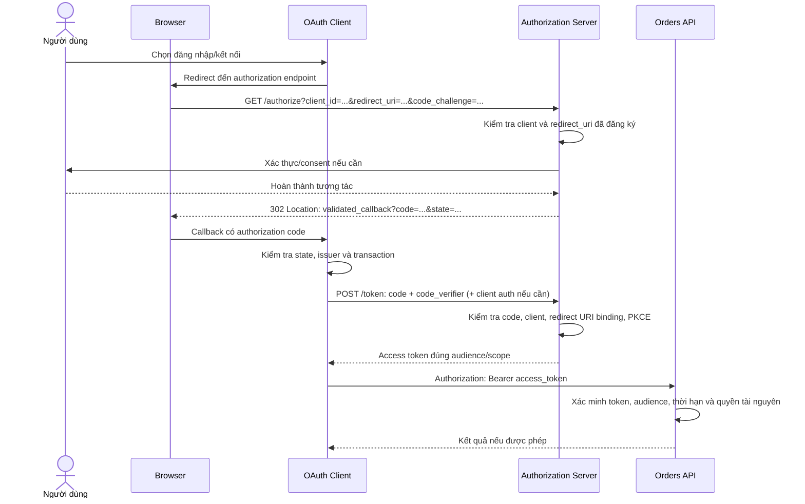
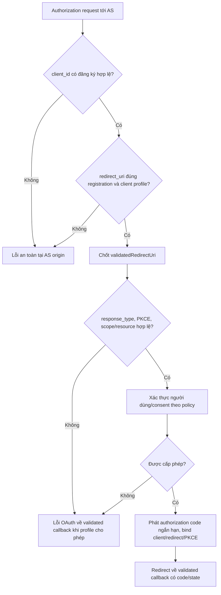

# Redirect URI validation

## 1. Tình huống mở đầu: một ký tự sai có thể khiến authorization code đi nhầm chỗ

Một ứng dụng web quản lý đơn hàng sử dụng **OAuth 2.0 Authorization Code + PKCE**. Authorization server (AS) đã đăng ký callback chính thức của ứng dụng:

```text
https://client.example.com/oauth/callback
```

Khi người dùng đăng nhập và chấp thuận quyền, AS gửi browser quay về callback kèm **authorization code** ngắn hạn. Nhưng nếu AS chỉ so sánh prefix, một kẻ tấn công có thể đề nghị:

```text
https://client.example.com.evil.invalid/oauth/callback
```

Chuỗi này **bắt đầu bằng** `https://client.example.com` nhưng host thực tế là `client.example.com.evil.invalid`, không phải `client.example.com`. Nếu AS không kiểm tra chính xác, authorization response có thể bị gửi tới nơi không được client cho phép.

Tương tự, so khớp thiếu chặt chẽ với path, port, scheme, query hoặc các dạng mã hóa URI có thể biến một callback hợp lệ thành **open redirect, authorization code leakage, login CSRF hoặc authorization response injection**. PKCE giúp giảm nguy cơ đổi một code bị chặn, nhưng **không cho phép bỏ qua kiểm tra redirect URI**.

> **Quy tắc trọng tâm:** Authorization server phải xác định **redirect URI đã được đăng ký và cho phép cho đúng OAuth client** trước khi gửi authorization response. Theo OAuth 2.0 Security Best Current Practice, nguyên tắc là **so khớp chuỗi chính xác (exact string matching)** với ngoại lệ được quy định cho **cổng của loopback redirect URI ở native apps**. Không tự nới thành “cùng domain”, “cùng prefix”, wildcard hoặc regex linh hoạt.

Bài thuộc chương **Authorization Code** trong module `SECURITY_TOKEN_SECURITY_FUNDAMENTALS`. Chủ đề liên hệ trực tiếp với authorization server, OAuth 2.0/OIDC, PKCE, JWT/opaque access token, scope, audience, vòng đời phát hành–xác minh–lưu trữ–thu hồi token và giảm nguy cơ credential bị đánh cắp hoặc phát lại.

## 2. Mục tiêu học tập

Sau bài này, bạn có thể:

1. Phân biệt **registered redirect URI**, **requested redirect URI**, **effective redirect URI**, callback endpoint và địa chỉ điều hướng nội bộ sau đăng nhập.
2. Giải thích vì sao **exact matching** an toàn hơn prefix/subdomain/wildcard matching, và khi nào native app có ngoại lệ về cổng loopback.
3. Kiểm tra cấu trúc URI: scheme, authority, host, port, path, query, fragment, userinfo, encoding.
4. Nêu quy tắc **không redirect lỗi tới URI chưa được xác minh**.
5. Giải thích cách AS ràng buộc authorization code với client, PKCE challenge và redirect URI, sau đó kiểm tra tại token endpoint.
6. Phân biệt kiểm tra redirect URI ở AS với kiểm tra `state`/issuer/nonce ở OAuth/OIDC client.
7. Nhận diện open redirect, callback CSRF, mix-up, URI parsing differential và các sai sót liên quan URL encoding.
8. Phác thảo bộ validator và ma trận kiểm thử production-like cho web, SPA, BFF và native apps.

## 3. Nhắc lại luồng Authorization Code và vị trí của redirect URI

Bốn vai trò OAuth 2.0 cơ bản:

| Vai trò | Trách nhiệm | Ví dụ |
| --- | --- | --- |
| **Resource owner** | Chủ thể có khả năng ủy quyền truy cập protected resource | Người dùng quản lý đơn hàng |
| **OAuth client** | Khởi tạo yêu cầu ủy quyền và đổi code lấy token | `orders-web` |
| **Authorization server (AS)** | Kiểm tra client, grant, redirect, PKCE, user/consent/policy; cấp code và token | `auth.example.com` |
| **Resource server (RS)** | Xác minh access token và quyền đối với API | Orders API |

**Redirect URI** là địa chỉ mà **AS chuyển user agent trở lại OAuth client** sau tương tác tại authorization endpoint. Nó không phải URI mà client gọi để nhận refresh token, cũng không phải audience của access token.



Trong sơ đồ:

- **Tại authorization endpoint**, AS kiểm tra **đích gửi kết quả** có thuộc danh sách của client hay không.
- **Tại callback**, client kiểm tra **kết quả thuộc đúng transaction và issuer**.
- **Tại token endpoint**, AS kiểm tra **code chỉ được đổi bởi đúng client và các ràng buộc của code**.
- **Tại resource server**, API kiểm tra **access token**, không dùng redirect URI để quyết định người dùng có quyền trên bản ghi.

Bốn kiểm tra này **không thay thế cho nhau**.

## 4. Ba loại URI dễ bị nhầm

### 4.1. Registered redirect URI

Là một URI do client đăng ký với AS bằng quy trình đáng tin cậy, ví dụ:

```text
client_id = orders-web

registered_redirect_uris = [
  "https://client.example.com/oauth/callback",
  "https://client.example.com/account/connect/callback"
]
```

AS lưu cấu hình này ở **trusted client registry**. Một client có thể đăng ký nhiều redirect URIs hợp lệ nếu chính sách cho phép; việc có nhiều URI **không có nghĩa** được phép dùng URI bất kỳ trong cùng origin.

### 4.2. Requested redirect URI

Là URI được client nêu trong authorization request:

```http
GET /authorize?response_type=code&client_id=orders-web&redirect_uri=https%3A%2F%2Fclient.example.com%2Foauth%2Fcallback&state=<random_state>&code_challenge=<challenge>&code_challenge_method=S256 HTTP/1.1
Host: auth.example.com
```

Sau khi HTTP query được parse đúng theo giao thức, giá trị `redirect_uri` là:

```text
https://client.example.com/oauth/callback
```

**Requested** không có nghĩa **trusted**: AS phải tra đăng ký của `orders-web` và đối chiếu.

### 4.3. Effective/validated redirect URI

Là URI mà AS **đã xác định hợp lệ** để gửi response. Đối với web client thông thường, URI này phải khớp chính xác với một registered redirect URI theo chính sách hiện đại.

### 4.4. Post-login return URL không phải OAuth redirect URI

Ví dụ sau khi callback hợp lệ xử lý xong, ứng dụng muốn đưa user tới:

```text
/orders/123
/dashboard
/settings
```

Các đường dẫn này là **điều hướng bên trong ứng dụng**, không phải các OAuth redirect URIs động. Đừng làm:

```text
redirect_uri=https://client.example.com/orders/123
redirect_uri=https://client.example.com/dashboard
redirect_uri=https://client.example.com/settings
```

chỉ để duy trì trang người dùng đang xem.

Giải pháp thường an toàn hơn:

1. Dùng **một callback ổn định** đã đăng ký.
2. Tạo `state` ngẫu nhiên gắn với authorization transaction.
3. Lưu **relative return path đã xác minh** theo state trong session store đáng tin.
4. Sau khi xử lý callback, state, token và phiên, điều hướng tới đường dẫn nội bộ đã được policy cho phép.

Nếu dùng `return_to`, `next` hoặc `continue`, không được chấp nhận external URL tùy ý; nếu không sẽ tạo open redirect ở chính ứng dụng.

## 5. Cấu trúc URI: hiểu đúng trước khi so khớp

Một URI HTTP(S) điển hình:

```text
https://client.example.com:443/oauth/callback?flow=connect#section
  |             |          |       |            |          |
scheme         host       port    path         query     fragment
```

Các phần liên quan:

| Thành phần | Ví dụ | Kiểm soát |
| --- | --- | --- |
| Scheme | `https` | Web redirect production thường yêu cầu HTTPS; không hạ cấp sang HTTP |
| Authority/host | `client.example.com` | Không dùng prefix/suffix hoặc subdomain wildcard không được phép |
| Port | `443` hoặc port đã đăng ký | Phân biệt cổng theo exact matching; ngoại lệ đặc thù native loopback |
| Path | `/oauth/callback` | Phải khớp path đã đăng ký, không chỉ host |
| Query | `?flow=connect` | Nếu đã là phần registered URI, cần bảo toàn đúng khi so khớp |
| Fragment | `#section` | Redirect endpoint URI dùng trong OAuth **không được chứa fragment** |
| Userinfo | `user@host` | Không nên có trong callback; tránh nhầm host và credential trong URL |

Trong HTTP request to AS, chuỗi `redirect_uri` thường được **percent-encode làm giá trị của tham số query/form**. AS cần parse lớp HTTP parameter đúng **một lần**, sau đó đối chiếu giá trị URI thu được với chuỗi đăng ký.

### 5.1. URI parameter encoding và nội dung URI là hai lớp khác nhau

Giả sử registered callback chứa query cố định:

```text
https://client.example.com/oauth/callback?flow=connect
```

Giá trị này khi đặt trong outer query của authorization endpoint thường thành:

```text
redirect_uri=https%3A%2F%2Fclient.example.com%2Foauth%2Fcallback%3Fflow%3Dconnect
```

AS parse **outer request parameter** thành đúng URI nội bộ trước khi so khớp. Không được giải mã lặp `%252F` thành `/` tùy tiện, hoặc áp dụng decode/normalize khác nhau giữa validation và khi tạo Location header.

**Cảnh báo:** “Exact string matching” không có nghĩa so nguyên **bytes đã percent-encode của outer authorization URL** với registered URI. Cần so sánh **giá trị tham số redirect URI sau khi được parse đúng một lần** theo HTTP/giao thức, không phải biến thể đã chuẩn hóa hoặc tự tái cấu trúc sau đó.

### 5.2. Không mặc định các URI tương đương

Ví dụ dưới đây có thể khác nhau trong cấu hình exact matching:

| URI A | URI B | Có nên mặc định xem là cùng đăng ký? |
| --- | --- | --- |
| `https://app.example/cb` | `https://app.example/cb/` | **Không** — path khác |
| `https://app.example/cb` | `https://app.example/CB` | **Không** — path khác chữ hoa/thường |
| `https://app.example/cb` | `https://app.example:443/cb` | **Không** — string khác, dù cổng mặc định có thể tương đương ở tầng URI |
| `https://app.example/cb` | `http://app.example/cb` | **Không** — scheme khác, hạ cấp TLS |
| `https://app.example/cb` | `https://app.example/cb?x=1` | **Không** — query khác |
| `https://app.example/a%2Fb` | `https://app.example/a/b` | **Không** — encoding/path khác |
| `https://app.example/cb` | `https://sub.app.example/cb` | **Không** — host khác |
| `https://app.example/cb` | `https://app.example.evil.invalid/cb` | **Không** — host khác |

Một URI có thể tương đương về **cách browser gửi request** nhưng không được xem là tương đương với **registered redirect URI** khi áp dụng chính sách exact matching. Phần lớn lỗi xảy ra do lập trình viên tự “thân thiện” bằng cách bỏ slash, chuẩn hóa case hoặc tự bỏ default port.

## 6. Nguyên tắc đăng ký và so khớp chính xác

### 6.1. Tiếp nhận redirect URI khi đăng ký client

Đối với web app/SPA/BFF, một chính sách an toàn thường:

1. Cho phép **URI tuyệt đối** và cú pháp hợp lệ.
2. Yêu cầu **HTTPS** đối với production web redirects.
3. Không cho fragment.
4. Không cho userinfo hoặc URI có host mơ hồ.
5. Không chấp nhận wildcard, regex, scheme tương đối hoặc URL thiếu host.
6. Kiểm tra **ownership/control** của redirect URI theo quy trình client registration phù hợp, đặc biệt với client bên thứ ba.
7. Đánh giá domain/host có nằm dưới quyền của chủ sở hữu client không và không phụ thuộc subdomain dễ bị takeover.
8. Giới hạn số URI, độ dài và quyền sửa registry; thay đổi callback phải là hoạt động quản trị có kiểm soát.
9. Tách rõ **web redirect**, **native loopback**, **private-use custom scheme** và **claimed HTTPS/app link**.
10. Kiểm tra các đặc tả/profiles mạnh hơn (OIDC/FAPI/ứng dụng tài chính) nếu áp dụng.

Lưu ý **đăng ký redirect URI** không tương đương cho phép toàn bộ origin. Nếu có endpoint open redirect trong domain được đăng ký, AS và client vẫn phải xem xét rủi ro.

### 6.2. So khớp tại authorization endpoint

Luồng tư duy:

```text
requestedClientId
  -> tìm client registration tin cậy
requestedRedirectUri
  -> parse đúng giao thức một lần
  -> kiểm tra cấu trúc/ràng buộc
  -> so khớp chính xác với URI đã đăng ký của chính client
  -> chốt validatedRedirectUri
  -> mới tiếp tục login/consent và gửi authorization response
```

**Không** dùng:

```javascript
// Sai: cùng prefix không có nghĩa cùng host hoặc cùng path.
redirectUri.startsWith("https://client.example.com");

// Sai: bất kỳ subdomain nào cũng được, kể cả subdomain bị takeover.
redirectUri.endsWith(".example.com");

// Sai: host đúng nhưng callback path bất kỳ.
new URL(redirectUri).hostname === "client.example.com";
```

**Nên** dùng exact string membership trên danh sách URI đã đăng ký, sau khi parse request đúng và kiểm tra loại redirect:

```text
if registeredRedirectUrisFor(clientId).contains(requestedRedirectUriValue):
    VALID
else:
    INVALID
```

Đây là quy tắc cho **web redirect thông thường**; xử lý **native loopback port** là một ngoại lệ được mô tả riêng ở phần sau.

### 6.3. Vì sao không dùng wildcard?

Một chính sách sai:

```text
allowed_redirect_uri = https://*.example.com/*
```

Có thể làm authorization response tới:

- Một subdomain do đối tác hoặc tenant khác kiểm soát.
- Một subdomain trỏ tới dịch vụ bên thứ ba qua CNAME.
- Một hostname cũ đã bị takeover.
- Một endpoint có open redirect hoặc khả năng tự chạy JavaScript.
- Một môi trường staging/development quản lý lỏng hơn production.

**TLS không tự chứng minh host thuộc đúng OAuth client.** Một domain giả/subdomain khác có thể có chứng chỉ HTTPS hợp lệ; vẫn không phải redirect URI được đăng ký.

## 7. Kiểm tra redirect URI **trước khi redirect cả lỗi**

Một quy tắc dễ bỏ sót: AS không chỉ phải bảo vệ **redirect thành công**, mà cả **đường trả lỗi**.

Giả sử attacker gửi:

```http
GET /authorize?response_type=code&client_id=orders-web&redirect_uri=https%3A%2F%2Fevil.invalid%2Fcollect&scope=orders%3Aread HTTP/1.1
Host: auth.example.com
```

Nếu AS phát hiện URI không thuộc registration, **không được trả**:

```http
HTTP/1.1 302 Found
Location: https://evil.invalid/collect?error=invalid_request
```

Dù không có code, redirect đến đích chưa tin cậy vẫn là **open redirect**. Nó còn có thể làm người dùng tin rằng AS đã cho phép chuyển tới website của attacker, và tương tác với các luồng login/consent khác.

### 7.1. Phản ứng đúng khi URI chưa được tin cậy

- Từ chối authorization request.
- Hiển thị thông báo lỗi **trên origin của AS** hoặc kênh an toàn do AS kiểm soát.
- Không phản chiếu URI chưa được xác minh vào `Location` header.
- Không phát authorization code, access token, ID token hoặc state/credential tới URI đó.
- Ghi audit metadata cần thiết, **không ghi raw credential/URL nhạy cảm**.

Nếu client ID không tồn tại hoặc registration không xác định, AS cũng **không thể** dựa vào redirect_uri do request đưa vào để báo lỗi.

### 7.2. Khi URI hợp lệ nhưng quyền bị từ chối

Nếu AS đã xác minh redirect URI hợp lệ, user có thể từ chối consent:

```http
HTTP/1.1 302 Found
Location: https://client.example.com/oauth/callback?error=access_denied&state=<original_state>
Cache-Control: no-store
```

Đây là **authorization error response** gửi về callback hợp lệ. Client vẫn phải xác minh `state` trước khi xử lý lỗi/đăng nhập. Các tham số phản hồi cần được mã hóa đúng để không tạo header injection hay query confusion.

### 7.3. HTTP status và hiển thị lỗi

OAuth có các error codes như `invalid_request`, `unauthorized_client`, `access_denied`, `invalid_scope`. Nhưng **không phải mọi lỗi đều được gửi qua redirect**. Tình huống redirect URI sai phải được xử lý tại AS mà không chuyển browser sang URI đó; mã HTTP/trang lỗi cụ thể phụ thuộc profile/triển khai.

Không hiển thị chi tiết registration của client khác hoặc lý do nội bộ có thể hỗ trợ enumeration. Một trang lỗi chung kèm request ID thường đủ cho người dùng; audit nội bộ có thể ghi lý do `redirect_uri_mismatch`.

## 8. Redirect URI phải gắn với đúng client

Nếu AS phục vụ nhiều clients:

```text
Client A: orders-web
  https://client.example.com/oauth/callback

Client B: partner-portal
  https://partner.example.org/oauth/callback
```

AS không được dùng **danh sách callback toàn hệ thống** rồi chỉ kiểm tra URI có trong bất kỳ client nào. Phải kiểm tra:

```text
(request.client_id, request.redirect_uri)
   thuộc đúng client registration và đúng flow
```

Nếu Client B có URI hợp lệ của nó, không có nghĩa Client A được chuyển response tới URI của B.

### 8.1. Client ID là định danh, không phải secret

Trong browser-based SPA, `client_id` thường xuất hiện trong URL và **không phải bí mật**. Việc biết `client_id` của client hợp lệ không tạo quyền gửi authorization code của client đó tới URI khác.

AS phải xác minh client registration cùng redirect URI; tại token endpoint, confidential client còn cần client authentication, public client cần PKCE và các ràng buộc khác theo policy.

### 8.2. Không lấy redirect từ Header do người dùng tự khai

Các anti-pattern:

```text
redirect = request.headers["Referer"]
redirect = request.headers["Origin"]
redirect = request.headers["Host"] + "/callback"
redirect = request.query["return_to"]
```

Các thông tin này **không thay thế registered redirect URI**. `Host`, `X-Forwarded-Host` hoặc `Forwarded` còn có thể bị giả mạo nếu không được proxy đáng tin kiểm soát.

Đối với AS nằm sau reverse proxy, URL public cần được cấu hình từ **issuer/endpoint tin cậy** chứ không dựng từ forwarded headers tùy tiện.

## 9. Ràng buộc redirect URI với authorization code và token endpoint

Validation tại authorization endpoint chưa đủ. Authorization code cần lưu/ngầm mã hóa các ràng buộc quan trọng:

- Code thuộc **client nào**.
- Callback URI nào đã được chọn và xác minh.
- Code challenge và method PKCE nào được sử dụng.
- Scope/resource và subject/grant nào được chấp thuận.
- Issuer/AS nào phát hành.
- Thời hạn, trạng thái **chưa dùng/đã dùng**, và các điều kiện bảo vệ khác.

Khi client đem code tới token endpoint, AS phải xác minh những ràng buộc đó.

### 9.1. Authorization request

```http
GET /authorize?response_type=code&client_id=orders-web&redirect_uri=https%3A%2F%2Fclient.example.com%2Foauth%2Fcallback&state=<state>&code_challenge=<challenge>&code_challenge_method=S256 HTTP/1.1
Host: auth.example.com
```

AS xác minh:

```text
client_id = orders-web
redirect_uri = https://client.example.com/oauth/callback
PKCE challenge = <challenge>
granted scopes = orders:read
```

và phát authorization code có các ràng buộc đó.

### 9.2. Token request

```http
POST /token HTTP/1.1
Host: auth.example.com
Content-Type: application/x-www-form-urlencoded

grant_type=authorization_code&client_id=orders-web&code=<authorization_code>&redirect_uri=https%3A%2F%2Fclient.example.com%2Foauth%2Fcallback&code_verifier=<verifier>
```

Theo RFC 6749, nếu `redirect_uri` đã có trong authorization request, `redirect_uri` ở token request cũng **phải có và phải giống hệt** giá trị đã dùng lúc cấp code. Các profiles hiện đại có thể đưa ra yêu cầu mạnh hơn, vì vậy client nên dùng URI nhất quán trong cả hai bước.

AS phải kiểm tra **code → client → redirect URI → PKCE verifier** theo các điều kiện của grant. Không chỉ dựa vào chuỗi URI token request mà bỏ thông tin đã gắn với code.

### 9.3. Vì sao cần kiểm tra lại?

Một code bị chặn hoặc bị chuyển nhầm không được trở thành “code có thể dùng ở bất kỳ callback/client nào”. Các ràng buộc giảm khả năng:

- Đổi code cấp cho client A bằng client B.
- Dùng code trên luồng có URI khác.
- Tiêm code của transaction khác vào callback.
- Đổi code khi không có PKCE verifier được ràng buộc.
- Dùng lại code đã consumed.

**PKCE không thay thế redirect matching.** PKCE giúp người chỉ lấy được code không dễ đổi code nếu không có verifier, nhưng AS vẫn phải bảo vệ đích redirect và binding của code. Một thiết kế bỏ redirect matching vì “đã có PKCE” là sai ranh giới bảo mật.

### 9.4. Trường hợp client không gửi redirect_uri

RFC 6749 cho phép một số trường hợp không nêu `redirect_uri` khi có lựa chọn URI đã đăng ký rõ, nhưng yêu cầu cụ thể phụ thuộc AS/profile. Không tự chọn **URI đầu tiên trong danh sách** nếu client đăng ký nhiều callback mà không có quy tắc xác định đích rõ.

Một chính sách đơn giản, dễ kiểm toán cho web clients là **yêu cầu client gửi redirect_uri chính xác trong authorization request** và dùng lại chính giá trị đó tại token endpoint. Nếu profile cho phép bỏ, AS phải xác định URI đã đăng ký hợp lệ và bảo vệ binding tương ứng.

## 10. PKCE, state, nonce và issuer: lớp bảo vệ bổ sung

### 10.1. PKCE bảo vệ code exchange

Với Authorization Code + PKCE (RFC 7636):

```text
code_verifier = chuỗi ngẫu nhiên do client tạo
code_challenge = BASE64URL(SHA256(ASCII(code_verifier))) không padding

/authorize nhận code_challenge và method=S256
/token nhận authorization_code + code_verifier
AS tính lại và so khớp trước khi cấp token
```

PKCE giảm rủi ro authorization code interception. Nhưng nếu AS gửi authorization response sang URI ngoài đăng ký, **đường giao tiếp của OAuth vẫn đã bị phá vỡ**. Không dùng PKCE để hợp thức hóa wildcard hoặc prefix redirect URI.

### 10.2. State bảo vệ callback transaction

OAuth client nên sinh `state` khó đoán, lưu gắn browser/session/authorization transaction và so khớp khi callback. Nếu response có `state` không khớp, client phải từ chối, không tiếp tục đổi code hoặc tạo phiên.

`state` giúp chống **callback CSRF, login CSRF, authorization response injection**. Tuy nhiên, state **không chứng minh redirect URI đã được AS kiểm tra đúng**. Cần cả hai.

### 10.3. Nonce trong OIDC

OIDC có `nonce` để ràng buộc ID token với yêu cầu xác thực khi profile sử dụng/yêu cầu. OIDC client xác minh `nonce` sau khi đã xác minh ID token.

**Không** đánh đồng:

- Redirect URI: **nơi** AS gửi authorization response.
- State: transaction **nào** của client nhận response.
- PKCE: **ai có verifier** để đổi authorization code.
- Issuer: **AS nào** phát hành kết quả.
- Nonce: kết quả ID token thuộc **authentication request nào**.

### 10.4. Issuer chống AS mix-up

Client hỗ trợ nhiều authorization servers phải ràng buộc transaction với **issuer được lựa chọn trước khi redirect**, có thể kiểm tra issuer trong authorization response theo RFC 9207 khi AS hỗ trợ.

Không lấy `token_endpoint` từ URI callback/issuer do người dùng tự truyền mà không so với metadata đã tin cậy. Một redirect URI đúng của client **không tự ngăn mọi AS mix-up**.

## 11. Những kiểu sai lệch URI có thể làm validator thất bại

### 11.1. Host prefix/suffix

```text
Được đăng ký:
  https://client.example.com/callback

Không được chấp nhận:
  https://client.example.com.evil.invalid/callback
  https://evil-client.example.com/callback
  https://client-example.com/callback
```

So sánh prefix trên chuỗi là lỗi điển hình. Host parser chuẩn có thể giúp nhận diện cấu trúc nhưng **không thay thế exact membership**.

### 11.2. Userinfo và ký tự `@`

```text
https://client.example.com@evil.invalid/callback
```

Một người đọc qua loa có thể thấy `client.example.com`, nhưng trong URI, phần trước `@` thuộc **userinfo**, còn host thực là `evil.invalid`.

Registered redirect URIs nên không có userinfo và cần được kiểm soát chặt. Tuy nhiên **đừng chỉ cấm `@`** để tự bảo vệ: có nhiều biến thể encoding/parse khác. Hãy dùng parser tin cậy **và** exact matching.

### 11.3. Path prefix và traversal

```text
Đăng ký:
  https://client.example.com/callback

Không được chấp nhận:
  https://client.example.com/callback/next
  https://client.example.com/callback.evil
  https://client.example.com/callback/../redirect
  https://client.example.com/%63allback
```

Một số server/framework có thể chuẩn hóa path, decode percent-encoding hoặc xử lý dot segments khác nhau. Validation và redirect response không được dùng **hai cách diễn giải URI khác nhau**.

### 11.4. Scheme và downgrade

```text
Được đăng ký:
  https://client.example.com/callback

Không tự chấp nhận:
  http://client.example.com/callback
```

Đổi HTTPS sang HTTP có thể làm code/state bị quan sát hoặc sửa trên mạng và phá vỡ ranh giới TLS. Một số **native loopback redirects** được phép dùng HTTP vì giao tiếp qua loopback, nhưng **đó không phải ngoại lệ chung cho web clients**.

### 11.5. Port và default port

```text
https://client.example.com/callback
https://client.example.com:443/callback
https://client.example.com:8443/callback
```

Dù cổng 443 có thể là mặc định của HTTPS ở tầng network, **chuỗi đăng ký vẫn khác** khi áp dụng exact matching. Không bỏ/đổi port để “giúp người dùng” nếu không có profile quy định.

### 11.6. Query string và thứ tự tham số

```text
https://client.example.com/callback?a=1&b=2
https://client.example.com/callback?b=2&a=1
```

Ứng dụng có thể xử lý cùng hai tham số nhưng **đó là hai chuỗi URI khác nhau**. Đừng tự sắp xếp query hay xóa tham số thừa để cố khớp registration.

Nếu registered URI đã có query:

```text
https://client.example.com/callback?flow=connect
```

authorization server phải thêm response parameters như `code` và `state` bằng cách tạo URL hợp lệ, bảo toàn query ban đầu và không ghi đè/nhân đôi tham số làm sai callback. **Chỉ đăng ký URI không chứa query nếu ứng dụng không thật sự cần** là lựa chọn đơn giản hơn.

### 11.7. Fragment

```text
https://client.example.com/callback#access_token=...
```

Registered redirect endpoint URI **không được có fragment**. Mặc dù các OAuth response modes có thể dùng fragment trong **authorization response** của một số flow legacy, đó **không** là lý do đăng ký callback URI vốn đã chứa fragment.

Trong Authorization Code flow hiện đại, client thường nhận `code` qua query hoặc một response mode được hỗ trợ khác, không phát access token trực tiếp qua fragment như implicit legacy.

### 11.8. Unicode và IDNA

Tên miền Unicode có thể có biểu diễn IDNA/Punycode; các chuỗi Unicode cũng có thể có những dạng chuẩn hóa khác nhau. Nếu một thành phần so khớp chuỗi chưa xử lý IDNA, còn browser phân giải host theo cách khác, có thể tạo **parser differential**.

Thiết kế an toàn:

- Đặt chính sách registration rõ ràng, ưu tiên host dạng ASCII/canonical được kiểm soát.
- Xác minh ownership của host khi đăng ký.
- **Lưu dạng được chọn nhất quán** ở registry; không tự chuẩn hóa requested URI thành một chuỗi khác ngay trước so khớp.
- Kiểm thử Unicode, punycode, case, encoded dot và các edge cases theo parser/ngăn xếp thực tế.
- Không so chữ trực quan giống nhau như bằng chứng hai hostname cùng nguồn gốc.

### 11.9. Double decoding và percent encoding

Ví dụ:

```text
/callback
/%63allback
/%2563allback
```

Có thể dẫn đến cùng đường dẫn sau một số bước decode khác nhau, nhưng không được **tự giải mã nhiều lần rồi coi tương đương**. Outer query decoding và URI component decoding là hai tầng riêng.

Một anti-pattern nguy hiểm:

```text
validRedirect = normalize(decode(decode(requestedUri)))
sendLocation  = requestedUri
```

AS validate một URI đã biến đổi nhưng redirect theo chuỗi ban đầu, tạo lệch ngữ nghĩa. Exact matching trên giá trị đã parse đúng, cùng một biến `validatedRedirectUri` dùng cho response, giúp hạn chế loại lỗi này.

## 12. Native applications: ngoại lệ loopback port có điều kiện

Không phải mọi client đều là web application. **Native apps** dùng system browser/external user-agent với những loại redirect URI khác nhau theo RFC 8252.

### 12.1. Loopback interface redirect

Native app có thể mở một HTTP listener cục bộ trên loopback interface để nhận callback:

```text
http://127.0.0.1:51723/oauth/callback
http://[::1]:51723/oauth/callback
```

**Port** có thể do hệ điều hành cấp động mỗi lần ứng dụng chạy. Vì vậy, **RFC 8252 cho phép AS chấp nhận các cổng được yêu cầu khác nhau cho loopback IP redirect URI của native app**; OAuth Security BCP xem đây là **ngoại lệ cụ thể** đối với exact matching.

Ví dụ policy:

```text
Registered/native loopback callback:
  http://127.0.0.1/oauth/callback

Requested redirect:
  http://127.0.0.1:51723/oauth/callback

Chấp nhận theo profile native-loopback nếu:
  - client được đăng ký là native app với loopback redirect;
  - scheme/loopback IP và path/query phù hợp registration;
  - chỉ PORT là thành phần được phép biến đổi;
  - các kiểm tra còn lại, PKCE và client/grant, đều hợp lệ.
```

Không biến ngoại lệ này thành “native app có thể chọn host bất kỳ”. Không chấp nhận:

```text
http://evil.invalid:51723/oauth/callback
http://192.168.1.10:51723/oauth/callback
http://localhost.attacker.invalid:51723/oauth/callback
```

chỉ vì chúng có port tương tự.

### 12.2. Loopback literal IP và `localhost`

RFC 8252 hướng dẫn ưu tiên **loopback IP literal** như `127.0.0.1` hoặc `[::1]` hơn tên `localhost` vì việc phân giải `localhost` có thể không giống nhau trên mọi môi trường. Tùy AS/profile, `localhost` có thể được cấu hình riêng, nhưng **không nên suy ra ngoại lệ cho mọi hostname chứa chữ localhost**.

Native app nên:

1. Chọn một port còn trống trên loopback thật sự.
2. Mở listener trước khi điều hướng tới AS.
3. Gửi redirect URI với port đã chọn.
4. Chỉ nhận callback trên interface loopback, bảo vệ transaction.
5. Kiểm tra `state`, PKCE, issuer và code.
6. Đóng listener khi xong hoặc hết thời hạn.

**Cổng động không phải bí mật bảo mật**. PKCE và transaction validation vẫn cần thiết để bảo vệ việc code bị chặn hoặc callback bị tiêm.

### 12.3. Private-use URI scheme

Một native app có thể đăng ký scheme riêng:

```text
com.example.orders:/oauth2redirect
```

Cần kiểm tra chính xác theo profile/registration và quy định nền tảng. Private-use URI schemes có rủi ro **ứng dụng khác đăng ký cùng scheme hoặc chặn callback** tùy hệ điều hành; PKCE là biện pháp quan trọng nhưng không bảo đảm tuyệt đối nếu thiết bị bị xâm nhập.

Không tự cấp wildcard:

```text
com.example.orders:*
```

hoặc chấp nhận một private-use scheme bất kỳ chỉ vì client tự khai tên scheme có vẻ thuộc doanh nghiệp.

### 12.4. Claimed HTTPS/App Links/Universal Links

Một số native apps sử dụng HTTPS URI được hệ điều hành liên kết với ứng dụng thông qua cơ chế chứng minh sở hữu domain:

```text
https://app.example.com/oauth/callback
```

AS vẫn phải kiểm tra URI đã đăng ký và client. Hệ điều hành phải được cấu hình xác minh domain/app association tương ứng. Đừng coi **claimed HTTPS** như một cách cho phép bất kỳ HTTPS callback mà client yêu cầu.

### 12.5. Bảng quy tắc theo loại client

| Client | Callback điển hình | Kiểm tra chính | Ngoại lệ |
| --- | --- | --- | --- |
| Web app confidential/BFF | `https://client.example.com/callback` | Exact registered URI, HTTPS, code/PKCE | Không tự nới |
| SPA public | `https://spa.example.com/callback` | Exact URI, state, PKCE S256 | Không tự nới |
| Native loopback IPv4 | `http://127.0.0.1:port/callback` | IP literal + path/query theo registration, PKCE | **Port động** theo RFC 8252 |
| Native loopback IPv6 | `http://[::1]:port/callback` | IP literal + path/query, PKCE | **Port động** theo RFC 8252 |
| Native private scheme | `com.example.app:/callback` | Scheme/URI đã đăng ký, external user-agent, PKCE | Không mặc định wildcard |
| Native claimed HTTPS | `https://app.example.com/callback` | Exact URI + OS domain association | Không tự chấp nhận host khác |

**Không áp dụng ngoại lệ cổng native-loopback cho web `https://client.example.com:port/...`**, ngay cả khi client muốn chạy nhiều dev servers. Dev/test callbacks nên được đăng ký rõ và tách client/environment.

## 13. Web SPA, BFF và OIDC: callback có những khác biệt nào?

### 13.1. SPA public client

Trong SPA chạy hoàn toàn trong browser:

- Client là **public client**; không dùng secret nhúng JavaScript như credential tin cậy.
- Sử dụng **Authorization Code + PKCE S256**.
- Redirect URI HTTPS đúng origin/path đã đăng ký.
- Client kiểm tra state và issuer khi callback.
- Token request từ browser có thể cần AS hỗ trợ CORS, nhưng **CORS không xác thực client**.
- Access/refresh tokens phải được bảo vệ theo threat model XSS, storage và rotation/sender-constraining nếu có RT.

AS không được chấp nhận `redirect_uri` động chỉ vì SPA muốn triển khai tại nhiều subdomains. Nên đăng ký từng URI được kiểm soát và quản lý client registration theo môi trường.

### 13.2. Backend-for-Frontend

BFF có thể giữ OAuth tokens server-side. Browser nhận **session cookie** do BFF kiểm soát, không trực tiếp nhận refresh token OAuth.

Luồng:

```text
Browser -> BFF (bắt đầu login)
BFF -> browser redirect -> AS /authorize
AS -> browser -> BFF callback với code + state
BFF verify state/issuer -> AS /token (code + PKCE/client auth)
AS -> BFF access token, refresh token nếu được cấp
BFF giữ OAuth credential server-side
Browser -> BFF bằng HttpOnly Secure session cookie
```

BFF callback cũng phải có URI đã đăng ký, đúng scheme/host/path. Backend không được dựng `redirect_uri` từ header `X-Forwarded-Host` do caller tự đặt rồi tin rằng nó hợp lệ.

**CSP, CSRF, HttpOnly, Secure, SameSite và session fixation protection** vẫn quan trọng vì BFF bảo vệ một lớp nhưng không ngăn hoàn toàn hành động XSS bằng phiên hợp lệ.

### 13.3. OIDC client

Trong OpenID Connect, client có thể nhận **ID token** ở token endpoint sau Authorization Code flow. ID token thường có `aud` chứa OAuth client ID, và có các quy tắc `iss`, `sub`, `exp`, `nonce`/`auth_time` tùy flow.

**Redirect URI vẫn là URI callback của client**, không phải audience của Orders API. Đừng nhầm:

```text
OIDC ID token audience -> client ID
OAuth access token audience -> resource server/API
OAuth redirect URI -> nơi client nhận authorization response
```

OIDC có yêu cầu đăng ký/kiểm tra redirect URI theo OIDC Core. Một profile an toàn cần áp dụng đúng quy định OIDC, thường với exact matching, và không tự nới wildcard. OIDC implicit/hybrid có response modes khác nhưng **không làm URI chưa đăng ký trở thành hợp lệ**.

### 13.4. Multiple authorization servers

Nếu ứng dụng hỗ trợ Google/enterprise IdP/AS khác nhau theo hợp đồng:

- Mỗi issuer có metadata và authorization/token endpoints tin cậy.
- Callback transaction phải ghi **issuer đã chọn**.
- Kiểm tra `state` và issuer authorization response (ví dụ RFC 9207 khi hỗ trợ).
- Không lấy issuer/token endpoint từ query `?issuer=...` do caller điều khiển mà không ràng buộc.
- Có thể dùng **redirect URI riêng cho từng AS** theo thiết kế để giảm mix-up.
- Tất cả callback URI phải nằm trong registration của đúng client tương ứng tại mỗi AS.

Một URI callback hợp lệ không tự ngăn AS mix-up nếu client đổi nhầm code tại token endpoint của issuer khác.

## 14. URL builder, encoding và phân tích query an toàn

### 14.1. Đừng nối chuỗi URL tùy tiện

Một ví dụ nguy hiểm:

```javascript
const url = "/authorize?client_id=" + clientId
  + "&redirect_uri=" + redirectUri
  + "&state=" + state;
```

Nếu giá trị chứa `&`, `?`, `#` hoặc phần trăm chưa encode, request có thể bị parse sai. Điều này ảnh hưởng đến việc AS chọn redirect_uri nào và có thể gây **parameter pollution**.

Ví dụ cách build ở browser:

```javascript
// Ví dụ tạo authorization URL; chưa gồm transaction store và OAuth client đầy đủ.
const authorizationUrl = new URL("https://auth.example.com/authorize");

authorizationUrl.searchParams.set("response_type", "code");
authorizationUrl.searchParams.set("client_id", "orders-spa");
authorizationUrl.searchParams.set(
  "redirect_uri",
  "https://client.example.com/oauth/callback"
);
authorizationUrl.searchParams.set("scope", "orders:read");
authorizationUrl.searchParams.set("state", stateFromSecureTransaction);
authorizationUrl.searchParams.set("code_challenge", pkceChallenge);
authorizationUrl.searchParams.set("code_challenge_method", "S256");

// Dùng URL đã encode đúng để điều hướng browser.
// Không log toàn bộ URL nếu chứa state/transaction data nhạy cảm.
```

**Giới hạn ví dụ:** `stateFromSecureTransaction` và `pkceChallenge` phải được sinh/ghi hợp lệ trước đó. Client phải lấy authorization endpoint từ issuer/configuration đáng tin, không phải URL do request tùy ý cung cấp.

### 14.2. Duplicate redirect_uri parameters

Một request có hai giá trị:

```text
redirect_uri=https%3A%2F%2Fclient.example.com%2Fcallback
&redirect_uri=https%3A%2F%2Fevil.invalid%2Fcollect
```

có thể được parse khác nhau bởi proxy/framework: lấy first, last, nối chuỗi hay array. Nếu AS validate giá trị thứ nhất nhưng dùng giá trị thứ hai để dựng Location, code có thể đi nhầm đích.

Chính sách an toàn thường là **từ chối request có `redirect_uri` lặp hoặc ambiguous**, thay vì tự chọn tùy tiện. Với PAR/JAR, cũng phải ngăn xung đột giá trị bên trong request object và tham số bên ngoài theo profile.

### 14.3. HTTP parameter parsing một lần

Xử lý đúng:

```text
Outer authorization request encoded:
  redirect_uri=https%3A%2F%2Fclient.example.com%2Fcallback

Framework parse query parameter:
  "https://client.example.com/callback"

AS compare EXACT với trusted registry:
  "https://client.example.com/callback"

AS use chính validated URI đó làm Location base.
```

Xử lý sai:

```text
AS parse query
  -> decode lần hai
  -> remove slash hoặc lowercase path
  -> compare với allowed URI
  -> redirect bằng giá trị gốc chưa chuẩn hóa
```

Cần kiểm thử trên chính **URI/parser của runtime** (Java Servlet, reverse proxy, HTTP library). Dùng một canonicalization policy lúc đăng ký nếu cần, nhưng không biến exact comparison tại runtime thành phép đoán tương đương.

## 15. Ví dụ Java: exact redirect URI validator cho web clients

Đoạn dưới minh họa **chỉ thành phần kiểm tra callback HTTPS của web clients**. Nó **không** xử lý native loopback exception và **không** phải OAuth AS hoàn chỉnh.

```java
import java.net.URI;
import java.net.URISyntaxException;
import java.util.Map;
import java.util.Set;

public final class WebRedirectUriValidator {

    private final Map<String, Set<String>> redirectUrisByClient;

    public WebRedirectUriValidator(
            Map<String, Set<String>> trustedRegistrations) {
        this.redirectUrisByClient = Map.copyOf(trustedRegistrations);
    }

    /**
     * requestedRedirectUri là giá trị tham số HTTP đã được framework
     * parse chính xác một lần; KHÔNG phải chuỗi outer query đã encode.
     */
    public boolean isAllowed(String clientId, String requestedRedirectUri) {
        if (clientId == null || requestedRedirectUri == null) {
            return false;
        }

        Set<String> registered = redirectUrisByClient.get(clientId);
        if (registered == null || !registered.contains(requestedRedirectUri)) {
            return false;
        }

        try {
            URI uri = new URI(requestedRedirectUri);

            // Giới hạn minh họa cho HTTPS callback của web clients.
            if (!uri.isAbsolute()
                    || !"https".equals(uri.getScheme())
                    || uri.getHost() == null
                    || uri.getRawAuthority() == null
                    || uri.getRawUserInfo() != null
                    || uri.getRawFragment() != null) {
                return false;
            }

            return true;
        } catch (URISyntaxException ex) {
            return false;
        }
    }
}
```

Cách dùng thử với registry đáng tin:

```java
import java.util.Map;
import java.util.Set;

var validator = new WebRedirectUriValidator(Map.of(
    "orders-web", Set.of(
        "https://client.example.com/oauth/callback",
        "https://client.example.com/account/connect/callback"
    )
));

boolean valid = validator.isAllowed(
    "orders-web",
    "https://client.example.com/oauth/callback"
); // true

boolean invalidHost = validator.isAllowed(
    "orders-web",
    "https://client.example.com.evil.invalid/oauth/callback"
); // false

boolean invalidSlash = validator.isAllowed(
    "orders-web",
    "https://client.example.com/oauth/callback/"
); // false
```

**Đây là hai đoạn ví dụ độc lập:** đoạn sử dụng `var` minh họa trong một phương thức Java phù hợp; không phải mã Java có thể đặt trực tiếp ở top level của file. Khi triển khai thực tế, cần đặt trong class/test/method.

### 15.1. Các giới hạn quan trọng của validator minh họa

- Registry trong ví dụ là `Map` tĩnh; production phải lấy từ **trusted client registry** có đăng ký/quản trị/validation đầu vào an toàn.
- `Map.copyOf` không biến Set lồng bên trong thành immutable deep copy nếu caller tiếp tục thay đổi mutable sets. Ở production, sao chép hoặc bảo đảm dữ liệu registry immutable.
- Nó **không** hỗ trợ native loopback, claimed HTTPS app links, private-use schemes; mỗi loại phải có **profile riêng**.
- Nó chưa giới hạn tổng số/độ dài tham số HTTP, duplicate keys, Unicode/IDNA policy, registration ownership, TLS downgrade ở proxy hoặc logging.
- Nó không phát code, không xác thực user/client, không kiểm tra `state`/PKCE, không xử lý OAuth error response, không ký JWT.
- Nó không quản lý trường hợp `redirect_uri` vắng mặt khi spec/profile cho phép, không bảo đảm callback thực tế không open redirect.
- Việc kiểm tra cấu trúc **sau** exact membership là phòng vệ bổ sung; các URI được đăng ký cũng phải được kiểm tra tại thời điểm registration.
- Cấu hình HTTPS-only là chính sách **web production**, không áp đặt nguyên xi cho mọi native app.

**Không dùng các hàm `URI.normalize()`, `toLowerCase()`, `URLDecoder.decode()` lần hai hoặc tự loại cổng 443 trước khi `contains`.** Những thao tác đó làm biến đổi ngữ nghĩa exact comparison.

### 15.2. Bài toán native loopback nên dùng validator khác

Pseudo-code riêng:

```text
function validateNativeLoopback(clientRegistration, requestedUri):
    require clientRegistration.type == NATIVE
    require clientRegistration.loopbackRedirectAllowed

    u = parseUriStrictly(requestedUri)
    require scheme == "http"
    require host literal == registered loopback IP (127.0.0.1 hoặc [::1])
    require valid requested TCP port
    require no userinfo and no fragment
    require path, query và thành phần còn lại match registration
    # Chỉ PORT là biến được chấp nhận theo RFC 8252.
    require registration đúng client
    return validatedUri
```

**Không** dùng `uri.getHost().endsWith("localhost")` hoặc bỏ qua toàn bộ authority. Cần kiểm tra riêng IPv4/IPv6 literal, chuẩn hóa cú pháp IP theo chính sách, loại bỏ địa chỉ ngoài loopback, và không để username/host encoding gây khác biệt.

## 16. Trình tự xử lý authorization endpoint tại AS

Một AS an toàn nên kiểm tra redirect rất sớm, trước khi phát authorization response hoặc tạo phiên ủy quyền có thể gửi về một URI chưa tin cậy.



### 16.1. Pseudo-code phía AS

```text
function handleAuthorizationRequest(httpRequest):
    parsed = parseAndLimitHttpAuthorizationRequest(httpRequest)
    if parsed.hasDuplicateOrAmbiguousRedirectUri:
        return safeLocalErrorPage()

    client = trustedClientRegistry.find(parsed.clientId)
    if client missing:
        return safeLocalErrorPage()

    effectiveRedirect = validateAndResolveRegisteredRedirect(
        client = client,
        requested = parsed.redirectUri,
        clientProfile = client.type
    )

    if effectiveRedirect invalid:
        return safeLocalErrorPage()  # KHÔNG redirect theo requested URI

    if not allowedResponseType(client, parsed.responseType):
        return oauthErrorTo(effectiveRedirect, "unauthorized_client")

    if not validPkceAndOtherRequestParameters(parsed, client):
        return oauthErrorTo(effectiveRedirect, "invalid_request")

    approved = authenticateAndAuthorizeUserIfNeeded(
        client, parsed.scope, parsed.resource, consentPolicy()
    )

    if not approved:
        return oauthErrorTo(effectiveRedirect, "access_denied")

    code = issueShortLivedSingleUseCode(
        clientId = client.id,
        boundRedirectUri = effectiveRedirect,
        pkceChallenge = parsed.codeChallenge,
        pkceMethod = parsed.codeChallengeMethod,
        subject = approved.subject,
        grantedScopes = approved.scopes,
        approvedResource = approved.resource,
        issuer = trustedIssuer
    )

    return buildOAuthRedirectResponse(
        validatedRedirect = effectiveRedirect,
        code = code,
        state = parsed.state
    )
```

Đây là **pseudocode giảng dạy**, không đủ để đưa trực tiếp vào production. Cần xử lý chuẩn lỗi OAuth/OIDC, session CSRF, consent, login, risk/MFA, PAR/JAR, audit, expiry/replay, HTTP response modes, atomicity và cấu hình nhiều issuer.

**Không truyền `parsed.redirectUri` trực tiếp vào hàm dựng Location sau khi đã xác minh một biến khác.** Sử dụng đúng `effectiveRedirect` đã kiểm tra để tránh validation-to-use mismatch.

### 16.2. Token endpoint phải tiếp tục xác minh

```text
function redeemAuthorizationCode(tokenRequest):
    client = authenticateOrValidateClient(tokenRequest)
    codeRecord = loadSingleUseCode(tokenRequest.code)

    reject if code missing, expired or consumed
    reject if codeRecord.clientId != client.id
    reject if redirect_uri does not satisfy codeRecord.boundRedirect rules
    reject if codeRecord.pkceChallenge does not match verifier
    reject if grant/client/policy no longer permits issuance as applicable

    mark code consumed atomically
    issue least-privilege access token with correct audience and scopes
```

Mỗi bước giải quyết một ranh giới riêng. Đừng bỏ check client binding vì redirect đã hợp lệ, hoặc bỏ PKCE vì client có HTTPS callback.

## 17. PAR và JAR: URI vẫn phải được xác minh

**Pushed Authorization Requests (PAR, RFC 9126)** cho phép client gửi authorization request tới AS qua PAR endpoint rồi dùng `request_uri` ngắn hạn khi chuyển browser tới authorization endpoint.

**JWT-Secured Authorization Request (JAR, RFC 9101)** có thể bảo vệ yêu cầu bằng request object dạng JWT đã ký theo profile.

Cả hai có thể cải thiện integrity/độ ngắn của front-channel request, nhưng:

1. AS vẫn phải xác minh **client registration và redirect URI** trong nội dung đã được đẩy/ký.
2. `request_uri` của PAR không phải OAuth redirect URI và không phải access token.
3. Không cho `redirect_uri` bên ngoài request object/đường front channel **ghi đè** giá trị đã xác minh bên trong theo cách trái profile.
4. Token endpoint vẫn phải xác minh code/PKCE/client/redirect binding.
5. Client callback vẫn phải kiểm tra state/issuer và quyền trên token.
6. PAR/JAR có thể cần giới hạn thời gian, chống replay, audience/issuer cho request object và bảo vệ endpoint riêng.

### 17.1. Ví dụ PAR

```text
Client -> AS /par:
  response_type=code
  client_id=orders-web
  redirect_uri=https://client.example.com/oauth/callback
  scope=orders:read
  code_challenge=...
  state=...

AS -> Client:
  request_uri=urn:ietf:params:oauth:request_uri:<opaque_reference>

Client -> Browser -> AS /authorize:
  client_id=orders-web
  request_uri=<opaque_reference>
```

AS phải biết request URI này thuộc client và yêu cầu nào, có hợp lệ/chưa hết hạn không. Việc URI tham chiếu đã được AS cấp **không làm callback được phép động bất kỳ**.

### 17.2. JAR và tham số mâu thuẫn

Nếu request object ký có:

```json
{
  "client_id": "orders-web",
  "redirect_uri": "https://client.example.com/oauth/callback",
  "response_type": "code"
}
```

nhưng tham số ngoài request object có `redirect_uri=https://evil.invalid/collect`, AS phải xử lý **theo quy tắc JAR/profile** và không tự chọn giá trị có quyền rộng hơn. Phương pháp vững chắc là không cho dữ liệu chưa được bảo vệ ghi đè các trường đã xác minh trong request object.

## 18. Open redirect ở client: AS exact matching vẫn chưa đủ

Giả sử AS chỉ cho redirect tới callback đã đăng ký:

```text
https://client.example.com/oauth/callback
```

Nhưng callback của ứng dụng lại hỗ trợ:

```text
/callback?next=https://evil.invalid/
```

và sau khi nhận code, ứng dụng redirect browser tiếp tới `next` mà **giữ nguyên query/code** hoặc dùng logic sao chép URL. Đây có thể là một đường lộ authorization code hoặc session state.

### 18.1. Một số lỗi callback cụ thể

- Coi `next`/`returnUrl` là external URL bất kỳ.
- Phản chiếu toàn bộ `window.location.href` vào analytics.
- Chuyển nguyên query `?code=...&state=...` sang route hoặc domain khác.
- Tạo session trước khi kiểm tra `state`/issuer và PKCE transaction.
- Để callback có XSS đọc/chiếm code, verifier hoặc token trong browser context.
- Ghi authorization code vào access logs của proxy/ứng dụng và giữ retention dài.
- Dùng client-side router làm thay đổi/canonicalize path trước khi code xử lý.
- Cho phép redirect nội bộ tới path do người dùng kiểm soát mà sau đó trở thành external redirect.

### 18.2. Thiết kế callback giảm rủi ro

1. Callback có URI cụ thể và được đăng ký chính xác.
2. Kiểm tra state và transaction trên **đúng session**.
3. Kiểm tra issuer theo profile khi cần.
4. Đổi code bằng PKCE tại đúng token endpoint.
5. Không log code, verifier, access token hoặc full callback URL.
6. Xóa/giảm khả năng code nằm trong browser history sau khi xử lý an toàn (ví dụ điều hướng sạch hoặc History API theo kiến trúc).
7. Chỉ điều hướng tới **relative path đã được validate** sau khi hoàn tất đăng nhập.
8. Thiết lập CSP, Referrer-Policy, output encoding và CSRF/session controls phù hợp.

**OAuth redirect_uri validation tại AS** và **open redirect prevention tại client** phải đi cùng nhau. Một lớp không chứng minh lớp còn lại an toàn.

## 19. BFF/gateway sau reverse proxy: Host header là bẫy

Một lỗi thực tế trong ứng dụng đặt sau ingress:

```text
public URL: https://app.example.com/oauth/callback

backend receives:
  Host: internal-service:8080
  X-Forwarded-Host: app.example.com
  X-Forwarded-Proto: https
```

Nếu ứng dụng dựng redirect URI từ `request.getHeader("Host")` hoặc `X-Forwarded-Host` mà không có trust boundary, caller có thể thao túng host/protocol được dùng tạo authorization request.

Hậu quả:

- AS từ chối `redirect_uri_mismatch` không ổn định.
- Callback bị tạo với host giả/môi trường sai.
- Có khả năng kết hợp với open redirect, cache poisoning hoặc login confusion.

**Khuyến nghị:** OAuth client nên cấu hình redirect URI **cố định theo môi trường** từ trusted deployment config, không dựng từ header do request Internet trực tiếp kiểm soát. Nếu cần forwarded headers, chỉ tin proxy đã được cấu hình rõ, xóa header do caller tự gửi và giới hạn host theo allowlist thực.

### 19.1. Sai khác giữa staging và production

Ví dụ:

```text
Dev:     http://127.0.0.1:5173/callback
Staging: https://staging.client.example.com/callback
Prod:    https://client.example.com/callback
```

Đây là **ba URI khác nhau**, không nên dùng wildcard chung với quyền production. Nên có client registration rõ theo môi trường và policies khác nhau.

Với local SPA development, AS có thể hỗ trợ redirect localhost/loopback riêng theo chính sách, nhưng đừng suy diễn ngoại lệ native loopback cho web production.

### 19.2. Cấu hình multi-tenant

Một SaaS có tenants tại:

```text
tenant-a.client.example.com
tenant-b.client.example.com
```

Không nên để attacker tự truyền `tenant=evil.invalid` rồi AS chuyển code tới host đó. Nếu hệ thống thực sự cần callback riêng từng tenant:

- Quản lý các URI đã đăng ký theo client/tenant đáng tin.
- Kiểm soát ownership của domain tenant và lifecycle khi tenant bị xóa.
- Tách registrations/clients theo ranh giới tin cậy khi phù hợp.
- Hạn chế wildcard và không cho phép dynamic arbitrary host.
- Có thể dùng callback tập trung ở một domain tin cậy rồi chuyển hướng nội bộ sau khi xử lý state.

## 20. Các lỗ hổng và hiểu lầm thường gặp

| Sai sót | Hậu quả | Biện pháp |
| --- | --- | --- |
| So khớp `startsWith` | Host/path giả có tiền tố giống vẫn được chấp nhận | Exact string matching |
| So khớp hostname mà bỏ path/query | Callback bất kỳ cùng host được chấp nhận | So toàn URI đã đăng ký |
| Dùng wildcard `https://*.example.com/*` | Subdomain khác/đã takeover nhận response | URI cụ thể, ownership policy |
| URI sai vẫn redirect error tới đó | Open redirect tại AS | Trang lỗi tại AS origin |
| Dùng global allowlist thay vì theo client | Client A dùng callback của Client B | Registry gắn `client_id` |
| Chấp nhận `http` thay `https` cho web | TLS downgrade | HTTPS production web |
| Bỏ port/default port trước match | URI chưa đăng ký được xem là hợp lệ | Exact; chỉ ngoại lệ native-loopback có quy định |
| Tự decode hai lần | Parser differential, URI biến đổi | Parse outer parameter đúng một lần |
| `redirect_uri` lặp | Parser chọn first/last khác nhau | Từ chối ambiguous parameters |
| Dùng `URI.normalize()` rồi match | Path khác chuỗi đăng ký được chấp nhận | Match unmodified parsed value |
| Cho URI có userinfo/fragment | Host confusion, callback sai | Kiểm tra cấu trúc và registration |
| Lấy URI từ `Host`/`Referer` | Header spoofing | Trusted configuration |
| Bỏ PKCE vì redirect hợp lệ | Code interception risk | PKCE S256 |
| Bỏ redirect validation vì có PKCE | Authorization response đi nhầm nơi | Cả hai lớp cần thiết |
| Token endpoint không bind code với client | Cross-client code redemption | Code/client binding |
| Token endpoint không đối chiếu redirect URI | Code exchange khác transaction | Enforce redirect binding |
| Client bỏ state | Login CSRF, response injection | State/session/transaction |
| Client nhiều AS không bind issuer | AS mix-up | Issuer binding/RFC 9207 |
| Callback có open redirect | Code/credential bị chuyển tiếp | Chỉ internal validated return path |
| Callback log đầy đủ URL | Lộ code/state | Redact URL/params |
| SPA dùng `client_secret` để thay validation | Public client secret bị lộ | PKCE và registration |
| Cho URI native-loopback đổi mọi component | Host/path attacker nhận code | Chỉ port đổi theo profile |
| Nhầm ID token audience với redirect URI | Token-type confusion | OIDC/RS validation riêng |
| Tắt implicit nhưng callback vẫn nhận token fragment | Legacy credential exposure | Chuyển code + PKCE, disable legacy |
| PAR/JAR được dùng để bỏ redirect check | Request vẫn có thể chứa URI độc hại | Validate theo client/profile |

## 21. Ma trận kiểm thử authorization endpoint

Giả định `orders-web` là web client chỉ có hai redirect URIs đăng ký:

```text
https://client.example.com/oauth/callback
https://client.example.com/account/connect/callback
```

AS yêu cầu Authorization Code + PKCE S256 và redirect HTTPS exact matching.

| Tình huống | Kết quả mong đợi | Thuộc tính |
| --- | --- | --- |
| URI thứ nhất khớp hoàn toàn | Cho phép tiếp tục authorization | Happy path |
| URI thứ hai khớp hoàn toàn | Cho phép theo registration | Nhiều callbacks có kiểm soát |
| URI không đăng ký | Từ chối tại AS, không redirect theo URI đó | Strict matching |
| Client ID không tồn tại | Không dùng redirect_uri trong request | Trusted registration |
| Client B gửi callback của Client A | Từ chối | Client-specific registry |
| Domain suffix `client.example.com.evil.invalid` | Từ chối | Prefix bypass |
| Host có userinfo `client.example.com@evil.invalid` | Từ chối | Host confusion |
| Host `evil-client.example.com` | Từ chối | Host khác |
| `http` thay `https` | Từ chối | TLS/scheme |
| Port `:443` thêm vào chuỗi không đăng ký | Từ chối | Exact port |
| Port `:8443` khác đăng ký | Từ chối | Exact port |
| Slash dư sau path | Từ chối | Exact path |
| Path chữ hoa/thường khác | Từ chối | Exact path |
| Path có `..` segments | Từ chối | No normalization bypass |
| Path chứa `%2F` khác URI đăng ký | Từ chối | Percent-encoding |
| Query thêm `next=...` | Từ chối nếu URI không được đăng ký | Exact query |
| Query sắp xếp thứ tự khác | Từ chối theo exact string | Query ordering |
| URI chứa fragment | Từ chối | No fragment |
| URI tương đối `/callback` | Từ chối | Absolute URI |
| URI có scheme lạ `javascript:` | Từ chối | Scheme policy |
| URI có ký tự xuống dòng/control | Từ chối | Header injection prevention |
| Hai `redirect_uri` parameters | Từ chối ambiguous request | Parameter pollution |
| Percent encoding double-decode | Không được match biến thể chưa đăng ký | Parser consistency |
| Unicode/IDNA host khác biểu diễn đăng ký | Không tự coi tương đương | Host canonicalization policy |
| Redirect URI sai và user chưa login | Không redirect ra bên ngoài ngay cả khi trả lỗi | Error safety |
| Redirect URI hợp lệ nhưng user từ chối consent | Lỗi OAuth về URI hợp lệ | Safe authorization error |
| Scope sai và URI hợp lệ | Lỗi OAuth theo profile về validated callback | Separation of concerns |
| Code cấp với URI A, token request dùng URI B | Từ chối token exchange | Redirect binding |
| Code cấp với client A, client B đem đổi | Từ chối | Client binding |
| Code PKCE verifier sai | Từ chối | PKCE |
| Code đã dùng lần nữa | Từ chối | Code one-time use |
| Callback state sai | Client từ chối, không tạo phiên | CSRF defense |
| Callback state của session khác | Client từ chối | Login CSRF |
| Callback issuer khác transaction | Client từ chối | Mix-up defense |
| OIDC nonce không khớp | OIDC client từ chối ID token | Authentication request binding |
| Client callback chứa open redirect | Không chuyển code/token ra external host | Client hardening |
| AS sau reverse proxy bị Host spoofing | Callback vẫn từ trusted config | Header trust |
| Dev URI được dùng với prod client | Từ chối theo prod registration | Environment isolation |
| Native app loopback IPv4 với port động | Chấp nhận nếu đúng RFC8252 profile và các phần còn lại khớp | Native exception |
| Native app loopback đổi host sang LAN IP | Từ chối | Loopback limitation |
| Native app loopback đổi path | Từ chối | Port-only exception |
| Native app custom scheme không đăng ký | Từ chối | Platform/profile |
| PAR request_uri thuộc client khác | Từ chối | PAR/client binding |
| JAR có URI khác ngoài request object | Xử lý an toàn theo profile, không override tùy tiện | Parameter integrity |
| URI rất dài/nhiều tham số | Từ chối theo input limits không leak secrets | DoS protection |
| Callback URL xuất hiện trong log raw | Test thất bại | Secret minimization |

### 21.1. Kiểm thử qua nhiều tầng

Đừng chỉ test một hàm `isAllowedRedirect()`. Cần tích hợp:

```text
Browser
  -> CDN / reverse proxy / AS authorization endpoint
  -> client registration lookup
  -> redirect validation
  -> login/consent
  -> authorization code issuance
  -> browser callback
  -> client state/issuer verification
  -> token endpoint code/client/redirect/PKCE validation
  -> resource server access-token validation
```

Dùng **test account/test tokens**. Không đưa code, verifier, JWT, session cookie hoặc refresh token production vào log CI.

### 21.2. Property-based/fuzz testing

Tạo các URI biến thể từ callback gốc:

- Thay từng ký tự host.
- Thêm dấu chấm, userinfo `@`, port, fragment.
- Thay case của path/scheme, slash cuối, encoded slash, dot segments.
- Thêm/xóa/đảo thứ tự query parameters.
- Thử percent-encoding và Unicode.
- Tạo duplicate `redirect_uri`, input rỗng/quá dài.
- Thử browser/client/proxy frameworks khác nhau để phát hiện parser differential.

Bất biến kiểm thử của web client: **chỉ các URI nằm trong registration đã kiểm tra mới được dùng làm OAuth response destination**, không có phép suy diễn “trông tương đương”.

## 22. Hai kịch bản thực tế

### 22.1. Case study A: prefix-match làm authorization code lệch host

**Đăng ký:**

```text
https://login.client.example.com/callback
```

**Validator sai:**

```javascript
requestedRedirect.startsWith("https://login.client.example.com")
```

**Yêu cầu nguy hiểm:**

```text
https://login.client.example.com.evil.invalid/callback
```

**Diễn biến:**

1. Attacker biết `client_id` công khai của ứng dụng.
2. Attacker khởi tạo authorization request với redirect URI giả có cùng prefix.
3. AS dùng validator sai và chuyển authorization response tới host attacker.
4. Authorization code có thể bị lộ ở đích ngoài dự kiến.
5. PKCE có thể ngăn đổi code nếu attacker không có verifier, nhưng không sửa việc AS đã chuyển response ra ngoài trust boundary.

**Khắc phục:**

- So sánh exact với URI đã đăng ký của **đúng client**.
- Từ chối không redirect khi URI sai.
- Kiểm tra token endpoint code-client-redirect-PKCE binding.
- Giới hạn authorization code TTL/one-time use và audit sự kiện sai URI.

### 22.2. Case study B: developer muốn redirect về trang đang xem

Ứng dụng có nhiều trang nội bộ và nhóm phát triển đề xuất:

```text
redirect_uri=https://client.example.com/orders/123
redirect_uri=https://client.example.com/orders/456
redirect_uri=https://client.example.com/settings
```

Họ muốn AS cho phép tất cả đường dẫn thuộc `client.example.com`.

**Vấn đề:** Việc nới path tạo ranh giới khó kiểm soát; một route nội bộ có open redirect hoặc nội dung do user kiểm soát có thể nhận code. AS cũng khó audit số callback thực sự có khả năng đọc credential.

**Thiết kế tốt hơn:**

```text
OAuth redirect URI cố định:
  https://client.example.com/oauth/callback

Client session:
  pendingState = random
  pendingReturnPath = "/orders/123"

AS callback:
  /oauth/callback?code=...&state=...

Client:
  validate state/issuer
  exchange code with PKCE
  establish session
  redirect to validated relative path "/orders/123"
```

Nếu external return URL thật sự cần trong nghiệp vụ, phải có allowlist/ownership và quy trình cấp phép riêng; **không dùng return URL như redirect_uri cho AS**.

## 23. Lỗi xử lý và logging an toàn

### 23.1. Không làm lộ URI nhạy cảm cùng credential

Tránh ghi nguyên:

- Query `/authorize` chứa toàn bộ `state`/`request_uri` nhạy cảm.
- Callback URL chứa `code`.
- Token endpoint request có `code_verifier`.
- `Authorization: Bearer` hoặc refresh token.
- Session cookies và client secret.

Audit nội bộ có thể ghi:

```json
{
  "event": "oauth_redirect_uri_mismatch",
  "client_id": "orders-web",
  "request_id": "req-730a",
  "policy": "exact_match_required",
  "action": "rejected_at_authorization_server",
  "timestamp": "2026-11-23T03:00:00Z"
}
```

Đây là **metadata minh họa**. Tùy threat model và privacy policy có thể cần hash/ẩn bớt client identifiers và không ghi URI yêu cầu thô nếu chứa query nhạy cảm.

### 23.2. Cảnh báo bất thường

- Số request bị từ chối do `redirect_uri_mismatch` tăng đột biến.
- Có nhiều attempts với hostname giống domain hợp lệ nhưng thêm suffix.
- Có request chuyển từ HTTPS sang HTTP hoặc thêm port khác.
- Có authorization code attempts từ client/callback không được đăng ký.
- Có thay đổi client registration/redirect URI bất thường.
- Có URL callback bị log bởi proxy hoặc analytics.
- Có lộ mã code/verifier trong bug report/HAR.

Bảo vệ logs, phân quyền người xem, retention và rate limit để tránh biến audit thành nguồn credential leakage.

### 23.3. Tránh tiết lộ thông tin client registration

Response gửi tới attacker không cần liệt kê:

```text
"Allowed redirect URIs for orders-web are:
  https://client.example.com/oauth/callback
  https://client.example.com/internal/callback"
```

Cách phản hồi hợp lý là **lỗi chung**, kèm request ID để admin/client owner tra cứu chi tiết trong kênh quản trị đã xác thực.

## 24. Checklist review nhanh

1. **Registry:** Mỗi client có registered redirect URI cụ thể, xác thực quyền sửa/ownership không?
2. **Exact matching:** Web/SPA/BFF redirect có được so khớp nguyên chuỗi với registration theo RFC 9700 không?
3. **Native exception:** Chỉ cho phép **port động của loopback IP** trong đúng native profile, không mở rộng host/path?
4. **HTTPS:** Web callbacks dùng TLS; HTTP chỉ được chấp nhận trong ngoại lệ/ môi trường được policy cho phép?
5. **No fragment:** Registered redirect URI có bị cấm fragment không?
6. **No wildcard:** Có loại bỏ prefix/suffix/regex/subdomain wildcard không?
7. **Encoding:** Outer parameter được parse một lần; không double decode/re-serialize tùy tiện?
8. **Duplicate keys:** Có từ chối `redirect_uri` trùng/mơ hồ không?
9. **Invalid redirect error:** URI chưa được xác minh có bị từ chối ngay tại AS, không redirect lỗi theo URI đó không?
10. **Binding:** Authorization code gắn với client, validated redirect URI, PKCE challenge, grant và issuer không?
11. **Token endpoint:** Client và redirect binding được kiểm tra khi đổi code, kể cả PKCE không?
12. **State:** Client callback kiểm tra state một lần, đúng session/transaction không?
13. **Issuer/OIDC:** Multi-AS có issuer binding; OIDC nonce/ID token được kiểm tra riêng không?
14. **Return path:** Post-login navigation tách khỏi OAuth redirect_uri, không open redirect không?
15. **Host trust:** Client/BFF không dựng callback từ Host/X-Forwarded-* chưa tin cậy?
16. **PAR/JAR:** Redirect URI trong pushed/signed request vẫn được validate theo đúng client và profile?
17. **Scope/audience:** AS cấp access token ít quyền đúng API; RS xác minh `aud`, `iss`, `exp`, scope và quyền dữ liệu?
18. **Secrets/logging:** Không log code, verifier, raw token, cookie hoặc callback URL nguyên vẹn?
19. **Environments:** Dev/staging/prod registrations tách biệt, không dùng wildcard production?
20. **Testing:** Đã thử prefix attack, userinfo, encoded path, port, fragment, duplicate parameters, AS mix-up và native loopback?

## 25. Tổng kết

**Redirect URI validation** bảo đảm authorization server chỉ gửi authorization response tới **địa chỉ callback được đăng ký cho đúng OAuth client**. Trong Authorization Code flow, nếu kiểm tra lỏng như `startsWith`, “cùng domain”, wildcard subdomain hoặc tự chuẩn hóa URL, authorization code có thể đi sai đích. Theo OAuth Security BCP, **exact string matching** là lựa chọn trọng tâm; **ngoại lệ cổng động của loopback redirect URI dành cho native app** phải được giới hạn đúng RFC 8252.

Quan trọng nhất, **URI sai không được dùng để redirect cả thông báo lỗi**. AS phải từ chối tại origin tin cậy; nếu URI hợp lệ, code phải được ràng buộc với client/redirect/PKCE và token endpoint kiểm tra lại. Phía OAuth client vẫn phải xác minh `state`, issuer và giao dịch; callback phải tránh open redirect, XSS và leak code. Resource server kiểm tra access token, audience và quyền dữ liệu riêng.

Một hệ thống an toàn không chỉ “redirect được đến callback”. Nó phải giữ nguyên ranh giới tin cậy xuyên suốt:

```text
Trusted client registration
   -> Exact redirect validation tại AS
   -> Authorization code gắn client/URI/PKCE
   -> Verified callback state/issuer tại client
   -> Token endpoint kiểm tra code binding
   -> Access token đúng audience/scope
   -> Resource server kiểm tra token và quyền
```

## Tài liệu chuẩn để tìm hiểu thêm

- **RFC 6749 — The OAuth 2.0 Authorization Framework:** redirect endpoints, authorization code grant, token endpoint và quy tắc `redirect_uri`.
- **RFC 9700 — Best Current Practice for OAuth 2.0 Security:** exact redirect URI matching, PKCE, open redirectors và các biện pháp tăng cường OAuth.
- **RFC 8252 — OAuth 2.0 for Native Apps:** external user-agent, private-use schemes, claimed HTTPS URI và ngoại lệ cổng native-loopback.
- **RFC 7636 — Proof Key for Code Exchange by OAuth Public Clients (PKCE):** code challenge, verifier và code binding.
- **RFC 9207 — OAuth 2.0 Authorization Server Issuer Identification:** issuer identification trong authorization response để giảm mix-up.
- **RFC 8414 — OAuth 2.0 Authorization Server Metadata:** issuer và authorization/token endpoints đáng tin.
- **RFC 9126 — OAuth 2.0 Pushed Authorization Requests (PAR):** đẩy authorization request và ràng buộc client.
- **RFC 9101 — JWT-Secured Authorization Request (JAR):** bảo vệ authorization request object.
- **RFC 9396 — OAuth 2.0 Rich Authorization Requests:** yêu cầu ủy quyền có cấu trúc; không bỏ redirect validation.
- **RFC 9068 — JWT Profile for OAuth 2.0 Access Tokens:** kiểm tra JWT access token tại RS.
- **RFC 6750 — OAuth 2.0 Bearer Token Usage:** rủi ro lộ bearer tokens và cách trình token tới API.
- **OpenID Connect Core:** đăng ký redirect URI, ID token, `state`/`nonce` theo flow OIDC.
- **OWASP OAuth2 Cheat Sheet / Unvalidated Redirects and Forwards Cheat Sheet:** phương pháp chống open redirect và kiểm tra OAuth client.
