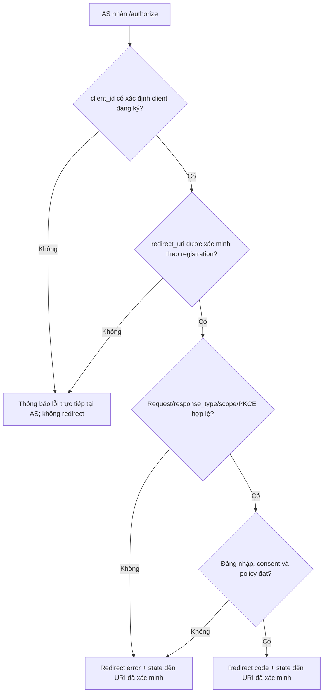

# Error response from authorization endpoint

Khi một ứng dụng dùng **OAuth 2.0 Authorization Code Flow**, trình duyệt được chuyển đến **authorization endpoint** của authorization server (AS). Nếu người dùng đồng ý và các điều kiện đạt, AS chuyển về ứng dụng một **authorization code** để client đổi lấy token tại token endpoint. Nhưng không phải lần yêu cầu nào cũng thành công: người dùng có thể từ chối consent, client xin scope không hợp lệ, phiên đăng nhập chưa tồn tại hoặc AS gặp lỗi tạm thời. Khi đó AS phải trả **authorization error response** theo giao thức — và quan trọng hơn, phải biết **lúc nào được phép redirect về client, lúc nào tuyệt đối không được redirect**.

Ví dụ: một client gửi `redirect_uri=https://attacker.example.net/receive` thay vì callback đã đăng ký. Nếu AS «trả lỗi cho client» bằng cách redirect trình duyệt về chính URI độc hại này, nó đã mở ra đường **open redirect/phishing** và có thể tạo điều kiện rò dữ liệu của luồng ủy quyền. Vì vậy, **xác minh client và redirect URI trước khi tạo error redirect** là một ranh giới tin cậy, không phải chi tiết giao diện.

Bài học thuộc chương **Authorization Code** của module **SECURITY_TOKEN_SECURITY_FUNDAMENTALS**. Nội dung làm rõ cách tạo và xử lý lỗi ở authorization endpoint theo OAuth 2.0/OIDC, mối liên hệ với `state`, PKCE, issuer, consent, scope, audience, access/refresh token, JWT/opaque token, lưu trữ, thu hồi và phòng chống token bị đánh cắp, tráo đổi hoặc phát lại.

**Thông điệp chính:** authorization endpoint error **không phải** token endpoint error; lỗi có thể được trả qua **front-channel redirect** chỉ khi **redirect URI được xác minh đáng tin**. Client phải kiểm `state` và ngữ cảnh request **ngay cả khi chỉ nhận lỗi**, không dựa vào tham số từ trình duyệt để đổi trạng thái đăng nhập hoặc cấp quyền.

## 1. Đặt error response đúng vị trí trong Authorization Code Flow

Authorization Code Flow có hai kênh trao đổi:

1. **Front-channel:** browser đi từ client đến `/authorize` của AS, rồi nhận redirect về callback của client. Browser có thể nhìn thấy tham số trên URL/HTML form.
2. **Back-channel:** client gửi authorization code và `code_verifier` tới **token endpoint** qua HTTPS để xin access token, và có thể ID token/refresh token tùy flow và chính sách.

```mermaid
sequenceDiagram
    actor U as Người dùng
    participant B as Browser
    participant C as OAuth Client
    participant AS as Authorization Server

    U->>C: Bấm "Kết nối tài khoản"
    C->>C: Tạo state và PKCE code_verifier/challenge
    C-->>B: Redirect đến AS /authorize
    B->>AS: response_type=code, client_id, redirect_uri, scope, state, PKCE
    AS->>AS: Xác minh client và redirect_uri
    alt Client hoặc redirect_uri không đáng tin
        AS-->>B: Trang lỗi trực tiếp tại AS (không redirect tới URI khai báo)
    else Redirect URI hợp lệ
        AS->>AS: Kiểm request, login, consent, policy
        alt Cấp quyền thành công
            AS-->>B: Redirect callback?code=...&state=...
            B->>C: Callback thành công
            C->>AS: POST /token với code và code_verifier
            AS-->>C: Token response theo grant
        else Lỗi authorization
            AS-->>B: Redirect callback?error=...&state=...
            B->>C: Callback báo lỗi; không có code
            C->>C: Kiểm state rồi xử lý lỗi
        end
    end
```

**Lưu ý:** callback nhận `error` ở authorization endpoint **không có authorization code hợp lệ** để đổi token. Không cố gọi token endpoint với chuỗi lỗi hoặc một code cũ trong session. Ngược lại, lỗi tại `/token` được trả về trực tiếp cho HTTP client gọi token endpoint, thường ở dạng JSON, **không phải một redirect về callback**.

## 2. Cấu trúc chuẩn của authorization endpoint error response

Trong Authorization Code Flow, **RFC 6749 (mục 4.1.2.1)** quy định các tham số lỗi:

| Tham số | Ý nghĩa | Bắt buộc? | Cách dùng an toàn |
| --- | --- | --- | --- |
| `error` | Mã lỗi máy đọc được, như `access_denied` hoặc `invalid_scope` | **Có**, khi trả error response theo chuẩn | Client so với allowlist mã lỗi được hỗ trợ |
| `error_description` | Văn bản bổ sung để client hiểu lỗi | **Không** | Không chứa secret/PII; UI không render raw HTML |
| `error_uri` | URI tới tài liệu giải thích lỗi | **Không** | Đưa tới tài liệu đáng tin; không lấy URL từ attacker |
| `state` | Giá trị client đã gửi trong authorization request | **Bắt buộc phản hồi nếu request ban đầu có `state`** | Client so khớp chính xác với state đã lưu và ràng buộc session |

Các giá trị trường có ràng buộc cú pháp theo RFC; các tham số phải được **URL-encode đúng**. `error_description` là thông tin *diagnostic*, không phải nguồn dữ liệu đáng tin để thực thi logic phân quyền. Client nên hiển thị thông báo thân thiện do **ứng dụng tự ánh xạ từ mã lỗi**, thay vì tin nguyên văn thông điệp từ URL.

Ví dụ người dùng từ chối quyền truy cập:

```http
HTTP/1.1 302 Found
Location: https://client.example.test/oauth/callback?error=access_denied&state=qB91L7EXAMPLE
Cache-Control: no-store
```

Đường dẫn `https://client.example.test/oauth/callback` phải là **redirect URI được AS xác minh từ client registration**, không phải một URL tự do. `state=qB91L7EXAMPLE` chỉ là placeholder dễ đọc; giá trị thực cần có entropy phù hợp, ràng buộc với authorization request và **không được dùng làm credential truy cập API**.

Một ví dụ khác có diễn giải tùy chọn:

```http
HTTP/1.1 302 Found
Location: https://client.example.test/oauth/callback?error=invalid_scope&error_description=Requested%20scope%20is%20not%20allowed&state=qB91L7EXAMPLE
Cache-Control: no-store
```

Không nên tiết lộ «user A không có role X» hoặc chi tiết nội bộ của AS cho mọi client qua `error_description`. Ghi lý do kỹ thuật ở audit riêng; phản hồi public nên đủ để client chọn hành vi tiếp theo.

### 2.1. Dùng query, fragment hay form POST?

- **Authorization Code Flow thông thường:** các tham số trên redirect về client nằm ở **query** của redirect URI, ví dụ `?error=access_denied&state=...`.
- **Implicit Flow** trong OAuth 2.0 cũ dùng **fragment** theo quy tắc profile; không sao chép cách đó sang code flow. Với hệ thống mới, ưu tiên authorization code + PKCE thay vì implicit flow.
- **OIDC response_mode=form_post** và các response mode được AS/client hỗ trợ có thể trả dữ liệu **qua auto-submitted HTML form POST** tới redirect URI. Đây là profile/mở rộng khác, cần handler và chính sách cookie/CSRF thích hợp.

**Không chọn mode dựa hoàn toàn vào `response_mode` attacker tự gửi.** AS phải kiểm mode đó được hỗ trợ và phù hợp `response_type`/client registration. Client phải biết callback sẽ tới qua GET hay POST, và không chấp nhận một response không thuộc phiên flow đã khởi tạo.

## 3. Lỗi nào được redirect, lỗi nào phải hiển thị trực tiếp tại AS?

Đây là phân biệt quan trọng nhất của bài.

### 3.1. Điều kiện bắt buộc trước khi redirect error

AS phải có khả năng xác định **client hợp lệ và redirect URI hợp lệ** theo client registration và chính sách. Các tình huống không bảo đảm điều đó bao gồm:

- `client_id` thiếu, không hợp lệ hoặc không ánh xạ được tới client đã đăng ký.
- `redirect_uri` bắt buộc nhưng thiếu, hoặc được cung cấp sai cú pháp.
- `redirect_uri` không trùng URI đã đăng ký/phù hợp policy.
- `redirect_uri` chứa fragment, wildcard hoặc đường dẫn/host không được chấp nhận theo profile.
- Không thể xác định một redirect URI an toàn từ registration khi request không cung cấp đủ thông tin.

Trong các trường hợp **không thể xác nhận redirect URI đáng tin**, AS **không được tự động redirect browser tới URI không hợp lệ**. Thay vào đó, AS trả **trang lỗi ngay tại origin của AS** hoặc cách phản hồi trực tiếp an toàn phù hợp, không chuyển trình duyệt sang một đích do request không đáng tin chỉ định.



**Sai lầm nguy hiểm:**

```java
// SAI: Client đưa URI bất kỳ thì AS cũng redirect lỗi đến đó.
String redirect = request.getParameter("redirect_uri");
return redirect302(redirect + "?error=invalid_request");
```

Nếu attacker đặt `redirect_uri=https://evil.example.net/collect`, lệnh trên có thể biến AS thành **open redirector**. Lỗi không biến một redirect URI bất hợp lệ thành đích an toàn.

### 3.2. Khi nào được redirect với `error=invalid_request`?

`invalid_request` không mặc định có nghĩa «trả trang lỗi tại AS». Ví dụ `scope` bị lặp sai, `response_type` thiếu hoặc PKCE challenge không hợp lệ, **nhưng client và redirect URI đã được xác minh**: AS có thể trả **authorization error redirect** đúng URI đã đăng ký.

Ngược lại, nếu chính `redirect_uri` không đáng tin hoặc `client_id` không xác định, **không redirect dù mã lỗi logic cũng là `invalid_request`**. Cách trả response phụ thuộc **đích redirect có đáng tin không**, không chỉ vào tên mã lỗi.

| Trường hợp | AS đã có redirect URI đáng tin? | Cách phản hồi |
| --- | --- | --- |
| `client_id` không tồn tại | Không | Trang lỗi trực tiếp tại AS |
| `redirect_uri` trỏ host lạ | Không | Trang lỗi trực tiếp tại AS |
| `redirect_uri` sai cú pháp hoặc không khớp | Không | Trang lỗi trực tiếp tại AS |
| `response_type` không được hỗ trợ | Có | Redirect `error=unsupported_response_type` |
| Client không được phép dùng code flow | Có | Redirect `error=unauthorized_client` |
| Scope yêu cầu không hợp lệ | Có | Redirect `error=invalid_scope` |
| Người dùng bấm «Từ chối» | Có | Redirect `error=access_denied` |
| Người dùng chưa login với `prompt=none` trong OIDC | Có | Redirect lỗi OIDC `login_required` |
| AS gặp lỗi tạm thời khi xử lý authorization | Có | Redirect `error=temporarily_unavailable` hoặc mã phù hợp |

Các dòng «Có» giả định **client và redirect URI đã được xác thực từ registration**, không phải chỉ có một chuỗi URL được parse thành công.

### 3.3. Exact matching của redirect URI và ngoại lệ theo profile

Trong thiết kế OAuth bảo mật hiện đại, AS nên/được yêu cầu **so khớp redirect URI chính xác theo registration và profile**. Không mở wildcard, so substring hoặc «tự chuẩn hóa» host/path để tiện triển khai:

```text
Registered:
  https://client.example.test/oauth/callback

Allowed:
  https://client.example.test/oauth/callback

Not equivalent by assumption:
  https://client.example.test.evil.net/oauth/callback
  https://evil.example.net/oauth/callback
  https://client.example.test/oauth/callback/another
  http://client.example.test/oauth/callback
  https://client.example.test/oauth/callback#fragment
```

**Native apps** có thể dùng redirect URI dạng **loopback IP** với ngoại lệ thay đổi port theo RFC 8252; đây là ngoại lệ có điều kiện cho profile cụ thể, **không phải quy tắc bỏ so khớp URI rộng rãi** cho web client. AS phải kiểm URI đúng registration và chính sách transport của client.

Nếu request **không có `redirect_uri`**, AS có thể xác định URI từ registration khi spec/profile và client registration cho phép. Nếu không thể chọn an toàn, AS không được đoán một callback đích từ `Referer`, `Host` hay query tùy ý của trình duyệt.

## 4. Các mã lỗi OAuth 2.0 tại authorization endpoint

RFC 6749 (mục 4.1.2.1) định nghĩa các mã lõi sau cho code flow:

| Mã `error` | Khi nào xảy ra? | Hành vi client nên làm |
| --- | --- | --- |
| `invalid_request` | Yêu cầu thiếu/sai tham số bắt buộc, tham số không hỗ trợ/sai định dạng, bị lặp hoặc có nhiều cơ chế không phù hợp | Dừng flow; kiểm cấu hình/khởi tạo request; không retry nguyên xi |
| `unauthorized_client` | Client đã được nhận diện nhưng **không được phép dùng phương thức authorization** này | Chặn, kiểm registration/grant policy; không ép qua flow khác không được phép |
| `access_denied` | Resource owner hoặc AS **từ chối** yêu cầu | Tôn trọng quyết định; UI giải thích và cho phép user chủ động chọn lại khi phù hợp |
| `unsupported_response_type` | AS không hỗ trợ nhận authorization code theo response type yêu cầu | Kiểm response type/profile; không fallback implicit tùy tiện |
| `invalid_scope` | Scope xin thiếu hợp lệ, không biết, sai định dạng hoặc vượt phạm vi cho phép | Điều chỉnh scope đúng đăng ký/least privilege |
| `server_error` | AS gặp điều kiện lỗi không mong đợi khiến không hoàn thành authorization | Báo lỗi tạm thời; retry giới hạn khi user chủ động và không loop |
| `temporarily_unavailable` | AS tạm không thể xử lý vì quá tải/bảo trì | Trình bày thông báo phù hợp; backoff theo policy |

#### `invalid_request`

Ví dụ authorization request gồm hai giá trị `redirect_uri` hoặc `response_type` không rõ nghĩa. Nếu vấn đề trực tiếp ảnh hưởng khả năng xác minh redirect, AS **không chuyển hướng tới URI sai**; nếu redirect đã hợp lệ và lỗi ở tham số khác, có thể gửi `error=invalid_request` tới callback.

#### `unauthorized_client` khác `invalid_client`

`unauthorized_client` tại **authorization endpoint** nói rằng client **không được dùng authorization flow được yêu cầu**. `invalid_client` thường xuất hiện ở **token endpoint** khi client authentication thất bại. Một request `/authorize` có `client_id` không tồn tại còn có vấn đề **không xác lập được redirect URI tin cậy**, nên không được lạm dụng error redirect.

#### `access_denied`

Đây không nhất thiết là lỗi kỹ thuật. Người dùng có thể quyết định **không cấp quyền** cho một third-party client hoặc AS từ chối theo policy. Client phải xem đó là một **kết thúc hợp lệ của flow không có quyền**, không tự động chạy lại authorization đến khi người dùng bấm đồng ý.

#### `invalid_scope`

Client yêu cầu:

```text
scope=orders:read orders:refund
```

nhưng registration chỉ cho phép `orders:read` và policy từ chối `orders:refund`. AS có thể trả `invalid_scope` khi yêu cầu không hợp lệ. Một AS khác có thể cấp **subset scope** theo điều khoản và chính sách cụ thể, nhưng client phải dùng **tập scope thực sự được cấp**, không giả định mọi scope xin đều đã có.

#### `server_error` và `temporarily_unavailable`

Các mã này được định nghĩa vì lỗi đi qua **HTTP redirect**: AS không thể thể hiện trạng thái HTTP `500`/`503` như phản hồi cuối tại client callback chỉ bằng việc redirect (browser có thể nhận `302` và callback nhận `200`). **Mã `error` trong redirect** mới là tín hiệu giao thức. Client nên đo lỗi theo tham số `error` sau khi xác minh correlation.

### 4.1. Mã lỗi từ OIDC và các extension

Khi yêu cầu có `scope=openid` và dùng OIDC, OpenID Provider có thể trả thêm các **Authentication Error Response** theo OIDC Core:

| Mã OIDC | Ngữ cảnh điển hình | Hành vi đúng |
| --- | --- | --- |
| `interaction_required` | Cần tương tác người dùng nhưng request không cho phép | Chuyển sang flow tương tác khi người dùng/chính sách cho phép |
| `login_required` | Người dùng cần đăng nhập/xác thực lại, ví dụ `prompt=none` không thể thỏa | Không lặp silent login vô hạn; kích hoạt luồng tương tác phù hợp |
| `account_selection_required` | Cần người dùng chọn tài khoản | Cho phép tương tác khi phù hợp |
| `consent_required` | Cần lấy consent nhưng không thể thực hiện âm thầm | Hiển thị flow consent phù hợp, tôn trọng lựa chọn của user |
| `invalid_request_uri` hoặc `invalid_request_object` | URI/request object không đáp ứng profile OIDC tương ứng | Sửa tích hợp/đăng ký, không bỏ validation |
| `request_not_supported` hoặc `request_uri_not_supported` | OP không hỗ trợ phương thức gửi request tương ứng | Đổi theo khả năng OP đã công bố |

Các mã này **không phải bảy mã lõi của OAuth 2.0 `4.1.2.1`**. Client cần biết mình đang dùng **OAuth thuần**, **OIDC**, **PAR/JAR** hay profile khác để ánh xạ lỗi đúng. Không suy rằng bất kỳ AS nào cũng phát tất cả các mã trong bảng.

## 5. Những trường hợp lỗi phổ biến trong một luồng thực tế

### 5.1. Người dùng từ chối consent

1. Client tạo `state` và PKCE, chuyển user đến AS.
2. AS xác minh client và redirect URI.
3. AS hiển thị màn hình cấp quyền.
4. User bấm «Từ chối».
5. AS redirect về URI đã đăng ký với `error=access_denied` và `state` được gửi ban đầu.
6. Client kiểm `state`, đánh dấu flow kết thúc, không đổi code và không phát phiên API mới.

**Không coi `access_denied` là sự cố hệ thống nghiêm trọng cần retry tự động.** Sự từ chối là lựa chọn có chủ đích cần được tôn trọng.

### 5.2. Client xin scope ngoài registration

Ví dụ third-party client `budget-app` chỉ được cấp `accounts:read` nhưng gửi `accounts:write`. Nếu redirect đã được xác minh, AS có thể trả:

```http
HTTP/1.1 302 Found
Location: https://budget.example.net/callback?error=invalid_scope&state=s93FEXAMPLE
```

Client không tự động bỏ kiểm tra scope hoặc đổi sang scope rộng hơn bằng request mới. Nhà phát triển phải kiểm registration, grant, consent và policy. Nếu scope nhạy cảm cần review hoặc step-up, flow phải đi qua kiểm soát tương ứng.

### 5.3. `prompt=none` trong OIDC khi chưa đăng nhập

Một client thử kiểm tra đăng nhập im lặng:

```text
response_type=code
scope=openid
prompt=none
state=<correlation>
```

Nếu OP không thể hoàn tất mà không tương tác user, nó có thể trả `login_required` hoặc mã OIDC phù hợp. Client nên dừng silent attempt và **chuyển sang interactive login khi có yêu cầu/hành động hợp lệ**, tránh vòng lặp redirect khiến trang không dùng được.

### 5.4. PKCE challenge lỗi

PKCE (RFC 7636) bảo vệ authorization code khỏi bị đổi bởi bên không giữ `code_verifier` phù hợp. Ở authorization endpoint, AS cần kiểm:

- `code_challenge` có định dạng đúng theo method.
- `code_challenge_method` được hỗ trợ/cho phép; với thiết kế mới ưu tiên `S256`.
- Client/flow có đáp ứng yêu cầu **PKCE bắt buộc theo policy** không.

Nếu challenge bị sai/thiếu theo yêu cầu và redirect đã được xác minh, AS có thể trả `invalid_request` hoặc mã phù hợp với profile.

**Đừng nhầm điểm lỗi:** `code_verifier` được trình ở **token endpoint**, không phải authorization endpoint thông thường. Nếu authorization code có challenge đúng nhưng `code_verifier` gửi ở bước đổi token không khớp, đó là **token endpoint error**, thường `invalid_grant`; không phải redirect lỗi authorization.

### 5.5. Redirect URI sai

Client khai `redirect_uri=https://attacker.example.net/callback`. AS phải:

- Không tự redirect browser về địa chỉ này, **kể cả để báo lỗi**.
- Không đưa authorization code, access token, ID token hoặc state bí mật vào URI đó.
- Hiển thị lỗi an toàn tại AS với thông báo chung.
- Audit request/registered client ID và lý do sai URI theo chính sách, tránh ghi credential.

**Không khắc phục bằng wildcard redirect URI** hoặc so khớp kiểu `contains("example.test")`.

## 6. Bảo vệ `state` trên cả đường thành công và đường lỗi

`state` là giá trị do **client** sinh ra và gửi ở authorization request để liên kết response với phiên/ngữ cảnh đã khởi tạo, thường dùng chống **login CSRF, response injection và liên kết sai phiên**.

```text
Client tạo:
  state_random = secureRandom(...)
  saved = {state_random, client_id, AS_issuer, redirect_uri,
           response_mode, PKCE verifier reference, created_at, expires_at}

AS response:
  ...?error=access_denied&state=state_random

Client callback:
  yêu cầu session correlation tồn tại
  và state response khớp state đã lưu
  và chưa hết hạn/chưa dùng
  rồi mới xử lý error hoặc code
```

**AS phải trả lại đúng giá trị `state` được gửi khi có `state` trong authorization request** tại error redirect hợp lệ, theo RFC 6749. Client nên tự yêu cầu `state` hoặc cơ chế bảo vệ tương đương theo profile, kiểm **giá trị trùng khớp**, gắn với user agent/session và chỉ dùng một lần.

### 6.1. Kiểm `state` trước khi tin lỗi

Một callback có:

```text
/oauth/callback?error=access_denied&state=made-up-by-attacker
```

không chứng minh đó là lỗi của flow mà người dùng vừa bắt đầu. Nếu client nhận mọi `access_denied` rồi xóa session hoặc thay đổi liên kết tài khoản, attacker có thể gây **login/logout CSRF hoặc session disruption**. **Đầu tiên kiểm correlation**; chỉ khi response thuộc một flow có thật mới cập nhật trạng thái flow hoặc hiện kết luận tương ứng.

### 6.2. Không dùng state như credential dài hạn

- Sinh state bằng CSPRNG, entropy đủ cao, không tuần tự hoặc đoán được.
- Không đưa access token, refresh token, password hoặc PII vào plaintext state/URL.
- Lưu state/PKCE verifier theo session hoặc transaction, có expiry ngắn.
- Xử lý một lần và dọn state sau thành công/lỗi hợp lệ; chống replay callback.
- Tránh để state tồn tại trong logs/analytics/third-party script/referrer; dùng `Referrer-Policy` phù hợp, không render secret vào response không cần.
- Khi callback không có state nhưng flow đã yêu cầu state, **từ chối correlation**, không «bỏ qua cho tiện».

Nếu AS trả lỗi trực tiếp tại trang của AS vì redirect URI không hợp lệ, **không có callback được gửi đến client**, do đó client có thể chỉ quan sát timeout/flow bị bỏ dở. Client cần xử lý timeout và cho phép người dùng bắt đầu lại mà không suy đoán đã được cấp quyền.

## 7. Issuer identification và phòng chống OAuth mix-up

Khi client làm việc với **nhiều AS/OP**, nhận một callback có `state` đúng chưa đủ nếu hệ thống không buộc response gắn với **AS đã khởi tạo flow**. OAuth mix-up có thể khiến client gửi authorization code hoặc credential đến nhầm AS/token endpoint.

Các biện pháp:

1. Client lưu **issuer/AS identity** theo authorization transaction.
2. Client dùng các redirect URI riêng cho AS khi mô hình yêu cầu, hoặc xác minh **issuer của authorization response**.
3. Khi hỗ trợ **RFC 9207**, AS có thể đưa tham số `iss` vào authorization response (kể cả error response theo profile), và client phải kiểm `iss` đúng issuer đã lưu.
4. Client chỉ gửi authorization code tới **token endpoint được cấu hình từ AS đáng tin** của transaction đó.
5. Client không lấy token endpoint hoặc JWKS URL từ tham số query tùy ý của callback.

Ví dụ error callback với issuer identification theo extension:

```text
https://client.example.test/oauth/callback
  ?error=access_denied
  &state=qB91L7EXAMPLE
  &iss=https%3A%2F%2Fauth.example.test
```

**`iss` ở đây là tham số mở rộng theo RFC 9207**, không phải một trong bốn tham số lỗi lõi của RFC 6749. Nếu client cấu hình bắt buộc issuer identification thì thiếu/sai `iss` phải bị xử lý theo profile và chính sách, không chấp nhận callback chỉ vì state đúng.

Trong OIDC, việc kiểm issuer ở ID token cũng quan trọng **sau khi token được phát**, nhưng error callback **không có ID token hợp lệ để thay thế kiểm issuer của authorization response**.

## 8. Authorization endpoint error và token endpoint error: hai giao thức khác nhau

### 8.1. So sánh trực tiếp

| Tiêu chí | Authorization endpoint (`/authorize`) | Token endpoint (`/token`) |
| --- | --- | --- |
| Đường đi | Browser/front-channel | HTTP client/back-channel |
| Định dạng lỗi code flow điển hình | Redirect về callback với `error`/`state` nếu URI hợp lệ | HTTP error response JSON theo RFC 6749 `5.2` |
| Khi redirect URI không hợp lệ | **Không redirect** tới URI đó; hiển thị lỗi tại AS | Không liên quan tới việc tạo error redirect |
| Lỗi thường gặp | `access_denied`, `invalid_scope`, `unauthorized_client`, `temporarily_unavailable` | `invalid_grant`, `invalid_client`, `invalid_request`, `unsupported_grant_type` |
| `state` | Echo trong authorization response nếu request có state | Không phải thành phần chuẩn của token endpoint error |
| `code` | Chỉ có trên authorization response thành công | Là đầu vào token request của code flow |
| `access_token`/`refresh_token` | Không đưa vào authorization **error redirect** | Token response thành công có thể chứa theo grant |

Một authorization endpoint error:

```http
HTTP/1.1 302 Found
Location: https://client.example.test/oauth/callback?error=access_denied&state=qB91L7EXAMPLE
```

Một token endpoint error:

```http
HTTP/1.1 400 Bad Request
Content-Type: application/json
Cache-Control: no-store
Pragma: no-cache

{"error":"invalid_grant"}
```

**Không xử lý `invalid_grant` như một error redirect của authorization endpoint**. Ví dụ code bị dùng lại, code đã hết hạn, `code_verifier` không khớp hoặc `redirect_uri` ở token request không phù hợp là các trường hợp cần xử lý tại **token endpoint** sau khi browser đã quay về callback thành công với code.

### 8.2. HTTP status không phải OAuth error code

Nếu AS redirect `302` với `error=server_error`, HTTP browser thấy `302` và callback server có thể trả `200`. Điều đó **không có nghĩa flow thành công**. Client phải đọc **tham số giao thức** sau khi kiểm correlation.

Ngược lại, khi redirect URI không hợp lệ, AS có thể trả HTTP `400` với trang HTML an toàn ngay tại origin của AS. Client có thể không nhận được thông báo qua callback; không nên ép AS redirect tới callback sai chỉ để «client dễ biết lỗi».

## 9. OAuth 2.0 và OIDC không trao token trong authorization error response

Trong code flow:

```text
Authorization success:
  code + state
  |
  v
Token request:
  code + client authentication nếu cần + PKCE verifier
  |
  v
Access token (+ ID token OIDC / refresh token nếu được cấp)
```

Khi authorization bị từ chối hoặc request không hợp lệ, flow dừng trước bước đổi code; **không có access token mới được cấp từ authorization response lỗi**.

Các điểm cần nhớ:

- **Access token** dành cho RS đúng `aud`, được xác minh chữ ký/JWKS hoặc introspection opaque, issuer, thời hạn, scope và quyền tài nguyên.
- **ID token** trong OIDC dành cho client/RP (`aud=client_id`), không thể dùng thay access token gọi API.
- **Refresh token** được AS phát theo grant và chính sách, gửi tới token endpoint để làm mới token; không xuất hiện trong URL error callback.
- **JWT và opaque token** là cách biểu diễn credential, không phải mã lỗi của authorization endpoint.
- User từ chối consent không cho phép client tiếp tục dùng quyền cũ ngoài chính sách; các grant/token cũ có được thu hồi không là **quyết định lifecycle riêng**, không được suy từ một `access_denied` mới.

### 9.1. Lỗi authorization có tự revoke phiên/token cũ không?

**Không mặc định.** Người dùng từ chối một authorization request mới không đồng nghĩa AS đã thu hồi mọi access/refresh token của các grant cũ. Khi cần «ngắt kết nối ứng dụng», dùng cơ chế revoke/consent withdrawal và policy phù hợp (ví dụ RFC 7009), và quản lý cache/trạng thái RS.

Client không nên tự xóa mọi session của user chỉ vì một callback error hợp lệ, trừ khi đó là **hành vi sản phẩm được thiết kế** và không tạo điều kiện CSRF qua callback.

## 10. Ví dụ Java: phát error response an toàn tại authorization server

Ví dụ sau là **pseudocode gần Java**, không phải API hoàn chỉnh của Spring Authorization Server. Các interface `RegisteredClientRepository`, `RedirectUriPolicy`, `AuthorizationRequest`, `AuthResponse` được đặt tên để minh họa **thứ tự kiểm tra**.

```java
AuthResponse handleAuthorize(AuthorizationRequest request) {
    // 1. Client ID phải ánh xạ tới registration đáng tin.
    RegisteredClient client =
        registeredClients.findByClientId(request.clientId());

    if (client == null || !client.isEnabled()) {
        // Không được lấy redirect_uri chưa xác minh để trả lỗi.
        return localErrorPage(
            400, "Authorization request cannot be processed"
        );
    }

    // 2. Resolve redirect theo registration và profile.
    // Với client có nhiều URI, chỉ dùng URI do request chỉ rõ
    // khi đã xác minh. Không wildcard, không open redirect.
    VerifiedRedirectUri redirect = redirectPolicy.verify(
        client, request.redirectUriOrAbsent()
    );
    if (redirect == null) {
        return localErrorPage(
            400, "Authorization request cannot be processed"
        );
    }

    // 3. Sau khi có verified redirect URI mới được tạo error redirect.
    ResponseMode mode = responseModePolicy.requireAllowedOrError(
        client, request.responseMode(), request.responseType()
    );
    if (mode == null) {
        return authorizationError(
            redirect, ResponseMode.QUERY,
            "invalid_request", request.stateOrAbsent()
        );
    }

    if (!requestSyntax.isValidWithoutAmbiguity(request)) {
        return authorizationError(
            redirect, mode, "invalid_request", request.stateOrAbsent()
        );
    }
    if (!client.allowedResponseTypes().contains(request.responseType())) {
        return authorizationError(
            redirect, mode, "unauthorized_client", request.stateOrAbsent()
        );
    }
    if (!asCapabilities.supports(request.responseType())) {
        return authorizationError(
            redirect, mode, "unsupported_response_type",
            request.stateOrAbsent()
        );
    }
    if (!pkcePolicy.isValidForAuthorizationRequest(client, request)) {
        return authorizationError(
            redirect, mode, "invalid_request", request.stateOrAbsent()
        );
    }
    if (!scopePolicy.isAcceptable(client, request.requestedScope())) {
        return authorizationError(
            redirect, mode, "invalid_scope", request.stateOrAbsent()
        );
    }

    AuthorizationDecision decision =
        authorizationPolicy.evaluate(client, request);
    if (!decision.allowed()) {
        return authorizationError(
            redirect, mode, "access_denied", request.stateOrAbsent()
        );
    }

    // 4. Chỉ ở đường thành công mới tạo code ràng buộc
    // client, redirect URI, PKCE challenge, subject/grant và TTL.
    String code = authorizationCodes.issueSingleUse(
        client, redirect, request, decision
    );
    return authorizationSuccess(
        redirect, mode, code, request.stateOrAbsent()
    );
}
```

**Những điểm bắt buộc hiểu đúng:**

1. `redirectPolicy.verify` **không chỉ parse URL**, mà phải xác minh URI theo **client registration, scheme, redirect profile và quy tắc so khớp**. URI nào không đáng tin thì **không thể dùng để trả error redirect**.
2. `authorizationError` phải dùng **mã lỗi từ allowlist**, encode tham số đúng, echo `state` nếu request có state và **không bao giờ** chèn `code`/token vào error response.
3. `ResponseMode.QUERY` trong nhánh mode invalid chỉ là phương án minh họa cho **code flow chuẩn với redirect đã xác minh**; hệ thống thực cần xử lý response mode/profile không được hỗ trợ một cách tường minh và tránh trả mode bị cấm.
4. `AuthorizationRequest` phải được parse an toàn: duplicate parameter, ký tự điều khiển, giới hạn độ dài và khác biệt parser giữa proxy/AS đều phải có chính sách.
5. Code thành công cần **ngắn hạn, one-time, gắn client và redirect URI, PKCE challenge**. Một error redirect không được tạo code "để client thử lại".
6. `authorizationPolicy` bao gồm login, consent, user/account status, requested scope, client grant, redirect và resource policy. `access_denied` là nhánh minh họa; khi OIDC `prompt=none` không đáp ứng, cần chọn đúng mã OIDC như `login_required`/`consent_required` theo điều kiện.
7. Thứ tự kiểm `allowedResponseTypes` và `asCapabilities.supports` là quyết định triển khai; cần bảo đảm trả **mã đúng ý nghĩa** theo spec thay vì phụ thuộc thứ tự kiểm tra ngẫu nhiên.

**Triển khai sản xuất** nên sử dụng thư viện/AS đã được kiểm thử, không viết authorization endpoint thủ công chỉ từ pseudocode trên.

### 10.1. Xây `Location` thế nào để không lỗi?

Không nối chuỗi thủ công:

```java
// SAI: có thể hỏng query/encoding và dễ mắc lỗi open redirect.
String location = request.redirectUri()
    + "?error=" + request.error()
    + "&state=" + request.state();
```

Thay vào đó, dùng **URI builder** đáng tin nhận **`VerifiedRedirectUri`** (loại dữ liệu chỉ tạo sau registration check), bổ sung query parameter đã URL-encode, không cho response chứa header splitting/CRLF và không cho URI chứa fragment ngoài profile. Nếu registered redirect URI đã có query hợp lệ, builder phải thêm tham số đúng thay vì tạo hai dấu `?`.

```java
// Pseudocode: chỉ nhận verified redirect, không nhận arbitrary URL.
URI buildErrorRedirect(
    VerifiedRedirectUri target,
    String fixedErrorCode,
    Optional<String> originalState
) {
    if (!KNOWN_AUTH_ERRORS.contains(fixedErrorCode)) {
        throw new IllegalArgumentException("Unknown authorization error");
    }
    UriBuilder builder = uriBuilders.fromVerifiedTarget(target);
    builder.queryParam("error", fixedErrorCode);
    originalState.ifPresent(state ->
        builder.queryParam("state", boundedState(state))
    );
    return builder.buildEncoded();
}
```

Không lấy `error_uri` từ query hay payload chưa xác minh; nếu dùng phải trỏ tới **trang tài liệu tin cậy** đã được AS cấu hình. Không cho `error_description` chứa stack trace, token hoặc giá trị người dùng nhạy cảm.

## 11. Ví dụ Java: client xử lý callback có lỗi

Client nên lưu **authorization transaction** trước khi chuyển browser đi:

```text
AuthTransaction {
  transaction_id,
  session_binding,
  state_digest,
  expected_issuer,
  client_id,
  registered_redirect_uri,
  expected_response_mode,
  pkce_verifier_reference,
  created_at,
  expires_at,
  consumed_at
}
```

Đoạn pseudocode minh họa xử lý callback:

```java
CallbackResult handleOAuthCallback(CallbackRequest callback) {
    // 1. Chỉ nhận mode/method đã được đăng ký cho callback.
    callbackPolicy.requireSupportedModeAndMethod(callback);
    callbackPolicy.rejectDuplicateOrAmbiguousParameters(callback);

    String returnedState = callback.requireSingle("state");
    AuthTransaction tx = transactions.findBySessionAndState(
        callback.browserSessionBinding(), returnedState
    );
    if (tx == null || tx.isExpired(clock.instant())
            || tx.isConsumed()) {
        throw invalidCallback("No matching authorization request");
    }

    // 2. Chống AS mix-up nếu profile/config yêu cầu.
    issuerResponseValidator.requireExpectedIssuerIfConfigured(
        callback.optionalSingle("iss"), tx.expectedIssuer()
    );

    boolean hasError = callback.hasSingle("error");
    boolean hasCode = callback.hasSingle("code");
    if (hasError == hasCode) {
        // Phải có đúng một trong error hoặc code cho flow này.
        throw invalidCallback("Ambiguous callback");
    }

    // 3. Đánh dấu transaction đã dùng theo cơ chế nguyên tử.
    transactions.consumeOnce(tx.id());

    if (hasError) {
        String error = callback.requireSingle("error");
        // Không lấy error_description làm HTML hoặc quyết định bảo mật.
        return userFacingError(errorMapper.toSafeMessage(error));
    }

    // 4. Chỉ success path mới gọi /token tại issuer đã lưu.
    String code = callback.requireSingle("code");
    TokenResponse tokens = tokenClient.exchangeAuthorizationCode(
        tx.expectedIssuer(),
        code,
        tx.registeredRedirectUri(),
        tx.pkceVerifier()
    );
    tokenValidator.validateExpectedResponse(tokens, tx);
    return finishLoginOrAuthorization(tokens);
}
```

Các class/method này là **abstraction minh họa**. Để an toàn trong thực tế:

- `state` cần entropy cao, ràng buộc với đúng session và một authorization transaction; so khớp chính xác, có expiry và chống reuse.
- `consumeOnce` phải là thao tác nguyên tử đủ mạnh nếu có nhiều node hoặc browser callback lặp.
- `tx.expectedIssuer()` đến từ **cấu hình tin cậy đã chọn khi bắt đầu flow**, không phải từ tham số query callback.
- `errorMapper.toSafeMessage` ánh xạ mã lỗi thành thông báo nội bộ của ứng dụng, không render nguyên `error_description`/`error_uri` chưa được tin.
- Với lỗi, client **không gửi request đổi authorization code** hoặc giữ một `code` kèm `error`.
- Khi token exchange thành công, client tiếp tục kiểm ID token theo OIDC khi có, xử lý `aud=client_id` đúng, access token đúng resource và bảo vệ refresh token theo chính sách.

### 11.1. UX: đừng tạo vòng lặp lỗi

| Lỗi đã xác minh | Hành vi UI/ứng dụng gợi ý |
| --- | --- |
| `access_denied` | «Bạn chưa cấp quyền cho ứng dụng.» Cho phép quay lại, không tự xin lại vô hạn |
| `invalid_scope` | «Ứng dụng yêu cầu phạm vi chưa được hỗ trợ.» Thông báo nhà phát triển/chọn cấu hình đúng |
| `unauthorized_client` | «Ứng dụng chưa được phép dùng phương thức đăng nhập này.» Chặn và kiểm registration |
| `login_required` (OIDC) | Đề xuất đăng nhập tương tác; đừng lặp `prompt=none` |
| `consent_required` (OIDC) | Mở flow tương tác để người dùng quyết định khi phù hợp |
| `temporarily_unavailable` | Báo hệ thống tạm bận, thử lại có giới hạn |
| `server_error` | Báo lỗi chung, gắn correlation ID; không hiển thị stack trace |
| Mã không biết | Từ chối coi là thành công; thông báo an toàn, ghi log cấu hình |

**Không để error query trực tiếp quyết định trạng thái «đã đăng nhập», «đã logout» hoặc «đã cấp quyền».** Đây là dữ liệu front-channel và chỉ có ý nghĩa sau khi đã xác minh correlation cùng chính sách.

## 12. Security controls xung quanh error response

### 12.1. Open redirect, phishing và redirect URI injection

Attacker có thể thử:

```text
redirect_uri=https://client.example.test.evil.net/callback
redirect_uri=https://client.example.test/redirect?next=https://evil.net
redirect_uri=https://client.example.test@evil.net/callback
redirect_uri=https://client.example.test/callback#fragment
```

Vấn đề không chỉ là host trông giống domain thật. URI cần xác minh **theo registration**; nếu chính registered redirect URI là một **open redirect endpoint**, client vẫn có thể vô tình làm rò authorization code và state qua redirect thứ hai. Vì vậy **client cũng phải bảo vệ callback và các đường redirect nội bộ**.

AS không nên dùng URL client khai để tạo trang lỗi kèm link «Back to application» nếu URL chưa được xác minh; một nút trở về URL độc hại cũng có thể hỗ trợ phishing.

### 12.2. Login CSRF và phản hồi lỗi giả

Một website khác có thể đưa user tới:

```text
https://client.example.test/oauth/callback?error=access_denied&state=guess
```

Nếu client không kiểm state/session binding, nó có thể nhầm đây là kết quả của flow hợp lệ và thay đổi giao diện hoặc phiên user. **State/correlation được bảo vệ ngay cả trên error path**; phân biệt response từ AS với URL bất kỳ được mở trong browser.

### 12.3. Clickjacking và user consent

Nếu trang login/consent của AS bị nhúng trong iframe không đáng tin, attacker có thể cố điều khiển tương tác cấp quyền. AS cần chính sách frame embedding thích hợp (ví dụ `Content-Security-Policy: frame-ancestors`), giao diện xác nhận rõ client, scope và bên vận hành; không xem «người dùng bấm Allow» là hợp lệ nếu UI bị thao túng.

### 12.4. SameSite và callback mode

Với authorization code flow qua **top-level GET callback**, cookie correlation của RP dùng `SameSite=Lax` có thể được trình duyệt gửi khi chuyển từ AS khác site về RP. Nếu dùng `response_mode=form_post`, callback là **cross-site POST**, cookie `Lax` thường không đi kèm.

Không **bỏ kiểm state** để chữa lỗi cookie; hãy thiết kế cookie/correlation phù hợp với flow (ví dụ cookie chuyên dụng `SameSite=None; Secure` khi thật sự cần, cùng CSRF và state bảo vệ) và kiểm thử trên trình duyệt đích. Trình duyệt có thể chặn third-party cookies hoặc có giới hạn khác.

### 12.5. Giao thức và logging

AS và client cần:

- Dùng HTTPS, trừ những ngoại lệ redirect của native/loopback được profile cho phép.
- Không gửi access token, refresh token, ID token, client secret, PKCE verifier hoặc session cookie trong error redirect.
- Đặt `Cache-Control: no-store` và chính sách cache/privacy thích hợp cho trang lỗi/response chứa dữ liệu transaction.
- Hạn chế `Referer`; tránh nhúng tài nguyên third-party trên trang callback có query chứa `code` hoặc `state` trước khi xử lý và dọn URL.
- Log mã lỗi, request/correlation ID đã được làm an toàn, client registration ID, thời điểm và loại validation failure; **không log raw credential**.
- Áp dụng giới hạn kích thước tham số/header và rate limit để tránh request lỗi hàng loạt gây DoS hoặc bão log.

### 12.6. PAR/JAR có thay đổi nguyên tắc không?

**Pushed Authorization Requests (PAR, RFC 9126)** và **JWT-Secured Authorization Request (JAR, RFC 9101)** giúp bảo vệ/tham chiếu authorization request theo profile, giảm rủi ro tham số bị sửa trên front channel. Chúng có thể đưa một số lỗi validation sang **PAR endpoint** hoặc request object validation với **định dạng lỗi riêng theo endpoint**.

Tuy nhiên, **không vì dùng PAR/JAR mà redirect URI chưa xác minh trở thành đáng tin**. Authorization endpoint vẫn phải xử lý request/response mode và bảo đảm **không error-redirect tới URI không hợp lệ**. Phân biệt lỗi nhận ở **PAR back-channel** với lỗi ở `/authorize` front-channel.

## 13. Ứng dụng thực tế: kết nối ứng dụng tài chính đối tác

Giả sử một ngân hàng có:

```text
Authorization Server:
  https://login.bank.example.test

Registered third-party client:
  client_id=budget-partner
  redirect_uri=https://budget.example.net/oauth/callback
  allowed scopes=accounts:read

Resource Server:
  accounts-api, audience=accounts-api
```

### 13.1. Trường hợp người dùng từ chối

Ứng dụng `budget-partner` tạo state/PKCE, gửi request đúng registration. AS hiển thị các scope; người dùng chọn «Từ chối». AS trả:

```text
https://budget.example.net/oauth/callback
  ?error=access_denied
  &state=<original-state>
```

Ứng dụng đối tác xác minh state, dừng flow và không có token để đọc `accounts-api`. **Không giả định user đã cấp quyền** chỉ vì browser đã quay về đúng callback.

### 13.2. Trường hợp redirect URI bị thay

Attacker làm request giống hệt nhưng sửa `redirect_uri=https://evil.example.net/collect`. AS phát hiện URI không thuộc client registration, **không redirect** tới `evil.example.net`. Trang lỗi AS thông báo yêu cầu không hợp lệ và ghi audit.

Đây là khác biệt giữa **một lỗi cần thông báo cho client hợp lệ** và **một đầu vào chưa được phép chỉ định nơi browser đi tiếp**.

### 13.3. Trường hợp đối tác xin `accounts:write`

AS xác minh client và redirect URI đúng, nhưng scope ngoài quyền đăng ký. AS redirect:

```text
https://budget.example.net/oauth/callback
  ?error=invalid_scope
  &state=<original-state>
```

Client phải xử lý việc scope không được chấp nhận. Không tự tạo access token, không mở rộng `aud` hay sửa `scope` bằng cách ký lại JWT.

### 13.4. Trường hợp thành công

AS trả authorization code về callback. Client kiểm state, đổi code tại `/token` với PKCE và client authentication nếu cần. Access token có `aud=accounts-api`, `scope=accounts:read`; RS xác minh chữ ký/issuer/audience/expiry hoặc introspection opaque và kiểm quyền chủ tài khoản. Nếu được cấp refresh token, client quản lý storage, rotation, expiry và revocation theo chính sách.

**Một error response ở `/authorize` xảy ra trước các bước token validation tại RS**. Không vì lỗi xuất hiện ở đầu luồng mà bỏ qua ranh giới của JWT, opaque access token hoặc refresh token về sau.

## 14. Ma trận kiểm thử authorization endpoint error response

| Trường hợp | Đầu vào/tình huống | Kết quả mong đợi |
| --- | --- | --- |
| Client ID không biết | `client_id=unknown` | Không error-redirect tới URI khai; hiển thị lỗi tại AS |
| Thiếu client ID | Không có `client_id` | Không redirect đến URI chưa xác minh |
| Redirect host lạ | `redirect_uri=https://evil.example.net` | Không redirect tới URI đó |
| Redirect là prefix gần giống | `client.example.test.evil.net` | Không chấp nhận |
| Redirect sai scheme | Registered HTTPS, request HTTP | Từ chối theo policy; không redirect URI sai |
| Redirect có fragment không được phép | `#fragment` trong URI yêu cầu | Không redirect tới URI không hợp lệ |
| Client có nhiều registered URIs nhưng không chọn an toàn | Không có `redirect_uri` khi bắt buộc | Không tự suy callback từ Host/Referer |
| Redirect URI hợp lệ, thiếu `response_type` | Request chưa đủ | Error redirect `invalid_request` + state nếu có |
| Request lặp tham số nhạy cảm | Hai `response_type`/`redirect_uri` | Từ chối mơ hồ; không bị parser bypass |
| Response type chưa hỗ trợ | `response_type=unsupported_value` | `unsupported_response_type` nếu redirect hợp lệ và chính sách cho phép trả redirect |
| Client không được code flow | Registration không cho `authorization_code` | `unauthorized_client` |
| Scope ngoài registration | Xin `payments:refund` không được phép | `invalid_scope` hoặc xử lý theo policy đã định |
| User từ chối consent | Đăng nhập nhưng chọn Deny | `access_denied`, không có code |
| AS policy không cho phép | User/client không đạt policy | `access_denied` hoặc lỗi profile phù hợp |
| AS gặp lỗi nội bộ | Lỗi không mong đợi sau validation redirect | `server_error`; thông báo tối thiểu |
| AS đang bảo trì | Redirect hợp lệ nhưng tạm unavailable | `temporarily_unavailable` |
| OIDC `prompt=none` chưa có login | Không tương tác được | `login_required` theo OIDC |
| OIDC cần consent khi silent | `prompt=none` nhưng cần consent | `consent_required` hoặc mã OIDC phù hợp |
| PKCE challenge sai tại /authorize | `code_challenge` sai định dạng | `invalid_request` hoặc mã profile phù hợp |
| PKCE verifier sai tại /token | Code có challenge, verifier không khớp | **Token endpoint** trả lỗi, thường `invalid_grant` |
| AS trả `error` và `code` cùng lúc | Callback có cả hai | Client từ chối callback mơ hồ |
| AS trả error không có state | Client đã gửi state | Client từ chối correlation |
| State do attacker tự chọn | Không có transaction trong client session | Client từ chối |
| State cũ được phát lại | Flow đã consume | Client từ chối replay |
| State thuộc session khác | Callback tại browser/user session B | Client từ chối cross-session |
| `iss` sai khi RFC 9207 được yêu cầu | Callback issuer khác issuer đã lưu | Client từ chối mix-up |
| Error description có HTML | `error_description=<script>...` | Client không render raw HTML, chỉ hiển thị message an toàn |
| Error URI bên ngoài không đáng tin | `error_uri` trỏ URL attacker | Client không tự điều hướng/phơi dữ liệu |
| Mode callback không khớp | Dự kiến query GET nhưng nhận form POST trái policy | Client từ chối/không diễn giải tùy tiện |
| Form POST khi cookie `Lax` không được gửi | Correlation session không tới callback | Không bỏ kiểm state; giải quyết thiết kế flow |
| Success code sau authorization error | Không có code hợp lệ nhưng client vẫn gọi /token | Test phải bắt lỗi client; không đổi token |
| Redirect URI đã đăng ký là open redirect | Callback tự chuyển tới host khác | Client/AS policy phát hiện và chặn rò code/state |
| OAuth error bị ghi log kèm token | Logging query/body đầy đủ | Redact token, code, secret, state nhạy cảm |
| Refresh token còn hạn khi request mới bị denied | Grant/token cũ còn tồn tại | Không tự suy revocation nếu không có policy riêng |
| RS nhận ID token thay access token sau flow khác | `aud=client_id` | RS từ chối sai type/audience |
| API nhận opaque token đã revoke | Introspection `active=false` | RS từ chối, độc lập error handling của authorization |
| Token endpoint lỗi `invalid_client` | Confidential client auth sai khi đổi code | **JSON/HTTP error tại /token**, không phải auth redirect |
| Authorization endpoint bị quá tải | Lượng request lỗi lớn | Giới hạn rate/log; không leak thông tin nhạy cảm |

Các kiểm thử nên chạy trên **AS và client callback thật hoặc môi trường tích hợp tương đương**, không chỉ unit-test hàm ghép URL. Cần mở trình duyệt qua callback GET, form POST nếu dùng OIDC, các trình duyệt có SameSite khác nhau, reverse proxy và cache/CDN để xác nhận không có header/redirect bất thường.

## 15. Những anti-pattern thường gặp

| Anti-pattern | Hậu quả | Cách sửa |
| --- | --- | --- |
| Redirect error tới `redirect_uri` do request cung cấp mà không xác minh | Open redirect/phishing, rò code/state ở luồng liên quan | Kiểm registration trước; URI sai thì lỗi trực tiếp tại AS |
| «Bất kỳ lỗi nào cũng redirect» | Vượt ranh giới tin cậy của client/URI | Phân biệt lỗi trước/sau verified redirect |
| Dùng `error_description` như HTML từ AS | XSS/HTML injection nếu input không tin | Ánh xạ mã lỗi sang thông điệp nội bộ và escape |
| Client tin `error=access_denied` mà không kiểm state | CSRF/session disruption | Kiểm state, session, transaction và issuer |
| Đổi code khi callback có `error` | Đổi nhầm code cũ hoặc xử lý flow mơ hồ | Error path tuyệt đối không token exchange |
| Không echo `state` khi đã nhận trong request | Client không correlate, khó chống CSRF | Echo đúng state trong error redirect hợp lệ |
| Dùng state dễ đoán, không giới hạn thời gian | Callback injection/replay | CSPRNG, session-bound, short TTL, one-time |
| Dựa vào JWT ID token để kiểm authorization error | Error không có ID token mới | Kiểm callback state và issuer identification theo profile |
| PKCE verifier không khớp nhưng trả auth redirect error | Nhầm bước giao thức, khó xử lý lỗi | Xử lý verifier tại token endpoint |
| Trả `invalid_grant` trực tiếp qua /authorize callback | Sai chuẩn/nhầm token endpoint | Dùng mã authorization endpoint đúng ngữ cảnh |
| Chỉ dựa HTTP `302` và coi redirect thành công | Không nhận ra `error=server_error` | Kiểm payload giao thức sau correlation |
| Mọi `server_error` được retry vô hạn | Redirect loop, DoS AS, UX xấu | Backoff, giới hạn số lần và user action |
| Cố fallback sang implicit/password flow khi code flow lỗi | Hạ cấp bảo mật | Sửa client registration, PKCE, consent theo BCP |
| Client tự lấy token endpoint từ URL callback | OAuth mix-up và credential leak | Pin issuer/token endpoint theo transaction/config |
| Đưa access/refresh token vào error redirect | Rò bearer credential trên front channel | Chỉ tham số lỗi/state và extension đã cho phép |
| Callback là open redirect URL | Code/state leak dù AS chọn đúng registration | Bảo vệ callback, không chuyển tiếp bí mật ra host khác |
| Bỏ consent khi user đã chọn deny | Vượt quyền chủ thể | Tôn trọng `access_denied` và grant policy |
| Xóa mọi token cũ chỉ vì một `access_denied` mới | Thay đổi trạng thái trái ngữ nghĩa giao thức | Revocation là cơ chế/vòng đời riêng |

## 16. Checklist trước khi đưa authorization endpoint vào production

1. **Đăng ký client/redirect:** AS xác định client từ `client_id` hợp lệ, chọn redirect URI từ registration và không redirect nếu URI không được xác minh?
2. **Cấu trúc lỗi:** error response dùng `error` bắt buộc, `state` được echo khi request có, `error_description`/`error_uri` tùy chọn và không lộ secret?
3. **Phân biệt flow:** response mode query cho code flow, hỗ trợ `form_post`/OIDC có kiểm soát, không nhầm implicit fragment hoặc lỗi JSON ở token endpoint?
4. **Mã lỗi:** AS hỗ trợ các mã RFC 6749 đúng ngữ nghĩa, mã OIDC/extension theo profile, không tự trộn `invalid_grant` vào authorization callback?
5. **State:** client sinh giá trị khó đoán, lưu session/issuer/redirect/PKCE context, kiểm chính xác, expire và consume một lần trên cả success/error?
6. **Mix-up:** client xác minh issuer của response khi dùng RFC 9207/profile phù hợp; không chọn token endpoint từ query callback?
7. **PKCE:** authorization request kiểm `code_challenge` theo policy; token endpoint kiểm `code_verifier` và code binding; không bỏ PKCE khi lỗi?
8. **Redirect safety:** URI match theo profile, không wildcard/open redirect, không tự suy callback từ Host/Referer; native loopback chỉ dùng ngoại lệ được phép?
9. **Consent/login:** `access_denied` tôn trọng từ chối; OIDC `prompt=none` trả mã phù hợp và client không lặp silent login?
10. **CSRF/XSS:** callback không tin URL bất kỳ, UI không render raw error description, cookie SameSite phù hợp GET/form_post và trang AS chống clickjacking?
11. **Token separation:** auth error không phát code/access/refresh/ID token; token success và RS validation vẫn kiểm type, issuer, audience, scope, lifetime và quyền?
12. **Observability:** ghi mã lỗi, client registration ID, request ID an toàn và tỷ lệ lỗi; không log raw code/token/session secret hoặc lộ thông tin tài khoản?
13. **Failure mode:** AS quá tải/lỗi không cho client nhận quyền mặc định; retry giới hạn; callback thiếu correlation thì fail closed?
14. **Test end-to-end:** đã thử sai redirect, unknown client, user denial, invalid scope, response type, OIDC prompt=none, PKCE sai, state replay/mismatch, issuer mix-up và token endpoint error?

## Tổng kết

**Error response from authorization endpoint** là phản hồi kết thúc **authorization request** không thành công. Trong Authorization Code Flow, khi **client và redirect URI đã được xác minh**, AS có thể redirect tới callback được đăng ký với `error`, `state` (nếu request có) và các trường mô tả tùy chọn. Khi `client_id` hoặc `redirect_uri` không đáng tin, AS **không được tự động redirect tới URI do request đưa ra**; lỗi cần được hiển thị an toàn tại AS.

Client phải kiểm **`state`, session correlation và issuer theo profile** cả trên đường lỗi; không đổi authorization code hoặc cấp quyền khi có `error`. Các mã như `access_denied`, `invalid_scope`, `unauthorized_client`, `server_error` thuộc ngữ cảnh authorization endpoint, trong khi `invalid_grant`/`invalid_client` chủ yếu thuộc token endpoint. PKCE, redirect matching, SameSite/CSRF, OIDC response modes, giới hạn scope và lưu trữ/thu hồi token tiếp tục bảo vệ toàn bộ hành trình OAuth 2.0 — **không một thông báo lỗi nào thay thế được việc xác minh token và phân quyền tại resource server**.

**Tài liệu tham khảo:** RFC 6749 (mục 4.1.2.1: Authorization Code Error Response; mục 4.2.2.1: Implicit Error Response; mục 5.2: Token Endpoint Error Response); RFC 7636 (PKCE); RFC 9700 (OAuth 2.0 Security Best Current Practice); RFC 9207 (Authorization Server Issuer Identification); RFC 8252 (OAuth 2.0 for Native Apps); RFC 9126 (Pushed Authorization Requests); RFC 9101 (JWT-Secured Authorization Request); RFC 6750 (Bearer Token Usage); RFC 7009 (Token Revocation); RFC 9068 (JWT Access Token Profile); OpenID Connect Core 1.0 (Authentication Error Response, Response Modes).
