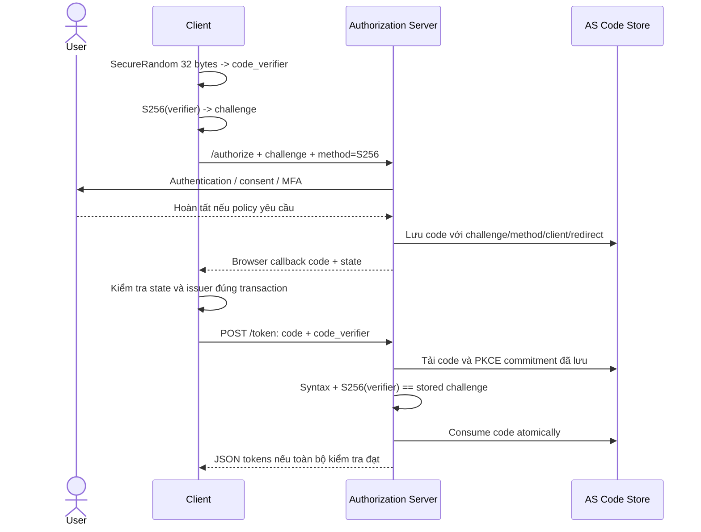

# Code verifier entropy

**Độ bất định (*entropy*) của `code_verifier` là nền tảng bảo mật của PKCE.** Trong OAuth 2.0 Authorization Code Flow, một authorization code có thể đi qua trình duyệt, redirect URI, ứng dụng native hoặc các thành phần trung gian. PKCE (*Proof Key for Code Exchange*, RFC 7636) bổ sung một bí mật mà client tạo trước khi xin code: **`code_verifier`**. Authorization server (AS) chỉ cho phép đổi code thành token nếu client chứng minh biết verifier khớp với **`code_challenge` đã được cam kết từ trước**.

Một verifier có **43 ký tự đúng cú pháp nhưng dễ đoán** vẫn là một lỗ hổng. Tương tự, mã hóa Base64URL, băm SHA-256 hoặc làm chuỗi dài thêm **không tự tạo ra entropy**. Cách thông dụng, rõ ràng và đúng khuyến nghị của RFC 7636 là **sinh 32 byte bằng bộ sinh số ngẫu nhiên mật mã (CSPRNG), sau đó Base64URL không padding thành một verifier dài 43 ký tự**. Nếu 32 byte đầu vào không thể dự đoán và được sinh độc lập, chúng mang **256 bit entropy nguồn**.

```text
                 Client (trước /authorize)
             CSPRNG -> 32 byte ngẫu nhiên
                          |
                          v
              Base64URL không padding
                          |
                          v
                code_verifier (43 ký tự)
                          |
                          | SHA-256(ASCII(verifier))
                          v
              Base64URL không padding
                          |
                          v
                code_challenge (S256)
                          |
            /authorize: gửi challenge, KHÔNG verifier
                          |
              AS ràng buộc challenge với code
                          |
             /token: gửi code + verifier
                          |
             AS tự tính S256(verifier) và so sánh
                          |
             Khớp + grant hợp lệ -> có thể cấp token
             Sai/thiếu -> từ chối, không cấp token
```

Bài thuộc chương **PKCE** của module **SECURITY_TOKEN_SECURITY_FUNDAMENTALS**. Trong phạm vi mô hình tin cậy và vòng đời token bảo mật, bài liên hệ với JWT, opaque token, access/refresh token, OAuth 2.0/OIDC, phát hành, xác minh claims, scope, audience, lưu trữ, thu hồi và phòng chống token bị đánh cắp hoặc phát lại. Trọng tâm trực tiếp là **entropy của `code_verifier`**: nguồn entropy, cách giữ nó, cách kiểm tra và những hiểu lầm có thể làm PKCE vô hiệu.

## 1. Mục tiêu học tập

Sau bài học, bạn có thể:

1. Phân biệt **độ dài chuỗi, encoding, tính duy nhất và entropy mật mã**; chỉ ra vì sao chúng không thay thế nhau.
2. Giải thích `code_verifier` cần **khó dự đoán** dù `code_challenge` theo `S256` có thể xuất hiện trên front-channel.
3. Trình bày RFC 7636: verifier có **43–128 ký tự unreserved**; khuyến nghị sinh **32 byte bằng CSPRNG** rồi Base64URL không padding.
4. Tính được vì sao 32 byte ngẫu nhiên cho **256 bit entropy** và được biểu diễn thành **43 ký tự Base64URL**, trong đó ký tự cuối chỉ mang bốn bit thông tin.
5. Nhận diện nguồn verifier yếu: `Math.random()`, timestamp, counter, username, `UUID` tùy tiện, secret cố định, seed dễ đoán, cắt/đệm chuỗi.
6. Sinh cặp verifier/challenge chính xác bằng Java `SecureRandom`, `MessageDigest`, `Base64.getUrlEncoder().withoutPadding()`; biết lựa chọn API CSPRNG trên browser.
7. Thiết kế **verifier mới cho từng authorization transaction**, ràng buộc với state, issuer, client ID, redirect URI và bảo vệ theo vòng đời.
8. Phân tích giới hạn: PKCE không tự chống XSS, user-agent bị kiểm soát, token theft sau phát hành hay sai audience/scope.
9. Kiểm thử cú pháp, S256 vector, vòng đời một lần, tính bất biến của AS và điều kiện fail closed; không nhận nhầm kiểm thử thống kê sơ sài là chứng minh entropy.
10. Xử lý tình huống verifier/code bị lộ, logging sai hoặc hệ thống sinh verifier yếu.

## 2. PKCE giải quyết vấn đề gì?

### 2.1. Nguy cơ đánh cắp authorization code

Authorization Code Flow sử dụng hai chặng:

- **Front-channel:** client chuyển user-agent (thường là browser) đến authorization endpoint; AS đưa code về redirect URI của client.
- **Token exchange:** client gửi code tới **token endpoint** qua HTTPS POST; AS kiểm tra grant và phát access token/refresh token nếu được phép.

Code trên redirect có thể bị một ứng dụng khác chặn callback, xuất hiện ở proxy log, bị script độc hại đọc hoặc bị lấy qua một lỗ hổng redirect. Nếu không có ràng buộc bổ sung, attacker sở hữu code có thể thử đổi code trước client thật.

Với PKCE:

1. Client giữ bí mật `code_verifier`.
2. Client chỉ gửi `code_challenge` đến authorization endpoint.
3. AS gắn challenge với **authorization code sắp phát hành**.
4. Client trình verifier khi đổi code.
5. AS so sánh với challenge đã lưu; một attacker chỉ có code không đủ điều kiện.

**Điều kiện then chốt:** verifier phải **không đoán được**. Nếu attacker có thể suy ra verifier từ một mẫu thời gian, client ID, biến cố ngẫu nhiên yếu hoặc `code_challenge` của verifier entropy thấp, phép kiểm tra PKCE không còn tác dụng như kỳ vọng.

### 2.2. Bốn vai trò OAuth và người chịu trách nhiệm

| Vai trò | Liên quan tới entropy của verifier |
| --- | --- |
| **Resource owner** | Người dùng xác thực/ủy quyền; không trực tiếp lựa chọn PKCE verifier thay client |
| **Client** | **Phải sinh và giữ verifier đủ entropy**, đúng từng transaction |
| **Authorization server** | Kiểm tra syntax/method, **ràng buộc challenge với code**, yêu cầu verifier đúng khi exchange; không tự tin chuỗi client khai có đủ entropy |
| **Resource server** | Kiểm tra access token theo issuer, audience, thời hạn, scope và policy; không trực tiếp nhận PKCE verifier |

User-agent là **kênh điều hướng**, không phải vai trò OAuth thứ năm. Browser có thể nhìn thấy `code_challenge` trong URL; với `S256` điều đó được dự kiến trong mô hình bảo vệ. **`code_verifier` không được chuyển qua user-agent nếu có thể tránh**.

## 3. Entropy là gì?

**Entropy** mô tả mức bất định của giá trị bí mật trước khi kẻ tấn công biết nó. Trong ngữ cảnh verifier, câu hỏi bảo mật là: **attacker có bao nhiêu khả năng thực tế phải thử để đoán đúng?**

Nếu giá trị được chọn **đều và độc lập** trong tập có `N` khả năng, entropy có thể biểu diễn bằng:

\[
H = \log_2(N)\text{ bit}
\]

Ví dụ:

| Nguồn sinh / không gian giá trị | Số khả năng tối đa | Entropy khi phân bố đều và không bị lộ |
| --- | --- | --- |
| Một bit ngẫu nhiên | 2 | 1 bit |
| Một byte ngẫu nhiên | `2^8` | 8 bit |
| 16 byte ngẫu nhiên độc lập | `2^128` | 128 bit |
| **32 byte ngẫu nhiên độc lập** | **`2^256`** | **256 bit** |
| 48 byte ngẫu nhiên độc lập | `2^384` | 384 bit |
| Một giá trị lấy từ 1.000 mẫu đoán được | Không quá 1.000 | Không quá `log2(1000) ≈ 9,97` bit |
| Timestamp trong cửa sổ 60 giây, độ phân giải giây | 60 | Không quá `log2(60) ≈ 5,91` bit |

Trong bảng, `2^128` và `2^256` là **số lượng khả năng**, không phải tên thuật toán. Con số “timestamp 60 giây” chỉ là minh họa trường hợp attacker biết sẵn khoảng thời gian phát sinh, chứ không phải đánh giá cho mọi hệ thống.

### 3.1. Min-entropy quan trọng trong bảo mật

Khi nguồn ngẫu nhiên **không đều**, công thức `log2(N)` có thể phóng đại mức khó đoán. Khái niệm hữu ích là **min-entropy**:

\[
H_{\infty}(X)=-\log_2\left(\max_x P(X=x)\right)
\]

Nó dựa vào **giá trị có xác suất cao nhất**. Ví dụ:

- Một bộ sinh chỉ xuất ra hai chuỗi, một chuỗi xuất hiện 99% thời gian: nó có **không gian hai giá trị**, nhưng attacker gần như chỉ cần thử chuỗi phổ biến.
- Một thuật toán `random()` trả về mẫu nằm trong tập nhỏ do seed thời gian dễ đoán: output nhìn dài nhưng min-entropy có thể thấp.
- Một verifier được cố định trong cấu hình: từ góc nhìn attacker đã biết cấu hình, **entropy bí mật bằng 0**.

Vì vậy, bài này không chỉ yêu cầu “chuỗi trông ngẫu nhiên”, mà yêu cầu **nguồn ngẫu nhiên mật mã không thể dự đoán và cách sử dụng không làm mất tính bí mật**.

### 3.2. Những thứ không đồng nghĩa với entropy

| Thuộc tính | Nó đảm bảo gì? | Có đảm bảo attacker không đoán được không? |
| --- | --- | --- |
| **Độ dài 43 ký tự** | Đạt độ dài cú pháp tối thiểu của verifier | **Không** |
| **Base64URL encoding** | Chuỗi phù hợp URL, không có `+`/`/`/`=` | **Không** |
| **Hash SHA-256** | Đầu ra hash có kích thước 256 bit | **Không tự tạo entropy cho input yếu** |
| **Tính duy nhất** | Hai transaction khó trùng cùng giá trị trong một tập thử | **Không** nếu attacker đoán được quy luật |
| **Ngẫu nhiên thống kê sơ bộ** | Mẫu có vẻ không lặp/không thiên lệch quá rõ | **Không đủ** để xác nhận CSPRNG |
| **CSPRNG với 32 byte đầu ra** | Nguồn phù hợp cho 256 bit ngẫu nhiên, nếu hoạt động đúng | **Có cơ sở mật mã**, kèm bảo vệ vòng đời |
| **Giữ bí mật và không tái sử dụng** | Giảm cơ hội attacker lấy/áp dụng verifier | **Cần thiết**, nhưng không cứu được nguồn yếu |

Ví dụ `"A"` lặp 43 lần **đúng regex** verifier nhưng hoàn toàn có thể đoán. Ngược lại, 16 byte sinh bằng CSPRNG có entropy tốt 128 bit, nhưng khi Base64URL không padding chỉ tạo **22 ký tự**, **không đạt cú pháp tối thiểu** RFC 7636.

## 4. RFC 7636 yêu cầu gì về verifier?

### 4.1. Cú pháp bắt buộc

RFC 7636 định nghĩa:

```abnf
code-verifier = 43*128unreserved
unreserved   = ALPHA / DIGIT / "-" / "." / "_" / "~"
```

Nghĩa là:

- **43 đến 128 ký tự**, không ít hơn và không nhiều hơn.
- Ký tự hợp lệ: `A–Z`, `a–z`, `0–9`, `-`, `.`, `_` và `~`.
- Không chứa khoảng trắng, `+`, `/`, dấu `=`, dấu hai chấm, ký tự Unicode ngoài tập ASCII đã nêu.
- Giá trị phải được giữ **nguyên dạng**, không tự chuyển chữ hoa/thường, trim hay chuẩn hóa Unicode.

Regex Java minh họa để **kiểm tra cú pháp**, không phải kiểm tra entropy:

```java
boolean hasValidPkceSyntax(String verifier) {
    return verifier != null
        && verifier.matches("[A-Za-z0-9._~-]{43,128}");
}
```

Một verifier thỏa regex chưa chắc an toàn. Ở phía AS, kiểm tra regex là bước cần thiết, nhưng AS **không thể suy ra** CSPRNG của client có tốt hay không chỉ bằng nhìn một chuỗi.

### 4.2. Khuyến nghị nguồn 32 byte

RFC 7636 khuyến nghị dùng **32 octet từ nguồn random thích hợp**, rồi mã hóa Base64URL để tạo một giá trị URL-safe dài 43 ký tự. Với nguồn CSPRNG tốt, 32 octet mang:

\[
32\ \text{byte} \times 8\ \frac{\text{bit}}{\text{byte}}=256\ \text{bit}.
\]

**Phân biệt chuẩn:** `43–128 ký tự` là **ràng buộc cú pháp** của verifier; phương pháp **32 byte ngẫu nhiên/256 bit** là **cách sinh được khuyến nghị**. Đừng nói mọi verifier 43 ký tự đương nhiên có 256 bit entropy, cũng không nói RFC yêu cầu mọi nguồn phải là 256 bit nếu đang phân tích câu chữ chuẩn.

### 4.3. Tại sao 32 byte thành 43 ký tự?

Base64 phân nhóm bit thành các nhóm **6 bit** để biểu diễn bằng một ký tự. Với 32 byte:

```text
32 byte x 8 = 256 bit.

256 / 6 = 42 nhóm đủ 6 bit, còn 4 bit.

42 ký tự đầu: 42 x 6 = 252 bit.
Ký tự cuối: 4 bit có dữ liệu + 2 bit đệm bằng 0.

Tổng số ký tự Base64URL không padding = 43.
```

Vì vậy, **ký tự thứ 43 chỉ có 16 giá trị khả dĩ** khi mã hóa đúng 32 byte, thay vì 64. Điều này **không làm mất 2 bit entropy nguồn**: hai bit còn lại của ký tự cuối chỉ là bit đệm, không phải dữ liệu gốc. Tổng thông tin vẫn là **256 bit**.

Đừng viết test đòi mọi vị trí của 43 ký tự phải có đủ 64 khả năng; điều đó sẽ đánh giá sai một bộ sinh Base64URL đúng chuẩn. Ký tự cuối của một verifier tạo từ **32 byte** thuộc tập hợp các giá trị Base64URL có hai bit thấp bằng 0.

### 4.4. Dài hơn không tự động mạnh hơn

| Cách tạo verifier | Độ dài thường gặp | Entropy nguồn khi CSPRNG tốt | Nhận xét |
| --- | --- | --- | --- |
| 16 byte → Base64URL không padding | 22 ký tự | 128 bit | **Sai cú pháp** RFC 7636 |
| 16 byte → Base64URL rồi thêm 21 ký tự cố định | 43 ký tự | **Vẫn chỉ 128 bit** | Cú pháp có thể đúng nhưng không tự tăng entropy |
| **32 byte → Base64URL không padding** | **43 ký tự** | **256 bit** | **Khuyến nghị, đơn giản** |
| 48 byte → Base64URL không padding | 64 ký tự | 384 bit | Hợp lệ nếu tất cả byte thực sự ngẫu nhiên |
| 64 byte → Base64URL không padding | 86 ký tự | 512 bit | Hợp lệ nhưng thường không có lợi ích thực tế so với 32 byte |
| 96 byte → Base64URL không padding | 128 ký tự | 768 bit | Vừa đạt giới hạn độ dài; cần đánh giá chi phí/tương thích |
| 97 byte → Base64URL không padding | 130 ký tự | 776 bit | **Quá giới hạn 128 ký tự**, không hợp lệ |

Đầu ra S256 là **SHA-256 digest 32 byte**, nên dù verifier nguồn dài hơn 32 byte và có nhiều entropy hơn, việc đảo từ challenge vẫn chịu giới hạn bảo mật của hàm băm 256 bit và các giả định mật mã liên quan. **32 byte ngẫu nhiên là lựa chọn thực tế rất mạnh**, không cần “tăng đến 128 ký tự cho chắc” theo cảm tính.

## 5. Threat model: attacker thấy challenge nhưng không biết verifier

Với phương thức **`S256`**:

\[
\text{code\_challenge}
=\operatorname{BASE64URL}_{\text{no-padding}}\left(
\operatorname{SHA256}(\operatorname{ASCII}(\text{code\_verifier}))
\right).
\]

Challenge được gửi qua authorization request nên một attacker có thể **quan sát challenge** trong một số môi trường. Nếu verifier có entropy cao, việc từ challenge tìm lại đúng verifier bằng thử đoán là **không khả thi trong thực tế**.

### 5.1. Tấn công đoán offline

Attacker có thể lấy `code_challenge` và thử các verifier ứng viên:

```text
observedChallenge = S256(secretVerifier)

for each candidateVerifier in guessedCandidates:
    if S256(candidateVerifier) == observedChallenge:
        candidateVerifier may be the secret
        break
```

Đây là **mô hình minh họa sự yếu kém của verifier dự đoán được**, không phải một quy trình được khuyến khích nhắm tới credential thật. Nếu `secretVerifier` chỉ được sinh từ timestamp hoặc một tập nhỏ, attacker có thể thu hẹp candidates mà **không cần hỏi token endpoint từng lần**. Khi đã suy ra verifier và có code còn hiệu lực, họ có thể thử đổi code.

Nếu verifier có **256 bit entropy từ CSPRNG** và được bảo vệ, một phép đoán ngẫu nhiên đúng trong một lần có xác suất khoảng **`1/2^256`**. Với `q` lần đoán độc lập và `q` rất nhỏ so với `2^256`, xác suất thành công xấp xỉ **`q/2^256`** trong mô hình lý tưởng.

**Lưu ý:** mô hình còn phụ thuộc SHA-256 hoạt động theo giả định kháng tiền ảnh và không có rò rỉ ngoài ý muốn. Một token endpoint có rate limiting tốt **không sửa được** entropy thấp nếu attacker đã có challenge và có thể tự thử offline.

### 5.2. Vì sao SHA-256 không cứu verifier yếu?

Giả sử một client tạo verifier từ thời điểm bắt đầu đăng nhập và vài ký tự cố định:

```text
code_verifier = fixedPrefix + formattedCurrentSecond + fixedSuffix
```

Sau khi băm, challenge trông như chuỗi 43 ký tự ngẫu nhiên. Nhưng nếu attacker biết user bắt đầu login trong cửa sổ vài phút, họ chỉ cần băm các **timestamp ứng viên** tương ứng. Hàm băm **che hình dạng** của input nhưng không làm tăng số khả năng bí mật thực sự.

**Nguyên tắc:** *entropy phải có trước bước hash và encoding*. `S256` là cơ chế cam kết/kiểm chứng, không phải nguồn sinh ngẫu nhiên.

### 5.3. `plain` phá vỡ giả định giữ kín verifier

RFC 7636 cũng định nghĩa phương thức `plain`:

```text
code_challenge = code_verifier
code_challenge_method = plain
```

Khi dùng `plain`, verifier được đưa **nguyên dạng** lên front-channel. Dù verifier được sinh bằng CSPRNG và có 256 bit entropy, attacker quan sát được authorization request sẽ **biết ngay verifier**. Entropy cao không có ích nếu bí mật đã bị tiết lộ.

**Khuyến nghị:** client gửi tường minh `code_challenge_method=S256`; AS cho phép `S256` theo chính sách và tránh cho downgrade sang `plain`. Mặc định method bị bỏ qua có thể được diễn giải là `plain` theo RFC 7636, nên cấu hình hiện đại không được dựa vào việc bỏ field để bảo đảm S256.

### 5.4. Đoán verifier và đánh cắp verifier là hai bài toán khác

| Kịch bản | Entropy cao có tác dụng gì? | Còn cần gì? |
| --- | --- | --- |
| Attacker chỉ có authorization code | Khó tìm verifier từ challenge nếu S256 đúng | Code one-time, client/redirect binding |
| Attacker có code và public S256 challenge | Ngăn đoán verifier offline | Không dùng nguồn yếu, không log verifier |
| Attacker đã đọc được verifier qua XSS | **Không ngăn** sử dụng verifier đã bị lộ | Chống XSS, transaction binding, bảo vệ client |
| Attacker lấy code và verifier từ cùng log | **Không ngăn** exchange chỉ bằng PKCE | Không log body/token, hạn chế truy cập và phản ứng sự cố |
| Attacker chỉ có access token đã cấp | PKCE **không tác động** tới bearer token bị sao chép | Token validation, TTL, sender constraint/thu hồi |
| Attacker làm AS mix-up | Entropy không tự quyết định đúng issuer | Ràng buộc issuer và token endpoint theo transaction |

## 6. Những cách sinh verifier yếu dù vẫn đúng 43 ký tự

### 6.1. Chuỗi cố định hoặc lấy từ cấu hình

```java
// SAI: dài 43 ký tự không có nghĩa là bí mật.
String verifier = "AAAAAAAAAAAAAAAAAAAAAAAAAAAAAAAAAAAAAAAAAAA";
```

Chuỗi này đạt regex về độ dài/ký tự nhưng **entropy bằng 0 đối với attacker biết cách triển khai**. Dùng chung verifier cho nhiều người dùng hoặc nhiều phiên cũng phá tính biệt lập giao dịch.

### 6.2. Timestamp, counter, username và session ID

```java
// SAI: độ biến thiên chủ yếu dựa vào thời gian dễ quan sát.
String verifier = fixedPadding(userId + System.currentTimeMillis());
```

Đệm tới 43 ký tự chỉ làm chuỗi dài hơn; không tạo thêm khả năng bí mật nếu attacker đoán được `userId` và khoảng thời gian.

Một session ID có thể đã được sinh bằng CSPRNG, nhưng **không nên tái sử dụng nó** làm verifier: vô tình liên kết hai mục đích bảo mật, làm lộ/chuyển secret sang những nơi khác và không bảo đảm verifier mới cho mỗi transaction.

### 6.3. `Math.random()` hoặc PRNG không dùng cho bảo mật

```javascript
// SAI: Math.random không phải nguồn ngẫu nhiên mật mã.
const verifier = Math.random().toString(36).repeat(3);
```

Một số API PRNG có output **nhìn ngẫu nhiên về mặt thống kê** nhưng không được thiết kế để chống suy đoán seed/trạng thái từ quan sát. Java `java.util.Random` cũng không phải lựa chọn dành cho cryptographic secret.

**Dùng API CSPRNG của nền tảng**: Java `SecureRandom`, browser `crypto.getRandomValues` hoặc thư viện OAuth/OIDC có generator đã được kiểm chứng.

### 6.4. `UUID.randomUUID()` không phải lựa chọn được khuyến nghị

Trong Java, UUID phiên bản 4 có các bit dành cho version/variant và không mang đầy đủ 128 bit trong mọi bit. Dù được sinh với nguồn ngẫu nhiên mạnh, **một UUID v4 đơn lẻ thường chỉ mang khoảng 122 bit ngẫu nhiên** và biểu diễn UUID 36 ký tự cũng **không đủ 43 ký tự** của PKCE.

Không khuyên ghép hai UUID hoặc thêm chuỗi cố định để “cho đủ 43”. Thiết kế đơn giản hơn, kiểm toán dễ hơn là **32 byte CSPRNG → Base64URL không padding**.

### 6.5. Hash một giá trị đoán được

```text
verifier = BASE64URL(SHA256(username + timestamp))
```

Hàm băm không tạo thêm entropy. Nếu attacker đoán được username và timestamp, họ tính cùng verifier. Vì mục tiêu PKCE là bí mật khó đoán, **không sinh verifier từ PII, thời gian hoặc giá trị client công khai**.

### 6.6. Cắt rồi đệm

```text
16 random bytes -> Base64URL (22 chars)
then pad with constant letters -> 43 chars
```

Đầu vào có thể có 128 bit entropy và phần đệm không bổ sung bit nào. Output **hợp lệ về syntax nhưng không phải phương pháp 32-byte/256-bit được khuyến nghị**. Không dùng độ dài verifier làm cách đo entropy.

### 6.7. Cố định seed của CSPRNG

Một số lập trình viên muốn test chạy lặp lại nên cố gắng set seed cố định cho generator dùng trong production. Với API/provider có ngữ nghĩa seed khác nhau, việc seed sai còn có thể làm output dự đoán hoặc gây hiểu lầm về mức bảo mật.

**Không tự tạo generator mật mã từ seed thời gian, hằng số repo hoặc thông tin cấu hình.** Để test deterministic, sử dụng fixture giả **chỉ trong test** và truyền generator qua dependency injection tách khỏi production; không đụng vào generator production.

## 7. Lấy mẫu đồng đều và modulo bias

Giả sử bạn tự tạo verifier bằng cách chọn từng ký tự từ bảng 66 ký tự `unreserved`. Nếu lấy một byte ngẫu nhiên đều từ 0–255 rồi tính:

```text
index = randomByte % 66
```

Phép chia có dư **không tạo phân bố đều** vì 256 không chia hết cho 66. Có ký tự xuất hiện với xác suất cao hơn ký tự khác (một số có 4 tiền ảnh, số khác có 3). Đó là **modulo bias**.

Trong hệ thống có yêu cầu mật mã, việc tự lấy mẫu từng ký tự còn tạo nguy cơ:

- Sai bảng chữ cái hoặc sai tập ký tự `unreserved`.
- Mất entropy do PRNG yếu hay tái sử dụng state.
- Giữ quy luật từ seed hoặc timestamp.
- Cắt/đệm chuỗi mà không hiểu phân bố.
- Dùng `toString(36)`/`Math.random` với không gian đầu vào nhỏ.

**Khuyến nghị thực dụng:** **không cần tự chọn từ 66 ký tự**. Sinh 32 byte với CSPRNG và dùng **Base64URL không padding**. Cách này mã hóa bit ngẫu nhiên trực tiếp, không cần modulo trên bảng chữ cái; output nằm trong tập ký tự `[A-Za-z0-9_-]`, là **tập con hợp lệ** của `unreserved`.

Nếu một hệ thống buộc phải chọn từng ký tự trong bảng bất kỳ, cần **rejection sampling** để loại vùng giá trị gây lệch phân bố, và test kỹ. Đó là vấn đề riêng về thiết kế random generator, không có lợi ích trực tiếp so với 32 byte Base64URL cho PKCE.

## 8. Java: sinh verifier 256 bit entropy bằng `SecureRandom`

Ví dụ Java sau có thể dùng làm lõi thư viện phát sinh PKCE trong một client. Nó dùng **`SecureRandom` để sinh 32 byte**, tạo verifier bằng **Base64URL without padding**, rồi dẫn xuất S256 challenge theo RFC 7636. Class không log verifier.

```java
import java.nio.charset.StandardCharsets;
import java.security.MessageDigest;
import java.security.NoSuchAlgorithmException;
import java.security.SecureRandom;
import java.util.Base64;
import java.util.Objects;
import java.util.regex.Pattern;

public final class PkceEntropy {
    private static final int VERIFIER_RANDOM_BYTES = 32;
    private static final SecureRandom CSPRNG = new SecureRandom();
    private static final Base64.Encoder URL_ENCODER =
        Base64.getUrlEncoder().withoutPadding();
    private static final Pattern VERIFIER_SYNTAX =
        Pattern.compile("[A-Za-z0-9._~-]{43,128}");

    private PkceEntropy() {}

    /** One fresh verifier per authorization transaction. */
    public static String newCodeVerifier() {
        byte[] randomBytes = new byte[VERIFIER_RANDOM_BYTES];
        CSPRNG.nextBytes(randomBytes);

        String verifier = URL_ENCODER.encodeToString(randomBytes);
        if (!validSyntax(verifier)) {
            throw new IllegalStateException("PKCE generator invariant failed");
        }
        return verifier; // Secret: do not log/URL-embed.
    }

    /** S256: BASE64URL-NOPAD(SHA256(ASCII(code_verifier))). */
    public static String s256CodeChallenge(String verifier) {
        if (!validSyntax(verifier)) {
            throw new IllegalArgumentException("Invalid PKCE verifier syntax");
        }

        try {
            byte[] input = verifier.getBytes(StandardCharsets.US_ASCII);
            byte[] digest = MessageDigest.getInstance("SHA-256").digest(input);
            return URL_ENCODER.encodeToString(digest);
        } catch (NoSuchAlgorithmException e) {
            throw new IllegalStateException("SHA-256 is unavailable", e);
        }
    }

    public static boolean validSyntax(String verifier) {
        return verifier != null && VERIFIER_SYNTAX.matcher(verifier).matches();
    }

    public static PkcePair newPair() {
        String verifier = newCodeVerifier();
        return new PkcePair(verifier, s256CodeChallenge(verifier), "S256");
    }

    public record PkcePair(
        String codeVerifier,
        String codeChallenge,
        String codeChallengeMethod
    ) {
        public PkcePair {
            Objects.requireNonNull(codeVerifier);
            Objects.requireNonNull(codeChallenge);
            if (!"S256".equals(codeChallengeMethod)) {
                throw new IllegalArgumentException("Expected S256");
            }
        }
    }
}
```

Mẫu sử dụng:

```java
PkceEntropy.PkcePair pair = PkceEntropy.newPair();

// Lưu pair.codeVerifier() trong authorization transaction được bảo vệ.
// Chỉ đưa pair.codeChallenge() và method "S256" lên /authorize.
// Khi callback state/issuer hợp lệ, gửi code + pair.codeVerifier() tới /token.

// SAI trong production:
// log.debug("verifier={}", pair.codeVerifier());
// return ResponseEntity.ok(pair); // Tình cờ trả bí mật về UI.
```

**Điều kiện/giới hạn của ví dụ:**

- Mẫu dùng Java hỗ trợ `record` (Java 16+); có thể thay bằng class immutable ở phiên bản cũ hơn.
- `SecureRandom` chọn provider phù hợp môi trường Java. Cần quản trị nền tảng và đánh giá CSPRNG của runtime/OS theo yêu cầu an ninh; **không tự seed bằng thời gian**.
- `newPair()` trả cả verifier và challenge. **Không serialize nguyên object** ra HTTP response, log, cache hay URL vì object chứa secret.
- `String` trong Java là immutable nên không xóa zeroize đáng tin cậy như byte array. Giảm vòng đời, quyền truy cập, retention và chặn logging quan trọng hơn nỗ lực “xóa String” không bảo đảm.
- Code mới chỉ sinh PKCE. Authorization Code Flow còn cần state/issuer/redirect/client/grant checks, token endpoint và session storage đúng chuẩn.
- Đừng dùng `new SecureRandom()` rồi cho rằng thiếu entropy nếu nó không được seed thủ công: provider chuẩn lấy nguồn entropy phù hợp theo thiết kế. Tránh thuật toán custom và cấu hình yếu.

### 8.1. Tại sao `SecureRandom` thay `Random`?

`java.util.Random` không được thiết kế để chống attacker suy đoán trạng thái. `SecureRandom` cung cấp giao diện tạo byte ngẫu nhiên phù hợp cryptographic use theo provider. PKCE verifier là một bí mật dùng cho kiểm soát cấp token, nên cần API mật mã thực sự.

### 8.2. Tại sao encode sau khi sinh bytes?

Sinh random bytes rồi Base64URL là **biến đổi biểu diễn một-một** trên chuỗi byte với độ dài cố định: không tạo ra hoặc cố ý bỏ entropy của dữ liệu nguồn. Không cần tự biến chuỗi hex/UUID thành bảng ký tự riêng. Byte array được tạo **trước** phép encode, đúng mô hình “entropy trước, biểu diễn sau”.

### 8.3. S256 cần ASCII của verifier gốc

Mọi ký tự hợp lệ của verifier đều thuộc ASCII. Công thức chuẩn là:

```text
code_challenge =
    BASE64URL_NOPAD(SHA256(ASCII(code_verifier)))
```

Không hash chuỗi form-urlencoded `code_verifier%3D...`, không hash JSON object hay digest hexadecimal. Trong token request, thư viện có thể URL-encode verifier cho body, nhưng AS phải decode form **một lần** rồi dùng giá trị verifier gốc để tính S256.

## 9. Browser JavaScript: sinh verifier bằng Web Crypto

Khi public browser client thực sự cần sinh PKCE tại frontend, dùng **Web Crypto API** thay vì `Math.random()`. Đoạn dưới là ví dụ client-side, không dùng Node.js và không log credential.

```javascript
function base64url(bytes) {
  // Bytes 0..255 -> binary string (32-byte input is small and safe here).
  const binary = String.fromCharCode(...bytes);
  return btoa(binary)
    .replace(/\+/g, "-")
    .replace(/\//g, "_")
    .replace(/=+$/g, "");
}

function createCodeVerifier() {
  const randomBytes = new Uint8Array(32); // 256-bit source
  crypto.getRandomValues(randomBytes);
  return base64url(randomBytes); // 43 characters; never log it
}

async function s256CodeChallenge(verifier) {
  if (!/^[A-Za-z0-9._~-]{43,128}$/.test(verifier)) {
    throw new Error("Invalid PKCE verifier syntax");
  }
  const input = new TextEncoder().encode(verifier); // ASCII input
  const hash = await crypto.subtle.digest("SHA-256", input);
  return base64url(new Uint8Array(hash));
}

async function createPkcePair() {
  const verifier = createCodeVerifier();
  return {
    codeVerifier: verifier,
    codeChallenge: await s256CodeChallenge(verifier),
    codeChallengeMethod: "S256"
  };
}
```

Các API `crypto.getRandomValues` và `crypto.subtle.digest` được dùng trong **browser context phù hợp/secure context** theo chính sách nền tảng. Không dùng `localStorage` chỉ vì ví dụ sinh verifier chạy trên JavaScript: **nơi lưu verifier là quyết định bảo mật của toàn bộ flow**. Với nhiều app, BFF giữ verifier và token ở backend sẽ giảm bề mặt lộ qua JavaScript.

### 9.1. Không dùng `crypto.randomUUID()` một cách máy móc

`crypto.randomUUID()` tạo UUID v4 phù hợp nhiều mục đích định danh, nhưng một UUID v4 đơn lẻ không phải verifier được khuyến nghị:

- Chuỗi UUID gồm dấu gạch ngang nhưng thường dài **36 ký tự**, dưới mức tối thiểu 43.
- Một phần bit dành cho version/variant nên không có 128 bit ngẫu nhiên đầy đủ.
- **Bổ sung padding hoặc lặp UUID** không phải cách dễ kiểm toán entropy.

Với PKCE, **`crypto.getRandomValues(new Uint8Array(32))` + Base64URL không padding** là cách trực tiếp hơn.

### 9.2. Không dùng `btoa(verifier)` để tính challenge

`btoa` chỉ thực hiện Base64 encoding, không băm SHA-256. Code challenge `S256` phải được tính từ **digest SHA-256 của verifier**, sau đó Base64URL; không được chỉ Base64URL verifier gốc và gọi đó là challenge.

## 10. Vòng đời bí mật: tạo mới, ràng buộc, dùng một lần và hủy

Entropy tốt ở thời điểm sinh **chưa đủ** nếu client làm rò hoặc tái sử dụng verifier.

### 10.1. Trạng thái authorization transaction

Một transaction client-side/server-side có thể lưu:

```text
transaction_id      = random trusted reference
state               = independently generated CSRF/correlation value
code_verifier       = 32-byte-CSPRNG-derived secret
code_challenge      = S256(code_verifier)
issuer              = trusted AS registration
client_id           = client registered with AS
redirect_uri        = exact registered callback
scope/resource      = requested authorization context
created_at/expires  = short bounded lifetime
status              = PENDING | CONSUMED | EXPIRED | CANCELLED
```

**Verifier phải gắn với đúng transaction**, không chỉ với user ID hoặc client ID. Nếu người dùng mở hai tab đăng nhập:

```text
Tab A -> state-A -> verifier-A -> challenge-A
Tab B -> state-B -> verifier-B -> challenge-B
```

Callback của A không được dùng verifier-B. Nếu lookup sai transaction, client phải **từ chối** và có thể khởi tạo flow mới, không cố thử nhiều verifier cho đến khi gặp giá trị khớp.

### 10.2. Lưu ở đâu tùy loại client?

| Loại client | Nơi lưu có thể phù hợp | Rủi ro cần kiểm soát |
| --- | --- | --- |
| Backend confidential web client | Session/transaction store phía server | Session fixation, quyền đọc, TTL, log, CSRF |
| BFF | Verifier và tokens tại backend; browser dùng session cookie | Cookie `Secure`/`HttpOnly`/`SameSite`, CSRF, XSS gây thao tác |
| SPA/public browser client | Bộ nhớ hoặc state storage ngắn hạn theo transaction | XSS, third-party script, reload/multi-tab, telemetry |
| Native mobile | Trạng thái tạm thời của app theo authorization session | Callback interception, app lifecycle, secure storage, log |
| Desktop/CLI | Process memory hoặc credential store tạm theo flow | Local malware, loopback listener, file permissions |

Không có đáp án “luôn lưu localStorage” hoặc “luôn lưu cookie” cho mọi ứng dụng. Chọn kiến trúc theo threat model và profile. **Không gửi verifier ra third-party analytics, log, crash report, query URL hoặc callback response**.

### 10.3. TTL và một lần sử dụng

Verifier nên tồn tại **chỉ cho giao dịch cần đổi code**:

1. Sinh mới khi khởi tạo authorization request.
2. Lưu kín đến khi callback hợp lệ.
3. Gửi một lần trong token request qua TLS.
4. Sau khi exchange hoàn tất hoặc flow bị hủy/hết hạn, dọn transaction và verifier.
5. Nếu mất verifier, **không sinh một verifier mới để đổi code cũ**; phải bắt đầu lại authorization.

Authorization code tại AS cũng phải **ngắn hạn, dùng một lần**, ràng buộc với client, redirect URI và challenge/method. Việc verifier còn trong client storage **không** cho phép code đã dùng được đổi thêm lần nữa.

### 10.4. Multi-provider và issuer binding

Client tích hợp nhiều authorization server phải lưu **expected issuer/token endpoint** theo transaction. Không cho callback tự chỉ định token endpoint từ query `provider` chưa được kiểm chứng rồi gửi verifier/code tới đó. Ngay cả verifier 256-bit cũng **vô ích nếu client tự chuyển nó cho AS do attacker kiểm soát**.

## 11. AS phải ràng buộc challenge như thế nào?

Ở authorization endpoint:

1. AS nhận `code_challenge` và `code_challenge_method=S256`.
2. Xác minh method/cú pháp theo chuẩn và policy, ràng buộc request với đúng client/redirect URI.
3. Sau khi authentication, consent và grant hoàn tất, AS phát **authorization code**.
4. Lưu **challenge + method cùng record của code/grant** trong kho tin cậy.

Ở token endpoint:

1. AS nhận code và verifier qua **HTTP POST `application/x-www-form-urlencoded` UTF-8**.
2. Xác thực/ràng buộc client, tra code còn hạn, chưa dùng, đúng issuer/client/redirect URI.
3. Đọc **challenge/method đã lưu**, không lấy challenge mới từ token request.
4. Kiểm tra cú pháp verifier rồi tính `S256` từ verifier gốc.
5. So sánh chính xác challenge đã lưu; nếu sai/thiếu, **`invalid_grant`, không mint token**.
6. Nếu toàn bộ grant/policy hợp lệ, tiêu thụ code atomically và phát token đúng scope/audience.



### 11.1. Không kiểm tra “cả hai giá trị client tự gửi”

**Mẫu sai:**

```java
// SAI: attacker có thể tạo cặp verifier/challenge của riêng mình.
boolean accepted = s256(request.codeVerifier())
    .equals(request.codeChallenge());
```

**Mẫu đúng về mặt nguyên lý:**

```java
String stored = issuedCodeRecord.getPkceChallenge();
String receivedVerifier = tokenRequest.getCodeVerifier();
boolean accepted = validPkceSyntax(receivedVerifier)
    && constantTimeEquals(
        s256(receivedVerifier), stored);
```

Hàm `constantTimeEquals` và `s256` ở đây là **abstraction minh họa**. Cần lấy `issuedCodeRecord` từ kho tin cậy, kiểm soát method/issuer/client/redirect/code lifecycle, không chỉ kiểm tra hai dòng trên. Dùng framework AS được kiểm thử thay vì tự xây token endpoint khi có thể.

### 11.2. Không cho downgrade sang `plain` hoặc “no PKCE”

Nếu AS đã cấp code gắn với `S256`, token request không được:

- Bỏ `code_verifier` và tiếp tục nhận token.
- Gửi `code_challenge_method=plain` mới để thay phương thức đã lưu.
- Gửi `code_challenge` mới khớp với một verifier dễ đoán.
- Thử nhiều verifier trên cùng một code mà bỏ kiểm soát trạng thái.

Nếu profile/client registration yêu cầu PKCE, authorization request **thiếu challenge** cũng phải bị từ chối. Không coi `plain` mặc định của giao thức legacy là một lựa chọn tương đương `S256` trong chính sách hiện đại.

### 11.3. Kiểm tra cú pháp không chứng minh entropy

AS có thể từ chối verifier sai độ dài/ký tự, nhưng không thể **nhìn vào một chuỗi** để chứng minh client đã dùng `SecureRandom`. Do đó việc sinh verifier đúng entropy là **trách nhiệm kỹ thuật của client** và cần kiểm tra bằng review code, test, SDK/configuration và môi trường runtime.

## 12. PKCE khác state, nonce, client secret và audience

Một verifier 256-bit mạnh **không thay thế toàn bộ kiểm soát OAuth/OIDC**:

| Thành phần | Bảo vệ điều gì? | Không thay thế được |
| --- | --- | --- |
| **PKCE `code_verifier` + `code_challenge`** | Chứng minh bên đổi authorization code giữ secret đã cam kết trước khi cấp code | User authentication, client secret, scope/audience |
| **`state`** | Ràng buộc callback với authorization transaction/browser, chống CSRF/nhầm phiên | Không tự chứng minh quyền đổi code |
| **OIDC `nonce`** | Ràng buộc ID token với authentication request khi profile/flow yêu cầu | Không thay code verifier |
| **Client authentication** | Confidential client chứng minh danh tính với AS | Không thay PKCE chống code interception |
| **Registered `redirect_uri`** | Giới hạn nơi AS gửi authorization response | Không tự bảo vệ code bị chặn |
| **Issuer binding / `iss`** | Client xử lý response/token từ đúng AS đã chọn | Không thay độ bí mật verifier |
| **Access token `aud`** | Resource server được phép nhận token | Không chứng minh PKCE đã chạy |
| **Scope và resource policy** | Quyền trên loại thao tác và tài nguyên cụ thể | Không được suy ra từ entropy |

**PKCE không phải MFA.** AS vẫn phải hoàn tất xác thực user, step-up, consent và authorization grant bắt buộc trước khi phát code/token. Một verifier tốt không cho phép client tự xin `admin` scope ngoài policy.

**PKCE không chống refresh-token theft.** Refresh token được cấp sau authorization code exchange cần lưu an toàn, kiểm tra ràng buộc client, rotation/revocation và replay theo chính sách AS. PKCE không được dùng làm lý do bỏ thu hồi refresh token.

**PKCE không khiến access JWT vô hiệu khi bị sao chép.** Resource server vẫn phải kiểm tra issuer, chữ ký JWT hoặc opaque introspection, token type, audience, thời hạn, scope và quyền tài nguyên. Nếu bearer access token bị lộ trong log, người giữ có thể thử dùng cho đến khi bị chặn.

## 13. Kiểm thử entropy: điều gì có thể và không thể chứng minh?

### 13.1. Kiểm tra thuộc tính bắt buộc

Có thể kiểm tra bằng test tự động:

- Generator trả **43 ký tự** khi được cấu hình sinh 32 byte.
- Chỉ dùng ký tự `[A-Za-z0-9_-]` (tập con của `unreserved`) và không có padding `=`.
- Decode Base64URL trả **đúng 32 byte** cho generator 32-byte.
- `code_challenge` đúng **RFC 7636 Appendix B vector**.
- Mỗi authorization request gọi generator mới, transaction giữ riêng verifier.
- Không ghi verifier vào `/authorize`/callback URL hoặc log.

Không thể chỉ từ 100 hoặc 1.000 mẫu “trông đều” mà **chứng minh SecureRandom là CSPRNG** hoặc đo đúng 256-bit min-entropy của nguồn. Cần review API, provider, cấu hình và mô hình tin cậy của runtime.

### 13.2. Test vector công khai của RFC 7636

Verifier và challenge từ **Appendix B**:

```text
code_verifier:
dBjftJeZ4CVP-mB92K27uhbUJU1p1r_wW1gFWFOEjXk

code_challenge_method:
S256

code_challenge:
E9Melhoa2OwvFrEMTJguCHaoeK1t8URWbuGJSstw-cM
```

Đây là **cặp công khai chỉ dùng để test**. Không dùng nó trong một giao dịch OAuth thật: một giá trị công khai có **0 bit bí mật đối với attacker biết tài liệu**.

### 13.3. JUnit test cho generator và phép biến đổi

```java
import static org.assertj.core.api.Assertions.assertThat;
import static org.assertj.core.api.Assertions.assertThatThrownBy;

import java.util.Base64;
import java.util.HashSet;
import java.util.Set;
import org.junit.jupiter.api.Test;

class PkceEntropyTest {

    @Test
    void generatedVerifierHas43CharsAnd32RandomBytes() {
        String verifier = PkceEntropy.newCodeVerifier();

        assertThat(verifier).hasSize(43);
        assertThat(verifier).matches("[A-Za-z0-9_-]{43}");
        assertThat(Base64.getUrlDecoder().decode(verifier)).hasSize(32);
        assertThat(verifier).doesNotContain("=");
    }

    @Test
    void s256MatchesRfc7636AppendixB() {
        String verifier =
            "dBjftJeZ4CVP-mB92K27uhbUJU1p1r_wW1gFWFOEjXk";

        assertThat(PkceEntropy.s256CodeChallenge(verifier))
            .isEqualTo("E9Melhoa2OwvFrEMTJguCHaoeK1t8URWbuGJSstw-cM");
    }

    @Test
    void obviousInvalidSyntaxIsRejected() {
        assertThat(PkceEntropy.validSyntax("too-short")).isFalse();
        assertThat(PkceEntropy.validSyntax("A".repeat(129))).isFalse();
        assertThat(PkceEntropy.validSyntax("A".repeat(42) + "+")).isFalse();
        assertThatThrownBy(() -> PkceEntropy.s256CodeChallenge("short"))
            .isInstanceOf(IllegalArgumentException.class);
    }

    @Test
    void freshTransactionsDoNotReuseVerifierInSample() {
        Set<String> seen = new HashSet<>();
        for (int i = 0; i < 1000; i++) {
            seen.add(PkceEntropy.newCodeVerifier());
        }
        assertThat(seen).hasSize(1000);
    }
}
```

Lớp test là minh họa Java/JUnit/AssertJ; cần bổ sung dependencies phù hợp. **Test không trùng trong 1.000 mẫu chỉ phát hiện lỗi thô** (verifier cố định, cache lặp), không chứng minh min-entropy. Xác suất collision của verifier độc lập 256-bit cực nhỏ, nhưng **absence of collisions không thay thế security review**.

### 13.4. Test ký tự cuối: hiểu đúng phân bố

Với **32 byte** làm input Base64URL, 42 ký tự đầu mang từng nhóm 6 bit; ký tự thứ 43 mang **4 bit có dữ liệu**. Trong test:

- Decode verifier đúng 32 byte.
- Encode lại bằng Base64URL không padding và đối chiếu chuỗi ban đầu.
- Không yêu cầu ký tự thứ 43 phân bố đều trên đủ 64 chữ cái.
- Không suy ra 256 bit entropy chỉ từ việc output có 43 ký tự.

Đây là ví dụ quan trọng về việc **test một định dạng đã biết**, thay vì áp đặt giả định thống kê sai.

## 14. Ma trận kiểm thử độ mạnh của verifier và PKCE flow

| Ca kiểm thử | Input hoặc điều kiện | Kết quả mong đợi |
| --- | --- | --- |
| CSPRNG 32 byte | Generator hợp lệ | Verifier 43 ký tự Base64URL không padding |
| Sinh mới cho mỗi transaction | Hai lần `/authorize` khác nhau | Hai verifier độc lập theo generator; không dùng hằng số |
| Verifier 42 ký tự | Sai cú pháp | AS từ chối khi exchange |
| Verifier 129 ký tự | Sai cú pháp | AS từ chối |
| Verifier có `+` | Sai tập `unreserved` | AS từ chối |
| Verifier có `=` padding | Sai tập `unreserved` | AS từ chối |
| Verifier chứa Unicode | Không hợp lệ theo ABNF | AS từ chối |
| Verifier dài 43 toàn `A` | Cú pháp đúng, entropy yếu | Code review/secure generator test phải chặn tại client |
| Verifier sinh từ timestamp | Có thể đoán | Security review từ chối thiết kế |
| Verifier sinh từ 16 byte rồi đệm | Entropy nguồn không tăng | Không được mô tả là 256-bit |
| `Math.random()` | PRNG không dành cho secret | Không chấp nhận trong security review |
| `UUID v4` đơn lẻ | Chuỗi quá ngắn, không phải 32 byte entropy | Không dùng làm verifier mặc định |
| Source 32 byte bị cố định seed | Dự đoán/replay | Không đạt yêu cầu bảo mật |
| RFC S256 vector | Verifier/challenge Appendix B | Output đúng byte-for-byte |
| SHA-256 ở dạng hex | Challenge khác RFC | AS từ chối |
| Base64 thường có padding | Challenge sai format/method | Không tự xem là S256 |
| Hash URL-encoded verifier | Không phải input chuẩn | Challenge mismatch |
| Method `plain` khi policy chỉ S256 | Hạ mức bảo vệ | AS từ chối |
| Thiếu challenge khi PKCE bắt buộc | Authorization request không đủ | AS từ chối trước cấp code |
| Thiếu verifier ở token exchange | Code đã ràng buộc S256 | `invalid_grant`, không mint token |
| Verifier sai nhưng cùng độ dài | Challenge mismatch | `invalid_grant` |
| Code của transaction khác | Verifier của A + code của B | Từ chối |
| Client/redirect URI không khớp | Verifier vẫn đúng | Từ chối |
| Code được dùng lần hai | Cùng code và verifier đúng | Không cấp token mới |
| Hai token request đồng thời | Cùng code/verifier tới hai AS node | Một lần consume theo transaction policy |
| Multi-tab | T1/T2 song song | Mỗi callback lấy verifier đúng state/issuer |
| Mất verifier khi reload | Client không còn transaction | Hủy flow, xin code mới |
| AS mix-up | Callback chọn token endpoint khác | Không gửi code/verifier tới AS sai |
| Verifier xuất hiện trong log | App/proxy/APM capture form body | Test E2E báo lỗi security |
| PKCE pass, scope sai | Client xin quyền ngoài grant | AS không cấp quyền trái policy |
| PKCE pass, API sai audience | Access token dành API A gửi API B | RS từ chối |

### 14.1. Test end-to-end cần kiểm tra side effect

Một test token endpoint khi verifier sai không nên chỉ assert HTTP 400. Cần xác minh:

1. **Không** có access/refresh/ID token mới trong response.
2. Token issuer không được gọi cho request bị từ chối.
3. Không có authorization code được “hồi sinh” từ trạng thái đã dùng/hết hạn.
4. Không có log chứa verifier/code từ request lỗi.
5. Database không tạo grant/token trái policy hoặc giữ transaction ở trạng thái cho phép bypass lần sau.

### 14.2. Test sau khi sửa generator

Nếu hệ thống chuyển từ verifier yếu sang `SecureRandom`:

- Kiểm tra mọi **đường bắt đầu authorization**, không chỉ nút Login ở UI chính (mobile, SSO, deep link, callback retry, CLI).
- Khởi tạo giao dịch mới sau khi deploy; không giữ verifier legacy đã yếu để “tương thích” vô thời hạn.
- Test AS thực thi S256 bắt buộc để client không thể rơi về `plain`.
- Test zero logging ở gateway/HTTP client/AS/APM, đặc biệt lúc DEBUG.
- Kiểm tra nhiều AS node và nhiều tab không dùng chung verifier từ cache sai.

## 15. Phân tích xác suất, collision và tính duy nhất

### 15.1. Đoán đúng một verifier

Nếu verifier là 32 byte ngẫu nhiên độc lập được lấy đều, mỗi giá trị có xác suất `2^-256`. Attacker chỉ biết cấu trúc output không giúp họ chọn một giá trị có xác suất cao hơn giá trị khác. Không gian không được thu hẹp đáng kể bởi việc biết verifier **dài 43** hoặc có tập chữ cái Base64URL.

### 15.2. Trùng verifier giữa hai transaction

Với `n` verifier 256-bit được sinh độc lập, xác suất có ít nhất một cặp trùng trong mô hình birthday approximation (khi `n` nhỏ so với `2^128`) khoảng:

\[
P(\text{collision})\approx\frac{n(n-1)}{2^{257}}.
\]

Đây là bài toán **collision giữa các verifier**. Nó khác bài toán **attacker đoán đúng verifier cụ thể**. Cả hai xác suất đều rất nhỏ với CSPRNG 32 byte ở quy mô ứng dụng thông thường; tuy nhiên không dùng xác suất để biện hộ cho việc **tái sử dụng** cùng verifier có chủ đích.

### 15.3. Cảnh báo: output hash dài không nói gì về entropy input

SHA-256 luôn tạo **digest 256 bit** dù input là:

```text
"A"
"2026-11-23T09:00:00Z"
"secret-from-CSPRNG-256-bits"
```

Độ dài 256 bit của digest **không chứng minh** các input có cùng độ khó đoán. Attacker có thể tính hash của một danh sách từ điển hoặc timestamp mà không cần đảo SHA-256 tổng quát.

Do đó điều cần kiểm định là **quy trình tạo verifier**, không chỉ kích thước challenge.

## 16. Vận hành: log, tracing, crash report và token storage

**`code_verifier` phải được xử lý như credential tạm thời.** Nếu log được cấp quyền đọc rộng hơn client, việc log verifier đã làm bí mật vượt qua trust boundary.

### 16.1. Những vị trí dễ làm lộ verifier

| Vị trí | Anti-pattern | Phương án |
| --- | --- | --- |
| Client debug | `log("code_verifier", verifier)` | Chỉ log transaction result/reason code |
| HTTP client interceptor | Dump full `POST /token` form | Tắt raw body logging trên endpoint nhạy cảm |
| Reverse proxy/gateway | Capture body/header/token response | Cho phép metadata log theo allowlist |
| Spring error handler | In request/exception chứa form | Chuẩn hóa mã lỗi, không in credential |
| APM/traces | Gắn `code_verifier` vào span/baggage | Không thu hoặc export attribute nhạy cảm |
| Browser analytics | Thu full URL/state/session | Tránh giá trị PKCE/token trong URL, bảo vệ redirect |
| Crash report/mobile | Dump storage/session object | Cấu hình scrubbing và không serialize secret |
| Ticket hỗ trợ | Paste raw code/verifier “để debug” | Dùng request ID và fixture giả |

**Không log `code_challenge` theo mặc định** dù nó ít nhạy cảm hơn verifier với `S256`. Challenge vẫn có thể dùng để tương quan giao dịch và không cần thiết cho phần lớn hoạt động hỗ trợ. Khi cần debug, dùng **event metadata** từ AS đã xác minh, không dump request.

Ví dụ audit an toàn:

```json
{
  "event": "oauth_code_exchange_rejected",
  "client_registration": "storefront",
  "reason_code": "PKCE_MISMATCH",
  "result": "DENIED",
  "request_id": "example-request-42"
}
```

Không ghi `code`, `code_verifier`, `client_secret`, `access_token`, `refresh_token`, `id_token`, raw `Authorization` header hoặc form body vào log.

### 16.2. TLS không thay cho bảo vệ secret tại endpoint

TLS bảo vệ truyền dữ liệu giữa các điểm kết thúc kết nối, nhưng server/proxy có thể giải mã rồi log request body. Một verifier cực mạnh vẫn bị lộ nếu nằm trong trace hoặc debug dump. Vì vậy:

- Gửi verifier chỉ qua **HTTPS token endpoint đúng issuer**.
- Không tự động follow redirect sang host khác với request chứa credential.
- Không log body/request/response dù ở môi trường DEBUG.
- Giới hạn retention và quyền đọc transaction store.
- Có test sentinel verifier xuyên gateway, app, AS và APM.

### 16.3. Chỉ bảo vệ verifier chưa đủ

Ở cùng ứng dụng cần bảo vệ:

- Authorization code (ngắn hạn, một lần).
- Client secret/private key khi confidential client.
- Access token JWT/opaque, ID token OIDC và refresh token.
- Browser session cookie, PKCE transaction `state` và OIDC `nonce`.
- JWT signing keys, introspection credentials và thông tin nhạy cảm trong claims.

Chỉ vì verifier tạo bằng CSPRNG không đồng nghĩa token sau khi phát đã an toàn trước theft/replay. Cần tiếp tục cấp scope hẹp, audience đúng, hạn token phù hợp và thu hồi/rotation refresh token.

## 17. Điều tra sự cố verifier yếu hoặc bị lộ

### 17.1. Phát hiện generator yếu trong production

Ví dụ một ứng dụng di động tạo verifier bằng timestamp lặp lại qua nhiều phiên. Sau khi phát hiện:

1. **Ngừng phát sinh verifier yếu:** triển khai generator 32 byte CSPRNG qua client/SDK tương ứng.
2. **Khoanh vùng:** phiên bản app, client ID, môi trường, thời điểm, AS/issuer và authorization transactions đã dùng mã yếu.
3. **Đánh giá khả năng attacker có code/challenge:** callback URL có bị log, intercept hoặc gửi tới app khác không.
4. **Kiểm tra code exchange:** AS có thực thi S256 bắt buộc, code one-time, client/redirect binding và trạng thái giao dịch đúng không.
5. **Xác định token đã cấp:** truy theo safe transaction references và reason codes, không sao chép credential vào ticket.
6. **Xử lý rủi ro:** hủy giao dịch chưa hoàn tất, cân nhắc revoke refresh grant/token family/phiên và vô hiệu access token còn hạn theo bằng chứng và policy.
7. **Hồi quy:** bổ sung test generator, transaction isolation, form logging, downgrade và kiểm thử trên nhiều phiên bản client.

Không thể “sửa” entropy của verifier đã dùng bằng cách **đổi challenge sau khi authorization code đã phát**; giao dịch đó đã được ràng buộc. Nếu nghi không an toàn, **hủy và bắt đầu giao dịch mới** với verifier mới.

### 17.2. Verifier bị log nhưng chưa có bằng chứng code bị lộ

PKCE bảo vệ khi **attacker chỉ có code**. Nếu verifier đã lộ, cần đánh giá **code tương ứng có thể bị lấy hay không**, code còn hạn, có bị đổi hay chưa và quyền grant. Sau khi token đã phát, điều tra cả access/refresh token liên quan. Không mặc định “code đã hết hạn nên hoàn toàn không cần xem xét”, bởi credential có thể đã được cấp trước đó.

### 17.3. Không dùng bộ test mật mã trên credential thật

Không lấy verifier production rồi đưa vào trang web hash, AI prompt, pastebin hoặc ticket để “xác minh entropy”. Dùng **test vector công khai**, code review, self-contained unit tests và môi trường thử nghiệm. Các thử nghiệm cố gắng đoán thực tế trên tài khoản/người dùng không phải nội dung của quy trình vận hành thông thường.

## 18. Bài thực hành

### Bài A — Phân biệt cú pháp và entropy

Cho bốn verifier giả định:

```text
A) "A" lặp 43 lần
B) 16 random bytes -> Base64URL -> đệm tới 43 ký tự bằng "A"
C) 32 random bytes từ SecureRandom -> Base64URL without padding
D) "user-42" + timestamp + padding tới 43 ký tự
```

Hãy trả lời:

1. Giá trị nào có thể **đạt cú pháp 43 ký tự**?
2. Giá trị nào có thể đạt **256 bit entropy nguồn**?
3. Tại sao hash SHA-256 của A hoặc D không sửa được lỗi?
4. Vì sao B có thể đúng độ dài nhưng **không** có 256 bit entropy?

**Định hướng:** chỉ C mô tả trực tiếp phương pháp được khuyến nghị; độ dài không đo được entropy.

### Bài B — Bài toán 32 byte và 43 ký tự

Giả sử có 32 byte đồng đều:

1. Tính tổng số bit.
2. Chia thành các nhóm 6 bit để mã hóa Base64URL.
3. Xác định số ký tự output không padding.
4. Giải thích vì sao ký tự cuối chỉ có **16 khả năng** mà tổng thông tin vẫn là 256 bit.
5. Nếu decode verifier đúng, phải nhận lại bao nhiêu byte?

**Đáp án định hướng:** 256 bit, 42 nhóm 6 bit và 1 nhóm 4 bit, tổng 43 ký tự, decode thành 32 byte.

### Bài C — Test vector chuẩn

Tính S256 cho verifier công khai:

```text
dBjftJeZ4CVP-mB92K27uhbUJU1p1r_wW1gFWFOEjXk
```

Kết quả cần là:

```text
E9Melhoa2OwvFrEMTJguCHaoeK1t8URWbuGJSstw-cM
```

Viết test Java kiểm tra `MessageDigest.getInstance("SHA-256")` và `Base64.getUrlEncoder().withoutPadding()`. Không dùng cặp này cho production vì nó đã công khai.

### Bài D — Review một generator yếu

```javascript
function newVerifier(userId) {
  return (userId + Date.now()).padEnd(43, "X");
}
```

Hãy đánh giá:

- Tập giá trị attacker có thể đoán trong khoảng thời gian login.
- Vì sao `padEnd` không tạo bit ngẫu nhiên.
- Vì sao generator có thể đúng regex nhưng không an toàn.
- Cách thay bằng `crypto.getRandomValues(new Uint8Array(32))` và Base64URL no padding.

### Bài E — Phát hiện PKCE downgrade

Token endpoint có logic:

```text
if request.code_verifier exists:
    check S256
else:
    issue token
```

Hãy mô tả cách sửa: AS lưu challenge/method từ `/authorize`, yêu cầu verifier đúng cho code đã gắn PKCE và từ chối thiếu/sai. Vì sao không được xem request có verifier là tiêu chí quyết định PKCE có bắt buộc?

### Bài F — Hai tab, hai verifier

Tab T1 sinh V1 và `state1`; tab T2 sinh V2 và `state2`. T2 ghi đè một khóa storage chung; callback T1 đến sau.

Hãy thiết kế transaction store gắn verifier với **state, issuer, client ID, redirect URI, TTL**. Nếu client không tìm thấy V1 thì phải làm gì? Có được dùng V2 để thử code T1 không?

**Tiêu chí đạt:** không đổi code nếu transaction không còn hoặc không khớp; khởi tạo authorization mới nếu cần.

### Bài G — Đánh giá bảo vệ thực tế

Một SPA có verifier 256 bit, nhưng bật APM thu toàn form body `POST /token` và dùng `plain` ở `/authorize`.

Hãy chỉ ra **hai đường lộ verifier**, cách sửa ở client/AS/telemetry và lý do tăng verifier lên 128 ký tự không khắc phục chúng.

### Bài H — PKCE pass nhưng API từ chối

Client đổi code bằng verifier đúng và nhận access token có `aud=orders-api`, `scope=orders:read`. Nó dùng token đó để yêu cầu `payments-api` hoàn tiền.

Hãy phân biệt:

1. PKCE đã chứng minh điều gì?
2. Vì sao audience không khớp?
3. Vì sao `orders:read` không cho quyền `payments:refund`?
4. Resource server còn phải kiểm tra quyền nào trên giao dịch cụ thể?

### Bài I — Nhận diện lời khẳng định sai

Đánh dấu Đúng/Sai và giải thích:

1. “Verifier dài 43 ký tự thì chắc chắn có 256 bit entropy.”
2. “Đầu ra SHA-256 dài 256 bit nên input yếu cũng được bảo vệ như bí mật 256 bit.”
3. “32 byte CSPRNG được Base64URL no padding tạo ra 43 ký tự.”
4. “Verifier 256-bit có thể log nguyên dạng vì quá dài để đoán.”
5. “Ký tự cuối của Base64URL 32 byte không thể có đủ 64 giá trị.”
6. “PKCE thay thế xác thực client và kiểm audience.”
7. “Mỗi authorization transaction nên có verifier mới.”

**Định hướng:** 1 Sai, 2 Sai, 3 Đúng, 4 Sai, 5 Đúng, 6 Sai, 7 Đúng.

## 19. Checklist trước khi phát hành

- [ ] Client sinh **32 byte bằng CSPRNG** cho từng authorization transaction, không dùng timestamp, counter, `Math.random()`, `java.util.Random` hoặc verifier cố định.
- [ ] Generator dùng **Base64URL without padding**, output 43 ký tự từ 32 byte; không thêm `=`, `+`, `/` hay ký tự ngoài unreserved.
- [ ] Kiểm tra `43–128` ký tự; hiểu đây là **syntax**, không tự coi là bằng chứng 256-bit entropy.
- [ ] Không dùng hash chuỗi đoán được hoặc cắt/đệm một giá trị entropy thấp để tạo verifier.
- [ ] Dùng **`S256`** tường minh cho `code_challenge_method`, không rơi về `plain` hoặc bỏ PKCE.
- [ ] S256 tính từ **ASCII(verifier gốc)**, SHA-256 rồi Base64URL không padding; test RFC 7636 Appendix B.
- [ ] Mỗi transaction có state/verifier/issuer/client/redirect URI riêng, TTL và chính sách consume.
- [ ] `code_verifier` được giữ kín ở client, không đưa lên authorization request, redirect callback, query URL hoặc log.
- [ ] Token request gửi **code + verifier** trong **POST form-urlencoded UTF-8** tới token endpoint đúng issuer qua TLS.
- [ ] AS ràng buộc challenge/method **từ `/authorize`** với code; không dùng challenge do `/token` tự khai.
- [ ] AS từ chối thiếu/sai verifier, method sai hoặc code không có PKCE khi profile yêu cầu; không cho downgrade.
- [ ] AS kiểm tra code còn hạn, chưa dùng, đúng client, redirect URI và grant; consume **atomically** trên các node.
- [ ] Client kiểm tra `state`/issuer và OIDC `nonce` khi áp dụng; PKCE không thay state, authentication hay client binding.
- [ ] Không log code/verifier, raw authorization/token request, token response hoặc client secret ở app/proxy/APM.
- [ ] Hệ thống phân biệt bảo vệ code exchange với bảo vệ **access/refresh token** đã cấp: audience/scope, storage, TTL, rotation và revoke.
- [ ] Có test cú pháp, S256 vector, 32-byte decode, vòng đời transaction, multi-tab, verifier yếu và downgrade.
- [ ] Có test âm tính chứng minh **token issuer không được gọi** khi PKCE hoặc ràng buộc grant thất bại.
- [ ] Có quy trình xử lý sự cố nếu verifier, code hoặc token bị lộ trong logging/storage.

## 20. Câu hỏi tự kiểm tra

**1. Entropy của `code_verifier` là gì?** Mức độ khó đoán của bí mật trước khi attacker biết nó; không đồng nghĩa số ký tự hiển thị.

**2. Vì sao verifier 43 ký tự toàn `A` không an toàn?** Nó đạt cú pháp nhưng được đoán ngay, entropy bí mật bằng 0 khi thuật toán đã biết.

**3. RFC 7636 yêu cầu cú pháp verifier như thế nào?** 43–128 ký tự thuộc `ALPHA / DIGIT / "-" / "." / "_" / "~"`.

**4. RFC 7636 khuyến nghị cách sinh nào?** Sinh 32 byte bằng nguồn ngẫu nhiên phù hợp rồi Base64URL không padding; với CSPRNG tốt sẽ có 256 bit entropy nguồn.

**5. 32 byte tạo bao nhiêu ký tự Base64URL không padding?** 43.

**6. Ký tự cuối của verifier 32-byte có bao nhiêu khả năng?** 16, vì chỉ mang 4 bit dữ liệu; hai bit đệm không mất entropy gốc.

**7. Tại sao `SHA256(timestamp)` không trở thành verifier 256-bit an toàn?** Hash không tạo entropy từ dữ liệu dễ đoán; attacker có thể băm tập timestamp ứng viên.

**8. Nguồn nào dùng trong Java?** `SecureRandom`; không dùng `Random` hoặc seed thời gian làm secret generator.

**9. Nguồn nào dùng trong browser?** `crypto.getRandomValues` cho random bytes; dùng `crypto.subtle.digest` để tạo S256 challenge.

**10. PKCE `S256` challenge có cần được giữ bí mật tuyệt đối không?** Không giống verifier; challenge được gửi trên authorization request. Nhưng vẫn nên hạn chế logging không cần thiết và giữ verifier bí mật.

**11. Nếu attacker có code và có thể đoán verifier từ challenge thì sao?** Họ có thể thử đổi code trước client nếu còn đáp ứng các ràng buộc khác; entropy thấp làm yếu mục tiêu PKCE.

**12. Nếu attacker có cả code và verifier thật thì tăng entropy có giúp không?** Không; bí mật đã bị lộ. Cần chặn kênh rò, binding/thu hồi theo policy.

**13. PKCE verifier có dùng lại cho mọi tab hoặc mọi lần login được không?** Không nên; cần verifier mới cho từng authorization transaction.

**14. Client mất verifier sau khi redirect quay về thì sao?** Không thể tạo verifier khác để khớp code cũ; từ chối/hủy flow và bắt đầu lại.

**15. `S256` có thay `state` hoặc issuer binding không?** Không. Chúng bảo vệ những rủi ro khác nhau trong authorization response.

**16. PKCE có thay xác thực client confidential không?** Không. Secret/private key/mTLS theo registration vẫn có thể bắt buộc.

**17. PKCE pass có bảo đảm JWT access token đúng `aud` và `scope` không?** Không. AS/RS phải kiểm tra token issuance, claims, audience, scope và quyền tài nguyên riêng.

**18. Vì sao 1.000 output không trùng chưa chứng minh 256-bit entropy?** Một nguồn yếu vẫn có thể sinh 1.000 giá trị khác nhau; phải kiểm tra CSPRNG và quy trình sinh.

**19. HMAC/hash của verifier để “giấu” trước khi gửi token endpoint có thay giá trị gốc được không?** Không tự ý. Token endpoint cần `code_verifier` gốc để tính S256 theo challenge đã lưu; thay cách tính chỉ hợp lệ nếu có profile được cả hai bên hỗ trợ.

**20. Có nên thu thập verifier trong APM để chẩn đoán lỗi `invalid_grant` không?** Không. Ghi reason code, request ID và metadata không phải credential, kiểm thử log sinks.

## 21. Tài liệu tiêu chuẩn tham khảo

- **RFC 7636 — Proof Key for Code Exchange by OAuth Public Clients:** cú pháp `43*128unreserved`, khuyến nghị tạo 32 octet ngẫu nhiên, `S256`/`plain`, ràng buộc code và test vector Appendix B.
- **RFC 6749 — The OAuth 2.0 Authorization Framework:** authorization code grant, bốn vai trò, client authentication, redirect URI và token endpoint.
- **RFC 9700 — Best Current Practice for OAuth 2.0 Security:** PKCE trong mô hình bảo mật hiện đại, chống downgrade, CSRF, mix-up và token leakage.
- **RFC 8252 — OAuth 2.0 for Native Apps:** external user-agent và PKCE cho native client, các kiểu redirect callback.
- **RFC 9207 — OAuth 2.0 Authorization Server Issuer Identification:** ràng buộc issuer trong authorization response để chống mix-up.
- **RFC 6750 — OAuth 2.0 Bearer Token Usage:** cách bảo vệ access token khi sử dụng ở resource server.
- **RFC 7009 — OAuth 2.0 Token Revocation:** thu hồi các token đã phát, khác với bảo vệ code exchange.
- **RFC 9068 — JWT Profile for OAuth 2.0 Access Tokens:** claims và xác minh access JWT ở resource server.
- **OpenID Connect Core 1.0:** OIDC Authorization Code Flow, ID token, `nonce` và các kiểm tra authentication liên quan.
- **OWASP OAuth 2.0 Security Cheat Sheet:** hướng dẫn triển khai PKCE, client/redirect binding và bảo vệ token.

**Kết luận:** verifier an toàn không phải một chuỗi “đủ 43 ký tự”, mà là **một bí mật độc lập, không đoán được, được sinh từ CSPRNG và giữ kín cho đúng một authorization transaction**. Công thức thực tế dễ kiểm toán là **32 byte ngẫu nhiên → Base64URL không padding (43 ký tự, 256 bit entropy nguồn) → `code_challenge=S256(code_verifier)`**. Chỉ khi AS ràng buộc challenge với code từ đầu, bắt buộc verifier đúng ở token endpoint, chống downgrade/replay và kết hợp state, issuer, redirect, client và token policy thì entropy ấy mới thực sự bảo vệ bước đổi authorization code.
