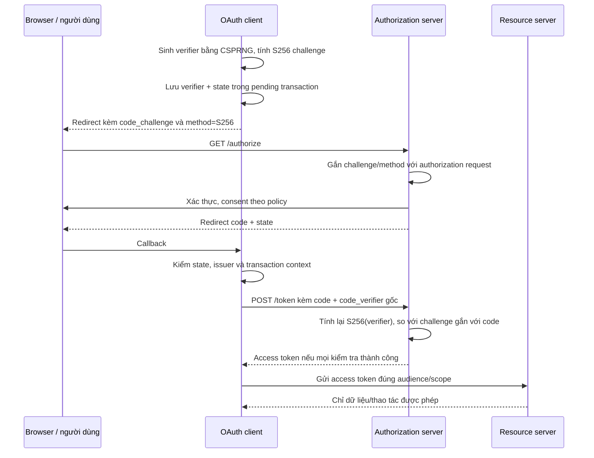
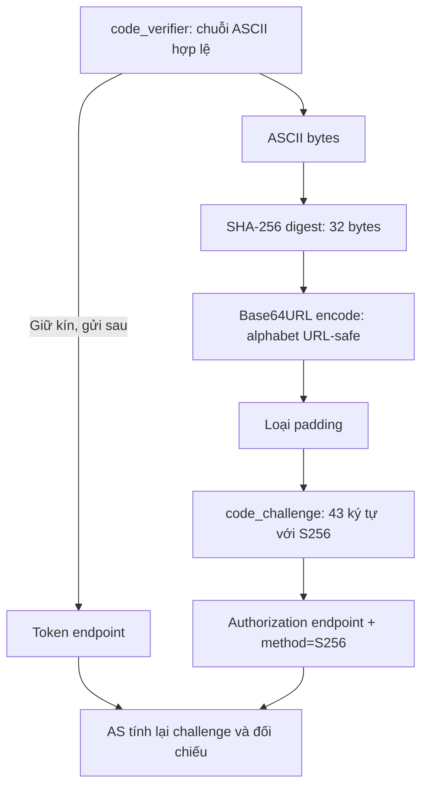
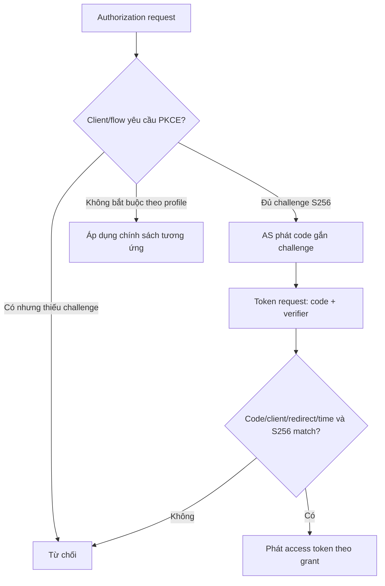

# S256 transformation

Một SPA hoặc ứng dụng mobile sử dụng **OAuth 2.0 Authorization Code flow**. Khi người dùng đồng ý cấp quyền, authorization server chuyển **authorization code** về ứng dụng qua browser hoặc cơ chế redirect. Nếu attacker nhìn thấy code đó, liệu họ có thể đổi code lấy access token trước client hợp lệ? **PKCE** (*Proof Key for Code Exchange*, đọc là “pixy”) được thiết kế để giảm rủi ro **authorization-code interception/injection** bằng cách buộc bên đổi code chứng minh rằng mình nắm **`code_verifier`** đã dùng khi bắt đầu giao dịch.

Trong PKCE, client tạo một bí mật ngẫu nhiên tạm thời `code_verifier` và gửi **`code_challenge`** trong authorization request. Với **S256 transformation**, challenge được tính bằng:

```text
code_challenge = BASE64URL-ENCODE(SHA256(ASCII(code_verifier)))
```

Trong công thức này, **BASE64URL-ENCODE phải bỏ padding `=`**. AS lưu challenge cùng authorization code. Khi client đổi code tại token endpoint, nó gửi **`code_verifier` gốc**, để AS tự tính lại S256 và đối chiếu. Kẻ chỉ lấy được authorization code **mà không có verifier tương ứng** không thể đổi code thành token khi AS thực thi PKCE đúng cách.

Bài học thuộc chương **PKCE** của module **SECURITY_TOKEN_SECURITY_FUNDAMENTALS**. Nội dung tập trung vào chính xác **S256 transformation**, đồng thời kết nối mô hình tin cậy và vòng đời token trong OAuth 2.0/OIDC: access token JWT/opaque, refresh token, issuer/audience/scope, token storage, thu hồi và phòng chống token theft/replay. S256 bảo vệ **một bước trong việc phát hành token**, không thay thế những kiểm soát sau khi token đã phát hành.

Kết thúc bài, bạn có thể:

- Tính **code challenge S256 đúng byte-by-byte** từ code verifier chuẩn RFC 7636.
- Phân biệt giá trị **ngẫu nhiên bí mật (`code_verifier`)** với **bản cam kết công khai (`code_challenge`)**, cùng với `code_challenge_method=S256`.
- Nhận diện các lỗi sử dụng Base64 chuẩn, giữ padding, băm chuỗi hex, băm sai bảng mã, hoặc tự giải mã verifier trước khi băm.
- Viết code Java và JavaScript để tạo challenge và tự kiểm bằng **test vector chính thức RFC 7636**.
- Giải thích AS cần lưu binding giữa authorization code và challenge, xác minh tại token endpoint và chống PKCE downgrade/stripping.
- Phân biệt S256 với **`state`, OIDC `nonce`, client authentication, TLS, audience, scope và DPoP**.
- Thiết kế kiểm thử cho code bị chặn, verifier sai, callback giả, multi-tab, replay, log leakage và JWT/opaque token sau token exchange.

## 1. PKCE đứng ở đâu trong Authorization Code flow?

OAuth Authorization Code flow tách **authorization endpoint** (client điều hướng browser đến AS) và **token endpoint** (client đổi code lấy token). PKCE thêm một cặp giá trị cho đúng giao dịch đó:

1. **Trước redirect:** client tạo `code_verifier` ngẫu nhiên, giữ kín và tính `code_challenge` bằng S256.
2. **Authorization request:** client gửi challenge và tên method `S256`; **không gửi verifier** tại bước này.
3. **AS phát code:** nếu yêu cầu được chấp thuận, AS gắn authorization code với challenge/method/client/redirect context.
4. **Token request:** client gửi authorization code cùng **verifier gốc**; confidential client còn xác thực chính mình theo hợp đồng.
5. **AS kiểm chứng:** AS tính lại `BASE64URL(SHA256(ASCII(verifier)))` và so với challenge đã lưu. Nếu không khớp, **không cấp token**.
6. **API sử dụng token:** resource server vẫn phải xác minh access token, audience, scope và quyền nghiệp vụ.



PKCE **không làm authorization code thành access token**. Code vẫn phải được AS cấp, có thời gian sống ngắn, dùng một lần, gắn với đúng client và redirect URI theo điều kiện OAuth.

## 2. Ba giá trị phải phân biệt

| Giá trị | Do ai tạo? | Xuất hiện ở đâu? | Mục đích |
| --- | --- | --- | --- |
| `code_verifier` | Client, bằng bộ sinh ngẫu nhiên mật mã học | Client giữ tạm; **gửi tới token endpoint** lúc đổi code | Bí mật chứng minh client bắt đầu flow |
| `code_challenge` | Client, biến đổi từ verifier | **Authorization request**; AS lưu cùng giao dịch/code | Bản cam kết để AS kiểm verifier về sau |
| `code_challenge_method` | Client chọn, AS phải hỗ trợ | Authorization request, ví dụ `S256` | Chỉ rõ phép biến đổi để AS tính lại |

Với method **`S256`**, một challenge chỉ là **digest của verifier được Base64URL-encode**, không phải verifier đã mã hóa để có thể giải ngược. Với verifier được tạo đủ ngẫu nhiên, kẻ quan sát challenge không thể thực tế suy ra verifier trong phạm vi an toàn thông thường.

**Không đánh đồng** challenge với `state` hoặc OIDC `nonce`. Chúng được sinh và kiểm ở những điểm khác nhau của flow:

- **`state`**: liên kết callback với **browser/authorization transaction**, phòng CSRF theo thiết kế.
- **`nonce` OIDC**: nếu gửi, được kiểm trong **ID token đã xác minh** để gắn ID token với authentication request.
- **`code_verifier`**: được AS kiểm ở **token endpoint** để ràng buộc authorization code với client tạo challenge.

## 3. Công thức S256 chính xác

RFC 7636, mục 4.2 định nghĩa:

```text
S256:
    code_challenge = BASE64URL-ENCODE(SHA256(ASCII(code_verifier)))

plain:
    code_challenge = code_verifier
```

Trong đó:

1. **`ASCII(code_verifier)`** chuyển đúng các ký tự verifier hợp lệ thành **byte ASCII**. Không tự thêm newline, không thêm khoảng trắng và không chuyển `code_verifier` thành chuỗi hex.
2. **`SHA256(...)`** tính digest SHA-256 của **chính byte verifier**. Digest có **32 byte** (256 bit).
3. **`BASE64URL-ENCODE(...)`** chuyển 32 byte digest thành **Base64URL**, dùng `-` thay cho `+`, `_` thay cho `/` và **bỏ `=` padding**.
4. **`code_challenge_method=S256`** nói rõ với AS phải áp dụng đúng cách tính trên khi đổi code.



### 3.1. Vì sao kết quả S256 có 43 ký tự?

SHA-256 luôn tạo 32 byte. Base64 biểu diễn 32 byte thành 44 ký tự **nếu có padding** vì cần hoàn chỉnh nhóm 4 ký tự. Với 32 byte, kết quả Base64 có **một dấu `=` ở cuối**. Loại dấu `=` đó sẽ còn **43 ký tự**.

Vì vậy, trong **S256 chuẩn**, một challenge hợp lệ do SHA-256 tạo ra luôn dài **43 ký tự**. Tuy nhiên, ABNF của `code_challenge` trong RFC cho phép 43–128 ký tự nhằm hỗ trợ cả các phương thức khác; **không nên suy ra một chuỗi 43 ký tự bất kỳ chắc chắn là challenge được tính đúng**.

### 3.2. S256 không phải mã hóa có khóa

SHA-256 là **hàm băm mật mã học**, không phải phép mã hóa đảo ngược. Base64URL là **mã hóa biểu diễn byte thành ký tự**, không phải cryptographic encryption.

S256 **không có shared secret của AS**, không ký JWT, không mã hóa authorization code và không chứng minh danh tính người dùng. Giá trị verifier có tính bí mật chủ yếu nhờ **CSPRNG/entropy**, còn challenge cho phép AS kiểm rằng verifier ở lần đổi code đúng với cam kết ban đầu.

## 4. Yêu cầu đối với `code_verifier` theo RFC 7636

RFC 7636 mục 4.1 xác định `code_verifier` là chuỗi entropy cao, gồm **43 đến 128 ký tự** trong tập `unreserved`:

```abnf
code-verifier = 43*128unreserved
unreserved = ALPHA / DIGIT / "-" / "." / "_" / "~"
```

Điều đó có nghĩa:

| Quy tắc | Ví dụ hợp lệ | Ví dụ không hợp lệ |
| --- | --- | --- |
| Độ dài | Từ 43 tới 128 ký tự | 20 ký tự hoặc 129 ký tự |
| Chữ cái | `A-Z` và `a-z` | Chữ có dấu như `á`, `Đ` |
| Chữ số | `0-9` | Không có lỗi riêng với chữ số, miễn đủ entropy |
| Dấu được phép | `-`, `.`, `_`, `~` | `+`, `/`, `=`, khoảng trắng |
| Nội dung | Chuỗi ngẫu nhiên bằng CSPRNG | Timestamp, username, UUID dễ dự đoán hoặc chuỗi cố định |

**Có đúng charset/độ dài chưa đồng nghĩa an toàn.** Ví dụ một chuỗi gồm 43 chữ `a` là hợp lệ về hình thức nhưng **entropy gần bằng không**; attacker đoán được verifier. Cần sinh từ **nguồn ngẫu nhiên an toàn**.

### 4.1. Cách sinh được RFC 7636 khuyến nghị

Một lựa chọn thực tế:

1. Sinh **32 byte** bằng cryptographically secure random number generator (CSPRNG).
2. Mã hóa 32 byte thành **Base64URL không padding**.
3. Nhận verifier **43 ký tự**, entropy đầu vào **256 bit** khi CSPRNG đạt chất lượng mật mã.

```text
code_verifier = BASE64URL-ENCODE(CSPRNG(32 bytes))
code_challenge = BASE64URL-ENCODE(SHA256(ASCII(code_verifier)))
```

**Hai lần Base64URL trong quá trình trên xử lý dữ liệu khác nhau**: lần đầu chuyển **byte ngẫu nhiên** thành verifier; lần sau chuyển **SHA-256 digest của chuỗi verifier** thành challenge.

Không nhầm thành `SHA256(32 random bytes)` khi cần tính challenge: AS sẽ băm **ASCII của verifier đã mã hóa**, không băm lại byte ngẫu nhiên gốc.

### 4.2. Những cách sinh verifier không an toàn

- `Math.random()`, timestamp, sequence number hoặc email/user ID.
- Dùng nguyên access token, refresh token, client secret hoặc password làm verifier.
- Sinh một verifier một lần khi cài app rồi dùng cho mọi lần đăng nhập.
- Tái sử dụng verifier cho nhiều tab/authorization codes đồng thời.
- Đưa verifier vào URL authorization, query của callback hoặc log để “tiện debug”.
- Dùng một nonce/csrf token quá ngắn rồi coi đó là verifier.

**Nguyên tắc:** mỗi **authorization request/giao dịch** cần **verifier riêng** và giữ đúng giá trị đó đến lúc đổi code, rồi tiêu thụ/xóa theo lifecycle.

## 5. Test vector chính thức từ RFC 7636

RFC 7636, Appendix B cung cấp một ví dụ chuẩn để kiểm tra code:

**Code verifier:**

```text
dBjftJeZ4CVP-mB92K27uhbUJU1p1r_wW1gFWFOEjXk
```

**S256 code challenge mong đợi:**

```text
E9Melhoa2OwvFrEMTJguCHaoeK1t8URWbuGJSstw-cM
```

Giá trị trên là **test vector công khai**, chỉ dùng cho kiểm thử/học tập, **tuyệt đối không dùng nó làm verifier thật trong production**. Một bản cài đặt S256 đúng phải biến đổi chuỗi verifier cố định đó thành **đúng từng ký tự** của challenge.

### 5.1. Lý giải dạng byte của test vector

`code_verifier` chỉ chứa ASCII unreserved. Việc chuyển thành byte không có dấu BOM, không thêm newline và không thay đổi chữ hoa/chữ thường. Hash tạo ra **byte digest nhị phân**; Base64URL-encode **digest nhị phân** thay vì hex string. Kết quả có ký tự `-` URL-safe, không có padding.

Không nên tự tìm challenge bằng cách nhìn test vector và thao tác thủ công; hãy dùng thư viện SHA-256/Base64URL đáng tin và thêm test chính xác vào unit-test suite.

## 6. Java 11+: tạo verifier và challenge đúng chuẩn

Java có `SecureRandom`, `MessageDigest` và `Base64.getUrlEncoder().withoutPadding()` để triển khai phép biến đổi mà không viết thuật toán mật mã thủ công:

```java
import java.nio.charset.StandardCharsets;
import java.security.MessageDigest;
import java.security.NoSuchAlgorithmException;
import java.security.SecureRandom;
import java.util.Base64;

public final class PkceS256 {
    private static final SecureRandom RANDOM = new SecureRandom();

    private PkceS256() {
    }

    public static String newCodeVerifier() {
        byte[] randomBytes = new byte[32];
        RANDOM.nextBytes(randomBytes);
        // 32 random bytes -> Base64URL không padding -> 43 ký tự.
        return Base64.getUrlEncoder()
                .withoutPadding()
                .encodeToString(randomBytes);
    }

    public static String codeChallenge(String codeVerifier) {
        if (codeVerifier == null
                || !codeVerifier.matches("[A-Za-z0-9._~-]{43,128}")) {
            throw new IllegalArgumentException(
                    "code_verifier không đúng RFC 7636"
            );
        }
        try {
            // Hash ASCII của CHUỖI verifier, không hash byte
            // random nguyên thủy, không hash chuỗi hex.
            byte[] digest = MessageDigest.getInstance("SHA-256").digest(
                    codeVerifier.getBytes(StandardCharsets.US_ASCII)
            );
            return Base64.getUrlEncoder()
                    .withoutPadding()
                    .encodeToString(digest);
        } catch (NoSuchAlgorithmException e) {
            throw new IllegalStateException("SHA-256 không khả dụng", e);
        }
    }

    public static void main(String[] args) {
        String verifier = newCodeVerifier();
        String challenge = codeChallenge(verifier);
        System.out.println("Verifier length: " + verifier.length());
        System.out.println("Challenge length: " + challenge.length());
        // Không log giá trị verifier trong ứng dụng thật!
    }
}
```

Đây là ví dụ **có thể dùng để học thuật toán**. Một ứng dụng OAuth thật phải bổ sung bảo vệ transaction store, redirect/PKCE state, HTTP client và token validation. `SecureRandom` cần chạy trên runtime đáng tin, verifier không xuất hiện trong logs hoặc telemetry.

### 6.1. Unit test Java với vector RFC

```java
// Minh họa JUnit 5; đặt trong test suite thực tế của ứng dụng.
import static org.junit.jupiter.api.Assertions.assertEquals;
import org.junit.jupiter.api.Test;

class PkceS256Test {
    @Test
    void matchesRfc7636AppendixB() {
        String verifier =
                "dBjftJeZ4CVP-mB92K27uhbUJU1p1r_wW1gFWFOEjXk";
        String expected =
                "E9Melhoa2OwvFrEMTJguCHaoeK1t8URWbuGJSstw-cM";

        assertEquals(expected, PkceS256.codeChallenge(verifier));
    }
}
```

Test này rất quan trọng: các lỗi băm sai đầu vào hoặc dùng Base64 thông thường có thể “trông có vẻ đúng” nhưng không khớp AS.

### 6.2. Kiểm tra giá trị verifier

Đoạn regex `[A-Za-z0-9._~-]{43,128}` kiểm hình thức. Một verifier tự tạo từ chuỗi lặp vẫn có thể qua regex, nên **code sinh verifier** phải đảm bảo entropy. AS thường chỉ thấy verifier ở token request và không thể tự chứng minh nó được sinh ngẫu nhiên; **trách nhiệm nguồn ngẫu nhiên thuộc client**.

## 7. JavaScript browser: Web Crypto và Base64URL

Với SPA, dùng **Web Crypto API** thay vì `Math.random()` hoặc tự viết SHA-256. Một cách minh họa có thể dùng trong browser secure context:

```javascript
function base64url(bytes) {
  // Chuyển các byte thành binary string để btoa hoạt động.
  let binary = "";
  for (const byte of bytes) binary += String.fromCharCode(byte);
  return btoa(binary)
    .replace(/\+/g, "-")
    .replace(/\//g, "_")
    .replace(/=+$/g, "");
}

function createVerifier() {
  const randomBytes = new Uint8Array(32);
  crypto.getRandomValues(randomBytes);
  return base64url(randomBytes);
}

async function s256Challenge(verifier) {
  if (!/^[A-Za-z0-9._~-]{43,128}$/.test(verifier)) {
    throw new Error("Invalid PKCE verifier");
  }
  const asciiBytes = new TextEncoder().encode(verifier);
  const hashBuffer = await crypto.subtle.digest("SHA-256", asciiBytes);
  return base64url(new Uint8Array(hashBuffer));
}

const verifier = createVerifier();
const challenge = await s256Challenge(verifier);
// Lưu verifier trong giao dịch OAuth, không gửi nó lên /authorize.
// Authorization request: code_challenge=challenge,
// code_challenge_method=S256.
```

`TextEncoder` xuất UTF-8, nhưng vì verifier chỉ có ASCII unreserved, byte UTF-8 ở đây **trùng byte ASCII** mà RFC yêu cầu. Chính regex giới hạn đầu vào là điều kiện quan trọng. Không dùng chuỗi Unicode tùy ý hay ký tự có dấu làm verifier.

### 7.1. Không đưa `code_verifier` vào query URL

Lỗi thường gặp:

```text
SAI: /authorize?...&code_verifier=<secret>
ĐÚNG: /authorize?...&code_challenge=<S256-result>&code_challenge_method=S256
```

`code_verifier` chỉ xuất hiện ở **token request** qua kênh được bảo vệ. Query URL có thể bị ghi trong history, logs, referrer và công cụ đo lường. Việc gửi verifier cùng authorization request làm mất mục tiêu của PKCE: attacker quan sát code và verifier sẽ có thể đổi code nếu các điều kiện khác cho phép.

## 8. Mẫu request Authorization Code + S256

Client tạo transaction:

```text
state = high-entropy-random-state-for-this-browser-transaction
code_verifier = CSPRNG-generated-43-char-verifier
code_challenge = BASE64URL(SHA256(ASCII(code_verifier)))
code_challenge_method = S256
expected_issuer = https://login.example.com
requested_scopes = openid orders.read
expected_resource = https://api.example.com/orders
redirect_uri = https://shop.example.com/oauth/callback
```

Authorization request về mặt HTTP có dạng:

```http
GET /authorize?response_type=code&client_id=orders-web&redirect_uri=https%3A%2F%2Fshop.example.com%2Foauth%2Fcallback&scope=openid%20orders.read&state=<random-state>&code_challenge=<43-char-challenge>&code_challenge_method=S256 HTTP/1.1
Host: login.example.com
```

**Các placeholder không phải giá trị thực.** Trong request thật, URL cần URL-encode đúng tham số. AS phải biết client/redirect URI được đăng ký, scope/grant được cho phép và phương thức challenge phù hợp. Màn hình login/consent thuộc AS/OP, không phải client tự xin password người dùng.

### 8.1. Vì sao challenge được phép nằm trong URL?

Challenge là **bản cam kết từ verifier**; mục tiêu thiết kế là có thể công bố nó trong authorization request mà **không tiết lộ verifier gốc** nếu verifier đủ ngẫu nhiên. Tuy nhiên, authorization URL vẫn có `state`, requested scope và metadata có thể nhạy cảm về quyền riêng tư; không nên log URL thô hoặc gửi cho hệ thống phân tích không cần thiết.

Challenge không làm AS tin rằng client đã đăng nhập: **chứng minh possession chỉ diễn ra khi client gửi verifier tại token endpoint**.

## 9. Callback và token request: gửi verifier gốc

Sau khi AS chấp thuận, browser được redirect về registered redirect URI:

```http
HTTP/1.1 302 Found
Location: https://shop.example.com/oauth/callback?code=<one-time-code>&state=<same-random-state>
```

Client **trước tiên kiểm `state`**, browser/session transaction, expected issuer, redirect URI và các điều kiện chống mix-up theo thiết kế. Sau đó nó tìm `code_verifier` đã **lưu tại chính transaction này** và gửi token request:

```http
POST /oauth2/token HTTP/1.1
Host: login.example.com
Content-Type: application/x-www-form-urlencoded
Accept: application/json

grant_type=authorization_code&code=<one-time-code>&redirect_uri=https%3A%2F%2Fshop.example.com%2Foauth%2Fcallback&client_id=orders-web&code_verifier=<original-verifier>
```

`code_verifier` phải là **chuỗi gốc**, không phải `code_challenge`, không phải chuỗi digest hex, không phải hash Base64 lần nữa. AS nhận chính verifier, **tự tính S256** rồi so với challenge được lưu theo authorization code.

Với **confidential client**, token endpoint còn phải thực hiện client authentication theo phương thức được đăng ký (ví dụ client secret, private-key JWT hoặc mTLS). **PKCE không thay thế client authentication**; client secret cũng không thay thế S256.

### 9.1. Kiểm chứng bên phía authorization server

Pseudocode:

```text
function exchangeAuthorizationCode(code, verifier, authenticatedClient,
                                   presentedRedirectUri):
    authorization = lookupAuthorizationCode(code)
    require authorization exists and notExpired and notConsumed
    require authorization.clientId == authenticatedClientOrRegisteredPublicId
    require redirectUriMatchesAuthorization(presentedRedirectUri)
    require authorization.pkceMethod == "S256"
    require authorization.hasPkceChallenge
    require verifier conforms to RFC7636 syntax

    candidateChallenge = BASE64URL(SHA256(ASCII(verifier)))
    require secureEqual(candidateChallenge, authorization.pkceChallenge)

    atomicallyConsume(authorization)
    issueAccessTokenUnderGrantedScopesAndAudience()
```

Đây là **pseudocode**, không phải đầy đủ mọi điều kiện của token endpoint OAuth. Trong thực tế, client identity, redirect URI, grant, scope/resource, code lifetime, one-time use và phương thức PKCE đều phải được kiểm tra theo chuẩn và policy.

Việc so sánh nên tránh tạo kênh rò rỉ không cần thiết (constant-time comparison khi phù hợp), đồng thời đặt giới hạn độ dài/charset trước xử lý. Tuy nhiên **kiểm tra đúng binding giữa authorization code và challenge** quan trọng hơn việc chỉ có một lời gọi hash.

## 10. Authorization server phải lưu những gì?

Khi cấp authorization code, AS cần giữ thông tin để kiểm token exchange:

```text
AuthorizationCodeRecord {
    code_digest: <protected lookup value>,
    client_id: orders-web,
    redirect_uri: https://shop.example.com/oauth/callback,
    code_challenge: <S256 challenge>,
    code_challenge_method: S256,
    subject: <authorized principal>,
    granted_scopes: [openid, orders.read],
    target_resource: https://api.example.com/orders,
    issued_at: ...,
    expires_at: ...,
    consumed_at: null,
    additional_grant_context: ...
}
```

Đây là **schema khái niệm**. AS có thể dùng database, cache hoặc authorization record được bảo vệ khác. Điều quan trọng:

- **Challenge/method phải gắn với chính authorization code**, không phải một biến “lastChallenge” toàn cục của client.
- **Method phải được lưu hoặc ràng buộc có toàn vẹn**, không để attacker chỉ định method khác lúc đổi token.
- Code phải **ngắn hạn, dùng một lần, gắn với client/redirect context**.
- **Granted scopes và audience** do AS xác định, không tự cấp theo giá trị client gửi tại token endpoint.
- Không lưu code hoặc token plaintext trong log; có thể dùng digest/HMAC cho lookup nếu thiết kế phù hợp.
- Cần transaction/atomic consume để hai request dùng cùng code không cùng thành công.

### 10.1. AS chỉ lấy challenge từ token request là sai

Anti-pattern:

```text
POST /token
    code=stolen-code
    code_verifier=attacker-verifier
    code_challenge=SHA256(attacker-verifier)    # attacker tự khai
```

Nếu AS tin challenge do **token request** tự khai, attacker có thể tạo cặp verifier/challenge mới từ code đã đánh cắp. **Challenge phải được ràng buộc tại authorization endpoint trước khi AS phát code**; token endpoint không cho đổi challenge.

## 11. Vì sao S256 mạnh hơn `plain`?

RFC 7636 định nghĩa hai phương thức:

| Method | Challenge | Điều người quan sát thấy |
| --- | --- | --- |
| `plain` | `code_challenge = code_verifier` | Verifier xuất hiện trực tiếp trong authorization request |
| **`S256`** | `code_challenge = BASE64URL(SHA256(ASCII(verifier)))` | Chỉ thấy hash-derived challenge, không có verifier gốc |

Với `plain`, nếu attacker quan sát được **authorization request** và **authorization response/code**, họ có đủ verifier để thử token exchange. `S256` được thiết kế để chống kịch bản **đọc được request lẫn response nhưng không có bí mật verifier gốc**.

Theo RFC 7636, client có khả năng S256 **phải dùng S256**; `plain` chỉ dành cho trường hợp không thể hỗ trợ S256 theo điều kiện của RFC. Theo thực hành bảo mật hiện đại/RFC 9700, **nên cấu hình AS và clients dùng S256**, tránh fallback/hạ cấp không cần thiết.

### 11.1. Không tự fallback sang `plain` khi AS báo lỗi

Đoạn xử lý nguy hiểm:

```text
try S256
if server returns any error:
    retry with plain and same verifier          # SAI
```

Attacker có thể lợi dụng đường fallback hoặc một AS cấu hình sai để downgrade. Thay vào đó:

1. Kiểm metadata/capability của AS đã cấu hình.
2. Sử dụng `S256` theo profile hiện đại.
3. Nếu AS thật sự không hỗ trợ S256, **dừng và sửa cấu hình/đánh giá hỗ trợ**, không âm thầm giảm bảo vệ.
4. Không gửi verifier gốc trong authorization request để “thử cho chạy được”.

### 11.2. Method bị bỏ trống

RFC 7636 định nghĩa rằng **nếu `code_challenge_method` bị bỏ qua thì method mặc định là `plain`** để tương thích. Vì vậy, một client định dùng S256 phải **gửi tường minh `code_challenge_method=S256`**.

AS cần có chính sách chống **PKCE stripping/downgrade**: không cho một yêu cầu token không có verifier “vượt” bước kiểm nếu authorization request đáng lẽ phải dùng PKCE; nên yêu cầu PKCE đối với các clients/flows thuộc diện bảo vệ.

## 12. Phân tích mối đe dọa: attacker biết code nhưng không biết verifier

Giả sử SPA bắt đầu Authorization Code + PKCE:

- Verifier `V` được sinh ngẫu nhiên và giữ trong transaction store của client.
- Challenge `C = S256(V)` được gửi đến AS.
- AS phát authorization code `K` gắn với `C`.
- Attacker chặn được `K` qua redirect URI hoặc lỗ hổng rò URL nhưng **không có `V`**.

Attacker thử:

```text
POST /token
    code = K
    code_verifier = V_attacker
```

AS tính `S256(V_attacker)` và so với `C`. Không khớp ⇒ **từ chối**. Attacker không thể đổi code chỉ bằng cách biết challenge `C` vì muốn tìm verifier hợp lệ cần giải bài toán tiền ảnh trên SHA-256 đối với verifier có entropy cao.

**Giới hạn của kết luận này:** nếu attacker kiểm soát JavaScript của client, lấy được **cả code và verifier**, hoặc khiến chính client thực hiện token exchange theo ý mình, PKCE không còn bảo vệ như mô hình chỉ chặn code. **PKCE không phải bảo vệ XSS, endpoint RCE hoặc token theft sau khi issuance.**

### 12.1. Authorization-code injection

Không chỉ code interception: attacker có thể cố **chèn code của giao dịch khác** vào callback của client. Với PKCE được thực thi đúng, code của attacker thường gắn với **challenge khác** nên không thể đổi bằng verifier của transaction nạn nhân. Dù vậy client vẫn cần **đối chiếu state/transaction, issuer và redirect context**; không dùng PKCE làm lý do tự bỏ mọi bảo vệ callback.

### 12.2. Attacker tạo sẵn verifier biết trước

Nếu ứng dụng dùng **verifier cố định** cho mọi login, attacker có thể biết nó qua binary/source hoặc đoán cấu hình, khiến S256 không còn chứng minh mỗi flow được bắt đầu bởi đúng client instance. **S256 chỉ mạnh khi verifier bí mật và khó đoán**.

## 13. PKCE stripping và enforcement tại AS

Một lỗi nghiêm trọng là AS/SDK chấp nhận **cùng một client hoặc grant** theo hai đường:

1. Authorization request có `code_challenge`; token endpoint bắt verifier.
2. Authorization request **bị loại mất challenge** nhưng AS vẫn phát code, và token endpoint cho đổi code **không có verifier**.

Nếu attacker có thể loại/thay tham số challenge trong một ngữ cảnh nào đó, bước bảo vệ bị phá. Biện pháp:

- AS **bắt buộc PKCE** cho các OAuth clients/flows được cấu hình yêu cầu, đặc biệt public clients.
- Khi authorization code đã gắn `S256`, token endpoint **bắt buộc kiểm verifier**, không có nhánh bỏ qua.
- Không cho token request bổ sung/thay đổi challenge/method đã lưu.
- Từ chối method không hỗ trợ và các dạng challenge/verifier sai cú pháp.
- Bảo vệ authorization endpoint, redirect URI, registration và state/issuer context.
- Theo dõi telemetry cho token exchange bị lỗi `invalid_grant` theo nguyên nhân nội bộ mà không log bí mật.



### 13.1. Metadata về method hỗ trợ

OAuth Authorization Server Metadata (RFC 8414) có thể công bố trường `code_challenge_methods_supported`, ví dụ:

```json
{
  "issuer": "https://login.example.com",
  "authorization_endpoint": "https://login.example.com/authorize",
  "token_endpoint": "https://login.example.com/oauth2/token",
  "code_challenge_methods_supported": ["S256"]
}
```

Trường metadata này **không phải lúc nào cũng hiện diện**. Client không được tự tin một AS lạ chỉ vì nó công bố `S256`. Issuer, endpoints, đăng ký client và metadata phải thuộc **nguồn tin cậy được quản lý**, đồng thời khả năng S256 được kiểm thử trong tích hợp thực tế.

## 14. PKCE trong SPA, mobile và confidential backend

| Kiến trúc | Vì sao cần S256? | Verifier lưu ở đâu? | Điều còn phải bảo vệ |
| --- | --- | --- | --- |
| **SPA public client** | Code đi qua browser; không có client secret giữ kín | Transient transaction trong memory/storage SDK phù hợp redirect | XSS, state/session, callback, access/refresh token |
| **Native mobile public client** | Code có thể bị chặn qua redirect handler/deep link | Transient app state, gắn với flow của app instance | System browser, redirect URI, keychain/keystore, mất thiết bị |
| **CLI/native desktop** | Redirect localhost/custom scheme có thể bị listener khác chặn | Process memory/OS credential context tạm | Localhost binding, session/user separation, history/logs |
| **Confidential web/BFF client** | Thêm defense in depth chống code interception/injection | Server-side pending transaction store | Client authentication, session cookie, CSRF, KMS/DB |

**S256 có giá trị cả với confidential clients**; client authentication và PKCE giải hai nhiệm vụ khác nhau. Một backend có client secret an toàn vẫn có thể bị **authorization code injection** nếu callback/session binding sai.

### 14.1. SPA cần giữ verifier qua redirect

Khi SPA redirect khỏi trang, JavaScript memory có thể biến mất. OAuth SDK có thể lưu `state`, `code_verifier` và metadata liên quan trong **sessionStorage hoặc cơ chế giao dịch tạm thời** để có thể xử lý callback. Điều đó không tự tạo môi trường an toàn trước XSS:

- `code_verifier` là secret tạm; chỉ giữ trong thời gian hoàn tất authorization flow.
- Không lưu verifier ở `localStorage` vĩnh viễn hoặc dùng chung nhiều flows.
- Không ghi verifier vào URL, source maps, logs hoặc metrics.
- Khi callback hoàn tất hoặc hết hạn, **xóa transaction**.

### 14.2. Mobile redirect không thay PKCE

Native apps thường dùng **Authorization Code + PKCE** qua browser của hệ điều hành, không nhúng web login giả trong app để thu mật khẩu. Với custom URL scheme, một app khác có thể đăng ký scheme tương tự; với claimed HTTPS links, vẫn cần kiểm domain/app association. PKCE giảm rủi ro **code bị app khác nhận**, nhưng phải kết hợp redirect URI registration/validation.

### 14.3. BFF giữ verifier và OAuth token ngoài browser

BFF tạo verifier và state trên backend, browser chỉ nhận redirect và sau login có session cookie `HttpOnly`/`Secure`/`SameSite` phù hợp. BFF cần ràng buộc transaction với browser session. **Không chỉ lookup verifier theo `state` không có session binding**, vì attacker có thể cố gắn callback của mình vào phiên nạn nhân.

## 15. Nhiều tabs và nhiều authorization requests

Một ứng dụng web có thể mở hai Authorization Code flows đồng thời:

| Transaction | State | Verifier | Challenge | Scopes |
| --- | --- | --- | --- | --- |
| A | `state-A` | `verifier-A` | `S256(verifier-A)` | `openid orders.read` |
| B | `state-B` | `verifier-B` | `S256(verifier-B)` | `openid orders.create` |

Client **không được** chỉ giữ một biến `latestVerifier`. Nếu callback A đến sau callback B, code A phải được đổi bằng **verifier-A**, không phải verifier-B.

**Thiết kế đúng:**

1. Mỗi flow có **state và verifier riêng**, không chia sẻ.
2. Transaction store giữ mapping `state → verifier, issuer, redirect URI, scopes, nonce, expiresAt`.
3. Callback kiểm state **thuộc browser/session hiện tại**, chưa hết hạn/chưa dùng.
4. Client lấy đúng verifier của transaction ấy và đổi code ở **đúng token endpoint**.
5. Consume transaction một lần; request callback lặp không dùng lại code/verifier cũ.
6. Giới hạn số pending flows và thời hạn để tránh DoS/memory leak.

PKCE hoạt động đúng **trên từng authorization code**, không phải “một challenge dùng cho toàn bộ client”.

## 16. PKCE, state, nonce, redirect URI và issuer: lớp bảo vệ khác nhau

| Cơ chế | Kiểm tra tại đâu? | Ngăn/giảm rủi ro chính |
| --- | --- | --- |
| **S256 PKCE** | AS token endpoint | Authorization code bị chặn/chèn nhưng attacker không giữ verifier |
| **`state`/browser transaction binding** | OAuth client callback | Callback không thuộc phiên, login CSRF và nhầm transaction |
| **OIDC `nonce`** | OIDC client khi kiểm ID token | ID token không gắn authentication request/replay theo profile |
| **Registered redirect URI** | AS authorization/token endpoint và client | Chuyển code tới URI attacker hoặc nhầm client |
| **Issuer identification (`iss`)** | OAuth client và RS theo profile | Mix-up giữa nhiều authorization servers |
| **Client authentication** | AS token endpoint | Chứng minh confidential client có credential được đăng ký |
| **TLS** | Toàn bộ network paths | Nghe lén/giả mạo kênh mạng |
| **Audience (`aud`)** | Resource server khi kiểm access token | Token đúng nhưng được phát cho API khác |
| **Scope + object policy** | Resource server | Thao tác hoặc dữ liệu mà token/chủ thể không được phép |

**Không có một cơ chế nào thay thế tất cả cơ chế còn lại.** Một `state` đúng không chứng minh `code_verifier` đúng; một `code_verifier` đúng không chứng minh user có quyền với tất cả Orders; một ID token có nonce đúng không được dùng làm Bearer access token cho API.

### 16.1. Lưu ý về CSRF và PKCE

OAuth Security BCP (RFC 9700) phân tích rằng **PKCE có thể cung cấp bảo vệ CSRF trong điều kiện triển khai phù hợp**, đặc biệt khi AS thực thi đúng việc gắn code với challenge. Tuy vậy, ứng dụng nhiều tabs, nhiều providers, login session hoặc nghiệp vụ có callback context thường cần cơ chế **transaction binding tường minh**.

Với bài này, mẫu thực hành là **PKCE S256 + state ngẫu nhiên gắn browser session + issuer/redirect binding**. Đây là cấu hình dễ giải thích và kiểm thử; không nên kết luận “dùng PKCE là bỏ state/nonce được” nếu chưa đánh giá profile, SDK và security model.

### 16.2. OIDC Code Flow

OIDC client có thể gửi `scope=openid` và `nonce` theo profile. Nếu gửi nonce, client phải kiểm claim trong **ID token đã xác minh**. PKCE bảo vệ authorization code, **không xác minh chữ ký ID token**. ID token được kiểm `iss`, `aud` là client ID, `exp`, nonce theo điều kiện.

Orders API tiếp tục chỉ nhận **access token** đúng audience. Không đưa ID token đến API chỉ vì cùng issuer hoặc user subject.

## 17. Những lỗi Base64/SHA-256 thường gặp

| Lỗi | Kết quả sai | Cách đúng |
| --- | --- | --- |
| Hash **byte ngẫu nhiên ban đầu** thay ASCII của verifier | Challenge khác AS tính | `SHA256(ASCII(code_verifier))` |
| Băm chuỗi **hex của verifier** | Thay đổi toàn bộ input | Băm trực tiếp byte ASCII verifier |
| Mã hóa digest SHA-256 thành **hex 64 ký tự** | Không phải S256 challenge RFC 7636 | Base64URL của **32-byte digest** |
| Dùng Base64 chuẩn với `+`, `/` | Ký tự sai alphabet URL-safe | Base64URL `-`, `_` |
| Giữ padding `=` | S256 challenge dài 44 thay vì 43 | **Bỏ padding** |
| Hash `verifier + "\\n"` do lệnh shell echo | Digest sai | Không thêm newline/space |
| Trim/normalize/verifier to lowercase | Verifier bị biến đổi | Dùng đúng chuỗi verifier nguyên vẹn |
| Tạo verifier từ Unicode `á`/emoji | Sai charset chuẩn | ASCII unreserved 43–128 ký tự |
| Sử dụng challenge làm verifier | AS tính S256 của challenge, mismatch | Token request gửi **verifier gốc** |
| Gửi `code_challenge_method=plain` khi đã hash | AS xử lý plain, mismatch hoặc downgrade | Tường minh `S256` |
| Bỏ method và tưởng default S256 | RFC default là plain | Tường minh `code_challenge_method=S256` |
| Sinh verifier 12 ký tự hoặc chuỗi tuần tự | Dễ đoán/không đạt ABNF | CSPRNG ≥ 32 byte, Base64URL |

### 17.1. Ví dụ “double encoding”

Sai:

```text
randomBytes = CSPRNG(32)
verifier = BASE64URL(randomBytes)
challenge = BASE64URL(SHA256(BASE64URL(ASCII(verifier))))
```

Đúng:

```text
randomBytes = CSPRNG(32)
verifier = BASE64URL(randomBytes)
challenge = BASE64URL(SHA256(ASCII(verifier)))
```

Ở bản sai, client đã Base64URL-encode **chuỗi verifier** một lần không cần thiết trước khi hash, khiến challenge khác AS tính khi AS nhận verifier gốc.

### 17.2. Vì sao không dùng charset mặc định?

Verifer chuẩn chỉ cho ASCII, vì vậy `StandardCharsets.US_ASCII` trong Java biểu đạt ý định rõ ràng. UTF-8 của ký tự ASCII cũng cho cùng byte, nhưng nếu code không giới hạn charset/length thì dễ đưa Unicode ngoài tập hợp vào flow và khác kỳ vọng. **Validate syntax trước khi tính S256**.

## 18. Cách debug lỗi `invalid_grant` do S256

Khi token endpoint từ chối code exchange, RFC OAuth thường dùng `invalid_grant` cho code không hợp lệ/không khớp binding. Không có một thông báo chuẩn “SHA-256 mismatch” phải trả chi tiết cho client.

Hãy kiểm tra theo thứ tự **mà không in secrets vào log**:

1. **Client có dùng đúng `state`/transaction?** Có bị trộn verifier giữa hai tabs không?
2. **Verifier đúng syntax?** 43–128 ký tự, ASCII unreserved, không padding, không newline?
3. **Challenge có khớp test vector RFC 7636?** Nếu không, lỗi tính hash/Base64URL.
4. **Authorization request có `code_challenge_method=S256`?** Có bị bỏ hoặc proxy rewrite không?
5. **AS có lưu challenge/method với chính code?** Có trạng thái global bị ghi đè không?
6. **Token request có gửi verifier gốc?** Không gửi challenge, không gửi hash hex.
7. **Client ID/redirect URI/issuer đúng giao dịch?** Có gọi nhầm token endpoint không?
8. **Code còn hạn/chưa dùng?** Browser callback duplicate hoặc retry sau AS đã consume code?
9. **Confidential client authentication có hợp lệ?** Lỗi này độc lập với PKCE.
10. **Network/URL encoding có biến đổi verifier?** HTTP form serializer có đúng không?

**Không tắt PKCE để “tìm ra lỗi” trong môi trường production.** Có thể kiểm bằng test vector trong unit tests và diagnostic metadata không chứa verifier, challenge, code hoặc access token.

### 18.1. Log gì cho an toàn?

Nên ghi: correlation ID nội bộ, issuer identifier, client ID theo policy, method=S256, chiều dài verifier/challenge (nếu cần), bước thất bại và mã lỗi. **Không ghi giá trị `code_verifier`, authorization code, access token, refresh token**. Ngay cả challenge dù không phải bí mật như verifier cũng nên hạn chế ghi cùng transaction IDs để giảm theo dõi/liên kết không cần thiết.

### 18.2. Lỗi băm đúng nhưng AS vẫn từ chối

Test vector khớp **chỉ xác nhận thuật toán S256 client đúng**. AS vẫn có thể từ chối nếu code hết hạn, đã dùng, khác client, redirect URI mismatch, client authentication không hợp lệ, grant bị hủy hoặc token request không đúng HTTP form. Phân biệt **sai PKCE transformation** với **sai OAuth transaction binding**.

## 19. PKCE không bảo vệ access/refresh token sau khi phát hành

Khi code exchange thành công, AS có thể trả:

```json
{
  "access_token": "<orders-access-token>",
  "token_type": "Bearer",
  "expires_in": 600,
  "scope": "orders.read",
  "refresh_token": "<optional-refresh-token>"
}
```

**PKCE kết thúc vai trò chính ở việc đổi authorization code**. Nó không tự:

- Ngăn JavaScript XSS đọc access token nếu SPA lưu trong `localStorage`.
- Ngăn attacker dùng **bản sao bearer access token** khi token còn hạn.
- Làm một JWT access token có đúng `aud`, `iss`, `exp` hoặc scope.
- Khiến refresh token luôn bị rotation/revocation.
- Chặn việc client gửi token đến sai API.
- Kiểm owner/tenant hoặc role nghiệp vụ.

### 19.1. JWT và opaque token đều cần resource server validation

| Access token | Resource server kiểm | PKCE có thay thế được không? |
| --- | --- | --- |
| **JWT access token (JWS)** | Chữ ký, algorithm/key, `iss`, `aud`, `exp`, `nbf`, type/profile, scope, object policy | **Không** |
| **Opaque access token** | Introspection `active` từ AS đáng tin, resource binding/audience, scope, expiry/policy | **Không** |
| **Sender-constrained token** | Các kiểm tra trên + DPoP proof/mTLS certificate binding | **Không** |

Không gửi `code_verifier` tới resource server. Verifier chỉ phục vụ AS/token endpoint trong Authorization Code exchange.

### 19.2. Refresh token được cấp có bắt buộc không?

Không. Authorization Code + PKCE có thể trả chỉ access token hoặc thêm refresh token theo chính sách AS. Nếu refresh token được cấp cho **public client**, OAuth Security BCP yêu cầu rotation hoặc sender constraint để giảm replay theo điều kiện áp dụng. Với confidential BFF, refresh token cần client binding, server-side storage, expiry/revocation và policy tương ứng.

**S256 không biến public client thành confidential client** và cũng không giảm yêu cầu quản lý refresh token.

## 20. Phân tích tình huống thực hành

### 20.1. Tình huống A: hacker chỉ thấy authorization code

Một mobile app dùng S256 và giữ verifier trong app context. App giả mạo redirect nhận được code nhưng không có verifier. Nếu AS kiểm PKCE đúng, **token exchange của attacker bị từ chối**. Đây là mục tiêu cốt lõi.

**Giới hạn:** nếu attacker cũng đọc bộ nhớ app và lấy verifier, S256 không cứu được. Phải bảo vệ runtime/OS storage và token sau issuance.

### 20.2. Tình huống B: hai tabs dùng một verifier chung

Tab A và B login gần nhau. Client dùng một `globalVerifier`, bị ghi đè bởi tab B. Callback của A tới sau và dùng verifier B. **Kết quả đúng** khi AS bảo vệ PKCE: token request A bị từ chối. **Cách sửa:** transaction mapping theo state + verifier riêng; không tắt PKCE để qua lỗi.

### 20.3. Tình huống C: frontend gửi verifier lên authorization URL

Một nhà phát triển debug và thêm `code_verifier` vào URL `/authorize`. Attackers/telemetry có thể nhìn thấy secret. Dù code challenge vẫn đúng, **mục tiêu chống code interception bị suy yếu**. Xóa việc truyền verifier, thu hồi/test lại các flows bị ảnh hưởng.

### 20.4. Tình huống D: ứng dụng dùng `plain` vì “dễ tính”

Client dùng `code_challenge=verifier` ở query. Attackers quan sát request có thể biết verifier. **Giải pháp:** dùng `S256`, kiểm AS support; không giữ fallback xuống plain không được đánh giá.

### 20.5. Tình huống E: JWT access token đúng S256 nhưng sai audience

Client đổi code thành access token dành cho Reports API, rồi gửi đến Orders API. Orders phải **từ chối** vì audience, bất kể Authorization Code trước đó dùng PKCE đúng. **PKCE bảo vệ code exchange, audience bảo vệ resource server.**

### 20.6. Tình huống F: nonce/state thiếu, verifier vẫn đúng

Một callback giả hoặc nhầm issuer có thể mang authorization code/verifier liên quan đến giao dịch không đúng browser/session. Nếu client không xác minh state và issuer context, có thể phát sinh login confusion dù AS dùng PKCE. **Kết hợp transaction binding và PKCE**, không phân công sai trách nhiệm.

### 20.7. Tình huống G: verifier được tái sử dụng vô hạn

Mobile app tạo verifier một lần khi cài và lưu mãi trong cài đặt. Nếu attacker lấy được nó, nhiều authorization codes tương lai có thể bị lạm dụng; việc dùng S256 không cứu thiết kế entropy/lifecycle. **Mỗi authorization transaction cần verifier mới**, xóa sau khi kết thúc.

## 21. Ma trận kiểm thử S256 transformation

| # | Test input / hành vi | Kết quả mong đợi |
| --- | --- | --- |
| 1 | RFC 7636 verifier Appendix B | S256 challenge **đúng tuyệt đối** với RFC vector |
| 2 | 32 bytes CSPRNG được Base64URL | Verifier 43 ký tự, syntax hợp lệ |
| 3 | 43-char verifier ngẫu nhiên | Challenge SHA-256 Base64URL đúng 43 ký tự |
| 4 | Verifier 42 ký tự | Client/AS từ chối |
| 5 | Verifier 129 ký tự | Client/AS từ chối |
| 6 | Verifier chứa `+`, `/` hoặc `=` | Từ chối sai charset |
| 7 | Verifier chứa khoảng trắng, newline hoặc Unicode | Từ chối |
| 8 | Verifier toàn ký tự giống nhau | Test entropy policy của generator; không sử dụng làm secret production |
| 9 | Hash byte ngẫu nhiên gốc thay vì ASCII verifier | Không trùng RFC vector |
| 10 | Hash chuỗi hex | Không trùng RFC vector |
| 11 | Hash `verifier + newline` | Không trùng RFC vector |
| 12 | Encode SHA-256 digest sang hex | Không trùng RFC vector |
| 13 | Base64 thường với `+` và `/` | Không trùng trong các vector có ký tự tương ứng |
| 14 | Base64URL còn `=` padding | Không đúng format S256 chuẩn |
| 15 | Challenge đúng nhưng `code_challenge_method=plain` | Token exchange không được coi là S256 |
| 16 | Authorization request bỏ method với client yêu cầu S256 | AS áp dụng policy chống downgrade, không âm thầm bảo vệ S256 |
| 17 | Code được cấp với challenge A, token request verifier B | `invalid_grant`/từ chối; không cấp token |
| 18 | Token request chỉ gửi challenge, không verifier | Từ chối |
| 19 | Token request thay challenge đã ràng buộc | AS không chấp nhận đổi challenge |
| 20 | Authorization request cho public client thiếu PKCE khi AS yêu cầu | AS từ chối request |
| 21 | Attacker chặn được code, không có verifier | Không redeem được code |
| 22 | Callback state sai dù verifier trong app có tồn tại | Client từ chối trước token exchange |
| 23 | Callback hai tabs đảo thứ tự | Mỗi code dùng đúng verifier của transaction |
| 24 | Callback replay cùng code/state | Client/AS từ chối reuse |
| 25 | Multi-issuer callback của AS A nhưng client chọn AS B | Từ chối mix-up, không gửi code/verifier sang AS sai |
| 26 | Confidential client auth sai dù S256 đúng | AS từ chối token request |
| 27 | S256 đúng nhưng authorization code hết hạn | AS từ chối |
| 28 | S256 đúng nhưng redirect URI mismatch | AS từ chối theo redirect binding |
| 29 | Token issued đúng, nhưng JWT access token `aud` sai RS | RS từ chối |
| 30 | Access token Bearer bị sao chép sau issuance | Kiểm mô hình hậu quả/TTL/revocation, không kỳ vọng PKCE chặn |
| 31 | Refresh token từ public client bị reuse sau rotation | AS áp dụng reuse policy theo BCP |
| 32 | Verifier/code xuất hiện trong access log/telemetry | Redaction/security test phát hiện và ngăn lộ |
| 33 | AS gửi 503 hoặc timeout token endpoint | Client không tắt PKCE hay retry vô hạn |
| 34 | SDK dùng `SHA-256` nhưng Base64URL double encoding | Vector và integration test phát hiện sai |

Nên có **unit test** cho công thức/mã hóa, **integration test** Authorization Code với AS thật của môi trường kiểm thử, **negative tests** cho PKCE binding/downgrade, **browser/native E2E tests** cho callback/session, và **security review** với attack model token theft/replay. Đừng chỉ test “đăng nhập trả 200”.

## 22. Checklist triển khai S256

1. **Code verifier có đúng chuẩn?** 43–128 ký tự ASCII unreserved, sinh riêng từng flow bằng CSPRNG, đủ entropy?
2. **Công thức đúng tuyệt đối?** `BASE64URL-ENCODE(SHA256(ASCII(code_verifier)))`, băm trực tiếp verifier gốc, không dùng hex/extra newline?
3. **Không có padding?** Challenge 43 ký tự với SHA-256, dùng Base64URL URL-safe, bỏ `=`?
4. **Có test vector RFC 7636?** Verifier `dBjft...` trả đúng challenge `E9Mel...` và có unit test cố định?
5. **Authorization request đúng?** `code_challenge` được gửi với `code_challenge_method=S256`, verifier không nằm trên URL?
6. **AS enforce PKCE?** Code gắn challenge/method, token endpoint bắt verifier đúng và chặn stripping/downgrade?
7. **Token exchange đúng?** Gửi verifier gốc, không gửi challenge; AS kiểm code/client/redirect/expiry/one-time use?
8. **Có transaction binding?** `state`/browser session, issuer, redirect URI và verifier được lưu theo mỗi authorization flow?
9. **Có xử lý multi-tab?** Không dùng verifier toàn cục, không ghi đè giao dịch và consume callback một lần?
10. **Client classification đúng?** SPA/mobile là public client; confidential backend vẫn dùng client authentication và nên dùng PKCE?
11. **OIDC đúng?** Nếu gửi nonce thì kiểm ID token nonce; không dùng ID token như access token cho API?
12. **Sau exchange có bảo vệ token?** Access token TTL, refresh policy, storage, revocation, sender constraints theo threat model?
13. **Resource server có kiểm?** JWT signature/opaque introspection, `iss`, `aud`, `exp`, scopes và owner/tenant?
14. **Không log secret?** Code, verifier, access/refresh token và callback URL nhạy cảm không xuất hiện trong telemetry/URL analytics?
15. **Failure policy rõ?** AS không hỗ trợ S256 hoặc trả lỗi thì không âm thầm fallback sang plain/tắt PKCE?
16. **Kiểm thử an ninh?** Code interception/injection, PKCE stripping, wrong verifier, reused code, callback CSRF, mix-up và multi-tab?

## 23. Tóm tắt thao tác: một phút kiểm tra S256

Khi xem một đoạn code PKCE, hãy tự đặt bốn câu hỏi:

**Câu hỏi 1 — Verifier có thực sự bí mật và ngẫu nhiên?** Nó phải được sinh riêng cho flow, đủ entropy, 43–128 ký tự hợp lệ và giữ xa authorization URL/log.

**Câu hỏi 2 — Challenge có đúng byte không?** Băm **ASCII của chính chuỗi verifier** bằng SHA-256, Base64URL-encode **32 byte digest** và **bỏ padding**. Kết quả S256 dài 43 ký tự, đối chiếu test vector RFC.

**Câu hỏi 3 — AS có ràng buộc challenge với code không?** Authorization request gửi challenge/method; token endpoint dùng verifier gốc, **tính lại challenge và so với bản đã lưu**, đồng thời kiểm client/redirect/expiry và one-time code.

**Câu hỏi 4 — Các lớp bảo vệ khác còn không?** `state`/issuer/nonce/PKCE transaction bảo vệ flow, còn resource server phải kiểm `aud`/scope/claims/quyền và cả hệ thống phải bảo vệ access/refresh token khỏi bị đánh cắp.

**Kết luận:** **S256 transformation là phép biến đổi một chiều từ một `code_verifier` ngẫu nhiên sang `code_challenge` công khai**. Công thức chính xác là **`BASE64URL-ENCODE(SHA256(ASCII(code_verifier)))`** với Base64URL **không padding**; AS dùng verifier gốc tại token endpoint để kiểm challenge đã gắn với authorization code. S256 giảm nguy cơ kẻ chặn được code đổi nó lấy token, nhưng chỉ phát huy khi **verifier đủ entropy, được giữ kín, AS enforce PKCE chống downgrade và giao dịch được liên kết đúng**. Việc bảo vệ scope, audience, token storage, revocation và replay vẫn tiếp tục sau khi authorization code được đổi thành access token.

## Tài liệu tham khảo

- [RFC 7636 — Proof Key for Code Exchange by OAuth Public Clients](https://www.rfc-editor.org/rfc/rfc7636): mục 4.1 verifier, mục 4.2 S256 transformation, mục 4.3/4.5 request, Appendix B test vector.
- [RFC 9700 — Best Current Practice for OAuth 2.0 Security](https://www.rfc-editor.org/rfc/rfc9700): PKCE, CSRF, authorization-code injection, downgrade defense và bearer token risks.
- [RFC 6749 — The OAuth 2.0 Authorization Framework](https://www.rfc-editor.org/rfc/rfc6749): Authorization Code flow, client authentication, token endpoint, code binding và scope.
- [RFC 8414 — OAuth 2.0 Authorization Server Metadata](https://www.rfc-editor.org/rfc/rfc8414): metadata `code_challenge_methods_supported` và trusted AS endpoints.
- [RFC 9207 — OAuth 2.0 Authorization Server Issuer Identification](https://www.rfc-editor.org/rfc/rfc9207): issuer trong authorization response và chống mix-up.
- [RFC 8707 — Resource Indicators for OAuth 2.0](https://www.rfc-editor.org/rfc/rfc8707): resource/audience restriction cho tokens.
- [RFC 6750 — OAuth 2.0 Bearer Token Usage](https://www.rfc-editor.org/rfc/rfc6750): truyền access token qua Authorization header và rủi ro bearer.
- [RFC 7519 — JSON Web Token (JWT)](https://www.rfc-editor.org/rfc/rfc7519): claims `iss`, `aud`, `exp` và `nbf`.
- [RFC 9068 — JWT Profile for OAuth 2.0 Access Tokens](https://www.rfc-editor.org/rfc/rfc9068): access token JWT validation và resource server audiences.
- [RFC 7662 — OAuth 2.0 Token Introspection](https://www.rfc-editor.org/rfc/rfc7662): kiểm trạng thái opaque tokens tại resource server.
- [RFC 7009 — OAuth 2.0 Token Revocation](https://www.rfc-editor.org/rfc/rfc7009): thu hồi OAuth access/refresh tokens.
- [RFC 9449 — OAuth 2.0 Demonstrating Proof of Possession (DPoP)](https://www.rfc-editor.org/rfc/rfc9449): sender-constrained tokens ngoài phạm vi PKCE.
- [OpenID Connect Core 1.0](https://openid.net/specs/openid-connect-core-1_0.html): ID token, `nonce` và xác minh OIDC.
- [OWASP OAuth 2.0 Cheat Sheet](https://cheatsheetseries.owasp.org/cheatsheets/OAuth2_Cheat_Sheet.html): hướng dẫn thực hành PKCE, redirect URI, token storage và security.
