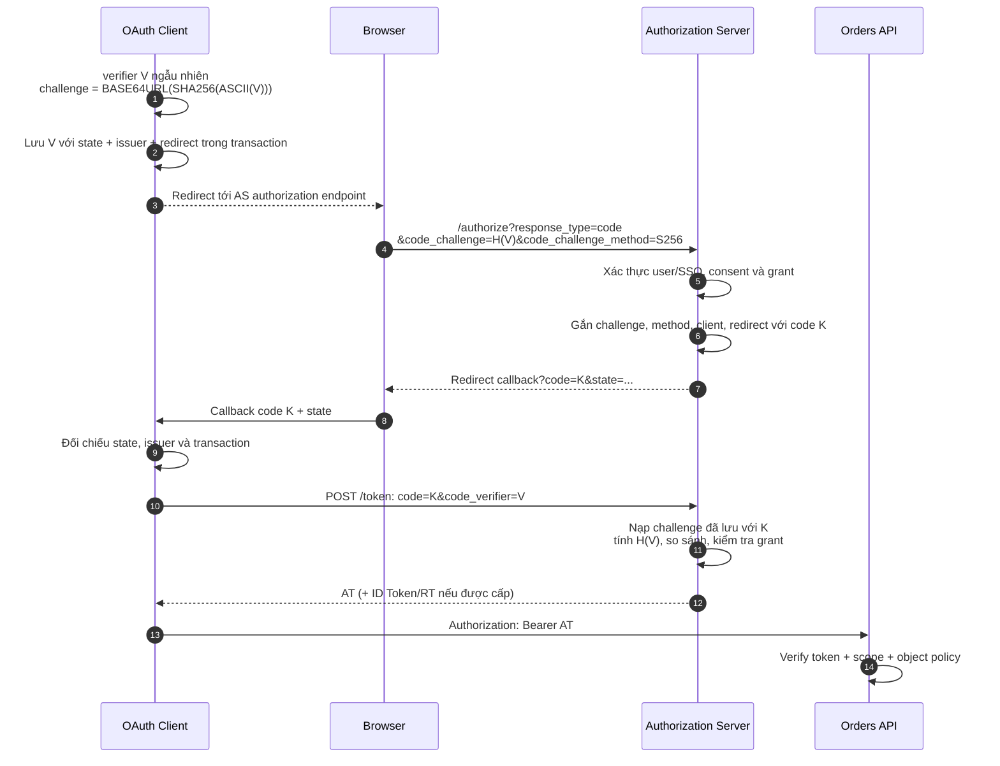
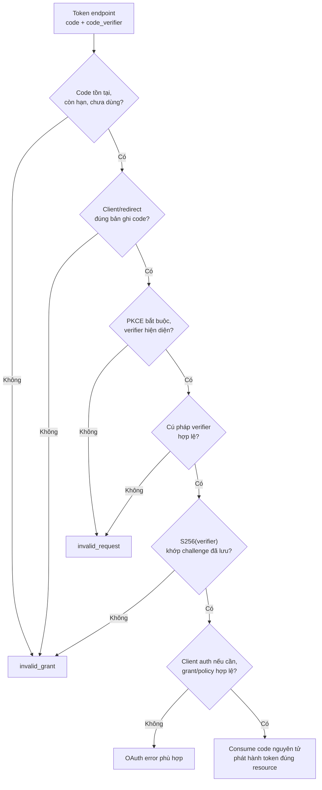
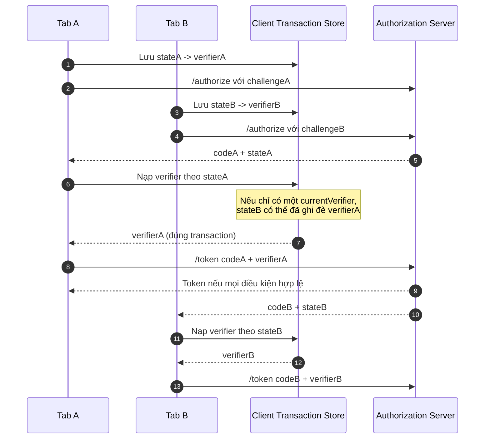

# Missing or mismatched verifier

## Mục tiêu học tập

Trong module **SECURITY_TOKEN_SECURITY_FUNDAMENTALS**, chúng ta học mô hình tin cậy và vòng đời token: OAuth 2.0/OIDC, JWT và opaque token, access token và refresh token, phát hành, kiểm tra issuer, audience, claims, scope, lưu trữ, thu hồi và bảo vệ trước token bị đánh cắp hoặc phát lại. Ở chương **PKCE**, bài **“Missing or mismatched verifier”** tập trung vào một điểm kiểm soát rất cụ thể của **Authorization Code flow**: **Authorization Server (AS) phải từ chối trao đổi authorization code khi `code_verifier` bị thiếu hoặc không khớp `code_challenge` đã ràng buộc với code đó**.

Học xong, bạn có thể:

- Trình bày vai trò riêng của `code_verifier`, `code_challenge` và `code_challenge_method` trong PKCE (RFC 7636).
- Phân biệt **không gửi verifier**, **verifier sai định dạng**, **verifier hợp lệ về cú pháp nhưng không khớp**, và **authorization code không hợp lệ**.
- Ánh xạ lỗi một cách có căn cứ: theo RFC 7636 `4.6, **thiếu `code_verifier` → `invalid_request`**, còn **kiểm chứng verifier thất bại → `invalid_grant`** tại token endpoint.
- Hiểu vì sao AS phải so sánh với challenge được lưu từ **authorization request ban đầu**, không tin challenge mới do client trình ở token request.
- Chẩn đoán lỗi triển khai ở SPA, mobile, server-side client/BFF: mất session/tab, trộn giao dịch, base64url sai, SHA-256 sai, encode nhiều lần, callback bị xử lý lại.
- Thiết kế fail-closed, code dùng một lần, chống downgrade và không đưa raw code/verifier/token vào logs.
- Viết ví dụ Java tạo verifier/challenge đúng chuẩn và mô phỏng kiểm chứng phía AS, kèm ma trận test thành công/thất bại.

> **Ghi nhớ trước tiên:** **Authorization code không tự đủ để xin access token khi giao dịch dùng PKCE.** Client phải đưa **đúng verifier bí mật của giao dịch đã khởi tạo authorization** vào **token endpoint**; AS phải kiểm tra khớp với challenge đã gắn với code. **Thiếu hoặc sai verifier không được dẫn tới fallback bỏ PKCE.**

## 1. Bối cảnh: PKCE bảo vệ authorization code bị đánh cắp

Trong Authorization Code flow:

1. Client khởi tạo request tới **authorization endpoint** của AS/OP. User xác thực ở AS/IdP hoặc dùng phiên SSO, rồi AS xét consent và quyền.
2. AS redirect browser về client cùng **authorization code** ngắn hạn.
3. Client gửi authorization code tới **token endpoint** để đổi access token (và ID Token/refresh token nếu grant/profile cho phép).
4. Client dùng **access token** tại Resource Server đúng audience; API kiểm tra token và phân quyền.

**Rủi ro:** authorization code đi qua **front channel** (browser redirect). Nếu attacker chặn hoặc lấy được code trước khi client thật đổi, họ có thể thử gửi code tới token endpoint. **PKCE** thêm bằng chứng rằng bên đổi code biết một giá trị ngẫu nhiên đã ràng buộc từ **lúc khởi tạo** request.

| Giá trị | Sinh/giữ ở đâu? | Được gửi ở đâu? | Vai trò |
| --- | --- | --- | --- |
| `code_verifier` | Client tạo ngẫu nhiên, giữ riêng theo **một authorization transaction**. | Chỉ gửi tới **token endpoint** khi đổi code. | Bằng chứng bên đổi code nắm bí mật của lần khởi tạo. |
| `code_challenge` | Client tính từ verifier. | Gửi cùng **authorization request** đến AS. | Cam kết một chiều để AS lưu liên kết với code. |
| `code_challenge_method` | Client chọn theo hỗ trợ/đăng ký; nên là `S256`. | Authorization request. | Chỉ ra cách AS xác minh challenge. |
| Authorization code | AS phát hành sau khi authorization thành công. | Trả về redirect URI; sau đó client gửi token endpoint. | Grant ngắn hạn, một lần, gắn client/redirect/challenge. |
| `state` | Client tạo và lưu theo giao dịch. | Authorization request và response. | Liên kết callback với phiên/yêu cầu, giảm CSRF và trộn giao dịch. |
| OIDC `nonce` | Client tạo nếu OIDC profile/flow yêu cầu. | Authorization request; được kiểm tra trong ID Token khi áp dụng. | Ràng buộc kết quả authentication, **không thay PKCE**. |

**PKCE không xác thực danh tính user hay cấp scope.** Nó chủ yếu bảo vệ **code exchange**. AS vẫn phải kiểm tra grant, client, redirect URI, consent/scope/resource; Resource Server vẫn phải kiểm tra access token `iss`, `aud`, thời hạn và quyền dữ liệu.

## 2. Luồng PKCE đúng với `S256`

Client tạo verifier có entropy cao, tính challenge và **không công bố verifier trong authorization URL**.



**Nếu `code_verifier` vắng mặt hoặc khác V**, luồng phải **dừng ở token endpoint**, không được phát hành access token, ID Token hoặc refresh token cho lần exchange đó.

### Ví dụ authorization request

Các chuỗi `<...>` chỉ là placeholder:

```http
GET /authorize?response_type=code&client_id=sales-portal&redirect_uri=https%3A%2F%2Fportal.example.com%2Fcallback&scope=openid%20orders%3Aread&state=<state>&code_challenge=<S256-challenge>&code_challenge_method=S256 HTTP/1.1
Host: identity.example.com
```

Điểm cần quan sát: có `code_challenge` và `code_challenge_method=S256`, **không có `code_verifier`**. Authorization code sau này phải được gắn với challenge này bằng state **phía AS**, không chỉ dựa vào lời khai của client.

### Token request hợp lệ

Với confidential client, ví dụ:

```http
POST /oauth2/token HTTP/1.1
Host: identity.example.com
Authorization: Basic <encoded-registered-client-credentials>
Content-Type: application/x-www-form-urlencoded

grant_type=authorization_code&code=<one-time-code>&redirect_uri=https%3A%2F%2Fportal.example.com%2Fcallback&code_verifier=<original-verifier>
```

Với **public client** (SPA/native), không đặt shared `client_secret` vào bundle; token request vẫn phải có `code_verifier` và những điều kiện client/redirect/issuer theo registration. Với confidential client, client authentication **bổ sung**, không thay thế PKCE khi giao dịch đã được PKCE bảo vệ.

## 3. Verifier và challenge: định dạng quan trọng tới từng byte

Theo **RFC 7636**, `code_verifier` là chuỗi khó đoán, dùng các ký tự `unreserved`:

```abnf
code-verifier = 43*128unreserved
unreserved    = ALPHA / DIGIT / "-" / "." / "_" / "~"
```

Nghĩa là **43 đến 128 ký tự**, gồm chữ ASCII hoa/thường, số và bốn dấu `-._~`. Không có space, dấu `+`, dấu `/` hay dấu `=`. AS phải áp giới hạn chiều dài và cú pháp trước khi kiểm chứng để tránh đầu vào bất thường.

Với phương thức `S256`:

```text
code_challenge = BASE64URL-ENCODE(SHA256(ASCII(code_verifier)))
```

Base64url được dùng **không có padding `=`** theo cách diễn đạt trong RFC. Với digest SHA-256 32 byte, chuỗi base64url không padding có **43 ký tự**. Hash ở đây là SHA-256 của **toàn bộ chuỗi verifier đúng từng byte ASCII**, không phải hash của authorization code, `state` hoặc `client_id`.

### Ví dụ chuẩn của RFC 7636, Phụ lục B

```text
code_verifier =
dBjftJeZ4CVP-mB92K27uhbUJU1p1r_wW1gFWFOEjXk

code_challenge_method = S256

code_challenge =
E9Melhoa2OwvFrEMTJguCHaoeK1t8URWbuGJSstw-cM
```

Đây là **test vector công khai**, **không dùng verifier ví dụ này để bảo vệ phiên đăng nhập thật**. Trong production phải tạo verifier mới bằng **bộ sinh số ngẫu nhiên mật mã** cho mỗi giao dịch.

### Java: sinh verifier và challenge

```java
import java.nio.charset.StandardCharsets;
import java.security.MessageDigest;
import java.security.NoSuchAlgorithmException;
import java.security.SecureRandom;
import java.util.Base64;

public final class PkceS256 {
    private static final SecureRandom RANDOM = new SecureRandom();

    public static String newVerifier() {
        byte[] random = new byte[32]; // 256 bit entropy
        RANDOM.nextBytes(random);
        // 32 byte -> 43 ký tự base64url, nằm trong unreserved [43,128].
        return Base64.getUrlEncoder().withoutPadding().encodeToString(random);
    }

    public static String challengeOf(String verifier) {
        if (verifier == null ||
            !verifier.matches("[A-Za-z0-9._~-]{43,128}")) {
            throw new IllegalArgumentException("Invalid PKCE verifier syntax");
        }
        try {
            byte[] hash = MessageDigest.getInstance("SHA-256")
                .digest(verifier.getBytes(StandardCharsets.US_ASCII));
            return Base64.getUrlEncoder().withoutPadding()
                .encodeToString(hash);
        } catch (NoSuchAlgorithmException ex) {
            throw new IllegalStateException("SHA-256 unavailable", ex);
        }
    }
}
```

Đoạn Java minh họa cách tính `S256` và có thể dùng làm cơ sở unit test, nhưng **không phải một OAuth client hoàn chỉnh**: ứng dụng còn phải bảo vệ verifier theo transaction, `state`, issuer, redirect URI, callback và token response. Thư viện OAuth/OIDC tin cậy nên đảm nhiệm flow trong production.

### Vì sao tự viết SHA-256 dễ tạo mismatch?

| Cách tính sai | Hậu quả |
| --- | --- |
| Lấy SHA-256 dạng **hex** rồi base64url-encode chuỗi hex. | Challenge khác với base64url trực tiếp trên digest 32 byte. |
| Dùng Base64 thường chứa `+`, `/`, `=` thay cho Base64url không padding. | Kết quả không khớp hoặc sai format. |
| Hash `state`, `authorization_code` hay `client_id` thay verifier. | Không thể chứng minh code được gắn với đúng verifier. |
| Đổi hoa/thường, `trim()`, thêm newline hoặc mã hóa lại verifier. | Digest thay đổi, AS từ chối. |
| Thêm dấu `=` padding vào verifier/challenge không theo chuẩn. | Có thể làm hỏng format/so khớp. |
| Dùng RNG yếu, thời gian hiện tại, UUID dễ dự đoán hoặc verifier cố định. | Có thể làm giảm khả năng chống code interception. |
| Dùng chung một verifier cho nhiều lần login hoặc nhiều user. | Phá phân tách transaction, tăng tác động khi bị lộ. |

Verifier chỉ gồm ASCII unreserved nên việc dùng `US_ASCII` để hash là rõ ràng và tránh chuyển đổi Unicode ngoài ý muốn. Phần gửi HTTP body `application/x-www-form-urlencoded` vẫn phải mã hóa tham số đúng cách; **đừng double-encode verifier**.

## 4. Khi thiếu hoặc sai verifier, AS phải trả gì?

Điểm trọng tâm của bài là **không gộp mọi lỗi PKCE thành một loại**:

| Trường hợp tại token endpoint | Diễn giải | Phản hồi theo RFC 7636 `4.6 |
| --- | --- | --- |
| Authorization code có liên kết PKCE nhưng request **không có `code_verifier`**. | Thiếu tham số cần để xác minh giao dịch. | `invalid_request`. |
| Request có `code_verifier` nhưng **giá trị không tạo challenge khớp** giá trị đã lưu. | Bằng chứng PKCE không hợp lệ cho authorization code. | `invalid_grant`. |
| Verifier bị thiếu giá trị hoặc **sai cú pháp/độ dài**. | Input không thỏa định dạng PKCE. | Từ chối, thường `invalid_request` ở lớp kiểm tra request; mã cụ thể theo hợp đồng parser/profile. |
| Code đã hết hạn, bị dùng lại hoặc không thuộc client/redirect. | Authorization grant/code không hợp lệ độc lập với PKCE. | `invalid_grant` theo OAuth 2.0. |
| Confidential client authentication sai. | Không xác thực được client. | `invalid_client` theo OAuth. |
| AS không có trạng thái challenge bắt buộc hoặc kho xác minh lỗi. | Không đủ bằng chứng để hoàn tất exchange. | **Fail closed**; lỗi theo tình trạng thực tế, không bỏ qua kiểm tra PKCE. |

### 4.1. Thiếu `code_verifier`: `invalid_request`

Request **không hợp lệ**:

```http
POST /oauth2/token HTTP/1.1
Host: identity.example.com
Content-Type: application/x-www-form-urlencoded

grant_type=authorization_code&code=<code>&client_id=sales-spa&redirect_uri=https%3A%2F%2Fapp.example.com%2Fcallback
```

Nếu code được AS phát hành cùng challenge PKCE, **RFC 7636 `4.6 yêu cầu trả `invalid_request` khi `code_verifier` vắng mặt**. Response minh họa:

```http
HTTP/1.1 400 Bad Request
Content-Type: application/json
Cache-Control: no-store
Pragma: no-cache

{"error":"invalid_request"}
```

Không suy rằng client confidential đã gửi secret đúng thì có thể bỏ qua verifier. **Client authentication và PKCE bảo vệ hai điều kiện khác nhau**.

### 4.2. Verifier không khớp: `invalid_grant`

Request có `code_verifier`, nhưng là **verifier của giao dịch khác** hoặc chuỗi không tạo ra challenge đã được AS lưu với code:

```http
POST /oauth2/token HTTP/1.1
Host: identity.example.com
Content-Type: application/x-www-form-urlencoded

grant_type=authorization_code&code=<code>&client_id=sales-spa&redirect_uri=https%3A%2F%2Fapp.example.com%2Fcallback&code_verifier=<wrong-verifier>
```

Theo RFC 7636 `4.6, AS **MUST return `invalid_grant`** khi kiểm chứng verifier thất bại:

```http
HTTP/1.1 400 Bad Request
Content-Type: application/json
Cache-Control: no-store
Pragma: no-cache

{"error":"invalid_grant"}
```

**Không trả challenge đúng, expected verifier hoặc khác biệt chi tiết về byte đã sai** trong response. Client chỉ cần biết giao dịch trao đổi code đã thất bại; người vận hành có thể dùng request/correlation ID để điều tra.

### 4.3. Sai cú pháp khác sai chứng minh

Ví dụ:

```text
code_verifier=abc             # quá ngắn, không đúng 43-128 ký tự
code_verifier=hello+world...  # dấu + không thuộc unreserved
code_verifier=<valid-but-wrong-43-char-value>
```

Trường hợp đầu là **input sai định dạng**; trường hợp cuối có thể đúng cú pháp nhưng sai giao dịch. AS phải từ chối cả hai và **không cấp token**. Việc tách `invalid_request` (invalid syntax) khỏi `invalid_grant` (mismatch) nên thống nhất với parser/profile; **đừng trả thông tin chi tiết giúp attacker đoán verifier**.

### 4.4. Sai `state` không phải lỗi `code_verifier`

Nếu callback tới client với `state` sai hoặc không có authorization transaction đang chờ, **client phải từ chối từ trước khi gửi token request**. Không nên “thử đổi code trước rồi kiểm tra state sau”. PKCE không thay toàn bộ cơ chế chống login CSRF, session binding hoặc bảo vệ nhiều issuer.

### 4.5. Không tự động retry verifier khác

`invalid_grant` là tín hiệu **không có bằng chứng grant hợp lệ** trong request hiện tại. Client không được thử một danh sách verifier cũ, bỏ PKCE, đổi sang `plain` hoặc gửi lặp token request với cùng code để “đoán” cách khớp. Nếu client thực sự mất verifier, hướng khắc phục an toàn là **bỏ giao dịch hỏng và khởi động authorization flow mới**, với verifier/state mới, không thu password user ở frontend để fallback.

## 5. Những nguyên nhân thường gặp phía client

Lỗi `missing/mismatched verifier` có thể bắt nguồn từ các bug hợp lệ, không chỉ hành vi tấn công:

| Hiện tượng | Nguyên nhân có thể | Cách xác minh an toàn |
| --- | --- | --- |
| Authorization request có challenge, token request không có verifier. | Client không lưu verifier, mất state sau redirect/reload, token SDK bỏ trường, BFF đổi session. | Kiểm tra **có/không** verifier ở token request, transaction ID an toàn, không log giá trị. |
| Callback của tab A nhưng dùng verifier tab B. | Dùng một biến `currentVerifier` toàn cục hoặc key storage bị ghi đè. | Kiểm tra state→transaction mapping, xử lý nhiều tab/song song. |
| Mismatch dù client “dùng cùng chuỗi”. | Hash sai (hex vs bytes), base64 thường vs URL-safe, padding, newline hoặc double-encoding. | Unit test RFC 7636 Appendix B, so **kết quả không nhạy cảm** trong môi trường test. |
| Mismatch chỉ xảy ra sau reload hoặc browser back. | Verifier chỉ nằm trong memory đã mất, transaction bị xóa sớm hoặc callback xử lý lại. | Kiểm tra vòng đời transaction và hành vi reload/callback replay. |
| Mismatch ở nhiều backend instance. | State/verifier lưu local trong một node, callback sang node khác; session store không dùng chung. | Kiểm tra session affinity/store, transaction ID, TTL và consistency. |
| Mismatch sau login bằng SSO IdP khác. | Client bắt đầu transaction A nhưng callback bị gắn nhầm transaction B; state/issuer binding thiếu. | Kiểm tra exact state, expected issuer, redirect URI theo giao dịch. |
| Token request đôi khi bị gửi hai lần. | Retry tự động, callback effect chạy hai lần, mạng mất response. | Kiểm tra code đã consumed, chính sách retry/idempotency, correlation ID. |
| AS trước đó cho exchange không cần verifier nhưng phiên bản mới từ chối. | Cấu hình legacy hoặc bug downgrade được vá, client chưa cập nhật. | Bật PKCE ở client; không nới yêu cầu server để tránh break UX. |
| Client gửi code_challenge mới trong token request thay verifier. | Nhầm tham số của hai bước. | Kiểm tra authorization request và token request **tách biệt**. |
| `code_challenge_method` khác với method đã lưu. | Client/AS không thống nhất phương thức, fallback sang `plain`. | Kiểm tra allowlist method; production nên dùng `S256`, không fallback. |

**Quy trình debug:** dùng test user, request ID, `state`/transaction reference được bảo vệ, code error category và các cờ `verifier_present`, `syntax_valid`, `method=S256`. **Không** yêu cầu user gửi raw verifier hoặc authorization code qua chat/email để debug.

## 6. AS phải lưu và ràng buộc bằng chứng PKCE

PKCE chỉ phát huy tác dụng khi AS **ghi nhớ challenge được trình ở authorization request** và liên kết nó với authorization code cụ thể.

Một bản ghi server-side minh họa:

```json
{
  "authorization_code_ref": "code-hmac-ref-73ac",
  "client_id": "sales-portal",
  "redirect_uri": "https://portal.example.com/callback",
  "issuer": "https://identity.example.com",
  "challenge_method": "S256",
  "code_challenge": "stored-challenge-from-authorize",
  "grant_ref": "grant-2b9d",
  "authorized_scopes": ["orders:read"],
  "authorized_resources": ["api://orders"],
  "status": "ACTIVE",
  "expires_at": "2027-01-15T10:05:00Z"
}
```

Đây là **schema minh họa**, không phải schema bắt buộc theo RFC. Lưu trữ thực tế có thể dùng session, database, mã code có cấu trúc và trạng thái chống replay. Giá trị `authorization_code_ref` có thể là HMAC/opaque reference được bảo vệ; không nên lưu raw code hay raw verifier trong audit log. **Challenge không phải secret thay verifier**, nhưng vẫn thuộc metadata của giao dịch, cần bảo vệ integrity và truy cập phù hợp.

### Bất biến (invariants) tại token endpoint

- **Bản ghi code là nguồn sự thật** về client, redirect URI, challenge method và challenge. Không lấy challenge mới từ token request để xác minh.
- Token request phải có `code_verifier` khi giao dịch đã yêu cầu PKCE; nếu chính sách bắt buộc PKCE thì **không cấp code thiếu challenge ngay từ đầu**.
- AS xác minh code còn hạn, chưa dùng, đúng client, redirect URI và PKCE trước khi mint token.
- Code được **tiêu thụ đúng một lần**; nhiều request song song không được cùng đổi một code thành công.
- Nếu state database/introspection của code không khả dụng, không chấp nhận code chỉ vì client gửi cùng một chuỗi hợp lệ về cú pháp.
- Mọi access token sau exchange phải bị giới hạn bởi issuer, audience, scope/grant, subject/client, thời gian và chính sách AS; PKCE đúng **không tự mở rộng quyền**.



**Chú thích sơ đồ:** Để đơn giản, nhánh `verifier_present` thể hiện một code **đã được PKCE bảo vệ**. Trường hợp AS có grant legacy không PKCE phải được kiểm soát bởi chính sách riêng; **không coi việc thiếu challenge là một lý do mặc định để bỏ kiểm tra**. Lựa chọn thứ tự kiểm tra và error code cho syntax phụ thuộc profile, nhưng **mọi nhánh thất bại đều không được mint token**.

## 7. Pseudocode Java: từ chối thiếu/sai verifier

Ví dụ này mô tả **AS xử lý token exchange**. Không sao chép nguyên xi để viết một OAuth server production; nên dùng AS/framework đã được kiểm chứng.

```java
TokenResponse exchangeCode(TokenRequest req, AuthenticatedClient client) {
    // AuthenticatedClient được tạo bằng quy tắc AS cho public/confidential client.
    return transaction.execute(() -> {
        CodeRecord code = codes.findForUpdate(req.authorizationCode())
            .orElseThrow(InvalidGrantException::new);

        requireActiveAndNotExpired(code);
        requireClientAndRedirectMatch(code, client, req.redirectUri());

        if (code.pkceRequired()) {
            String verifier = req.codeVerifier();
            if (verifier == null || verifier.isEmpty()) {
                throw new InvalidRequestException(); // RFC 7636: missing
            }
            if (!verifier.matches("[A-Za-z0-9._~-]{43,128}")) {
                throw new InvalidRequestException(); // malformed input
            }
            if (!"S256".equals(code.challengeMethod())) {
                throw new InvalidGrantException(); // policy/method không hợp lệ
            }

            String actual = PkceS256.challengeOf(verifier);
            if (!constantTimeEqualAscii(actual, code.storedChallenge())) {
                throw new InvalidGrantException(); // RFC 7636: mismatch
            }
        } else if (policy.requiresPkce(client, code.grantType())) {
            // Không hạ cấp khi code thiếu challenge do bug/cấu hình sai.
            throw new InvalidGrantException();
        }

        requireGrantAndClientPolicyStillValid(code, client);
        codes.markConsumed(code.id()); // transaction + unique/lock/CAS
        TokenResponse response = issuer.issueOnlyAuthorizedTokens(
            code.subject(), client, code.scopes(), code.resources());
        audit.outboxCodeExchanged(code.safeReference(), client.id());
        return response;
    });
}

boolean constantTimeEqualAscii(String a, String b) {
    byte[] x = a.getBytes(java.nio.charset.StandardCharsets.US_ASCII);
    byte[] y = b.getBytes(java.nio.charset.StandardCharsets.US_ASCII);
    return java.security.MessageDigest.isEqual(x, y);
}
```

**Các điều kiện production quan trọng:**

1. Phải có **transaction/locking/CAS bền vững giữa nhiều node AS**, không chỉ `synchronized` trên một instance.
2. Không để token response được gửi trước khi cập nhật trạng thái consumed/code issuance commit thành công.
3. Việc `throw` trong transaction có thể rollback các thay đổi; khi cần audit thất bại hoặc chặn code do nhiều lần thử sai, ghi sự kiện/decision bằng cơ chế commit phù hợp, không dựa vào side effect trước exception.
4. Khi AS gặp lỗi database, clock hoặc khóa ký, **fail closed** và phản hồi lỗi vận hành an toàn; không loại bỏ PKCE để hệ thống “tiếp tục chạy”.
5. So sánh challenge bằng thư viện an toàn, giới hạn input; **không viết expected challenge hoặc verifier vào exception/public response**.
6. Mã ví dụ minh họa `S256`; nếu môi trường cần tương thích `plain` theo RFC cũ thì phải có **policy explicit và không được âm thầm hạ cấp từ S256 sang plain**.

## 8. Không nhầm lỗi verifier với các lớp lỗi khác

Trước khi gán mọi `invalid_grant` cho PKCE, cần phân biệt các chứng cứ:

| Lớp | Lỗi điển hình | Nơi sửa chính |
| --- | --- | --- |
| **Authorization request** | Thiếu challenge bắt buộc, unsupported `code_challenge_method`, redirect URI sai. | Client tạo request và AS validation tại authorization endpoint. |
| **Authorization response/callback** | `state` không khớp, không có pending transaction, issuer ngoài dự kiến. | Client callback/session, giao dịch OAuth. |
| **Code exchange** | Thiếu verifier → `invalid_request`; mismatch → `invalid_grant`. | Client giữ verifier, AS kiểm tra challenge đã lưu. |
| **Code lifecycle** | Code hết hạn/đã consumed/không thuộc client. | AS code store, redirect/client binding, client tránh retry sai. |
| **Client authentication** | Secret, private_key_jwt hoặc mTLS không hợp lệ. | Confidential client/AS registration, error `invalid_client`. |
| **Token profile/RS validation** | JWT sai issuer, audience, expiry, token type, thiếu scope. | AS issuance policy và Resource Server validator. |
| **Object authorization** | User có token hợp lệ nhưng không có quyền trên đơn thuộc tenant khác. | Resource Server business policy, không phải PKCE. |
| **Refresh token exchange** | Refresh token đã revoked/reused/expired. | AS refresh grant, rotation/family; `code_verifier` không phải yêu cầu chung của refresh grant. |

Một lần login có thể **PKCE PASS** nhưng API vẫn trả `401` do sai audience, hoặc `403` do thiếu scope/quyền. Ngược lại, một token JWT ký đúng từ phiên trước **không chứng minh** một authorization code mới đã vượt qua PKCE.

## 9. Quản lý verifier theo transaction: nhiều tab, reload và callback

Một lỗi phổ biến ở client là tạo verifier đúng nhưng **không giữ được đúng giá trị** tới lúc nhận authorization code. Hãy coi mỗi lần login là **một transaction riêng**, không phải một biến verifier toàn cục.

### Ví dụ: hai tab mở login cùng lúc



Nếu client chỉ lưu:

```javascript
// KHÔNG AN TOÀN về tính đúng đắn khi có nhiều giao dịch song song.
let currentVerifier = generatedForMostRecentLogin;
```

thì một yêu cầu authorization khác có thể ghi đè verifier trước khi callback của giao dịch cũ trở về. Kết quả thường là `invalid_grant` do mismatched verifier, dù cả hai verifier đều đúng cú pháp.

### Mô hình transaction đúng

```text
Transaction A
  state_ref        -> stateA
  issuer           -> https://identity.example.com
  client_id        -> sales-spa
  redirect_uri     -> https://app.example.com/callback
  verifier         -> VA
  challenge_method -> S256
  started_at       -> tA

Transaction B
  state_ref        -> stateB
  issuer           -> https://identity.example.com
  client_id        -> sales-spa
  redirect_uri     -> https://app.example.com/callback
  verifier         -> VB
  challenge_method -> S256
  started_at       -> tB

Callback stateA -> chỉ lấy VA, tuyệt đối không dùng VB.
```

**Không lưu cả hai verifier bằng cùng một key `pkce_verifier` rồi hy vọng callback đến đúng thứ tự**. Giao dịch phải liên kết với browser/session và issuer được tin cậy.

### 9.1. SPA có thể mất verifier vì những lý do gì?

- Redirect tới AS rồi load lại ứng dụng làm **biến memory** biến mất.
- Một tab khác bắt đầu login và ghi đè key dùng chung trong storage.
- App dùng callback handler hai lần, lần đầu xóa transaction, lần sau cố exchange bằng verifier trống.
- Browser back/forward, reload, extension hoặc chính sách dọn session làm mất dữ liệu giữa hai bước.
- `state` nằm ở một key, verifier ở key khác nhưng code lấy sai transaction hoặc sắp xếp thứ tự không ổn định.
- Service worker/frontend routing xử lý callback ở origin/path khác, không có quyền truy cập nơi lưu transaction theo thiết kế.

Một SPA có thể sử dụng một giải pháp transaction storage phù hợp SDK, nhưng **`sessionStorage`/`localStorage` đều JS-readable và chịu rủi ro XSS**. Nếu hệ thống có quyền nhạy cảm hoặc cần refresh token dài hạn, cân nhắc **BFF**: state/verifier/token nằm server-side, browser chỉ giữ session reference được bảo vệ.

### 9.2. BFF và multi-instance backend

Với BFF, verifier nên gắn với transaction trong **server-side session store**; khi callback tới bất kỳ node nào, node đó phải nạp đúng transaction:

- Không lưu verifier duy nhất trong static variable hoặc thread-local không tồn tại qua redirect.
- Không chỉ lưu memory riêng của instance A nếu callback có thể đến instance B.
- Đặt TTL, giới hạn số giao dịch pending, ràng buộc browser session và dùng reference ngẫu nhiên.
- Sau khi exchange thành công, tiêu thụ transaction và thiết lập session mới theo cách chống replay/session fixation.
- Khi callback đến với `state` thiếu/sai/đã hết hạn, **không đoán verifier khác hoặc tự khởi tạo transaction mới để dùng code cũ**.

## 10. JavaScript minh họa phía client: tạo và giữ verifier đúng cách

Trong môi trường web có thể dùng **Web Crypto** để tạo verifier và challenge. Ví dụ sau chỉ minh họa **sinh dữ liệu và liên kết transaction**, không phải một ứng dụng OAuth production hoàn chỉnh.

```javascript
function base64url(bytes) {
  // Với 32 byte, chuyển từng byte sang chuỗi nhị phân không gây vấn đề kích thước.
  const binary = String.fromCharCode(...bytes);
  return btoa(binary).replaceAll("+", "-")
                     .replaceAll("/", "_")
                     .replaceAll("=", "");
}

function newRandomValue() {
  const bytes = crypto.getRandomValues(new Uint8Array(32));
  return base64url(bytes);  // 43 ký tự với 256 bit entropy
}

async function createPkceTransaction() {
  const state = newRandomValue();
  const codeVerifier = newRandomValue();
  const digest = await crypto.subtle.digest(
    "SHA-256", new TextEncoder().encode(codeVerifier)
  );
  const codeChallenge = base64url(new Uint8Array(digest));

  // SDK/store phải liên kết giao dịch với browser session và issuer tin cậy.
  return {
    state,
    codeVerifier,
    codeChallenge,
    codeChallengeMethod: "S256"
  };
}
```

Ở callback, client cần tìm đúng pending transaction bằng `state` đã xác minh, sau đó gửi `code_verifier` tương ứng trong **body form** đến token endpoint đáng tin:

```javascript
// Pseudocode: tx đến từ pending transaction được ràng buộc session,
// không phải object tự nhận từ URL hay từ origin không tin cậy.
async function exchangeCode(code, tx) {
  const body = new URLSearchParams({
    grant_type: "authorization_code",
    client_id: tx.clientId,
    code,
    redirect_uri: tx.redirectUri,
    code_verifier: tx.codeVerifier
  });

  const response = await fetch(tx.trustedTokenEndpoint, {
    method: "POST",
    headers: { "Content-Type": "application/x-www-form-urlencoded" },
    body,
    cache: "no-store"
  });
  if (!response.ok) {
    // Không in toàn bộ request, code, verifier hay token response vào log.
    throw new Error("Authorization code exchange failed");
  }
  return response.json();
}
```

Ví dụ này chỉ dành cho **public browser client** khi AS hỗ trợ token endpoint và CORS theo đăng ký. Confidential client phải thực hiện client authentication **ở backend** bằng phương thức đã đăng ký, không hard-code secret hoặc private key trong JavaScript. Với browser-only client, cần thiết kế nơi lưu token sau exchange và bảo vệ XSS; cách quản lý PKCE transaction đúng **không tự bảo vệ access/refresh token trong `localStorage`**.

## 11. Các tấn công PKCE và cách tránh downgrade

PKCE giúp giảm nguy cơ attacker có **authorization code** nhưng không nắm verifier. Những sai lầm sau có thể vô hiệu lớp bảo vệ này:

| Anti-pattern | Vì sao nguy hiểm? | Biện pháp |
| --- | --- | --- |
| Nếu token request thiếu verifier, AS vẫn cấp token khi client authenticated. | PKCE bị vô hiệu với confidential client. | **Không bỏ PKCE** chỉ vì có client secret/private key. |
| AS chấp nhận `code_challenge` mới ở token request để so với verifier mới. | Attacker có code có thể tự tạo challenge tương ứng. | Chỉ dùng challenge **đã gắn code ở authorization request**. |
| AS tự chuyển `S256` sang `plain` nếu so khớp thất bại. | Mở cửa downgrade và làm yếu cam kết. | Cố định method của transaction; nếu không khớp thì từ chối. |
| Client dùng verifier tĩnh cho mọi user/login. | Lộ một verifier ảnh hưởng nhiều authorization transaction. | CSPRNG + verifier mới cho từng request. |
| Client lấy verifier từ URL query/callback do attacker điều khiển. | Attacker có thể quyết định cả code và verifier. | Verifier phải lấy từ transaction store đáng tin đã tạo trước redirect. |
| Client chọn token endpoint từ `iss`/URL trong callback chưa xác minh. | Code/verifier có thể bị gửi tới AS giả. | Ràng buộc issuer/token endpoint với cấu hình và transaction; chống mix-up. |
| AS không kiểm tra client/redirect/code one-time. | PKCE đúng vẫn chưa chặn code bị dùng sai ngữ cảnh. | Kiểm tra **tất cả** ràng buộc của authorization code. |
| AS chấp nhận code có `code_challenge_method` không rõ và suy `plain`. | Khả năng downgrade hoặc lỗi interoperability. | Chính sách explicit/allowlist, ưu tiên `S256`; từ chối unsupported method. |
| Client dùng retry vô hạn sau `invalid_grant`. | Tạo lỗi replay và quá tải AS, không giải quyết verifier bị mất. | Dừng giao dịch, khởi tạo authorization request mới khi cần. |
| Verifier ghi trong analytics/URL/log. | Bên lấy được code và verifier có thể thử exchange trong thời gian code còn sống. | Redaction toàn tuyến, không đưa verifier lên front-channel. |

### 11.1. Nếu authorization request không có `code_challenge`?

Đối với client/flow mà AS **yêu cầu PKCE**, đây là **authorization request không đáp ứng chính sách**. AS nên từ chối ngay ở **authorization endpoint**, không cấp code rồi chấp nhận token request thiếu verifier.

Lỗi đặc thù có thể tùy cách AS thực thi/profile, nhưng **không được tự động fallback sang Authorization Code không PKCE** khi PKCE được yêu cầu. `code_challenge_method` phải được ghi nhận và cố định cho giao dịch; không để attacker làm AS suy ra phương thức yếu hơn.

### 11.2. PKCE có thay `state` và client authentication không?

**Không hoàn toàn.** PKCE chứng minh bên đổi code biết verifier. Trong OAuth/OIDC hiện đại, cũng cần:

- Liên kết authorization response với yêu cầu ban đầu bằng `state`/session-binding hoặc cơ chế chống CSRF tương đương theo profile.
- Chống **AS mix-up** khi client hỗ trợ nhiều issuer; cố định expected AS/token endpoint.
- Đối với **confidential client**, client authentication nếu AS yêu cầu.
- Đối với **OIDC**, kiểm chứng ID Token `iss`, `aud`, `exp`, `nonce` khi áp dụng.
- Phân quyền API dựa trên scope, audience và object policy ở RS.

**PKCE cũng không bảo vệ được khi attacker kiểm soát hoàn toàn runtime client**: XSS trong SPA có thể đọc hoặc sử dụng verifier, access token và các khả năng của ứng dụng theo tình huống; malware trên thiết bị có thể làm hỏng nhiều bảo đảm khác.

## 12. Response và audit an toàn khi PKCE thất bại

Một response công khai nên đủ để client hiểu loại lỗi theo giao thức, **không giúp attacker biết expected challenge**:

```http
HTTP/1.1 400 Bad Request
Content-Type: application/json
Cache-Control: no-store
Pragma: no-cache

{"error":"invalid_grant"}
```

`error_description` nếu dùng cần trung tính, không trả `expectedVerifier`, `storedChallenge`, authorization code hoặc `client_secret`. Không phản chiếu `code_verifier` trong HTTP error.

### Mẫu audit chỉ ghi metadata đã kiểm soát

```json
{
  "event_type": "PKCE_VERIFICATION_FAILED",
  "correlation_id": "req-64f29a",
  "client_reference": "sales-spa",
  "grant_type": "authorization_code",
  "pkce_method": "S256",
  "failure_class": "VERIFIER_MISMATCH",
  "verifier_present": true,
  "http_status": 400,
  "oauth_error": "invalid_grant",
  "occurred_at": "2027-01-15T10:05:00Z"
}
```

Event trên là **schema minh họa**, không phải RFC bắt buộc. Với client chưa xác thực, `client_reference` chỉ có thể là **claimed client ID**, không phải danh tính đã được chứng minh; telemetry cần phân biệt nếu cần.

| Dữ liệu | Có nên log trực tiếp? | Giải pháp phù hợp |
| --- | --- | --- |
| Raw `code_verifier` | **Không.** | Chỉ ghi `verifier_present`, syntax category hoặc reference an toàn. |
| Authorization code gốc | **Không.** | Correlation ID hoặc HMAC/opaque audit reference theo policy. |
| `code_challenge` của giao dịch | Không cần ghi raw trong audit thông thường. | Ghi method và kiểm soát lưu trữ tại AS nếu cần. |
| Access token, refresh token, ID Token | **Không.** | Ghi issuance event ID và token reference an toàn khi cần. |
| `client_secret`, private key, full `Authorization` header | **Không.** | Audit phương thức client auth và outcome, không credential. |
| `state`, `nonce`, browser session cookie | Tránh raw trong logs. | Transaction/correlation reference có phân quyền/retention. |
| Failure class, route template, AS/issuer alias | Có thể, khi đã kiểm soát PII và nguồn dữ liệu. | Structured logging, retention và quyền truy cập. |

Redaction phải được áp dụng **từ gateway, reverse proxy, APM, tracing, token endpoint middleware đến error reporting**. Một application handler không in verifier vẫn chưa đủ nếu upstream proxy đã log toàn bộ form body.

### 12.1. Phòng DoS và phát hiện thử đoán

AS phải giới hạn kích thước request/body, cú pháp verifier và số lần thử, dùng code TTL ngắn, code one-time và rate limiting thích hợp. Đừng dùng `state`, username hoặc `client_id` chưa được xác minh như bằng chứng duy nhất để kết luận cùng một attacker.

Theo dõi số lượng `invalid_request` (missing verifier), `invalid_grant` (mismatch, expired/reused code) và backend failures riêng nhau. Nếu toàn bộ metric chỉ có `invalid_grant` mà không có nội bộ failure class, vận hành có thể nhầm bug multi-tab với tấn công.

## 13. Ma trận kiểm thử PKCE

Giả sử:

```text
Issuer:        https://identity.example.com
Public client: sales-spa
Redirect URI:  https://app.example.com/callback
PKCE method:   S256
Code lifetime: ngắn, dùng một lần theo policy
Resource:      api://orders
Granted scope: orders:read
```

Sử dụng **test user, code và verifier giả ở môi trường được phép**, không dump credential production vào test report.

| Input / tình huống | Kết quả mong đợi |
| --- | --- |
| Code hợp lệ, verifier đúng đã gắn với code, đúng client/redirect. | Exchange thành công một lần; AS cấp token theo grant, code bị consumed. |
| Code có challenge PKCE nhưng không có tham số `code_verifier`. | **`invalid_request`** theo RFC 7636; **không cấp token**. |
| `code_verifier` tồn tại nhưng empty. | Từ chối như request thiếu/sai định dạng, không cấp token. |
| Verifier dưới 43 ký tự hoặc trên 128 ký tự. | Từ chối input không hợp lệ, không cấp token. |
| Verifier có dấu `+`, `/`, `=`, dấu cách hoặc Unicode. | Từ chối cú pháp sai; không tự sửa âm thầm. |
| Verifier 43 ký tự đúng cú pháp nhưng không tạo challenge đã lưu. | **`invalid_grant`** theo RFC 7636; không cấp token. |
| Client tính SHA-256 digest dạng hex rồi base64url chuỗi hex. | RFC test vector không khớp; sửa phép tính client, AS không đổi standard. |
| Client dùng Base64 thường hoặc giữ dấu padding sai cách. | Không khớp hoặc sai định dạng; sửa encoder phía client. |
| Client dùng verifier của giao dịch/tab B để đổi code của A. | **`invalid_grant`**, AS không phát token; client sửa transaction mapping. |
| Client gửi `code_challenge` mới kèm wrong verifier ở token request. | AS **không tin challenge mới**; từ chối mismatch với challenge của code. |
| Code có `S256` nhưng client cố dùng `plain` khi exchange. | Không downgrade; từ chối. |
| Authorization request thiếu challenge trong flow bắt buộc PKCE. | AS từ chối/không cấp code thiếu bảo vệ. |
| Authorization request dùng unsupported method. | AS từ chối theo giao thức/policy; không suy phương thức khác. |
| Callback sai `state` hoặc giao dịch đã hết hạn. | Client từ chối trước code exchange. |
| Code đã đổi thành công, request thứ hai dùng lại cùng code/verifier. | AS từ chối `invalid_grant`; chỉ một lần thành công. |
| Code hết hạn dù verifier đúng. | AS từ chối `invalid_grant`. |
| Confidential client xác thực sai dù verifier đúng. | AS từ chối client authentication (`invalid_client` theo tình huống). |
| AS database chứa challenge không khả dụng trong lúc exchange. | **Fail closed**; không cấp token chỉ vì code/verifier trông hợp lệ. |
| Verifier được ghi vào access log/tracing ở token endpoint. | Test bảo mật **FAIL**; phải redact trước khi production. |
| Token hợp lệ sau PKCE nhưng audience là Billing, request tới Orders. | Orders từ chối do sai `aud`; PKCE không thay RS validation. |
| Token đúng issuer/audience nhưng thiếu `orders:write` cho PATCH. | RS từ chối theo `scope`/policy, thường `403 insufficient_scope`. |
| Token có scope đọc nhưng order thuộc tenant khác. | RS từ chối theo object-level authorization. |

### Unit test Java với vector RFC 7636

```java
// Pseudocode JUnit; tham chiếu PkceS256.challengeOf ở trên.
@Test
void rfc7636AppendixBVectorMatches() {
    String verifier = "dBjftJeZ4CVP-mB92K27uhbUJU1p1r_wW1gFWFOEjXk";
    String expected = "E9Melhoa2OwvFrEMTJguCHaoeK1t8URWbuGJSstw-cM";
    assertEquals(expected, PkceS256.challengeOf(verifier));
}

@Test
void missingVerifierIsRejected() {
    // AS test fixture: code K đã gắn S256 challenge của V.
    assertOAuthError("invalid_request", () ->
        tokenEndpoint.exchange(codeK, null)
    );
}

@Test
void mismatchedVerifierIsRejected() {
    String wrong = PkceS256.newVerifier();
    assertOAuthError("invalid_grant", () ->
        tokenEndpoint.exchange(codeK, wrong)
    );
}

@Test
void sameCodeCannotBeExchangedTwice() {
    tokenEndpoint.exchange(codeK, originalVerifier); // thành công
    assertOAuthError("invalid_grant", () ->
        tokenEndpoint.exchange(codeK, originalVerifier)
    );
}
```

Tên `tokenEndpoint`, `codeK` và `assertOAuthError` ở trên là **test doubles/fixtures minh họa**, không phải mã có thể biên dịch độc lập. Nếu tạo một test integration thực, cần fixture AS/client, authorization transaction và token store thật trong môi trường thử nghiệm.

## 14. Ba tình huống chẩn đoán thực tế

### 14.1. Bug SPA: callback đúng nhưng verifier bị mất

**Hiện tượng:** login từ browser chuyển qua AS thành công; callback có code và state hợp lệ; token endpoint trả:

```json
{"error":"invalid_request"}
```

**Phân tích:** client lưu verifier trong memory của component cũ. Full redirect tải lại ứng dụng khiến memory mất; token request không có `code_verifier`.

**Sửa:** quản lý verifier trong pending transaction qua một SDK phù hợp lifecycle browser hoặc chuyển flow sang BFF với state/verifier server-side. Callback phải tìm được đúng transaction bằng `state`. Không sửa bằng cách bỏ PKCE tại AS.

### 14.2. Bug multi-tab: verifier A bị ghi đè bởi B

**Hiện tượng:** login thường thành công, nhưng khi mở hai tab cùng lúc, một tab nhận `invalid_grant`.

**Phân tích:** cả hai tab lưu verifier vào cùng key `pkce_verifier`. Callback của tab A lấy verifier B dù trạng thái callback `stateA` đúng.

**Sửa:** lưu transaction độc lập theo `state` và session; đảm bảo callback A chỉ dùng verifier A, callback B chỉ dùng verifier B. Nếu SDK/browser có cơ chế đồng bộ phiên, cần kiểm thử các trường hợp back/reload và callback tới khác thứ tự.

### 14.3. Sai base64url: Java và JavaScript không thống nhất

**Hiện tượng:** verifier đúng độ dài nhưng AS trả `invalid_grant` cho mọi login.

**Phân tích:** một client tính `Base64.encode(SHA256(verifier))` với dấu `+`/`/`/`=`, trong khi chuẩn cần `BASE64URL` không padding, hoặc client đang encode chuỗi hex thay vì bytes digest.

**Sửa:** dùng test vector Appendix B của RFC 7636 trên cả hai phía (hoặc thư viện chuẩn), xác minh cùng byte ASCII input; test end-to-end với verifier ngẫu nhiên trong môi trường thử nghiệm. **Không** đổi AS sang so sánh lỏng lẻo hoặc plain để chiều theo client lỗi.

## 15. Câu hỏi tự kiểm tra

1. Verifier được gửi ở authorization endpoint hay token endpoint? Challenge gửi ở đâu?
2. Vì sao có authorization code vẫn không đủ để đổi token trong giao dịch dùng PKCE?
3. `code_verifier` phải dài bao nhiêu ký tự và gồm những ký tự gì?
4. `S256` sử dụng SHA-256 trên **bytes nào**? Base64 hay base64url? Có padding không?
5. Theo RFC 7636 `4.6, missing verifier và mismatched verifier khác nhau về `error` thế nào?
6. Nếu client gửi đúng client secret nhưng thiếu verifier, AS có được cấp token không?
7. Nếu AS chỉ so verifier với challenge mà client mới gửi kèm token request, nguy cơ gì?
8. Khi hai tab tạo hai verifier, transaction nào phải được dùng để chọn verifier?
9. PKCE bảo vệ được gì khi callback `state` sai hoặc client bị XSS đang hoạt động?
10. `invalid_grant` có luôn chứng minh một verifier bị mismatch không?
11. Sau khi PKCE PASS, Resource Server có cần kiểm tra audience, scope và tenant không?
12. Khi mất verifier vì reload, giải pháp an toàn là đoán verifier khác, bỏ PKCE hay tạo giao dịch authorization mới?

**Gợi ý trả lời:**

1. Challenge ở authorization request; verifier ở token request sau callback.
2. AS cần bằng chứng client biết verifier gắn với code lúc khởi tạo, giảm khả năng attacker chỉ có code đổi được token.
3. 43–128 ký tự ASCII `ALPHA / DIGIT / - . _ ~`.
4. SHA-256 trên ASCII bytes của verifier; Base64**url** không padding.
5. **Thiếu → `invalid_request`; mismatch → `invalid_grant`**.
6. Không. Client authentication không thay PKCE đã ràng buộc với code.
7. Attacker có code có thể tự tạo một cặp verifier/challenge mới để qua kiểm tra.
8. Chọn đúng verifier của giao dịch được ràng buộc với `state`/session/expected issuer.
9. `state` phải được client kiểm tra riêng; active XSS có thể lạm dụng runtime và credential, PKCE không thay chống XSS.
10. Không. Code hết hạn, bị dùng lại, sai client/redirect cũng có thể trả `invalid_grant`.
11. Có. PKCE bảo vệ code exchange, không thay xác minh token và quyền trên đối tượng.
12. Bỏ giao dịch cũ, khởi tạo flow mới và lưu verifier an toàn theo transaction.

## 16. Checklist triển khai

- [ ] Client tạo **verifier mới bằng CSPRNG** cho mỗi authorization transaction; cú pháp 43–128 ký tự unreserved.
- [ ] Sử dụng `S256`: `BASE64URL(SHA256(ASCII(verifier)))` không padding; test bằng vector RFC 7636 Appendix B.
- [ ] Chỉ gửi `code_challenge`/method tại authorization endpoint, **không đưa verifier lên browser authorization URL**.
- [ ] Lưu verifier theo transaction gắn `state`, client ID, issuer, redirect URI và TTL; tránh biến chung ghi đè giữa nhiều tab.
- [ ] Client kiểm tra `state` và expected issuer ở callback **trước** khi code exchange; từ chối callback ngoài giao dịch.
- [ ] Token endpoint yêu cầu verifier khi code gắn PKCE; **missing → `invalid_request`**, **mismatch → `invalid_grant`**.
- [ ] AS validate verifier syntax/size trước hashing; không trim, hạ chuẩn hoặc chấp nhận base64/hex sai.
- [ ] AS chỉ so với challenge/method **đã lưu cùng authorization code**, không tin challenge mới trong token request.
- [ ] Không cho fallback `plain` hoặc bỏ PKCE khi `S256` thất bại; từ chối authorization request thiếu challenge nếu policy yêu cầu.
- [ ] Code một-lần-dùng, TTL ngắn, gắn client, redirect, scope/grant và issuer; chống race khi đổi đồng thời ở nhiều node.
- [ ] Confidential client vẫn phải xác thực với AS khi yêu cầu; public SPA/native không nhúng shared client secret.
- [ ] Xử lý reload, browser back, multi-tab, callback double-handling, mất response và token endpoint retry có kiểm soát.
- [ ] Khi verifier mất/sai, dừng flow cũ và tạo authorization transaction mới; **không thử đoán, không fallback ROPC**.
- [ ] Không ghi raw verifier, code, state, ID Token, access/refresh token, session cookie hay client secret trong logs/traces/analytics.
- [ ] Phân loại nội bộ missing/mismatch/expired/reused/client-auth/backend failure, giữ public response trung tính và correlation ID.
- [ ] Resource Server vẫn verify JWT/opaque token: issuer, audience, exp/nbf, token type, scope, object-level permission và trạng thái thu hồi theo policy.
- [ ] Test cả positive/negative cases, đặc biệt thiếu verifier, mismatch, sai cú pháp, sai S256, hai tab, code reuse và PKCE downgrade.

## Tài liệu nền tảng

- **RFC 7636 — Proof Key for Code Exchange by OAuth Public Clients:** `4.1` cú pháp verifier, `4.2` challenge `S256`, `4.4` authorization request, **`4.6` verification và lỗi missing/mismatch**, Appendix B có vector kiểm thử.
- **RFC 6749 — The OAuth 2.0 Authorization Framework:** authorization code, token endpoint, client authentication, `invalid_request`/`invalid_grant` và code một-lần-dùng.
- **RFC 9700 — Best Current Practice for OAuth 2.0 Security:** PKCE/downgrade, chống CSRF/mix-up, loại bỏ ROPC và bảo vệ refresh token.
- **RFC 9207 — OAuth 2.0 Authorization Server Issuer Identification:** giảm AS mix-up khi có nhiều issuer.
- **RFC 8252 — OAuth 2.0 for Native Apps:** external user-agent, redirect URI và bảo vệ code trong native public client.
- **RFC 8707 — Resource Indicators for OAuth 2.0:** giới hạn resource/audience của access token khi AS hỗ trợ.
- **RFC 9068 / RFC 7519:** JWT access token profile, JWT claims và xác minh issuer/audience/expiry.
- **RFC 7662 / RFC 7009:** token introspection và revocation.
- **OpenID Connect Core 1.0:** ID Token, `nonce`, user authentication và authorization code trong OIDC.
- **OWASP OAuth 2.0 Cheat Sheet:** bảo vệ code/PKCE, redirect, state, token storage và tránh log bí mật.

**Ghi nhớ:** Một authorization code được phát hành sau khi user đăng nhập không đủ để cấp token nếu giao dịch đã gắn PKCE. Tại **token endpoint**, **thiếu `code_verifier` phải bị từ chối `invalid_request`**, còn **verifier không khớp challenge đã lưu phải bị từ chối `invalid_grant`** theo RFC 7636. Client phải giữ verifier đúng **cho từng transaction**, AS phải kiểm chứng `S256` và code một-lần-dùng mà không cho downgrade. PKCE bảo vệ **code exchange**, nhưng access/refresh token và quyền API vẫn cần được bảo vệ bằng **issuer, audience, scope, thời hạn, lưu trữ, thu hồi và object-level authorization** trong suốt vòng đời.
