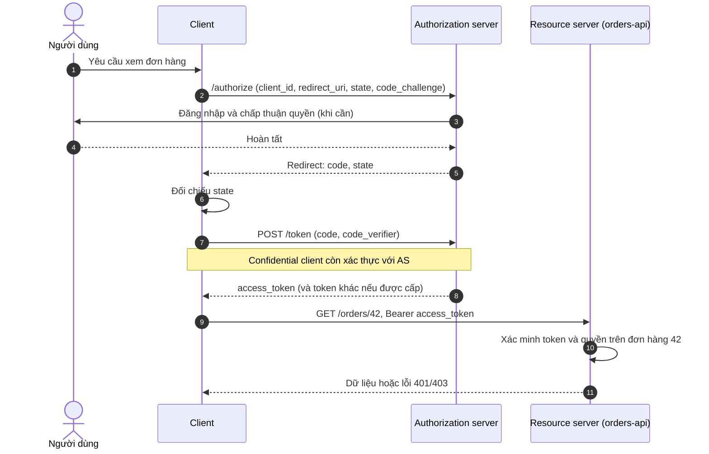
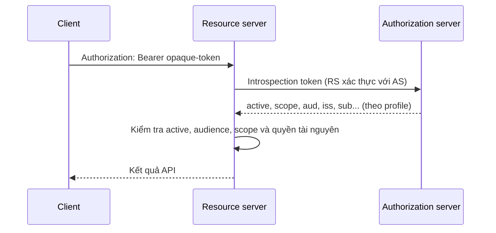

# Trust boundary giữa client, authorization server và resource server

Trong hệ thống dùng OAuth 2.0 hoặc OpenID Connect (OIDC), token thường đi qua nhiều thành phần trước khi một API trả dữ liệu. Câu hỏi bảo mật cốt lõi không chỉ là «token có hợp lệ không?», mà còn là **ai phát hành token, ai được phép sử dụng token, token được tạo cho API nào và thành phần nào chịu trách nhiệm quyết định quyền truy cập**. Đó là bài toán về *trust boundary* (ranh giới tin cậy).

Bài này tập trung vào ba vai trò **client**, **authorization server** và **resource server**; đồng thời giải thích vị trí của JWT, opaque token, access token, refresh token trong mô hình tin cậy, vòng đời kiểm tra và phòng chống token bị đánh cắp hoặc phát lại.

## 1. Trust boundary là gì?

*Trust boundary* là ranh giới tại đó dữ liệu hoặc yêu cầu đi từ một chủ thể có mức độ tin cậy, trách nhiệm hay quyền kiểm soát khác sang chủ thể còn lại. Mỗi lần vượt ranh giới, bên nhận phải tự xác minh bằng chứng phù hợp, thay vì mặc định tin thông tin do bên gửi cung cấp.

Trong OAuth 2.0, ba thành phần chính có trách nhiệm khác nhau:

| Thành phần | Vai trò | Nguồn tin cậy chính | Điều không được mặc định tin |
| --- | --- | --- | --- |
| **Client** (ứng dụng web, mobile, backend) | Xin quyền, nhận token theo luồng phù hợp và dùng access token để gọi API | Cấu hình authorization server và kết quả luồng OAuth/OIDC đã kiểm tra | Không tự quyết định rằng một token do mình giữ chắc chắn có quyền truy cập mọi API |
| **Authorization server (AS)** | Xác thực người dùng khi cần, xét việc cấp quyền, xác thực client theo loại client, phát hành và quản lý token | Định danh, chính sách cấp quyền, đăng ký client và khóa/token do AS kiểm soát | Không coi mọi yêu cầu chứa `client_id` là yêu cầu đến từ client hợp pháp |
| **Resource server (RS)** | Tiếp nhận access token, xác minh tính hợp lệ, áp dụng chính sách truy cập tài nguyên | AS/issuer đã được cấu hình tin cậy **và** chính sách riêng của API | Không coi token do client gửi hoặc một claim được giải mã là bằng chứng đủ nếu chưa xác minh |

Người dùng (*resource owner*) có thể tham gia cấp quyền cho client. Tuy nhiên, **client không đồng nghĩa với người dùng**: trong luồng `client_credentials`, client là một dịch vụ gọi dịch vụ khác và không có người dùng cuối trực tiếp. AS và RS cũng có thể được triển khai chung một hệ thống vật lý, nhưng trách nhiệm tin cậy của chúng vẫn khác nhau.

Một kết nối HTTPS bảo vệ dữ liệu trên đường truyền, **không thay thế** bước xác minh token, audience hay phân quyền ở API. Tương tự, việc hai dịch vụ chạy trong cùng VPC hoặc cùng cụm Kubernetes không khiến dữ liệu do một dịch vụ gửi mặc nhiên đáng tin.

## 2. Luồng điển hình: authorization code với PKCE

Giả sử một ứng dụng quản lý đơn hàng muốn gọi `GET /orders/42` từ `orders-api`. Với luồng *authorization code* (có PKCE), đường đi tiêu biểu như sau:



Các bước trên minh họa ba ranh giới quan trọng:

1. **Client → AS:** client phải sử dụng đúng luồng, redirect URI và PKCE; AS xác minh yêu cầu, người dùng/quyền và client theo loại client.
2. **AS → RS, thông qua token:** RS chỉ tin token sau khi xác minh nó đến từ issuer được tin cậy, dành cho chính RS, còn hiệu lực và có các điều kiện sử dụng cần thiết.
3. **Client → RS:** client có thể trình token nhưng **RS mới là nơi quyết định cuối cùng** có cho phép truy cập đơn hàng cụ thể hay không.

Đối với OIDC, AS còn có thể đóng vai trò *OpenID Provider* và cấp **ID token** cho client để xác nhận sự kiện đăng nhập. ID token có người nhận là client; nó không tự động trở thành access token để gọi API.

## 3. Ranh giới client ↔ authorization server

### 3.1. AS không tin danh tính client chỉ vì thấy `client_id`

`client_id` là mã định danh được công bố trong quá trình đăng ký ứng dụng, **không phải mật khẩu**. Cách xác thực client phụ thuộc khả năng giữ bí mật:

- **Public client** như ứng dụng mobile hoặc SPA chạy trong trình duyệt không thể bảo vệ lâu dài một `client_secret` nhúng trong mã. AS không được dựa vào secret đó để xác thực ứng dụng. Luồng authorization code với PKCE giúp ràng buộc việc đổi mã với bên đã khởi tạo yêu cầu.
- **Confidential client** như backend có nơi lưu bí mật an toàn có thể xác thực với AS bằng client secret, private-key JWT, mTLS hoặc cơ chế được AS hỗ trợ. PKCE vẫn có giá trị bổ sung trong luồng authorization code.

PKCE bảo vệ việc đổi **authorization code**: client sinh `code_verifier` khó đoán, gửi `code_challenge` lúc bắt đầu và xuất trình `code_verifier` lúc đổi code; AS kiểm tra sự tương ứng. **PKCE không chứng minh một public client là bí mật hoặc đáng tin tuyệt đối**, cũng không tự giải quyết mọi vấn đề CSRF và sai cấu hình redirect.

### 3.2. Những gì phải kiểm tra khi vượt ranh giới

| Bên thực hiện | Kiểm tra/trách nhiệm | Nếu bỏ qua |
| --- | --- | --- |
| Client | Dùng đúng AS dự kiến; tạo và đối chiếu `state` gắn với phiên yêu cầu; bảo vệ `code_verifier` | Nhầm phản hồi đăng nhập, ghép sai phiên hoặc bị tấn công CSRF/mix-up tùy luồng |
| AS | Kiểm tra `client_id` đã đăng ký; so khớp chính xác redirect URI theo chính sách đăng ký; xác minh code còn hạn, dùng một lần, khớp client/redirect URI/PKCE | Code bị sử dụng sai client, bị chuyển hướng đến nơi của kẻ tấn công hoặc bị dùng lại |
| AS | Xác thực confidential client khi quy định; giới hạn scope, resource/audience theo chính sách; chỉ cấp refresh token khi thích hợp | Cấp quyền quá rộng hoặc phát token cho bên không đủ điều kiện |
| Client OIDC | Xác minh ID token theo OIDC: issuer, audience là client, chữ ký, thời gian và `nonce` nếu có dùng | Chấp nhận kết quả đăng nhập thuộc phiên/client/issuer khác |

Authorization code đi qua luồng chuyển hướng trình duyệt và chỉ có mục đích **đổi lấy token tại AS**; nó không phải access token để gửi cho RS. Code nên có thời hạn ngắn và chỉ được sử dụng một lần. Client nên tránh để code/token rò rỉ qua log, lịch sử URL, referrer hoặc công cụ theo dõi.

## 4. Ranh giới client ↔ resource server

Client thường gửi access token trong header HTTP:

```http
GET /orders/42 HTTP/1.1
Host: api.example.test
Authorization: Bearer <access_token>
```

Với **bearer token**, bất kỳ ai sở hữu giá trị token có thể thử dùng nó, nếu không có ràng buộc bổ sung như mTLS hoặc DPoP. Vì vậy RS phải coi token nhận từ mạng là **dữ liệu chưa được tin cậy** cho tới khi xác minh xong. Không gửi bearer token trong query string nếu có thể tránh, bởi URL dễ xuất hiện trong lịch sử, log và hệ thống giám sát.

RS không được thay việc xác thực bằng một header do client tự điền như `X-User-Id: admin`, một trường `role` từ JSON request, hay việc giao diện đã ẩn nút «Xóa». Các trường đó đều có thể bị sửa tại client. Nếu có API gateway xác thực trước, RS vẫn cần một mô hình rõ ràng về kênh tin cậy từ gateway đến dịch vụ: chỉ nhận header danh tính nội bộ từ gateway đã được xác thực, ngăn truy cập trực tiếp giả mạo header, và xác định dịch vụ nào chịu trách nhiệm kiểm tra authorization.

Ngay cả token hợp lệ có scope `orders:read` cũng chưa chứng minh người gọi được xem **đơn hàng 42**. RS còn phải kiểm tra chủ sở hữu đơn hàng, tổ chức/tenant, trạng thái tài nguyên, vai trò hoặc chính sách nghiệp vụ tương ứng.

### Ví dụ: xác thực token khác với phân quyền dữ liệu

Đoạn Java dưới đây là **mã giả định hướng thiết kế**; `verifier` tượng trưng cho bộ xác minh OAuth resource server được kiểm thử và cấu hình sẵn, không phải thư viện cụ thể:

```java
VerifiedAccessToken token = verifier.verify(
    rawBearerToken,
    "https://auth.example.test", // issuer được tin cậy
    "orders-api"                 // audience mà API này chấp nhận
);
// verify phải kiểm tra chữ ký/JWKS hoặc introspection, thời hạn,
// token type, issuer, audience và các ràng buộc token có áp dụng.

if (!token.hasScope("orders:read")) {
    return forbidden(); // HTTP 403
}

Order order = repository.findById(42);
if (order == null) {
    return notFound();
}

if (!order.tenantId().equals(token.tenantId())
        || !order.ownerUserId().equals(token.subject())) {
    return forbidden(); // Không được xem đơn của người/tenant khác
}

return ok(order);
```

Nếu không có token hoặc token không hợp lệ, RS thường trả **401 Unauthorized** và thông tin xác thực phù hợp; nếu đã xác thực nhưng không đủ quyền, thường trả **403 Forbidden**. Việc trả 404 thay vì 403 trong một số trường hợp để tránh làm lộ sự tồn tại tài nguyên là một lựa chọn chính sách.

Đoạn ví dụ giả định token đại diện cho **người dùng** và chứa thông tin tenant đã được xác minh. Với token thuộc luồng `client_credentials`, `sub` có thể đại diện cho client hoặc một principal của dịch vụ, nên không được suy diễn thành ID người dùng cuối. Khi đó phải áp dụng chính sách service-to-service riêng.

## 5. Ranh giới authorization server ↔ resource server

RS **không cần tin client là ai để tin một access token**. Nó cần tin **issuer** và quy trình kiểm tra token do chính RS thực hiện. Có hai cách phổ biến, tùy dạng token và kiến trúc:

### 5.1. Access token dạng JWT

JWT là **định dạng** token gồm các claim; access token là **vai trò/mục đích** sử dụng. Một access token có thể là JWT, nhưng không phải mọi JWT đều là access token. JWT được ký (JWS) thông thường có payload đọc được sau khi giải mã Base64URL, vì **chữ ký bảo đảm tính toàn vẹn/xuất xứ trong phạm vi khóa được tin cậy, không mã hóa bí mật nội dung**.

Payload minh họa của một JWT access token:

```json
{
  "iss": "https://auth.example.test",
  "sub": "user-123",
  "aud": ["orders-api"],
  "scope": "orders:read",
  "client_id": "shop-web",
  "tenant_id": "tenant-a",
  "iat": 1893456000,
  "exp": 1893459600
}
```

Đây chỉ là ví dụ claim; tên claim mở rộng, cách biểu diễn scope và ý nghĩa `sub` tùy profile/token contract của issuer. `iat` và `exp` là thời điểm Unix tính bằng giây. **Giải mã thấy JSON hợp lệ chưa có nghĩa token hợp lệ**: trước hết cần kiểm tra chữ ký, khóa, thuật toán và các điều kiện ngữ nghĩa.

RS kiểm tra tối thiểu theo hợp đồng token của hệ thống:

1. **Issuer (`iss`):** chính xác issuer mà RS tin cậy; không nhận token từ môi trường hay tenant/AS ngoài danh sách cho phép.
2. **Chữ ký và thuật toán:** xác minh bằng khóa công khai được lấy qua cấu hình/metadata/JWKS của issuer tin cậy; giới hạn thuật toán cho phép. Không tự lấy khóa từ URL do header của token tùy ý chỉ định, và không chấp nhận `alg: none` cho token bắt buộc có chữ ký.
3. **Audience (`aud`):** token được cấp cho `orders-api`, không phải cho một API khác. Đây là hàng rào quan trọng chống chuyển token từ dịch vụ A sang B.
4. **Thời hạn:** `exp` chưa quá hạn; `nbf` (nếu có) đã đến hiệu lực; xử lý sai lệch đồng hồ có giới hạn hợp lý.
5. **Loại và mục đích:** chỉ chấp nhận access token theo profile đã thống nhất; không coi ID token hay refresh token là access token.
6. **Scope và ràng buộc bổ sung:** scope/permission cần thiết, token binding (`cnf`) nếu có, tenant hoặc client liên quan theo chính sách; sau đó tiếp tục kiểm tra quyền trên tài nguyên cụ thể.

`kid` trong JWT header chỉ là **gợi ý chọn khóa trong tập khóa tin cậy**, không phải giấy phép tự kết nối tới địa chỉ ngoài do token đề xuất. Hệ thống cũng phải xử lý thay khóa (key rotation) an toàn và giới hạn cache khóa hợp lý.

### 5.2. Access token dạng opaque

Opaque token là chuỗi mà RS không tự suy diễn ý nghĩa bằng cách giải mã. Một phương án phổ biến là RS gọi **token introspection endpoint** của AS qua kênh được bảo vệ và cơ chế xác thực được phép:



`active: true` chỉ trả lời token đang được AS coi là hoạt động theo ngữ cảnh introspection. RS vẫn phải so khớp **đúng audience/resource, quyền hạn và principal** theo hợp đồng của AS. RS cần bảo vệ thông tin xác thực dùng với introspection endpoint, chọn timeout/cache cân đối giữa hiệu năng, tính sẵn sàng và tốc độ phản ánh việc thu hồi token.

| Đặc tính | JWT access token tự xác minh tại RS | Opaque access token với introspection |
| --- | --- | --- |
| Kiểm tra nguồn phát hành | Chữ ký, issuer và metadata/khóa đã tin cậy | Phản hồi từ AS qua endpoint và xác thực được tin cậy |
| Cần hỏi AS cho mỗi lượt gọi API? | Thường không, nếu không có bước kiểm tra trạng thái bổ sung | Tùy chính sách cache; thông thường RS cần tra trạng thái |
| Thu hồi trước hạn | Cần cơ chế bổ sung như denylist, kiểm tra trạng thái hoặc giảm thời gian sống | Có thể được phản ánh qua introspection, phụ thuộc cache và AS |
| Rủi ro chính cần quản lý | Kiểm tra claim/khóa sai, quyền cũ tồn tại đến khi hết hạn | Phụ thuộc AS, độ trễ, cache trạng thái và bảo mật introspection |

JWT và opaque không tự quyết định mức độ an toàn: **hệ thống kiểm tra, quản lý khóa, thời hạn, quyền hạn và lưu trữ token** mới quyết định kết quả.

## 6. Access token, refresh token, ID token: ai được nhận?

Một lỗi ranh giới thường gặp là dùng nhầm token chỉ vì tất cả đều trông giống «chuỗi ký tự bảo mật».

| Loại | Mục đích | Đối tượng nhận/kiểm tra | Không được làm |
| --- | --- | --- | --- |
| **Access token** | Trình quyền truy cập tài nguyên/API | RS đích, theo issuer và audience được phép | Đem token của API A sang API B nếu B không thuộc audience |
| **Refresh token** | Xin cấp access token mới theo chính sách AS | AS token endpoint; client lưu giữ và sử dụng theo loại client | Gửi refresh token tới resource server |
| **ID token (OIDC)** | Cung cấp các thông tin xác thực người dùng cho client | Client/Relying Party, theo quy tắc OIDC | Dùng làm bearer access token để gọi API |
| **Authorization code** | Mã ngắn hạn để client đổi token | AS token endpoint cùng thông tin PKCE/client tương ứng | Dùng như credential dài hạn hoặc token gọi API |
| **Session cookie** | Duy trì phiên với đúng ứng dụng/AS phát cookie | Server gắn với phiên và các quy tắc cookie tương ứng | Mặc định coi cookie đăng nhập AS là quyền truy cập RS |

Access token thường mang quyền **được cấp cho một client đối với một resource**; refresh token thường có phạm vi sử dụng nhạy cảm hơn vì giúp xin token mới. Khi triển khai refresh token, cân nhắc rotation, phát hiện dùng lại token đã xoay vòng (*reuse detection*), ràng buộc với client và chính sách thời hạn. Public client cần cơ chế bảo vệ refresh token phù hợp với khả năng giữ bí mật thực tế.

Trong OIDC, client kiểm tra ID token cho **đăng nhập**, còn RS kiểm tra access token cho **API**. Hai kiểu kiểm tra có thể dùng chung kỹ thuật JWT nhưng khác **audience, mục đích và chính sách**. Phân biệt này ngăn *token substitution*: một token hợp lệ trong ngữ cảnh A bị đem dùng nhầm trong ngữ cảnh B.

## 7. Ranh giới tin cậy trong trình duyệt và các dịch vụ nội bộ

### 7.1. Trình duyệt ↔ frontend/backend

Mã JavaScript chạy trong trình duyệt thuộc môi trường có thể bị XSS, extension độc hại hoặc người dùng sửa đổi. Đừng đặt client secret trong SPA, bundle JavaScript hay ứng dụng mobile rồi coi nó là bí mật. Token xuất hiện trong `localStorage` hoặc `sessionStorage` có thể bị JavaScript độc hại cùng origin đọc; giữ token trong bộ nhớ hạn chế thời gian lưu nhưng không tự loại bỏ tác động của XSS.

Mô hình **Backend for Frontend (BFF)** có thể giữ access/refresh token ở backend và dùng cookie phiên `HttpOnly`, `Secure`, `SameSite` cho trình duyệt. Cách này giảm việc JavaScript trực tiếp lấy token; vẫn cần kiểm soát **CSRF** cho các hành động dựa trên cookie, XSS, cấu hình CORS, bảo vệ phiên và quyền truy cập API. `HttpOnly` không khiến ứng dụng miễn nhiễm với XSS: mã độc vẫn có thể gửi yêu cầu dưới phiên người dùng.

**CORS không phải hệ thống xác thực/phân quyền**: nó hạn chế một số cách trình duyệt cho JavaScript đọc phản hồi giữa các origin, chứ không chứng minh quyền của bất kỳ request nào mà RS nhận được. Mọi API vẫn phải xác minh token và phân quyền ở phía server.

### 7.2. Dịch vụ A ↔ dịch vụ B

Trong hệ thống microservice, `payment-service` có thể là client của `inventory-api` và tự nó cũng là RS cho ứng dụng khác. Mỗi bước gọi là một ranh giới:

- Nếu dịch vụ A gọi B bằng `client_credentials`, B phải kiểm tra access token hướng đến **B**, scope dịch vụ được cấp và chính sách B; không có giả định tự động về người dùng cuối.
- Nếu A cần gọi B **thay mặt người dùng**, phải có cơ chế ủy quyền rõ ràng (ví dụ token exchange/delegation do AS hỗ trợ) và audience thích hợp. Không chuyển tiếp bừa access token vốn chỉ cấp cho A.
- Không tin header `X-User-Id` hoặc `X-Tenant-Id` do một nguồn không được xác thực truyền qua nhiều hop. Mỗi hop cần biết bên nào tạo và bảo vệ ngữ cảnh danh tính.

Trong hệ thống đa tenant, cặp `(iss, sub)` thường cần được xem cùng nhau để phân biệt định danh từ các issuer; claim tenant cũng phải được xác minh và so sánh với tenant sở hữu dữ liệu. Scope rộng như `orders:read` **không thay thế** bước ngăn truy cập chéo tenant.

## 8. Các kiểu vượt ranh giới sai và cách phòng chống

| Tình huống | Ranh giới bị phá | Cách phòng chống phù hợp |
| --- | --- | --- |
| API chỉ `decode` JWT và tin `role=admin` | Client → RS: tin claim chưa xác minh | Kiểm tra chữ ký/issuer/audience/thời hạn và quyền trên server |
| Token dành cho `billing-api` được `orders-api` nhận | AS → RS: bỏ qua audience | Mỗi RS bắt buộc kiểm tra `aud`/resource của chính mình |
| Frontend gửi ID token thay access token | Client → RS: nhầm mục đích token | Phân biệt token type/profile, audience và kiểm tra đúng hợp đồng |
| Token rò qua URL, log, XSS hoặc thiết bị mất | Kẻ tấn công chiếm bearer token | HTTPS, tối thiểu hóa ghi log, bảo vệ storage, TTL ngắn, thu hồi khi cần; cân nhắc mTLS/DPoP |
| Kẻ tấn công phát lại bearer token vừa đánh cắp | Không có bằng chứng người gọi là chủ token | Sender-constrained token (mTLS/DPoP) khi phù hợp, xác minh proof và chống replay theo cơ chế tương ứng |
| Refresh token bị đánh cắp và dùng nhiều lần | Client ↔ AS: credential dài hạn bị lộ | Bảo vệ refresh token, rotation/reuse detection, thu hồi chuỗi token khi phát hiện lạm dụng |
| API cho phép xem đơn của tenant khác chỉ vì có scope | RS ↔ dữ liệu nghiệp vụ: thiếu object-level authorization | Kiểm tra owner, tenant và chính sách đối với từng tài nguyên |
| RS chọn khóa từ URL do JWT header tùy ý cung cấp | RS ↔ nguồn khóa: mở rộng danh sách issuer không kiểm soát | Pin issuer/JWKS đáng tin, allowlist thuật toán, xoay khóa có kiểm soát |
| Quyền người dùng bị rút nhưng JWT vẫn còn hạn | AS ↔ RS: quyền tại thời điểm cấp khác quyền hiện tại | TTL phù hợp, tra cứu quyền động, revocation/denylist hoặc introspection theo mức rủi ro |

**mTLS** và **DPoP** có thể ràng buộc access token với khóa/chứng chỉ của bên dùng token (*sender-constrained token*). Khi dùng DPoP, RS/AS phải xác minh proof phù hợp request (HTTP method, URI, thời gian, `jti`/nonce theo chính sách) và khóa gắn với token; chỉ thêm một header mà không xác minh ràng buộc không chống được phát lại. Cơ chế này giảm khả năng tái sử dụng token bị lộ, nhưng không thay thế việc sửa nguyên nhân lộ token.

## 9. Khi token được gia hạn hoặc thu hồi, ai có trách nhiệm?

Token có vòng đời: **phát hành → lưu giữ → trình để sử dụng → xác minh → hết hạn hoặc thu hồi**. Quyền tin cậy thay đổi theo thời điểm:

1. **AS phát hành:** giới hạn audience, scope, thời gian sống, loại token và client được phép. Không phát quyền rộng chỉ vì client yêu cầu.
2. **Client lưu giữ:** tránh lộ access/refresh token qua log, analytics, URL hoặc kho lưu trữ không phù hợp. Chọn cách lưu tùy mobile, SPA hay backend; giới hạn quyền truy cập nội bộ.
3. **RS xác minh mỗi lần sử dụng:** phải đánh giá tình trạng token theo cơ chế đã chọn; token từng hợp lệ không bảo đảm luôn hợp lệ.
4. **AS xử lý gia hạn/thu hồi:** refresh token được đổi tại AS, có thể xoay vòng hoặc bị vô hiệu hóa; RS không tự biến access token thành refresh token.
5. **RS phản ánh thay đổi quyền:** JWT tự xác minh có thể tiếp tục được chấp nhận đến lúc hết hạn trừ khi có denylist/kiểm tra bổ sung. Introspection có thể phản ánh thu hồi nhanh hơn nhưng kết quả tùy thời gian cache và tính sẵn sàng của AS.

Ví dụ: quản trị viên thu hồi quyền `orders:read` của người dùng lúc 10:00, nhưng access token JWT đã cấp có hạn tới 10:10. Nếu RS chỉ kiểm tra chữ ký, `exp` và scope chứa trong token, quyền cũ có thể còn được dùng đến 10:10. Hệ thống có yêu cầu thu hồi tức thì cần chính sách bổ sung, chẳng hạn tra cứu quyền hiện hành tại RS, introspection hoặc danh sách thu hồi. Không nên hứa rằng «JWT tự động bị vô hiệu hóa ngay khi người dùng đăng xuất».

## 10. Checklist áp dụng khi thiết kế API có token

Trước khi đưa một luồng token vào môi trường thực tế, hãy trả lời rõ:

- **Ai là client?** Public hay confidential? Nếu authorization code flow, PKCE, `state`, redirect URI và client authentication được triển khai đúng chưa?
- **Ai là issuer được tin cậy?** RS cấu hình issuer và nguồn JWKS/introspection cố định, có kiểm soát thuật toán và xoay khóa chưa?
- **Access token gửi cho ai?** RS có kiểm tra `aud`, loại token, `exp`/`nbf`, scope và ràng buộc proof-of-possession nếu áp dụng không?
- **Ai phân quyền tài nguyên?** Có kiểm tra user/service principal, owner, tenant và hành động đối với đối tượng thực tế không?
- **Token nằm ở đâu?** Access/refresh token có bị lộ vào URL, log, client secret trong frontend, hoặc lưu trữ dễ bị XSS lấy không?
- **Điều gì xảy ra khi token bị đánh cắp, phát lại hoặc thu hồi?** Có TTL, rotation, reuse detection, chính sách cache/introspection và phương án xử lý sự cố phù hợp không?
- **Có nhiều API hoặc nhiều tenant không?** Token có bị chuyển tiếp sai audience, nhầm issuer hoặc tin header danh tính vượt qua ranh giới mà không xác minh không?

### Kết luận

**Client xin và trình token; authorization server phát hành và quản lý sự tin cậy gắn với token; resource server độc lập xác minh token và quyết định quyền truy cập tài nguyên.** Mỗi bên chỉ tin đúng bằng chứng thuộc phạm vi của mình. Hiểu rạch ròi ba ranh giới này giúp tránh lỗi chấp nhận nhầm ID token, bỏ qua audience, tin claim chưa kiểm tra, lộ refresh token và phân quyền thiếu kiểm soát trong OAuth 2.0/OIDC.

**Tài liệu kỹ thuật nên tra cứu thêm:** OAuth 2.0 Bearer Token Usage (RFC 6750), PKCE (RFC 7636), Token Introspection (RFC 7662), Token Revocation (RFC 7009), JWT Best Current Practices (RFC 8725), JWT Profile for OAuth 2.0 Access Tokens (RFC 9068), OAuth 2.0 Security Best Current Practice (RFC 9700) và OpenID Connect Core.
