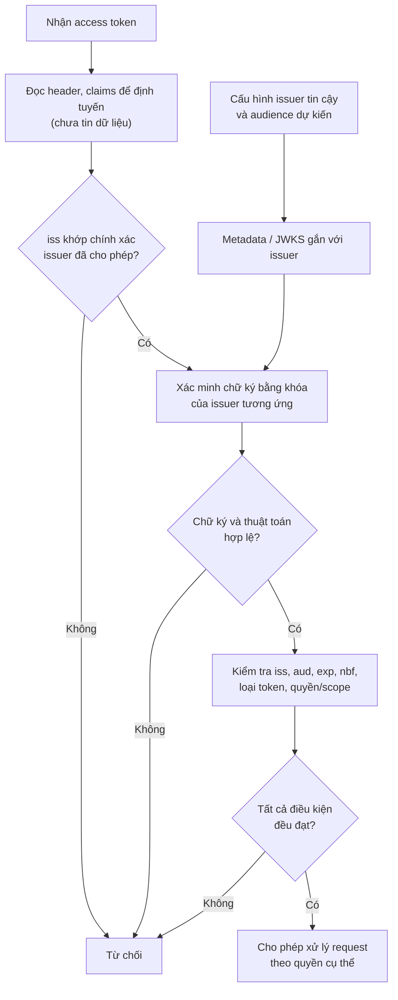

# Issuer identity và định danh ổn định

## Mục tiêu học tập

Sau bài này, bạn có thể:

- Giải thích **issuer** là ai, vì sao `iss` là một phần của ranh giới tin cậy và vì sao tên miền hoặc chữ ký hợp lệ riêng lẻ chưa đủ để chấp nhận token.
- Phân biệt định danh issuer với `sub` (chủ thể), `aud` (bên nhận), `client_id` (ứng dụng khách), `kid` (khóa ký) và tên hiển thị của tổ chức.
- Thiết lập quy tắc định danh issuer ổn định, kiểm tra khớp chính xác và xử lý an toàn hệ thống có nhiều issuer/tenant.
- Nhận biết tác động của xoay khóa, đổi tên miền, di chuyển Authorization Server và thu hồi token tới mối quan hệ tin cậy.
- Vận dụng các quy tắc trên cho JWT, opaque token, access token, refresh token và các luồng OAuth 2.0/OpenID Connect (OIDC).

## 1. Issuer là một danh tính bảo mật

**Issuer** là thực thể phát hành token và chịu trách nhiệm về các khẳng định trong token theo một thỏa thuận tin cậy. Trong OAuth 2.0, issuer thường là **Authorization Server** (AS); trong OIDC, OpenID Provider (OP) là issuer của ID Token. Một Resource Server (API) cần biết nó chấp nhận token từ issuer nào trước khi tin vào thông tin bên trong token.

Ví dụ một hệ thống bán hàng dùng issuer có định danh:

```text
https://identity.example.com/realms/retail
```

Giá trị này là **định danh giao thức ổn định**, không phải tên sản phẩm "Retail Login", tên máy chủ đang chạy, địa chỉ một node Kubernetes hay URL trang đăng nhập mà người dùng nhìn thấy. Một cụm nhiều máy chủ có thể cùng đại diện cho một issuer; ngược lại, một nền tảng Identity có thể vận hành nhiều issuer tách biệt theo tenant hoặc môi trường.

Issuer thường xuất hiện dưới dạng claim `iss` trong JWT:

```json
{
  "iss": "https://identity.example.com/realms/retail",
  "sub": "user-4821",
  "aud": "api://orders",
  "scope": "orders:read",
  "iat": 1800000000,
  "exp": 1800000900
}
```

*Payload trên chỉ minh họa các claim; một payload JSON tự nó chưa chứng minh được nguồn phát hành hay tính hợp lệ của token.*

Theo JWT (RFC 7519), `iss` là claim dùng để nhận diện issuer; việc sử dụng claim này trong JWT tổng quát phụ thuộc thỏa thuận ứng dụng. Với **OIDC ID Token**, `iss` là claim bắt buộc. Với **JWT access token theo profile RFC 9068**, `iss` cũng là claim bắt buộc. Resource Server chỉ nên nhận token theo một hợp đồng xác thực xác định, thay vì suy đoán từ sự có mặt của một claim.

## 2. Phân biệt các định danh dễ nhầm

| Thành phần | Trả lời câu hỏi | Ví dụ | Hệ quả khi xác thực |
| --- | --- | --- | --- |
| `iss` — issuer | **Ai phát hành** token? | `https://identity.example.com/realms/retail` | Phải thuộc danh sách issuer được tin cậy và khớp với định danh đã cấu hình. |
| `sub` — subject | Token nói về **chủ thể nào**? | `user-4821` | Thường chỉ duy nhất trong phạm vi issuer; định danh người dùng nên gắn với cặp `(iss, sub)`. |
| `aud` — audience | Token **dành cho ai**? | `api://orders` | API Orders từ chối token phát hành cho API khác, kể cả cùng issuer. |
| `client_id` | **Ứng dụng khách nào** tham gia luồng cấp token? | `web-order-portal` | Không thay thế kiểm tra issuer hoặc audience. |
| `kid` — key ID | Chữ ký dùng **khóa nào trong bộ khóa phù hợp**? | `signing-key-2027-01` | Gợi ý chọn khóa; không chứng minh issuer là ai, không phải định danh toàn cục. |
| `jti` — token ID | **Token cụ thể nào**? | `9a7f-...` | Hữu ích cho audit, phát hiện phát lại hoặc thu hồi khi hệ thống hỗ trợ. |
| Tên hiển thị | Gọi issuer/thương hiệu là gì? | "Retail Identity" | Có thể đổi mà không nhất thiết đổi `iss`. |

Hai issuer khác nhau hoàn toàn có thể cùng phát hành token có `sub = "42"`. Nếu ứng dụng lưu tài khoản chỉ bằng `sub`, chúng có thể bị nhập nhằng:

```text
(https://identity.example.com/realms/retail, 42)  -> người dùng A
(https://identity.example.com/realms/partner, 42) -> người dùng B
```

Đặc biệt với OIDC, `sub` được thiết kế để ổn định trong phạm vi issuer và có thể là định danh kiểu *pairwise* khác nhau giữa các nhóm client. Không nên dùng email, username hoặc tên hiển thị làm thay thế cho `(iss, sub)` khi cần định danh bảo mật.

## 3. Issuer trở thành gốc của mô hình tin cậy như thế nào?

Một hệ thống an toàn bắt đầu từ **cấu hình issuer tin cậy do bên vận hành kiểm soát**. Issuer có thể công bố metadata của OIDC hoặc OAuth 2.0 Authorization Server, trong đó có trường `issuer` và thông tin lấy các khóa xác minh (ví dụ `jwks_uri`). Resource Server liên kết **định danh issuer → metadata phù hợp → bộ khóa được phép → các điều kiện dùng token**.



Lưu ý thứ tự tin cậy: hệ thống có thể **đọc tạm** `iss` từ một JWT chưa xác minh để chọn cấu hình trong danh sách issuer cho phép; giá trị đó **chưa được xem là đúng** cho đến khi chữ ký và toàn bộ điều kiện xác thực đã được kiểm chứng. Nếu chỉ có một issuer, nên chọn trực tiếp cấu hình đã ghim sẵn, không cần để token quyết định nơi tải khóa.

**Các kiểm tra phải đi cùng nhau:**

1. **Issuer:** `iss` phải khớp chính xác với giá trị đã tin cậy; JWT có chữ ký hợp lệ từ một issuer khác vẫn phải bị từ chối.
2. **Chữ ký và thuật toán:** chỉ cho phép các thuật toán phù hợp với cấu hình; lấy khóa từ tập khóa đáng tin cậy gắn với issuer đó. `kid` là chỉ số chọn khóa, không được dùng để tùy ý chuyển sang một nguồn khóa lạ.
3. **Audience:** API so sánh `aud` với định danh tài nguyên của chính nó. Không chấp nhận access token dành cho một API khác.
4. **Thời hạn:** kiểm tra `exp`, `nbf` và chính sách về `iat`/độ lệch đồng hồ nếu cần.
5. **Loại token và quyền:** access token dùng để truy cập API; ID Token dành cho client OIDC; refresh token dành cho endpoint cấp lại token. Đồng thời kiểm tra `scope`, role hoặc permission thích hợp cho thao tác.
6. **Trạng thái cần thiết:** nếu chính sách yêu cầu thu hồi tức thời hoặc phát hiện phát lại, kết hợp introspection, danh sách thu hồi, token ngắn hạn hoặc kiểm soát phiên.

Một **chữ ký đúng** chỉ chứng minh token được ký bởi một khóa tương ứng. Khi chưa xác minh rằng khóa đó được ủy quyền cho **issuer dự kiến**, chữ ký chưa chứng minh được token đến từ nơi cần tin cậy. Tương tự, một chuỗi `iss` được viết trong payload chưa phải bằng chứng xác thực: ai cũng có thể tự tạo payload khai là issuer nổi tiếng.

## 4. “Định danh ổn định” nghĩa là gì?

Định danh ổn định là giá trị issuer được các bên xem như một **khóa tham chiếu lâu dài trong hợp đồng bảo mật**. Các dịch vụ, ứng dụng khách, log và cấu hình xác thực sử dụng nhất quán giá trị này qua việc mở rộng hạ tầng, thay certificate TLS hoặc xoay khóa ký token.

Ví dụ:

```text
Issuer tin cậy: https://identity.example.com/realms/retail

Tháng 1: ký bằng key-A  -> iss vẫn là cùng URL
Tháng 2: thêm key-B     -> iss vẫn là cùng URL
Tháng 3: ngừng key-A    -> iss vẫn là cùng URL
```

**Xoay khóa không đồng nghĩa đổi issuer.** Nhiều khóa có thể cùng hiện diện trong JWKS ở giai đoạn chuyển tiếp; các verifier cần làm mới bộ khóa an toàn và chỉ chấp nhận token còn hiệu lực theo chính sách. Ngược lại, nếu thay `iss`, các client và API dùng so khớp chính xác có thể lập tức từ chối token mới — kể cả khi công ty, người dùng hay máy chủ không thay đổi.

Những quyết định thiết kế nên áp dụng:

- **Định danh theo ranh giới bảo mật:** đặt issuer riêng cho môi trường production và staging; khi các tenant là những miền tin cậy độc lập, có thể dùng issuer riêng từng tenant.
- **Giữ URL có chủ sở hữu rõ ràng:** sử dụng HTTPS và tên miền/namespace được tổ chức kiểm soát; bảo vệ DNS, TLS, quyền quản trị domain và các cấu hình công bố metadata.
- **Tránh gắn với vị trí triển khai dễ đổi:** không lấy hostname pod, node, địa chỉ IP tạm thời hoặc phiên bản build làm `iss`.
- **Cố định định dạng:** thống nhất scheme, host, đường dẫn và quy tắc dấu `/` cuối; kiểm thử tất cả thành phần dùng đúng một giá trị.
- **Quản lý thay đổi như thay hợp đồng:** đổi issuer cần kiểm kê toàn bộ client, Resource Server, metadata, audience, cache khóa và cơ chế gắn tài khoản trước khi triển khai.

### So khớp chính xác là yêu cầu bảo mật

Theo quy tắc so sánh chuỗi của JWT và các quy tắc xác thực OIDC, giá trị issuer được so sánh theo dạng chuỗi **phân biệt hoa/thường**; không tùy ý bỏ dấu `/`, đổi host, thay path, giải mã/chuẩn hóa URL rồi kết luận rằng hai issuer “tương đương”.

| Issuer được tin cậy | `iss` trong token | Kết quả |
| --- | --- | --- |
| `https://id.example.com/tenant/a` | `https://id.example.com/tenant/a` | Khớp issuer; vẫn cần các kiểm tra khác. |
| `https://id.example.com/tenant/a` | `https://id.example.com/tenant/a/` | Không khớp. |
| `https://id.example.com/tenant/a` | `https://id.example.com/tenant/b` | Không khớp, dù cùng tên miền. |
| `https://id.example.com/tenant/a` | `http://id.example.com/tenant/a` | Không khớp. |
| `https://id.example.com/tenant/a` | `https://ID.example.com/tenant/a` | Không khớp theo quy tắc so khớp chuỗi; không tự chuẩn hóa host. |

Issuer trong OIDC là một URL HTTPS không chứa query hay fragment; việc khám phá metadata phải dùng cơ chế đúng chuẩn mà nhà cung cấp hỗ trợ. Đừng tự chế một quy tắc ghép URL từ dữ liệu chưa tin cậy. Một issuer có thể đại diện cho một cụm AS, nhưng mọi thành phần có trách nhiệm phát hành token phải xuất ra **cùng chuỗi issuer** đã công bố.

## 5. Gắn issuer vào JWT, opaque token và các loại token OAuth/OIDC

| Loại token | Issuer được thể hiện/kiểm tra ra sao? | Bên có trách nhiệm |
| --- | --- | --- |
| **JWT access token** | Đọc `iss` trong claims, kiểm tra chữ ký bằng khóa gắn với issuer, xác thực `aud`, thời hạn, token type và quyền. Với profile RFC 9068, header `typ` nhận diện access token JWT (ví dụ `at+jwt`). | Resource Server |
| **Opaque access token** | Chuỗi token không được giả định chứa claim có thể đọc. Resource Server hỏi **introspection endpoint đáng tin cậy**; phản hồi `active` và claims/metadata do AS trả về theo hợp đồng. `iss` trong introspection response là trường tùy chọn theo RFC 7662. | Resource Server và AS introspection |
| **OIDC ID Token** | Client kiểm tra `iss` từ OP kỳ vọng, chữ ký, `aud` là client, thời hạn và các điều kiện như `nonce`/`azp` khi áp dụng. ID Token xác nhận thông tin đăng nhập cho client, không thay cho access token truy cập API. | OIDC Relying Party / Client |
| **Refresh token** | Thường là opaque; client giữ nó trong quan hệ với **AS đã cấp và client đã được cấp quyền**. AS kiểm tra ràng buộc và có thể xoay hoặc thu hồi refresh token. | Authorization Server |

Một điểm dễ nhầm: opaque token không có phần payload để Resource Server “đọc `iss`”. Danh tính AS được neo vào **điểm introspection mà API cấu hình**, cơ chế xác thực với endpoint đó và hợp đồng của kết quả. API không được lấy một opaque token bất kỳ rồi dò mọi AS cho đến khi có nơi nhận.

Với JWT access token, đừng dùng sự xuất hiện của `sub`/`email` làm dấu hiệu cho phép đăng nhập hay truy cập. Một ID Token có thể cũng được ký bởi đúng issuer và chứa `sub` hợp lệ, nhưng **audience và mục đích sử dụng khác**. Đây là lỗi *token confusion* nếu API không phân biệt loại token.

## 6. Ví dụ: thiết kế Resource Server chấp nhận đúng issuer

Giả sử Orders API chỉ nhận JWT access token do issuer `retail` cấp cho audience `api://orders`. Cấu hình được khai báo bởi đội vận hành:

```yaml
trustedIssuer: "https://identity.example.com/realms/retail"
expectedAudience: "api://orders"
allowedAlgorithms: ["RS256"]
acceptedTokenKind: "access_token"
```

Một quy trình xác thực minh họa (pseudo-code, không phụ thuộc thư viện):

```java
// Mọi trường đọc từ rawToken đều là untrusted cho tới khi verify thành công.
TokenHeader header = parseHeaderWithoutTrust(rawToken);
TokenClaims hints = parseClaimsWithoutTrust(rawToken);

IssuerConfig issuer = configuredTrustedIssuer; // cấu hình từ phía server
if (!constantStringEquals(hints.iss(), issuer.issuerId())) {
    throw new UnauthorizedException("Unexpected issuer");
}

// Verifier chỉ dùng thuật toán cho phép và keys của issuer đã cấu hình.
VerifiedToken token = verifier.verifySignature(
    rawToken,
    issuer.allowedAlgorithms(),
    issuer.trustedJwks(),
    header.kid()
);

requireEqual(token.issuer(), issuer.issuerId());
requireAudience(token.audience(), "api://orders");
requireValidTimes(token.issuedAt(), token.notBefore(), token.expiresAt());
requireAccessTokenType(token);  // theo profile token đang sử dụng
requireScope(token.scopes(), "orders:read");
```

Trong ứng dụng Spring Security, cấu hình `spring.security.oauth2.resourceserver.jwt.issuer-uri` có thể giúp Resource Server tìm metadata/khóa của issuer được cấu hình và xác minh issuer. Vẫn cần cấu hình hoặc bổ sung validator cho **audience**, token type và các điều kiện nghiệp vụ theo hợp đồng của API. Đừng suy luận rằng chỉ thêm `issuer-uri` là đã xử lý đầy đủ mọi kiểm tra phân quyền.

Nếu service nhận token từ **nhiều issuer** (ví dụ retail và partner), dùng bảng ánh xạ cho phép đã khai báo:

```text
https://identity.example.com/realms/retail
  -> bộ JWKS retail, policy audience retail

https://partner-id.example.net/oidc
  -> bộ JWKS partner, policy audience partner
```

Giá trị `iss` chưa xác minh chỉ được dùng làm **khóa tra cứu trong danh sách cố định**. Không làm như sau:

```java
// SAI: token điều khiển trực tiếp URL truy cập và nơi lấy trust material.
String issuer = parseClaimsWithoutTrust(token).iss();
Jwks keys = httpGet(issuer + "/keys");
acceptIfSignatureVerifies(token, keys);
```

Cách sai tạo cơ hội cho token do kẻ tấn công tự cấp, truy cập mạng nội bộ trái phép (SSRF) và tin nhầm khóa của một bên chưa từng được ủy quyền. Tương tự, header `jku`, `x5u` hoặc `kid` không được phép tự quyết định một URL/tập khóa bên ngoài danh sách tin cậy.

## 7. Vòng đời issuer: xoay khóa, di chuyển và hủy bỏ tin cậy

**Trường hợp A — xoay khóa ký:** giữ nguyên `iss`, thêm khóa mới vào tập khóa có thẩm quyền, bắt đầu ký bằng khóa mới, duy trì khóa cũ đủ cho các JWT còn hạn theo chính sách và loại bỏ khóa cũ sau cửa sổ phù hợp. Resource Server làm mới JWKS từ nguồn đã ghim, xử lý cache và giới hạn số lần tải lại khi gặp `kid` mới. Việc xoay khóa có thể thực hiện độc lập với đổi issuer.

**Trường hợp B — đổi nhà cung cấp hoặc tên miền issuer:** đây là **thay đổi danh tính theo giao thức** nếu chuỗi `iss` khác đi. Một kế hoạch chuyển đổi có kiểm soát có thể gồm:

1. Xác định issuer cũ và mới, các client và API tin cậy từng issuer, phạm vi tenant, audience và ánh xạ `(iss, sub)`.
2. Cấu hình **cả hai issuer chính xác** chỉ trong giai đoạn chuyển đổi nếu chính sách cho phép; mỗi issuer có metadata/khóa, audience và quy tắc riêng.
3. Chuyển client sang endpoint mới, phát hành token mới dưới issuer mới, cập nhật liên kết tài khoản bằng quy trình có kiểm chứng.
4. Theo dõi traffic và hạn sống token; dừng chấp nhận issuer cũ sau thời điểm đã thông báo, xử lý các phiên/refresh token cũ theo chính sách.
5. Loại bỏ metadata, khóa, ngoại lệ và cấu hình trust của issuer cũ khi đã hoàn tất chuyển đổi.

Không chấp nhận mọi issuer có chung hậu tố domain, không tự động “sửa” `iss` trong token và không coi một key ký dùng chung là phép thay thế cho định danh issuer. Việc đổi issuer đôi khi cần đăng nhập hoặc cấp consent mới; refresh token của AS cũ không mặc nhiên hợp lệ tại AS mới.

**Trường hợp C — issuer bị xâm phạm hoặc mất quyền kiểm soát domain:** phải có cách ngừng tin cậy issuer/khóa bị ảnh hưởng, đánh giá token còn hạn và kích hoạt quy trình thu hồi/giảm thời hạn tùy loại token. Chuỗi `iss` ổn định không đồng nghĩa một issuer luôn đáng tin cậy mãi mãi. Quyền sở hữu DNS, cấu hình issuer, endpoint metadata/JWKS và khóa ký đều là một phần của tài sản bảo mật phải được quản trị.

## 8. Issuer confusion và các lỗi thường gặp

| Sai sót | Tình huống | Kiểm soát cần áp dụng |
| --- | --- | --- |
| **Chỉ tin chuỗi `iss`** | Kẻ tấn công tạo JWT tự ký và ghi `iss` bằng issuer thật. | Xác minh chữ ký với khóa được ủy quyền cho issuer cấu hình. |
| **Chỉ kiểm tra chữ ký** | JWT được ký hợp lệ nhưng thuộc tenant hoặc AS khác. | Kiểm tra `iss` chính xác, `aud`, loại token và chính sách tenant. |
| **Tải JWKS theo issuer tự khai** | API nhận issuer tùy ý, rồi tải khóa từ địa chỉ token cung cấp. | Allowlist issuer, pin metadata/JWKS, chặn URL tùy ý và giới hạn network access. |
| **Dùng `kid` làm danh tính** | Hai issuer có cùng `kid` như `key-1`. | Chọn key trong namespace issuer đã tin cậy; không dùng `kid` toàn cục. |
| **Gộp người dùng bằng `sub`** | Tenant A và B đều có `sub = 42`. | Dùng cặp `(iss, sub)` và kiểm tra tenant context. |
| **Nhầm ID Token với access token** | API nhận ID Token do đúng issuer ký nhưng `aud` là client. | Buộc đúng token purpose/profile và audience của API. |
| **Đổi issuer âm thầm** | AS mới cấp token với `iss` mới khiến các API từ chối. | Quản lý migration và cấu hình trust rõ ràng, có ngày kết thúc. |
| **Nhầm lẫn nhiều Authorization Server** | OAuth client dùng nhiều AS, lẫn response từ AS này vào phiên của AS khác (*mix-up*). | Ràng buộc phiên authorize với AS dự kiến, redirect URI/`state` phù hợp và kiểm tra định danh AS trong authorization response khi dùng cơ chế RFC 9207. |

Trong OAuth client tích hợp nhiều AS, tham số `iss` ở **authorization response** (RFC 9207) giúp xác định AS đã tạo response để phòng chống *mix-up*. Nó khác với việc kiểm tra claim `iss` trong JWT: cả hai phải được xử lý tại đúng bước của luồng, không thay thế cho kiểm tra `state`, redirect URI và các biện pháp bảo vệ khác.

## 9. Tình huống thực hành

Orders API cấu hình:

```text
Trusted issuer = https://id.example.com/realm/store
Expected aud   = api://orders
Required scope = orders:read
```

Xét các yêu cầu sau, giả sử thời hạn token còn hiệu lực và không có thu hồi:

| Token nhận được | Quyết định | Lý do |
| --- | --- | --- |
| JWT ký bằng khóa tin cậy của `store`; `iss` khớp; `aud = api://orders`; đủ scope; đúng loại token | **Chấp nhận** | Các điều kiện đã nêu đều thỏa; vẫn phải xác thực quyền trên tài nguyên cụ thể nếu cần. |
| JWT từ `https://id.example.com/realm/partner`; cùng `sub` và `aud` | **Từ chối** | Issuer sai ranh giới tin cậy. |
| JWT có `iss` của `store` nhưng ký bằng khóa do attacker tự sinh | **Từ chối** | Không xác minh được chữ ký bằng khóa của issuer đã tin cậy. |
| JWT từ `store` nhưng `aud = api://billing` | **Từ chối** | Token không dành cho Orders API. |
| ID Token từ `store`, `aud` là `web-store-client` | **Từ chối ở Orders API** | Mục đích và audience của ID Token không đúng. |
| JWT từ `store` với `iss` có dấu `/` thừa ở cuối | **Từ chối** | So khớp issuer chính xác thất bại. |
| Opaque token được AS `store` xác nhận `active = true` qua introspection đã tin cậy, đúng audience và scope | **Có thể chấp nhận** | Dựa trên kết quả introspection có thẩm quyền và các chính sách còn lại; không cần tự giải mã token. |

**Câu hỏi tự kiểm tra**

1. Vì sao đổi `kid` khi xoay khóa không bắt buộc phải đổi `iss`?
2. Vì sao không dùng riêng `sub` để liên kết người dùng qua hai issuer?
3. Nếu API tải JWKS dựa vào mọi giá trị `iss` nhận được, điểm nào trong mô hình tin cậy đã bị phá vỡ?
4. Khi nào một doanh nghiệp đổi tên thương hiệu nhưng vẫn nên giữ nguyên `iss`? Khi nào bắt buộc có kế hoạch chuyển issuer?

**Gợi ý trả lời:** (1) `kid` định danh khóa ký trong bộ khóa, còn `iss` định danh thực thể phát hành; (2) `sub` có phạm vi issuer; (3) bên gửi token đã tự lựa chọn nguồn khóa mà API tin; (4) giữ nguyên khi ranh giới bảo mật và định danh giao thức không đổi, còn nếu chuỗi issuer thực tế thay đổi thì phải chuyển các bên tin cậy một cách có kiểm soát.

## 10. Checklist khi triển khai

- [ ] Xác định và ghi rõ issuer được phép cho từng môi trường và từng tenant phù hợp; dùng chuỗi chính xác, duy nhất theo hợp đồng.
- [ ] Tải metadata/JWKS chỉ qua cấu hình đáng tin cậy; không để token tùy ý chỉ định nguồn khóa.
- [ ] Xác minh chữ ký, thuật toán, `iss`, `aud`, thời hạn, loại token và scope/permission cho từng API.
- [ ] Gắn khóa định danh chủ thể vào cặp `(iss, sub)` khi phù hợp; lưu dấu issuer trong audit log, tránh ghi giá trị token nhạy cảm.
- [ ] Có quy trình xoay khóa, làm mới cache JWKS, thu hồi token và ngừng tin cậy issuer cũ.
- [ ] Kiểm thử token từ issuer khác, sai audience, sai token type, chữ ký giả, khóa cũ và biến thể dấu `/` của issuer.

**Ghi nhớ:** Issuer là định danh của **nguồn có thẩm quyền phát hành token**, nhưng sự tin cậy chỉ hình thành khi hệ thống liên kết đúng issuer với **khóa/endpoint xác minh đáng tin cậy** và kiểm tra **token được phép dùng để làm gì, cho ai, trong bao lâu**. Giữ issuer ổn định giúp các quan hệ tin cậy này rõ ràng và quản lý được xuyên suốt vòng đời token.
