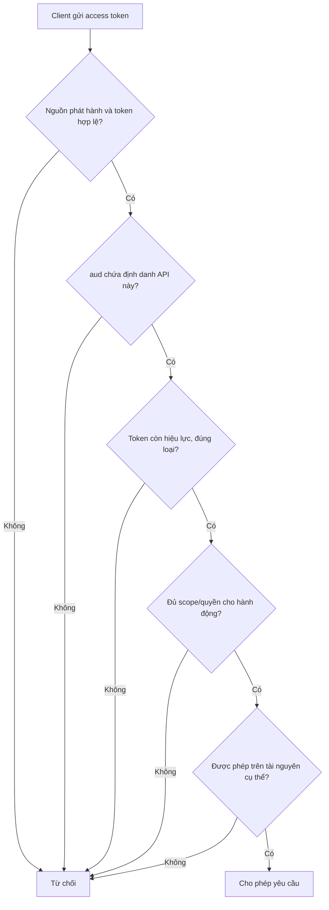
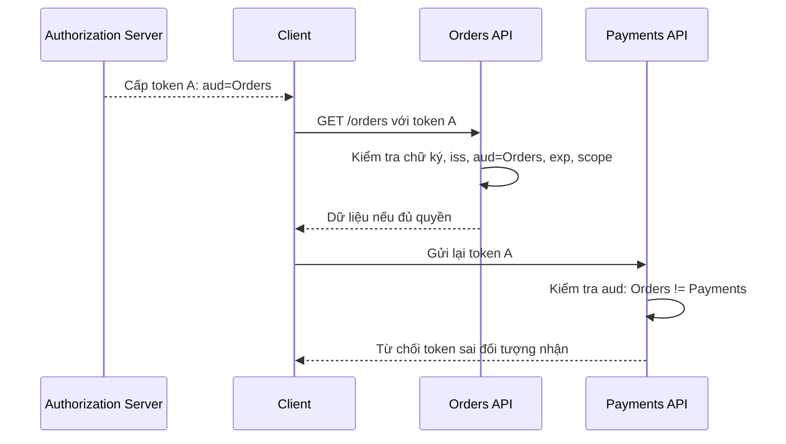

# Audience giới hạn nơi token được chấp nhận

## 1. Vấn đề: token hợp lệ không có nghĩa là hợp lệ ở mọi API

Giả sử một doanh nghiệp có ba API: **Orders API** để xem đơn hàng, **Payments API** để xử lý thanh toán và **Reports API** để xuất báo cáo. Cả ba đều tin cậy cùng một máy chủ phát hành token, chẳng hạn `https://auth.example.com`.

Một ứng dụng được cấp access token để đọc đơn hàng. Nếu Payments API chỉ kiểm tra rằng token có **chữ ký hợp lệ** và **chưa hết hạn** rồi chấp nhận, token dành cho Orders API có thể bị dùng tại Payments API. Điều này tạo ra lỗi **nhầm lẫn đối tượng nhận** (*audience confusion*) và có thể cho phép **sử dụng lại token qua các dịch vụ** (*cross-service token replay*), đặc biệt khi tên quyền giữa các dịch vụ trùng nhau hoặc API kiểm tra quyền thiếu chặt chẽ.

Giải pháp quan trọng là ràng buộc token với **đối tượng nhận được phép** (*audience*). Trong JWT, đối tượng này thường được biểu diễn bằng claim `aud`. Resource server phải từ chối token không dành cho mình, **ngay cả khi token có chữ ký đúng, issuer đúng và chưa hết hạn**.

> **Ý chính:** `aud` trả lời câu hỏi **“Token này được phát hành cho bên nhận nào?”**. Đây là ranh giới tin cậy của bên nhận token; token có thể được gửi nhầm đến bất kỳ URL nào, nhưng chỉ bên nhận đúng `aud` mới nên chấp nhận nó.

Bài này thuộc phần **Mô hình tin cậy** của module `SECURITY_TOKEN_SECURITY_FUNDAMENTALS`. Mục tiêu là hiểu audience trong vòng đời token bảo mật, phân biệt `aud` với các claims khác, và xác định vị trí kiểm tra audience trong xác thực, phân quyền và OAuth 2.0/OpenID Connect (OIDC).

## 2. Audience là gì?

**Audience** là tập đối tượng nhận mà token được dự định phục vụ. Với JWT, claim đăng ký chuẩn `aud` (*audience*) chỉ ra những bên nhận mà token nhắm tới. Theo JWT (RFC 7519), `aud` có thể là:

- Một **chuỗi** đại diện cho một đối tượng nhận.
- Một **mảng chuỗi** đại diện cho nhiều đối tượng nhận.

Ví dụ access token chỉ dành cho Orders API:

```json
{
  "iss": "https://auth.example.com",
  "sub": "user-123",
  "aud": "https://orders-api.example.com",
  "scope": "orders:read",
  "exp": 1893459600
}
```

Ví dụ token được cấp có chủ đích cho **hai** API:

```json
{
  "iss": "https://auth.example.com",
  "aud": [
    "https://orders-api.example.com",
    "https://reports-api.example.com"
  ],
  "scope": "orders:read reports:read",
  "exp": 1893459600
}
```

Đây là **payload minh họa**, chưa phải JWT hoàn chỉnh có chữ ký. Claims trong payload chỉ đáng tin **sau khi** resource server kiểm tra token theo profile và quan hệ tin cậy đã cấu hình.

Mỗi API cần biết trước **định danh audience được phép của chính mình**, do hợp đồng cấu hình giữa authorization server và resource server xác định. Định danh có thể là một URI như `https://orders-api.example.com` hoặc một chuỗi logic theo profile của hệ thống. Việc dùng URI không nhất thiết có nghĩa API phải truy cập địa chỉ đó hoặc URL HTTP thực tế phải giống hệt; điều quan trọng là **giá trị định danh được thống nhất và được so khớp chính xác**.

### Quy tắc tiếp nhận

Với Orders API được cấu hình audience `https://orders-api.example.com`:

| `aud` trong token | Orders API | Giải thích |
| --- | --- | --- |
| `"https://orders-api.example.com"` | Chấp nhận **về điều kiện audience** | Đúng đối tượng nhận; vẫn phải kiểm tra các điều kiện khác |
| `["https://orders-api.example.com", "https://reports-api.example.com"]` | Chấp nhận **về điều kiện audience** | Orders API là một thành viên chính xác của tập audience |
| `"https://payments-api.example.com"` | **Từ chối** | Token được cấp cho API khác |
| `"https://orders-api.example.com.evil.invalid"` | **Từ chối** | Giá trị khác hoàn toàn, dù có tiền tố giống |
| `"https://orders-api.example.com/v2"` | **Từ chối**, trừ khi được cấu hình chính xác như vậy | Audience là định danh; không tự suy diễn quan hệ cha–con của đường dẫn |
| Thiếu `aud` | **Từ chối** theo profile access token yêu cầu audience | Không có bằng chứng token dành cho API này |

**Chấp nhận về điều kiện audience** không có nghĩa là API lập tức cho phép truy cập. Token vẫn phải vượt qua xác minh nguồn phát hành, chữ ký/trạng thái, thời hạn, quyền và chính sách nghiệp vụ.

## 3. Audience nằm ở đâu trong mô hình tin cậy?

Một resource server thường cần kiểm tra các **ranh giới độc lập**:

1. **Issuer:** Ai đã phát hành token, và API có tin nguồn phát hành đó không?
2. **Tính xác thực của token:** Chữ ký có hợp lệ với khóa được tin cậy hay token opaque có đang hoạt động theo hệ thống cấp phát?
3. **Audience:** Token có thực sự **dành cho API hiện tại** không?
4. **Quyền được cấp:** `scope` hoặc các thông tin quyền có cho phép hành động cần làm không?
5. **Quyền trên dữ liệu:** Chủ thể có quyền thao tác trên **bản ghi cụ thể** theo chính sách hệ thống không?



Thứ tự thao tác có thể khác nhau tùy thư viện xác thực và kiến trúc; các kiểm tra bắt buộc vẫn phải được thực thi trước khi sử dụng claims để cho phép truy cập.

### Phân biệt `aud` với các trường thường bị nhầm

| Khái niệm | Câu hỏi nó giải quyết | Ví dụ | Có thay thế `aud` không? |
| --- | --- | --- | --- |
| `iss` (*issuer*) | **Ai** phát hành token? | `https://auth.example.com` | **Không**. Một issuer có thể phát hành token cho nhiều API |
| `aud` (*audience*) | **Bên nhận nào** được phép xử lý token này? | `https://orders-api.example.com` | Đây là kiểm tra đối tượng nhận |
| `sub` (*subject*) | Token nói về **chủ thể nào**? | `user-123` hoặc một client/workload | **Không**. Danh tính không xác định API đích |
| `scope` | Token được cấp **phạm vi quyền nào**? | `orders:read` | **Không**. Quyền không xác định API đích một cách đáng tin cậy |
| `client_id` / `azp` | **Client nào** được xác định/liên quan đến token theo profile? | `mobile-app` | **Không**. Client là bên sử dụng token, không mặc nhiên là API nhận token |
| `exp` / `nbf` | Token có **đang trong khoảng hiệu lực** không? | Unix timestamp | **Không**. Thời gian không xác định đối tượng nhận |
| Kiểm tra quyền sở hữu bản ghi | Chủ thể có được truy cập **đơn hàng số 42** không? | Quy tắc owner/tenant/role | **Không**. `aud` chỉ giới hạn nơi token được chấp nhận |

Một lỗi phổ biến là cho rằng “issuer tin cậy + scope hợp lệ” đã đủ. Nếu authorization server phát hành token cho nhiều resource server, hai điều kiện đó **không buộc token phải dành cho resource server hiện tại**.

## 4. Ví dụ xuyên suốt: Orders API từ chối token dành cho Payments API

Giả sử authorization server ký hai access token với cùng khóa và cùng issuer:

| Thuộc tính | Token A | Token B |
| --- | --- | --- |
| `iss` | `https://auth.example.com` | `https://auth.example.com` |
| `sub` | `user-123` | `user-123` |
| `aud` | `https://orders-api.example.com` | `https://payments-api.example.com` |
| `scope` | `orders:read` | `payments:read` |
| Chữ ký/thời hạn | Hợp lệ | Hợp lệ |

Khi client gọi Orders API:

```http
GET /orders/42 HTTP/1.1
Host: orders-api.example.com
Authorization: Bearer <token_A>
```

Orders API xác minh token và thấy `aud` đúng. Sau đó nó còn phải xác nhận `orders:read` và quyền của `user-123` đối với đơn hàng 42.

Nếu cùng client gửi Token B tới Orders API:

```http
GET /orders/42 HTTP/1.1
Host: orders-api.example.com
Authorization: Bearer <token_B>
```

Orders API **phải từ chối** vì Token B nhắm tới Payments API. Token B không “trở thành” token dành cho Orders API chỉ vì hai API cùng tin một authorization server.



Đặc biệt với **bearer token**, bên nào lấy được chuỗi token có thể thử trình nó. Audience là một lớp giới hạn **nơi token bị đánh cắp có thể được chấp nhận**, nhưng không tự ngăn việc token bị đánh cắp hoặc gửi đi. HTTPS/TLS, bảo vệ nơi lưu token, thời hạn ngắn, thu hồi và các cơ chế ràng buộc người gửi như DPoP/mTLS vẫn quan trọng.

## 5. Audience trong JWT, opaque token và OAuth 2.0/OIDC

### 5.1. JWT access token

Với JWT access token, resource server có thể kiểm tra `aud` sau khi xác minh chữ ký bằng tập khóa đã tin cậy và kiểm tra token đúng profile. Trong **JWT Profile for OAuth 2.0 Access Tokens (RFC 9068)**, claim `aud` thể hiện resource server hoặc các resource server được chỉ định.

Điều này cho phép API kiểm tra token cục bộ theo cấu hình rõ ràng. Tuy nhiên, **chữ ký hợp lệ không thay thế kiểm tra audience**. API cần cấu hình audience mong đợi; không lấy giá trị này từ một trường tùy ý do người gọi cung cấp.

### 5.2. Opaque access token

Opaque token là một giá trị mà resource server không tự giải mã để suy ra claims. API thường xác minh thông qua **token introspection** hoặc tra cứu trạng thái do bên có thẩm quyền cung cấp.

Phản hồi introspection có thể có `active`, `scope`, `client_id`, `sub`, `aud`, `iss`, `exp`... tùy hệ thống và profile. Ví dụ:

```json
{
  "active": true,
  "iss": "https://auth.example.com",
  "aud": "https://orders-api.example.com",
  "scope": "orders:read",
  "sub": "user-123",
  "exp": 1893459600
}
```

Ở đây `active: true` **không tự động có nghĩa** token dùng được cho mọi API. Orders API còn phải kiểm tra token được cấp cho mình, bằng trường audience hoặc **ràng buộc đối tượng nhận tương đương** mà authorization server bảo đảm. Nếu profile yêu cầu audience mà introspection không cung cấp dữ liệu xác minh đáng tin cậy, API không được tự coi token là token dùng chung.

Các chi tiết của introspection, bao gồm xác thực resource server và bảo vệ phản hồi, phải tuân theo giao thức và cấu hình hệ thống. Không tin phản hồi introspection từ nguồn không được xác thực.

### 5.3. OAuth 2.0 và `resource`

OAuth 2.0 là khuôn khổ **ủy quyền**. Nó cho phép client nhận access token để gọi resource server. Cơ chế **Resource Indicators for OAuth 2.0 (RFC 8707)** định nghĩa tham số yêu cầu `resource` để client chỉ ra tài nguyên/API dự định truy cập. Chẳng hạn, một yêu cầu ủy quyền hoặc token request có thể chứa:

```text
resource=https://orders-api.example.com
scope=orders:read
```

Authorization server xem xét yêu cầu, chính sách và sự cho phép trước khi cấp token có ràng buộc audience tương ứng. **Client không tự đặt `aud` để tăng quyền**: client chỉ đề nghị resource, còn authorization server quyết định token có được cấp cho resource đó hay không.

Không phải nhà cung cấp OAuth nào cũng triển khai tham số `resource` hay ánh xạ trực tiếp nó vào `aud` theo cùng một cách. Hệ thống phải dựa vào hợp đồng/profile cụ thể giữa authorization server và các API. Chẳng hạn, issuer có thể dùng tên logic của API thay vì URL ngoài.

### 5.4. OIDC ID token: audience thường là client

Trong OIDC, **ID token** cho client biết kết quả xác thực danh tính. `aud` của ID token phải bao gồm **client ID của relying party/client** theo quy tắc OIDC:

```json
{
  "iss": "https://auth.example.com",
  "sub": "user-123",
  "aud": "customer-portal-client",
  "exp": 1893459600
}
```

Ngược lại, `aud` của **access token dành cho Orders API** biểu diễn resource server/API đích. Vì vậy:

- **OIDC client** xác minh ID token theo yêu cầu OIDC, gồm issuer, audience là client, chữ ký, thời hạn và các ràng buộc của luồng.
- **Orders API** xác minh **access token** theo profile của API, gồm audience là Orders API và các quyền truy cập.

**Không dùng ID token làm access token** chỉ vì cả hai có dạng JWT. Đây là lỗi **nhầm lẫn loại token** (*token substitution/cross-JWT confusion*). Các trường như `typ`, profile riêng, issuer, audience và cách phát hành phải được kiểm tra nhất quán để giảm khả năng nhầm lẫn. Trong ngữ cảnh OIDC, `azp` có quy tắc xử lý riêng khi cần; nó **không thay thế** audience của access token.

### 5.5. Refresh token có audience không?

Refresh token được client trình cho **authorization server/token endpoint** để xin access token mới, không dùng gọi Orders API hay Payments API. Định dạng refresh token có thể opaque hoặc có cấu trúc; không thể giả định nó luôn mang `aud` giống JWT access token.

Resource server phải **từ chối refresh token như một loại thông tin xác thực API**, ngay cả khi kẻ gửi cố tình đặt nó trong header `Authorization`. Authorization server chịu trách nhiệm ràng buộc refresh token với client, phiên, phạm vi quyền, resource được cấp và chính sách rotation/thu hồi.

## 6. Quy trình xác minh audience tại resource server

Mỗi API nên có một **cấu hình xác minh được định nghĩa sẵn**. Ví dụ của Orders API:

```yaml
# Ví dụ cấu hình khái niệm, không phụ thuộc framework
trusted_issuer: "https://auth.example.com"
expected_audience: "https://orders-api.example.com"
accepted_token_kind: "access_token"
allowed_signing_algorithms:
  - "RS256"
required_scope_for_get_order: "orders:read"
```

Giá trị cấu hình phải đến từ môi trường triển khai, chính sách tin cậy hoặc metadata đã xác thực; không thể chấp nhận `expected_audience` do client tự gửi như tham số cho mỗi request.

Pseudo-code minh họa một đường xử lý cho **JWT access token ký số**:

```text
function authorizeGetOrder(rawToken, orderId):
    # Hàm verifyJwt phải dùng khóa/thuật toán được cấu hình tin cậy.
    token = verifyJwtSignatureAndProfile(rawToken, trustedIssuerKeys, allowedAlgorithms)
    if token.invalid:
        reject("invalid_token")

    claims = token.verifiedClaims
    if claims.iss != TRUSTED_ISSUER:
        reject("invalid_issuer")
    if claims.aud is missing or not containsExactAudience(claims.aud, ORDERS_API_AUDIENCE):
        reject("invalid_audience")
    if claims.exp is missing or now >= claims.exp:
        reject("expired_token")
    if claims.nbf exists and now < claims.nbf:
        reject("token_not_yet_valid")
    if not isExpectedAccessTokenType(token):
        reject("wrong_token_type")
    if "orders:read" not in parseScopes(claims.scope):
        reject("insufficient_scope")

    identity = resolveSubjectAccordingToTokenProfile(claims)
    if not canReadOrder(identity, orderId):
        reject("forbidden")

    return loadOrder(orderId)
```

Pseudo-code cố ý không phải trình xác minh JWT hoàn chỉnh: hàm `verifyJwtSignatureAndProfile` còn cần kiểm tra định dạng, giới hạn thuật toán, khóa hợp lệ, issuer/key binding và các ràng buộc profile khác. Các thư viện/SDK đã được kiểm chứng nên đảm nhiệm xác minh mật mã; code nghiệp vụ cần bổ sung validator audience và quyền theo chính sách.

### Cách so khớp chính xác

- Nếu `aud` là **chuỗi**, kiểm tra **bằng đúng** định danh audience cho phép.
- Nếu `aud` là **mảng**, kiểm tra có **phần tử bằng đúng** định danh audience cho phép.
- Nếu thiếu, sai kiểu, rỗng hoặc không khớp trong profile yêu cầu audience, **từ chối**.
- Không dùng phép kiểm tra tiền tố, hậu tố, chuỗi con hoặc tự áp dụng wildcard như `*.example.com`, trừ khi một giao thức đã định nghĩa chính xác cách khớp khác và được đánh giá riêng. Với JWT thông thường, áp dụng so sánh chuỗi chính xác.
- Không so khớp bằng tên host của HTTP request hoặc `Origin` để suy ra `aud`. Audience là định danh token được thỏa thuận; `Host`/routing và CORS là những cơ chế khác.

Theo RFC 7519, các so sánh `StringOrURI` dùng ngữ nghĩa so khớp chuỗi phân biệt chữ hoa/thường, không mặc định chuẩn hóa URI. Ví dụ, `https://orders-api.example.com` và `https://orders-api.example.com/` có thể là **hai audience khác nhau** theo quy tắc đối chiếu của hệ thống.

### Thông báo lỗi cho client

Trong một API Bearer token, token thiếu hoặc không hợp lệ thường dẫn đến **HTTP 401** và có thể kèm challenge theo RFC 6750; token hợp lệ nhưng thiếu quyền được cấp thường dẫn đến **HTTP 403** với `insufficient_scope` theo ngữ cảnh phù hợp. Phân loại lỗi chi tiết tùy vào lớp middleware và profile. Không gửi nguyên token, khóa, claims nhạy cảm hoặc lý do nội bộ quá chi tiết vào response/log.

## 7. Những tình huống kiến trúc cần thiết kế audience rõ ràng

### 7.1. Một authorization server, nhiều API

Đây là tình huống cần audience nhất. Từng API có định danh riêng, chẳng hạn:

| Resource server | Audience mong đợi | Scope ví dụ |
| --- | --- | --- |
| Orders API | `https://orders-api.example.com` | `orders:read`, `orders:write` |
| Payments API | `https://payments-api.example.com` | `payments:read`, `payments:refund` |
| Reports API | `https://reports-api.example.com` | `reports:export` |

Một token chứa `orders:read` mà `aud` là Payments API vẫn phải bị Orders API từ chối. Scope và audience giải quyết **hai câu hỏi khác nhau**, cả hai đều bắt buộc theo chính sách.

### 7.2. Token có nhiều audiences

JWT cho phép `aud` là mảng. Việc cấp token cho nhiều API có thể hợp lệ nếu đó là chủ đích của hệ thống và mỗi bên đều có hợp đồng tin cậy phù hợp. Tuy nhiên, một token có nhiều audiences có thể được chấp nhận ở **nhiều nơi hơn** khi bị rò rỉ.

Để giới hạn tác động sự cố, thường ưu tiên **access token dành cho một resource server/nhóm tài nguyên có ranh giới rõ**. Chỉ dùng multi-audience khi có nhu cầu và chính sách thực sự. Không mặc định thêm tất cả API vào `aud` cho tiện tích hợp.

### 7.3. API Gateway và dịch vụ phía sau

Một gateway có thể xác thực token trước khi chuyển yêu cầu đến dịch vụ nội bộ. Cần quyết định rõ **bên nào là resource server thực sự**, **audience áp dụng tại mỗi ranh giới** và **dịch vụ phía sau dựa vào bằng chứng xác thực nào**.

- Nếu gateway là nơi thực thi xác thực và ủy quyền, dịch vụ phía sau phải được bảo vệ khỏi truy cập trực tiếp vượt qua gateway và phải tin cậy kênh/định danh do gateway cung cấp theo cơ chế an toàn.
- Nếu dịch vụ phía sau cũng nhận access token và tự ra quyết định bảo mật, nó cần kiểm tra audience phù hợp với chính mình hoặc ranh giới resource server đã được thiết kế.
- Không mặc định rằng việc gateway đã xác minh chữ ký cho phép mọi dịch vụ nội bộ bỏ qua kiểm soát riêng.

### 7.4. Service-to-service và gọi API tiếp theo

Giả sử Orders API nhận token từ client rồi cần gọi Payments API. Token có `aud = Orders` **không tự động hợp lệ ở Payments**. Truyền nguyên bearer token sang Payments và yêu cầu Payments bỏ kiểm tra audience là cách làm nguy hiểm.

Các lựa chọn tùy mục tiêu nghiệp vụ có thể gồm: Orders API nhận **token riêng dành cho Payments** bằng cơ chế ủy quyền của dịch vụ, hoặc dùng **OAuth 2.0 Token Exchange** (nếu authorization server hỗ trợ) để đổi lấy token có audience và quyền phù hợp, hoặc kiến trúc ủy quyền đã định nghĩa rõ. Khi một dịch vụ thực hiện thay người dùng, cần bảo toàn ngữ cảnh ủy quyền cần thiết mà không nâng quyền trái phép.

### 7.5. Phân tách môi trường và tenant

Cùng một API có thể tồn tại ở `dev`, `staging` và `production`. Nếu các môi trường dùng chung issuer/khóa hoặc audience không phân tách, token ở môi trường ít được bảo vệ có thể bị thử lại ở môi trường khác. Nên thiết kế ranh giới issuer, audience, client và khóa phù hợp từng môi trường.

Trong hệ thống nhiều tenant, audience **không tự thay thế tenant isolation**. Dù token đúng API, resource server vẫn cần xác minh tenant và quyền trên dữ liệu. Không thể giả định `aud` đúng là người dùng được phép xem dữ liệu thuộc bất kỳ tenant nào.

## 8. Các lỗi bảo mật thường gặp

| Lỗi | Hệ quả có thể xảy ra | Cách phòng tránh |
| --- | --- | --- |
| Chỉ kiểm tra chữ ký và `exp` | Token hợp lệ cho API A được thử ở API B | Bắt buộc kiểm tra audience tại mỗi resource server |
| Chấp nhận mọi token có `iss` tin cậy | Một issuer phục vụ nhiều ứng dụng/API, gây nhầm lẫn bên nhận | Kết hợp issuer + audience + loại token + quyền |
| Chấp nhận `aud` thiếu vì “tương thích” | API không còn bằng chứng token hướng tới mình | Quy định profile rõ, từ chối khi không chứng minh được audience |
| Dùng `contains` cho chuỗi audience | `orders-api.example.com.evil.invalid` có thể bị nhận nhầm | So sánh giá trị audience **chính xác**, kể cả trong mảng |
| Lấy audience kỳ vọng từ token hoặc request | Client tự chọn điều kiện kiểm tra | Cấu hình audience cố định/đáng tin cho từng API |
| Dùng ID token để gọi API | API nhận JWT có `aud` là client ID, nhầm loại token | Phân tách validator ID token và access token |
| Cấp token cùng lúc cho mọi API | Mở rộng nơi bearer token bị lộ có thể hoạt động | Giảm audiences và scopes xuống mức cần thiết |
| Không kiểm tra phía sau gateway | Đường gọi trực tiếp có thể vượt qua điểm kiểm tra | Bảo vệ đường nội bộ và xác minh/ủy quyền đúng ranh giới |
| Coi `aud` là phân quyền dữ liệu | Token đúng API vẫn có thể truy cập bản ghi không thuộc quyền | Kiểm tra scope và chính sách cấp đối tượng |
| Chuyển tiếp token upstream sang downstream tùy tiện | Token dành cho dịch vụ đầu tiên bị sử dụng sai mục đích | Dùng token riêng/token exchange và ràng buộc audience |

## 9. Kiểm thử audience trước khi đưa API vào vận hành

Giả định Orders API chấp nhận issuer `https://auth.example.com` và audience `https://orders-api.example.com`, đồng thời yêu cầu `orders:read` cho endpoint `GET /orders/42`. Tất cả token trong bảng, trừ khi ghi khác, có chữ ký và thời hạn hợp lệ.

| Tình huống kiểm thử | Kết quả mong đợi | Điều chứng minh |
| --- | --- | --- |
| `aud` đúng, `scope` có `orders:read`, chủ thể sở hữu đơn | **Cho phép** | Đồng thời thỏa audience, quyền và chính sách dữ liệu |
| `aud` là Payments API | **Từ chối** | Không chấp nhận token dành cho tài nguyên khác |
| `aud` là mảng có Orders API | **Qua kiểm tra audience** | Phải kiểm tra thành viên chính xác, rồi tiếp tục kiểm tra quyền |
| `aud` là chuỗi có thêm hậu tố/đường dẫn | **Từ chối** | Không so khớp tiền tố hoặc chuỗi con |
| Thiếu `aud` | **Từ chối** | Tuân thủ profile yêu cầu audience |
| `aud` đúng nhưng issuer khác | **Từ chối** | Audience không thay thế tin cậy vào issuer |
| `aud` đúng nhưng chữ ký sai hoặc hết hạn | **Từ chối** | Token phải hợp lệ toàn bộ |
| `aud` đúng nhưng thiếu `orders:read` | **Từ chối** | Audience không thay thế quyền thao tác |
| `aud` đúng, scope đúng nhưng người dùng không sở hữu đơn | **Từ chối** | Phân quyền trên bản ghi là bước độc lập |
| ID token OIDC có `aud` là client ID | **Từ chối ở Orders API** | API chỉ chấp nhận access token đúng loại và audience |

Khi chạy thử thực tế, dùng token thử nghiệm do môi trường kiểm thử phát hành và kiểm tra **HTTP response, nhật ký từ chối đã ẩn dữ liệu nhạy cảm, và hành vi tại cả gateway lẫn dịch vụ đích**. Không đưa bearer token thực vào báo cáo lỗi, ảnh chụp màn hình hoặc log ứng dụng.

## 10. Tự đánh giá thiết kế

Trước khi kết luận một API đang kiểm soát audience đúng, trả lời được các câu hỏi sau:

1. **Định danh:** Audience chính xác dành cho API này là gì, và ai quản lý cấu hình đó?
2. **Phát hành:** Authorization server phát hành token cho đúng resource bằng quy trình nào? Client có thể yêu cầu resource nào theo chính sách?
3. **Xác minh:** Mọi đường gọi có kiểm tra đúng issuer, token hợp lệ, loại token và audience hay không?
4. **Khớp chuỗi:** Validator có xử lý `aud` kiểu chuỗi/mảng và từ chối giá trị thiếu, sai kiểu, chuỗi chỉ tương tự không?
5. **Phân quyền:** Sau audience, API có kiểm tra scope và quyền trên tài nguyên cụ thể không?
6. **Đường đi:** Gateway, dịch vụ nội bộ, service-to-service và các môi trường có chung một hợp đồng audience rõ ràng không?
7. **Sự cố:** Nếu token bị đánh cắp, những resource server nào có thể chấp nhận nó và thời hạn rủi ro là bao lâu?

**Ghi nhớ:** `iss` nói ai phát hành, `aud` nói **ai được nhận**, `scope` nói **được làm gì**, còn chính sách nghiệp vụ nói **được làm gì trên dữ liệu nào**. Một resource server an toàn phải xác minh các điều kiện phù hợp theo đúng ranh giới tin cậy. Audience là cách giới hạn việc chấp nhận token giữa các API và là nền tảng quan trọng cho thiết kế cấp phát, kiểm tra claims, giới hạn quyền và giảm tác động khi token bị đánh cắp hoặc phát lại.

### Tiêu chuẩn liên quan để tìm hiểu thêm

- **RFC 7519 — JSON Web Token (JWT):** định nghĩa `aud` và cách biểu diễn chuỗi/mảng.
- **RFC 9068 — JWT Profile for OAuth 2.0 Access Tokens:** quy ước claims cho JWT access token.
- **RFC 8707 — Resource Indicators for OAuth 2.0:** cách client chỉ ra resource dự định truy cập.
- **RFC 7662 — OAuth 2.0 Token Introspection:** kiểm tra trạng thái và metadata token opaque/được introspect.
- **RFC 8725 — JSON Web Token Best Current Practices:** giảm lỗi cấu hình và nhầm lẫn loại/đối tượng token.
- **OpenID Connect Core:** audience và quy trình xác minh ID token tại OIDC client.
