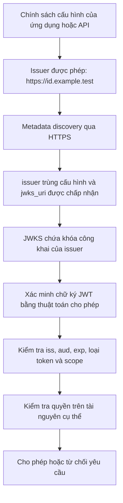
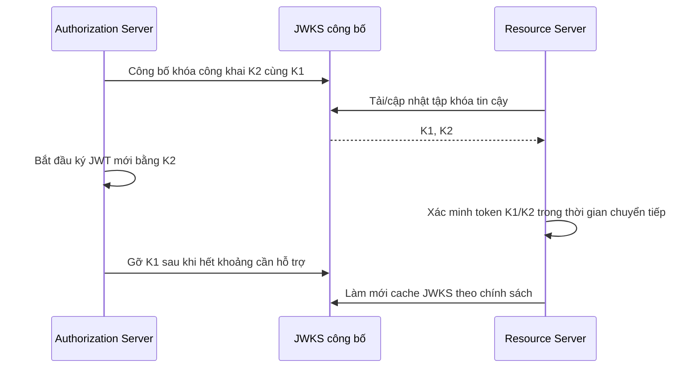

# Trust chain và nguồn gốc metadata

Một API nhận được JWT có chữ ký hợp lệ. Nó phải trả lời thêm ba câu hỏi: **ai cho phép tổ chức phát hành token đó?**, **khóa dùng để xác minh đến từ nguồn nào?**, và **token có được phát hành để dùng tại API này không?** Nếu chỉ nhìn chữ ký hoặc đọc các claims mà không xác lập nguồn tin cậy, hệ thống có thể chấp nhận token do kẻ tấn công tự ký.

Bài thuộc chương **Mô hình tin cậy** của module `SECURITY_TOKEN_SECURITY_FUNDAMENTALS`. Trong bảo mật token OAuth 2.0/OpenID Connect (OIDC), *trust chain* là chuỗi căn cứ cho phép client và resource server xác định nguồn phát hành, xác minh metadata/khóa và cuối cùng quyết định có chấp nhận token cho một thao tác hay không. Bài tập trung vào việc thiết lập, duy trì và kiểm chứng chuỗi tin cậy đó; các nội dung về JWT, opaque token, vòng đời, scope, audience, lưu trữ và chống phát lại được liên hệ ở những bước cần thiết.

## 1. Trust chain là gì?

**Trust chain** (chuỗi tin cậy) là quan hệ nối từ một **trust anchor** được hệ thống chủ động tin cậy đến những bằng chứng được dùng để đưa ra quyết định bảo mật. Với token, một chuỗi phổ biến có dạng:



Từng mắt xích có trách nhiệm riêng:

- **Trust anchor:** cấu hình tin cậy có chủ đích của hệ thống, ví dụ danh sách issuer cho phép, client ID, audience của API, thuật toán chấp nhận và chính sách endpoint. Đây là điểm khởi đầu; **không lấy trust anchor từ token do bên gọi gửi đến**.
- **Nguồn metadata:** tài liệu do authorization server/OpenID Provider công bố để mô tả issuer và các endpoint, thuật toán hoặc khả năng được hỗ trợ.
- **Nguồn khóa:** JWKS (JSON Web Key Set) gắn với issuer đã được xác thực, dùng để tìm khóa công khai kiểm tra chữ ký.
- **Bằng chứng mật mã:** chữ ký hợp lệ chứng minh token được ký bằng khóa tương ứng, trong phạm vi khóa đó thật sự thuộc nguồn đã tin cậy.
- **Điều kiện nghiệp vụ:** `aud`, `scope`, thời hạn, chủ thể và quyền trên tài nguyên trả lời câu hỏi token **có được dùng cho hành động hiện tại không**.

Trong thực tế có thể không có bước JWKS: access token dạng **opaque** thường được kiểm tra qua **introspection** do authorization server tin cậy cung cấp. Tư duy về nguồn tin cậy vẫn giống nhau.

> **Phân biệt hai lớp tin cậy:** HTTPS/TLS giúp xác thực kết nối tới một tên miền và bảo vệ dữ liệu trên đường truyền. Việc một endpoint có chứng chỉ TLS hợp lệ **không có nghĩa** ứng dụng đã đồng ý tin issuer của endpoint đó. Trust anchor của token cần được thiết lập riêng bằng cấu hình và chính sách.

## 2. Metadata đến từ đâu?

Trong hệ thống OAuth 2.0/OIDC, từ *metadata* có thể chỉ nhiều nguồn dữ liệu khác nhau. Không phải metadata nào cũng có cùng thẩm quyền:

| Nguồn | Bên kiểm soát | Ví dụ dữ liệu | Vai trò và giới hạn tin cậy |
|---|---|---|---|
| **Cấu hình tin cậy của client/API** | Đội triển khai hoặc hệ thống quản trị đáng tin cậy | Issuer được phép, client ID, audience kỳ vọng, thuật toán cho phép | **Trust anchor** để đối chiếu; không suy ra từ JWT chưa được kiểm chứng. |
| **Authorization Server Metadata / OIDC Discovery** | Authorization Server (AS) / OpenID Provider (OP) | `issuer`, `authorization_endpoint`, `token_endpoint`, `jwks_uri` | Chỉ được sử dụng theo issuer đã chọn và kiểm tra; HTTPS bảo vệ việc truy xuất. |
| **JWKS** | AS/OP hoặc hạ tầng khóa của issuer | Khóa công khai, `kid`, `kty`, `use`, `alg` | Cung cấp vật liệu xác minh chữ ký; **không** quyết định độc lập token nào được quyền truy cập API. |
| **Claims trong JWT** | Bên tạo và ký token (nếu chữ ký được xác minh đúng) | `iss`, `sub`, `aud`, `exp`, `scope` | Là lời khẳng định có chữ ký; phải đối chiếu chính sách của bên nhận. |
| **Introspection response** | AS tin cậy trả lời qua kết nối được bảo vệ | `active`, `scope`, `client_id`, `sub`, `aud`, `exp` | Thông tin trạng thái của token, dùng theo hợp đồng giữa API và AS; không phải JWT để API tự giải mã. |
| **Protected Resource Metadata** (nếu triển khai) | Resource Server (API) | Định danh tài nguyên, AS liên quan, scope có hỗ trợ | Giúp client khám phá cách xin token; phải kiểm tra nguồn gốc và không thay thế chính sách tin cậy của client. |

Đừng nhầm **thông tin được công bố** với **quyền được chấp nhận**. Ví dụ `scopes_supported` trong metadata chỉ nói AS có thể hỗ trợ các scope nào. Nó **không chứng minh** rằng một token cụ thể đã được cấp scope đó, càng không cấp quyền truy cập mọi đơn hàng.

## 3. Thiết lập trust anchor trước khi discovery

Giả sử một ứng dụng dùng issuer `https://id.example.test` và có API đơn hàng `orders-api`. Các giá trị dưới đây chỉ minh họa, không phải cấu hình của một sản phẩm cụ thể:

```yaml
trusted_issuer: https://id.example.test
oidc_discovery_url: https://id.example.test/.well-known/openid-configuration
expected_access_token_audience: orders-api
accepted_access_token_signing_algorithms:
  - RS256
required_scope_for_read: orders.read
```

**Issuer** là định danh của nơi phát hành token, không đơn thuần là URL tùy ý để tải khóa. Trong luồng có nhiều nhà cung cấp danh tính, hệ thống phải xác định được issuer nào được phép dùng cho yêu cầu/phiên hiện tại; không phải thấy `iss` bất kỳ trong token là tự động thêm issuer đó vào danh sách tin cậy.

Thông thường client/API có thể dùng discovery để tự động lấy endpoint và khóa sau khi đã biết issuer tin cậy. Discovery tiện lợi vì tránh phải nhúng cố định từng khóa ký, nhưng **không được biến việc tự động khám phá thành việc tự động tin bất kỳ nhà phát hành nào**.

Nếu AS triển khai ở đường dẫn con, URL `.well-known` có quy tắc ghép đường dẫn theo đặc tả tương ứng; **OIDC Discovery** và **OAuth 2.0 Authorization Server Metadata** (RFC 8414) có quy tắc xây dựng URL khác nhau trong một số trường hợp. Dùng cơ chế discovery chuẩn của thư viện và đối chiếu `issuer` chính xác, thay vì tự nối chuỗi tùy tiện.

## 4. Discovery metadata: biết endpoint nào thuộc issuer

Trong OIDC, client có thể đọc tài liệu cấu hình của OP từ URL `.well-known/openid-configuration` thuộc issuer tin cậy. Ví dụ:

```http
GET /.well-known/openid-configuration HTTP/1.1
Host: id.example.test
Accept: application/json
```

Phản hồi minh họa (chỉ liệt kê các trường liên quan bài học):

```json
{
  "issuer": "https://id.example.test",
  "authorization_endpoint": "https://id.example.test/oauth2/authorize",
  "token_endpoint": "https://id.example.test/oauth2/token",
  "jwks_uri": "https://id.example.test/oauth2/jwks",
  "introspection_endpoint": "https://id.example.test/oauth2/introspect",
  "revocation_endpoint": "https://id.example.test/oauth2/revoke",
  "response_types_supported": ["code"],
  "id_token_signing_alg_values_supported": ["RS256"]
}
```

Các endpoint như introspection và revocation có thể **không hiện diện** trong metadata của một hệ thống cụ thể. `id_token_signing_alg_values_supported` mô tả thuật toán ký **ID token**, không tự xác định thuật toán mà API phải chấp nhận cho **access token**.

Quy trình tiếp nhận discovery metadata:

1. Bắt đầu từ **issuer đã được cấu hình cho phép**, tạo hoặc dùng discovery URL theo đặc tả áp dụng.
2. Truy cập qua **HTTPS**, xác thực chứng chỉ và tên máy chủ, đặt giới hạn thời gian, kích thước phản hồi và chính sách chuyển hướng phù hợp.
3. Kiểm tra trường `issuer` trong phản hồi **khớp chính xác** issuer kỳ vọng. Không tự động sửa dấu `/`, chữ hoa/thường hay thay hostname để biến một giá trị không khớp thành khớp.
4. Kiểm tra kiểu dữ liệu, URL endpoint, giao thức và chính sách cho phép đối với địa chỉ sẽ gọi tiếp theo. Metadata có thể trỏ JWKS sang một hostname khác; chỉ chấp nhận khi đáp ứng chính sách bảo mật và vận hành.
5. Ghi nhận metadata cho issuer đã xác thực, quản lý cache/refresh và theo dõi thay đổi bất thường. Nếu metadata sai hoặc không kiểm chứng được, không âm thầm chuyển sang issuer khác.

**Nguồn gốc của metadata là quan trọng:** bản metadata thông thường được tin qua kênh HTTPS tới issuer đã chọn và quy trình kiểm tra trên; đừng mặc định rằng tài liệu discovery luôn được ký như JWT. Kể cả khi truyền tải an toàn, metadata bị thay đổi tại máy chủ đã tin cậy vẫn có thể ảnh hưởng đến endpoint và khóa của cả hệ thống.

OAuth 2.0 cũng có cơ chế **Authorization Server Metadata** tại `.well-known/oauth-authorization-server` (RFC 8414). OIDC Discovery và RFC 8414 có nhiều trường tương đồng, nhưng không được giả định tài liệu của hai cơ chế luôn có cùng đường dẫn hay hoàn toàn tương đương trong mọi triển khai.

## 5. JWKS: nguồn khóa ký và ranh giới tin cậy

Sau khi biết `jwks_uri` từ cấu hình/metadata đã kiểm tra, API có thể tải bộ khóa công khai của issuer:

```http
GET /oauth2/jwks HTTP/1.1
Host: id.example.test
Accept: application/json
```

```json
{
  "keys": [
    {
      "kty": "RSA",
      "kid": "signing-2026-11",
      "use": "sig",
      "alg": "RS256",
      "n": "BASE64URL_PUBLIC_RSA_MODULUS_EXAMPLE",
      "e": "AQAB"
    }
  ]
}
```

`n` ở trên là chỗ giữ chỗ và **không phải modulus RSA thật**. JWKS chỉ chứa dữ liệu **khóa công khai** cần thiết; khóa riêng để ký JWT phải được AS bảo vệ và không được công bố. Các trường thường gặp:

- `kty`: loại khóa, ví dụ RSA hoặc EC.
- `kid`: định danh giúp chọn khóa trong tập khóa; **không phải bằng chứng khóa đáng tin cậy**.
- `use` hoặc `key_ops` (nếu có): mục đích sử dụng khóa, ví dụ xác minh chữ ký.
- `alg` (nếu có): gợi ý thuật toán liên quan tới khóa; vẫn phải tuân theo danh sách thuật toán chấp nhận tại bên xác minh.

Ví dụ JWT có header:

```json
{
  "alg": "RS256",
  "kid": "signing-2026-11",
  "typ": "at+jwt"
}
```

Ở đây `typ: at+jwt` minh họa hồ sơ JWT access token theo **RFC 9068**. Không phải access token ở mọi hệ thống đều có định dạng JWT hoặc header này. Bộ xác minh phải chọn khóa trong **JWKS gắn với issuer đã tin cậy**, kiểm tra tính tương thích của loại khóa/thuật toán và xác minh chữ ký.

Không làm những việc sau:

- Lấy `iss` từ một JWT chưa xác minh rồi tự ý tải JWKS của issuer bất kỳ mà không có danh sách cho phép.
- Xem `kid` là URL, đường dẫn file hoặc mã để tra khóa trên mọi nguồn công khai.
- Tự động tải URL `jku` / `x5u` do JWT header khai báo mà không có chính sách cho phép nghiêm ngặt. Đây có thể là điểm dẫn đến **SSRF**, đánh tráo khóa hoặc mở rộng nguồn tin cậy ngoài ý muốn.
- Tin `alg` trong header như một lệnh bắt buộc dùng thuật toán nào. Đặc biệt, phải từ chối `none` hay chuyển đổi thuật toán không nằm trong chính sách và không trộn lẫn sai cách khóa đối xứng/bất đối xứng.

**Chữ ký đúng chỉ chứng minh token khớp với khóa xác minh đã chọn**. Nếu khóa đến từ nguồn giả mạo, chữ ký hợp lệ theo khóa giả mạo vẫn không chứng minh issuer đáng tin.

## 6. Từ chữ ký đến quyết định nhận access token

Giả sử access token dành cho API đơn hàng có payload minh họa:

```json
{
  "iss": "https://id.example.test",
  "sub": "user-123",
  "aud": "orders-api",
  "scope": "orders.read",
  "iat": 1795410000,
  "exp": 1795410900
}
```

Các mốc thời gian chỉ minh họa một token sống 15 phút. Payload JWT có thể đọc được khi giải mã Base64URL; **đọc claims không phải là xác minh chữ ký**.

Tại `GET /orders/{id}`, resource server cần đi qua các điều kiện:

| Bước | Câu hỏi | Nếu sai |
|---|---|---|
| 1. Phạm vi tin cậy | `iss` có thuộc danh sách issuer cho phép đối với API này không? | Từ chối, không tải khóa từ issuer lạ. |
| 2. Xác thực mật mã | Chữ ký, thuật toán và khóa từ nguồn đã tin cậy có hợp lệ không? | Từ chối token. |
| 3. Loại token | Đây có phải **access token** đúng hồ sơ API chấp nhận, thay vì ID token hoặc JWT mục đích khác? | Từ chối token nhầm loại. |
| 4. Thời điểm | `exp`, `nbf` (nếu có) và các giới hạn thời gian có hợp lệ không? | Từ chối token hết hạn/chưa có hiệu lực. |
| 5. Đối tượng nhận | `aud` có chứa đúng audience của API (`orders-api`) không? | Từ chối token dành cho client/API khác. |
| 6. Quyền được cấp | Có scope/authority cần thiết, ví dụ `orders.read`, theo chính sách API không? | Từ chối thao tác thiếu quyền. |
| 7. Quyền nghiệp vụ | Chủ thể có được xem **đơn hàng cụ thể này** không? | Từ chối dù scope đã hợp lệ. |

Điểm quyết định là **mỗi bước dùng dữ liệu từ đúng nguồn**. JWT ký hợp lệ có thể chứa `scope: orders.read`, nhưng chính sách `GET /orders/{id}` và quyền sở hữu đơn hàng là do API kiểm soát. Thêm claims vào token không cho phép bên phát hành tự quyết mọi chính sách nghiệp vụ mà API chưa chấp nhận.

### Phân biệt access token với ID token

ID token của OIDC hướng đến **client**; thông thường `aud` của ID token chứa **client ID**, ví dụ `orders-web`. Access token hướng đến **resource server**, ví dụ `aud = orders-api`. Cả hai có thể do một issuer ký, song API không được nhận ID token để gọi tài nguyên chỉ vì chữ ký đúng. Client OIDC phải xác minh ID token theo OIDC (gồm `iss`, `aud`, chữ ký, `exp`, `iat` và `nonce`/`auth_time` khi áp dụng). Resource server phải xác minh access token theo giao thức/hồ sơ tương ứng và chính sách API.

## 7. Opaque token, introspection và refresh token nằm ở đâu trong chuỗi?

### Opaque access token

Opaque token không cung cấp claims cho bên nhận tự giải mã. API thường gửi token đến **introspection endpoint của AS đã tin cậy** bằng một kênh an toàn và cơ chế xác thực phía API theo hợp đồng triển khai. Một phản hồi minh họa:

```json
{
  "active": true,
  "client_id": "orders-web",
  "sub": "user-123",
  "aud": "orders-api",
  "scope": "orders.read",
  "exp": 1795410900
}
```

Chuỗi tin cậy lúc này là: **cấu hình issuer/AS tin cậy → endpoint introspection được xác minh → phản hồi bảo vệ bằng TLS và xác thực phù hợp → `active`, audience, scope, hạn dùng → phân quyền nghiệp vụ**. Không thể kết luận một opaque token hợp lệ chỉ vì API nhận được HTTP 200; phải kiểm tra kết quả introspection và chính sách truy cập. Các trường ngoài `active` có thể khác nhau giữa các nhà cung cấp, nên API cần quy định rõ metadata nào bắt buộc.

### Refresh token

Refresh token được **client gửi tới token endpoint của AS**, không phải resource server. AS là bên xác minh token này thuộc client/ủy quyền phù hợp, còn hiệu lực, chưa bị thu hồi và có thể cấp access token mới hay không. Nếu triển khai rotation, việc refresh token đã dùng bị gửi lại có thể là dấu hiệu đánh cắp/phát lại. Trust chain của resource server **không biến refresh token thành access token**; API phải từ chối token sai mục đích.

### Protected Resource Metadata (tùy hệ thống)

Một API có thể công bố **OAuth 2.0 Protected Resource Metadata** theo RFC 9728 để client biết resource identifier và các authorization server được công bố, ví dụ:

```json
{
  "resource": "https://api.example.test",
  "authorization_servers": ["https://id.example.test"],
  "scopes_supported": ["orders.read"]
}
```

Client cần xác minh metadata thực sự xuất phát từ resource mà nó định liên hệ và tiếp tục áp dụng chính sách chọn AS của mình. Danh sách `authorization_servers` ở đây **không tự cấp quyền** cho một AS chưa được client tin cậy. Định danh resource trong metadata cũng không thay thế yêu cầu API phải kiểm tra `aud` của access token.

## 8. Các kiểu tấn công khi mất một mắt xích

| Tình huống | Sai lầm trong chuỗi tin cậy | Cách xử lý |
|---|---|---|
| **Issuer tự xưng:** token do `https://attacker.example.test` ký, `aud` và `scope` được khai báo giống token thật. | API tự khám phá và tin mọi `iss` do token cung cấp. | Chỉ chấp nhận issuer đã cho phép; khóa kiểm chứng phải lấy từ issuer được ràng buộc đúng. |
| **Đánh tráo khóa qua header:** JWT khai báo `jku` trỏ tới máy chủ của kẻ tấn công. | Bộ xác minh tin URL do người gửi tự chọn. | Chỉ dùng nguồn JWKS được cấu hình hoặc metadata từ issuer đã xác minh; kiểm soát redirect và đích truy cập. |
| **Cùng issuer, sai audience:** access token dành cho `payments-api` được gửi đến `orders-api`. | API xem chữ ký đúng là đủ. | So khớp audience của chính API; không dựa vào tên role/scope để bỏ qua `aud`. |
| **Token nhầm loại:** ID token được dùng làm Bearer access token. | Không tách token cho xác thực và token cho truy cập tài nguyên. | Kiểm tra loại token/hồ sơ, audience và claims của đúng ngữ cảnh. |
| **Thuật toán bị thao túng:** header yêu cầu `none` hoặc thuật toán không được phép. | Bộ xác minh tin `alg` của token mà không có chính sách. | Danh sách thuật toán cho phép do API cấu hình; kiểm tra loại khóa tương ứng. |
| **Metadata bị thay đổi:** `jwks_uri` đổi sang hostname bất thường. | Tự động tin mọi URL trong metadata mà không kiểm soát nguồn/đích. | Ràng buộc metadata với issuer, kiểm soát endpoint, theo dõi thay đổi, điều tra bất thường. |
| **Nhiều AS bị nhầm lẫn:** phản hồi của AS A được ghép với phiên khởi tạo ở AS B. | Không ràng buộc phản hồi với issuer và yêu cầu ủy quyền ban đầu. | Ràng buộc phiên với AS đã chọn, `state`/PKCE, issuer response theo RFC 9207 khi hỗ trợ và xác minh ở token endpoint. |

Lưu ý: các biện pháp này không thể sửa được việc **một issuer thực sự tin cậy bị chiếm quyền**. Khi đó cần quản trị khóa, giám sát, phản ứng sự cố và khả năng loại bỏ issuer/khóa bị ảnh hưởng khỏi cấu hình tin cậy.

## 9. Vòng đời metadata và khóa: tin cậy phải được duy trì

Khóa ký và metadata không bất biến. Khi AS **xoay vòng khóa** bình thường, JWKS có thể chứa cả khóa cũ lẫn khóa mới để các JWT đang còn hạn vẫn kiểm chứng được:



Cần thiết kế cache có thời hạn, giới hạn truy vấn, khả năng làm mới khi gặp `kid` chưa thấy và quy trình xử lý lỗi. **Không** bỏ kiểm tra chữ ký chỉ vì JWKS tạm thời không truy cập được. Khi mất kết nối, cách sử dụng cache đã xác minh còn hiệu lực hoặc từ chối phụ thuộc chính sách sẵn sàng và rủi ro của hệ thống; không được tự chuyển sang khóa không rõ nguồn.

Sự cố lộ **khóa riêng** khác với rotation định kỳ: phải xử lý nhanh để chặn token giả mạo. Loại bỏ khóa công khai khỏi tập tin cậy có thể khiến token cũ còn hạn bị từ chối; đó là tác động cần chấp nhận/điều phối trong ứng phó sự cố. Với **opaque token** hoặc JWT có introspection/denylist phù hợp, AS và API có thể phối hợp thu hồi nhanh hơn, nhưng phải xét cơ chế cache và thời gian đồng bộ.

Để truy vết quyết định tin cậy, hệ thống nên ghi log **issuer đã chọn, audience, kết quả xác minh, mã lỗi, phiên bản cấu hình, `kid` và nguồn metadata/JWKS** ở mức phù hợp; tránh ghi nguyên access token, refresh token, ID token hoặc dữ liệu cá nhân không cần thiết vào log.

## 10. Ví dụ phân tích một yêu cầu thất bại

Ứng dụng quản lý đơn hàng cho phép issuer `https://id.example.test`. API cấu hình `aud = orders-api`, scope cần thiết `orders.read`.

**Trường hợp 1:** JWT có `iss = https://id.example.test`, `aud = orders-api`, `scope = orders.read`, `exp` còn hạn. Chữ ký khớp khóa `kid = signing-2026-11` trong JWKS đã xác thực. API tiếp tục kiểm tra quyền của người dùng trên đơn hàng; chỉ cho phép nếu quyền nghiệp vụ cũng hợp lệ.

**Trường hợp 2:** JWT ghi cùng `aud` và `scope` nhưng `iss = https://attacker.example.test`, có chữ ký hợp lệ với JWKS của kẻ tấn công. API **từ chối ở bước issuer**, không tải JWKS theo giá trị `iss` đó. `aud` và `scope` giống token thật không tạo ra lòng tin.

**Trường hợp 3:** JWT do issuer tin cậy ký, chưa hết hạn nhưng `aud = payments-api`. API **từ chối ở bước audience**, kể cả chữ ký được kiểm chứng thành công.

**Trường hợp 4:** Opaque token được gửi tới API; introspection từ AS tin cậy trả `active: false`. API **từ chối** dù token có hình thức giống các token từng hợp lệ.

Đây cũng là cách chẩn đoán sự cố sản xuất: xác định **mắt xích nào không thỏa** (nguồn issuer, metadata, khóa, chữ ký, loại token, audience, scope hay quyền nghiệp vụ), tránh sửa bằng cách tắt một phép kiểm tra quan trọng.

## 11. Checklist thiết kế và câu hỏi tự kiểm tra

Một triển khai token security cần trả lời rõ:

1. **Ai quyết định issuer tin cậy?** Danh sách đó được quản lý và cập nhật từ đâu? Có cho phép tự động chấp nhận issuer lạ không?
2. **Metadata được lấy bằng cách nào?** URL discovery có được tạo theo đúng OIDC/RFC 8414 không, và `issuer` trong tài liệu có khớp chính xác cấu hình không?
3. **Khóa công khai lấy từ đâu?** JWKS có ràng buộc với issuer đã tin không? Bộ xác minh có bỏ qua URL từ header không được phép và dùng danh sách thuật toán an toàn không?
4. **Token được dùng ở đâu?** API có kiểm tra loại token, `aud`, thời hạn, scope và quyền trên đối tượng không? Client có xác minh ID token theo OIDC không?
5. **Nếu metadata/khóa thay đổi hoặc không truy cập được thì sao?** Có chính sách cache, rotation, theo dõi thay đổi và ứng phó lộ khóa không?
6. **Opaque token được xác thực thế nào?** Introspection có được gửi tới AS tin cậy và kiểm tra `active` cùng các thông tin cấp quyền cần thiết không?

**Bài tập:** Một nhóm phát triển đề xuất “API sẽ đọc `iss` trong JWT, truy cập `/.well-known/openid-configuration` của issuer đó, lấy JWKS, và nếu chữ ký hợp lệ thì cho truy cập”. Hãy chỉ ra điểm làm mất trust anchor và nêu các điều kiện còn thiếu. Câu trả lời cần nói đến **danh sách issuer tin cậy**, kiểm chứng metadata/JWKS, **loại token**, `aud`, `exp`, scope và kiểm tra quyền nghiệp vụ.

## 12. Kết luận cần ghi nhớ

- **Trust chain bắt đầu từ quyết định tin cậy có chủ đích**, thường là cấu hình issuer và chính sách bên nhận; không bắt đầu từ giá trị `iss` trong token do người gọi tự gửi.
- **Discovery metadata** giúp tìm endpoint; **JWKS** giúp tìm khóa công khai; **chữ ký** giúp kiểm chứng dữ liệu do khóa đó ký; **audience/scope/quyền nghiệp vụ** mới quyết định có chấp nhận hành động cụ thể hay không.
- HTTPS bảo vệ việc lấy metadata nhưng **không tự phê duyệt mọi issuer**. `kid`, `alg`, `jku` và `x5u` trong token không được phép thay đổi ranh giới tin cậy của hệ thống.
- **JWT access token, ID token, opaque access token và refresh token** đi qua các cơ chế kiểm tra khác nhau; không thay thế được cho nhau.
- Chuỗi tin cậy có vòng đời: metadata, khóa ký, cache, rotation, thu hồi và giám sát cần được quản trị cùng nhau.

### Tài liệu chuẩn tham khảo

- [RFC 8414 — OAuth 2.0 Authorization Server Metadata](https://www.rfc-editor.org/rfc/rfc8414): khám phá metadata của authorization server.
- [OpenID Connect Discovery 1.0](https://openid.net/specs/openid-connect-discovery-1_0.html) và [OpenID Connect Core 1.0](https://openid.net/specs/openid-connect-core-1_0.html): discovery, issuer, ID token và yêu cầu xác minh.
- [RFC 7517 — JSON Web Key (JWK)](https://www.rfc-editor.org/rfc/rfc7517): JWKS và cấu trúc dữ liệu khóa công khai.
- [RFC 8725 — JSON Web Token Best Current Practices](https://www.rfc-editor.org/rfc/rfc8725) và [RFC 9068 — JWT Profile for OAuth 2.0 Access Tokens](https://www.rfc-editor.org/rfc/rfc9068): giới hạn thuật toán, phân tách mục đích token và xác minh JWT access token.
- [RFC 7662 — OAuth 2.0 Token Introspection](https://www.rfc-editor.org/rfc/rfc7662): kiểm tra trạng thái opaque/access token qua AS.
- [RFC 9728 — OAuth 2.0 Protected Resource Metadata](https://www.rfc-editor.org/rfc/rfc9728) và [RFC 9207 — OAuth 2.0 Authorization Server Issuer Identification](https://www.rfc-editor.org/rfc/rfc9207): metadata resource và ràng buộc phản hồi với issuer.
- [RFC 9700 — Best Current Practice for OAuth 2.0 Security](https://www.rfc-editor.org/rfc/rfc9700): các mối đe dọa và biện pháp bảo vệ trong OAuth 2.0.
