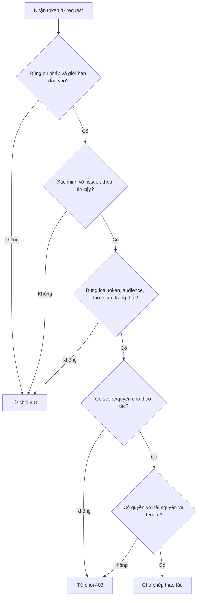
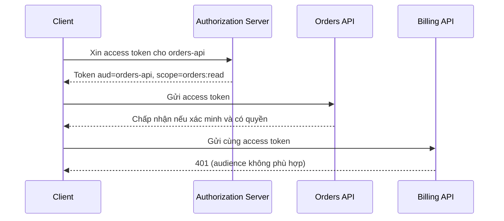
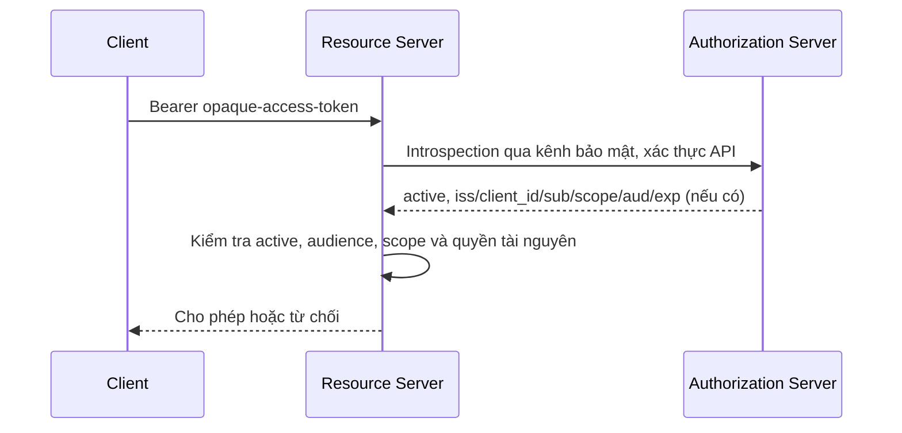

# Không tin token chỉ vì token có hình thức hợp lệ

## Mục tiêu học tập

Trong chương **Mô hình tin cậy** của học phần bảo mật token, một nguyên tắc nền tảng là: **token trông hợp lệ chưa chắc là token đáng tin, và token đáng tin chưa chắc đủ quyền cho yêu cầu hiện tại**.

Sau bài học, bạn có thể:

1. Phân biệt việc token **có cú pháp hợp lệ**, **được phát hành và xác minh đúng**, **được phép sử dụng tại API này**, và **đủ quyền đối với dữ liệu cụ thể**.
2. Giải thích tại sao đọc được claims của JWT hoặc nhận được chuỗi opaque token không chứng minh quyền truy cập.
3. Xây dựng quy trình kiểm tra issuer, chữ ký/khóa, algorithm, audience, thời gian hiệu lực, mục đích token, scope và quyền trên tài nguyên.
4. Nhận biết các sai lầm như tin `sub` do client gửi, nhầm ID token với access token, nhận token từ issuer khác, hoặc dựa vào chữ ký hợp lệ mà bỏ qua tenant và trạng thái thu hồi.
5. Áp dụng nguyên tắc **fail closed** khi không xác minh được nguồn tin cậy hoặc thiếu thông tin để quyết định quyền truy cập.

## 1. “Hình thức hợp lệ” có thể đánh lừa như thế nào?

Một JSON Web Token (JWT) ký theo dạng JWS compact thường có ba phần ngăn cách bởi dấu chấm:

```text
BASE64URL(header).BASE64URL(payload).BASE64URL(signature)
```

Một ứng dụng có thể **tách được ba phần**, **giải mã được payload** và đọc được các trường `sub`, `scope`, `exp`. Những thao tác này mới là **phân tích cú pháp**. Chúng không nói lên:

- Các claims có bị sửa sau khi phát hành hay không.
- Token có được ký bằng khóa thuộc **issuer mà API thực sự tin cậy** hay không.
- Token được cấp cho **API nào** và **loại tác vụ nào**.
- Token còn hiệu lực, đã bị thu hồi hay thuộc một phiên bị chặn chưa.
- Người mang token có quyền thực hiện **hành động cụ thể trên đối tượng cụ thể** hay không.

Ví dụ, attacker tự tạo chuỗi JWT có payload:

```json
{
  "sub": "administrator",
  "scope": "orders:read orders:write",
  "aud": "orders-api",
  "exp": 1950000000
}
```

Payload này có vẻ hợp lý. Attacker vẫn có thể tự mã hóa Base64URL và tạo chuỗi ba phần. Nếu API chỉ `decode` rồi tin `sub`/`scope`, attacker có thể tự cấp quyền cho mình. Chỉ **xác minh đúng bằng thông tin tin cậy do server cấu hình** mới khiến claims trở thành đầu vào đáng xem xét.

Ngược lại, một JWT được ký hợp lệ cũng **không tự động được chấp nhận**: nó có thể do tổ chức khác phát hành, dành cho dịch vụ khác, hết hạn hoặc thiếu quyền trên tài nguyên. Với **opaque token**, chuỗi trông ngẫu nhiên, đúng độ dài hoặc có prefix giống token thật cũng không chứng minh nó còn hoạt động; API cần một cơ chế kiểm tra đáng tin cậy.

> Quy tắc thực hành: **Đọc được ≠ xác minh được ≠ được phép dùng tại đây ≠ có quyền thực hiện hành động này.**

## 2. Các lớp kiểm tra từ dữ liệu không đáng tin đến quyết định cấp quyền

Hãy xem token đầu vào là **dữ liệu không đáng tin** cho đến khi hệ thống đi qua từng lớp kiểm tra.

| Lớp | Câu hỏi phải trả lời | Kết quả khi kiểm tra thất bại |
|---|---|---|
| **1. Cú pháp và giới hạn đầu vào** | Token có đúng cách truyền, định dạng, kích thước và loại mã hóa được hỗ trợ không? | Từ chối token lỗi; không diễn giải claims làm căn cứ cấp quyền. |
| **2. Nguồn gốc và toàn vẹn** | Ai phát hành? Khóa/thuật toán xác minh có thuộc issuer đã được cấu hình tin cậy không? | Từ chối, ngay cả khi có thể đọc được payload hoặc chữ ký khớp một khóa lạ. |
| **3. Mục đích và nơi nhận** | Đây có phải access token cho **chính API** này, đúng luồng và đúng loại token không? | Từ chối ID token, refresh token hoặc access token dành cho dịch vụ khác. |
| **4. Hiệu lực và trạng thái** | Token có đang trong khoảng thời gian cho phép? Có bị thu hồi, vô hiệu hóa hoặc vi phạm chính sách phiên không? | Từ chối hoặc đối chiếu trạng thái theo cơ chế đã thiết kế. |
| **5. Quyền được cấp** | Scope, role, permission có đáp ứng thao tác yêu cầu không? | Từ chối thao tác vượt quyền. |
| **6. Quyền với tài nguyên thực tế** | Chủ thể, tenant, quan hệ sở hữu và chính sách nghiệp vụ có cho truy cập bản ghi này không? | Từ chối dù token đã qua năm lớp trước. |
| **7. Bằng chứng ràng buộc người gửi, nếu áp dụng** | Token có bắt buộc chứng minh sở hữu khóa/chứng chỉ không? Request có bằng chứng đúng không? | Từ chối khi thiếu hoặc sai proof. |

Các lớp này cần **kết hợp**, không thay thế nhau. Thứ tự cụ thể phụ thuộc framework và mô hình token, nhưng phải bảo đảm không lấy claims chưa xác minh làm căn cứ cấp quyền.



*Sơ đồ đơn giản hóa: khi dùng sender-constrained token, kiểm tra proof là bước bắt buộc trong nhánh xác minh. Cách trả 403 hay 404 cho tài nguyên bị cấm có thể theo chính sách hạn chế lộ thông tin; không được để sai mã HTTP làm lộ dữ liệu.*

## 3. JWT: chữ ký hợp lệ là điều kiện cần, chưa phải quyết định cuối

### 3.1. “Verify” khác “decode”

Đây là **mã giả nguy hiểm**:

```text
claims = base64url_decode(jwt.payload)
if claims.role == "admin":
    allow()
```

Attacker có thể sửa payload tùy ý. Mã phía trên không biết nội dung có được issuer đáng tin cậy phát hành hay không. Một đoạn xử lý đúng phải sử dụng **thư viện JOSE/JWT được kiểm chứng** và quy tắc tin cậy cấu hình **từ phía máy chủ**.

Với JWT dạng JWS, một bước xác minh mật mã cơ bản gồm:

1. Xác định **issuer đã được cho phép** cho endpoint/API, từ cấu hình đáng tin cậy.
2. Chỉ chấp nhận các **thuật toán ký được cấu hình** cho issuer và loại token đó; không để giá trị `alg` trong header tự quyết định chính sách.
3. Chọn khóa kiểm tra trong **tập khóa tin cậy** của issuer; xác minh chữ ký và kiểm tra sự phù hợp của thuật toán với loại khóa.
4. Tiếp tục kiểm tra `iss`, `aud`, `exp`, `nbf` và các điều kiện sử dụng trước khi cho phép.

Header JWT minh họa:

```json
{
  "typ": "at+jwt",
  "alg": "RS256",
  "kid": "signing-key-2026"
}
```

`alg` cho biết thuật toán JWT **khai báo**; `kid` là gợi ý tìm khóa trong tập khóa. Cả hai đều đến từ **token chưa đáng tin** cho tới khi quy trình xác minh hoàn tất. Một số hệ thống dùng `typ: "at+jwt"` để phân biệt access-token JWT theo profile tương ứng, nhưng không phải mọi JWT access token đều bắt buộc dùng giá trị này. API phải xác định định dạng token mà mình nhận theo hợp đồng với issuer, không suy đoán chỉ từ một trường header.

Các lỗi cần tránh:

- Chấp nhận `alg: none` hoặc tùy tiện chuyển đổi giữa thuật toán đối xứng/bất đối xứng vì token tự yêu cầu.
- Lấy khóa từ URL `jku`/`x5u` do token chỉ ra mà không có chính sách giới hạn nguồn tin cậy, khiến attacker dẫn API đến khóa do họ kiểm soát.
- Coi bất kỳ `kid` nào là đường dẫn tệp hoặc truy vấn cơ sở dữ liệu tùy ý. `kid` chỉ nên được đối chiếu trong tập khóa đã tin cậy, với cách xử lý đầu vào an toàn.
- Tin mọi token xác minh được bằng **bất kỳ khóa công khai** tải về từ internet.
- Dùng một secret chia sẻ quá rộng giữa nhiều dịch vụ hoặc nhiều issuer, khiến ranh giới trách nhiệm phát hành và xác minh trở nên mơ hồ.

### 3.2. Tin cậy issuer và quản lý JWKS

Trong hệ thống OAuth 2.0/OIDC, Authorization Server có thể công bố **JWKS (JSON Web Key Set)** qua endpoint đã định danh. API thường lấy cấu hình issuer/JWKS từ cấu hình dịch vụ hoặc metadata discovery tại **issuer được phép**, truyền qua HTTPS và được xác thực phù hợp.

Việc một JWT có `iss: "https://trusted.example"` **không chứng minh** issuer đó đã phát hành JWT. Chỉ sau khi đối chiếu với nguồn cấu hình tin cậy, xác minh chữ ký và so sánh issuer kỳ vọng, API mới có căn cứ tin token.

Khi **luân chuyển khóa ký (key rotation)**, Authorization Server phát hành khóa mới và duy trì quy trình cho API tải/cập nhật JWKS an toàn. Nếu token mang `kid` không tìm thấy, API có thể làm mới cache JWKS từ **endpoint đã cấu hình**, theo giới hạn tần suất để tránh bị khai thác; nếu vẫn không xác minh được, phải từ chối. Không tự mở rộng tập issuer hoặc lấy khóa từ URL do caller đưa vào.

**Lưu ý về mã hóa:** JWT dạng JWE có thể bảo vệ tính bí mật của nội dung, nhưng giải mã thành công **không thay cho** xác minh issuer, audience, loại token, thời gian và quyền. Tùy profile, còn cần xác minh nguồn phát hành và tính toàn vẹn theo thiết kế.

## 4. Kiểm tra các claims trong đúng ngữ cảnh tin cậy

Ví dụ một access token JWT minh họa:

```json
{
  "iss": "https://auth.example.test",
  "sub": "user-123",
  "aud": ["orders-api"],
  "client_id": "shop-web",
  "scope": "orders:read",
  "tenant_id": "tenant-a",
  "iat": 1893456000,
  "nbf": 1893456000,
  "exp": 1893456900,
  "jti": "token-unique-id-42"
}
```

Các giá trị số là **Unix time** để minh họa, không phải token thật. Tùy nhà phát hành và profile, JWT có thể dùng claims hoặc cấu trúc khác. Không được giả định mọi OAuth token đều chứa đủ các trường kể trên.

| Trường hoặc điều kiện | Kiểm tra đúng | Ngộ nhận thường gặp |
|---|---|---|
| `iss` (issuer) | So sánh với **issuer được cấu hình tin cậy** cho API/tenant/luồng tương ứng. | “Có trường `iss` giống tên miền tin cậy thì chắc đúng.” |
| `aud` (audience) | API hiện tại phải nằm trong tập audience được cho phép; xử lý cả giá trị chuỗi lẫn mảng nếu profile hỗ trợ. | “Cùng một Authorization Server ký thì mọi API đều dùng được token.” |
| `exp` | Thời điểm hiện tại phải trước hạn hết hiệu lực, tính sai lệch đồng hồ nhỏ theo chính sách. | “Chữ ký còn đúng thì token tồn tại mãi.” |
| `nbf` / `iat` | `nbf`: chưa dùng trước thời điểm cho phép; `iat`: thời điểm cấp, có thể được dùng để kiểm tra tuổi token theo chính sách. | “Chỉ cần có `iat` là token hiện còn hợp lệ.” |
| Loại token / `typ` | Kiểm tra hợp đồng token/profile; endpoint tài nguyên chỉ nhận loại access token được hỗ trợ. | “ID token là JWT nên dùng làm access token được.” |
| `scope` / quyền | Kiểm tra quyền cần cho hành động và không suy diễn thêm quyền ngoài phần được cấp. | “Có scope `read` nghĩa là được xem mọi bản ghi.” |
| `sub` | Xác định chủ thể sau xác minh; đối chiếu với chính sách ứng dụng. | “`sub` chính là người đang giữ token; không thể bị phát lại.” |
| `client_id` / `azp` nếu áp dụng | Phân biệt ứng dụng được ủy quyền với người dùng và kiểm tra theo profile sử dụng. | “`client_id` là danh tính người dùng cuối.” |
| `tenant_id` hoặc claim riêng | Áp dụng quy tắc tách tenant của ứng dụng và xác minh quan hệ với tài nguyên; tên claim phụ thuộc hợp đồng. | “Dữ liệu cùng ID thì cùng người được xem, bất kể tenant.” |
| `jti` | Là mã định danh có thể hỗ trợ kiểm soát thu hồi/phát lại **nếu** có cơ chế trạng thái. | “Chỉ cần `jti` là token tự động dùng một lần.” |

**So khớp chính xác theo hợp đồng:** cần tôn trọng kiểu dữ liệu, giá trị kỳ vọng và chuẩn biểu diễn issuer/audience. Không dùng cách kiểm tra chuỗi mơ hồ như `aud.contains("orders")` khiến `other-orders-api` bị chấp nhận nhầm. Các cấu hình liên quan phải đến từ nguồn đáng tin, không lấy ngẫu nhiên từ claim của token.

**Độ lệch đồng hồ (clock skew):** thời gian giữa các hệ thống có thể sai vài giây. Một khoảng dung sai nhỏ, ví dụ 30–60 giây nếu chính sách cho phép, có thể hữu ích với `exp`/`nbf`. Dung sai càng lớn càng kéo dài cửa sổ chấp nhận; cần đồng bộ giờ hệ thống và giới hạn giá trị này.

## 5. Đúng chữ ký nhưng sai đối tượng nhận hoặc sai mục đích

Hãy xét một tổ chức có chung Authorization Server cho `orders-api` và `billing-api`:



Kể cả khi `billing-api` nhận diện chính xác issuer và xác minh được chữ ký, **nó vẫn phải từ chối token cấp cho `orders-api`**. Nếu không kiểm tra `aud`, token từ dịch vụ ít nhạy cảm có thể bị sử dụng ở dịch vụ nhiều quyền hơn, tạo ra lỗi **token substitution / token confusion**.

Đặc biệt cần phân biệt ba loại token trong cùng hệ thống:

- **Access token:** Resource Server dùng để quyết định có thể gọi API hay không, sau khi xác minh phù hợp.
- **ID token (OIDC):** thông báo kết quả xác thực của người dùng **cho client**; audience thường là client ID. API nghiệp vụ không nên chấp nhận ID token thay access token.
- **Refresh token:** dùng tại token endpoint của Authorization Server để xin token mới. API nghiệp vụ không được chấp nhận refresh token để đọc/ghi dữ liệu.

JWT và opaque là **định dạng**; access, ID, refresh là **mục đích**; bearer hoặc sender-constrained mô tả **cách chứng minh quyền sử dụng**. Các trục này độc lập. Không thể quyết định mục đích sử dụng chỉ từ việc chuỗi token có ba phần ngăn cách bởi dấu chấm hay có thể giải mã thành JSON.

Với OAuth/OIDC, token còn có thể gắn với một client, một tập tài nguyên và các điều kiện bổ sung do profile quy định. Khi hỗ trợ nhiều issuer, mỗi issuer phải được khai báo, kiểm soát ranh giới trust và được xác minh theo chính sách tương ứng; không để `iss` chưa xác minh tự khiến API tin một issuer mới.

## 6. Opaque token: không tự đoán quyền từ một chuỗi bí mật

**Opaque token** là chuỗi mà Resource Server không thể tự diễn giải một cách có ý nghĩa. Token có thể là một khóa tra cứu hoặc biểu diễn riêng của Authorization Server. API không nên đoán `userId`, `role` hay thời hạn dựa vào chiều dài hoặc prefix của chuỗi.

Một phương án phổ biến là **token introspection** theo OAuth 2.0 (RFC 7662), hoặc tra cứu trạng thái trong hạ tầng nội bộ đáng tin cậy:



Phản hồi minh họa, **không phải dữ liệu từ hệ thống thật**:

```json
{
  "active": true,
  "client_id": "shop-web",
  "sub": "user-123",
  "scope": "orders:read",
  "aud": "orders-api",
  "exp": 1893456900
}
```

`active: true` có ý nghĩa **chỉ khi kết quả đến từ hệ thống xác minh đã tin cậy và được gắn với token đang kiểm tra**. API vẫn phải xét audience, scope và quyền trên tài nguyên. Phản hồi introspection có thể không bao gồm tất cả thuộc tính ở mọi hệ thống; nếu thiếu thuộc tính bắt buộc theo chính sách API, kết quả không đủ để cấp quyền.

Khi dùng introspection, cần:

- Kết nối tới **endpoint tin cậy** bằng HTTPS và xác thực Resource Server theo yêu cầu của Authorization Server.
- Kiểm soát quyền ai được hỏi trạng thái token; tránh để introspection trở thành kênh lộ claims.
- Cân nhắc **cache kết quả** để giảm độ trễ, nhưng xác định rõ đánh đổi giữa hiệu năng và **độ trễ thu hồi**.
- Nếu không truy vấn được hoặc kết quả không rõ ràng, **không mặc định coi token hoạt động**. Có thể trả lỗi tạm thời theo chính sách vận hành, nhưng phải tránh cấp quyền từ dữ liệu không đủ tin cậy.

JWT tự xác minh cục bộ cũng có vấn đề tương tự về **thu hồi**: nếu chỉ kiểm tra chữ ký và `exp`, token đã bị đánh cắp có thể tiếp tục được dùng đến khi hết hạn. Các hệ thống cần thu hồi sớm phải bổ sung kiểm tra trạng thái phiên, denylist, introspection hoặc mô hình phù hợp. **Chữ ký hợp lệ không phản ánh tức thời trạng thái phiên**.

## 7. Authentication chưa thay Authorization

Một access token có chữ ký hợp lệ, đúng issuer, audience, thời gian và scope `orders:read` mới cho thấy **request có một căn cứ ủy quyền sơ bộ**. Quyền truy cập đơn hàng cụ thể còn tùy quy tắc nghiệp vụ.

Giả sử tài nguyên có dữ liệu:

```json
{
  "orderId": "42",
  "ownerId": "user-999",
  "tenantId": "tenant-b",
  "total": 5000000
}
```

Request mang token đã xác minh có `sub=user-123` và `tenant_id=tenant-a`. API không thể trả đơn hàng 42 chỉ bởi token có `orders:read`. Cần kiểm tra user-123 có được đọc đơn hàng 42 theo chính sách sở hữu, ủy quyền quản trị hoặc vai trò trong tenant; trong ví dụ này chủ sở hữu và tenant đều khác.

Thiếu kiểm tra kiểu này là một nguyên nhân của **Broken Object Level Authorization (BOLA/IDOR)**. Kiểm tra quyền phải gắn với đối tượng mà ứng dụng thực sự tải hoặc sửa, chứ không dựa đơn thuần vào ID truyền trên URL.

```text
GET /api/orders/42
Authorization: Bearer <ACCESS_TOKEN_PLACEHOLDER>

# Không đủ: access token có orders:read
# Cần thêm: người dùng/tenant trong token có quyền đọc order 42?
```

Sự khác biệt giữa các danh tính cần rõ ràng:

- **Issuer (`iss`)**: ai phát hành token.
- **Client (`client_id` hoặc claim tương ứng)**: ứng dụng hoặc dịch vụ được cấp token.
- **Subject (`sub`)**: chủ thể mà token mô tả, thường là người dùng hoặc service principal, tùy luồng.
- **Bearer hiện tại**: bên đang gửi request; với bearer token thuần túy, chỉ sở hữu token không chứng minh đó là người dùng gốc.
- **Resource owner/tenant**: người hoặc tổ chức sở hữu tài nguyên mà chính sách ứng dụng phải kiểm tra.

Không gộp các vai trò này thành một “user” duy nhất.

## 8. Quy trình xác thực và phân quyền tại API

Mã giả bên dưới mô tả **các điều kiện logic** cần đáp ứng, không thay thế thư viện JWT/OAuth có kiểm chứng:

```text
handle(GET /orders/{orderId}, request):
    token = parse_authorization_bearer_header(request)
    if token missing or malformed:
        return 401

    # Từ cấu hình tin cậy; không chấp nhận issuer/URL do token tự đề xuất.
    policy = trusted_token_policy_for("orders-api")
    identity = verify_access_token(token, policy)
        # JWT: chữ ký + thuật toán/khóa/issuer tin cậy + claims
        # opaque: introspection/tra cứu đáng tin cậy + trạng thái

    if identity invalid or inactive:
        return 401
    if identity.audience does not include "orders-api":
        return 401
    if identity.token_purpose != "access":
        return 401
    if not identity.within_validity_window:
        return 401
    if policy.sender_proof_required and not verify_sender_proof(request, token):
        return 401

    if "orders:read" not in identity.scopes:
        return 403

    order = orders.findById(orderId)
    if order not found:
        return 404
    if not can_read_order(identity.subject, identity.tenant, order):
        return 403   # Có thể dùng 404 theo chính sách che giấu tồn tại

    return 200 with authorized order fields
```

`verify_access_token` phải **từ chối** những điều kiện không đủ căn cứ, ví dụ: thiếu audience bắt buộc, issuer không khớp, trạng thái introspection không xác định, khóa ký không tin cậy hoặc proof không đạt. Ứng dụng cần đánh giá cả trường hợp quyền thay đổi sau khi cấp token: quyết định cuối có thể cần đọc dữ liệu/role hiện tại từ nguồn chính sách thay vì chỉ tin một role cũ trong token.

Về HTTP, **401 Unauthorized** thường áp dụng khi thiếu/không hợp lệ thông tin xác thực (có thể kèm `WWW-Authenticate` theo giao thức); **403 Forbidden** khi đã có thông tin xác thực hợp lệ nhưng không đủ quyền. Không đưa nguyên token hoặc claims nhạy cảm vào lỗi trả về.

## 9. Những trường hợp “trông hợp lệ” nhưng phải từ chối

| Trường hợp | Tại sao không được tin? | Kiểm soát cần có |
|---|---|---|
| JWT có ba phần, payload `role=admin` | Chuỗi có thể được tạo hoặc sửa tùy ý. | Xác minh chữ ký bằng thuật toán và khóa được cho phép. |
| JWT có chữ ký hợp lệ của issuer lạ | Một khóa bất kỳ không tạo quan hệ tin cậy với API. | Allowlist issuer và gắn khóa theo issuer. |
| Token do issuer đúng phát hành nhưng `aud=billing-api` | Token không được cấp cho `orders-api`. | So khớp audience dự kiến. |
| JWT access token hết hạn nhưng chữ ký vẫn đúng | Chữ ký không nói token còn hiệu lực. | Kiểm tra `exp`, `nbf`, TTL và trạng thái liên quan. |
| OIDC ID token có tên và email người dùng | ID token dành cho client xác thực danh tính, không phải bằng chứng gọi API. | Kiểm tra loại/mục đích token. |
| Opaque token có `active: true` trong JSON mà caller tự gửi | Caller có thể tự sửa bất kỳ JSON nào. | Chỉ tin phản hồi từ introspection/issuer đáng tin. |
| Token `orders:read` truy cập đơn hàng tenant khác | Scope chưa xác định quyền trên đối tượng cụ thể. | Object-level authorization và tenant isolation. |
| Token hợp lệ nhưng đã bị thu hồi, API chỉ kiểm tra JWT cục bộ | Token có thể còn được chấp nhận tới `exp` nếu không có cơ chế trạng thái. | Thiết kế kiểm tra thu hồi phù hợp. |
| Bearer token bị sao chép rồi gửi từ máy khác | Bearer token không chứng minh người gửi là chủ sở hữu gốc. | Bảo vệ token, TTL/scope hẹp; DPoP/mTLS khi cần ràng buộc người gửi. |

### Khi token bị đánh cắp hoặc phát lại

Trong mô hình **bearer**, bất kỳ ai có token hợp lệ có thể thử dùng nó. API xác minh chữ ký/claims sẽ thấy token *đúng* nhưng không biết người đang gửi HTTP request có phải người nhận ban đầu hay không. Vì thế, việc bảo vệ token khi lưu và truyền (TLS, tránh URL/log, giảm XSS, bảo vệ refresh token), giới hạn audience/scope/TTL và khả năng thu hồi đều cần thiết.

Nếu hệ thống dùng **sender-constrained access token**, chẳng hạn DPoP hoặc certificate-bound token qua mTLS, API phải kiểm tra **bằng chứng sở hữu khóa/chứng chỉ phù hợp với token và request**. Khi đó sao chép riêng token thường chưa đủ để sử dụng. Tuy vậy, nếu attacker có cả token và khả năng sử dụng khóa, rủi ro vẫn còn; đây không phải giải pháp thay thế mọi biện pháp kiểm soát khác.

## 10. Checklist triển khai mô hình tin cậy

Trước khi đưa một Resource Server vào sử dụng, có thể rà soát:

1. **Nguồn tin cậy rõ ràng:** issuer, audience, kiểu token, JWKS/introspection endpoint và thuật toán được xác định từ cấu hình đáng tin cậy.
2. **Xác minh thay vì giải mã:** dùng thư viện phù hợp; chặn `alg`/khóa không được hỗ trợ; không nhận nguồn khóa tùy ý từ token.
3. **Kiểm tra đầy đủ claims cần thiết:** issuer, audience, thời gian, loại token, trạng thái, proof nếu có; thiếu dữ liệu bắt buộc thì từ chối.
4. **Phân quyền theo thao tác và dữ liệu:** scope/permission chỉ là một lớp; kiểm tra subject, tenant, chủ sở hữu và chính sách nghiệp vụ ở từng yêu cầu.
5. **Vòng đời token có chủ đích:** TTL phù hợp, bảo vệ refresh token, quy trình rotation và thu hồi, xác định độ trễ cache/trạng thái có thể chấp nhận.
6. **Không rò rỉ token qua hệ thống phụ trợ:** log, trace, metrics, crash report, URL, hỗ trợ khách hàng hoặc công cụ phân tích phải không chứa giá trị token thật.
7. **Xử lý thất bại an toàn:** khi không thể xác minh chữ ký/JWKS/introspection hoặc trạng thái không rõ, không cho phép request chỉ vì hệ thống xác minh đang lỗi.
8. **Quan sát và phản ứng:** giám sát tỷ lệ từ chối bất thường, thay đổi khóa, dấu hiệu token bị phát lại; log mã sự kiện thích hợp mà không ghi bí mật.

## 11. Bài tập suy luận ngắn

**Câu 1.** API nhận một JWT có `aud=orders-api`, `scope=orders:read`, `exp` trong tương lai, nhưng chữ ký được kiểm chứng bằng khóa mà API tải từ URL do JWT tự chỉ định. Có nên cho phép không?

**Giải thích:** Không. Nguồn khóa chưa được gắn với issuer đã tin cậy theo cấu hình của API. Các claims hợp lý không khắc phục được lỗi chọn nguồn xác minh.

**Câu 2.** JWT do issuer tin cậy phát hành, chữ ký đúng, `aud` đúng và còn hạn. Người dùng truy cập đơn hàng của tenant khác. Có được trả dữ liệu vì scope `orders:read` không?

**Giải thích:** Không. Kiểm tra scope không thay thế kiểm tra quyền trên bản ghi và ranh giới tenant.

**Câu 3.** Opaque token được introspection và phản hồi `active: true`, nhưng kết quả không có audience mà chính sách API bắt buộc. Có được chấp nhận?

**Giải thích:** Không. Nếu thiếu bằng chứng token được cấp cho API này, phải từ chối hoặc xử lý theo hợp đồng xác minh được thiết kế trước, không tự mặc định audience phù hợp.

**Câu 4.** Một client nhận ID token OIDC chứa `sub` và `email_verified=true`. Client gửi ID token sang `orders-api` để mua hàng. API có được coi đó là access token không?

**Giải thích:** Không. ID token giúp client xác thực người dùng theo OIDC, còn API cần access token hợp lệ cho chính API và kiểm tra quyền tương ứng.

**Câu 5.** Token JWT vẫn còn hạn sau khi chủ tài khoản đăng xuất. API không tra cứu phiên hoặc danh sách thu hồi. Có thể API vẫn chấp nhận token đó không?

**Giải thích:** Có. Nếu hệ thống chỉ dựa vào chữ ký và `exp`, token có thể tiếp tục được chấp nhận cho đến khi hết hạn. Cần chính sách TTL và thu hồi được thiết kế phù hợp.

## Ghi nhớ

Trong bảo mật token, **chuỗi có thể đọc được** chỉ là dữ liệu; **chữ ký hợp lệ** chỉ là một phần bằng chứng về nguồn gốc và tính toàn vẹn; **token được chấp nhận tại API** còn phải đúng issuer, audience, mục đích, thời gian và trạng thái; **quyền truy cập tài nguyên** vẫn cần quyết định riêng dựa trên scope, người dùng, tenant và nghiệp vụ. Mọi lớp xác minh phải được thực hiện bằng chính sách do hệ thống tin cậy thiết lập, trước khi xử lý yêu cầu nhạy cảm.

### Tài liệu tham khảo

- [RFC 7519 — JSON Web Token (JWT)](https://www.rfc-editor.org/rfc/rfc7519)
- [RFC 8725 — JSON Web Token Best Current Practices](https://www.rfc-editor.org/rfc/rfc8725)
- [RFC 9068 — JSON Web Token (JWT) Profile for OAuth 2.0 Access Tokens](https://www.rfc-editor.org/rfc/rfc9068)
- [RFC 7662 — OAuth 2.0 Token Introspection](https://www.rfc-editor.org/rfc/rfc7662)
- [RFC 6750 — OAuth 2.0 Bearer Token Usage](https://www.rfc-editor.org/rfc/rfc6750)
- [RFC 9449 — OAuth 2.0 Demonstrating Proof of Possession (DPoP)](https://www.rfc-editor.org/rfc/rfc9449)
