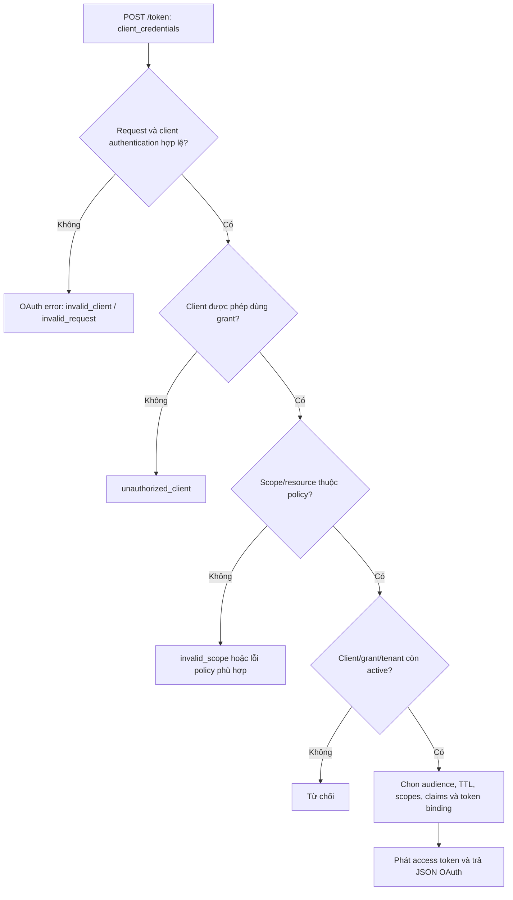
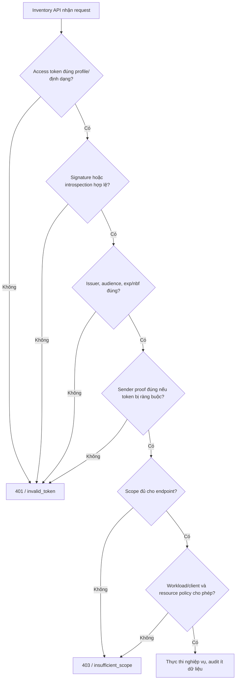

# Machine-to-machine token request

## 1. Tình huống mở đầu: một dịch vụ cần gọi một dịch vụ khác

Một nền tảng bán hàng có dịch vụ `inventory-sync` chạy theo lịch. Cứ vài phút, nó đọc dữ liệu tồn kho từ Inventory API để cập nhật báo cáo. Đây là **machine-to-machine (M2M)**: phần mềm gọi phần mềm, **không có người dùng mở trình duyệt, đăng nhập hoặc bấm consent ở mỗi lượt gọi**.

Nhóm phát triển cân nhắc ba cách:

1. Gắn một API key tĩnh vào mã nguồn rồi gửi mãi.
2. Lấy access token của một quản trị viên rồi chia sẻ cho mọi batch job.
3. Đăng ký `inventory-sync` làm OAuth 2.0 confidential client, xác thực dịch vụ tại authorization server và xin một **access token chỉ có quyền `inventory:read` cho Inventory API**.

Cách thứ ba có thể được hiện thực bằng **OAuth 2.0 Client Credentials Grant**. Luồng này thường phù hợp khi dịch vụ cần dùng **quyền của chính client/workload** hoặc quyền được chuẩn bị trước theo quan hệ tin cậy với authorization server (AS).

Một token request minh họa:

```http
POST /token HTTP/1.1
Host: auth.example.com
Authorization: Basic <base64_of_form_encoded_client_id_colon_secret>
Content-Type: application/x-www-form-urlencoded
Accept: application/json

grant_type=client_credentials&scope=inventory%3Aread
```

AS xác thực client, đánh giá chính sách và có thể trả:

```http
HTTP/1.1 200 OK
Content-Type: application/json
Cache-Control: no-store
Pragma: no-cache

{
  "access_token": "<opaque_or_jwt_access_token>",
  "token_type": "Bearer",
  "expires_in": 300,
  "scope": "inventory:read"
}
```

Dịch vụ dùng access token để gọi **Inventory API**, không gửi client secret tới API nghiệp vụ:

```http
GET /inventory/summary HTTP/1.1
Host: inventory-api.example.com
Authorization: Bearer <access_token>
Accept: application/json
```

> **Tư tưởng chính:** Trong M2M, **client được xác thực tại token endpoint** để nhận token; **resource server xác minh access token và phân quyền workload khi token được sử dụng**. Không có end-user mặc định, và `client_id` không tự đồng nghĩa quyền quản trị hay bằng chứng người gọi API hiện tại còn giữ client secret.

Bài thuộc chương **Client credentials** trong module `SECURITY_TOKEN_SECURITY_FUNDAMENTALS`. Nội dung kết nối phát hành–xác minh–lưu trữ–thu hồi token với JWT/opaque token, audience, scope, OAuth 2.0/OIDC và phòng chống token bị lấy cắp hoặc phát lại.

## 2. Mục tiêu học tập

Sau bài học, bạn cần nắm được:

1. Phân biệt **M2M**, **client credentials grant**, OAuth client authentication và user-delegated authorization.
2. Biết M2M client cần đăng ký những gì tại authorization server và gửi request tới **token endpoint**, không phải authorization endpoint.
3. Tạo đúng `grant_type=client_credentials` với **HTTP POST + `application/x-www-form-urlencoded`**.
4. So sánh `client_secret_basic`, private-key JWT và mutual TLS (mTLS) ở ranh giới xác thực client.
5. Kiểm tra token response, `scope`, `audience/resource`, hạn dùng và ý nghĩa của `sub`/`client_id`.
6. Gọi resource server bằng bearer hoặc sender-constrained access token theo profile, không gửi client secret hay refresh token nhầm chỗ.
7. Thiết kế lưu bí mật, xoay credential, cache access token, xử lý concurrent requests và lỗi giao thức.
8. Xử lý đúng trường hợp công việc **thực hiện thay mặt một người dùng**, vốn không tự trở thành client credentials flow.
9. Phòng ngừa token theft/replay, quyền quá rộng và nhầm ranh giới tenant.
10. Kiểm thử end-to-end từ AS đến resource server với nhiều client, scopes, audiences và token profiles.

## 3. Những vai trò xuất hiện trong luồng M2M

OAuth 2.0 có bốn vai trò chức năng:

| Vai trò | Trong ví dụ M2M | Trách nhiệm |
| --- | --- | --- |
| **Client** | `inventory-sync` | Chứng minh danh tính ứng dụng và yêu cầu access token |
| **Authorization server (AS)** | `https://auth.example.com` | Xác thực client, kiểm tra grant và cấp token ít quyền |
| **Resource server (RS)** | Inventory API | Xác minh access token, audience, scope và chính sách dữ liệu |
| **Resource owner** | Bên có thẩm quyền đối với protected resource | Trong client credentials grant, quyền được AS chuẩn bị trước hoặc client hành động nhân danh chính mình; không có bước user authorization tương tác |

Một **workload** là phần mềm hoặc tiến trình thực thi (service, job, daemon, container). Một **OAuth client** là thực thể đăng ký với AS, có `client_id` và phương thức xác thực phù hợp. Tùy kiến trúc, một workload có thể có một OAuth client registration riêng hoặc nhiều instances dùng cùng một registration.

### 3.1. Machine-to-machine không nhất thiết luôn là client credentials

M2M là **kiểu giao tiếp** giữa máy với máy; `client_credentials` là **một loại OAuth grant**.

Những trường hợp khác cũng có giao tiếp server-to-server nhưng dùng mô hình quyền khác:

- Backend gọi API **thay mặt một user** với token được ủy quyền trong Authorization Code flow.
- Service A đổi token người dùng sang token dành cho Service B bằng **OAuth 2.0 Token Exchange** khi AS hỗ trợ.
- Một workload dùng cơ chế định danh liên kết (*workload identity federation*) để xác thực client rồi nhận OAuth token.
- Service-to-service dùng mTLS hoặc một giao thức riêng thay vì OAuth nếu ranh giới tin cậy và sản phẩm không sử dụng OAuth.

**Không tự gán mọi request không có browser là `client_credentials`**. Cần xác định **quyền thuộc về chính dịch vụ hay được ủy quyền từ người dùng**.

### 3.2. Client Credentials Grant chỉ dành cho confidential clients

Theo RFC 6749 §4.4, client credentials grant **MUST only be used by confidential clients**.

Một **confidential client** có khả năng bảo vệ credential hoặc dùng cơ chế client authentication phù hợp với AS theo registration. Ví dụ: backend có secret vault, workload được cấp khóa riêng, hoặc dịch vụ có mTLS certificate.

**Public clients** như SPA thuần JavaScript và nhiều native apps không thể coi client secret được đóng gói trong code là bí mật đáng tin. Chúng **không nên** dùng client credentials để tự cấp quyền server-to-server bằng một secret cố định nằm trong frontend/mobile binary.

## 4. Sơ đồ đầy đủ: xin token rồi gọi API

```mermaid
sequenceDiagram
    participant J as inventory-sync (OAuth client)
    participant V as Secret vault / workload identity
    participant AS as Authorization Server
    participant API as Inventory API
    J->>V: Lấy client credential theo quyền workload
    V-->>J: Secret hoặc quyền ký/chứng chỉ
    J->>AS: POST /token; grant_type=client_credentials
    AS->>AS: Xác thực client; kiểm tra grant/scope/resource/policy
    AS-->>J: Access token + token_type + expires_in
    J->>J: Cache token theo client/scope/audience và TTL
    J->>API: GET /inventory/summary; Bearer access token
    API->>API: Verify issuer/audience/exp/scope + workload policy
    API-->>J: 200 và dữ liệu nếu được phép
    Note over J,AS: Khi token sắp hết hạn, client xin token mới tại /token
```

**Không có**:

- Browser redirect tới `/authorize`.
- Authorization code.
- PKCE `code_verifier`/`code_challenge`.
- OIDC login consent cho end-user trong grant này.
- End-user session hay OIDC ID token chỉ vì có access token.
- Refresh token như một yêu cầu mặc định.

Đối với client credentials, client lấy token trực tiếp tại **token endpoint** sau khi xác thực và được chính sách cấp quyền.

## 5. Chuẩn bị trước khi gửi token request

Một M2M client cần có **client registration** và hợp đồng với AS. Những dữ liệu thường cần:

| Thành phần | Ví dụ | Ý nghĩa |
| --- | --- | --- |
| Issuer tin cậy | `https://auth.example.com` | AS được phép phát token |
| Token endpoint | `https://auth.example.com/token` | URL nhận `client_credentials` |
| Client ID | `inventory-sync-prod` | Định danh OAuth client; **không phải bí mật** |
| Client authentication method | `client_secret_basic` hoặc `private_key_jwt`/mTLS | Cách AS xác thực client |
| Client credential | Secret, private key hoặc chứng chỉ/khóa workload | Phải được bảo vệ |
| Allowed grant | `client_credentials` | Client được phép yêu cầu kiểu grant này |
| Allowed scopes | `inventory:read` | Phạm vi client có thể được cấp |
| Allowed resource/audience | Inventory API | Giới hạn nơi access token sử dụng |
| Token format/profile | JWT access token hoặc opaque | Cách RS xác minh |
| Token lifetime | Ví dụ 300 giây | Mục tiêu an ninh/hiệu năng |
| Credential rotation policy | Xoay khóa/secret định kỳ hoặc khi lộ | Vòng đời nhận diện client |

**Registration phải do AS hoặc hệ thống quản lý đáng tin điều khiển**. Caller không được tự tạo `client_id=admin-service` hoặc yêu cầu `scope=admin` rồi AS mặc định chấp nhận.

### 5.1. Tách client theo service và môi trường

Không chia sẻ một client secret “toàn công ty” cho mọi service.

Ví dụ thiết kế:

```text
inventory-sync-dev
  issuer: auth-dev.example.com
  scope: inventory:read
  resource: inventory-api-dev

inventory-sync-staging
  issuer: auth-staging.example.com
  scope: inventory:read
  resource: inventory-api-staging

inventory-sync-prod
  issuer: auth.example.com
  scope: inventory:read
  resource: inventory-api-prod
```

Điều này giúp thu hồi, audit và đánh giá quyền theo service/môi trường mà không vô tình trao token production cho job phát triển.

### 5.2. Phải có chính sách cụ thể cho target resource

Một AS có thể phục vụ nhiều APIs:

```text
Inventory API: https://inventory-api.example.com
Orders API:    https://orders-api.example.com
Payments API:  https://payments-api.example.com
```

Client `inventory-sync` chỉ cần Inventory API. Việc nó được xác thực thành công **không làm nó có quyền gọi mọi resource server dùng cùng issuer**. Resource/audience phải được AS và RS thống nhất từ trước.

## 6. Cú pháp token request theo RFC 6749

### 6.1. HTTP POST với form body

Luồng tiêu chuẩn:

```http
POST /token HTTP/1.1
Host: auth.example.com
Authorization: Basic <client_authentication_value>
Content-Type: application/x-www-form-urlencoded
Accept: application/json

grant_type=client_credentials&scope=inventory%3Aread
```

- `grant_type=client_credentials`: **bắt buộc** cho grant này.
- `scope`: **tùy chọn** theo OAuth 2.0; AS định nghĩa phạm vi mặc định và chính sách nếu client không gửi.
- `Authorization`: ví dụ một **client authentication** theo Basic; không phải bearer access token.
- HTTPS/TLS: bảo vệ credential và token response trên mạng.
- `Content-Type`: body được mã hóa `application/x-www-form-urlencoded`, không phải JSON tùy ý nếu AS không công bố extension riêng.

**Không gửi client secret trong query string**:

```text
SAI:
GET /token?grant_type=client_credentials&client_secret=<secret>
```

URL/query có nguy cơ xuất hiện trong access logs, cache, proxy, telemetry và history. Đồng thời grant này sử dụng HTTP POST theo chuẩn.

### 6.2. Trường `scope` có ý nghĩa gì?

Ví dụ client xin:

```text
scope=inventory:read
```

AS đánh giá:

- Client registration có được phép `inventory:read` không?
- Client đang bị khóa/thu hồi credential không?
- Scope này có hợp lệ với resource dự định không?
- Chính sách tổ chức/tenant có cho phép workload truy cập dữ liệu không?
- Grant/client được cấp quyền này từ trước như thế nào?

**Scope được xin** không phải **scope được cấp**. Token response có thể có scope hẹp hơn nếu AS hỗ trợ/cho phép. Không tự bỏ check policy vì request chỉ có một scope.

### 6.3. Resource Indicators khi AS hỗ trợ

Theo RFC 8707, client có thể dùng tham số `resource` để chỉ ra target resource:

```http
POST /token HTTP/1.1
Host: auth.example.com
Authorization: Basic <client_authentication_value>
Content-Type: application/x-www-form-urlencoded

grant_type=client_credentials&scope=inventory%3Aread&resource=https%3A%2F%2Finventory-api.example.com
```

`resource` **không phải tham số bắt buộc trong mọi deployment**. Chỉ gửi nếu AS/registration/profile hỗ trợ. AS phải kiểm tra resource được đề nghị; không sao chép mù `resource` thành claim `aud` nếu policy không cho phép.

Không dùng:

```text
resource=https://payments-api.example.com
scope=payments:refund
```

với một client chỉ được phép đọc tồn kho rồi mong AS cấp quyền vì token request có hai tham số đó.

### 6.4. Form encoding khác JSON encoding

Form body cần percent-encoding đúng. Ví dụ:

```text
scope input: inventory:read
encoded:     inventory%3Aread

resource input: https://inventory-api.example.com
encoded:        https%3A%2F%2Finventory-api.example.com
```

Khi tự viết HTTP client, dùng hàm mã hóa dành cho **form parameters**. Đừng ghép chuỗi unescaped với ký tự `&`, `=`, `+` hoặc `%`, tránh server parse sai hoặc parameter pollution.

**Không URL-decode access token hoặc client secret tùy tiện** sau khi chúng đã được nhận trong giá trị đúng ngữ cảnh; credential phải được so khớp nguyên giá trị.

## 7. Client authentication: xác thực client trước khi cấp token

Với client credentials grant, AS phải xác thực client theo phương thức được đăng ký.

**Ba lựa chọn phổ biến**:

| Cơ chế | Client chứng minh gì? | Phù hợp | Cảnh báo |
| --- | --- | --- | --- |
| `client_secret_basic` | Biết shared secret của confidential client | Backend có secret store và TLS | Base64 **không mã hóa** secret; phải dùng TLS và bảo vệ secret |
| `private_key_jwt` | Có quyền ký client assertion bằng private key đã đăng ký | Workloads có key management phù hợp | Cần xác minh `aud`, thời hạn, `iss/sub`, signature và chống assertion replay |
| mTLS client authentication | Có private key của client certificate được AS tin cậy | Service-to-service/gateway hỗ trợ client cert | Phải kiểm tra certificate binding, trust và vận hành khóa |

AS có thể hỗ trợ phương thức khác theo metadata/registration. Không tự thử ngẫu nhiên tất cả authentication methods khi một phương thức thất bại.

### 7.1. `client_secret_basic`

HTTP Basic gửi một chuỗi mã Base64 trong header `Authorization`:

```http
Authorization: Basic <base64_value>
```

Theo RFC 6749 §2.3.1, `client_id` và `client_secret` phải được **form-encode riêng theo `application/x-www-form-urlencoded`** trước khi nối bằng dấu `:` rồi Base64 hóa. Việc encode riêng rất quan trọng nếu ID/secret chứa ký tự `:`, `+`, `%` hoặc các ký tự đặc biệt.

Logic khái niệm:

```text
encodedId     = formEncode(clientId)
encodedSecret = formEncode(clientSecret)
credentials   = encodedId + ":" + encodedSecret
basicValue    = BASE64(UTF8(credentials))
Authorization = "Basic " + basicValue
```

**Basic không mã hóa credential**. Ai đọc được header có thể giải Base64. Bảo mật dựa trên TLS, bảo vệ endpoint, chính sách secret và logging. Không đưa giá trị thật của client secret hoặc Authorization header vào tài liệu, CI logs hay error telemetry.

### 7.2. Vì sao không đặt client secret trong request body tùy tiện?

RFC 6749 cho phép AS hỗ trợ body parameter authentication bằng `client_id` và `client_secret` trong những trường hợp nhất định, nhưng xem đây là phương thức **không được khuyến nghị** so với HTTP Basic khi client có thể dùng Basic.

Body authentication có thể làm secret lọt vào request-body logging/tracing. Quan trọng hơn, phải dùng **duy nhất authentication method theo registration**; không gửi trùng Basic và body secret gây mơ hồ.

### 7.3. Private-key JWT / client assertion

Với `private_key_jwt`, client tạo một JWT assertion ngắn hạn ký bằng private key đã được đăng ký/được tin cậy theo profile. Token endpoint có thể nhận:

```http
POST /token HTTP/1.1
Host: auth.example.com
Content-Type: application/x-www-form-urlencoded

grant_type=client_credentials&scope=inventory%3Aread&client_assertion_type=urn%3Aietf%3Aparams%3Aoauth%3Aclient-assertion-type%3Ajwt-bearer&client_assertion=<signed_client_assertion>
```

JWT assertion minh họa về **claims**, không phải assertion đã ký:

```json
{
  "iss": "inventory-sync-prod",
  "sub": "inventory-sync-prod",
  "aud": "https://auth.example.com/token",
  "iat": 1900000000,
  "exp": 1900000060,
  "jti": "random-unique-assertion-id"
}
```

Trong client authentication profile thông dụng:

- `iss` và `sub` xác định client theo yêu cầu của AS/profile.
- `aud` phải khớp audience **AS yêu cầu cho client assertion**, có thể là token endpoint hoặc một identifier theo metadata/profile; **không tự suy đoán**.
- `exp` ngắn; kiểm tra thêm `nbf`/`iat` khi được sử dụng/AS yêu cầu.
- `jti` giúp chống phát lại nếu AS duy trì replay detection.
- AS phải xác minh chữ ký bằng public key đăng ký cho **đúng client**, không tin `jwk`/`jku` tùy ý do attacker chỉ định.
- Client phải bảo vệ private key (secret manager, KMS/HSM hoặc cơ chế tương đương).

**Client assertion không phải access token.** Nó là bằng chứng để AS xác thực client tại token endpoint.

### 7.4. mTLS client authentication

Với mTLS (RFC 8705), AS xác thực client bằng chứng chỉ và private key của client thông qua TLS handshake được bảo vệ.

Điểm cần chú ý:

1. Certificate identity phải được ràng buộc với **đúng client registration** và cách xác thực được AS cấu hình.
2. Nếu có gateway/ingress terminate TLS, đường chuyển tiếp thông tin certificate tới AS phải có **trust boundary** rõ; không tin header `X-Client-Cert` do Internet client tự gửi.
3. AS phải biết khi nào certificate hết hạn/thu hồi/được thay thế.
4. mTLS client authentication **không tự đồng nghĩa** access token được bind với cert; đó là lựa chọn sender-constraining riêng, nếu được áp dụng.

### 7.5. Xác thực client ≠ token binding

Hãy tách hai thời điểm:

```text
Tại /token:
  Client chứng minh credential -> AS phát access token

Tại Inventory API:
  Caller trình access token -> RS xác minh token
  Nếu token bearer: ai có token có thể thử dùng
  Nếu token sender-constrained: caller còn phải chứng minh khóa/cert
```

Client đã đưa secret đúng ở token endpoint **không khiến bearer access token tự động chống bị sao chép**. Nếu threat model yêu cầu chống token replay, áp dụng DPoP/mTLS-bound token theo profile và xác minh proof tại resource server.

## 8. Các bước authorization server phải thực hiện

Một token endpoint không nên phát token ngay khi nhìn thấy `grant_type=client_credentials`.

Quy trình điển hình:

1. **Kiểm tra HTTPS và định dạng request**: method POST, content type, body size, duplicate parameters, đầu vào theo RFC/profile.
2. **Xác thực confidential client** bằng phương thức đã đăng ký.
3. **Kiểm tra trạng thái client**: active, chưa bị đình chỉ/thu hồi credential, được cấp grant `client_credentials`.
4. **Xác định resource/audience** client được phép gọi theo metadata và policy.
5. **Kiểm tra scope** request so với allowed scopes và chính sách hiện hành.
6. **Xác định workload principal**, tenant/project/cơ sở quyền đã chuẩn bị trước — không tạo end-user giả.
7. **Áp dụng TTL, token format, token type, proof binding** phù hợp; giảm claims và quyền.
8. **Phát access token** JWT/opaque được quản lý, với issuer/audience/expiry và client context đúng profile.
9. **Ghi audit tối thiểu** mà không lưu secret/token thô.
10. **Trả response OAuth** với cache policy bảo vệ credential.



**Không phải mọi từ chối policy có cùng mã lỗi**. Mã lỗi phải tuân OAuth contract của AS. Sơ đồ chỉ mô tả các nhánh logic.

### 8.1. Chính sách mặc định khi client không gửi scope

RFC 6749 cho phép không gửi `scope`. Nhưng AS **không nên suy ra “không có scope tức là cấp tất cả”**.

Có thể có:

- Default scope hẹp đã được định nghĩa cho client.
- Từ chối request nếu AS yêu cầu client nêu scope.
- Token chỉ mang quyền định danh/truy cập một resource nhất định theo hợp đồng.

Hành vi phải rõ và được kiểm thử. Default scope rộng ngầm định là rủi ro privilege escalation.

## 9. Access token response: trường nào quan trọng?

Response ví dụ:

```json
{
  "access_token": "<signed_jwt_or_opaque_value>",
  "token_type": "Bearer",
  "expires_in": 300,
  "scope": "inventory:read"
}
```

| Trường | Vai trò | Chú ý |
| --- | --- | --- |
| `access_token` | Credential cấp cho client | Phải được bảo vệ, không log |
| `token_type` | Scheme sử dụng token, ví dụ `Bearer` hoặc profile khác | Client phải thực hiện đúng scheme |
| `expires_in` | Thời gian hiệu lực tính theo giây theo response | Dùng tính cache TTL với margin |
| `scope` | Phạm vi thực tế được cấp khi response cần biểu diễn | Không giả định đúng mọi scope yêu cầu |
| `refresh_token` | Credential xin AT mới, nếu được cấp theo grant/profile | **Thường không có** với client credentials |

### 9.1. Có refresh token trong client credentials không?

RFC 6749 §4.4.3 nêu **“A refresh token SHOULD NOT be included”** trong response của client credentials grant.

Nghĩa là:

- **Mặc định không kỳ vọng refresh token** cho luồng này.
- Khi access token gần hết hạn, confidential client thường **tự xác thực lại tại token endpoint để xin access token mới**.
- Nếu AS có extension/policy đặc biệt phát refresh token, cần xem xét nghiêm ngặt lý do, cách bảo vệ và tương thích; không coi đó là hành vi chuẩn mặc định.
- Không bịa `refresh_token` trong client code nếu AS không cấp.

Client credentials đã có một **cơ chế xác thực client** để lấy token mới; không cần chia sẻ một refresh credential dài hạn chỉ để khỏi thực hiện xác thực client lại.

### 9.2. Có ID token không?

Không có người dùng thực hiện OpenID Connect login trong grant này, nên **client credentials không tự cấp một OIDC ID token của end-user**. Một workload access token không chứng minh một người dùng đã xác thực và không thay thế phiên OIDC.

Nếu hệ thống cần biết **user nào** phê duyệt giao dịch, phải sử dụng mô hình quyền có user/actor phù hợp, không tự gắn `user_id=admin` vào client credentials token.

## 10. JWT access token dành cho workload

AS có thể cấp JWT access token theo profile được AS và RS thống nhất. Ví dụ payload:

```json
{
  "iss": "https://auth.example.com",
  "sub": "inventory-sync-prod",
  "aud": "https://inventory-api.example.com",
  "client_id": "inventory-sync-prod",
  "iat": 1900000000,
  "exp": 1900000300,
  "jti": "at-random-id",
  "scope": "inventory:read"
}
```

**Đây chỉ là payload minh họa**, không phải JWS đã ký. Một JWT access token theo **RFC 9068** có thêm yêu cầu về JOSE header, claims/profile và validation phải được tuân thủ.

### 10.1. `sub` và `client_id` trong M2M

Với grant không có resource owner như client credentials:

- `client_id` định danh OAuth client được cấp token theo profile.
- `sub` mô tả subject của token theo issuer/profile; trong nhiều M2M profiles, nó biểu diễn client/workload.
- Trong JWT access token profile RFC 9068, `sub` trong các trường hợp không có resource owner được hướng dẫn phản ánh định danh ứng dụng/client, với ngữ nghĩa chi tiết theo profile.

**Không suy luận rằng `sub` luôn là một end-user**. Cũng không suy luận `sub == client_id` có nghĩa mọi token là client credentials grant. Resource server cần **mô hình principal type và token profile rõ ràng**, không dựa vào đoán từ một chuỗi.

### 10.2. `aud` giới hạn resource server

Inventory API phải yêu cầu token có audience dự kiến:

```text
expected_audience = https://inventory-api.example.com
```

Token `aud=https://payments-api.example.com` **không được** dùng cho Inventory API dù chữ ký và issuer đúng. Điều này giảm rủi ro **token redirect/confused deputy** và việc bearer token bị dùng ở dịch vụ sai.

Một AS phát token cho nhiều APIs phải có resource/audience policy. **Không mặc định mọi token cùng issuer dùng được ở mọi RS**.

### 10.3. `scope` chưa đủ để ủy quyền từng tài nguyên

Một token có `inventory:read` chỉ nói scope được cấp cho hành động. RS có thể vẫn cần:

- Client/workload có được đọc kho hàng cụ thể không?
- Kho đó thuộc tenant nào?
- Batch job có bị đình chỉ trong hệ thống vận hành không?
- Resource đang ở trạng thái nào?
- Có giới hạn theo region/environment không?

Access token là **đầu vào cho authorization**, không phải quyền vô hạn để xem mọi dữ liệu.

### 10.4. `iat`/`exp` không bảo đảm trạng thái hiện hành

Token có `exp` hợp lệ vẫn có thể chứa quyền đã cũ nếu service bị khóa sau phát hành. Khi cần ngắt quyền nhanh, RS hoặc AS phải có giải pháp **revocation, introspection, denylist, version hoặc policy lookup** với độ mới phù hợp.

Không giải quyết vấn đề bằng cách cho token sống thật dài để giảm số lần gọi `/token`.

## 11. Opaque access token và introspection

AS cũng có thể cấp một opaque token, ví dụ:

```text
access_token = "random-high-entropy-opaque-value"
```

Client không cần giải mã token. Resource server có thể tra trạng thái qua **OAuth 2.0 Token Introspection (RFC 7662)**.

Response introspection minh họa:

```json
{
  "active": true,
  "iss": "https://auth.example.com",
  "aud": "https://inventory-api.example.com",
  "client_id": "inventory-sync-prod",
  "sub": "inventory-sync-prod",
  "scope": "inventory:read",
  "exp": 1900000300
}
```

Các fields ngoài `active` phụ thuộc AS/profile. RS chỉ được tin introspection response từ **endpoint và kết nối đã xác thực/được bảo vệ**, phải kiểm tra audience, scope, client context, type và policy phù hợp.

**`active: true` không có nghĩa mọi action đều được phép**; RS vẫn kiểm tra tài nguyên và workload policy. Introspection có thể được cache, nên thiết kế phải cân nhắc độ trễ thu hồi và trạng thái quyền mới nhất.

### 11.1. JWT vs opaque trong M2M

| Tiêu chí | JWT access token | Opaque access token |
| --- | --- | --- |
| Cách RS xác minh | Thường xác minh chữ ký và claims cục bộ | Thường introspection/tra cứu đáng tin |
| Nội dung client có thể đọc | JWS payload thường đọc được, không được mã hóa | Không tự diễn giải được |
| Kích thước | Có thể lớn nếu nhiều claims | Có thể ngắn nếu AS chọn handle ngắn |
| Revocation | Cần TTL ngắn/denylist/version/introspection bổ sung khi muốn chặn sớm | Có thể được phản ánh qua AS nhưng phụ thuộc cache |
| Lựa chọn | Theo hệ thống và threat model | Theo hệ thống và threat model |

**Không coi JWT lúc nào cũng tốt hơn opaque** vì “không cần DB”, hoặc opaque lúc nào cũng an toàn hơn vì “không đọc được”. Cả hai đều cần xác minh đúng audience/scope và bảo vệ token.

## 12. Gọi resource server đúng cách

### 12.1. Bearer access token

Với token response `"token_type":"Bearer"`, client thường gọi:

```http
GET /inventory/summary HTTP/1.1
Host: inventory-api.example.com
Authorization: Bearer <access_token>
Accept: application/json
```

Điểm quan trọng:

- Sử dụng **HTTPS/TLS**.
- Token phải nhắm đúng audience/resource.
- Không gửi client secret trong header/body của API nghiệp vụ.
- Không gửi refresh token vào resource server.
- Không đặt bearer access token trong query string để “debug” hoặc né hạn chế header.
- Không log Authorization header, JWT raw, opaque token hoặc client credential.
- Không tự chuyển bearer token sang API khác khi `aud` không khớp.
- Không coi response 200 từ một API là bằng chứng token dùng được ở mọi API.

### 12.2. RS cần kiểm tra gì?



Sơ đồ chỉ minh họa phân lớp. Lỗi thực tế và vị trí kiểm tra phụ thuộc auth middleware/profile, ví dụ token sender-constrained có challenge cụ thể theo RFC.

### 12.3. Client authentication không được chuyển tới RS

Sai:

```http
GET /inventory/summary HTTP/1.1
Host: inventory-api.example.com
Authorization: Basic <oauth_client_secret>
```

Nếu API được thiết kế nhận OAuth access token, nó không nên chấp nhận OAuth client secret thay access token. Điều đó làm **mở rộng nơi lưu/kiểm tra credential dài hạn** và phá vỡ audience/scope policy.

## 13. Ví dụ Java 17: gọi token endpoint bằng HTTP Client

Dưới đây là một ví dụ **minh họa** sử dụng Java `java.net.http.HttpClient` để gửi client credentials request bằng `client_secret_basic` và đọc token response bằng Jackson.

Ví dụ giả định:

- Secret đã được cấp từ nguồn bí mật an toàn ra biến cấu hình runtime.
- Token endpoint và issuer được cấu hình tĩnh theo môi trường.
- Client được phép dùng `inventory:read`.
- Dự án đã có Jackson Databind; đây **không phải code OAuth framework production hoàn chỉnh**.

```java
import com.fasterxml.jackson.databind.JsonNode;
import com.fasterxml.jackson.databind.ObjectMapper;
import java.net.URI;
import java.net.URLEncoder;
import java.net.http.HttpClient;
import java.net.http.HttpRequest;
import java.net.http.HttpResponse;
import java.nio.charset.StandardCharsets;
import java.time.Duration;
import java.util.Base64;

public final class ClientCredentialsExample {

    private static final URI TOKEN_ENDPOINT =
            URI.create("https://auth.example.com/token");
    private static final ObjectMapper JSON = new ObjectMapper();

    private static String form(String value) {
        return URLEncoder.encode(value, StandardCharsets.UTF_8);
    }

    // RFC 6749 §2.3.1: form-encode ID và secret RIÊNG trước khi Basic.
    private static String basicAuth(String clientId, String clientSecret) {
        String credentials = form(clientId) + ":" + form(clientSecret);
        return "Basic " + Base64.getEncoder().encodeToString(
                credentials.getBytes(StandardCharsets.UTF_8));
    }

    public static String requestAccessToken(
            HttpClient client,
            String clientId,
            String clientSecret) throws Exception {

        String body = "grant_type=client_credentials"
                + "&scope=" + form("inventory:read")
                + "&resource="
                + form("https://inventory-api.example.com");

        HttpRequest request = HttpRequest.newBuilder(TOKEN_ENDPOINT)
                .timeout(Duration.ofSeconds(10))
                .header("Content-Type", "application/x-www-form-urlencoded")
                .header("Accept", "application/json")
                .header("Authorization", basicAuth(clientId, clientSecret))
                .POST(HttpRequest.BodyPublishers.ofString(
                        body, StandardCharsets.UTF_8))
                .build();

        HttpResponse<String> response = client.send(
                request,
                HttpResponse.BodyHandlers.ofString(StandardCharsets.UTF_8));

        // KHÔNG log raw response body vì có thể chứa access token.
        if (response.statusCode() != 200) {
            throw new IllegalStateException(
                    "Token endpoint rejected the request; status="
                    + response.statusCode());
        }

        JsonNode parsed = JSON.readTree(response.body());
        String tokenType = parsed.path("token_type").asText();
        String accessToken = parsed.path("access_token").asText();

        if (!"Bearer".equalsIgnoreCase(tokenType)
                || accessToken.isEmpty()) {
            throw new IllegalStateException(
                    "Unexpected token response format/type");
        }

        return accessToken;
    }

    public static void main(String[] args) throws Exception {
        String clientId = System.getenv("OAUTH_CLIENT_ID");
        String clientSecret = System.getenv("OAUTH_CLIENT_SECRET");
        if (clientId == null || clientSecret == null) {
            throw new IllegalStateException("OAuth credential not configured");
        }

        HttpClient httpClient = HttpClient.newBuilder()
                .connectTimeout(Duration.ofSeconds(5))
                .followRedirects(HttpClient.Redirect.NEVER)
                .build();

        String token = requestAccessToken(httpClient, clientId, clientSecret);

        // Trong ứng dụng thật: cache an toàn theo expires_in,
        // scope, audience, issuer và binding; không in token.
        System.out.println("Access token received (value not logged).");
    }
}
```

**Giới hạn và yêu cầu bổ sung:**

1. Client phải xác minh cấu hình **trusted token endpoint**; không nhận URL tùy ý từ request bên ngoài.
2. Ví dụ dùng biến môi trường cho đơn giản. Production nên ưu tiên **secret manager/workload identity** và đánh giá rủi ro lộ env vars qua process diagnostics, crash dump hoặc quyền container.
3. Ví dụ chỉ chấp nhận `Bearer`; nếu AS cấp DPoP-bound token, cần xử lý proof và binding thay vì đổi tên token type tùy tiện.
4. Giả định AS hỗ trợ `resource` (RFC 8707); bỏ tham số này nếu deployment không hỗ trợ, thay bằng audience policy tin cậy.
5. Chưa kiểm tra đầy đủ mọi field/token response, lỗi OAuth JSON, `expires_in`, `scope`, `Cache-Control`, JSON size limit và schema validation.
6. Chưa xử lý token cache, rotation của client credential, concurrency, rate limit hoặc retries.
7. Secret là một `String` trong bộ nhớ JVM, không thể bảo đảm xóa ngay; cần cân nhắc bảo vệ memory, dump và observability.
8. HttpClient mặc định kiểm tra TLS certificate theo môi trường; không tắt xác minh chứng chỉ để “chạy được” khi config sai.
9. **Không tự viết crypto parser/JWT validator bằng substring**; hãy dùng thư viện/framework security đã được kiểm chứng.
10. **Nếu không cần nhận raw token trong JavaScript/frontend**, đặt token request ở server-side confidential client, không đưa secret ra browser.

### 13.1. Gọi Inventory API bằng token vừa nhận

Ví dụ thêm:

```java
HttpRequest apiRequest = HttpRequest.newBuilder(
        URI.create("https://inventory-api.example.com/inventory/summary"))
        .header("Authorization", "Bearer " + accessToken)
        .header("Accept", "application/json")
        .GET()
        .build();

HttpResponse<String> apiResponse = httpClient.send(
        apiRequest,
        HttpResponse.BodyHandlers.ofString());

// Không đưa Authorization header hoặc accessToken vào logs/tracing.
```

Đoạn này **phụ thuộc biến** `accessToken` và `httpClient` đã có ở một phương thức hợp lệ; không phải file Java độc lập để biên dịch. Resource server phải kiểm tra token và phân quyền. Khi gọi API khác, **không gửi lại token Inventory nếu audience không phù hợp**.

## 14. Client secret lifecycle: không để credential sống mãi

### 14.1. Lưu credential ở đâu?

Các lựa chọn tùy nền tảng:

- **Secret manager/vault** có IAM, audit, rotation và quyền truy cập theo workload.
- **KMS/HSM** nếu dùng private key/client assertion.
- **Workload identity federation** để đổi bằng chứng định danh máy thành credential/token ngắn hạn, nếu AS hỗ trợ.
- **mTLS key store** quản lý certificate/private key và vòng đời chứng chỉ.
- Kubernetes secret/configuration được kiểm soát quyền, có encryption at rest khi khả thi, hạn chế service account có quyền đọc.

Không lưu plaintext client secret trong:

```text
git repository
application.yml committed to source control
frontend JavaScript bundle
container image build ARG / Dockerfile layer
CI job logs
URL/query string
exception stack trace, metrics labels, tracing spans
developer chat, ticket hoặc screenshot
```

Không có nơi lưu nào bảo mật tuyệt đối. Phân quyền file/process/container, phân tách môi trường, quyền xuất secret và logging mới quyết định rủi ro thực tế.

### 14.2. Xoay secret/khóa

Một kế hoạch vận hành:

1. Đăng ký credential mới hoặc key version mới cho đúng client.
2. Cho AS chấp nhận cả credential cũ và mới **trong cửa sổ chuyển đổi có kiểm soát** nếu sản phẩm cho phép.
3. Triển khai workload dùng credential mới qua secret manager.
4. Theo dõi token requests có còn sử dụng credential cũ không **mà không log secret**.
5. Thu hồi credential cũ sau khi xác nhận chuyển đổi.
6. Nếu nghi ngờ lộ, thu hồi sớm, đánh giá access tokens đã cấp và xử lý theo incident policy.

**Xoay client secret không tự khiến mọi access token JWT đã phát hành trước đó mất hiệu lực ngay**. Tùy AS/RS, token có thể dùng đến hết hạn trừ khi hệ thống áp dụng denylist/introspection/session/client status.

### 14.3. Tách credential theo quyền và môi trường

Một `payments-refund-worker` không nên dùng cùng `client_id`/secret với `reporting-readonly-worker`. Tách identity giúp:

- Thu hồi chính xác.
- Audit caller rõ ràng.
- Quyền nhỏ nhất và giới hạn blast radius.
- Không cần cấp scope tổng hợp cho một service dùng ở nhiều chức năng.
- Áp dụng mTLS/DPoP và token TTL khác nhau theo mức rủi ro.

## 15. Cache access token: tránh gọi AS ở mọi API request

Một workload chạy hàng nghìn API requests mỗi phút không nhất thiết phải gọi token endpoint trước **mỗi** request. Có thể cache access token cho tới gần hết hạn, nhưng cần kiểm soát đúng.

### 15.1. Thông tin cache

Ví dụ:

```text
cache key:
  issuer = https://auth.example.com
  client = inventory-sync-prod
  audience/resource = https://inventory-api.example.com
  scope = inventory:read
  sender-binding/key-id = <nếu có>
  authentication-identity/version = <nếu cần>

cache value:
  access_token = <secret>
  token_type = Bearer
  usable_until = monotonic deadline with safety margin
```

Không cache chung một token cho mọi audience/scopes hoặc mọi client. Đặc biệt **client credentials token là quyền của workload**, nên nếu cache bị dùng chung giữa nhiều tenants hoặc môi trường, lỗi có thể vượt ranh giới dữ liệu.

### 15.2. TTL, clock skew và refresh ahead

Nếu AS trả `expires_in=300`, client có thể đặt mốc sử dụng ngắn hơn, ví dụ:

```text
issued_at_monotonic = now()
usable_for = expires_in - safety_margin
margin = 30 seconds (ví dụ, không phải chuẩn)

Đổi token mới khi tới usable_until thay vì chờ API trả 401.
```

**Lấy `expires_in` từ response và tôn trọng `exp` nếu profile liên quan**, không hard-code token TTL mãi mãi. Nếu expires_in rất ngắn, margin có thể cần được điều chỉnh để không âm và tránh vòng lặp. Clock skew giữa AS/RS, độ trễ mạng và thời gian xử lý cũng cần được đánh giá.

### 15.3. Single-flight token acquisition

Khi 100 threads cùng thấy cache hết hạn, không để 100 threads cùng gửi:

```text
POST /token grant_type=client_credentials
```

Có thể áp dụng **single-flight** theo cùng cache key:

```text
function getToken(cacheKey):
    if cachedTokenExistsAndUsable(cacheKey):
        return cachedToken

    acquire perKeyLock(cacheKey)
    try:
        if cachedTokenExistsAndUsable(cacheKey):
            return cachedToken

        newToken = requestClientCredentialsAccessToken(cacheKey)
        verifyTokenResponseContract(newToken)
        saveTokenWithBoundedTTL(cacheKey, newToken)
        return newToken
    finally:
        release perKeyLock(cacheKey)
```

Với nhiều pods/nodes, mỗi pod có thể cache token riêng và vẫn an toàn nếu AS chịu tải, nhưng cần kiểm soát **thundering herd**, backoff/jitter và rate limit. Shared cache chỉ phù hợp khi có thiết kế phân quyền/encryption/tenant isolation; không tự tạo “kho bearer token toàn công ty”.

### 15.4. Khi API trả 401

Một lựa chọn:

1. Đọc Bearer challenge/response để xác định access token bị từ chối.
2. Nếu có cơ sở token expired/revoked, **invalidate cache entry**.
3. Xin token mới **một lần có kiểm soát** theo cache key.
4. Retry API request **tối đa một lần khi an toàn**; không retry thao tác không-idempotent mà không có idempotency design.
5. Nếu vẫn lỗi, báo lỗi và điều tra issuer/audience/client policy.

**403 insufficient_scope** không nên tự được “chữa” bằng cách xin token scope rộng hơn. Phải thay đổi grant/authorization policy theo quy trình được kiểm soát.

## 16. HTTP error handling tại token endpoint

Token request có thể thất bại dù hệ thống mạng vẫn hoạt động.

| Tình huống | Mã lỗi OAuth thường gặp | Cách xử lý |
| --- | --- | --- |
| Client ID/secret sai, assertion signature sai hoặc mTLS binding sai | `invalid_client` | Không brute-force; kiểm tra credential/registration |
| Client xác thực được nhưng không được dùng `client_credentials` | `unauthorized_client` | Sửa đăng ký/grant policy |
| `grant_type` không được AS hỗ trợ | `unsupported_grant_type` | Kiểm tra AS/profile |
| Scope được yêu cầu không hợp lệ hoặc ngoài phạm vi | `invalid_scope` | Không retry với scope cao hơn tùy tiện |
| Thiếu tham số hoặc request có duplicate/format sai | `invalid_request` | Sửa encoding/request |
| AS tạm thời không sẵn sàng | `5xx`/lỗi hạ tầng theo triển khai | Backoff có jitter, fail closed |
| Bị rate limit | `429` khi sản phẩm dùng | Tôn trọng Retry-After/chính sách, tránh storm |
| Access token sai tại RS | `401 invalid_token` theo Bearer contract | Chẩn đoán audience, exp, issuer, binding |
| Scope không đủ tại RS | `403 insufficient_scope` | Quy trình xin quyền hợp lệ, không tự nâng |

Một token error response minh họa:

```http
HTTP/1.1 401 Unauthorized
WWW-Authenticate: Basic realm="token-endpoint"
Content-Type: application/json
Cache-Control: no-store

{
  "error": "invalid_client"
}
```

Với client authentication dùng HTTP Authorization scheme, RFC 6749 có quy tắc về 401 và `WWW-Authenticate`. Mã HTTP/headers cụ thể phải tuân chuẩn/profile và AS; **không dùng 401/403 của resource server để thay thế máy móc lỗi OAuth tại token endpoint**.

### 16.1. Không log request/response nhạy cảm

Log nên ghi:

```json
{
  "event": "oauth_client_credentials_request_failed",
  "client_ref": "inventory-sync-prod",
  "issuer_ref": "auth-prod",
  "grant_type": "client_credentials",
  "error_code": "invalid_client",
  "request_id": "req-demo-104",
  "credential_value_logged": false
}
```

**Không ghi**:

- Basic Authorization header.
- Raw `client_secret`, private-key JWT assertion, private key/certificate key.
- Raw access/refresh token.
- DPoP proof JWT nguyên vẹn khi không cần.
- Full HTTP request/response body chứa token.
- Các giá trị nhạy cảm đưa vào metric labels.

### 16.2. Retry có kiểm soát

Một lỗi mạng khi gọi AS có thể xảy ra trước, trong hoặc sau khi AS xử lý request. Với client credentials, việc xin token mới thường có thể thực hiện lại khi mạng hồi phục; tuy nhiên:

- Không gửi hàng nghìn requests đồng thời.
- Dùng **exponential backoff + jitter** và circuit breaker khi phù hợp.
- Không retry vô hạn lỗi `invalid_client` hay `invalid_scope`.
- Không để retry helper ghi secret/token vào logs.
- Không disable TLS verification để vượt qua lỗi chứng chỉ.
- Nếu downstream action cần token hợp lệ mà AS không sẵn sàng và cache không còn token hợp lệ, **fail closed** thay vì bỏ authentication.

Khác với refresh token rotation, việc **xin một client credentials token mới** không mặc định tiêu thụ refresh token một lần; mô hình retry khác, nhưng vẫn cần rate limit và chính sách issuance.

## 17. Token theft và replay trong machine-to-machine

### 17.1. Bearer access token bị sao chép

Khi RS nhận token `Bearer`, người trình cần có **chuỗi token**; nó không tự chứng minh đang giữ credential của client gốc. Nếu token bị lộ từ:

- CI/CD logs, tracing, metrics.
- Container environment hoặc memory dump.
- Debug proxy.
- Tệp cấu hình/secret storage bị chia sẻ.
- Kênh mạng thiếu TLS.
- Một service khác được chuyển token nhầm audience.

kẻ tấn công có thể thử gọi API với token cho tới khi token hết hạn/bị từ chối.

**Chữ ký JWT xác minh issuer và tính toàn vẹn, không chứng minh bên gửi token chính là client đã xin token.** Việc kiểm tra `client_id` trong JWT cũng không tự giải quyết replay của bearer token.

### 17.2. Sender-constrained access token

Hai cơ chế phổ biến:

| Cơ chế | Điều kiện bổ sung | Kiểm tra tại RS |
| --- | --- | --- |
| **DPoP (RFC 9449)** | Caller sở hữu private key của DPoP keypair | Proof signature, `htm`, `htu`, `ath`, `jti`/freshness, `cnf.jkt`, nonce khi áp dụng |
| **mTLS certificate-bound token (RFC 8705)** | Caller sở hữu private key của certificate đã bind | mTLS certificate thực tế khớp `cnf["x5t#S256"]` theo profile |

Ví dụ JWT access token sender-constrained có thể chứa:

```json
{
  "iss": "https://auth.example.com",
  "sub": "inventory-sync-prod",
  "aud": "https://inventory-api.example.com",
  "scope": "inventory:read",
  "cnf": {
    "jkt": "<base64url_jwk_thumbprint>"
  },
  "exp": 1900000300
}
```

**`cnf` chỉ có ý nghĩa khi token profile và proof verification được triển khai đúng**. Nếu RS bỏ qua proof mà chỉ đọc `cnf` như metadata, token không được bảo vệ khỏi replay.

### 17.3. DPoP tại token endpoint

Nếu dùng DPoP, client có thể gửi proof ở token endpoint để AS ràng buộc access token với public key theo RFC 9449. Khi sử dụng token, caller gửi token và **DPoP proof tương ứng với HTTP method/URI**, có `ath` khi cần theo profile.

DPoP **không thay thế** client authentication bắt buộc của client credentials grant. Một client có DPoP key chưa chắc được AS nhận diện là confidential client nếu không có hợp đồng xác thực riêng.

### 17.4. mTLS client authentication và mTLS-bound token

Đây là hai khái niệm cần phân biệt:

1. AS dùng mTLS để **xác thực client** tại `/token`.
2. AS cấp access token **ràng buộc chứng chỉ**, và RS kiểm tra certificate binding khi token được dùng.

Một deployment có thể hỗ trợ một hoặc cả hai. Không suy ra “đã dùng mTLS để nhận token” có nghĩa mọi RS mặc định sẽ xác minh certificate-bound token.

### 17.5. Proof-of-possession không chống mọi compromise

Nếu attacker chiếm chính workload/host và có thể sử dụng private key, nó vẫn có thể gọi API theo quyền workload. Non-exportable key/HSM có thể giảm khả năng **sao chép khóa**, không ngăn mã độc có quyền hợp lệ **yêu cầu ký** hoặc thao tác dịch vụ.

Cần song song:

- Scope/audience ít quyền.
- Token TTL hợp lý.
- Credential rotation và thu hồi.
- Giới hạn egress/allowed downstream resources.
- Workload isolation, IAM và network policy.
- Giám sát issuance và hành vi resource access.
- Step-up/approval riêng cho hành động rủi ro nếu nghiệp vụ cần.

## 18. Ranh giới quyền: client credentials không “hành động thay user”

Một sai lầm phổ biến: Service A có token client credentials scope `orders:write`, và user X đang thao tác qua Service A. Service A gọi Payments API bằng **quyền của service** rồi ghi log `user_id=X`, coi như X đã ủy quyền hoàn tiền.

Vấn đề: **client credentials token không chứa sự ủy quyền hợp lệ từ user X theo mặc định**.

### 18.1. Phân biệt các ngữ cảnh

| Ngữ cảnh | Chủ thể được cấp quyền | Flow phù hợp |
| --- | --- | --- |
| Cron tạo báo cáo tổng hợp từ dữ liệu hệ thống | Workload `reporting-job` | Client credentials |
| Service kiểm tra health/config của API nội bộ | Workload `ops-service` | Client credentials nếu AS/policy hỗ trợ |
| Web app đọc đơn của user vừa đăng nhập | User được ủy quyền qua client | Authorization Code + PKCE |
| Service A gọi Service B **thay user** | User + actor/delegation chain | Token exchange/OBO hoặc mô hình ủy quyền được AS hỗ trợ |
| Customer support làm việc thay user dưới chính sách hỗ trợ | Staff principal + policy/actor | Cần chính sách delegation/audit, không tự gán user vào CC |

### 18.2. OAuth Token Exchange

RFC 8693 mô tả token exchange trong trường hợp cần chuyển đổi token giữa resources và duy trì ngữ nghĩa ủy quyền theo contract.

Ví dụ:

```text
User -> Web Client -> Orders API với user access token
Orders API -> AS token exchange (nếu được phép)
AS -> Orders API: token downstream aud=Payments,
                   subject/actor theo policy delegation
Orders API -> Payments API: token downstream phù hợp
```

Không được **chuyển nguyên access token dành cho Orders sang Payments** nếu audience không chứa Payments. Không dùng một client credentials token quyền admin để tự nâng quyền thay user mà không có sự ủy quyền hợp lệ.

### 18.3. Service account không phải tài khoản con người

Không tạo một user giả `automation-admin@example.com` với mật khẩu dùng chung rồi cho mọi job đăng nhập như user. Cách này làm rối audit, ủy quyền và vòng đời tài khoản.

M2M nên dùng **workload identity/client principal** chuyên biệt, quyền nhỏ, dễ thu hồi và không nhầm với session của người dùng.

## 19. Multi-tenant M2M: token thuộc tenant nào?

Một client có thể phục vụ nhiều khách hàng/tenants. Nếu `inventory-sync` nhận request:

```http
GET /inventory/tenant-alpha/summary HTTP/1.1
Authorization: Bearer <workload_access_token>
X-Tenant-ID: tenant-alpha
```

Không cho rằng header `X-Tenant-ID` do caller gửi **tự chứng minh quyền trên tenant-alpha**.

RS cần một chính sách server-side:

```text
verifiedIssuer + verifiedClientId
  -> allowedTenants / workload-to-tenant mapping
  -> requiredScope("inventory:read")
  -> verify resource belongs to tenant
  -> allow only if all checks pass
```

Nếu AS cấp token riêng theo tenant/resource, RS phải xác minh binding tương ứng. Một `scope=inventory:read` toàn cục không tự cho phép đọc tồn kho của mọi tenant.

### 19.1. Confused deputy

Một service có quyền đọc nhiều tenants có thể bị client khác lợi dụng để “nhờ” đọc dữ liệu ngoài quyền. Đây là dạng *confused deputy*.

Giảm rủi ro bằng cách:

- Không tin tenant ID do bên không đáng tin tự khai như bằng chứng quyền.
- Tách client credentials theo tenant/workload khi phù hợp.
- Scope/audience và resource policy cụ thể.
- Authorization trên từng bản ghi, không chỉ token signature.
- Audit issuer, client/workload principal, tenant, action và kết quả.
- Cân nhắc token exchange/downscoping trong chuỗi nhiều dịch vụ.

### 19.2. Tách các service có quyền nguy hiểm

Một token chỉ `inventory:read` không nên có thêm `payments:refund` chỉ vì cùng backend chạy hai chức năng. Khi chức năng khác nhau có rủi ro khác nhau, sử dụng **client registrations/scopes/tokens khác nhau** để giảm blast radius.

## 20. Access token renewal và thu hồi

### 20.1. Vì sao không “renew” access token bằng refresh token mặc định?

Trong client credentials, confidential client đã có một **client authentication mechanism**. Khi AT sắp hết hạn:

```text
AT0 expires soon
  -> Client authenticates at AS /token again
  -> POST grant_type=client_credentials
  -> AS checks current client/grant/policy
  -> AT1 issued if permitted
```

Điều này cho phép AS kiểm tra trạng thái client và chính sách tại lần cấp mới. Không biến một refresh token không được cấp thành điều kiện vận hành bắt buộc.

### 20.2. Thu hồi khi credential bị lộ

Khi có incident:

1. Ngừng cấp token mới cho client hoặc thu hồi/xoay credential bị lộ.
2. Đánh giá tokens đã phát hành (client ID, `jti`, time window, audience, scopes).
3. Nếu cần ngắt tức thì, áp dụng introspection/denylist/revocation/version check phù hợp tại RS.
4. Giám sát hành vi API bất thường và điều tra audit.
5. Phát credential mới theo quy trình bảo mật và khôi phục workload.
6. Xác minh hết đường sử dụng credential cũ; cập nhật quy tắc logging/secret exposure.

**Cấm cấp AT mới** không luôn tương đương **mọi AT cũ mất hiệu lực ngay**. JWT được RS xác minh cục bộ có thể vẫn hợp lệ tới `exp` nếu không có cơ chế trạng thái bổ sung.

### 20.3. Token revocation và introspection

- **RFC 7009** mô tả token revocation endpoint cho những token được AS quản lý theo profile.
- **RFC 7662** mô tả introspection để RS nhận trạng thái/metadata của token.
- JWT TTL ngắn, `jti` denylist, client status version hoặc cơ chế khác có thể được dùng theo kiến trúc.

Không có một cách thu hồi phổ quát áp dụng tức thì cho mọi resource server. Chọn mục tiêu thời gian ngắt quyền rồi thiết kế và **đo độ trễ** của revocation propagation/cache.

## 21. Các anti-pattern cần tránh

| Anti-pattern | Tác hại | Thay thế |
| --- | --- | --- |
| Client secret nhúng trong SPA/mobile binary | Không bảo mật được secret ở public client | Code + PKCE/user flow, BFF/backend confidential client |
| Gửi client credentials bằng GET query | Secret leak trong URL/log | POST form body + client auth đúng method |
| Đặt Base64 Basic vào log | Lộ secret có thể giải mã | Redaction cho Authorization |
| Dùng shared super-admin client cho mọi service | Blast radius lớn, audit kém | Client riêng, least privilege |
| `grant_type=client_credentials` nhưng yêu cầu user consent mỗi lần | Nhầm flow | Policy/grant M2M chuẩn; user flow riêng nếu cần |
| Đòi PKCE verifier ở client credentials grant | Sai mục đích PKCE | Client authentication tại token endpoint |
| Dùng `client_id` như password | Client ID công khai, giả mạo dễ | Secret/private_key_jwt/mTLS đúng registration |
| Coi token có `sub` là người dùng | Phân quyền user/workload lẫn lộn | Principal type theo profile/grant |
| Tin `scope` được client gửi là scope được cấp | Privilege escalation | AS granted scope policy |
| Token `aud=Orders` dùng cho Payments | Cross-resource replay | Audience validation |
| JWT signature đúng là đủ | Bỏ scope, audience, quyền hiện hành | RS validation + authorization |
| Client credentials token dùng hành động thay user | Thiếu delegation | Authorization Code/OBO/token exchange |
| RS chấp nhận client secret thay access token | Lộ credential dài hạn sang nhiều APIs | Chỉ nhận access token đúng profile |
| RS bỏ kiểm tra `cnf` của token DPoP/mTLS | Mất chống replay | Verify proof/key binding |
| Lưu bearer token vào shared cache public | Lộ quyền workload | Private token cache với IAM/TTL |
| Mỗi request gọi `/token` | AS quá tải, rate limits | Token cache TTL + single-flight |
| Cache token theo client nhưng không theo audience/scope | Dùng token nhầm resource/quyền | Cache key đa chiều |
| Lấy token response rồi log JSON để debug | Lộ token | Chỉ log status, request ID, error code |
| Retry vô hạn `invalid_client` | Lockout/throttling/secret attack signal | Cảnh báo và sửa credential |
| Tắt TLS certificate verification | Credential có thể bị đánh cắp/MITM | Chỉnh trust store/cert đúng |
| Kéo AT TTL rất dài để ít gọi AS | Thời gian dùng token bị lộ tăng | TTL phù hợp và cache |
| Client credentials phát mặc định refresh token dài hạn | Không cần thiết, tăng bề mặt bí mật | Xin AT mới bằng client authentication |
| Dùng một service principal chung giữa dev/prod | Rủi ro truy cập chéo | Client/issuer/resource registrations riêng |
| Tin `X-Tenant-ID` từ caller để phân quyền | Cross-tenant leakage | Server-side tenant policy |
| Chuyển toàn bộ JWT claims thành headers nội bộ | Header spoofing/oversize, PII leak | Verified principal context tối thiểu |

## 22. Ma trận kiểm thử machine-to-machine token request

Giả định:

- AS `https://auth.example.com`.
- Client `inventory-sync-prod` là confidential client, được phép `client_credentials`.
- Scope được cấp `inventory:read` cho `https://inventory-api.example.com`.
- Inventory API yêu cầu đúng audience, token type, scope và workload-to-resource policy.
- Không dùng end-user login trong grant này.

| # | Ca kiểm thử | Kết quả kỳ vọng |
| --- | --- | --- |
| 1 | POST hợp lệ với client auth và `grant_type=client_credentials` | AS cấp AT ít quyền |
| 2 | Gửi GET thay vì POST | AS từ chối theo token endpoint contract |
| 3 | Gửi JSON body thay vì form body không được hỗ trợ | Từ chối/không parse như request hợp lệ |
| 4 | Thiếu `grant_type` | `invalid_request` hoặc lỗi phù hợp |
| 5 | Dùng grant khác không được client đăng ký | `unauthorized_client` hoặc lỗi tương ứng |
| 6 | Client secret sai | `invalid_client` |
| 7 | Client ID không tồn tại | Từ chối, không tiết lộ secret/registration |
| 8 | Client bị disable | Không cấp token |
| 9 | Client credential bị revoke | Không cấp token |
| 10 | Client authentication method khác registration | Từ chối |
| 11 | Basic header có ID/secret chứa ký tự đặc biệt và được form-encode đúng | AS xác thực chính xác |
| 12 | Basic header có Base64 sai hoặc thiếu TLS | Từ chối/kết nối không được phép |
| 13 | Client secret gửi vào query | Bị chính sách/kiểm thử phát hiện anti-pattern |
| 14 | Private-key JWT assertion chữ ký đúng | AS xác thực nếu registration/policy khớp |
| 15 | Assertion chữ ký sai hoặc key chưa đăng ký | Từ chối |
| 16 | Assertion `aud` sai | Từ chối |
| 17 | Assertion hết hạn hoặc `jti` replay theo policy | Từ chối |
| 18 | mTLS certificate không khớp client | Từ chối |
| 19 | Gateway nhận header chứng chỉ từ untrusted caller | Không được coi là mTLS proof |
| 20 | Request `inventory:read` hợp lệ | Được cấp scope phù hợp |
| 21 | Request `inventory:write` ngoài policy | Từ chối hoặc không cấp vượt phạm vi |
| 22 | Bỏ scope khi AS có default hẹp | Đúng policy, không tự cấp admin |
| 23 | Resource Indicator Inventory hợp lệ | AT đúng Inventory audience |
| 24 | Request resource Payments không được phép | Từ chối |
| 25 | Token response có `token_type=Bearer` | Client dùng Bearer đúng |
| 26 | Token response thiếu access_token hoặc type sai profile | Client từ chối response |
| 27 | AT hết hạn | RS từ chối |
| 28 | AT ký bởi issuer khác | RS từ chối |
| 29 | AT chữ ký JWT sai | RS từ chối |
| 30 | Opaque AT introspection `active=false` | RS từ chối |
| 31 | AT `aud=Payments` gửi Inventory API | RS từ chối |
| 32 | AT đúng audience nhưng thiếu `inventory:read` | RS từ chối theo scope |
| 33 | AT đúng scope nhưng workload không được xem kho tenant B | RS từ chối theo resource policy |
| 34 | Request có `X-Tenant-ID` giả mạo | Không vượt quyền tenant |
| 35 | ID token OIDC gửi Inventory API | RS từ chối token-type confusion |
| 36 | Refresh token gửi Inventory API | RS từ chối |
| 37 | Client secret gửi Inventory API | RS không coi đó là OAuth access token |
| 38 | Token bị sao chép, bearer mode | Kiểm tra TTL/aud/scope/revocation; ghi nhận replay risk |
| 39 | DPoP-bound AT nhưng thiếu proof | RS từ chối |
| 40 | DPoP proof method/URI/`ath` sai | RS từ chối |
| 41 | mTLS-bound AT dùng chứng chỉ khác | RS từ chối |
| 42 | AT cache còn hạn | Client không gọi AS mỗi lần |
| 43 | 100 threads đồng thời xin AT khi cache hết | Single-flight/backoff giới hạn AS calls |
| 44 | Cached AT scope/audience khác request | Không được tái sử dụng |
| 45 | Client authentication thất bại | Không retry vô hạn |
| 46 | AS lỗi 5xx | Backoff/circuit breaker và fail closed |
| 47 | RS trả 401 do token hết hạn | Cache invalidate + retry có kiểm soát |
| 48 | RS trả 403 thiếu scope | Không tự nâng scope rồi retry |
| 49 | AS thu hồi client credential | Không phát AT mới; AT cũ theo revocation contract |
| 50 | Log token request và response | Không có raw secret, Basic, assertion, access token |
| 51 | Dev client truy cập prod audience | Từ chối theo issuer/resource policy |
| 52 | Client credentials token dùng thay user trong thao tác refund | Từ chối khi cần user delegation |
| 53 | Workload được cấp token nhưng chủ thể bị disable sau đó | Kết quả phù hợp policy độ mới/revocation |
| 54 | Token endpoint trả redirect HTTP sang host khác | Client không tự gửi credential sang host chưa tin |
| 55 | Claims của JWT quá lớn | Kiểm tra header budget/DoS, ưu tiên tối giản claims |

### 22.1. Kiểm thử chức năng end-to-end

Một test không nên dừng tại response `200` của `/token`. Kiểm thử toàn chuỗi:

```text
Trusted service identity/client credential
  -> Token endpoint authentication
  -> Client/grant/scope/resource policy
  -> Access token issuance
  -> Token caching/binding
  -> Resource API call
  -> RS signature/introspection + issuer/aud/exp validation
  -> Scope + workload/tenant resource policy
  -> Audit, expiration, renewal/revocation
```

Nếu AS cấp token chính xác nhưng API bỏ audience, hoặc API dùng `client_id` làm bằng chứng người dùng, hệ thống vẫn không an toàn.

### 22.2. Kiểm thử concurrency và lỗi mạng

Thiết kế các ca:

1. **Token storm**: nhiều workers hết AT cùng lúc, xác minh không flooding token endpoint.
2. **AS transient failure**: retry có exponential backoff + jitter, không in secret.
3. **Expired token**: cache không trả token cũ quá thời gian cho phép.
4. **Credential rotation**: hai versions được AS hỗ trợ trong cửa sổ chuyển đổi, sau đó old credential bị vô hiệu.
5. **AS/rate limit**: client tuân `Retry-After` khi có, không tự brute-force.
6. **Multi-region**: client dùng đúng issuer/audience/keys và xử lý trạng thái thu hồi theo SLO.
7. **Non-idempotent API**: không tự retry POST nghiệp vụ sau 401 khi chưa có idempotency contract.

Dùng client/test credentials trong staging. Không đưa token/secret production vào CI artifacts, network captures chia sẻ công khai hoặc bug tickets.

## 23. Case study A: cron job chỉ đọc báo cáo

Một job `sales-summary-job` chạy hằng đêm, cần lấy tổng đơn hàng.

**Thiết kế sai:**

- Job dùng username/password của một nhân viên.
- Login như user để lấy access token `orders:read orders:write users:admin`.
- Token được ghi trong build logs.
- Job đổi môi trường prod/staging nhưng dùng cùng credential.

**Thiết kế đúng hướng:**

1. Đăng ký `sales-summary-prod` là confidential client của AS production.
2. Gắn grant `client_credentials`, scope `orders:read` và audience Orders API.
3. Bảo vệ client credential trong secret manager hoặc client assertion key store.
4. POST `grant_type=client_credentials` tới token endpoint qua TLS.
5. Cache AT ngắn hạn và dùng nó cho Orders API.
6. RS xác minh audience/scope và giới hạn dữ liệu mà job được phép đọc.
7. Nếu job bị compromise, thu hồi client credential và access tokens theo policy.

**Lợi ích:** audit rõ service principal, không phụ thuộc user session hoặc tài khoản nhân viên và dễ giới hạn quyền.

## 24. Case study B: một service có quyền hoàn tiền bị dùng sai ngữ cảnh

Orders Service có confidential client `orders-service` với token scope `payments:refund`. Một request đến từ user không có quyền hoàn tiền, nhưng Orders Service gọi Payments API bằng client credentials token quyền rộng.

**Lỗ hổng:** service đang dùng **quyền của chính nó** để thực hiện nghiệp vụ mà thực tế cần **quyền và ý chí của end-user**. Đây có thể là confused deputy.

**Khắc phục:**

- Xác định ai là chủ thể thực sự được ủy quyền cho `refund`.
- Phân biệt hành động nội bộ tự động được policy cho phép với hành động **thay user**.
- Nếu hành động theo user, dùng OAuth flow/delegation/token exchange phù hợp, bảo toàn subject/actor.
- Payments API kiểm tra quyền hiện hành, giao dịch, tenant, hạn mức và step-up khi cần.
- Không cho token service chỉ có `client_id=orders-service` tự đồng nghĩa “được hoàn tiền bất kỳ”.
- Giới hạn scope, audience và token TTL.

**Bài học:** xác thực máy gọi máy thành công không chứng minh yêu cầu nghiệp vụ được phép thực hiện theo ý định của một con người.

## 25. Checklist production

1. **Client type:** Workload có thật sự là confidential client và có thể bảo vệ credential không?
2. **Grant:** AS/client registration cho phép `client_credentials` rõ ràng không?
3. **Issuer:** Token endpoint được lấy từ issuer/metadata tin cậy, không từ input động?
4. **Transport:** Dùng HTTPS/TLS; không tắt certificate validation hoặc tự redirect secret?
5. **Request:** POST form-encoded với đúng `grant_type`, scope/resource theo profile?
6. **Authentication:** Dùng `client_secret_basic`, `private_key_jwt` hoặc mTLS đúng client registration?
7. **Secret storage:** Không có client secret trong code, image, frontend, logs, URL, CI artifact?
8. **Secret lifecycle:** Có kế hoạch rotation/revocation và phân tách env/service?
9. **Allowed scopes:** AS không mặc định cấp mọi scope khi client bỏ `scope`?
10. **Audience:** Token chỉ dành cho resource được phép, RS xác minh `aud`?
11. **Subject type:** API hiểu đúng client/workload principal, không mặc định có user session?
12. **Token profile:** JWT/opaque được xác minh đúng, ID token/refresh token bị từ chối tại API?
13. **Least privilege:** Scope nhỏ, resource policy và tenant ACL được kiểm tra hiện hành?
14. **Token lifetime:** TTL phù hợp, cache có safety margin, giới hạn số lần xin token?
15. **Cache isolation:** Cache key có issuer, client, scope, audience và sender binding khi cần?
16. **Concurrency:** Có single-flight/rate limit/backoff, không tạo token storm?
17. **PoP:** Nếu dùng DPoP/mTLS-bound AT, AS và RS kiểm tra proof/binding thực sự?
18. **Replay:** Bearer token bị sao chép được hạn chế bằng TTL, audience, scope và revocation?
19. **Revocation:** Có biết credential revoke ảnh hưởng AT cũ nhanh đến mức nào?
20. **Error handling:** Phân biệt `invalid_client`, `invalid_scope`, `401 invalid_token` và `403 insufficient_scope`?
21. **Retry:** Không brute-force lỗi client auth, không retry POST nghiệp vụ trái idempotency contract?
22. **Delegation:** Workload có đang thực hiện thao tác thay user không? Nếu có, client credentials đã phù hợp chưa?
23. **Monitoring:** Audit phát token/gọi API theo client/resource mà không lưu secret/token?
24. **Threat model:** Đã xét compromise container, secret manager, CI, logs, private key và ranh giới tenant?
25. **Tests:** Đã chạy cả token issuance, resource validation, clock skew, credential rotation và cross-audience replay?

## 26. Kết luận

**Machine-to-machine token request** qua OAuth 2.0 Client Credentials Grant cho phép **một confidential client tự xác thực tại token endpoint để nhận access token dành cho workload**, không cần browser, authorization code hay người dùng đăng nhập. Request chuẩn dùng HTTP POST với `grant_type=client_credentials`, client authentication đúng registration và scope/resource theo policy.

AS cần xác thực client, kiểm tra grant, cấp access token **ít quyền, đúng audience và TTL phù hợp**; response thường **không có refresh token** (RFC 6749 §4.4.3: `SHOULD NOT`). Client phải bảo vệ credential, cache token an toàn, làm mới bằng token request mới và xử lý lỗi/rate limit. Resource server phải xác minh JWT/opaque token, issuer, audience, thời hạn, scope và quyền của **workload**, không nhầm `sub` với end-user hay client ID với chứng minh sở hữu khóa của caller.

Đối với dữ liệu và hành động **thay mặt người dùng**, cần mô hình ủy quyền có user/actor phù hợp; client credentials không thể mặc nhiên mang danh tính hay consent của user. Với token bị sao chép, sender-constraining bằng DPoP/mTLS, TTL ngắn, least privilege, secret rotation và revocation giúp giảm rủi ro nhưng không thay thế an ninh workload và kiểm tra quyền nghiệp vụ.

## Tài liệu chuẩn để tìm hiểu thêm

- **RFC 6749 — The OAuth 2.0 Authorization Framework:** §2.3.1 client password authentication, §4.4 Client Credentials Grant, token request/response và lỗi OAuth.
- **RFC 9700 — Best Current Practice for OAuth 2.0 Security:** bảo vệ OAuth clients, tokens, audience, replay và các biện pháp bảo mật hiện đại.
- **RFC 8707 — Resource Indicators for OAuth 2.0:** tham số `resource` và audience/resource restriction.
- **RFC 9068 — JWT Profile for OAuth 2.0 Access Tokens:** claims `iss`, `sub`, `aud`, `client_id` và validation JWT access token.
- **RFC 7662 — OAuth 2.0 Token Introspection:** introspection của opaque access token, `active` và metadata.
- **RFC 7009 — OAuth 2.0 Token Revocation:** giao thức yêu cầu thu hồi token.
- **RFC 7523 — JWT Profile for OAuth 2.0 Client Authentication and Authorization Grants:** JWT client assertions/claims và binding.
- **RFC 8705 — OAuth 2.0 Mutual-TLS Client Authentication and Certificate-Bound Access Tokens:** mTLS client authentication và certificate-bound access tokens.
- **RFC 9449 — OAuth 2.0 Demonstrating Proof of Possession (DPoP):** token binding theo public key và request proof.
- **RFC 8693 — OAuth 2.0 Token Exchange:** subject/actor, delegated rights và downstream token exchange.
- **RFC 8414 — OAuth 2.0 Authorization Server Metadata:** issuer, token endpoint, authentication methods và khả năng AS.
- **OpenID Connect Core:** phân biệt identity authentication/ID token với access token dùng cho workload.
- **OWASP OAuth2 Cheat Sheet / Secrets Management Cheat Sheet:** các lưu ý bảo vệ token và quản trị client secrets.
