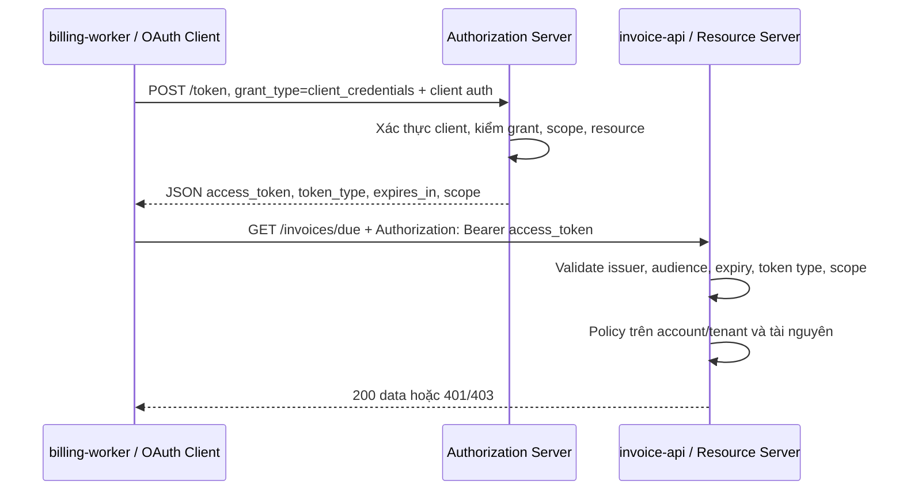

# Service identity without end user

Trong kiến trúc microservices, không phải mọi lời gọi API đều bắt đầu từ một người dùng đang đăng nhập. Một dịch vụ có thể cần lấy dữ liệu tồn kho định kỳ, thực thi tác vụ nền, đồng bộ báo cáo hoặc gọi một dịch vụ nội bộ khác **bằng danh tính của chính dịch vụ đó**. OAuth 2.0 **Client Credentials Grant** được thiết kế cho tình huống client truy cập tài nguyên **trong phạm vi quyền của chính client** hoặc theo một thỏa thuận ủy quyền có thể được biểu diễn bởi chính danh tính client — **không cần có end user ở thời điểm cấp token**.

Ví dụ: `billing-worker` gọi `invoice-api` để lấy các hóa đơn đến hạn. Authorization server (AS) xác thực `billing-worker` là **một client được đăng ký**, kiểm tra nó được phép sử dụng grant và scope nào, rồi cấp **access token** dành cho `invoice-api`. Resource server (RS) xác minh token và chính sách trước khi trả dữ liệu. Token không tuyên bố một nhân viên cụ thể đã đăng nhập chỉ vì request do một chương trình tự động tạo ra.

**Mô hình cần nhớ:**

```text
Không có end user tương tác

billing-worker --(client authentication)--> Authorization Server
                                               |
                          kiểm tra client, grant, scope, resource
                                               |
                                               v
                           access token cho invoice-api
                                               |
                                               v
billing-worker --(Bearer access token)--> invoice-api
                                               |
                                  kiểm tra token + API policy
                                               |
                                               v
                                     Cho phép hoặc từ chối
```

**Điểm cốt lõi:** một access token của `client_credentials` đại diện cho **service principal / workload identity theo mô hình của AS**, không tự đại diện cho user A hoặc user B. Khi API cần biết **người dùng cuối nào** đã cho phép thao tác, phải dùng cơ chế ủy quyền/delegation phù hợp; **không được tự gắn `sub=user-123` hoặc `user_id` tùy ý** vào token của dịch vụ để tạo ra quyền thay người dùng.

Bài thuộc chương **Client credentials** của module **SECURITY_TOKEN_SECURITY_FUNDAMENTALS**: tìm hiểu mô hình tin cậy và vòng đời token JWT/opaque, access/refresh token, xác thực, phân quyền và OAuth 2.0/OIDC; phát hành, kiểm tra claims, scope, audience, lưu trữ, thu hồi và phòng chống đánh cắp/phát lại token. Trọng tâm là **service identity không có end user**, các ranh giới tin cậy, cấp và sử dụng access token giữa máy với máy (*machine-to-machine*, M2M).

## 1. Mục tiêu học tập

Sau bài này, bạn có thể:

1. Giải thích khi nào dùng **Client Credentials Grant** và vì sao flow này **không yêu cầu user-agent redirect, authorization code hoặc người dùng đăng nhập**.
2. Phân biệt **OAuth client identity**, **service principal**, **workload identity**, **end-user identity** và **authorization grant**.
3. Mô tả cách client gửi **POST `application/x-www-form-urlencoded` UTF-8** tới token endpoint, xác thực bằng cơ chế được AS đăng ký và nhận access token.
4. Phân biệt `client_id`, client secret/private key/chứng chỉ, `sub`, `client_id` claims, scope, audience và quyền nghiệp vụ.
5. Giải thích vì sao access token `client_credentials` có thể là **JWT** hoặc **opaque**, và vì sao API phải xác minh đúng token type, issuer, audience, thời hạn và authorization policy.
6. Thiết kế quyền tối thiểu cho service-to-service, đặc biệt ở môi trường multi-tenant và thao tác nhạy cảm.
7. Sử dụng ví dụ Java/Spring Security OAuth2 Client và Resource Server để thực hiện/kiểm tra lời gọi dịch vụ đúng vai trò.
8. Phân biệt service token với **user-delegated token**, OAuth Token Exchange và trường hợp **on-behalf-of**.
9. Bảo vệ và xoay vòng client credentials, access token, log, token cache; xử lý lỗi AS/RS và tình huống lộ khóa.
10. Xây dựng ma trận kiểm thử chống nhầm danh tính, token substitution, sai audience, vượt scope và replay.

## 2. Bốn vai trò OAuth 2.0 trong trường hợp M2M

OAuth 2.0 định nghĩa bốn vai trò; không phải vai trò nào cũng xuất hiện như một **con người riêng biệt** trong Client Credentials Grant.

| Vai trò | Trong một flow có người dùng | Trong Client Credentials M2M |
| --- | --- | --- |
| **Resource owner** | Có thể là người dùng kiểm soát dữ liệu cá nhân | Có thể là tổ chức/hệ thống sở hữu tài nguyên; không cần user tương tác |
| **Client** | Web/mobile app thay mặt người dùng theo grant | **Dịch vụ hoặc job** xin access token bằng quyền của chính nó |
| **Authorization server (AS)** | Xử lý authentication/consent/grant rồi phát token | **Xác thực client** và kiểm tra policy của service principal trước khi phát token |
| **Resource server (RS)** | API nhận access token và kiểm tra quyền | API kiểm tra token M2M, quyền dịch vụ và policy tài nguyên |

**Không có bước hỏi người dùng cấp consent trong flow điển hình của Client Credentials.** Thay vào đó, một quản trị viên, quy trình provisioning hoặc policy tin cậy đã định nghĩa client nào được phép gọi API, scope/resource nào, giới hạn môi trường và điều kiện bảo mật. AS không được tự động cấp tất cả các scope chỉ vì client chứng minh được danh tính.

### 2.1. Không có browser redirect hoặc PKCE authorization code

Client Credentials Grant không dựa vào **authorization code** được gửi qua trình duyệt. Vì vậy flow này thông thường:

- **Không có `/authorize` qua user-agent**.
- **Không cần `redirect_uri`, `state`, `code_verifier` hay `code_challenge`**.
- **Không có bước đăng nhập end user/consent tương tác trong giao dịch token request**.
- **Không có `nonce` OIDC cho ID token chỉ để chứng minh người dùng đăng nhập**.

PKCE bảo vệ **Authorization Code Flow**, không phải một kỹ thuật thêm vào Client Credentials để thay client authentication. Cách an toàn của M2M là **xác thực client thích hợp, cấp quyền tối thiểu, kiểm tra audience/scope, giữ credential an toàn và có cơ chế thu hồi**.

### 2.2. Các tác vụ phù hợp

- Worker định kỳ `billing-worker` truy cập `invoice-api` với scope `invoices:read`.
- Dịch vụ `inventory-sync` cập nhật tồn kho trên `catalog-api` theo quyền dành cho workload.
- CI/CD bot được cấp quyền giới hạn để công bố artifact lên một API triển khai.
- Job đối soát chạy theo lịch và gọi API theo chính sách của tổ chức.
- Dịch vụ quan sát vận hành yêu cầu telemetry từ một API cho phép client của nó.

**Không phù hợp** khi một request thực chất phải được ủy quyền **theo danh tính/ngữ cảnh của người dùng cuối** nhưng developer muốn “bỏ qua login cho tiện”. Ví dụ đọc hồ sơ cá nhân hay tạo giao dịch tài chính theo user thường cần user-delegated authorization hoặc mô hình ủy quyền dịch vụ được định nghĩa rõ, không chỉ client credentials với quyền quá rộng.

## 3. Service identity: “ai đang gọi” và “thay mặt ai” là hai câu hỏi

Trong hệ thống phân tán, có thể tồn tại nhiều lớp danh tính:

1. **Workload/process identity:** instance, pod, job hoặc service account đang chạy code.
2. **OAuth client identity:** `client_id` và credential/khóa/chứng chỉ được đăng ký tại AS.
3. **Service principal:** chủ thể quyền mà AS/authorization policy gắn với OAuth client hoặc workload.
4. **End-user identity:** tài khoản người dùng thực, chỉ có khi flow/nguồn đáng tin đã xác thực và biểu diễn đúng.
5. **Actor/delegation context:** trong các hệ thống có ủy quyền, token có thể biểu diễn người dùng/actor theo một profile được kiểm tra đầy đủ.

**Những danh tính này không tự đồng nhất.** Một pod tên `payments-worker-17` không chứng minh nó là OAuth client `payments-worker` nếu không có khóa/ràng buộc đáng tin; `client_id` do request tự khai cũng không phải credential. Một dịch vụ đã xác thực **không có nghĩa** nó tự mang quyền của tất cả người dùng.

### 3.1. Ví dụ phân biệt identity và authorization

```text
Authenticated client:
  client_id = reports-service

Issued access token:
  audience = analytics-api
  scopes = reports:aggregate
  token subject = service principal (theo profile của AS)

Not asserted:
  end_user = "Alice"
  user_consent = true
  owner_of_any_customer_record = reports-service
```

API `analytics-api` có thể cho service tạo báo cáo tổng hợp theo policy. Nhưng API **không được suy ra** client `reports-service` sở hữu mọi dữ liệu cá nhân hoặc có quyền sửa hồ sơ bất kỳ.

### 3.2. Authentication khác authorization

- **Client authentication:** AS xác minh client thực sự có credential/khóa/chứng chỉ được chấp nhận.
- **Grant authorization:** AS quyết định client có được dùng `client_credentials` và xin scope/resource đó không.
- **Token validation:** RS xác minh access token do AS tin cậy phát cho **RS hiện tại**.
- **Resource authorization:** RS áp dụng policy trên thao tác/đối tượng cụ thể, ví dụ dịch vụ chỉ được đọc dữ liệu của một tổ chức.

Ngay cả khi ba bước đầu thành công, một giao dịch có thể bị **403 Forbidden** vì policy tài nguyên không cho phép.

## 4. Luồng Client Credentials đầy đủ



Luồng cơ bản:

1. **Provisioning:** tổ chức đăng ký một client/service principal tại AS, cấp quyền `client_credentials` và policy scope/audience/tenant phù hợp.
2. **Credential:** service nhận bí mật/khóa/chứng chỉ qua một kênh quản lý an toàn, không từ source code công khai.
3. **Request:** service gửi `POST` tới token endpoint qua TLS với `grant_type=client_credentials` và **client authentication**.
4. **AS xác minh:** client identity, trạng thái client, grant được phép, quyền yêu cầu scope/resource, rate limit, điều kiện mTLS/private_key_jwt nếu áp dụng.
5. **AS phát token:** access token JWT hoặc opaque, có audience/scope, issuer, expiry và metadata phù hợp profile.
6. **Service gọi RS:** truyền access token đúng API qua `Authorization: Bearer` hoặc cơ chế sender-constrained được profile quy định.
7. **RS quyết định:** chỉ xử lý API khi token hợp lệ **và** policy nghiệp vụ cho phép.
8. **Vòng đời:** service có thể tái sử dụng access token còn hợp lệ trong cache an toàn, xin token mới khi cần; khóa client và token phải có khả năng quản lý/thu hồi.

Không có authorization code hay refresh token bắt buộc trong flow này. Mỗi bước liên quan credential cần **TLS** và không được ghi raw token/secret vào log.

## 5. Token request: `POST` form-urlencoded

Theo **RFC 6749 `4.4**, Client Credentials Grant gửi yêu cầu token bằng **HTTP POST** với `grant_type=client_credentials` trong **`application/x-www-form-urlencoded` UTF-8**.

Ví dụ với client authentication dùng HTTP Basic:

```http
POST /oauth2/token HTTP/1.1
Host: id.example.test
Authorization: Basic <CLIENT_AUTH_PLACEHOLDER>
Content-Type: application/x-www-form-urlencoded
Accept: application/json

grant_type=client_credentials&scope=invoices%3Aread
```

`<CLIENT_AUTH_PLACEHOLDER>` là giá trị minh họa, **không phải credential thật**. Với confidential client dùng Basic, phần header chứa định danh và bí mật của client đã được encode theo quy tắc OAuth; Base64 **không phải mã hóa bảo mật**.

### 5.1. Các tham số quan trọng

| Vị trí | Trường | Ý nghĩa |
| --- | --- | --- |
| HTTP method | `POST` | Token exchange; không dùng GET để chứa client secret |
| Request header | `Content-Type: application/x-www-form-urlencoded` | Định dạng request body, không phải JSON |
| Body | `grant_type=client_credentials` | Chọn grant theo RFC 6749 |
| Body | `scope` (tùy chọn) | Scope client yêu cầu, **không tự cấp quyền** |
| Body | `resource` (nếu AS hỗ trợ RFC 8707) | Resource server dự kiến; AS phải xét policy |
| Client authentication | Basic, `private_key_jwt`, mTLS... | Chứng minh danh tính client theo registration |

Trong request client credentials đơn giản, **không gửi** `username`, `password` của người dùng, `authorization_code`, `code_verifier`, `redirect_uri` hay `refresh_token`. Những tham số đó thuộc các flow/mục đích khác.

### 5.2. Scope dùng đúng form encoding

Ví dụ yêu cầu hai scope:

```text
grant_type=client_credentials&scope=invoices%3Aread+invoices%3Aexport
```

Sau **form decode UTF-8 một lần**, `scope` là:

```text
invoices:read invoices:export
```

Các scope trong OAuth thường được phân tách bởi dấu cách. `+` trong form đại diện dấu cách; nếu giá trị thật chứa dấu `+`, phải encode thành `%2B`. Không ghép chuỗi body chứa secret bằng thủ thuật encoding tự viết; dùng SDK/form encoder chuẩn.

### 5.3. Resource Indicator theo RFC 8707

Nếu AS hỗ trợ tham số `resource`:

```text
grant_type=client_credentials
&scope=invoices%3Aread
&resource=https%3A%2F%2Fapi.example.test%2Finvoices
```

Các dòng chỉ được tách để đọc; form thực tế là **một chuỗi các cặp `name=value` nối bằng `&`**. Yêu cầu `resource` **không tự tạo** audience hoặc quyền. AS phải phê duyệt resource và phát token phù hợp; RS xác minh `aud`/resource binding ở token hoặc introspection.

### 5.4. JSON là định dạng token response, không phải request

Một response minh họa:

```http
HTTP/1.1 200 OK
Content-Type: application/json;charset=UTF-8
Cache-Control: no-store
Pragma: no-cache

{
  "access_token": "FAKE_ACCESS_TOKEN_NOT_USABLE",
  "token_type": "Bearer",
  "expires_in": 600,
  "scope": "invoices:read"
}
```

Đây là **placeholder**, không phải access token hợp lệ. `expires_in=600` là ví dụ, **không phải thời hạn bắt buộc**. Thời hạn thực tế do AS policy quyết định. Token có thể ở dạng JWT hoặc opaque; client **không nên dựa vào việc decode access token để tự xác định quyền** thay vì dùng token response/authorization contract.

### 5.5. Không mặc định phát refresh token

**RFC 6749 `4.4.3 nêu rằng refresh token SHOULD NOT được bao gồm trong response của Client Credentials Grant.** Điều đó phù hợp với việc service có thể **xác thực lại bằng client credential** khi cần access token mới, thay vì sử dụng refresh token đại diện một phiên người dùng.

Điều này là **SHOULD NOT**, không phải phát biểu rằng mọi extension/provider trên thế giới tuyệt đối không thể cấp refresh token cho client credentials. Khi AS có hành vi đặc biệt, cần kiểm tra profile và threat model; **không thiết kế client M2M mặc định dựa vào refresh token**.

## 6. Chỉ client phù hợp mới được sử dụng Client Credentials

Theo RFC 6749, **Client Credentials Grant được sử dụng bởi confidential clients**. Confidential client có khả năng bảo vệ credential hoặc dựa vào cơ chế client authentication tương đương theo profile.

### 6.1. Public client không thể giữ bí mật chia sẻ

Một SPA có source JavaScript gửi tới browser, hoặc một ứng dụng mobile bán công khai, không thể giữ một `client_secret` nhúng trong bundle như bí mật chỉ chủ ứng dụng biết.

**Anti-pattern:**

```javascript
// SAI: client secret lộ cho mọi người tải ứng dụng.
const clientId = "backend-service";
const clientSecret = "REPLACE_WITH_REAL_SECRET_IN_PRODUCTION";
fetch("https://id.example.test/oauth2/token", {
  method: "POST",
  body: "grant_type=client_credentials&client_secret=" + clientSecret
});
```

Mọi người có thể xem bundle, proxy network request hoặc giải mã ứng dụng để lấy secret. CORS không chứng minh ai đang gọi; Origin header cũng không phải client authentication.

**Cách đúng:** backend/BFF hoặc workload server giữ credential; browser/mobile cần quyền theo người dùng thì dùng Authorization Code + PKCE, và/hoặc backend có policy rõ ràng cho những tác vụ M2M được phép.

### 6.2. Không dùng tên service làm bằng chứng danh tính

Ví dụ:

```text
client_id=orders-service
```

`client_id` là **định danh** để chọn cấu hình AS. Một request tự khai `client_id` không đủ chứng minh người gửi thật sự là `orders-service`. Cần xác thực bằng credential/khóa/chứng chỉ đã đăng ký, hoặc cơ chế workload identity federation đã được AS tin cậy theo profile.

### 6.3. Service account trong cloud và OAuth client registration

Một workload có thể được cloud platform cấp **workload identity** hoặc chứng thư ngắn hạn. AS có thể thiết lập **federation** để chấp nhận assertion từ nền tảng tin cậy và ánh xạ nó sang service principal, giảm phụ thuộc client secret tĩnh.

Tuy nhiên **service account name, Kubernetes service account, SPIFFE ID, OAuth client ID và JWT `sub`** không phải các chuỗi mặc định luôn tương đương. Hệ thống phải xác định và xác minh **quan hệ ánh xạ danh tính được cấu hình**, không chỉ khớp tên bằng string.

## 7. Client authentication: so sánh các phương thức

AS xác thực **client** trước khi quyết định cấp access token. Các lựa chọn khác nhau về vận hành và rủi ro:

| Phương thức | Bằng chứng | Đặc điểm/rủi ro | Phù hợp khi |
| --- | --- | --- | --- |
| **`client_secret_basic`** | Client ID + secret qua HTTP Basic | Dễ tích hợp nhưng secret chia sẻ có thể bị sao chép; phải rotate và giữ kín | Backend kín, môi trường được kiểm soát |
| **`client_secret_post`** | Secret trong form body | Secret dễ lộ nếu log request body; không phải lựa chọn ưu tiên so với Basic theo RFC 6749 | Tương thích khi được AS hỗ trợ và đánh giá |
| **`private_key_jwt`** | JWT assertion ký bởi khóa riêng client | AS xác minh khóa công khai; cần quản lý `aud`, `exp`, `jti`, chống replay | Service kiểm soát khóa ký tốt |
| **mTLS client authentication** | Client certificate trong TLS | Có thể dùng PKI/certificate rotation; cần cấu hình trust store/termination đúng | Dịch vụ có hạ tầng chứng chỉ |
| **Workload identity federation** | Assertion từ một trusted workload identity provider | Ít secret dài hạn, nhưng trust config/audience/subject mapping cần chặt | Cloud/Kubernetes hoặc hạ tầng hỗ trợ |

**DPoP** theo RFC 9449 thường được dùng để chứng minh sở hữu khóa và **ràng buộc access token với sender**; nó **không nên được mặc định coi là thay thế client authentication** trong mọi phương thức hoặc profile.

### 7.1. Client secret trong HTTP Basic

Theo OAuth 2.0 `2.3.1, khi dùng HTTP Basic, client ID và client secret được **form-encode** trước khi ghép dưới dạng username/password để mã hóa Base64. Với secret có dấu `:`, `+` hoặc ký tự đặc biệt, hãy sử dụng **OAuth client library đã hỗ trợ đúng chuẩn** thay vì ghép Basic tùy tiện.

```http
Authorization: Basic <BASE64_ENCODED_CLIENT_CREDENTIALS>
```

Không log header này. Base64 chỉ là **encoding**; khi TLS bị giải mã và header xuất hiện trong log, secret có thể bị lấy lại ngay.

### 7.2. `private_key_jwt`

Ví dụ phần form được tách dòng:

```text
grant_type=client_credentials
&client_id=billing-worker
&client_assertion_type=urn%3Aietf%3Aparams%3Aoauth%3Aclient-assertion-type%3Ajwt-bearer
&client_assertion=SIGNED_ASSERTION_TEST_ONLY
```

AS phải xác minh assertion theo profile và client registration, gồm:

- Chữ ký bằng khóa được client đăng ký và thuật toán được cho phép.
- `iss`, `sub`/client identity theo profile.
- `aud` trỏ đúng AS/token endpoint theo policy.
- `exp`/`iat`/`nbf` khi áp dụng và giới hạn tuổi assertion.
- `jti` hoặc cơ chế chống replay phù hợp, không chấp nhận cùng một bằng chứng vô hạn.

**Không dùng client assertion thay access token** để gọi `invoice-api`. JWT assertion này phục vụ **client authentication ở AS**, không mặc nhiên là token dùng tại RS.

### 7.3. mTLS

Trong mô hình mTLS, client trình chứng chỉ theo TLS, AS xác minh chuỗi tin cậy/định danh và ánh xạ đúng OAuth client registration. **TLS-terminating proxy phải giữ nguyên ranh giới tin cậy**; không cho một client ngoài gửi header giả định danh chứng chỉ rồi được AS tin.

mTLS có thể phục vụ **client authentication** và/hoặc **certificate-bound access tokens** theo RFC 8705. Hai chức năng cần cấu hình và kiểm thử riêng: client đã xác thực bằng mTLS không tự có nghĩa mọi token đều bị ràng buộc với cùng chứng chỉ.

### 7.4. Không trộn các phương thức để “tăng xác thực”

Không nên gửi đồng thời `client_secret_basic`, `client_secret_post` và assertion khác trong cùng request nếu profile/AS không quy định cách kết hợp. OAuth 2.0 không cho phép client dùng nhiều phương thức client authentication trong một request theo cách mơ hồ. AS phải xác định **đúng một client** từ bằng chứng tin cậy và từ chối các kết hợp không hợp lệ.

## 8. AS quyết định cấp quyền cho service principal như thế nào?

**Client authentication thành công không đồng nghĩa authorization thành công.** AS phải kiểm tra:

1. Client registration tồn tại, đang `ACTIVE`, được phép dùng `client_credentials`.
2. Credential/khóa/chứng chỉ hợp lệ và phù hợp client đã khai.
3. Client thuộc đúng **tenant/environment** nếu policy yêu cầu; không dùng registration production để xin token của staging và ngược lại.
4. Scope được yêu cầu nằm trong **scope allowlist** của client.
5. Resource/audience được yêu cầu là mục tiêu mà client được phép tiếp cận.
6. Bất kỳ điều kiện tổ chức nào: workload attestation, network policy, time/risk policy, hạn chế token lifetime.
7. Nếu cấp token sender-constrained, binding được gắn đúng client/khóa.
8. Giới hạn tốc độ/token issuance audit được thực thi mà không log credential.

### 8.1. Ví dụ policy cấp quyền

```text
Client registration:
  client_id: billing-worker
  allowed_grants: [client_credentials]
  auth_method: private_key_jwt
  allowed_resources: [invoice-api]
  allowed_scopes: [invoices:read, invoices:mark-due]
  tenant_binding: tenant-acme
  max_access_token_lifetime: configured-short-ttl
```

Request:

```text
grant_type=client_credentials
scope=invoices:read invoices:delete
resource=payments-api
```

AS phải **từ chối** hoặc xử lý giảm phạm vi đúng theo chuẩn và chính sách, **không** cấp quyền `invoices:delete` hay audience `payments-api` chỉ vì client đã tự ghi chúng trong form.

### 8.2. Scope không phải “role” bất biến của client

`scope=invoices:read` trong token diễn tả một **phạm vi quyền đã được cấp cho token**, không tự chứng minh quyền với mọi invoice của mọi tenant. RS có thể cần thêm:

```text
allow =
    token_is_valid
    AND token_aud == invoice-api
    AND scope_contains(invoices:read)
    AND client_is_allowed_for_tenant
    AND resource_ownership_policy_allows
```

**Mô hình least privilege:** tạo **client registration riêng** cho các dịch vụ, môi trường và chức năng có mức rủi ro khác nhau. Không dùng một “super-client” có `admin:*` làm khóa chung cho mọi microservice.

## 9. Claims access token: service principal không tự biến thành end user

Một JWT access token M2M minh họa **payload đã được mô tả, không phải JWT ký thật**:

```json
{
  "iss": "https://id.example.test",
  "sub": "billing-worker",
  "aud": "invoice-api",
  "client_id": "billing-worker",
  "scope": "invoices:read",
  "iat": 1800000000,
  "exp": 1800000600,
  "jti": "example-token-identifier"
}
```

Giá trị trên chỉ là ví dụ học thuật, đặc biệt ngày tháng/expiry giả định. Một token thật phải được AS ký/định dạng theo profile và validate bởi RS. **Không tự cắt/dán payload JSON rồi gọi đó là access token**.

### 9.1. Ý nghĩa của các claims

| Claim/metadata | Ý nghĩa | Điều không được suy ra |
| --- | --- | --- |
| `iss` | AS phát hành token | Không chứng minh token dành cho mọi API của issuer |
| `sub` | Subject theo profile AS/token | Không mặc định là user end-user |
| `client_id` | OAuth client được liên kết với token nếu profile cung cấp | Không tự cho phép mọi thao tác của client |
| `aud` | Resource server dự kiến nhận token | Không được so khớp bằng substring/prefix |
| `scope` | Những scope đã cấp cho access token | Không tự cấp ownership của tài nguyên |
| `iat`/`nbf`/`exp` | Thời gian phát hành, chưa có hiệu lực, hết hạn theo claim áp dụng | Không nói token chưa bị thu hồi |
| `jti` | Token identifier khi có | Không tự là nonce chống replay nếu không có state/policy |
| `cnf` | Confirmation/sender binding theo profile khi áp dụng | Không được bỏ xác minh chứng minh khóa/chứng chỉ tương ứng |

**JWT access token profile RFC 9068** cung cấp những quy tắc cụ thể về `iss`, `sub`, `aud`, `exp`, `iat`, `jti`, `client_id` và token type. Trong trường hợp Client Credentials, **`sub` có thể đại diện subject của client/service** theo profile, thay vì con người. Việc `sub` có bằng `client_id` hay biểu diễn một identifier được AS định nghĩa phải được hiểu theo **profile đã thống nhất và tài liệu issuer**.

### 9.2. Đừng dùng `sub` để giả lập “user service”

Sai về mô hình:

```text
Client credentials token:
  sub: user-123
  client_id: billing-worker
  scope: orders:write

API giả định:
  sub == user-123 => có quyền sửa mọi đơn của user-123
```

Nếu token không xuất phát từ một grant **ủy quyền người dùng được xác minh**, `sub=user-123` là tuyên bố không có cơ sở hoặc có thể gây **identity confusion**. Không “chế” người dùng giả trong token M2M để vượt policy yêu cầu user consent.

Nếu hệ thống có một **system account** chuyên dụng làm chủ thể quyền, phải định nghĩa nó là **service/system principal** rõ ràng; không trộn với một người dùng cuối thật trong audit và authorization.

### 9.3. OIDC ID token không có vai trò mặc định

Client Credentials là **OAuth 2.0 grant**, không mặc định tạo một phiên **OpenID Connect login** của end user. Một token được cấp bằng client credentials thường là **access token** cho API, không phải ID token chứng minh người dùng đã đăng nhập.

Nếu resource server chấp nhận một OIDC **ID token** thay access token, đó là lỗi **token substitution/confusion**. RS phải kiểm tra token type, audience, issuer và các quy tắc profile phù hợp.

## 10. Access token JWT và opaque trong M2M

Client Credentials Grant không quy định access token phải là JWT. AS có thể phát:

| Đặc điểm | JWT access token | Opaque/reference access token |
| --- | --- | --- |
| Hình thức | Cấu trúc có claims, thường là JWS ký số | Chuỗi opaque không tự mang claims công khai |
| Xác minh ở RS | Kiểm chữ ký, issuer, audience, expiry, type, scope... | Thường gọi introspection hoặc tra store tin cậy |
| Revocation | Có thể cần denylist/session lookup hay TTL ngắn để chặn trước `exp` | AS có thể trả `active=false` qua introspection |
| Thông tin bị lộ nếu ghi log | Cả credential và claims đọc được nếu JWS | Vẫn là **credential** dù khó đọc claims |
| Caching | JWKS/token validation có cache; trạng thái revoke có thể trễ | Introspection metadata có cache; revoke có thể trễ |

**Không để loại token quyết định quyền theo cảm tính.** Với JWT, chữ ký hợp lệ không thay audience/scope. Với opaque, `active=true` từ introspection cũng không thay **kiểm tra resource binding và policy**.

### 10.1. JWT access token chỉ được dành cho đúng API

Ví dụ:

```text
access_token:
  iss = https://id.example.test
  aud = invoice-api
  scope = invoices:read
  client_id = billing-worker
```

`invoice-api` có thể tiếp tục kiểm tra quyền đọc. `payments-api` phải **từ chối** token này nếu audience không khớp, dù hai API cùng issuer và cùng chạy trong nội bộ.

Kiểm tra audience có thể là **chuỗi hoặc array** tùy định dạng/profile; phải so khớp **chính xác membership** theo bên nhận dự kiến. Không chấp nhận `aud.startsWith("invoice")` hoặc `aud.contains("api")`.

### 10.2. Opaque token không “an toàn để log”

Một opaque bearer token không lộ claims khi nhìn trực tiếp nhưng vẫn là **chìa khóa truy cập**. Ai có token có thể thử dùng tại RS cho đến khi token bị từ chối, hết hạn hoặc sender binding ngăn. Không log `Authorization: Bearer ...` ở gateway, app, APM, trace, metrics hay ticket hỗ trợ.

### 10.3. Sender-constrained token

mTLS certificate-bound token (RFC 8705) hoặc DPoP-bound token (RFC 9449) có thể hạn chế việc chỉ **sao chép chuỗi token** để gọi API nếu RS thực thi đúng bằng chứng sở hữu khóa.

Tuy nhiên:

- Một token có claim `cnf` không đủ; RS phải kiểm chứng **sender proof/certificate** thực tế.
- Khóa private/certificate có thể bị lộ, môi trường runtime có thể bị chiếm.
- Không phải mọi loại token và client đều hỗ trợ sender constraint.
- Sender constraint không cho phép nâng scope, bỏ audience hoặc impersonate user.

## 11. Resource server: xác minh service token và policy

Khi RS nhận:

```http
GET /v1/invoices/due HTTP/1.1
Host: api.example.test
Authorization: Bearer <ACCESS_TOKEN_M2M_TEST_ONLY>
```

Các lớp kiểm tra điển hình:

1. **Vận chuyển:** TLS, Bearer header/DPoP/mTLS theo profile; không nhận token từ query nếu không được phép.
2. **Nguồn token:** chữ ký/JWKS và thuật toán được phép đối với JWT, hoặc introspection đáng tin với opaque token.
3. **Issuer:** `iss` là AS được RS tin cậy **cho API và môi trường này**.
4. **Token type/profile:** RS chỉ nhận loại access token thích hợp; không nhận ID token, refresh token hay client assertion.
5. **Lifetime:** `exp`, `nbf`, clock skew được kiểm soát; không chấp nhận vô hạn.
6. **Audience:** `aud` chứa **đúng resource server** hiện tại.
7. **Scope/quyền:** token có scope cần thiết, ví dụ `invoices:read`.
8. **Service principal policy:** client/service nào được phép gọi endpoint.
9. **Resource/tenant authorization:** có được đọc hóa đơn của tenant đó, trạng thái dữ liệu và chính sách hiện hành không.
10. **Revocation và sender constraint** nếu hợp đồng bảo mật yêu cầu.

**Điểm phân quyền quan trọng:** nếu service đã có token `invoices:read` nhưng muốn lấy hóa đơn của tenant khác, RS **vẫn phải từ chối**, trừ khi đã có một quyền cross-tenant rõ ràng và được đánh giá an ninh.

### 11.1. 401 và 403

| Phản hồi RS | Trường hợp |
| --- | --- |
| **401 Unauthorized** | Thiếu token, token hết hạn/sai chữ ký/sai issuer/sai audience/sai token type hoặc xác thực token thất bại |
| **403 Forbidden** | Token hợp lệ nhưng thiếu scope hoặc policy dịch vụ/tài nguyên từ chối |

Ở OAuth Bearer usage (RFC 6750), `invalid_token` và `insufficient_scope` có ngữ nghĩa khác nhau. Mã HTTP và header `WWW-Authenticate` cần theo profile/implementation; không đánh đồng lỗi xác minh token với lỗi phân quyền nghiệp vụ.

### 11.2. Không dùng IP hoặc network location thay identity

`billing-worker` chạy trong private subnet chưa chứng minh request là client đã được AS xác thực. IP allowlist, service mesh mTLS và network policy là **defense in depth**, không tự thay OAuth access token/scope/audience checks nếu API contract yêu cầu chúng.

## 12. Service identity khác delegated user identity

Đây là phân biệt quan trọng nhất của bài.

| Câu hỏi | Client Credentials | User-delegated Authorization Code |
| --- | --- | --- |
| Có end user tham gia grant? | **Không cần** | Có, theo luồng xác thực/ủy quyền |
| Authorization endpoint/browser redirect? | Không | Có |
| Client authentication? | Bắt buộc theo confidential client/profile | Tùy loại client; confidential client cần |
| PKCE `code_verifier`? | Không phải flow của PKCE | Có vai trò bảo vệ code exchange |
| Token đại diện cho ai? | **Client/service principal** theo profile | Grant/quyền liên quan user/client/resource |
| Quyền từ đâu? | Policy/registration/workload authorization | Người dùng + AS/client/resource policy |
| OIDC ID token người dùng? | Không mặc định | Có thể được cấp trong OIDC |
| Scope/audience? | AS cấp theo quyền của service | AS cấp theo grant đã phê duyệt |
| Thao tác “thay mặt Alice” | **Không tự động hợp lệ** | Có ngữ cảnh user khi được cấp/kiểm chứng đúng |

### 12.1. Ví dụ nên dùng Client Credentials

```text
inventory-sync -> GET /stock/snapshots

Business rule:
  “Mọi ngày 02:00, service inventory-sync đọc số liệu tồn kho
   của một tenant do tổ chức quản trị đã cấp quyền.”

Authorization:
  service identity, allowed audience, read-only scope,
  tenant binding, audit as inventory-sync
```

Ở đây không cần một người dùng đăng nhập vào lúc 02:00. Dùng client credentials là tự nhiên.

### 12.2. Ví dụ không được “đóng giả” end user

```text
orders-service -> POST /users/{userId}/transfer-funds

Business rule:
  “Chuyển tiền theo yêu cầu hiện tại của một người dùng đã xác thực.”
```

Nếu `orders-service` chỉ có client credentials và chọn `userId` từ HTTP body, API không nên coi đó là consent/ủy quyền của người dùng. Cần **delegated user token**, cơ chế on-behalf-of/token exchange hoặc một workflow nghiệp vụ được phân quyền riêng (ví dụ hệ thống thanh toán có authority rõ và approval/audit), tùy threat model.

### 12.3. OAuth Token Exchange/on-behalf-of

**RFC 8693 Token Exchange** cho phép những mẫu trao đổi token có `subject_token`, `actor_token`, audience/resource và token type theo AS policy, trong đó có thể biểu diễn bối cảnh *on-behalf-of* hoặc *delegation*. Nhưng:

- Client Credentials Token **không tự biến thành user-delegated token** chỉ vì `scope` là `users:write`.
- AS phải xác minh subject token/actor token và **chấp thuận delegation** theo chính sách.
- RS phải biết cách đọc đúng **subject/actor semantics** của token profile; không tin client tự thêm `act` hoặc `user_id`.
- Token Exchange không phải “đổi một token bất kỳ lấy mọi audience”.

Nếu không có yêu cầu user-delegated, đừng triển khai token exchange chỉ để làm M2M đơn giản phức tạp hơn; Client Credentials với quyền tối thiểu thường đủ.

## 13. Java/Spring Security OAuth2 Client: cấu hình M2M

Spring Security hỗ trợ **OAuth2 Client** thực hiện Client Credentials Grant. Nên tận dụng thư viện để xử lý form encoding, client authentication, token caching và các lỗi OAuth thay vì tự viết toàn bộ giao thức.

### 13.1. Client registration

Ví dụ `application.yml` minh họa cho dịch vụ `billing-worker`:

```yaml
spring:
  security:
    oauth2:
      client:
        registration:
          billing-to-invoices:
            provider: internal-auth-server
            client-id: billing-worker
            client-secret: REPLACE_WITH_VALUE_FROM_SECRET_MANAGER
            client-authentication-method: client_secret_basic
            authorization-grant-type: client_credentials
            scope:
              - invoices:read
        provider:
          internal-auth-server:
            token-uri: https://id.example.test/oauth2/token
```

**Đây là cấu hình học thuật, không phải secret thật hay bản cấu hình production.** Khi triển khai, giá trị client secret phải được lấy từ secret manager/configuration phù hợp, không hardcode trong YAML, repository, image hoặc log. Nếu dùng environment variable để truyền secret, vẫn cần bảo vệ process environment, CI/CD, diagnostic dumps và quyền đọc.

`token-uri` phải đến từ **cấu hình AS tin cậy**, không từ input request. Nếu dùng `issuer-uri`/discovery, cần kiểm chứng metadata đúng issuer và policy.

### 13.2. Authorization manager dành cho service principal

Với ứng dụng Spring servlet/backend dùng `OAuth2AuthorizedClientService`, có thể cấu hình `AuthorizedClientServiceOAuth2AuthorizedClientManager` để cấp và lưu authorized client cho **client credentials**:

```java
import org.springframework.context.annotation.Bean;
import org.springframework.context.annotation.Configuration;
import org.springframework.security.oauth2.client.AuthorizedClientServiceOAuth2AuthorizedClientManager;
import org.springframework.security.oauth2.client.OAuth2AuthorizedClientManager;
import org.springframework.security.oauth2.client.OAuth2AuthorizedClientProvider;
import org.springframework.security.oauth2.client.OAuth2AuthorizedClientProviderBuilder;
import org.springframework.security.oauth2.client.OAuth2AuthorizedClientService;
import org.springframework.security.oauth2.client.registration.ClientRegistrationRepository;

@Configuration
public class MachineOAuth2ClientConfig {

    @Bean
    OAuth2AuthorizedClientManager machineAuthorizedClientManager(
        ClientRegistrationRepository registrations,
        OAuth2AuthorizedClientService clients
    ) {
        AuthorizedClientServiceOAuth2AuthorizedClientManager manager =
            new AuthorizedClientServiceOAuth2AuthorizedClientManager(
                registrations, clients);

        OAuth2AuthorizedClientProvider provider =
            OAuth2AuthorizedClientProviderBuilder.builder()
                .clientCredentials()
                .build();

        manager.setAuthorizedClientProvider(provider);
        return manager;
    }
}
```

Ví dụ sử dụng manager trong một lớp gọi downstream:

```java
import org.springframework.security.oauth2.client.OAuth2AuthorizeRequest;
import org.springframework.security.oauth2.client.OAuth2AuthorizedClient;
import org.springframework.security.oauth2.client.OAuth2AuthorizedClientManager;
import org.springframework.web.client.RestClient;

public final class InvoiceApiClient {
    private final OAuth2AuthorizedClientManager tokens;
    private final RestClient invoices;

    public InvoiceApiClient(OAuth2AuthorizedClientManager tokens) {
        this.tokens = tokens;
        this.invoices = RestClient.builder()
            .baseUrl("https://api.example.test")
            .build();
    }

    public String readDueInvoices() {
        OAuth2AuthorizeRequest request = OAuth2AuthorizeRequest
            .withClientRegistrationId("billing-to-invoices")
            .principal("billing-worker")
            .build();

        OAuth2AuthorizedClient authorized = tokens.authorize(request);
        if (authorized == null || authorized.getAccessToken() == null) {
            throw new IllegalStateException("M2M token unavailable");
        }

        String accessToken = authorized.getAccessToken().getTokenValue();

        // Không log accessToken, request hoặc authorized client object.
        return invoices.get()
            .uri("/v1/invoices/due")
            .headers(h -> h.setBearerAuth(accessToken))
            .retrieve()
            .body(String.class);
    }
}
```

**Điểm cần hiểu:**

- `.principal("billing-worker")` trong **OAuth2AuthorizeRequest** là **khóa principal ổn định cho việc quản lý authorized client/cache trong ngữ cảnh Spring**; không phải tuyên bố có end user tên `billing-worker`.
- Nếu service cũng xử lý HTTP user request, **không vô tình dùng principal của user đang đăng nhập để quản lý M2M client token** rồi làm cache/access control phụ thuộc user trái mô hình.
- Với nhiều instance, policy lưu authorized client/cache cần xem xét race/TTL và bảo vệ token.
- `RestClient` minh họa từ các phiên bản Spring hỗ trợ API này; cần dependencies/auto-configuration phù hợp, timeout, retry và xử lý HTTP error. Các class trên **không phải ứng dụng chạy độc lập**.
- Ví dụ dùng Bearer token. Nếu AS cấp **sender-constrained token**, HTTP client còn phải cung cấp mTLS/DPoP proof phù hợp; chỉ set Bearer header chưa đủ.

### 13.3. Quản lý cache và đồng thời

Một service có thể xử lý hàng trăm request và không nên **xin token mới cho mỗi lần gọi API**. Authorized client manager có thể giúp tái sử dụng access token chưa hết hạn; tuy nhiên:

- Cần **refresh sớm với clock-skew hợp lý** thay vì dùng token sát `exp`.
- Token mới của Client Credentials thường được xin bằng client authentication, **không phụ thuộc refresh token**.
- Nếu nhiều node/threads cùng thấy token hết hạn, nên giảm **thundering herd** tại AS bằng cache/locking/rate policy.
- Không cache token vô hạn, không dùng token dành audience A cho API B.
- Sau khi client bị disable hoặc credential bị thu hồi, cache không được tự mở quyền; RS vẫn phải thực thi token revocation/lifetime.

## 14. Java/Spring Resource Server: bảo vệ API trước service token

Một `invoice-api` cần đóng vai **resource server**, không chỉ là HTTP endpoint tin vào tên service ở header.

### 14.1. Cấu hình resource server cho JWT

```yaml
spring:
  security:
    oauth2:
      resourceserver:
        jwt:
          issuer-uri: https://id.example.test
```

`issuer-uri` giúp Spring cấu hình kiểm tra issuer/JWKS theo provider, nhưng **chưa đủ để bảo đảm audience của API đúng trong mọi cấu hình**. RS phải cấu hình audience validator/token type và policy thích hợp theo profile.

### 14.2. `SecurityFilterChain` với scope

```java
import org.springframework.context.annotation.Bean;
import org.springframework.context.annotation.Configuration;
import org.springframework.http.HttpMethod;
import org.springframework.security.config.Customizer;
import org.springframework.security.config.annotation.web.builders.HttpSecurity;
import org.springframework.security.web.SecurityFilterChain;

@Configuration
public class InvoiceApiSecurity {

    @Bean
    SecurityFilterChain security(HttpSecurity http) throws Exception {
        http.authorizeHttpRequests(auth -> auth
                .requestMatchers(HttpMethod.GET, "/v1/invoices/**")
                    .hasAuthority("SCOPE_invoices:read")
                .requestMatchers(HttpMethod.POST, "/v1/invoices/**")
                    .hasAuthority("SCOPE_invoices:write")
                .anyRequest().denyAll()
            )
            .oauth2ResourceServer(oauth -> oauth.jwt(
                Customizer.withDefaults()
            ));

        return http.build();
    }
}
```

Spring Security thường ánh xạ scope từ JWT thành authority tiền tố `SCOPE_`. Nhưng đây **chỉ là một phần kiểm tra**. Cấu hình thực còn phải:

- Bắt buộc `aud=invoice-api` bằng validator đúng issuer/profile.
- Chỉ chấp nhận access token type/token use hợp lệ; từ chối OIDC ID token hoặc refresh token.
- Giới hạn service principal/client được phép, nếu endpoint không dành cho mọi client có `invoices:read`.
- Áp dụng kiểm tra tenant, invoice ownership, trạng thái nghiệp vụ tại service/method policy.
- Đánh giá CSRF tùy API/cookie/session model; không tự ý xóa bảo vệ của một hệ thống khác chỉ vì endpoint dùng JWT.

### 14.3. Validator audience minh họa

```java
import org.springframework.security.oauth2.core.OAuth2Error;
import org.springframework.security.oauth2.core.OAuth2TokenValidator;
import org.springframework.security.oauth2.core.OAuth2TokenValidatorResult;
import org.springframework.security.oauth2.jwt.Jwt;

public final class InvoiceAudienceValidator
    implements OAuth2TokenValidator<Jwt> {

    @Override
    public OAuth2TokenValidatorResult validate(Jwt jwt) {
        boolean accepted = jwt.getAudience().contains("invoice-api");
        if (accepted) {
            return OAuth2TokenValidatorResult.success();
        }
        return OAuth2TokenValidatorResult.failure(
            new OAuth2Error("invalid_token", "Invalid audience", null)
        );
    }
}
```

Validator này **phải được đăng ký vào JwtDecoder cùng các validator mặc định** (issuer/expiry/...); không thay toàn bộ validator chain bằng một audience check. Khi service token chứa `aud` là mảng hay chuỗi, thư viện JWT xử lý danh sách; RS phải so khớp **chính xác** audience dự kiến.

### 14.4. Không tự cho rằng `sub` là một user

Một anti-pattern:

```java
// SAI trong API có cả user-delegated và M2M access token.
String userId = jwt.getSubject();
userAccountService.transferFundsAsUser(userId, transfer);
```

Nếu token M2M có `sub=billing-worker`, đoạn code đang biến service principal thành user. API cần phân biệt **loại principal được phép** cho mỗi endpoint; nếu có nhiều token profiles, dùng validator/authorization policy rõ ràng để định nghĩa subject semantics.

### 14.5. Opaque introspection

Với opaque token, Spring Security có thể dùng resource server **opaque token introspection** thay vì JWT decoder. Cần cấu hình introspection endpoint và credential của RS qua secret manager, xác thực kết quả từ AS, rồi **vẫn kiểm tra audience, scope và service/tenant policy**. `active=true` đơn thuần chưa đủ cho endpoint nhạy cảm.

## 15. Least privilege giữa các microservices

Các service thường được triển khai cùng mạng và dùng chung cơ chế observability, nhưng **không nên chia sẻ một client credential toàn cục**.

### 15.1. Tách client theo chức năng

| Service | Audience | Scope | Giới hạn thêm |
| --- | --- | --- | --- |
| `billing-worker` | `invoice-api` | `invoices:read` | Chỉ tenant đã đăng ký, đọc dữ liệu đến hạn |
| `payment-settler` | `payments-api` | `payments:settle` | Approval/policy rủi ro riêng |
| `inventory-sync` | `catalog-api` | `inventory:update` | Chỉ SKU thuộc nguồn được cấp |

Nếu cả ba sử dụng một client credential có `admin:*`, việc lộ secret của `inventory-sync` có thể cho attacker thực hiện nghiệp vụ thanh toán. Tách danh tính làm giảm **blast radius**.

### 15.2. Một service gọi nhiều API

Nếu một service cần `invoice-api` và `catalog-api`, có thể:

- Đăng ký một client có các audience/resource được kiểm soát, **xin token riêng đúng audience cho từng API** khi AS hỗ trợ resource indicator; hoặc
- Dùng **client registration/credential riêng** theo trust boundary và chính sách vận hành.

Không gửi token có `aud=invoice-api` sang `catalog-api` rồi sửa RS để “tạm bỏ audience check”. Đó là lỗi cross-service token reuse.

### 15.3. Multi-tenant

Một token service có scope `invoices:read` chưa đủ để chứng minh dịch vụ có quyền trên **tenant nào**. Ranh giới phải được quy định:

```text
token.client_id = billing-worker
token.aud = invoice-api
token.scope includes invoices:read
request.tenant_id = tenant-B

Policy:
  billing-worker is allowed only tenant-A
  => DENY tenant-B (403)
```

AS có thể gắn tenant context vào token hoặc quản lý grant theo tenant; RS vẫn phải kiểm tra ánh xạ tenant/token/resource từ nguồn tin cậy. Không tin `X-Tenant-Id` do client tự đặt mà không ràng buộc với identity.

### 15.4. Audit “ai thực hiện”

Với M2M, event audit nên mô tả:

```json
{
  "event": "invoice_batch_read",
  "actor_type": "SERVICE",
  "client_id": "billing-worker",
  "tenant_ref": "safe-tenant-reference",
  "resource_type": "invoice_batch",
  "result": "ALLOWED",
  "request_id": "example-request-74"
}
```

Đây là metadata giả định. Không thêm `end_user_id` nếu **không có end user được xác minh**; nếu sau này có delegated token, audit phải phân biệt **actor** và **subject/user** theo profile.

## 16. Credentials, token storage và vòng đời

Client Credentials Grant không có refresh token mặc định; service thường cần **khả năng xác thực lại** để xin access token. Vì vậy bảo vệ **client credential gốc** đặc biệt quan trọng.

### 16.1. Cấp, lưu và rotate client secret

Quy trình tốt:

1. Provision một client/service principal riêng, cấp scope/audience tối thiểu.
2. Tạo secret/khóa/chứng chỉ đủ mạnh trong secret manager, KMS/HSM hoặc hạ tầng PKI phù hợp.
3. Chỉ runtime cần thiết mới có quyền đọc; tránh ghi secret trong repository, Docker image, startup args, CI log hoặc ticket.
4. Có cơ chế **rotation không downtime** khi nền tảng cho phép chấp nhận hai khóa trong cửa sổ chuyển đổi được quản lý.
5. Sau khi deploy secret/khóa mới, kiểm thử token issuance rồi thu hồi secret cũ.
6. Audit thay đổi registration, quyền đọc secret, lần thất bại client authentication và hoạt động bất thường.

**Không truyền client secret từ bên ngoài vào API “để service xin token hộ”** nếu không có lý do đặc biệt; điều đó biến dịch vụ thành credential forwarding endpoint nguy hiểm.

### 16.2. Access token cache

Access token M2M có thể được giữ trong **memory/cache được bảo vệ** đến gần hết hạn:

- Dùng cache key phân biệt **client registration, issuer, audience/resource, scope và security context** phù hợp.
- Không chia sẻ token giữa service khác vì cùng issuer.
- Dùng thời hạn hiệu lực **ngắn hơn `exp`** một khoảng clock skew để tránh race.
- Không ghi access token vào distributed cache mà không phân quyền/mã hóa/retention.
- Sau khi đổi credential, cân nhắc những access token cũ còn hiệu lực và chính sách chặn sớm.

### 16.3. TTL và thu hồi

Access token TTL ngắn giúp giới hạn cửa sổ lạm dụng khi bị lộ; tuy nhiên **không làm attacker mất khả năng xin token mới nếu client credential vẫn còn giá trị**. Khi client secret/private key bị lộ, cần **vô hiệu hóa hoặc xoay credential nguồn** và đánh giá những access token đã phát.

Với JWT self-contained, RS chỉ kiểm chữ ký và `exp` có thể tiếp tục chấp nhận access token cũ tới hạn nếu không có cơ chế denylist/session version. Với opaque token, introspection có thể phản ánh revoke nhưng cache introspection gây độ trễ. Thiết kế “khẩn cấp ngừng quyền” phải xác định **revocation propagation** cụ thể.

### 16.4. Không giải quyết mọi vấn đề bằng token quá dài hạn

Một access token service sống 30 ngày giúp giảm request tới AS, nhưng **tăng cửa sổ sử dụng khi bị lộ**. Thay vào đó, triển khai cache/manager tốt và credential authentication đáng tin để xin token ngắn hạn khi cần.

## 17. Rủi ro token theft, replay và sender-constraining

### 17.1. Bearer token là credential sao chép được

Nếu RS chấp nhận `Authorization: Bearer <token>`, một bên sở hữu token còn hiệu lực có thể thử gọi API trong phạm vi token. **JWT có chữ ký không ngăn được sao chép JWT nguyên văn.** Opaque token cũng không khác về bản chất bearer.

Do đó:

- Không log `Authorization` hoặc body token endpoint.
- Không gửi token qua URL query, URL fragment, job payload không kiểm soát, analytics hoặc support ticket.
- Dùng TLS, audience/scope hẹp và lifetime phù hợp.
- Đánh giá sender-constrained access token khi threat model cần chống replay chỉ từ token copy.

### 17.2. mTLS-bound access tokens

Nếu token được ràng buộc với chứng chỉ client, RS phải kiểm tra rằng client đang kết nối **thực sự sở hữu chứng chỉ đúng**; chỉ đọc claim `cnf` mà không đối chiếu TLS peer là không đủ.

### 17.3. DPoP-bound access tokens

DPoP yêu cầu proof ký số gắn với request/URL/method, khóa và các trường chống replay theo RFC 9449. Triển khai phải xác minh `htu`, `htm`, `iat`, `jti`, access token hash và nonce khi profile yêu cầu, cùng kiểm soát replay cache.

**Không nhầm DPoP proof với access token** và không giả định DPoP bằng `client_secret_basic`. Không log raw proof/khóa private.

### 17.4. Service mesh không tự cấp OAuth scope

Service mesh mTLS có thể bảo vệ **workload-to-workload connection** và xác minh workload identity ở tầng hạ tầng. Nó không tự quyết định quyền OAuth `invoices:read` hay quyền trên invoice #123. Kiến trúc có thể **kết hợp** workload mTLS với OAuth access token/ABAC; phải định nghĩa lớp nào là nguồn policy cho từng quyết định.

## 18. Không để service token biến thành “super-user”

### 18.1. Một secret dùng cho mọi dịch vụ

```text
client_id = internal-superuser
client_secret = shared-by-20-microservices
scope = *
audience = every-api
```

Vấn đề: không phân biệt được ai gọi, rotation khó, credential bị lộ ở một service ảnh hưởng cả hệ thống. Thay bằng **service-specific registrations**, audience/scope tối thiểu và audit theo client.

### 18.2. RS bỏ scope vì request “đến từ mạng nội bộ”

```text
if caller_ip_is_private:
    allow_admin_operation()
```

Đây là sự nhầm lẫn network location với quyền nghiệp vụ. Cần identity, audience, scope và policy; network isolation chỉ thêm một lớp bảo vệ.

### 18.3. Chuyển client ID thành user ID

```text
sub=billing-worker
API maps sub to UserAccount with role ADMIN
```

Service principal phải được xử lý bằng **namespace/kiểu principal riêng** hoặc policy phân biệt rõ. Không cho service token gọi endpoint **đòi người dùng** chỉ vì tên trùng trong database.

### 18.4. Cấp token cho mọi resource

AS phát `aud=["invoice-api","payments-api","user-api"]` cho mọi Client Credentials request. Điều này mở rộng blast radius. Khi có thể, phát **token riêng cho resource cụ thể** hoặc audience list thật sự được policy cấp, và RS tiếp tục kiểm tra audience theo mình.

### 18.5. Client tự đặt `tenant_id` hoặc `user_id`

```text
POST /token
grant_type=client_credentials
user_id=user-999
tenant_id=tenant-other
```

Những trường tùy biến không trở thành nguồn tin cậy chỉ vì nằm trong token request. Nếu AS hỗ trợ context parameters, mọi giá trị phải được **xác thực/ràng buộc với registration/policy**. RS cũng không chấp nhận header tenant do client tự khai mà không kiểm tra token.

## 19. Lỗi AS và RS: phân biệt nguyên nhân

### 19.1. Token endpoint

| Kết quả | Nguyên nhân ví dụ | Cách xử lý |
| --- | --- | --- |
| `invalid_client` | Secret sai, assertion/chứng chỉ không hợp lệ, client không được xác thực | Sửa/rotate credential; không bypass auth |
| `unauthorized_client` | Client không được dùng `client_credentials` | Sửa registration/policy có phê duyệt |
| `unsupported_grant_type` | AS không hỗ trợ grant | Chọn flow theo hợp đồng, không tự hạ bảo mật |
| `invalid_scope` | Scope không hợp lệ hoặc không được cấp | Chọn scope phù hợp policy |
| `invalid_request` | Form sai cấu trúc/thiếu/trùng field | Sửa POST form-urlencoded UTF-8 |
| 5xx/timeout | AS/token store/PKI/network lỗi | Retry có giới hạn, không tự mint token |

Với client authentication qua Basic, token endpoint có thể dùng **HTTP 401** và `WWW-Authenticate` theo OAuth; các lỗi grant khác thường **HTTP 400**. Không coi mọi lỗi token endpoint là “user phải đăng nhập lại”.

### 19.2. Resource server

| Kết quả | Ví dụ |
| --- | --- |
| **401 `invalid_token`** | Thiếu access token, sai issuer/audience, hết hạn, chữ ký sai |
| **403 `insufficient_scope`** | Token M2M hợp lệ nhưng thiếu `invoices:write` |
| **403 policy denied** | Có `invoices:read` nhưng tenant không được phép |
| **5xx** | RS có lỗi backend không phải vấn đề token; phân loại riêng |

### 19.3. Không retry vô hạn

Nếu `client_secret` sai, retry liên tục `POST /token` sẽ không biến secret thành đúng; còn gây lockout/rate limits. Nếu RS trả 403 do thiếu scope/tenant policy, **xin token mới cùng quyền** thường không giải quyết được. Hãy phân biệt **misconfiguration**, **credential rotation**, **token expiry** và **authorization deny**.

### 19.4. Fail closed

Nếu AS không xác minh được client hoặc grant state, **không cấp access token**. Nếu RS không xác minh được JWT/opaque token hay quyền bắt buộc, **không tự cho phép** vì request đến từ nội bộ. Cần hợp đồng xử lý sự cố/rate limiting thay vì biến lỗi identity thành bypass.

## 20. Logging, telemetry và audit không lộ credential

Client Credentials Grant tạo các credential nhạy cảm ở **token request** và **token response**:

- Client secret/private key/client assertion/chứng chỉ.
- Access token JWT/opaque và các response token fields.
- HTTP `Authorization: Basic` ở token endpoint.
- HTTP `Authorization: Bearer` ở RS.
- DPoP proof, sender-binding data nếu có.

**Không log nguyên những giá trị trên** ở app, proxy/ingress, APM, traces, metric labels, crash reports hoặc ticket.

Sự kiện minh họa:

```json
{
  "event": "oauth_client_credentials_issued",
  "client_id": "billing-worker",
  "grant_type": "client_credentials",
  "resource": "invoice-api",
  "result": "ISSUED",
  "duration_ms": 34,
  "request_id": "test-request-247"
}
```

Đây là metadata giả định. Ngay cả `client_id`, `resource` và tenant references cũng cần quyền đọc và retention phù hợp. Không in nguyên JSON token response để debug.

### 20.1. Đừng dùng raw token làm correlation ID

Ghi một phần JWT/opaque token làm log key vẫn là dữ liệu bắt nguồn từ credential và có thể gây nguy cơ truy dấu. Ưu tiên **request ID**, trace ID do hệ thống kiểm soát và audit event ID không dùng được để đăng nhập. Nếu thật sự cần correlation token, phải có thiết kế nội bộ được đánh giá riêng.

### 20.2. Audit phân biệt service và user

Với M2M:

```text
actor_type = SERVICE
actor_ref = billing-worker
delegated_user = NONE
```

Với user-delegated request, có thể có **actor service** và **subject user** theo profile. Không giả tạo trường `user_id` hoặc gán một nhân viên vận hành làm chủ thể của mọi batch job để làm log “đẹp”.

## 21. Sự cố lộ client credential hoặc access token M2M

### 21.1. Access token bị lộ

Nếu một bearer access token của `billing-worker` xuất hiện trong log:

1. Ngăn nguồn ghi token, cô lập log sink và bản sao.
2. Xác định token còn hạn, audience/scope/tenant nào có thể bị truy cập.
3. Kiểm tra khả năng RS chặn sớm qua denylist/introspection/session state; nếu không, xác định cửa sổ `exp` còn lại.
4. Điều tra API calls bất thường với request ID và audit, không copy raw token.
5. Sửa logging/telemetry, test sentinel để ngăn tái diễn.

Việc thu hồi riêng **client secret** không nhất thiết làm mọi access JWT đã cấp hết hạn ngay nếu RS vẫn chỉ kiểm tra chữ ký và `exp`.

### 21.2. Client secret hoặc private key bị lộ

Đây có thể là sự cố nghiêm trọng hơn lộ một access token ngắn hạn vì attacker có thể **xin access token mới**:

1. Vô hiệu hóa/rotate client credential bị ảnh hưởng; nếu khóa lộ, ngừng tin khóa đó theo PKI/JWKS/trust policy.
2. Cân nhắc **suspend OAuth client registration** khi cần ngăn cấp mới khẩn cấp.
3. Xác định access token đã phát từ credential/client bị nghi xâm nhập và chính sách chặn/thu hồi tại RS.
4. Kiểm tra scope/audience, tenant, API writes và hành vi tài khoản dịch vụ.
5. Xử lý secret ở CI/CD, container, repo, secret store, log, crash report, backup.
6. Cấp credential mới qua kênh an toàn, xác minh identity/policy rồi mở lại khi đủ điều kiện.
7. Audit quyền đọc secret và client authentication, bổ sung kiểm thử rotation.

### 21.3. Không chỉ “đợi token hết hạn”

Với access token bị lộ, TTL ngắn giới hạn thời gian lạm dụng. Nhưng với **client credential** bị lộ, attacker có thể lặp token request nếu client vẫn active và credential vẫn được AS tin. **Thu hồi credential gốc và đánh giá token đã phát** là hai phần riêng biệt.

## 22. Ma trận kiểm thử Client Credentials

| Ca kiểm thử | Input/bối cảnh | Kết quả cần chứng minh |
| --- | --- | --- |
| Client hợp lệ | Client auth đúng, grant được phép | AS cấp access token cho scope/audience được duyệt |
| Không có user session | Service request không có browser user | M2M hoạt động theo policy, không xuất hiện user identity giả |
| Client ID giả | Chỉ khai `client_id`, thiếu auth proof | Không cấp token |
| Secret sai | Basic/secret không hợp lệ | `invalid_client` |
| Client bị disable | Registration không active | Không cấp token |
| Grant không được phép | Client chỉ được dùng authorization code | `unauthorized_client` |
| Scope vượt quyền | Xin `invoices:delete`, chỉ có `invoices:read` | Không nâng quyền |
| Resource sai | Xin token cho `payments-api` trái policy | Không cấp audience ngoài quyền |
| SPA nhúng client secret | Secret có thể sao chép | Security review từ chối kiến trúc |
| Gửi JSON thay form | `Content-Type: application/json` | Không bypass token endpoint contract |
| Hai client auth methods | Basic cùng `client_secret_post` | Từ chối ambiguity |
| `private_key_jwt` hết hạn | Assertion quá `exp` | Không xác thực client |
| `private_key_jwt` replay | Assertion `jti` dùng lại theo policy | Chặn replay |
| mTLS sai cert/binding | Chứng chỉ không khớp client | Không cấp token hoặc RS từ chối |
| Audience đúng | `aud=invoice-api`, gọi invoice API | Qua audience, còn kiểm scope/policy |
| Audience sai | Token invoice API gửi payments API | RS từ chối |
| Scope thiếu | Token `invoices:read` gọi write | 403 |
| Tenant sai | Token tenant A truy cập tenant B | 403 |
| ID token thay access token | OIDC ID token ở header Bearer | RS từ chối |
| Client assertion thay access token | JWT proof gửi RS | RS từ chối |
| User impersonation | Service gửi `user_id` tự chọn | Không trở thành user-delegated authorization |
| JWT hết hạn | `exp` đã qua | RS từ chối |
| Opaque introspection inactive | `active=false` | RS từ chối |
| RS không đọc được introspection | AS/introspection timeout | Fail closed |
| AS không đọc được client registration | Store outage | Không phát token mới |
| Cache dùng sai audience | Token A dùng cho API B | Không gửi/RS từ chối |
| Concurrent cache expiry | Nhiều threads/nodes xin token | Không lộ secret, giới hạn thundering herd |
| Credential rotate | Secret cũ bị vô hiệu | Token endpoint từ chối secret cũ |
| Raw token xuất hiện ở DEBUG log | App/proxy/APM capture | E2E test phát hiện lỗi bảo mật |

### 22.1. Unit/integration test cho Spring client

Test cần bao gồm:

1. `ClientRegistration` có đúng `client_credentials`, auth method đã đăng ký.
2. `OAuth2AuthorizedClientManager` được gọi với **service principal ổn định**, không vô tình dùng end user ID.
3. Token request dùng **POST form-urlencoded**, client auth đúng phương thức.
4. Token được cache/đổi mới theo TTL, không có client secret trong log.
5. Lỗi `invalid_client`/AS unavailable không làm client gọi RS với token rỗng hoặc tạo token giả.

Mã giả test:

```java
@Test
void machineClientDoesNotImpersonateEndUser() {
    given(tokenProvider.tokenFor(
        "billing-to-invoices", "billing-worker"))
        .willReturn(accessTokenFor("invoice-api", "invoices:read"));

    invoiceClient.readDueInvoices();

    verify(tokenProvider).tokenFor(
        "billing-to-invoices", "billing-worker");
    verifyNoInteractions(endUserTokenProvider);
}
```

`tokenProvider`, `accessTokenFor` và `endUserTokenProvider` là **test fixtures giả định**, không phải API Spring có sẵn. Trong integration test, kiểm tra cả HTTP request và security principal của RS.

### 22.2. Resource server security tests

```text
Given access token:
  iss = trusted-AS
  aud = invoice-api
  client_id = billing-worker
  scope = invoices:read

GET /v1/invoices/due
  -> allowed only for configured tenant/resource policy

POST /v1/invoices/999/delete
  -> forbidden without invoices:delete

GET /v1/invoices?tenant=other-tenant
  -> forbidden unless explicitly permitted

Replace aud = payments-api
  -> rejected as invalid token

Replace token with OIDC ID token
  -> rejected as wrong token type/profile
```

Đây là khung kịch bản, không phải JWT thật. Khi test ký JWT, dùng khóa/issuer test và **không** tắt signature/issuer validation trong production để test cho dễ.

### 22.3. End-to-end với hai resource servers

1. Đăng ký `billing-worker` chỉ được xin `invoice-api` và `invoices:read`.
2. Dùng client credential test xin token qua đúng token endpoint.
3. Gọi invoice API → kiểm audience/scope và policy.
4. Gọi payments API bằng **cùng token** → từ chối vì sai audience.
5. Xin `payments:refund` ở token endpoint → AS không tự cấp.
6. Dùng token M2M gọi API đòi user-delegated token → từ chối.
7. Rotate client secret/key và xác minh client auth cũ bị từ chối.
8. Truy vấn log sinks bằng sentinel: không thấy secret, assertion hay access token.

## 23. Tình huống nghiệp vụ

### A — Job chạy lúc nửa đêm

`settlement-job` chạy mỗi đêm, kiểm tra các giao dịch đến hạn. Không có user đang đăng nhập.

**Thiết kế phù hợp:** client/service principal riêng, cho phép `client_credentials`, scope `settlements:read` và audience `settlement-api`. Audit ghi **actor_type=SERVICE**, `client_id=settlement-job`; policy vẫn quyết định kỳ giao dịch nào được phép đọc.

**Không làm:** gắn tài khoản của nhân viên kế toán vào `sub` rồi lưu refresh token của nhân viên để job chạy “hộ”. Mô hình đó phụ thuộc phiên người dùng và khó quy trách nhiệm.

### B — Order service gọi User API

`orders-service` có client credentials hợp lệ. Request đến `GET /users/123/private-profile`; service truyền `user_id=123`.

**Rủi ro:** API nhầm service identity với quyền của người dùng 123. **Cách giải quyết:** API chỉ cho service truy cập dữ liệu theo quyền nghiệp vụ được cấp rõ; nếu cần quyền của user 123, dùng user-delegated token/Token Exchange hoặc quy trình ủy quyền thay người dùng đã được AS xác minh.

### C — Một token tái sử dụng cho nhiều API

`inventory-sync` xin token `aud=catalog-api` rồi gửi sang `payments-api`. Dev bỏ audience validation vì “hai API cùng nội bộ”.

**Sai:** token có thể bị dùng chéo API và trở thành confused deputy. Xin token riêng đúng audience/resource, giới hạn scope và để payments API từ chối token không dành cho nó.

### D — Secret bị lộ trong CI log

Một pipeline in client secret khi chạy test; attacker có quyền đọc CI log.

**Cách xử lý:** bảo vệ log, rotate/disable secret, điều tra access token cấp từ client sau thời điểm lộ, kiểm tra API calls, xử lý bản sao log và chỉnh pipeline. **Chỉ làm mới access token không sửa được client secret đã lộ**.

### E — System account có quyền quá rộng

Mọi microservice dùng một tài khoản tên `system-admin` có quyền `admin:*`.

**Hậu quả:** không truy ra service nào làm việc gì, mất khả năng cách ly sự cố, khó rotate và dễ nâng đặc quyền. Nên có **principal riêng**, token audience/scope hẹp, audit và approval cho thao tác nhạy cảm.

### F — mTLS đã bật nhưng API vẫn bị gọi sai scope

`billing-worker` trình chứng chỉ hợp lệ nhưng access token chỉ có `invoices:read`. Nó gọi `POST /invoices/delete`.

**Kết luận:** mTLS chứng minh kết nối/khóa hoặc client identity tùy thiết kế; **không tự cho `invoices:delete`**. RS phải trả 403 nếu token/service không có quyền.

## 24. Bài thực hành

### Bài A — Chọn grant đúng

Phân loại:

1. Bot tổng hợp tồn kho mỗi đêm, không có người dùng trực tuyến.
2. Người dùng web muốn xem hồ sơ cá nhân qua ứng dụng.
3. Backend cần gọi downstream **thay mặt người dùng đã có access token**.
4. Service A cần gửi metrics tới Service B theo scope riêng của workload.

Giải thích trường hợp nào dùng Client Credentials và trường hợp nào cần Authorization Code + PKCE, user-delegated grant hoặc Token Exchange. **Đừng dùng client credentials để giả người dùng.**

### Bài B — Phân loại claims

Token giả định:

```json
{
  "iss": "https://id.example.test",
  "sub": "billing-worker",
  "client_id": "billing-worker",
  "aud": "invoice-api",
  "scope": "invoices:read",
  "exp": 1800000600
}
```

Hãy cho biết: ai là **service principal**? Có bằng chứng người dùng Alice đã đăng nhập không? Token dùng tại API nào? Có quyền xóa hóa đơn hoặc mặc nhiên đọc mọi tenant không?

**Định hướng:** không có user authentication context được chứng minh; `aud` là invoice API; `scope` chỉ read; tenant policy vẫn bắt buộc.

### Bài C — Sửa token request

Một lập trình viên gửi:

```http
GET /oauth2/token?grant_type=client_credentials&client_secret=SECRET_THAT HTTP/1.1
Host: id.example.test
```

Hãy đổi thành **HTTPS POST form-urlencoded UTF-8**, chọn client authentication theo registration và nêu lý do không đưa secret vào query. Tại sao `client_id` riêng lẻ không đủ?

### Bài D — Least privilege trong ba services

Thiết kế client registration cho:

- `inventory-sync` đọc/cập nhật tồn kho.
- `billing-worker` đọc hóa đơn đến hạn.
- `payment-settler` thực hiện settlement.

Viết bảng `client_id`, `aud`, `scope`, auth method, policy tenant/resource, TTL và audit. Xác định service nào cần approval/kiểm soát đặc biệt.

### Bài E — Chống user impersonation

Một endpoint nhận Bearer token M2M, đọc `sub` rồi tạo phiên user có cùng tên. Giải thích vì sao logic sai và đề xuất cách tách `SERVICE`/`USER` principals, token profiles và authorization policies.

### Bài F — Token bị lộ nhưng key vẫn hoạt động

Access JWT M2M bị log trong 10 phút. Client secret chưa bị lộ. Hãy phân tích:

1. Cửa sổ replay của JWT còn hạn.
2. Audience/scope nào giới hạn thiệt hại.
3. Cơ chế revoke/denylist/introspection nào chặn sớm.
4. Tại sao vẫn phải sửa logging/backup và kiểm tra audit.

Sau đó xét kịch bản **client secret cũng bị lộ**: vì sao cần disable/rotate credential nguồn chứ không chỉ thu hồi một access token?

### Bài G — Multi-tenant policy

`billing-worker` được phép tenant-A, nhưng request API dùng `X-Tenant-Id: tenant-B`. Token đúng issuer/audience/scope. Hãy viết điều kiện authorization khiến API từ chối và giải thích không nên tin header chưa ràng buộc identity.

### Bài H — Kiểm thử Spring

Dựa trên `InvoiceApiClient` ở phần Java:

1. Mock `OAuth2AuthorizedClientManager` trả token test.
2. Xác minh principal đưa vào manager là **service principal ổn định**.
3. Xác minh HTTP downstream chỉ nhận `Authorization: Bearer` đúng token test.
4. Kiểm tra 401/403, token unavailable, timeout và retry có giới hạn.
5. Kiểm tra token/secret không xuất hiện trong console/app/proxy/APM log.

**Tiêu chí đạt:** token test không phải credential production; có test API không tự nhận một end user giả.

## 25. Checklist trước khi triển khai production

- [ ] Chọn **Client Credentials Grant** chỉ khi workload truy cập bằng **quyền của chính client**, không cần end user/delegation trong giao dịch.
- [ ] Client là confidential client hoặc cơ chế workload authentication/profile tương đương được AS tin cậy; không nhúng client secret vào SPA/mobile.
- [ ] Mỗi service/trust boundary có registration và service principal được quản trị; không dùng super-client chung.
- [ ] Client authentication phù hợp: `client_secret_basic`, `private_key_jwt`, mTLS hoặc federation theo registration và risk policy.
- [ ] Client secret/private key/chứng chỉ được lưu trong secret manager/PKI, có rotation/revocation, không commit vào git hoặc in log.
- [ ] Token request dùng **HTTPS POST**, `application/x-www-form-urlencoded` UTF-8, `grant_type=client_credentials`, scope/resource được encode đúng.
- [ ] AS từ chối client sai credential, disabled client, grant chưa được phép, scope/resource trái registration và tham số request mơ hồ.
- [ ] AS cấp access token **đúng audience và scope tối thiểu**, TTL phù hợp; không mặc định cấp refresh token cho Client Credentials.
- [ ] Service giữ/cached access token an toàn; không dùng token của API A cho API B, không cache vô hạn.
- [ ] RS kiểm chữ ký JWT/JWKS hoặc opaque introspection, issuer, token type, audience, thời hạn, scope và sender constraint khi áp dụng.
- [ ] API phân biệt **SERVICE** với **USER principal**; không diễn giải `sub` của service token thành end user.
- [ ] API có resource/tenant policy tách khỏi scope; không tin arbitrary `tenant_id`/`user_id` do client truyền.
- [ ] Nếu cần on-behalf-of, dùng user-delegated grant/Token Exchange đã được AS xác minh, không tự chèn user identity.
- [ ] Không bỏ audience/scope vì hai service cùng mạng/VPC/service mesh.
- [ ] Không log raw access token, client secret, Basic header, client assertion, private key, DPoP proof hoặc token response.
- [ ] Có phân quyền log/audit, sử dụng request ID và actor_type=SERVICE, không giả lập user_id.
- [ ] Có cơ chế xử lý lộ access token **và** client credential; không coi rotate secret tự thu hồi mọi JWT đã cấp.
- [ ] Token cache/retry có timeout, tránh thundering herd, phân biệt token endpoint errors với RS 401/403.
- [ ] Đã test wrong issuer/audience/scope/client, user impersonation, multi-tenant, revoked credential, store outage và token logging.
- [ ] Đã rà soát blast radius, client ownership, key rotation, revocation propagation và quy trình ứng phó sự cố.

## 26. Câu hỏi tự kiểm tra

**1. Client Credentials Grant có cần người dùng đăng nhập tại thời điểm xin token không?** Không. Nó dùng quyền đã cấp cho client/service principal, không yêu cầu end user tương tác.

**2. `client_id` có phải bí mật chứng minh danh tính client không?** Không. Đó thường là định danh; cần client authentication/binding.

**3. Client Credentials có bắt buộc dùng `code_verifier`/PKCE không?** Không. PKCE bảo vệ Authorization Code Flow.

**4. Token endpoint nhận request theo định dạng gì?** HTTPS POST với form-urlencoded UTF-8 chứa `grant_type=client_credentials` và các trường thích hợp; client auth theo registration.

**5. Access token của M2M có nhất thiết là JWT không?** Không. Có thể là JWT hoặc opaque theo AS/profile.

**6. `sub` trong token M2M có phải user ID không?** Không mặc định. Phải hiểu theo profile AS; trong Client Credentials nó có thể đại diện subject/service principal của client.

**7. Tại sao không được dùng token M2M tùy ý gọi API thay Alice?** Vì token không chứng minh Alice đã xác thực/ủy quyền; cần delegated authorization/workflow được xác minh.

**8. Đã xác thực client rồi, sao vẫn cần `scope`?** Authentication xác nhận ai đang gọi; authorization kiểm quyền thực hiện thao tác gì.

**9. Access token `aud=invoice-api` dùng được ở `payments-api` không?** Không, RS phải từ chối nếu token không dành cho nó.

**10. Token có `invoices:read` tự cho phép đọc mọi tenant không?** Không. RS vẫn cần policy tenant và tài nguyên.

**11. Có nên cấp refresh token mặc định trong Client Credentials không?** Không. RFC 6749 nói refresh token **SHOULD NOT** có trong response của flow này.

**12. Secret của client bị lộ nguy hiểm hơn một JWT ngắn hạn ở điểm nào?** Attacker có thể xin **token mới nhiều lần** nếu credential chưa bị vô hiệu.

**13. mTLS hoặc DPoP có thay scope/audience không?** Không. Chúng phục vụ ràng buộc sender/identity theo profile, không tự cấp quyền nghiệp vụ.

**14. Một service nhận 403 thiếu scope nên retry token liên tục không?** Không. Cần sửa grant/policy có phê duyệt.

**15. OIDC ID token dùng làm M2M access token không?** Không. ID token dành cho OIDC client; RS phải kiểm access token type/audience.

**16. `client_secret_post` an toàn hơn Basic vì secret ở body không?** Không mặc định. Body có thể bị log; RFC 6749 không khuyến nghị so với Basic.

**17. AS không đọc được client registration, có cấp token “tạm” không?** Không. Fail closed.

**18. `principal("billing-worker")` ở Spring OAuth2AuthorizedClientManager có phải user đang đăng nhập không?** Không. Trong ví dụ đó là định danh ổn định dùng quản lý authorized client cho workload.

**19. Rotate client secret thì JWT access token cũ tự mất hiệu lực không?** Không nhất thiết. RS cần revocation/denylist hoặc chờ `exp` nếu chỉ validate offline.

**20. Workload identity do cloud cấp có tự bằng OAuth client identity không?** Không. AS phải ánh xạ và xác minh trust/binding theo registration/federation policy.

## 27. Tài liệu tiêu chuẩn liên quan

- **RFC 6749 — The OAuth 2.0 Authorization Framework:** `4.4 Client Credentials Grant`, confidential client, client authentication, access token và `4.4.3` về refresh token.
- **RFC 6750 — OAuth 2.0 Bearer Token Usage:** sử dụng access token với resource server và bảo vệ bearer credential.
- **RFC 9068 — JWT Profile for OAuth 2.0 Access Tokens:** JWT access token, claims và token validation.
- **RFC 7662 — OAuth 2.0 Token Introspection:** trạng thái/metadata của opaque access token.
- **RFC 7009 — OAuth 2.0 Token Revocation:** revocation access/refresh token theo AS policy.
- **RFC 8707 — Resource Indicators for OAuth 2.0:** `resource` và audience/resource-specific tokens.
- **RFC 7523 — JWT Profile for OAuth 2.0 Client Authentication and Authorization Grants:** JWT assertion và xác thực client.
- **RFC 8705 — OAuth 2.0 Mutual-TLS Client Authentication and Certificate-Bound Access Tokens:** mTLS client auth và certificate-bound access token.
- **RFC 9449 — OAuth 2.0 Demonstrating Proof of Possession (DPoP):** sender-constrained token, proof of possession và replay.
- **RFC 8693 — OAuth 2.0 Token Exchange:** subject/actor token, delegation/on-behalf-of khi AS hỗ trợ.
- **RFC 9700 — Best Current Practice for OAuth 2.0 Security:** bảo mật OAuth hiện đại về tokens, clients, grants và rủi ro.
- **RFC 8414 — OAuth 2.0 Authorization Server Metadata:** khám phá metadata và endpoint AS theo cấu hình tin cậy.
- **OWASP OAuth 2.0 Security Cheat Sheet:** kiểm soát client authentication, token lifecycle, validation và least privilege.

**Kết luận:** **Client Credentials Grant xác thực một client/workload và cấp access token cho quyền của service principal, không tự tạo danh tính người dùng cuối.** Hệ thống an toàn cần client registration được quản trị, credential đủ mạnh và có thể thu hồi, token chỉ dành cho **audience/scope tối thiểu**, RS xác minh token và policy tài nguyên, đồng thời **tách SERVICE principal khỏi USER/delegated principal**. Khi nghiệp vụ cần “thay mặt người dùng”, hãy dùng một luồng ủy quyền đã được AS xác minh thay vì mượn client credentials để giả lập user. Bảo vệ credential và access token xuyên suốt vòng đời, vì việc lộ **credential gốc** có thể cho attacker tiếp tục xin token mới dù access token cũ đã hết hạn.
