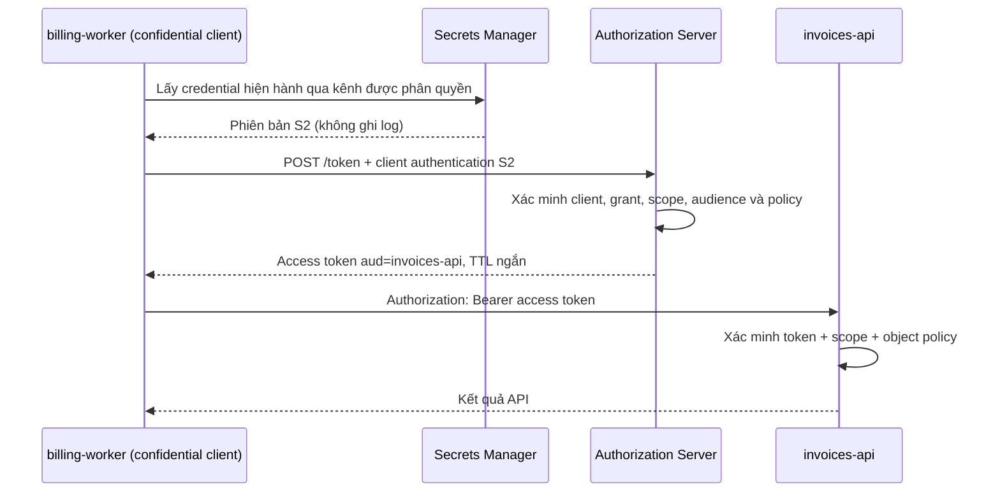
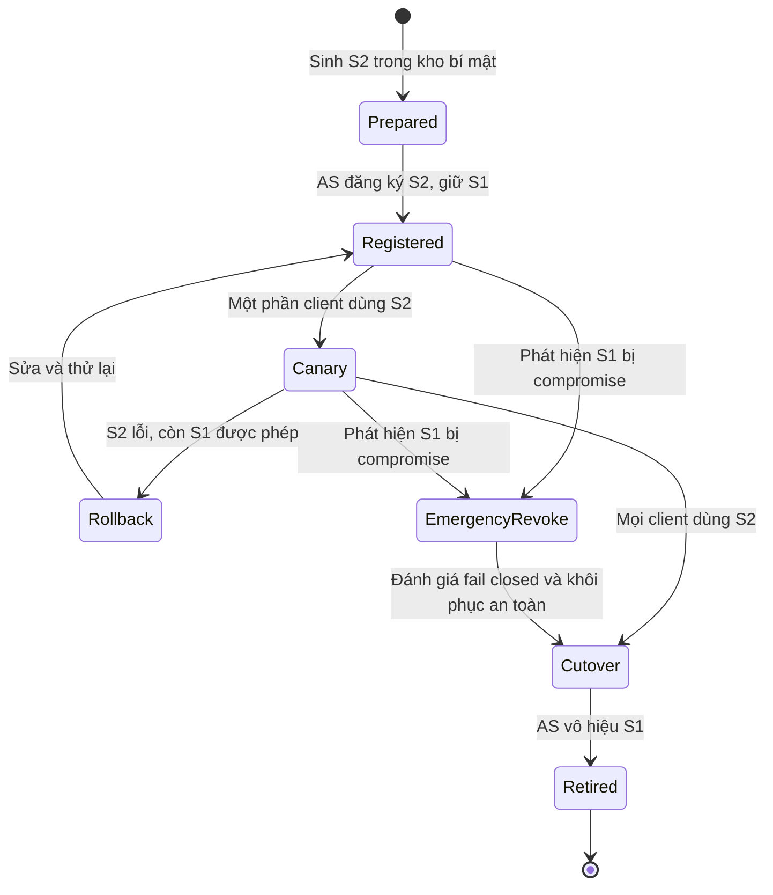

# Client credential rotation: xoay vòng thông tin xác thực của OAuth client

Giả sử `billing-worker` là một dịch vụ backend tự động gọi API xuất hóa đơn. Để xin access token, nó xác thực với **authorization server (AS)** bằng `client_secret`. Một ngày, đội bảo mật phát hiện secret đã xuất hiện trong log triển khai. Nếu xóa secret cũ ngay trong AS trong khi hàng chục pod vẫn dùng cấu hình cũ, hệ thống có thể ngừng phát token và tác vụ thanh toán bị gián đoạn. Nếu giữ secret cũ quá lâu, người đã lấy được secret vẫn có cơ hội mạo danh client để xin token mới.

**Client credential rotation** là quy trình **thay credential dùng để xác thực OAuth client** một cách kiểm soát: tạo hoặc đăng ký credential mới, phân phối và chuyển client sang credential mới, xác minh hoạt động, rồi vô hiệu hóa credential cũ đúng thời điểm. Tùy phương thức xác thực, credential có thể là **client secret**, **private key dùng ký `private_key_jwt`**, hoặc **certificate/private key cho mTLS**. Mục tiêu không chỉ là «đổi mật khẩu định kỳ», mà là **giảm thời gian một credential bị lộ còn có giá trị**, duy trì khả năng xác thực liên tục và có dấu vết kiểm toán.

Bài thuộc chương **Client credentials** của module **SECURITY_TOKEN_SECURITY_FUNDAMENTALS**. Trọng tâm liên hệ với mô hình tin cậy và vòng đời token: phân biệt JWT/opaque token, access token/refresh token, OAuth 2.0/OIDC, phát hành, scope, audience, lưu trữ, thu hồi và phòng chống credential hoặc token bị đánh cắp, phát lại.

> **Nguyên tắc:** xoay vòng credential của client là thao tác quản lý **danh tính client tại AS**. Nó **không tự động** đổi `client_id`, không tự mở rộng scope/audience và không bảo đảm mọi access token đã phát hành lập tức hết hiệu lực.

## 1. Đừng nhầm bốn loại "secret" trong OAuth

| Thành phần | Dùng ở đâu? | Có thể bị rotation? | Ý nghĩa khi bị lộ |
| --- | --- | --- | --- |
| `client_id` | Định danh OAuth client trong registration/request | Thường giữ ổn định; tạo registration mới là thay đổi khác | **Không phải secret**; biết ID không chứng minh quyền sở hữu client |
| **Client credential** | Client xác thực với AS, thường ở token endpoint | **Có**: secret, signing key, mTLS certificate/key | Attacker có thể cố mạo danh confidential client để xin token hoặc thực hiện thao tác client được phép |
| **Access token** | Trình tới resource server (RS) có audience phù hợp | Token mới được **phát hành**; token cũ có expiry/revoke riêng | Bearer token bị lộ có thể bị dùng tại đúng RS cho tới khi bị chặn |
| **Refresh token** | Client trình tới AS/token endpoint để xin token mới | Có thể **rotate** mỗi lần refresh theo chính sách | Lộ refresh token có thể cho phép xin thêm access token; có client binding/expiry/revoke riêng |

**Client credential rotation khác refresh token rotation.** Khi refresh token `R1` được dùng, AS có thể phát `R2` và đánh dấu `R1` đã tiêu thụ để phát hiện replay. Khi client secret `S1` được thay bởi `S2`, nhiều client instance có thể cần **một khoảng chồng lấn** cả `S1` và `S2` được AS chấp nhận để triển khai không gián đoạn.

Đặc biệt, tên grant **`client_credentials`** trong OAuth 2.0 không có nghĩa «mọi OAuth client đều dùng client secret». Grant đó cho phép một client nhận access token **với quyền của chính client/service principal** theo chính sách. Còn **client authentication** là thao tác chứng minh danh tính client, cũng được dùng trong authorization code flow, refresh token grant và token exchange khi cần.

### 1.1. Public client có client secret để rotate không?

Một browser SPA hay native mobile app thường là **public client**: mã ứng dụng và dữ liệu đi kèm có thể bị người dùng/attacker trích xuất, nên **không thể coi secret nhúng sẵn trong JavaScript hoặc binary là bí mật confidential**. Đưa cùng một `client_secret` vào tất cả bản mobile rồi «rotate» khi app cập nhật không biến mobile thành confidential client.

Với public client, dùng authorization code + PKCE và các biện pháp phù hợp cho loại client; không hứa bảo mật bằng secret nhúng. Nếu cần confidential client authentication, đưa thành phần giữ secret sang **backend/BFF** được kiểm soát. Một first-party SPA vẫn là public client; một third-party backend có thể là confidential client.

## 2. Credential tham gia luồng OAuth 2.0 như thế nào?



Trong một request dùng `client_credentials` grant, request tới token endpoint có thể như sau:

```http
POST /oauth2/token HTTP/1.1
Host: auth.example.test
Authorization: Basic <base64-encoded-registered-client-credentials>
Content-Type: application/x-www-form-urlencoded

grant_type=client_credentials&scope=invoices%3Awrite
```

Đây là request minh họa. **Không** hardcode, in ra terminal history hoặc đưa secret thật vào ví dụ. Với HTTP Basic trong OAuth, việc mã hóa `client_id` và `client_secret` phải tuân theo quy tắc của OAuth 2.0/RFC 6749; nên dùng OAuth client library hỗ trợ chuẩn thay vì tự nối chuỗi.

Response thành công minh họa:

```json
{
  "access_token": "<new-access-token>",
  "token_type": "Bearer",
  "expires_in": 600,
  "scope": "invoices:write"
}
```

`expires_in=600` là **thời gian sống của access token** theo response này, không phải thời hạn của client secret. Tương tự, `client_secret_expires_at` nếu một hệ thống hỗ trợ metadata tương ứng có ý nghĩa riêng về **secret của client**, không phải `exp` trong access token.

### 2.1. Client secret được AS xác minh, không phải RS

Trong flow trên:

1. **AS** xác minh credential của `billing-worker`, quyền dùng grant `client_credentials`, scope `invoices:write` và resource `invoices-api`.
2. **AS** cấp access token dành cho RS theo policy. Token có thể là JWT hoặc opaque.
3. **RS** xác minh access token bằng chữ ký/JWKS hoặc introspection, kiểm `iss`, `aud`, `exp`, scope và quyền đối tượng.

**Không gửi `client_secret` trong header `Authorization` tới RS.** Nó là credential để client xác thực với AS. Một service nhận được raw client secret vô tình có thể trở thành điểm rò rỉ đặc quyền cao hơn access token ngắn hạn.

### 2.2. Các flow khác cũng bị ảnh hưởng khi đổi credential

Một confidential client còn có thể dùng credential ở:

- **Authorization code flow:** backend đổi authorization code lấy token với client authentication và PKCE theo profile.
- **Refresh token grant:** backend xác thực với AS khi dùng refresh token, nếu client authentication được yêu cầu.
- **Token exchange (RFC 8693):** service được AS cho phép đổi token sang audience khác và xác thực như OAuth client.
- **OIDC RP:** confidential Relying Party có thể dùng credential ở token endpoint và các endpoint/profile yêu cầu client authentication.

Vì thế, kế hoạch rotation phải kiểm **mọi luồng dùng cùng client registration**, không chỉ một tác vụ `client_credentials`. Đổi secret có thể làm luồng đăng nhập hoặc refresh token của người dùng ngừng hoạt động nếu một số backend vẫn giữ secret cũ.

## 3. Khi nào cần rotate?

Không có một chu kỳ thời gian «30/60/90 ngày» bắt buộc cho mọi OAuth client trong RFC 6749. Chính sách tùy phương thức authentication, threat model, thời hạn credential và yêu cầu tuân thủ.

| Nguyên nhân | Ví dụ | Ưu tiên |
| --- | --- | --- |
| **Rotation định kỳ** | Chính sách nội bộ giới hạn tuổi của client secret | Có lịch, quan sát đủ để chuyển toàn bộ consumer |
| **Có dấu hiệu lộ** | Secret in trong CI log, repository, incident report | **Khẩn cấp**: chặn credential cũ sớm nhất có thể |
| **Thay đổi người/hệ thống có quyền truy cập** | Nhân sự/vận hành đối tác kết thúc nhiệm vụ | Đánh giá quyền trên secret, rotate nếu phạm vi lộ không kiểm soát |
| **Thay đổi hạ tầng** | Chuyển Secrets Manager, AS hoặc môi trường cloud | Chuyển trust boundary, không copy credential bừa bãi |
| **Key/certificate sắp hết hạn** | `private_key_jwt` signing key/cert, mTLS cert tới `NotAfter` | Phải chồng lấn để không ngắt authentication |
| **Thuật toán/chuẩn bị loại bỏ** | Loại thuật toán ký cũ, cập nhật PKI | Di chuyển theo policy, không chỉ đổi chuỗi secret |
| **Client bị vô hiệu hoặc nghi bị chiếm** | Workload đối tác compromise | Có thể phải disable client/revoke grants bên cạnh rotation |

**Chọn chu kỳ dựa trên mức rủi ro:** một service có quyền phát token cho nhiều API nhạy cảm cần kiểm soát chặt hơn một worker quyền hẹp. Rotation không thay thế secret minimization, storage, quyền AS, giám sát hoặc thu hồi token đã phát.

## 4. Ba cơ chế client authentication và cách rotate khác nhau

### 4.1. Client secret: `client_secret_basic` / `client_secret_post`

AS có thể hỗ trợ `client_secret_basic` hoặc `client_secret_post` theo registration. `client_secret_basic` đặt credential trong HTTP Basic tại token endpoint; `client_secret_post` đưa vào form body và nhìn chung không phải lựa chọn ưu tiên khi có giải pháp an toàn hơn vì secret dễ xuất hiện trong log/body processing.

Trong rotation an toàn:

1. AS **tạo/đăng ký `S2`** cho client `billing-worker`, chưa thu hồi `S1`.
2. Secret manager lưu `S2` như **phiên bản mới**, giới hạn ai được đọc; không gửi bằng chat/email/log.
3. Các instance dùng `S2` trong request token mới, có thể triển khai dần.
4. AS theo dõi **credential ID/version** được dùng (không ghi giá trị secret); xác nhận không còn request thành công với `S1`.
5. Thu hồi `S1` và kiểm âm tính bằng request cố dùng secret cũ.

**Điều kiện kỹ thuật:** AS phải hỗ trợ đồng thời ít nhất hai credential trong khoảng overlap, hoặc cần phương án triển khai cutover/giảm downtime khác đã được lên kế hoạch. Không giả định mọi AS đều cho tạo «secret thứ hai»; có nhà cung cấp chỉ hỗ trợ một secret đang hoạt động, hoặc thao tác rotate tự thay thế ngay secret cũ.

### 4.2. `private_key_jwt`: xoay khóa ký và JWKS

Với phương thức `private_key_jwt` (RFC 7523 và các profile/client-auth metadata liên quan), client ký một JWT assertion bằng private key. AS xác minh chữ ký bằng khóa công khai đã đăng ký cho **chính client đó**.

Ví dụ **payload assertion minh họa**:

```json
{
  "iss": "billing-worker",
  "sub": "billing-worker",
  "aud": "https://auth.example.test/oauth2/token",
  "iat": 1893456000,
  "exp": 1893456060,
  "jti": "c00f48c4-417f-4351-bde0-3f1b89d9a3c4"
}
```

`iss`/`sub` thường là `client_id` trong client assertion; `aud` nhắm tới AS/token endpoint theo **hợp đồng và profile**; `jti` có thể dùng để ngăn **replay assertion** bằng bộ nhớ trạng thái trong thời hạn ngắn. Đây **không phải access token** và `aud` của assertion **không phải** `aud=invoices-api` của access token đầu ra.

Quy trình rotation khóa:

- Tạo **key pair mới** (`K2`) trong HSM/KMS/keystore; private key **không xuất** ra client code, log hay source.
- Đăng ký **public key mới** vào JWKS/registry mà AS tin cho `billing-worker`, đồng thời giữ public key của `K1` trong khoảng overlap.
- Đợi AS/replica/cache của AS **nhận ra khóa mới** rồi chuyển client ký assertion bằng `K2` với `kid` được định nghĩa.
- Xác nhận các instance đều dùng `K2` và không còn signed assertion hợp lệ với `K1` trước khi gỡ public key cũ.
- Khi key bị compromise, **gỡ/deny khóa cũ khẩn cấp** theo khả năng của AS; đừng đợi hết cache TTL thông thường.

**`kid` là gợi ý chọn khóa** trong tập đã đăng ký và tin cậy, không phải lệnh tải key tùy ý. AS không được tin `jku`/`x5u` do assertion do client tự gửi để tải key từ URL lạ. Thuật toán `alg` cũng phải qua allowlist; không cho client tự chuyển sang `none` hoặc thuật toán không phù hợp.

### 4.3. OAuth mTLS: xoay certificate và private key

Với OAuth mutual TLS client authentication (RFC 8705), client trình **certificate và bằng chứng sở hữu private key qua TLS handshake**; AS đối chiếu chứng chỉ/danh tính theo cấu hình cho client.

Để rotate:

1. Cấp key/certificate mới đủ điều kiện (identity, EKU, chain/trust anchor và chính sách PKI).
2. Cập nhật trust/registration hoặc rule chấp nhận certificate ở AS nếu hệ thống pin cert/key.
3. Cho cả certificate cũ và mới được chấp nhận **có giới hạn** trong khoảng chuyển đổi.
4. Đưa certificate/key mới vào client TLS stack và kiểm tra **handshake thực**, không chỉ kiểm file tồn tại.
5. Thu hồi/loại certificate/key cũ và cập nhật CRL/OCSP hoặc pinning theo kiến trúc.

**Mấu chốt:** nếu AS phát **certificate-bound access token**, token có thể chứa `cnf`/thumbprint gắn với certificate lúc phát. Khi client đổi certificate, **access token cũ ràng buộc với certificate cũ không tự sử dụng được bằng certificate mới**. Cần chiến lược chuyển đổi: tiếp tục dùng cert cũ có kiểm soát cho token cũ trong cửa sổ cho phép, hoặc xin token mới bound với cert mới và thay cache; không bỏ kiểm sender binding tại RS.

Việc AS chấp nhận cert mới ở token endpoint và việc RS chấp nhận cert-bound access token tại API là **hai bước riêng**, có thể chịu tác động bởi TLS termination ở gateway/service mesh. Header `X-Client-Cert` tự khai không chứng minh đã diễn ra mTLS handshake.

### 4.4. So sánh theo phương thức

| Phương thức | Credential cần bảo vệ | Phải phân phối trước khi cutover | Điểm dễ lỗi |
| --- | --- | --- | --- |
| Client secret | Chuỗi random secret của confidential client | Secret mới tới AS và mọi consumer | AS không cho overlap; stale env/config, log secret |
| `private_key_jwt` | Private signing key | Public key/JWKS mới tới AS; private key mới tới signer | JWKS cache, `kid`/`alg` sai, jti replay store |
| mTLS | Private key + certificate identity | Cert/key và trust configuration của AS/RS | Cert chain/SAN, handshake, bound token cũ, proxy termination |

**Không chuyển từ secret sang `private_key_jwt` hay mTLS chỉ bằng cách đổi header.** Phải đăng ký đúng `token_endpoint_auth_method`, công bố key/certificate theo contract, cấu hình AS và kiểm tra client library hỗ trợ.

## 5. Zero-downtime rotation bằng khoảng chồng lấn có kiểm soát

Một cách nhìn tốt là **state machine của credential**, không phải một thao tác ghi đè biến môi trường:



State của secret và state của **client registration** là hai khái niệm khác nhau. Một client có thể vẫn `enabled` nhưng `S1` đã `retired`. Không nên disable cả client chỉ để ngừng một credential nếu AS cho phép thu hồi chính xác credential bị lộ và tiếp tục giữ client hợp lệ.

### 5.1. Runbook không gián đoạn theo sáu giai đoạn

**Giai đoạn A – Inventory và chuẩn bị**

- Xác định chính xác `client_id`, AS/tenant/environment, grant types, token endpoint, phương thức xác thực hiện tại.
- Liệt kê tất cả **consumer**: deployment/pod, cron job, batch, BFF, integration partner, region, DR environment và luồng đăng nhập/refresh nếu cùng credential.
- Xác định scope/audience đang dùng, thời hạn token, kho bí mật, owner và người được phép rotate.
- Kiểm AS có cho chồng lấn nhiều credential không, cách propagate đến replicas và cách quan sát credential version đã dùng.

**Giai đoạn B – Tạo secret/key mới**

- Sinh tại AS hoặc key-management system theo phương thức được hỗ trợ, bảo vệ với entropy/thuật toán phù hợp.
- Đăng ký vào đúng OAuth client và **đúng môi trường**; tách dev/staging/prod.
- Không gửi secret qua issue tracker, email, chat, stdout hoặc log CI; dùng Secrets Manager/KMS/HSM và quyền tối thiểu.
- Dùng tên phiên bản hoặc ID vô hại để audit, ví dụ `cred-v2`; ID này không phải giá trị secret.

**Giai đoạn C – Đảm bảo AS chấp nhận mới**

- Kiểm credential `S2` có hiệu lực tại token endpoint bằng một request thử **đúng client, grant, scope/resource được phép**.
- Với `private_key_jwt`, xác nhận AS đã tải/nhận public key mới và khớp `kid`/`alg`; với mTLS, xác nhận handshake và registered identity.
- Không phát tán `S2` tới mọi node trước khi AS có thể chấp nhận nó, nếu không hệ thống sẽ gặp bão `invalid_client`.

**Giai đoạn D – Canary, rollout và xác minh**

- Chuyển một instance/region nhỏ sang `S2`, theo dõi token issuance và request tới RS.
- Triển khai đồng loạt hoặc rolling deployment có kiểm soát; nạp bí mật mới bằng cơ chế bảo đảm **process thật sự sử dụng phiên bản mới**.
- Theo dõi `client_id + credential_version` ở phía AS (metadata nội bộ), **không ghi raw secret**.
- Giữ old credential chỉ trong **khoảng overlap có deadline** khi rủi ro cho phép.

**Giai đoạn E – Thu hồi credential cũ**

- Xác nhận tất cả consumer đã chuyển, bao gồm job ít chạy, DR node, region dự phòng, phiên bản ứng dụng cũ.
- AS đánh dấu `S1 revoked/disabled` và propagation đến mọi token endpoint replica/cache.
- Test request với `S1` **phải bị từ chối**, `S2` vẫn hoạt động.
- Xóa/disable old secret ở Secret Manager/client config, nhưng bảo tồn audit metadata theo retention phù hợp.

**Giai đoạn F – Giám sát sau cutover**

- Cảnh báo nếu còn request xác thực bằng `S1` hoặc tăng `invalid_client`.
- Kiểm lệnh token endpoint không bị retry storm, không vượt rate limit.
- Kiểm downstream RS vẫn chấp nhận token hợp lệ theo `aud`/`scope`/`exp`.
- Cập nhật playbook, owner và lịch kiểm tra lần tới.

### 5.2. Ví dụ timeline với overlap

```text
09:00  AS đang chấp nhận S1; client đang dùng S1
09:05  AS đăng ký S2 và xác nhận request test bằng S2
09:10  Canary 5% instance chuyển sang S2
09:20  Chuyển 100% pod chính; job ít chạy vẫn còn S1
10:00  Job và DR region chuyển sang S2; không còn S1 usage
10:15  AS revoke S1; request với S1 -> invalid_client
10:20  Audit: tất cả request hợp lệ dùng S2
```

Đây là lịch **minh họa**, không phải duration chuẩn. Một job chạy mỗi tháng có thể không gửi token request trong 60 phút quan sát, nên cần **inventory và xác minh cấu hình**, không chỉ nhìn dashboard «S1 không có traffic 15 phút» rồi vội kết luận đã hoàn tất.

### 5.3. Rollback không đồng nghĩa kéo dài secret cũ mãi

Trong rotation **bình thường**, nếu `S2` chưa hoạt động, có thể tạm rollback client về `S1` **khi `S1` vẫn an toàn và chưa bị revoke**, sau đó sửa vấn đề. Nhưng khi `S1` **đã bị compromise**, không được bật lại nó chỉ để tránh downtime. Lúc này cần **containment/fail closed**, triển khai credential mới khả dụng, hoặc tạm dừng những hoạt động không thể xác thực an toàn.

## 6. Emergency rotation sau khi phát hiện lộ credential

Trường hợp secret bị commit lên public repository hoặc private key có bằng chứng bị exfiltrate, **threat model đã thay đổi**:

1. **Đánh giá và cô lập:** xác định credential ID/client bị ảnh hưởng, quyền của client, nơi đã bị lộ và khoảng thời gian có thể bị khai thác.
2. **Chặn credential lộ:** thu hồi credential cũ càng sớm càng phù hợp khả năng ứng phó; nếu chưa có secret mới, có thể phải tạm disable client.
3. **Tạo credential mới từ trust boundary sạch:** kiểm soát admin, CI/CD, secret manager và build artifacts; không dùng lại cùng chuỗi bí mật.
4. **Điều tra token đã được cấp:** rotation secret **không tự vô hiệu hóa** access/refresh token đã phát; xem xét revoke grant/refresh token, token denylist/introspection và TTL của access token.
5. **Rà soát quyền và hành vi:** kiểm `client_credentials` issuance bất thường, audience/scope, IP/network, token usage, hoạt động API và logs đã redacted.
6. **Phục hồi & báo cáo:** triển khai mới, kiểm hoạt động theo policy, xác định nguyên nhân rò và đưa biện pháp phòng tái diễn.

**Không chờ hết chu kỳ rotation định kỳ** khi credential đã bị lộ. Trong sự cố, mục tiêu giảm khả năng attacker xin token mới thường quan trọng hơn việc duy trì overlap lâu để deployment «êm».

### 6.1. Rotation có thu hồi access token cũ không?

**Không mặc định.** Ví dụ:

```text
08:00  Attacker dùng S1 để xin JWT A, aud=payments-api, exp=08:15
08:05  AS revoke S1, đăng ký S2
08:06  Attacker thử dùng S1 xin token mới -> bị từ chối
08:07  Attacker trình JWT A tới payments-api
```

Nếu `payments-api` xác minh JWT **offline** và không có revocation/denylist hoặc policy trạng thái khác, JWT A **có thể vẫn được chấp nhận tới `exp`** dù `S1` đã bị revoke. Với opaque token/introspection, AS có thể đánh dấu token/grant inactive và RS sẽ từ chối theo freshness/cache policy. Vì vậy incident response phải xem xét **hai lớp khác nhau**: chặn phát token mới và chặn sử dụng token đã phát.

### 6.2. Có cần đổi `client_id` không?

Thông thường **không**: `client_id` là identifier, không phải secret. Việc tạo client registration mới có thể cần khi registration/binding bị xâm nhập hoặc policy yêu cầu, nhưng đó là **migration lớn hơn**, ảnh hưởng redirect URIs, grants, consents, refresh tokens, scope/audience policy và các integration đã gắn `client_id`.

Không đổi `client_id` một cách ngẫu nhiên với hy vọng nó «ẩn» credential đã lộ. Phải kiểm tra AS policy và trạng thái token/grant của registration cũ.

## 7. Thiết kế lưu credential và phiên bản an toàn

### 7.1. Metadata phía AS

Một mô hình quản trị credential tham khảo:

```text
OAuthClient {
  client_id,
  enabled,
  allowed_grant_types,
  token_endpoint_auth_method,
  allowed_scopes,
  allowed_resources,
  policy_version
}

ClientCredential {
  credential_id,
  client_id,
  method,
  public_key_or_secret_verifier,
  not_before,
  expires_at,
  revoked_at,
  lifecycle_state,
  created_by,
  created_at
}
```

**Không phải schema chuẩn OAuth.** Với client secret random đủ mạnh, AS có thể lưu verifier/digest theo thiết kế; đừng bắt buộc lưu secret plaintext để so sánh. Với `private_key_jwt`, AS lưu **public key/JWK metadata đáng tin**; với mTLS lưu rule về certificate/key/CA/identity theo profile. Không lưu private key của client vào AS nếu không có nhu cầu kiến trúc đặc biệt.

### 7.2. Phía client dùng Secret Manager thay vì hardcode

Nên dùng:

- Secret manager/KMS/HSM có **IAM theo service identity**, audit và vòng đời phiên bản.
- Workload identity/managed identity để bootstrap truy cập kho bí mật; không nhúng credential kho bí mật vào ứng dụng.
- Tách secret theo **client_id, environment, region/tenant và phương thức authentication**.
- Phân quyền **read** cho consumer, quyền **rotate/revoke** cho vai trò quản trị giới hạn; tránh để service nghiệp vụ tự tạo secret quyền cao.
- Encryption at rest/in transit, backup/restore có chính sách và redaction trên telemetry.

Một đường dẫn version giả định:

```text
secret://prod/oauth-clients/billing-worker/client-secret
  version=17   # S1
  version=18   # S2
```

Đây là **sơ đồ logic**, không phải URI được một Secret Manager cụ thể hỗ trợ. Giá trị thật không được xuất hiện trong file cấu hình source code hay tài liệu.

### 7.3. Environment variables có phải luôn cập nhật "nóng"?

**Không.** Với nhiều hệ thống deployment, environment variable được nạp khi process khởi động; cập nhật giá trị trong Secret Manager **không làm process đang chạy tự đổi secret**. Nếu ứng dụng cache credential trong object OAuth client được khởi tạo khi startup, cần restart/rollout hoặc cơ chế reload đã được kiểm thử.

Tương tự, pod có thể mount secret dạng file nhưng library chỉ đọc file **một lần**, nên file cập nhật không bảo đảm OAuth requests tiếp theo dùng credential mới.

Trong kiểm tra cutover, phải xác minh **credential version thực sự được dùng để AS xác thực** chứ không chỉ xác minh Secret Manager đã có phiên bản mới.

## 8. Java pseudocode: client lấy secret hiện hành và xin token

Đây là **pseudocode gần Java** để mô tả trách nhiệm của một confidential client. `SecretManager`, `OAuthTokenClient`, `CredentialVersion` là abstraction; không phải API chuẩn của Java/Spring Security. Trong sản xuất, ưu tiên OAuth client library được kiểm thử và cấu hình secrets manager theo platform.

```java
final class MachineTokenProvider {
    private final SecretManager secrets;
    private final OAuthTokenClient tokenClient;
    private final Clock clock;

    AccessToken issueForInvoices() {
        CredentialVersion current = secrets.resolveActive(
            "prod/oauth-clients/billing-worker/client-secret"
        );

        // current.secret() không được log, serialise ra trace,
        // đưa vào URL hay error message.
        TokenResponse response = tokenClient.clientCredentials(
            "https://auth.example.test/oauth2/token",
            "billing-worker",
            current.secret(),
            "invoices:write",
            "invoices-api"
        );

        if (!response.tokenType().equalsIgnoreCase("Bearer")) {
            throw new SecurityException("Unexpected token type");
        }
        if (!response.expiresAt().isAfter(clock.instant())) {
            throw new SecurityException("Token already expired");
        }
        return response.accessToken();
    }
}
```

Ở đây `tokenClient.clientCredentials` phải:

1. Gửi request **qua HTTPS** tới endpoint AS **đã cấu hình tin cậy**, không nhận URL từ user request.
2. Mã hóa client authentication đúng với `token_endpoint_auth_method` của client registration.
3. Gửi scope/resource phù hợp chính sách, không tự ghép thêm quyền.
4. Không log body/Authorization header, credential hoặc response token.
5. Xử lý lỗi `invalid_client`, timeout, rate limit và retry đúng lớp; không thử gửi secret tới host khác.

Nếu token là JWT, RS vẫn tự kiểm chữ ký/issuer/audience/expiry; nếu opaque, RS dùng introspection hoặc cơ chế tương ứng. Client **không thể tự suy rằng token hợp lệ cho API khác** từ một `client_credentials` response thành công.

### 8.1. Chuyển credential trong ứng dụng đang chạy

Một mô hình có thể hỗ trợ reload an toàn:

```java
final class ReloadableClientCredential {
    // Abstractions minh họa, không phải production-ready code.
    private final AtomicReference<CredentialVersion> active =
        new AtomicReference<>();

    void reloadFromTrustedSecretManager(SecretManager manager) {
        CredentialVersion candidate = manager.resolveActive(
            "prod/oauth-clients/billing-worker/client-secret"
        );
        credentialPolicy.requireKnownVersionAndNotRevoked(candidate);
        active.set(candidate);
    }

    CredentialVersion snapshotForOneTokenRequest() {
        CredentialVersion snapshot = active.get();
        if (snapshot == null) {
            throw new SecurityException("Client credential unavailable");
        }
        return snapshot;
    }
}
```

**Điểm quan trọng:** dùng **một snapshot nhất quán** cho mỗi request. Không lấy `client_id` từ một config version và secret từ một config version khác. Nếu reload lỗi, ứng dụng có chính sách fail closed hoặc tiếp tục dùng phiên bản cũ **chỉ khi vẫn hợp lệ và chưa compromise**; không kéo dài việc sử dụng credential revoked.

### 8.2. Retry sau `invalid_client`

Ví dụ xử lý logic:

```text
Token endpoint trả invalid_client
    |
    v
Kiểm nguyên nhân: credential expired/revoked/sai method? AS replication?
    |
    +-- Nếu có secret version mới đáng tin:
    |      reload 1 lần, thử lại có giới hạn theo policy
    |
    +-- Nếu vẫn fail hoặc version không rõ:
           dừng, cảnh báo; KHÔNG fail-open; KHÔNG quét mọi secret cũ
```

Không viết vòng lặp thử hàng loạt credential cũ khi AS trả `invalid_client`: cách đó kéo dài cửa sổ secret lộ, làm tăng tải AS và có thể bị phân loại brute force. Phải phân biệt **401/invalid_client**, **400/invalid_scope**, **5xx**, timeout và lỗi kết nối TLS; chúng có cách xử lý khác nhau.

## 9. Ví dụ AS pseudocode: xác thực nhiều phiên bản trong overlap

Một verifier phía AS có thể thực thi chính sách:

```java
VerifiedClient verifyClientSecret(
    String clientId,
    SecretPresented presented,
    Instant now
) {
    RegisteredClient client = clients.requireEnabled(clientId);
    if (!client.authMethod().equals("client_secret_basic")) {
        throw invalidClient();
    }

    List<CredentialVerifier> candidates =
        credentialStore.findEligibleVerifiers(clientId, now);

    // Verifier phải được thiết kế để không lộ secret qua timing,
    // cache key, audit hoặc error messages.
    CredentialVerifier matched = secureVerifier.match(
        presented, candidates
    );
    if (matched == null) {
        audit.invalidClientAttempt(clientId);
        throw invalidClient();
    }

    if (matched.revokedAt() != null
            || now.isBefore(matched.notBefore())
            || !now.isBefore(matched.expiresAt())) {
        throw invalidClient();
    }

    audit.clientAuthenticated(clientId, matched.credentialId());
    return new VerifiedClient(client, matched.credentialId());
}
```

Không lấy ví dụ làm thuật toán hashing hoặc constant-time comparison hoàn chỉnh: AS phải giới hạn số phiên bản eligible, chuẩn hóa encoding theo method, quản lý secret verifier an toàn, chống DoS và triển khai matching thích hợp. Với client secret có entropy cao, dùng giải pháp verifier/hashing hoặc HMAC phù hợp; không lưu raw secret vào logs hoặc analytics.

### 9.1. Chỉ một credential mới được làm "primary"

Tại client, nên có **một phiên bản được chọn** để phát token requests mới, ngay cả khi AS chấp nhận hai phiên bản trong overlap. Nếu ngẫu nhiên dùng `S1` hoặc `S2` mỗi lần, khó đánh giá tiến độ cutover và tăng thời gian phải giữ old credential.

Phía AS nên phân biệt:

- `not_before`: chưa chấp nhận trước mốc này nếu policy có.
- `expires_at`: không chấp nhận sau mốc này.
- `revoked_at`: ngừng chấp nhận trước hạn do sự kiện.
- `credential_id`: phục vụ audit version, **không phải bí mật**.
- `client_id`: danh tính client, có thể có nhiều credential đang hợp lệ trong quá trình rotation.

Đừng cho phép `revoked_at` bị «reset» do rollback automation không được phê duyệt, nhất là khi credential đã lộ.

## 10. Private-key JWT: kiểm tra các chi tiết dễ sai khi rotate

### 10.1. Header và assertion phải khớp registration

Ví dụ JOSE header:

```json
{
  "alg": "PS256",
  "typ": "JWT",
  "kid": "billing-worker-2026-k2"
}
```

Các ví dụ chỉ minh họa giá trị; thuật toán thật phải theo **AS-supported allowlist và registration**. Khi rotate từ `K1` sang `K2`:

- `kid` phải chọn đúng **public key K2 của billing-worker**, không phải một key bất kỳ của client khác.
- AS phải chống sử dụng khóa vừa bị revoke dù JWK cache còn bản cũ.
- `aud` trong assertion phải nhắm đúng AS/token endpoint theo profile; nếu cấu hình AS hỗ trợ issuer identifier khác, dùng contract đã đăng ký.
- `iss`/`sub` phải tương ứng client theo phương thức xác thực.
- `exp`/`iat`/`nbf` nếu áp dụng phải nhất quán với đồng hồ và giới hạn tuổi assertion.
- `jti` dùng để chống replay theo policy; không dùng lại assertion JWT đã ký cho nhiều token requests.

### 10.2. JWKS cache và overlap

AS có thể cache public JWKS của client, vì vậy đăng ký public key mới chưa chắc được mọi AS node biết ngay. Giải pháp là công bố K2 trước cutover, có thể chủ động refresh cache hoặc chờ propagation theo TTL cam kết. Trường hợp `kid` lạ, AS cần throttling để không bị attacker gây **JWKS refresh flood**.

**Không gỡ K1 quá sớm khi client còn ký bằng K1**, nhưng cũng không giữ K1 sau khi có bằng chứng compromise. Quan trọng là AS thực sự **dừng chấp nhận K1** ở mọi node, không chỉ một bảng quản trị đã hiển thị «revoked».

### 10.3. Tránh "key confusion"

Một khóa trong JWKS có thể dành cho **client assertion**; đó không phải khóa ký **access token của AS**. Không dùng nhầm issuer/JWKS của AS để kiểm chữ ký của client hoặc cho client ký access token tự phát. Token types/profile phải có validators, trust anchors và audience riêng.

## 11. mTLS rotation: chú ý certificate-bound access token

Hệ thống có thể sử dụng mTLS ở hai mục đích:

1. **Client authentication tại AS/token endpoint**.
2. **Sender-constrained access token**: RS yêu cầu kết nối chứng minh possession của cert tương ứng token `cnf`.

Ví dụ trong thời gian cutover:

```text
08:00  AS nhận Cert C1; phát Access Token A1 bound với C1
08:10  AS cho phép Cert C2; client bắt đầu dùng C2
08:11  AS phát Access Token A2 bound với C2
08:12  Client gọi RS bằng A1 + Cert C2 -> sender mismatch; từ chối
08:12  Client gọi RS bằng A2 + Cert C2 -> có thể hợp lệ nếu đủ policy
```

Không cố «sửa» bằng cách tắt kiểm certificate thumbprint tại RS. Cần phối hợp **token cache với certificate version**: không tái sử dụng A1 trên kết nối C2, hoặc duy trì kết nối/credential C1 trong khoảng được phép và có kế hoạch chấm dứt. Với sự cố C1 bị đánh cắp, ưu tiên revoke/replace hơn cố giữ A1 hoạt động.

Nếu TLS kết thúc ở ingress gateway, cần thiết kế rõ nơi chứng minh client key possession và cách RS tin kết quả. Một header chứa chuỗi PEM certificate không phải bằng chứng TLS.

## 12. Secret rotation ảnh hưởng ra sao đến token lifecycle?

### 12.1. Access token đã phát

- **JWT access token** có thể tiếp tục hợp lệ tới `exp` tại RS offline, kể cả khi client secret dùng để xin token đã được rotate/revoke.
- **Opaque access token** có thể bị AS đánh dấu inactive; RS chỉ biết thông qua introspection/cache theo độ mới.
- **Scope và audience không đổi** khi client đổi secret. Token mới vẫn phải nằm trong allowed grants/scopes/resources.
- Một AS có thể có policy thu hồi token khi client bị disable; cần đọc **hợp đồng AS**, không mặc định secret rotation sẽ revoke mọi token.

### 12.2. Refresh token của confidential client

Khi một confidential client dùng refresh token, AS có thể yêu cầu nó xác thực bằng client credential. Sau khi `S1` bị thu hồi, client có thể tiếp tục refresh bằng `S2` nếu **registration/grant và refresh token còn hợp lệ**, tùy AS policy. Việc `S1` bị revoke **không mặc định** làm refresh token đang active biến mất.

Ngược lại, nếu có bằng chứng attacker dùng `S1` để lấy access/refresh token, cần đánh giá **thu hồi các grant/token family đã bị ảnh hưởng**, không chỉ thay secret. Refresh token rotation/reuse detection và absolute/idle expiry vẫn được xử lý riêng ở AS.

### 12.3. OIDC ID token và API access token

Confidential OIDC client có thể dùng `S2` để đổi code tại token endpoint và nhận ID token. **ID token** có audience là client/RP theo OIDC, không phải token để gọi mọi API. **Access token** dùng tại RS phải có issuer/audience/scope/type phù hợp. Việc client auth thành công không biến `client_id` thành `aud` của API, và secret mới không cấp vai trò user/admin cho client.

### 12.4. DPoP và các cơ chế chống replay

DPoP (RFC 9449) có thể ràng buộc access token với khóa sender và proof theo request. **DPoP key** không đồng nhất với private key `private_key_jwt` dùng xác thực OAuth client, mặc dù một hệ thống có thể dùng chung hạ tầng quản lý khóa theo policy. Rotation của một key **không tự đổi key binding của token khác**.

Với `client_credentials` bearer token, attacker đánh cắp được token có thể phát lại tại đúng audience đến khi hết hạn/thu hồi. Client credential rotation giới hạn **khả năng xin thêm token bằng credential lộ**, không xóa ngay rủi ro **token đã bị đánh cắp**. TTL ngắn, audience hẹp, sender constraint, replay defenses và resource authorization vẫn cần thiết.

## 13. Multi-instance, multi-region và integration đối tác

### 13.1. "Mọi pod đã deploy" chưa đủ

Một tổ chức thường có:

- Pod ở vùng A chạy hàng ngày.
- Batch job ở vùng B chỉ chạy lúc cuối tháng.
- DR cluster đang tắt nhưng vẫn giữ secret trong snapshot.
- Một client integration của đối tác, có deployment và lịch phát hành riêng.
- Một phiên bản backend cũ xử lý refresh token hoặc OIDC callback.

Tất cả có thể dùng **cùng client registration**. Nếu AS thu hồi `S1` sau khi pod vùng A chuyển xong nhưng batch B chưa cập nhật, batch thất bại tại token endpoint dù dashboard vùng A xanh.

Giải pháp: **inventory thực tế**, tách client registration theo ứng dụng/đối tác/permission boundary khi hợp lý, xem nơi lưu credential và thử **từng consumer** trước retire.

### 13.2. Cấp quyền tối thiểu cho bên thứ ba

Nếu third-party backend giữ client secret, chủ hệ thống API không kiểm soát hoàn toàn cách partner lưu secret. Cần:

- Registration riêng cho partner; không chia sẻ secret của first-party service.
- Scope, audience, grant và token lifetime hẹp.
- Client authentication mạnh (ví dụ mTLS/`private_key_jwt` khi khả thi), kế hoạch key rotation và liên hệ sự cố.
- Quy trình phối hợp timeline: AS register credential mới → partner canary → xác nhận → retire credential cũ.
- Khả năng **disable riêng client hoặc credential** khi partner compromise.

Logo/nhãn «trusted partner» không thay cryptographic validation hoặc authorization tại RS.

### 13.3. Rotation phân tán: atomicity và propagation

AS nhiều node có thể có độ trễ replication. Một request với `S2` được node 1 chấp nhận nhưng node 2 trả `invalid_client` vì chưa nhận registration mới. Cần:

1. Cơ chế propagation/consistency được đo hoặc readiness check mọi vùng.
2. Không chuyển client sang `S2` cho tới khi các endpoint AS theo route có thể xác thực nó.
3. Không retire `S1` cho tới khi xác nhận nơi phát token thực tế và consumer đã chuyển.
4. Có rate limiting/backoff để tránh retry storm khi rollout lỗi.
5. Với incident, ưu tiên thu hồi khẩn cấp và chính sách fail closed; độ trễ propagation phải nằm trong giới hạn rủi ro được công bố.

## 14. Observability: đo version thay vì log secret

Nên ghi lại:

| Chỉ số/log an toàn | Mục tiêu |
| --- | --- |
| `oauth_client_auth_success{client_id,credential_version}` | Xác nhận adoption S2/K2/C2 |
| `oauth_client_auth_failure{client_id,error_class}` | Phát hiện `invalid_client` và lỗi phương thức |
| `credential_last_used_at` theo version | Tìm consumer chưa chuyển |
| `credential_expires_in_days` | Cảnh báo cert/key/secret sắp hết hạn |
| `jwks_key_refresh_age` / `unknown_kid_rate` | Phát hiện lỗi public key propagation |
| `tls_handshake_failure` theo client/service | Phát hiện mTLS cert/PKI issues |
| `token_endpoint_latency` / `5xx_rate` | Phân biệt AS outage với secret sai |
| `access_token_issued_by_client` và audience/scope tổng hợp | Phát hiện client compromise, cấp quyền bất thường |
| `retired_credential_use_attempt` | Báo động cấu hình cũ hoặc cố tái sử dụng secret bị lộ |

Không ghi:

- Raw `client_secret`, HTTP Basic `Authorization`, raw `client_assertion`.
- Private key, client TLS key, access token, refresh token hoặc ID token.
- Full token endpoint POST body, query chứa credential hay crash dump không redacted.

Metrics có thể dùng `credential_id` hoặc version ID **không bí mật**. Hạn chế high-cardinality labels; audit cần phân quyền, retention và chống sửa lịch sử. Với thất bại xác thực, **không phản hồi công khai** credential ID nào đã khớp từng phần, đã hết hạn hay đang active; tránh giúp attacker enumerate secret.

## 15. Phân loại lỗi khi rotation

| Hiện tượng | Nguyên nhân khả dĩ | Cách điều tra |
| --- | --- | --- |
| Token endpoint trả `invalid_client` | Secret sai/revoked, client disabled, sai auth method, bad JWT assertion, cert không đúng | Kiểm registration, version, time, client auth method; không in credential |
| `invalid_scope` | Client hợp lệ nhưng yêu cầu scope ngoài policy | Kiểm scope/consent/resource config, không đổi secret để "sửa" |
| `unauthorized_client` | Client không được dùng grant yêu cầu | Kiểm allowed grant types; rotation không tự cấp grant |
| `invalid_grant` ở refresh/code flow | Code/refresh token không hợp lệ/đã dùng/hết hạn hoặc binding sai | Kiểm token grant/PKCE/redirect/refresh rotation, không mặc định do secret sai |
| Lỗi TLS handshake | mTLS certificate/key/chain/trust sai hoặc hết hạn | Kiểm cert metadata, path, SAN/CA và TLS endpoint đúng |
| JWT client assertion bị từ chối | `kid` chưa có, signature/`alg`/`aud`/`exp`/`jti` sai | Kiểm registration JWKS, clock, replay policy và JOSE allowlist |
| AS trả `5xx`/timeout | Hạ tầng AS/mesh/mạng lỗi | Retry có giới hạn, không chuyển credential sang host khác |
| Token xin được nhưng RS trả 401 | Access token sai issuer/aud/type/exp hoặc sender binding | Kiểm RS validation; client auth success không bảo đảm API authorization |
| RS trả 403 | Token hợp lệ nhưng thiếu scope/role/object permission | Kiểm least privilege và resource policy, không nâng quyền mặc định |
| Sau rotate có traffic dùng secret cũ | Job/pod/cấu hình cũ hoặc attacker | Xác định consumer, kiểm compromise, revoke theo deadline |

### 15.1. Vì sao không retry vô hạn?

Nếu token endpoint trả `invalid_client` ngay sau cutover, hàng trăm instance có thể cùng retry mỗi giây, gây quá tải AS. Thiết kế an toàn cần:

- Giới hạn retry và jitter/backoff cho lỗi hạ tầng tạm thời.
- Với `invalid_client`, kiểm version/reload có kiểm soát, không spam secret cũ.
- Circuit breaker hoặc rate limit tại client khi không thể xác thực, **không fail-open**.
- Nếu cần tạm dừng job, giữ queue/transaction integrity và không tạo hóa đơn/thanh toán trùng khi khôi phục.

Việc token issuance lỗi phải được phân biệt khỏi access token cache còn hạn: một API call đang dùng access token hợp lệ có thể tiếp tục theo policy, nhưng không được tiếp tục **vô hạn sau `exp`** chỉ vì client không xin được token mới.

## 16. Case study: xoay client secret cho hệ thống phát hóa đơn

### 16.1. Bối cảnh

Hệ thống có:

```text
AS: auth.example.test
Client: billing-worker (confidential)
Grant: client_credentials
Allowed resource: invoices-api
Allowed scope: invoices:write
Existing secret: S1
New secret: S2

Instances:
  billing-worker-prod-a (5 pods)
  billing-worker-prod-b (3 pods)
  billing-worker-dr     (standby)
  billing-monthly-job   (scheduled)
```

Token mới `aud=invoices-api`, lifetime 10 phút; RS dùng JWT validation. AS hỗ trợ **hai secret song song** có deadline. Đội vận hành muốn đổi S1 mà không ngắt dịch vụ.

### 16.2. Quy trình đúng

1. Kiểm registration, scope và danh sách mọi workload tiêu thụ secret, bao gồm job tháng và DR.
2. AS tạo S2, secret manager lưu S2; đặt policy overlap S1/S2 có hạn chót.
3. Canary một pod dùng S2, gọi token endpoint rồi API với token đúng `aud`/`scope`; đo success và lỗi.
4. Rollout toàn bộ pod, cập nhật job/DR, xác nhận phiên bản ở AS audit; không chỉ nhìn deployment status.
5. Sau khi xác nhận, revoke S1 tại AS và thử một test hợp lệ với S2 + một test âm tính với S1.
6. Theo dõi lỗi `invalid_client` sau revoke. Nếu job tháng vẫn dùng S1, nó phải bị từ chối; sửa cấu hình job, **không mở lại S1** nếu có nghi ngờ leak.
7. Kiểm JWT đã phát trước rotation còn sử dụng theo `exp` như thiết kế; nếu S1 bị lộ thì có kế hoạch revoke/denylist riêng.

### 16.3. Một số quyết định khó

**Nếu không có overlap:** AS chỉ cho một secret active. Cần phối hợp switchover có thể có gián đoạn, hoặc tạo client registration mới và migrate dần với scope/audience/grant tương đương theo policy; việc đổi registration có thể ảnh hưởng grant/consent và không được xem là rotation đơn giản.

**Nếu S1 bị leak:** không giữ S1 thêm hai ngày chỉ để chờ monthly job. Thu hồi credential lộ nhanh, tạm ngưng những job chưa cập nhật và xử lý token đã phát theo incident response.

**Nếu token A đang được cache tại worker:** secret đổi không buộc access token A hết hạn ngay; worker chỉ được dùng A đến khi RS chấp nhận theo `exp`/revocation. Khi cache A hết hạn, request token mới phải dùng S2. Nếu token dùng mTLS-bound, kiểm thêm certificate binding.

## 17. Ma trận kiểm thử client credential rotation

| Ca kiểm thử | Điều kiện/đầu vào | Kết quả kỳ vọng |
| --- | --- | --- |
| Client auth với S1 trước rotation | S1 active | AS chấp nhận theo policy |
| S2 được tạo nhưng chưa đăng ký AS | Client thử dùng S2 | AS từ chối; không âm thầm coi S2 là hợp lệ |
| S1 và S2 cùng active trong overlap | Request từng version hợp lệ | AS chấp nhận cả hai trong window đã cấu hình |
| Canary với S2 | Một pod dùng S2 | Cấp token và gọi RS đúng `aud`/`scope` |
| Credential có `not_before` ở tương lai | S2 dùng trước mốc | Từ chối cho tới thời điểm hợp lệ |
| Thu hồi S1 | S1 đã revoked, S2 active | S1 bị từ chối, S2 tiếp tục hoạt động |
| Đúng thời điểm hết hạn | `now >= S1.expires_at` | Từ chối S1 |
| Request S1 sau revoke ở AS node khác | Multi-region replication | Mọi AS node từ chối trong SLA revoke |
| Client ID khác dùng S2 | Secret S2 thuộc billing-worker, request client khác | Từ chối |
| Secret sai auth method | Registration private_key_jwt nhưng gửi Basic | Từ chối |
| Client disabled | Credential mới đúng nhưng client bị khóa | Từ chối |
| Grant ngoài registration | Xin authorization code/client_credentials sai policy | `unauthorized_client` hoặc lỗi phù hợp |
| Scope vượt quyền | Xin `payments:refund` từ billing-worker | `invalid_scope`/từ chối, không mở quyền |
| Token đúng issuer nhưng sai audience | Access token `aud=invoices-api` vào payments-api | RS từ chối |
| Token JWT phát trước revoke secret | A còn `exp`, RS offline | Kiểm hành vi theo policy; không mặc định tự revoke |
| Token JWT hết hạn | `now >= exp(A)` | RS từ chối dù client rotation thành công |
| Opaque access token bị AS revoke | Introspection trả `active=false` | RS từ chối theo freshness policy |
| Refresh token còn hạn và client dùng S2 | Registration/grant vẫn hợp lệ | AS xử lý theo client binding/refresh policy |
| Refresh token bị consumed/replay | Token cũ sau rotation | AS từ chối theo refresh token lifecycle |
| `private_key_jwt` key K2 chưa propagate | AS cache chưa thấy K2 | Canary phát hiện và không chuyển toàn bộ client |
| JWT assertion `kid` không được đăng ký | Chỉ có key giả của attacker | AS từ chối, không tải JWK URL không tin |
| JWT assertion sai `aud` | Đích không phải AS/token endpoint được chấp nhận | AS từ chối |
| JWT assertion hết hạn | `now >= exp(assertion)` | AS từ chối |
| JWT assertion bị replay | Dùng lại `jti`/assertion theo anti-replay policy | AS từ chối replay theo contract |
| JWT assertion dùng thuật toán yếu/không hỗ trợ | `alg=none` hoặc ngoài allowlist | AS từ chối |
| K1 đã revoke nhưng còn trong JWKS cache | AS vẫn nhìn thấy key cũ | Không bỏ qua revocation policy |
| mTLS cert C2 không có chain tin cậy | TLS client authentication | AS từ chối |
| mTLS cert đã hết hạn | `now>=NotAfter` | Không thể tiếp tục xác thực theo PKI policy |
| mTLS-bound token A1 dùng với Cert C2 | `cnf` không khớp cert | RS từ chối sender mismatch |
| Pod không reload secret | Secret Manager lên S2 nhưng pod dùng S1 | Metrics nhận diện, kế hoạch migration không đánh dấu hoàn tất |
| DR/batch job chưa đổi | Main pods S2, job DR S1 | Có test/inventory phát hiện trước revoke hoặc job fail closed |
| Rotate bị lỗi giữa rollout | Một phần pod S1, phần khác S2 | Trong overlap hoạt động đúng; rollback chỉ nếu S1 còn an toàn |
| S1 đã bị compromise | Runbook tính giữ overlap dài | Không tái bật/giữ S1 trái incident policy |
| Token endpoint 5xx | Hạ tầng AS lỗi | Backoff, không fail-open hoặc gửi secret host lạ |
| Token endpoint `invalid_client` | S1 đã revoke, request cũ tiếp diễn | Không retry vô hạn; cảnh báo owner |
| Gateway forward client secret tới RS | Authorization Basic bị copy sai route | Bị chặn; secret không lộ cho downstream |
| Logs/trace chứa secret hoặc client_assertion | Telemetry bật debug | Secret/token redaction, test fail |
| Public mobile app có embedded secret | Secret copy từ binary | Không coi app là confidential; thay kiến trúc |
| Third-party partner rotate ngoài đồng bộ | Partner dùng K2 trước khi AS tin key | Có kế hoạch và kiểm phản hồi trước cutover |

**Đừng chỉ test "S2 dùng được".** Một rotation hoàn tất phải chứng minh **S1 không còn dùng được**, đúng client/scope/audience, không lộ credential trong telemetry và mọi consumer cần thiết đã được cập nhật.

## 18. Anti-pattern: những lỗi dễ dẫn tới downtime hoặc rò credential

| Anti-pattern | Rủi ro | Phương án đúng |
| --- | --- | --- |
| Ghi đè S1 bằng S2 ở client trước khi AS đăng ký | `invalid_client` trên mọi node | Register/verify S2 tại AS trước |
| Revoke S1 ngay khi một pod chuyển sang S2 | Job/region còn lại ngừng xin token | Inventory/canary/rollout xác minh trước retire trong rotation thường |
| Giữ S1 vô hạn vì sợ downtime | Credential cũ luôn còn giá trị nếu bị lộ | Overlap có deadline và owner |
| Giữ S1 sau khi đã bị compromise | Attacker tiếp tục xin token | Emergency revoke, chấp nhận fail closed nếu cần |
| Chỉ update Secrets Manager | Process vẫn dùng env/cached S1 | Reload/restart có kiểm chứng qua AS usage |
| Dùng một secret chung cho nhiều client/đối tác | Blast radius rộng, khó revoke riêng | Credential và client registration riêng |
| Nhúng secret vào SPA/mobile | Secret bị trích xuất | Public client + PKCE, backend/BFF khi cần |
| Đưa client secret trong query string | Rò qua log/history/referrer | OAuth client authentication đúng phương thức và HTTPS |
| Ghi raw HTTP Basic/`client_assertion` vào log | Lộ credential | Redact và hạn quyền diagnostics |
| Coi `client_id` là secret | Bỏ qua client authentication | Client ID chỉ là identifier |
| Đổi secret rồi nghĩ access token đã revoke | JWT cũ vẫn dùng tới `exp` | Xử lý token/grant revoke riêng |
| Chỉ cấp token đúng client mà không kiểm scope/aud | Service xin quá quyền | AS giới hạn grant, scope, resource; RS kiểm audience |
| Quét mọi secret cũ khi `invalid_client` | Retry storm và mở cửa cho revoked secret | Reload có kiểm soát và fail closed |
| Đổi `kid` nhưng không đổi key material | Không thật sự rotate private key | Tạo key pair mới, cập nhật trust và signer |
| Gỡ public key cũ trước khi AS cập nhật cache mới | Không xác thực được assertion trong rollout | Overlap propagation có kiểm soát |
| Tắt DPoP/mTLS binding khi đổi cert | Giảm bảo đảm sender, dễ replay | Phát token mới bound đúng cert/key |
| Tin header `X-Client-Cert` tự khai | Giả mạo client mTLS qua gateway | Proof ở TLS boundary và attest đáng tin |
| Cùng private key để client auth và ký AS tokens | Key confusion, blast radius | Phân tách trust domains và key purposes |
| Tự chọn grant/access policy từ version secret | Secret mới có quyền khác ngoài ý muốn | Client registration quyền độc lập khỏi credential |
| Chỉ kiểm pod online, bỏ qua DR/batch | Sự cố trễ khi job chạy | Inventory và kiểm consumer ít hoạt động |

## 19. Checklist trước production

1. **Phân loại đúng:** ứng dụng là public hay confidential? Client auth method là secret, `private_key_jwt` hay mTLS? Không hardcode secret vào SPA/mobile?
2. **Inventory:** có đầy đủ `client_id`, AS/tenant, region, grant types, consumer, cron job/DR, scope và audience đang sử dụng?
3. **Rotation support:** AS hỗ trợ nhiều credential active/overlap hay cần controlled cutover? Thời gian replication/JWKS cache đã đo?
4. **Secure generation:** credential mới có entropy/thuật toán phù hợp, private key sinh/lưu trong hệ thống bảo vệ, không copy qua kênh không an toàn?
5. **Storage/access:** Secret Manager/KMS/HSM, IAM least privilege, audit; không log/copy secret, không nhúng vào container image hoặc source code?
6. **Registration:** credential mới được AS liên kết đúng client/environment/method; verifier/key/certificate và `kid`/`alg` được kiểm theo allowlist?
7. **Deployment:** canary có token issuance và API call thành công, toàn bộ pod/job/DR dùng phiên bản mới, không chỉ nhìn config store?
8. **Overlap deadline:** có mốc retire S1 và owner chịu trách nhiệm; không duy trì secret cũ vô hạn?
9. **Retire validation:** S1 bị từ chối tại mọi AS node, S2 vẫn dùng được; metrics không còn authenticated requests bằng S1?
10. **Incident handling:** nếu credential cũ bị lộ, có khả năng emergency revoke/fail closed và điều tra access/refresh tokens đã phát?
11. **Token lifecycle:** rotation không được hiểu là revoke token; AS/RS xử lý JWT/opaque expiry, introspection, refresh token family và scope/audience riêng?
12. **mTLS/DPoP:** certificate/key bound token được xử lý đúng khi đổi sender; không tắt proof validation để chữa lỗi triển khai?
13. **Error/rollback:** `invalid_client`/TLS failure được báo đúng, retry bounded; không tự bật lại compromised secret?
14. **Third-party:** partner có registration/keys riêng, lịch phối hợp, khả năng thu hồi riêng và hợp đồng trách nhiệm bảo vệ credential?
15. **Kiểm thử:** đã thử multi-region propagation, key rotation, invalid old credential, wrong client, wrong audience, bound token mismatch, logs redaction và thất bại sau cutover?

## Tổng kết

**Client credential rotation** thay thông tin xác thực dùng để OAuth confidential client chứng minh danh tính với authorization server. Với **client secret**, thường cần khoảng chồng lấn hai secret và triển khai từng bước; với **`private_key_jwt`**, cần đăng ký public key mới và quản lý JWKS/`kid`/assertion replay; với **mTLS**, cần phối hợp certificate, TLS handshake và các access token ràng buộc chứng chỉ.

Quy trình an toàn gồm **inventory → tạo/đăng ký credential mới → thử nghiệm → canary/rollout → xác minh toàn bộ consumer → revoke credential cũ → audit**, có nhánh **emergency rotation** khi credential bị compromise. **`client_id` không phải secret**, rotation không tự mở rộng grant/scope/audience, không tự làm JWT/opaque access token đã phát bị thu hồi, và không thay thế bảo vệ refresh token hay chống replay. Mỗi lần phát hành token, AS vẫn xác thực client và giới hạn quyền; mỗi lần dùng access token, RS vẫn phải kiểm token đúng audience, thời hạn và quyền tài nguyên.

**Tài liệu tham khảo:** RFC 6749 (OAuth 2.0 Authorization Framework, client authentication và `client_credentials` grant); RFC 7523 (JWT Profile for OAuth 2.0 Client Authentication and Authorization Grants); RFC 8705 (OAuth 2.0 Mutual-TLS Client Authentication and Certificate-Bound Access Tokens); RFC 7591 (OAuth 2.0 Dynamic Client Registration); RFC 7592 (OAuth 2.0 Dynamic Client Registration Management); RFC 8414 (OAuth 2.0 Authorization Server Metadata); RFC 9700 (Best Current Practice for OAuth 2.0 Security); RFC 6750 (Bearer Token Usage); RFC 7517 (JSON Web Key); RFC 7519 (JSON Web Token); RFC 7662 (Token Introspection); RFC 7009 (Token Revocation); RFC 9068 (JWT Access Token Profile); RFC 9449 (DPoP); OpenID Connect Core 1.0 (client authentication và ID token).
