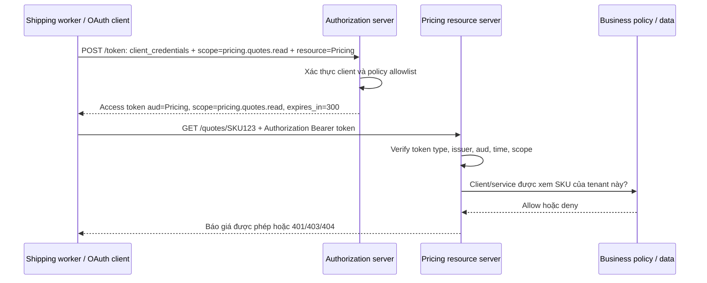
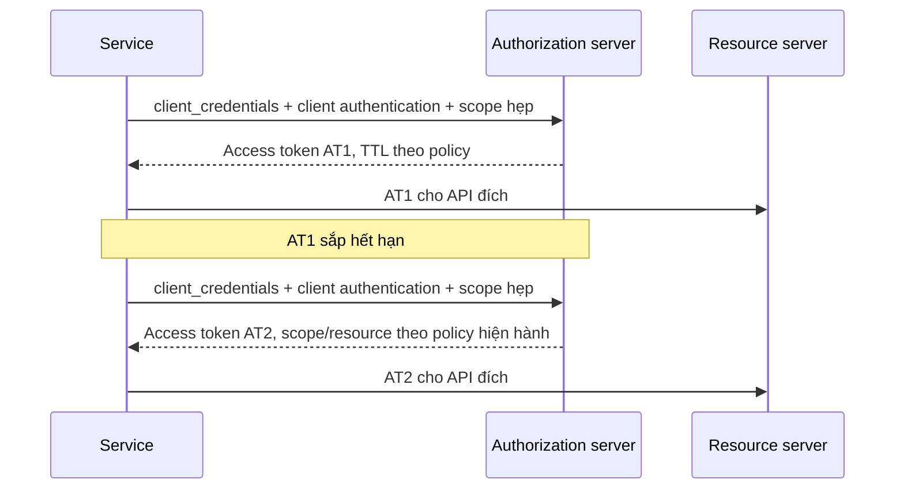

# Least privilege service scope

Một service xử lý đơn hàng cần đọc giá vận chuyển từ Pricing API. Để tích hợp nhanh, nhóm phát triển cấp cho service một access token có scope `admin`, có thể gọi mọi API và tồn tại nhiều giờ. Kết nối chạy thành công, nhưng khi một bản sao token bị lộ qua log hoặc process memory, kẻ tấn công có thể đọc, thay đổi và xóa dữ liệu ở nhiều hệ thống, dù nghiệp vụ ban đầu chỉ cần **đọc một loại thông tin**.

Trong OAuth 2.0 **Client Credentials grant**, client thường là một workload/backend có khả năng xác thực với authorization server (AS) bằng credential được bảo vệ. Nó xin **access token để thực hiện hành động dưới danh tính và quyền đã được AS cho phép của chính client**, chứ không phải mặc nhiên đại diện một người dùng đã đăng nhập. **Least privilege service scope** là việc thiết kế và thực thi phạm vi quyền nhỏ nhất mà service thực sự cần, kết hợp **scope**, **audience/resource**, **client identity**, **tenant/data boundary**, **time**, và các giới hạn tại resource server.

Bài thuộc chương **Client credentials** của module **SECURITY_TOKEN_SECURITY_FUNDAMENTALS**. Nội dung đặt trong mô hình tin cậy OAuth 2.0/OIDC, phân biệt JWT/opaque token, access/refresh token; trình bày cách phát hành, kiểm scope/audience/claims, lưu trữ, thu hồi và phòng chống token theft/replay. Trọng tâm trực tiếp là **giới hạn quyền của access token dành cho service** trong Client Credentials flow — không phải việc cấp quyền người dùng tùy ý.

Sau bài học, bạn có thể:

- Phân biệt **OAuth client**, **service identity**, **access token scope**, **audience** và **business authorization**.
- Thiết kế service scopes riêng theo **API, hành động, dữ liệu, môi trường và tenant** thay vì dùng `admin` hoặc wildcard.
- Cấu hình AS để **chỉ phát hành quyền thuộc allowlist** của client và xử lý cả requested/granted/default scopes.
- Hiểu vì sao **Client Credentials thường không cần refresh token**, và vì sao client authentication không làm access token an toàn trước mọi tấn công.
- Xác minh JWT/opaque access token tại RS: `iss`, `aud`, `exp`, `scope`, token type và policy dữ liệu.
- Xây dựng token caching, key/credential rotation, revocation và sender constraint phù hợp với từng workload.
- Viết negative tests cho việc leo thang scope, dùng nhầm audience, impersonation, cross-tenant và token theft.

## 1. Client Credentials: xác thực ứng dụng, không phải đăng nhập người dùng

Theo RFC 6749 mục 4.4, **Client Credentials grant** cho phép client dùng **client authentication** làm cơ sở xin access token, khi client truy cập tài nguyên **dưới quyền kiểm soát của chính nó**, hoặc theo một thỏa thuận trước với authorization server. Flow này phù hợp với batch job, microservice, daemon hoặc workload tự động.

Ví dụ:

- `inventory-sync` đọc dữ liệu tồn kho của nguồn được phép.
- `shipping-quote-worker` hỏi phí giao hàng cho đơn đã được xử lý.
- `invoice-exporter` đọc thông tin hóa đơn cho một tập tenant được ủy quyền.
- `monitoring-agent` gửi health metrics nhưng không được thay đổi dữ liệu nghiệp vụ.

### 1.1. Bốn vai trò OAuth trong một request S2S

| Vai trò | Trong ví dụ | Trách nhiệm |
| --- | --- | --- |
| **OAuth client** | `shipping-quote-worker` | Xác thực với AS, xin access token theo resource/scope, bảo vệ token |
| **Authorization server** | `https://login.example.com` | Xác thực client, kiểm chính sách cấp token, phát token |
| **Resource server** | `https://api.example.com/shipping` | Kiểm token, audience, scope và quyền nghiệp vụ trước khi trả dữ liệu |
| **Resource owner** | Tổ chức hoặc bên kiểm soát dữ liệu theo mô hình nghiệp vụ | Xác định thẩm quyền phân quyền; không nhất thiết có người dùng tương tác lúc gọi |

**Không suy ra “client là user”.** Trong Client Credentials, `sub` hoặc client identity trong token có thể đại diện workload, không nhất thiết là một người dùng. `client_id` định danh OAuth client, **không phải** email người dùng. Token service không tự chứng minh người dùng cuối đã qua MFA, không có OIDC `auth_time` mới và không được dùng để giả mạo các thao tác yêu cầu user consent.

### 1.2. Least privilege không chỉ là chọn chuỗi scope

Ví dụ service chỉ cần đọc bảng giá:

```text
client = shipping-quote-worker
resource = https://api.example.com/pricing
requested_scope = prices.read
granted_scope = prices.read
allowed_tenants = tenant-a
allowed_operations = GET /v1/prices/{sku}
access_token_ttl = policy-defined-short-lifetime
```

Đây là **hợp đồng minh họa**, không phải cú pháp đăng ký OAuth chuẩn. Nó cho thấy quyền hiệu lực là **giao của nhiều điều kiện**, không chỉ một từ `read` hay `admin`.

## 2. Tại sao service scope quá rộng đặc biệt nguy hiểm?

Một OAuth access token dạng **bearer** có thể được sử dụng bởi bất kỳ bên nào sở hữu token khi chưa có sender constraint. Một token `admin` hoặc một token có thể dùng ở nhiều APIs khiến **blast radius** lớn khi:

- Token lộ từ reverse proxy logs, APM traces, CI/CD output hoặc URL.
- Workload bị RCE/SSRF và kẻ tấn công gọi API bằng danh tính service.
- Service account/Kubernetes secret hoặc private key bị đánh cắp.
- Developer vô tình chuyển token của hệ thống A sang hệ thống B.
- Một backend có quyền rộng bị lợi dụng làm **confused deputy** cho người gọi thiếu quyền.
- Token được cache và tái sử dụng qua tenant/environment không đúng.

**Least privilege giảm hậu quả, không phải thay thế bảo vệ secret.** Ngay cả `prices.read` cũng có thể là quyền nhạy cảm nếu trả bảng giá của mọi khách hàng; cần giới hạn **tenant, đối tượng và trường dữ liệu** cùng resource scope.

### 2.1. Mô hình ba câu hỏi

Khi review một scope cho service, hỏi:

1. **Service thật sự cần làm gì?** Đọc, tạo, cập nhật, phê duyệt, xóa hay quản trị?
2. **Service được phép làm trên tài nguyên nào?** API cụ thể, subset dữ liệu, tenant, môi trường nào?
3. **Credential bị lấy cắp có thể gây thiệt hại tối đa gì và trong bao lâu?** Token lifetime, revocation, rate limit, sender binding và abuse detection có đủ?

Thiết kế nên chứng minh tại sao **một scope được yêu cầu** là cần thiết, thay vì yêu cầu tất cả rồi tìm lý do sau.

## 3. Scope là quyền thao tác được cấp, không phải toàn bộ policy

Trong OAuth 2.0, `scope` là chuỗi gồm các **scope tokens phân tách bằng khoảng trắng**, có ngữ nghĩa do AS và RS định nghĩa. Nó cho phép client diễn đạt quyền cần xin, ví dụ:

```text
scope=inventory.read orders.status.write
```

Request `scope=orders.status.write` **không tự cấp quyền**. AS phải kiểm client có thuộc allowlist và điều kiện grant được đáp ứng; resource server phải kiểm token được phát hợp lệ, đúng audience và đúng policy nghiệp vụ.

| Khái niệm | Ý nghĩa | Ví dụ |
| --- | --- | --- |
| **Requested scope** | Client **đề nghị** quyền trong token request | `inventory.read inventory.write` |
| **Allowed scope** | AS policy cho client ID được yêu cầu những quyền nào | Chỉ `inventory.read` |
| **Granted scope** | Phạm vi AS **thực sự cấp** trong access token | `inventory.read` |
| **Effective permission** | Hành động cụ thể được RS chấp nhận sau tất cả điều kiện | Đọc SKU thuộc tenant A |
| **Audience** | RS/API được phép chấp nhận token | `https://api.example.com/inventory` |
| **Business role/entitlement** | Quyền nghiệp vụ ngoài OAuth, có thể thay đổi theo thời gian | `warehouse-viewer`, dữ liệu site 12 |

**Scope-token là case-sensitive**: `Inventory.Read` và `inventory.read` không tự đồng nghĩa. Dấu cách phân tách scopes; RS phải **so khớp nguyên token**, không dùng substring như `scope.includes("read")` rồi coi là quyền đọc.

### 3.1. Scope không phải RBAC

`scope=orders.read` nói token có thể **yêu cầu đọc Orders API**. Nó không nói:

- Service được đọc đơn của tất cả khách hàng.
- Service có quyền ở mọi tenant.
- Service được xuất thông tin thanh toán đầy đủ.
- Service có quyền ghi nếu tên scope chứa từ `orders`.
- Service là admin của tổ chức.

Các điều kiện này thuộc **object-level/tenant authorization** tại RS hoặc policy engine. Một scope lớn dùng thay toàn bộ business policy thường dẫn tới **broken object-level authorization**.

## 4. Thiết kế taxonomy scope cho service

Một taxonomy tốt phải **dễ hiểu, đủ chi tiết và ổn định**, không gắn quyền vào một tên mơ hồ có thể dùng ở mọi API.

### 4.1. Phân theo API và hành động

| API | Scope đề xuất minh họa | Thao tác | Scope tránh dùng |
| --- | --- | --- | --- |
| Inventory | `inventory.items.read` | Xem hàng tồn | `inventory.admin` |
| Inventory | `inventory.stock.adjust` | Điều chỉnh tồn theo policy | `inventory.*` |
| Orders | `orders.status.read` | Đọc trạng thái đơn | `orders.all` |
| Orders | `orders.status.update` | Chỉ cập nhật trạng thái hợp lệ | `orders.write_all` |
| Pricing | `pricing.quotes.read` | Lấy báo giá | `pricing.superuser` |
| Billing | `billing.invoices.read` | Đọc hóa đơn được phép | `billing.full_access` |
| Billing | `billing.refunds.create` | Tạo yêu cầu hoàn tiền có kiểm soát | `payments.root` |
| Observability | `metrics.write` | Gửi metrics | `admin` |

**Các tên trên là ví dụ do hệ thống tự quy định**, không phải tên scope bắt buộc của OAuth. Một hệ thống có thể dùng `read:items` thay `inventory.items.read` nếu có hợp đồng rõ. Mục tiêu là tránh quyền bị hiểu khác nhau giữa AS và RS.

### 4.2. Không tạo quá nhiều scope vô nghĩa

Scope quá rộng tăng blast radius; nhưng tạo riêng scope cho **từng record ID** có thể khiến quản trị và token issuance trở nên không khả thi. Thường nên tách:

- **OAuth scopes:** loại hành động/khả năng truy cập ở cấp API.
- **Audience/resource:** token dành cho RS nào.
- **Policy theo tenant/owner/entity:** đối tượng cụ thể nào được phép.
- **Condition/assurance:** giới hạn thời gian, hạn mức, actor, môi trường hoặc xác nhận bổ sung.

Thay vì phát `orders.read.tenantA.order42` cho hàng triệu order IDs, có thể phát `orders.read` cho một RS và để RS kiểm **workload identity có quyền đọc order 42 ở tenant A không**.

### 4.3. Quyền ghi nên tách theo loại hành động

`write` chung thường quá rộng. Ví dụ không nên cho service chỉ xác nhận đã giao hàng quyền **xóa đơn**, **sửa người nhận** hoặc **phê duyệt hoàn tiền**. Phân tách:

```text
orders.delivery.confirm
orders.address.update
orders.cancel.request
billing.refunds.create
billing.refunds.approve
```

Đối với nghiệp vụ nhạy cảm, một scope **không phải sự cho phép cuối cùng**. RS còn kiểm trạng thái đơn, người/actor, hạn mức, chống lặp, segregation of duties và chính sách phê duyệt.

## 5. Luồng Client Credentials với scope tối thiểu



**Không có bước browser redirect hoặc người dùng nhập password** trong flow này. Client xác thực **chính nó** tại token endpoint; access token biểu diễn quyền AS đã cấp cho workload. Nếu yêu cầu cần thực hiện **thay mặt người dùng**, phải thiết kế delegation/user grant hoặc token exchange phù hợp, không dùng Client Credentials để tự khẳng định một user bất kỳ.

### 5.1. Token request minh họa

```http
POST /oauth2/token HTTP/1.1
Host: login.example.com
Authorization: Basic <encoded-client-credentials>
Content-Type: application/x-www-form-urlencoded
Accept: application/json

grant_type=client_credentials&scope=pricing.quotes.read&resource=https%3A%2F%2Fapi.example.com%2Fpricing
```

`Authorization: Basic` ở đây là **HTTP client authentication** minh họa; `client_id` và `client_secret` được encode theo quy tắc RFC 6749 trước khi đưa vào Basic, rồi truyền qua HTTPS. Không đặt client secret hoặc access token vào URL/query string. Một số AS dùng **private-key JWT**, **mTLS** hoặc workload federation thay client secret.

Tham số `resource` ở ví dụ dựa trên **Resource Indicators for OAuth 2.0 (RFC 8707)**; nó **không phải tham số bắt buộc của Client Credentials grant** và chỉ sử dụng khi AS/profile hỗ trợ. Nếu AS không có `resource`, client/AS cần hợp đồng audience cụ thể theo registration, scope hoặc cơ chế chuẩn được hỗ trợ, **không tự đoán audience từ URL**.

### 5.2. Token response minh họa

```http
HTTP/1.1 200 OK
Content-Type: application/json
Cache-Control: no-store
Pragma: no-cache

{
  "access_token": "<access-token-issued-for-pricing-api>",
  "token_type": "Bearer",
  "expires_in": 300,
  "scope": "pricing.quotes.read"
}
```

**`expires_in=300` là ví dụ**, không phải TTL bắt buộc. `token_type=Bearer` nói cách trình access token; **không quyết định token là JWT hay opaque**. Client không được dùng response này để tự tạo quyền khác hoặc kéo dài `exp` trong payload.

## 6. Requested scope khác granted scope

Client có thể request:

```text
scope=pricing.quotes.read pricing.quotes.write
```

Nhưng AS chỉ cho `shipping-quote-worker` scope `pricing.quotes.read`. Tùy policy, AS có thể **thu hẹp hoặc từ chối** request. Nếu AS phát token với scope khác scope request, token response phải thể hiện phạm vi thực cấp theo mục 5.1 của RFC 6749.

| Request | AS registration/policy | Token có thể phát | Kết luận |
| --- | --- | --- | --- |
| `pricing.quotes.read` | Cho phép read | `pricing.quotes.read` | Hợp lệ, tiếp tục xét audience |
| `pricing.quotes.read pricing.quotes.write` | Chỉ cho phép read | Read-only hoặc request bị từ chối | Không được coi write đã cấp |
| `billing.refunds.approve` | Service không được phép | Từ chối | Không nâng quyền qua token endpoint |
| Không gửi `scope` | AS có default policy | Scope mặc định hoặc từ chối | Không suy ra admin |
| `scope=inventory.read` nhưng resource Pricing | AS kiểm tính phù hợp resource | Thường từ chối hoặc giới hạn theo policy | Không dùng scope chéo API tùy ý |

### 6.1. Nếu response không có trường `scope`?

Mục 5.1 của RFC 6749 cho phép token response **bỏ `scope` khi phạm vi cấp giống phạm vi đã yêu cầu**, còn khi cấp khác thì `scope` là bắt buộc. Điều này không có nghĩa một client có thể dựa vào client-side request parameters để quyết định policy của RS. Resource server phải lấy scope từ **access token đã xác minh** hoặc kết quả introspection/AS trust channel.

Client cần xử lý profile của AS rõ ràng và kiểm token response, đặc biệt khi request scope bị thu hẹp. **Không ghi token là “full access” vì `scope` bị thiếu**.

### 6.2. Default scope là quyết định an ninh

Nếu request bỏ `scope`, theo mục 3.3 của RFC 6749, AS phải dùng **default được định nghĩa trước** hoặc **từ chối**. Đối với Client Credentials, default quá rộng là nguồn tạo access token quá quyền khi thư viện OAuth vô tình quên tham số.

Thiết kế nên làm cho default:

- **Hẹp nhất có thể** hoặc yêu cầu khai scope tường minh theo profile.
- **Riêng từng client**, không dùng `admin` chung cho mọi service.
- Có danh sách resource và scope được phép, có người phê duyệt thay đổi.
- Có test kiểm default để phát hiện cấu hình sai trong tương lai.

## 7. Scope allowlist tại authorization server

Không nên cho client tự chọn bất kỳ chuỗi scope rồi nhận nó trong token. AS cần bản đăng ký/policy **cụ thể cho từng OAuth client**.

Ví dụ:

```yaml
# PSEUDOCONFIG, không phải cú pháp của AS cụ thể.
clients:
  shipping-quote-worker:
    grant_types: [client_credentials]
    authentication_method: private_key_jwt
    allowed_resources:
      - https://api.example.com/pricing
    allowed_scopes:
      - pricing.quotes.read
    default_scopes:
      - pricing.quotes.read
    access_token_max_ttl_seconds: 300
  invoice-exporter:
    grant_types: [client_credentials]
    authentication_method: tls_client_auth
    allowed_resources:
      - https://api.example.com/billing
    allowed_scopes:
      - billing.invoices.read
    default_scopes: []
    access_token_max_ttl_seconds: 600
```

**YAML trên chỉ minh họa mô hình policy**, không phải cấu hình thật. AS có thể dùng DB, client registration hoặc policy engine với schema khác.

### 7.1. Các điều kiện AS cần kiểm

1. Client đã đăng ký, được phép dùng `grant_type=client_credentials`.
2. **Client authentication thành công** theo đúng credential và method đã đăng ký.
3. Requested scope tokens hợp lệ về cú pháp, thuộc **allowlist client** và phù hợp resource đích.
4. Resource indicator/audience được phép theo registration và policy.
5. Client/account/workload chưa bị khóa, credential/grant còn hiệu lực.
6. Lifetime, token type, claim set và sender constraint được tính theo security policy.
7. Scope thực cấp **không được mở rộng** vượt grant/registration/policy.
8. Security/audit events được ghi mà không lộ client secret hoặc access token.

```text
function issueClientCredentialsToken(authenticatedClient, request):
    require request.grant_type == "client_credentials"
    require authenticatedClient.isValidAndAllowedForGrant()

    scopes = parseExactScopeTokens(request.scope)
    if request.scope is absent:
        scopes = configuredDefaultScopesOrReject(authenticatedClient)

    require scopes is permitted by clientAllowedScopes
    require resourceIsAllowedForClient(authenticatedClient, request.resource)
    require all scopes are valid for resolvedResource
    require currentClientPolicyAllowsRequestedOperationSet(scopes)

    accessToken = issueAccessToken(
        clientIdentity = authenticatedClient.id,
        audience = resolvedResource,
        scopes = narrowedOrEqualGrantedScopes,
        expiry = policyBasedShortExpiry
    )
    return tokenResponse(accessToken, grantedScopes)
```

Đây là **pseudocode để diễn giải ranh giới cấp quyền**, không phải triển khai đầy đủ AS. Chi tiết xử lý requested scope khác granted scope và error responses theo OAuth specification và provider profile.

### 7.2. Không dùng dynamic scope wildcard không kiểm soát

Đừng phát mọi scope bắt đầu bằng `billing.` hoặc scope `*` cho service chỉ vì service “nằm trong nội bộ”. Nếu thật sự cần wildcard được định nghĩa trong một hệ thống, AS/RS phải có **ngữ nghĩa, review, audit và giới hạn rõ ràng**; tránh để wildcard ngầm trở thành quyền quản trị mọi tài nguyên.

## 8. Audience và Resource Indicators: token phải có đích

Một access token được cấp `scope=read` nhưng không giới hạn RS có thể bị chấp nhận ở nhiều API có cùng cách hiểu scope. **Audience restriction** giảm token substitution và giảm blast radius.

Ví dụ:

| OAuth client | Resource/audience | Scope | API được phép |
| --- | --- | --- | --- |
| `shipping-quote-worker` | `https://api.example.com/pricing` | `pricing.quotes.read` | Pricing |
| `stock-auditor` | `https://api.example.com/inventory` | `inventory.items.read` | Inventory |
| `invoice-exporter` | `https://api.example.com/billing` | `billing.invoices.read` | Billing |

Một token có `aud=pricing-api` không được sử dụng để gọi Billing API dù:

- Hai API dùng cùng AS và JWKS signing keys.
- Token có chữ ký hợp lệ và chưa hết hạn.
- Client đã xác thực bằng private key mạnh.
- Token chứa một scope tên gần giống `read`.

### 8.1. RFC 8707 không thay thế scope

Tham số `resource` giúp client chỉ định resource server dự kiến theo khả năng AS. Scope trả lời **làm gì**, resource/audience trả lời **ở đâu**. Cần kết hợp cả hai với danh tính workload và policy dữ liệu.

```text
resource = https://api.example.com/pricing
scope = pricing.quotes.read
```

AS phát token có audience tương ứng theo profile; **resource server tự xác minh audience**. Không tin một header `X-Target-Audience` hoặc query `aud` do caller tự cung cấp khi resource server chấp nhận token.

### 8.2. Một service gọi nhiều APIs

Khi `order-orchestrator` gọi Pricing và Billing, thường nên xin **hai token hẹp**:

```text
Token P:
    aud = pricing-api
    scope = pricing.quotes.read

Token B:
    aud = billing-api
    scope = billing.invoices.create
```

Đừng xin token `aud=[pricing-api,billing-api,inventory-api]` với mọi scope nếu không có lý do bảo mật rõ. JWT cho phép audience là mảng theo spec, nhưng càng nhiều RS và scope thì bản sao token bị lộ càng có nhiều nơi bị lạm dụng.

## 9. JWT access token cho Client Credentials

Nếu AS phát JWT access token theo profile (ví dụ RFC 9068), payload **minh họa** có thể như sau:

```json
{
  "iss": "https://login.example.com",
  "sub": "shipping-quote-worker",
  "aud": "https://api.example.com/pricing",
  "client_id": "shipping-quote-worker",
  "scope": "pricing.quotes.read",
  "iat": 1795000000,
  "nbf": 1795000000,
  "exp": 1795000300,
  "jti": "example-service-token-001"
}
```

Đây là **claims được decode, không phải JWT đã có chữ ký kiểm chứng được**. Giá trị `sub` đại diện client/workload ở ví dụ; không được mặc định mọi AS hoặc token profile đều định nghĩa `sub` giống nhau. RS phải xác minh token theo hợp đồng tin cậy của issuer.

### 9.1. RS cần kiểm đầy đủ

1. **Token type/profile** dành cho OAuth access token; không chấp nhận OIDC ID token hay refresh token làm Bearer credential.
2. **Chữ ký JWT/JWS** với khóa từ issuer đã cấu hình và thuật toán allowlist.
3. **`iss`** đúng AS tin cậy, **`aud`** chứa identifier chính resource server.
4. **`exp`**, `nbf` và lifetime/clock skew theo chính sách; NumericDate tính theo giây.
5. **`client_id`/`sub`** có ngữ nghĩa đúng profile, xác định service identity đáng tin.
6. **`scope`** chứa quyền thao tác yêu cầu, so khớp nguyên token.
7. **Tenant/data/object policy** bảo vệ resource cụ thể.
8. **Sender constraint/state bổ sung** khi token/profile yêu cầu.

Một JWT ký hợp lệ nhưng `aud=shipping-api` phải bị Pricing API từ chối. Một JWT chứa `scope=pricing.quotes.read` vẫn không cho service đọc báo giá của tenant ngoài quyền.

### 9.2. Key rotation và không tin key URLs trong token

Khi AS dùng JWKS, `kid` giúp RS tìm khóa trong tập **đã được issuer ủy quyền**. RS không tự tải `jku`/`x5u` hoặc URL do token chưa tin đưa ra, không cho phép `alg=none` trong profile cần chữ ký, và không chấp nhận key/algorithm confusion. Khi AS xoay khóa, RS phải có chính sách cache/JWKS refresh và xử lý key compromise.

### 9.3. JWT không tự thực thi revocation tức thì

Nếu RS chỉ kiểm JWT offline, việc revoke client secret hoặc xóa refresh token **không tự chặn access token đã cấp** trước `exp`. Với thao tác có rủi ro cao, cân nhắc TTL ngắn, denylist/`jti`, client/account-state lookup hoặc dùng opaque/introspection theo threat model. `jti` chỉ là ID; nó **không tự ngăn replay**.

## 10. Opaque access token và introspection

AS có thể phát **opaque access token** cho Client Credentials. RS không tự biết scope/subject/audience từ chuỗi opaque, mà có thể gọi OAuth 2.0 Token Introspection (RFC 7662) qua HTTPS và cơ chế RS authentication phù hợp.

Ví dụ response **minh họa theo AS contract**:

```json
{
  "active": true,
  "client_id": "shipping-quote-worker",
  "scope": "pricing.quotes.read",
  "aud": "https://api.example.com/pricing",
  "exp": 1795000300
}
```

RS phải:

- Xác minh kết quả từ **AS đáng tin**, bảo vệ authentication/transport và schema response.
- Chấp nhận token chỉ nếu `active` thực sự là boolean `true`.
- Xác minh **resource binding/audience**. RFC 7662 **không bắt buộc `aud` trong mọi introspection response**; nếu không có, cần AS contract ràng buộc token với RS đáng tin, không mặc định `active=true` là đủ.
- Kiểm **scope** và business policy; không coi HTTP 200 từ introspection là access token hợp lệ.
- Xử lý timeout/outage theo **fail closed**, trừ việc dùng cache còn hợp lệ đúng chính sách.

### 10.1. Opaque hay JWT: có ảnh hưởng tới least privilege?

**Nguyên tắc cấp scope tối thiểu giống nhau**. JWT tự chứa thường giúp RS xác minh offline nhanh nhưng có thách thức stale claims/revocation; opaque cho phép AS phản ánh state/introspection nhưng tăng latency, phụ thuộc AS và có thể bị cache stale. Định dạng token **không thay thế việc AS giới hạn grant hay RS kiểm object policy**.

## 11. Resource server phải thực thi scope và object policy

Một RS bảo vệ `GET /v1/prices/{sku}` không thể chỉ kiểm token chữ ký hợp lệ. Ví dụ Java-style pseudocode:

```java
// PSEUDOCODE - tên lớp/method và model minh họa.
HttpResponse getPrice(HttpRequest request, String sku) {
    VerifiedAccessToken token = tokenVerifier.verifyAccessToken(
        request.authorizationBearer(),
        "https://login.example.com",
        "https://api.example.com/pricing"
    );
    if (!token.isAccepted()) {
        return unauthorizedBearerInvalidToken();
    }
    if (!token.scopes().contains("pricing.quotes.read")) {
        return forbiddenInsufficientScope("pricing.quotes.read");
    }

    ProductPrice price = pricesRepository.find(sku);
    if (price == null) {
        return notFound();
    }

    if (!policy.canReadPrice(
            token.verifiedClientId(),
            price.tenantId(),
            price.customerClassification())) {
        return forbiddenOrNotFoundAccordingToPolicy();
    }
    return ok(price.onlyFieldsAllowedFor(token.verifiedClientId()));
}
```

**Không lấy `clientId` hoặc `tenantId` từ request body/header làm nguồn chứng minh quyền.** Nếu caller tự gửi `X-Client-Id: admin-service`, RS phải bỏ qua hoặc chỉ tin một trusted identity context đã được gateway xác thực bằng kênh riêng.

### 11.1. Scope đủ nhưng vẫn phải từ chối khi không đúng tenant

`invoice-exporter` có `billing.invoices.read` cho tenant A. Nó gọi `GET /invoices/9001` thuộc tenant B. Chữ ký, audience và scope đều đúng. **RS vẫn phải từ chối** vì dữ liệu tenant B không thuộc quyền service. Có thể trả 403 hoặc 404 theo disclosure policy.

### 11.2. Scope thiếu và HTTP errors

Theo RFC 6750, các trường hợp thường là:

| Tình huống | Phản hồi điển hình | Ý nghĩa |
| --- | --- | --- |
| Thiếu access token | `401 Unauthorized` + Bearer challenge | Chưa có credential |
| Token không hợp lệ/hết hạn/sai issuer hoặc audience | `401` + `invalid_token` nếu phù hợp | Không chấp nhận credential |
| Token hợp lệ nhưng thiếu `pricing.quotes.read` | `403` + `insufficient_scope` | Token không được cấp scope thao tác |
| Scope hợp lệ nhưng tenant/owner không được phép | `403`/`404` theo policy | Không có quyền object |
| AS introspection unavailable | `503/5xx` hoặc xử lý cache còn hợp lệ theo policy | Lỗi hạ tầng, **không fail open** |

Không tự coi mọi 403 là thiếu scope. Cần phân biệt **token permissions** và **resource-specific decisions**.

## 12. Tách từng workload identity thay vì một “super client”

Nhiều đội cấp một `integration-service` chung cho:

- Job đồng bộ tồn kho.
- Service đọc đơn.
- Worker tạo hóa đơn.
- Hệ thống giám sát.

Sau đó mọi nơi dùng cùng `client_id`, shared secret và scope `admin`. Khi một container bị chiếm, attacker có toàn bộ quyền. Đồng thời audit không thể phân biệt workload nào đã làm gì.

### 12.1. Thiết kế phân tách

| Workload | OAuth client | Audience | Scope tối thiểu |
| --- | --- | --- | --- |
| Đồng bộ SKU | `inventory-sync` | Inventory | `inventory.items.read` |
| Lấy báo giá | `shipping-quote-worker` | Pricing | `pricing.quotes.read` |
| Xuất hóa đơn | `invoice-exporter` | Billing | `billing.invoices.read` |
| Gửi metrics | `metrics-agent` | Metrics | `metrics.write` |
| Hủy đơn theo policy | `cancellation-service` | Orders | `orders.cancel.request` |

Mỗi workload có credential riêng, registration riêng, access token riêng và audit riêng. Điều này giảm **blast radius** và tăng khả năng thu hồi đúng service khi có sự cố.

### 12.2. Phân tách theo môi trường

Đừng dùng cùng client secret/workload identity cho **development, staging và production**. Nếu staging bị chiếm, attacker không nên xin được token production hay gọi resource APIs production. Các AS, audiences, scopes, trust policies và keys cần phân tách đủ theo threat model.

### 12.3. Phân tách theo tenant khi cần

Nếu service được ủy quyền nhiều tenants, hãy đánh giá:

- Một service identity có entitlement rõ cho các tenant được phép.
- Token được ràng buộc resource/tenant theo profile nếu AS hỗ trợ và giảm rủi ro đáng kể.
- RS luôn kiểm tenant/object policy dựa trên metadata đáng tin.
- Có cơ chế thu hồi/giảm quyền theo từng tenant khi một hợp đồng khách hàng kết thúc.

**`tenant_id` trong request do client tự khai không được coi là grant**. Ngay cả claim `tenant_id` trong JWT phải là claim đã xác minh từ issuer tin cậy và có policy xử lý quyền thay đổi.

## 13. Không dùng Client Credentials để giả lập user delegation

Một service `order-orchestrator` nhận request từ user A rồi gọi Billing API để hoàn tiền. Nếu nó dùng Client Credentials với `billing.refunds.approve` và tự thêm header `X-User-Id: A`, Billing có thể cho phép hoàn tiền **không qua quyền/consent của user**. Đây là nguy cơ **confused deputy** hoặc privilege escalation.

### 13.1. Tách service operation khỏi user operation

| Nghiệp vụ | Danh tính cần thiết | Lựa chọn kiến trúc |
| --- | --- | --- |
| Batch đồng bộ catalog dưới quyền hệ thống | Workload | Client Credentials với scope đọc/ghi hẹp |
| User xem đơn của mình | User-delegated | Authorization Code/PKCE hoặc mô hình user grant phù hợp |
| Service gọi API B thay mặt user | Service + user context | Token exchange/on-behalf-of được AS hỗ trợ và RS kiểm delegation |
| Service tự động cập nhật trạng thái giao hàng | Workload có quyền hạn chế | Client Credentials với scope `orders.delivery.confirm` và policy dữ liệu |
| Hoàn tiền cần phê duyệt con người | Workload + người phê duyệt/step-up | Policy chuyên biệt, approval/audit, không chỉ một scope admin |

### 13.2. Token exchange và audience downstream

RFC 8693 mô tả OAuth Token Exchange để AS có thể phát token mới cho downstream resource trong điều kiện được phép. Khi service nhận access token có `aud=orders-api` rồi cần gọi Billing API:

- **Không forward nguyên bearer token** sai audience.
- **Không tự sửa `aud`** trong JWT; chữ ký sẽ không còn hợp lệ.
- Xin token phù hợp resource/actor/policy từ AS nếu flow được hỗ trợ.
- Billing RS xác minh issuer, audience, scope và **quyền theo đối tượng**, bao gồm actor/delegation theo contract.

**Token exchange không được tự động cấp quyền nhiều hơn token nguồn hoặc policy cho phép**; AS phải xét bản chất delegation, tránh biến service mạnh thành “đường vòng” cho caller yếu.

## 14. Client authentication khác access token scope

**Client authentication** chứng minh client ở token endpoint đang sở hữu credential đã đăng ký. **Scope** là quyền AS cấp trong access token. Cơ chế client authentication mạnh **không tự cho phép mọi scope**.

| Phương thức | Dùng để làm gì? | Rủi ro cần kiểm soát |
| --- | --- | --- |
| `client_secret_basic` | Xác thực client bằng shared secret qua Basic trên HTTPS | Secret nằm ở config/log, shared blast radius |
| `private_key_jwt` | Client ký assertion bằng private key; AS xác minh theo registration | Key rotation, `aud`/`iss`/`sub`, expiry, replay |
| mTLS client authentication | Client trình certificate/private key ở TLS layer | Certificate issuance, rotation, proxy termination, trust |
| Workload identity federation | Dùng identity của nền tảng được AS tin theo contract | Trust mapping, claim validation, short-lived credentials |

### 14.1. Vì sao không lưu một client secret trong ứng dụng public?

Client Credentials thường chỉ dành cho **confidential clients** có thể xác thực với AS. Nhúng secret cố định vào **SPA hoặc mobile binary** khiến người dùng/attacker có thể trích xuất và xin token với quyền toàn bộ ứng dụng. Một `client_id` không bí mật, nhưng việc biết client ID **không chứng minh client identity**.

Khi một service backend dùng secret manager, KMS/HSM hoặc mTLS, nó vẫn cần hạn chế scope và resource theo registration. **Khóa mạnh không chữa token quá quyền**.

### 14.2. Key compromise không giống bearer token leak

- Nếu attacker chỉ lấy được **access bearer token**, họ có thể gọi đúng audience/scope đến khi token hết hạn/thu hồi.
- Nếu lấy được **client secret/private key**, attacker có thể **xin token mới** theo registration cho đến khi AS vô hiệu credential, tùy binding/policy.
- Nếu có RCE trên workload, attacker có thể sử dụng client authentication và token ngay trong runtime, dù private key không export được.

Vì thế phải áp dụng **workload isolation, egress control, key rotation, audit, short-lived tokens và least privilege**.

## 15. Java service: xin và cache access token có scope hẹp

Đối với Java backend, nên dùng OAuth client library đã được kiểm thử. Ví dụ sau là **pseudocode Java-style** về chính sách chọn token; không tự thực hiện cryptography:

```java
// PSEUDOCODE: API giả định minh họa logic, không phải thư viện cụ thể.
final class PricingTokenProvider {
    private final OAuthClient oauth;
    private final SecureTokenCache cache;

    AccessToken forPricingRead() {
        TokenRequest request = TokenRequest.clientCredentials()
            .issuer("https://login.example.com")
            .resource("https://api.example.com/pricing")
            .scope("pricing.quotes.read")
            .clientAuthentication(WorkloadIdentity.current())
            .build();

        TokenCacheKey key = TokenCacheKey.from(
            request.issuer(),
            request.authenticatedClientId(),
            request.resource(),
            request.scope(),
            request.senderBindingIdIfAny()
        );

        return cache.singleFlightGetOrAcquire(key, () -> {
            TokenResponse response = oauth.requestToken(request);
            validateTokenResponseTypeAndGrantedScope(response);
            // Không chấp nhận token được cấp scope/audience rộng trái policy.
            return AccessToken.fromResponse(response);
        });
    }
}
```

Điểm thiết kế:

1. **Scope/resource cố định theo nghiệp vụ**, không lấy trực tiếp từ request của người dùng.
2. **Workload authentication credential** đến từ môi trường/secret manager đáng tin.
3. **Cache key đủ chiều:** issuer, client identity, resource/audience, granted/requested scope, sender-binding khi có.
4. **Refresh trước expiry** bằng Client Credentials request mới, không retry token bị 401 mãi.
5. **Không tự nâng scope khi API trả 403**. Nếu cần quyền mới, phải thay đổi chính sách/registration qua review.
6. **Không log access token hoặc client credential**.

### 15.1. Vì sao cache key chỉ theo `client_id` là sai?

Giả sử một service gọi Inventory và Billing:

```text
BAD CACHE:
  key = client_id
  value = token_for_inventory

GOOD CACHE:
  key = (issuer, client_id, audience, granted_scope_set, sender_binding)
  value = token_for_specific_resource
```

Nếu dùng key chung, client có thể vô tình gửi **token Inventory** tới Billing. Billing đúng chuẩn phải từ chối sai audience, nhưng lỗi này vẫn gây outage và có thể tạo lỗ hổng nếu downstream kiểm audience lỏng lẻo.

### 15.2. Scope là tập, không phải chuỗi phụ thuộc thứ tự

Khi cache theo scope, xử lý scope tokens như một **tập có ngữ nghĩa rõ** theo profile, không nên coi `"a b"` khác `"b a"` chỉ vì thứ tự nếu policy quy định cùng tập. Tuy nhiên, **không tự gộp** một token scope rộng với token scope hẹp vì dễ làm tăng quyền ngầm. Cache key cần phản ánh **quyền thực sự được cấp**, không chỉ raw request string.

### 15.3. Cache hết hạn và concurrency

Nếu token `expires_in=300`, nên cấu hình renewal margin phù hợp clock skew/network latency. Khi hàng chục threads đồng thời cần token mới, sử dụng **single-flight** để tránh đột biến request tới AS. Không cho một request chưa có token hợp lệ “tạm mượn” token sai audience hoặc hết hạn để giữ uptime.

## 16. Client Credentials thường không cấp refresh token

RFC 6749 mục 4.4.3 nói rằng response của Client Credentials **SHOULD NOT** gồm refresh token. Vì client đã có credential để tự xác thực với AS, nó thường có thể xin **access token mới** khi token cũ hết hạn:



**Không khẳng định “bị cấm phát refresh token” trong mọi tình huống**; `SHOULD NOT` là chuẩn khuyến nghị, không phải `MUST NOT`. Nhưng đối với workload thông thường, phát thêm refresh token có thể tăng lượng credential dài hạn và complexity mà không có lợi ích rõ.

### 16.1. Không dùng lại client secret như refresh token

Client secret/private key là **client authentication credential**. Nó không phải refresh token. Một OAuth refresh token, nếu có, dùng với `grant_type=refresh_token` theo chính sách; không gửi client secret trong `Authorization: Bearer` tới resource API.

### 16.2. Không lạm dụng access token dài hạn để né cấp lại

Nếu AS gặp outage hoặc client auth quá tốn kém, không nên giải quyết bằng token `admin` tồn tại nhiều ngày. Thay vào đó, phân tích AS availability, token cache an toàn, TTL phù hợp, retry/backoff có giới hạn và cơ chế workload identity. **Scope tối thiểu + audience hẹp + TTL** giảm rủi ro ngay cả khi token phải giữ trong memory một thời gian.

## 17. Token storage và ranh giới bí mật trong service

Với backend, có ít nhất **hai loại secret khác nhau**:

1. **Client credential:** client secret, private key hoặc workload credential để AS phát token mới.
2. **Access token:** credential trình tới resource server, thường tồn tại ngắn hơn nhưng vẫn nhạy cảm.

| Vị trí/cơ chế | Dùng cho | Cần chú ý |
| --- | --- | --- |
| KMS/HSM/secret manager | Khóa và client auth secrets | Phân quyền, audit decrypt/signing, rotation |
| Workload identity/federation | Credential ngắn hạn chứng minh service | Token exchange/identity trust, ít credential tĩnh |
| Process memory/token cache | Access tokens ngắn hạn | Memory dump, concurrency, không log |
| Shared encrypted cache nếu cần | Access token cho nhiều instances | Phân quyền theo client/resource/tenant, TTL, key management |
| Config file/environment variables | Có thể là phương tiện inject secrets | Process inspection, backup, logs, image leakage |
| Logs/metrics/tracing/URLs | **Không phải nơi lưu token** | Redaction, retention, incident response |

### 17.1. Environment variable không tự là “secure storage”

Biến môi trường hữu ích nhưng có thể bị lộ qua process diagnostics, crash reports, container debugging, kiểm tra deployment hoặc logs. Với key/secret cần bảo vệ cao, nên dùng secret delivery, service identity, file permissions/mounting phù hợp hoặc crypto APIs của KMS/HSM. **Không commit secret vào repository**.

### 17.2. Một token bị lộ từ APM cũng đủ gây hậu quả

HTTP access logs, tracing instrumentation và exception middleware có thể tự ghi header `Authorization`. Hãy redact token ở gateway/SDK, bảo vệ đường đi CI/CD và chỉ lưu metadata như request ID, client ID đã xác minh, audience, scope theo audit policy và kết quả allow/deny.

**Không dùng hash thường của access token làm public log ID nếu có nguy cơ liên kết dữ liệu hoặc tấn công vào token entropy thấp**. Nếu cần fingerprint nội bộ, dùng một cơ chế HMAC/ID bảo vệ thích hợp.

## 18. Revocation, TTL và quyền bị thay đổi

**Least privilege là trạng thái phải duy trì**, không chỉ quyết định tại lúc phát hành. Service có thể đổi nhiệm vụ, mất quyền ở tenant, bị khóa hoặc bị phát hiện lộ key.

| Sự kiện | Hành vi phù hợp |
| --- | --- |
| Service ngừng dùng một API | Gỡ allowed resource/scope, revoke token/grant khi cần |
| Service bị vô hiệu hóa | AS từ chối cấp token mới, RS xử lý token cũ theo TTL/revocation |
| Client secret/private key bị lộ | Xoay/vô hiệu credential, rà scope/audience, revoke tokens có rủi ro |
| Tenant chấm dứt hợp đồng | RS/AS cập nhật entitlement, chặn dữ liệu tenant đó |
| Role/quyền nghiệp vụ thay đổi | RS áp policy hiện hành, không tin token cũ là toàn quyền |
| JWT access token chưa hết hạn | Offline RS có thể vẫn nhận đến `exp` nếu không có denylist/session check |
| Opaque token đã revoke | Introspection có thể trả `active=false`; cache làm trễ áp dụng |
| AS unavailable | Không mở rộng quyền; fail closed khi không thể xác minh |

### 18.1. Rút scope khỏi registration có chặn token đã phát ngay không?

**Không nhất thiết.** Việc AS không cấp token mới với `billing.refunds.create` không tự làm JWT access token cũ hết hạn trước `exp`. Nếu yêu cầu revoke ngay, thiết kế denylist, introspection, policy lookup hoặc TTL phù hợp. Quan trọng là **revocation latency budget** phải được xác định với stakeholders.

### 18.2. JWT vs opaque trong chính sách thay đổi nhanh

JWT offline giảm dependency lên AS nhưng cần chiến lược stale permissions. Opaque introspection cho phép phản ánh AS state nhưng tăng network dependency và có cache latency. Việc chọn token format phải dựa vào **khả năng đáp ứng thời hạn thu hồi**, scale và rủi ro, không chỉ performance.

## 19. Sender-constrained tokens và replay

Access token `Bearer` bị lấy cắp có thể được trình ở API đúng audience/scope. **DPoP** (RFC 9449) và **mTLS certificate-bound access token** (RFC 8705) có thể ràng buộc token với chứng cứ sở hữu khóa/chứng chỉ của client.

| Token usage | Credential gửi API | RS cần kiểm thêm |
| --- | --- | --- |
| Bearer thuần | `Authorization: Bearer <token>` | Token validation, scope, audience, policy |
| DPoP-bound | `Authorization: DPoP <token>` cùng `DPoP: <signed-proof-jwt>` | Key binding, method/URI, `iat`, `jti`, `ath`, nonce/replay theo profile |
| mTLS-bound | Thường `Authorization: Bearer <token>` qua kết nối mTLS | Certificate thumbprint/binding và thông tin xác minh TLS |

Sender constraint giúp **giảm khả năng replay bản sao token trên máy khác**, nhưng **không thể bảo vệ hoàn toàn khi attacker có quyền thực thi trên chính workload** và có thể yêu cầu hệ thống ký proof/call API hợp lệ.

### 19.1. Service nào cần sender constraint?

Cân nhắc khi:

- Service mang quyền nhạy cảm/giá trị cao.
- Token đi qua nhiều hop/proxy có nguy cơ lộ.
- Workload có key management đủ tốt.
- API/provider hỗ trợ xác minh proof/cert trên toàn đường đi.

Sender constraint **không thay thế least privilege**. Một mTLS-bound token có `billing.admin` vẫn có blast radius lớn khi service hoặc key bị chiếm.

## 20. Threat model cho ba cấp sự cố

### Mức A — Attacker sao chép được access token

Nguồn lộ: log, APM, URL, network hop cấu hình sai. Với bearer token, attacker có thể gọi API theo scope/audience cho đến expiry/revoke. **Giảm rủi ro:** TTL ngắn, scope và audience hẹp, token redaction, anomaly detection và sender binding nếu phù hợp.

### Mức B — Attacker lấy được client credential

Attacker có thể **xin access token mới** theo registration của client, ngay cả khi token cũ hết hạn. **Giảm rủi ro:** tách identities, HSM/KMS, rotation/revocation, giới hạn scope/resource và kiểm call pattern.

### Mức C — Attacker có RCE trên workload

Attacker có thể thực hiện hành vi nằm trong quyền hiện có, lấy token trong RAM hoặc dùng signing APIs. **Giảm rủi ro:** runtime isolation, least privilege cho service identity, tách credentials, egress allowlist, policy trên RS, workload attestation khi phù hợp, logging/audit và incident response.

### 20.1. Bảng điều khiển blast radius

| Trục | Thiết kế rủi ro cao | Thiết kế giảm rủi ro |
| --- | --- | --- |
| **Scope** | `admin` mọi thao tác | `pricing.quotes.read` |
| **Audience** | Một token cho tất cả APIs | Token riêng cho Pricing |
| **Subject** | Một OAuth client chung toàn hệ thống | Client identity riêng từng workload |
| **Tenant** | Đọc mọi tenants | Tenant entitlements được RS kiểm |
| **TTL** | Nhiều ngày không có revocation | Ngắn vừa đủ, có phương án revoke |
| **Key** | Shared secret trong image | Identity được bảo vệ/rotation rõ |
| **Token usage** | Bearer không monitoring | Monitoring, sender constraint khi cần |
| **Logging** | Dump request headers | Redaction và audit metadata |

## 21. Governance: ai được thêm hoặc đổi service scope?

Least privilege sẽ thất bại nếu mọi developer có thể tăng scope `admin` trực tiếp trong production mà không review. Một quy trình quản trị hiệu quả cần:

1. **Scope catalogue:** định nghĩa scope, API, endpoint/action, owner, mức nhạy cảm và cách kiểm thử.
2. **Client registration owner:** mỗi workload có team chịu trách nhiệm và danh sách scopes/resources được phép.
3. **Change approval:** yêu cầu thêm scope có lý do nghiệp vụ, rủi ro, kế hoạch kiểm thử và cấp qua IaC/policy workflow.
4. **Separation of duties:** quyền tạo client không tự cho quyền phê duyệt `billing.refunds.approve`.
5. **Expiry/review:** scopes tạm thời, tích hợp ngừng hoạt động và clients không còn dùng phải được rà soát định kỳ.
6. **Observability:** đo scope được sử dụng thực tế ở cấp action/API mà không làm lộ token.
7. **Deprovision:** gỡ credentials/scopes, revoke token/grant, cập nhật RS entitlement khi service ngừng.

### 21.1. Minh họa hồ sơ xin scope

```yaml
# PSEUDOCONFIG review record - không phải đặc tả OAuth.
service: invoice-exporter
business_purpose: Xuất hóa đơn theo lịch
oauth_client_id: invoice-exporter-prod
resource: https://api.example.com/billing
requested_scopes:
  - billing.invoices.read
forbidden_actions:
  - billing.invoices.update
  - billing.refunds.create
tenant_entitlements:
  - tenant-a
client_authentication: private_key_jwt
token_ttl_max_seconds: 600
review_owner: billing-security-team
review_event: scope-or-tenant-change
```

Hồ sơ trên giúp giải thích **tại sao service cần scope**, ai review và phạm vi dữ liệu; nhưng RS phải có **enforcement thật**, không chỉ đọc YAML để coi request tự an toàn.

### 21.2. Metrics cho phát hiện quyền quá rộng

Nên theo dõi:

- Số client có `admin`/wildcard scopes.
- Clients có nhiều hơn một resource audience.
- Token cấp nhưng một scope không được RS sử dụng trong khoảng thời gian dài.
- 403 `insufficient_scope` tăng bất thường.
- Mẫu request vượt tenant, truy cập endpoints nhạy cảm, egress mới.
- AS access-token issue rate, client authentication failures, revoked clients still calling.

Không phải scope không dùng trong một tuần luôn thừa; workload theo quý có thể hợp lệ. Dùng số liệu để **review**, không tự thu hồi mù gây gián đoạn.

## 22. Case study 1: giá vận chuyển chỉ cần đọc

**Bối cảnh:** `shipping-quote-worker` nhận một order và hỏi bảng giá từ Pricing API. Team dự định cấp `pricing.admin` vì “SDK dễ tích hợp”.

**Thiết kế ít quyền:**

1. Đăng ký client riêng và xác thực bằng workload identity/private key được bảo vệ.
2. Chỉ cấp `pricing.quotes.read` cho resource Pricing.
3. Access token TTL ngắn, cache theo client+resource+scope.
4. Pricing RS kiểm token và **đảm bảo chỉ trả bảng giá khách hàng/tenant được phép**.
5. Worker không được gửi token sang Billing/Inventory, không ghi token vào log.

**Khi token bị lộ:** attacker còn có thể đọc phạm vi giá mà token và RS policy cho phép, nhưng không thể dùng token đó để **chỉnh bảng giá** hoặc **duyệt hoàn tiền** nếu AS/RS kiểm scope/audience đúng. **Rủi ro đọc dữ liệu vẫn còn**, cần quản lý TTL/telemetry.

## 23. Case study 2: một service bị lạm dụng làm confused deputy

**Bối cảnh:** `order-orchestrator` có Client Credentials scope `billing.refunds.approve`. API nội bộ nhận request từ user không đủ quyền và gọi Billing để hoàn tiền.

**Lỗi:** Orchestrator cho phép caller truyền `userId`, `tenantId` và `refundAmount`, rồi dùng token service admin để approve mà không kiểm quyền/hạn mức. Dù OAuth token hợp lệ, **chủ thể gọi không được phép**.

**Thiết kế an toàn hơn:**

- Tách scope `billing.refunds.request` khỏi `billing.refunds.approve`.
- Orchestrator kiểm caller, tenant, order ownership và business policy trước khi dùng service credential.
- Với phê duyệt thay mặt user, dùng delegated context/token exchange được AS hỗ trợ nếu cần, kiểm actor/user ở Billing RS.
- Có approval/audit, idempotency key và limits theo policy.
- Giữ service credential chỉ cho hành động nền được ủy quyền rõ.

**Bài học:** Scope service hẹp giúp giảm rủi ro, nhưng **không thay authorizing original caller** hoặc phê duyệt nghiệp vụ.

## 24. Case study 3: token cache lẫn audience/tenant

**Bối cảnh:** `analytics-worker` có một cache keyed chỉ theo `client_id`. Worker vừa lấy token `aud=warehouse-api` với `warehouse.read`, sau đó cần gọi Billing.

**Lỗi kỹ thuật:** Cache trả lại Warehouse token cho Billing. Nếu Billing kiểm audience, request 401; nếu Billing chỉ kiểm chữ ký, token substitution có thể gây lộ dữ liệu. Nếu cache còn chia sẻ token giữa tenants, có thể dẫn tới cross-tenant access.

**Cách sửa:**

1. Cache key theo issuer/client/resource/scope/sender-binding và tenant khi token/entitlement được tenant-bound.
2. RS kiểm audience riêng và owner/tenant policy.
3. Hạn chế TTL cache và thu hồi token khi scope/entitlement đổi.
4. Negative test yêu cầu dùng sai token phải bị 401/403, không “fallback” sang token rộng.

## 25. Case study 4: service credential bị lộ, token scope vẫn hẹp

**Bối cảnh:** Một developer vô tình commit client secret của `metrics-agent`. AS registration chỉ cấp `metrics.write` cho Metrics API.

**Hậu quả:** Attacker có thể xin token mới và gửi metrics giả trong phạm vi policy; không được phép đọc Billing nếu resource/scope binding đúng. Mặc dù blast radius nhỏ hơn token admin, sự cố vẫn đáng xử lý.

**Ứng phó:**

1. Vô hiệu và xoay client credential; rà các access tokens còn hạn.
2. Kiểm tra lịch sử cấp token và request anomalies.
3. Làm sạch secret khỏi các artifact/log được phép xử lý, thay vì chỉ xóa commit mới nhất.
4. Thực hiện revocation/TTL enforcement theo mục tiêu.
5. Cập nhật secret delivery và monitoring để ngăn tái diễn.

**Bài học:** Least privilege làm giảm thiệt hại, **không có nghĩa credential bị lộ là vô hại**.

## 26. Ma trận kiểm thử least-privilege service scope

| # | Tình huống | Kỳ vọng |
| --- | --- | --- |
| 1 | Client Credentials request hợp lệ với scope đã allowlist | AS cấp token theo policy, scope không vượt yêu cầu/quyền |
| 2 | Client xin `billing.refunds.approve` ngoài allowlist | AS từ chối hoặc thu hẹp, không phát quyền ngoài policy |
| 3 | Client bỏ `scope` | AS áp default hẹp hoặc từ chối |
| 4 | Scope hoa/thường khác nhau | AS/RS không tự chuẩn hóa thành cùng quyền |
| 5 | Scope tương tự `orders.read.all` | RS không so substring thành `orders.read` |
| 6 | Client request scope trong resource khác | AS từ chối/giới hạn theo resource policy |
| 7 | Client auth secret sai | AS không cấp token |
| 8 | Client dùng grant type chưa được đăng ký | AS từ chối |
| 9 | Client B dùng credential/token của client A theo cách không được phép | AS/RS từ chối theo identity/binding |
| 10 | JWT access token sai `iss` | RS từ chối |
| 11 | JWT có chữ ký sai hoặc `alg=none` | RS từ chối |
| 12 | JWT sai `aud` nhưng cùng issuer/JWKS | RS từ chối |
| 13 | OIDC ID token gửi làm Bearer tới API | RS từ chối sai token type/audience |
| 14 | Refresh token gửi API | RS từ chối |
| 15 | JWT hết hạn hoặc chưa đến `nbf` | RS từ chối theo time policy |
| 16 | Opaque introspection HTTP 200, `active=false` | RS từ chối |
| 17 | Opaque `active=true` nhưng không có resource binding đáng tin | RS không tự allow |
| 18 | Introspection outage | Fail closed hoặc cache còn hạn theo policy |
| 19 | Token đúng audience nhưng thiếu scope endpoint | 403/`insufficient_scope` |
| 20 | Token có scope nhưng resource thuộc tenant khác | RS chặn 403/404 |
| 21 | User caller có quyền thấp, service có token mạnh | Không confused deputy, kiểm original caller/delegation |
| 22 | Worker đọc Pricing token rồi gửi tới Billing | Billing từ chối sai audience |
| 23 | Cache trả token tenant/resource khác | Không sử dụng, isolation đúng |
| 24 | Scope wildcard vô tình được thêm vào registration | IaC/policy review/test phát hiện |
| 25 | Token response cấp scope ít hơn request | Client/RS chỉ áp granted scope |
| 26 | Service đăng ký bị khóa, gọi xin token mới | AS từ chối |
| 27 | JWT đã cấp vẫn còn hạn sau revoke client | Hành vi đúng TTL/denylist/revocation budget |
| 28 | Opaque đã revoke nhưng cache introspection stale | Độ trễ trong giới hạn cam kết |
| 29 | DPoP-bound token thiếu proof/`ath` sai | RS từ chối |
| 30 | mTLS-bound token thiếu certificate đúng | RS từ chối |
| 31 | Token bị ghi ra access logs hoặc trace | Redaction và kiểm thử phát hiện/ngăn |
| 32 | Client secret/private key bị lộ | Rotation/revocation, audit và scope limits hoạt động |
| 33 | Hai threads đồng thời xin token cùng resource | Single-flight/cache không tạo bão request |
| 34 | AS timeout và client không có token hợp lệ | Không dùng token quá quyền hoặc hết hạn để fallback |
| 35 | Service chỉ có `orders.status.read` thử xóa order | RS từ chối |
| 36 | Tenant entitlement bị gỡ khi JWT chưa hết hạn | RS áp policy hiện hành theo security requirement |

**Cần kết hợp** unit tests cho policy allowlists, integration tests với AS/RS, gateway/mesh authorization tests, failure injection cho cache/outage, và security tests cho token theft, confused deputy, cross-tenant access. Một luồng lấy token trả HTTP 200 **không chứng minh least privilege đang được thực thi**.

## 27. Checklist production: giới hạn service scope

1. **Mỗi workload có danh tính riêng chưa?** Tránh client chung với quyền `admin` và shared secret ở nhiều apps.
2. **Service thực sự cần những hành động nào?** Có scope theo API/action rõ ràng, không wildcard vô hạn?
3. **AS enforce allowlist?** Client không thể xin scope/resource ngoài registration và policy.
4. **Default scopes an toàn?** Nếu client bỏ `scope`, AS không cấp quyền rộng ngoài dự kiến.
5. **Audience rõ ràng?** Token được phát cho API đích, không dùng sai giữa Pricing/Orders/Billing.
6. **Client authentication vững?** Secret manager, private-key JWT, mTLS hoặc workload identity phù hợp và key rotation?
7. **Token TTL hợp lý?** Access token ngắn vừa đủ, có kế hoạch outage/backoff, không đặt `exp` nhiều ngày để dễ cache.
8. **Refresh token có cần không?** Với Client Credentials thường xin AT mới bằng client authentication; không tạo RT dài hạn không cần thiết.
9. **RS kiểm token đúng?** JWT signature/issuer/audience/type/expiry/scope hoặc opaque introspection/resource binding?
10. **Object policy có hiệu lực?** Service có scope đúng vẫn không được đọc/ghi tenant hoặc record không thuộc quyền.
11. **User-delegated action được tách?** Không mạo danh user bằng Client Credentials và header `X-User-Id` chưa tin.
12. **Downstream token đúng audience?** Có token exchange/delegation hoặc Client Credentials hợp lệ cho RS khác.
13. **Cache an toàn?** Key theo issuer/client/audience/scope/binding, TTL và concurrency; không chia sẻ token sai context.
14. **Bảo vệ secret/token?** TLS, logs redaction, token storage ngắn hạn, KMS/HSM, workload identity và backup controls.
15. **Revocation thực tế?** Biết tác động của JWT offline/cache opaque, có TTL/denylist/introspection khi cần.
16. **Replay risk được đánh giá?** Cân nhắc DPoP/mTLS nếu service có privilege cao và hạ tầng hỗ trợ.
17. **Scope governance?** Đã có owner, change review, expiry, deprovision, metrics và audit?
18. **Negative tests đủ?** Sai issuer/aud/scope/tenant, client bị khóa, credential leak, AS outage, confused deputy và logs?

**Kết luận:** **Least privilege service scope trong Client Credentials là thiết kế quyền nhỏ nhất cho từng workload, chứ không chỉ là đặt một tên scope dễ nhớ.** Authorization server phải xác thực đúng client, ràng buộc token với **scope và audience đã được phép**, còn resource server phải xác minh access token và áp dụng **tenant/object/business authorization**. Client Credentials không mặc nhiên đại diện người dùng; một service có quyền mạnh không được dùng làm đường vòng cho caller yếu. Access token ngắn hạn, token cache đúng context, quản lý client credential, revocation, sender constraint và audit giúp giới hạn hậu quả khi token hoặc workload bị xâm nhập.

## Tài liệu tham khảo

- [RFC 6749 — The OAuth 2.0 Authorization Framework](https://www.rfc-editor.org/rfc/rfc6749): mục 3.3 Scope, mục 4.4 Client Credentials, mục 5 token responses và mục 2.3 client authentication.
- [RFC 9700 — Best Current Practice for OAuth 2.0 Security](https://www.rfc-editor.org/rfc/rfc9700): least privilege, access token protection, sender-constrained tokens và current OAuth risks.
- [RFC 8707 — Resource Indicators for OAuth 2.0](https://www.rfc-editor.org/rfc/rfc8707): tham số `resource`, hạn chế audience của access tokens.
- [RFC 6750 — OAuth 2.0 Bearer Token Usage](https://www.rfc-editor.org/rfc/rfc6750): Bearer tokens, Authorization header, HTTP errors và token disclosure.
- [RFC 9068 — JWT Profile for OAuth 2.0 Access Tokens](https://www.rfc-editor.org/rfc/rfc9068): JWT access token type, issuer, audience, `scope`, `client_id` và RS validation.
- [RFC 7519 — JSON Web Token (JWT)](https://www.rfc-editor.org/rfc/rfc7519): JWT claims và time-based validity.
- [RFC 8725 — JSON Web Token Best Current Practices](https://www.rfc-editor.org/rfc/rfc8725): token type separation, issuer/audience/algorithm validation.
- [RFC 7662 — OAuth 2.0 Token Introspection](https://www.rfc-editor.org/rfc/rfc7662): opaque access token status, scope và metadata từ AS.
- [RFC 7009 — OAuth 2.0 Token Revocation](https://www.rfc-editor.org/rfc/rfc7009): revocation endpoint và các giới hạn thu hồi.
- [RFC 8705 — OAuth 2.0 Mutual-TLS Client Authentication and Certificate-Bound Access Tokens](https://www.rfc-editor.org/rfc/rfc8705): mTLS client authentication và sender binding.
- [RFC 7523 — JWT Profile for OAuth 2.0 Client Authentication and Authorization Grants](https://www.rfc-editor.org/rfc/rfc7523): `private_key_jwt`/client assertion theo profile.
- [RFC 9449 — OAuth 2.0 Demonstrating Proof of Possession (DPoP)](https://www.rfc-editor.org/rfc/rfc9449): DPoP proof, token sender constraint và replay reduction.
- [RFC 8693 — OAuth 2.0 Token Exchange](https://www.rfc-editor.org/rfc/rfc8693): token exchange/delegation khi service cần downstream token.
- [OWASP API Security Top 10 — API1: Broken Object Level Authorization](https://owasp.org/API-Security/editions/2023/en/0xa1-broken-object-level-authorization/): kiểm tra quyền theo đối tượng dữ liệu.
- [OWASP OAuth 2.0 Cheat Sheet](https://cheatsheetseries.owasp.org/cheatsheets/OAuth2_Cheat_Sheet.html): access-token protection, client authentication và OAuth deployment security.
