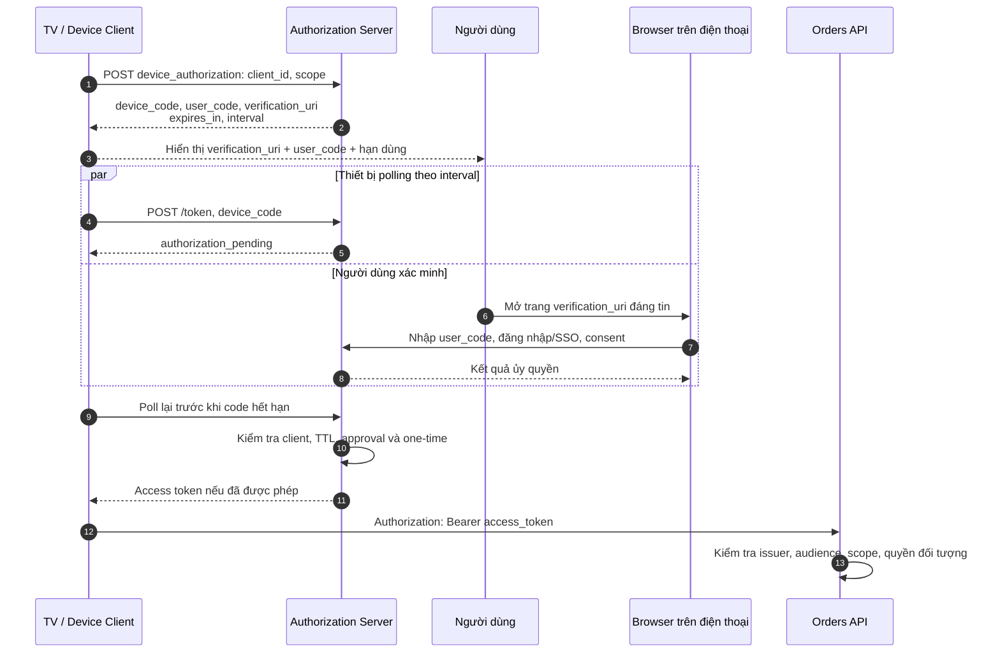
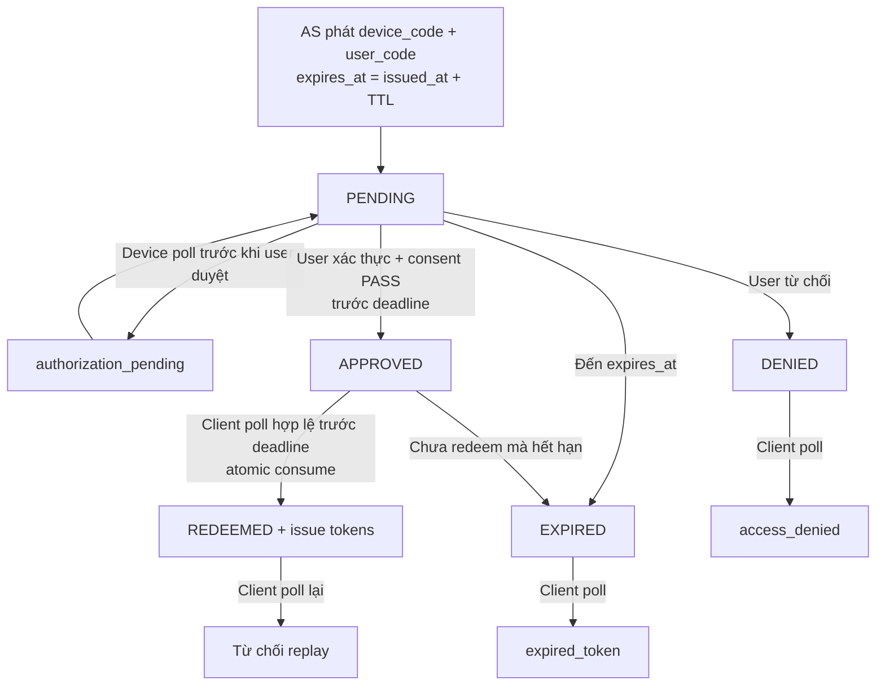
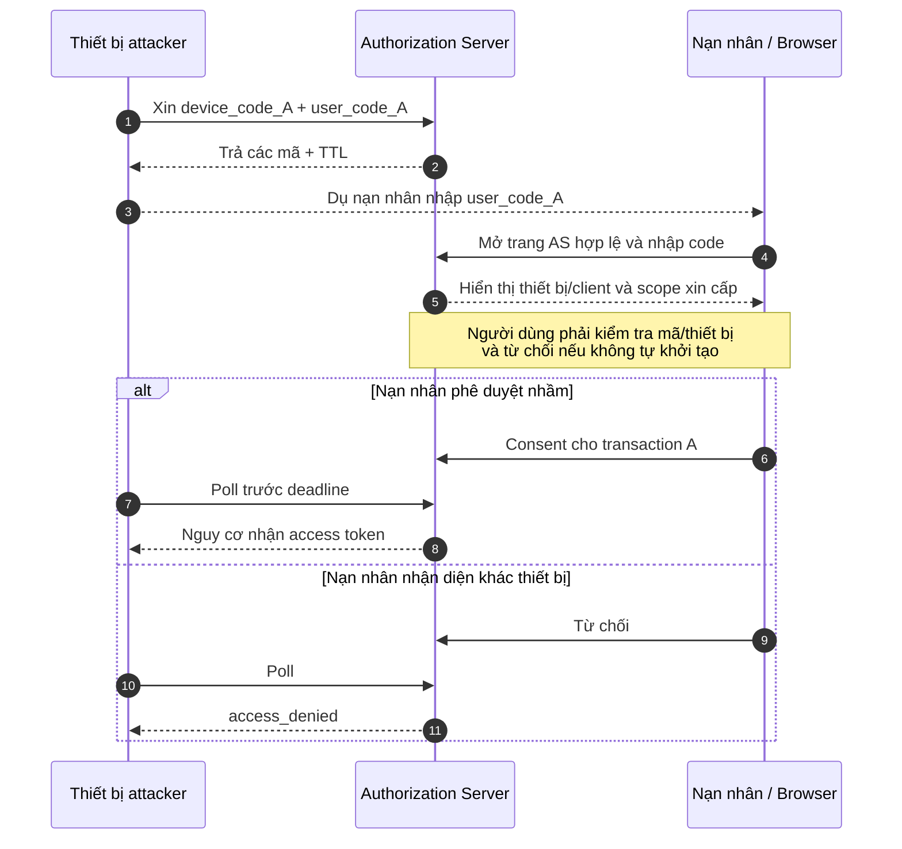

# Device code lifetime

## Mục tiêu học tập

Trong module **SECURITY_TOKEN_SECURITY_FUNDAMENTALS**, chúng ta tìm hiểu mô hình tin cậy và vòng đời token trong OAuth 2.0/OIDC: JWT và opaque token, access token và refresh token, phát hành, claims, scope, audience, lưu trữ, thu hồi và phòng chống token bị đánh cắp hoặc phát lại. Ở chương **Device authorization**, bài **“Device code lifetime”** tập trung vào **thời gian sống của mã thiết bị** trong OAuth 2.0 Device Authorization Grant (RFC 8628) và cách Authorization Server (AS), client và người dùng phải xử lý khi mã sắp hoặc đã hết hạn.

Sau bài này, bạn có thể:

- Phân biệt **`device_code`**, **`user_code`**, **`verification_uri`**, `verification_uri_complete`, `expires_in` và `interval` trong phản hồi device authorization.
- Hiểu **`expires_in` là thời gian sống của cả `device_code` và `user_code`**, không phải hạn dùng của access token, refresh token hay phiên người dùng tại AS.
- Giải thích vì sao client phải ngừng polling khi device code hết hạn, nhận `expired_token` và **khởi tạo một device authorization mới** nếu còn nhu cầu.
- Phân biệt bốn trạng thái kết quả polling: `authorization_pending`, `slow_down`, `access_denied` và `expired_token`.
- Áp dụng nhịp polling tối thiểu mặc định **5 giây** nếu phản hồi không có `interval`, tăng thêm **5 giây** khi nhận `slow_down` và giảm tần suất khi gặp lỗi kết nối theo RFC 8628.
- Thiết kế kiểm tra hạn dùng ở AS, cấp token một-lần-dùng, xử lý race giữa phê duyệt và expiry, ngăn replay mã đã dùng.
- Đánh giá nguy cơ user-code guessing, phishing/social engineering, QR verification và rò rỉ mã qua logs/telemetry.
- Viết Java pseudocode, ma trận test và checklist an toàn cho các hệ thống TV, CLI, thiết bị IoT hoặc thiết bị nhập liệu hạn chế.

> **Điểm cốt lõi:** Device Authorization Grant tách **thiết bị cần token** khỏi **trình duyệt nơi người dùng đăng nhập**. `device_code` chỉ là **credential tạm để client polling tại token endpoint**, còn `user_code` là mã ngắn người dùng nhập tại trang xác minh. **Cả hai hết hiệu lực theo `expires_in`; chúng không phải access token.**

## 1. Bối cảnh: Device Authorization Grant dùng khi nào?

Một smart TV hoặc CLI không thuận tiện nhập password, passkey hay thực hiện đầy đủ authorization redirect. **RFC 8628** cho phép client hiển thị **địa chỉ xác minh và user code**, còn người dùng sử dụng điện thoại/trình duyệt thứ hai để đăng nhập và xác nhận cấp quyền.

Các vai trò:

| Bên | Vai trò trong device flow | Không nên làm |
| --- | --- | --- |
| **Device Client** | Xin `device_code`/`user_code` từ AS, hiển thị hướng dẫn, polling token endpoint và nhận token khi được cấp. | Tự thu password/OTP người dùng, nhận user code như access token hoặc poll không giới hạn. |
| **Authorization Server (AS)** | Phát mã gắn grant/client, quản lý TTL/trạng thái, nhận phê duyệt, cấp access token khi đủ điều kiện. | Gia hạn vô hạn mã cũ, chấp nhận code đã consumed hoặc bỏ kiểm tra expiry. |
| **Resource Owner** | Truy cập trang xác minh ở thiết bị thuận tiện, đăng nhập với AS/IdP và cho phép/từ chối client. | Gửi password cho thiết bị/ứng dụng không tin cậy; tin user code bất kỳ do người khác gửi. |
| **Resource Server (RS)** | Nhận và kiểm tra **access token** được cấp sau flow thành công. | Chấp nhận `device_code` hoặc `user_code` như bearer access token. |

Thiết bị không phải chạy một trang web thu mật khẩu user; phần login nằm dưới **ranh giới AS/IdP**. Điều này cũng phù hợp với mục tiêu hạn chế mô hình ROPC/password grant cũ.

### Luồng tổng thể



Trong sơ đồ, việc user hoàn thành xác minh có thể diễn ra sau nhiều lần polling. **Client không biết kết quả ngay chỉ vì trình duyệt trên điện thoại báo thành công**; nó nhận token **chỉ khi token endpoint xác nhận trạng thái hợp lệ**.

## 2. Hai mã, hai mục đích, một giới hạn thời gian

Phản hồi device authorization có **hai loại mã** với threat model khác nhau:

| Trường | Ai nhìn thấy? | Mục đích | Rủi ro |
| --- | --- | --- | --- |
| `device_code` | **Client thiết bị** nhận từ AS, giữ kín để polling. | Định danh authorization transaction tại **token endpoint**. | Ai có được mã và điều kiện client phù hợp có thể thử nhận token sau khi user phê duyệt, tùy client authentication/binding. |
| `user_code` | **Người dùng** nhìn trên màn hình thiết bị, nhập ở `verification_uri`. | Liên kết sự chấp thuận trên browser với device transaction. | Mã ngắn dễ nhập hơn nên cần rate limiting, giới hạn thử và chống phishing. |
| `verification_uri` | Người dùng/browser. | Trang đáng tin của AS để nhập user code và đăng nhập. | Nếu truy cập miền giả, user có thể bị lừa cung cấp thông tin xác thực. |
| `verification_uri_complete` (không bắt buộc) | Người dùng/browser, có thể nằm trong QR. | URI bao gồm user code để hỗ trợ mở/điền nhanh. | Link có thể lộ user code qua URL, logs hoặc chia sẻ; phải bảo vệ và xác nhận mã trên thiết bị. |
| `expires_in` | Client thiết bị. | **Số giây sống của `device_code` và `user_code`** kể từ phản hồi được phát hành. | Không được nhầm với `expires_in` trong **token response** chỉ thời hạn access token. |
| `interval` (không bắt buộc) | Client thiết bị. | **Số giây tối thiểu giữa các lần polling**, theo hướng dẫn AS. | Polling quá nhanh có thể gây `slow_down`, bị hạn chế hoặc làm quá tải AS. |

**`user_code` không phải secret đủ mạnh để thay `device_code`**. Người dùng được phép nhìn và nhập user code; AS phải kiểm chứng việc nhập mã qua trang tin cậy, chống thử đoán và ràng buộc đúng thiết bị. **`device_code` thường phải có entropy cao** và không được log hoặc đưa vào QR/link công khai.

### 2.1. Response minh họa từ device authorization endpoint

```http
POST /oauth2/device_authorization HTTP/1.1
Host: identity.example.com
Content-Type: application/x-www-form-urlencoded

client_id=smart-tv&scope=orders%3Aread
```

```http
HTTP/1.1 200 OK
Content-Type: application/json
Cache-Control: no-store
Pragma: no-cache

{
  "device_code": "<high-entropy-device-code>",
  "user_code": "ABCD-EFGH",
  "verification_uri": "https://identity.example.com/device",
  "verification_uri_complete": "https://identity.example.com/device?user_code=ABCD-EFGH",
  "expires_in": 600,
  "interval": 5
}
```

Đây là **giá trị minh họa**, không phải chính sách chung bắt buộc thiết bị luôn có TTL 600 giây. RFC 8628 quy định **`expires_in` bắt buộc** trong response và diễn giải là vòng đời tính theo giây của **cả hai mã**; AS lựa chọn giá trị cụ thể theo UX và threat model.

**`interval` là tùy chọn**. Nếu không có, RFC 8628 `3.5 quy định client **phải dùng giá trị mặc định 5 giây**. Nếu AS trả `interval=10`, client phải tuân thủ 10 giây tối thiểu chứ không dùng mặc định 5 giây.

### 2.2. Không nhầm `verification_uri_complete` với bearer token trong query

`verification_uri_complete` có thể chứa **user code** trong URL vì RFC 8628 thiết kế nó để hỗ trợ luồng UX. Nó **không được chứa raw `device_code`, access token hoặc refresh token**. Mã user code vẫn nhạy cảm: không quảng bá URL trong analytics, logs hoặc support ticket và không coi QR đã scan là đủ bằng chứng user biết đúng thiết bị.

Theo khuyến nghị của RFC 8628 về xác minh từ xa, ngay cả khi dùng URI có user code tự điền, giao diện xác minh cần giúp người dùng **đối chiếu mã trên thiết bị** trước khi chấp thuận. Việc gõ/đối chiếu mã có vai trò chống đánh tráo transaction/phishing.

## 3. Device code lifetime: `expires_in` được hiểu chính xác thế nào?

AS tạo device authorization transaction và trả về `expires_in` là **thời lượng tính bằng giây** mà `device_code` và `user_code` còn hiệu lực, bắt đầu từ thời điểm mã được **phát hành**. Ví dụ:

```text
10:00:00  AS phát response, expires_in = 600 giây
10:00:00  Device transaction: PENDING
10:03:00  User mở verification_uri, bắt đầu đăng nhập
10:07:30  User nhập user_code và đồng ý
10:07:35  AS lưu authorization APPROVED
10:07:40  Device poll đúng hạn -> token có thể được cấp
10:10:00  Device code đến expiry deadline
10:10:01  Poll với device_code này -> expired_token
```

Mốc thời gian chỉ để minh họa. Trong một hệ thống thật, AS phải thực thi quy tắc chính xác tại **deadline**, không dựa vào thời gian hiển thị trên TV hay giờ local của người dùng.

### Bốn điều về thời hạn

1. **TTL mã thiết bị không phải TTL access token.** `expires_in=600` ở device authorization response nói về **thời gian hoàn tất device authorization**, không có nghĩa AT sau khi cấp sống 600 giây.
2. **User code cũng hết hạn.** Sau deadline, một người dùng nhập mã cũ không được tạo một authorization có thể cấp token mới cho device code cũ.
3. **Phê duyệt không tự gia hạn device code.** Nếu user hoàn tất quá muộn, hoặc client không kịp polling trước deadline, thiết bị phải bắt đầu một transaction mới.
4. **Có thể hoàn tất sớm.** AS có thể cấp token sau khi user phê duyệt và client polling thành công trước hạn; mã được **tiêu thụ**, không còn dùng lại dù `expires_in` chưa trôi hết.

### 3.1. Client nên tính hạn sử dụng với biên an toàn

Vì có độ trễ mạng và sai lệch đồng hồ giữa thiết bị/AS, client nên:

- Bắt đầu bộ đếm dựa trên thời điểm nhận device authorization response và **thời gian đơn điệu (monotonic elapsed time)** nếu nền tảng hỗ trợ.
- Coi deadline phía AS là nguồn quyết định; đồng hồ UI chỉ có tính hướng dẫn.
- Dừng polling sớm một chút khi thời gian ước lượng không đủ cho lần gửi tiếp theo, thay vì cố polling dồn dập sát hạn.
- Khi AS trả `expired_token`, **dừng ngay** dù màn hình thiết bị nghĩ vẫn còn vài giây.

**Không dùng clock của client để “gia hạn” hạn dùng**: thay đổi thời gian trên TV hoặc restart app không được kéo dài `device_code`. AS phải có thời điểm phát hành/deadline đáng tin trong token store.

### 3.2. User đang đăng nhập khi code hết hạn

Giả sử user vừa hoàn tất MFA đúng lúc mã hết hạn. Có hai vấn đề khác nhau:

- **Phiên xác thực của user tại AS** có thể vẫn hợp lệ cho những hoạt động khác theo policy.
- **Device authorization transaction cũ** đã hết hạn và **không còn quyền đổi lấy token**.

Một AS an toàn phải xử lý race giữa **approve** và **expiry check** một cách nhất quán: dù approval được ghi nhận, token endpoint **không được phát hành token nếu mã đã hết hạn**. User cần được hướng dẫn quay lại thiết bị để lấy code mới nếu muốn tiếp tục.

### 3.3. Vì sao không chọn TTL quá dài hoặc quá ngắn?

| TTL quá ngắn | TTL quá dài |
| --- | --- |
| User chưa kịp mở điện thoại/nhập mã/MFA thì hết hạn; retry lặp gây bực và tăng tải. | Mã bị lộ/đánh tráo có thời gian hữu dụng lâu, tăng rủi ro social engineering và thử đoán user code. |
| Khó hoàn tất ở mạng chậm hoặc thiết bị nhập liệu hạn chế. | Transaction pending và dữ liệu trạng thái phải lưu lâu; dễ tích lũy phiên bỏ dở. |
| Device có thể liên tục xin lại code mới. | User có thể hiểu nhầm code cũ vẫn thuộc đúng thiết bị nhiều giờ sau. |

AS chọn TTL dựa trên UX của thiết bị, độ khó thao tác, MFA/SSO, entropy user code, rate limits, mức nhạy cảm của resource và khả năng vận hành. **RFC 8628 không áp một TTL 600 giây cho mọi AS**; giá trị trong ví dụ là chính sách giả lập.

## 4. State machine: PENDING, APPROVED, DENIED, EXPIRED, REDEEMED



Đây là **mô hình trạng thái minh họa của AS**, không phải enum bắt buộc trong RFC 8628.

### Những bất biến cần bảo đảm

- `device_code` thuộc một transaction cụ thể, đúng `client_id` (và client authentication nếu áp dụng), authorized scopes/resources và deadline.
- `user_code` phải được ánh xạ đến đúng transaction khi người dùng xác minh trên browser; mã không được tiếp tục ánh xạ tới một giao dịch mới theo cách gây nhầm lẫn khi mã cũ còn có thể được nhập lại.
- **Sau expiry không có nhánh trở về PENDING/APPROVED để cấp token**. Việc cấp code mới phải tạo transaction và mã mới.
- **Chỉ một token exchange được phép thành công** với một device code. Không thể có hai request đồng thời cùng mint hai token response độc lập do race.
- **Không coi PENDING là bằng chứng đã xác thực user.** Khi chưa có approval, polling chỉ nhận trạng thái chờ.
- Trạng thái DENIED hoặc REDEEMED không tự biến thành APPROVED khi retry/mất response.

### 4.1. Phê duyệt và polling đến đồng thời

Hai request có thể chạy trên các AS node khác nhau:

```text
Node A: xử lý user nhập user_code và approve
Node B: nhận token polling cho device_code

Node B đọc trạng thái PENDING trước commit của A
  -> authorization_pending (không cấp token)

Node A commit APPROVED
Node B hoặc node C nhận polling kế tiếp trước expiry
  -> kiểm tra APPROVED + deadline + client; consume nguyên tử; cấp token
```

Đây là hành vi hợp lệ: polling có thể thấy **trạng thái cũ** trong một khoảng ngắn tùy kiến trúc, nhưng AS không được mint token trước khi approval được lưu bền vững và chính sách đã được kiểm tra. Cần lock/transaction/CAS hoặc cơ chế tương đương để đảm bảo **one-time redemption**.

### 4.2. Phê duyệt ở sát deadline

Nếu approval đến lúc `expires_at` đã qua, AS phải từ chối hoặc đánh dấu EXPIRED. Nếu approve được commit trước hạn nhưng polling sau hạn, **device code vẫn hết hạn**. Không có “grace tự động” chỉ vì user mất vài giây để hoàn tất.

Một hệ thống có thể định nghĩa UX khởi động lại flow và thông báo rõ ràng; **không kéo dài TTL bằng cách sửa bản ghi cũ sau khi mã đã phát hành** mà phá hợp đồng `expires_in` đã trả về client.

## 5. Polling token endpoint và vai trò của `interval`

Trong device flow, client **không nhận redirect trực tiếp** khi user hoàn thành authorization ở browser thứ hai. Thay vào đó client polling token endpoint:

```http
POST /oauth2/token HTTP/1.1
Host: identity.example.com
Content-Type: application/x-www-form-urlencoded

grant_type=urn%3Aietf%3Aparams%3Aoauth%3Agrant-type%3Adevice_code&device_code=<device-code>&client_id=smart-tv
```

Với confidential client, token request còn phải thực hiện client authentication theo cách AS yêu cầu; public TV/device client **không được coi shared secret nhúng trong firmware/app là bí mật**. `client_id` là định danh đăng ký, không tự chứng minh app “chính hãng”.

### 5.1. Interval tối thiểu và phản hồi chờ

Nếu AS chưa nhận kết quả xác minh của user:

```http
HTTP/1.1 400 Bad Request
Content-Type: application/json
Cache-Control: no-store
Pragma: no-cache

{"error":"authorization_pending"}
```

Client phải giữ nhịp polling theo `interval` từ device authorization response:

| Trường hợp | Client phải làm gì? |
| --- | --- |
| Response có `interval=5`. | **Không** polling nhanh hơn mỗi 5 giây, trừ khi AS cung cấp chính sách dài hơn. |
| Response có `interval=10`. | Duy trì tối thiểu 10 giây giữa request kế tiếp. |
| Response **không có `interval`**. | Mặc định **5 giây** theo RFC 8628 `3.5. |
| Nhận `authorization_pending`. | Tiếp tục chờ/poll theo nhịp hợp lệ, miễn device code chưa expired. |
| Nhận `slow_down`. | **Tăng interval thêm 5 giây** đối với giá trị đang dùng, và áp dụng cho các lần polling tiếp theo. |
| Token request gặp network timeout/connection error. | Client phải **tự giảm tần suất polling**; RFC khuyến nghị exponential backoff thay vì retry dồn dập. |

**Interval là khoảng tối thiểu, không phải lời hứa AS sẽ cấp token sau đúng 5 giây.** User có thể chưa mở trang verification; việc tăng interval giảm tải, không kéo dài `expires_in`.

### 5.2. `slow_down`: tăng 5 giây, không reset TTL

```http
HTTP/1.1 400 Bad Request
Content-Type: application/json
Cache-Control: no-store
Pragma: no-cache

{"error":"slow_down"}
```

Ví dụ:

```text
AS trả interval: 5s
Poll #1 -> authorization_pending
Poll #2 (quá sớm / theo quyết định AS) -> slow_down
Client interval mới: ít nhất 10s
Poll tiếp theo không được nhanh hơn 10s

Nếu nhận slow_down nữa:
Client interval mới: ít nhất 15s
```

RFC 8628 quy định tăng **5 giây** khi nhận `slow_down`. Không “retry ngay” để xem trạng thái đã đổi chưa. Đồng thời, **device code vẫn hết hạn ở deadline ban đầu**, dù client chuyển sang khoảng polling dài hơn.

### 5.3. Network timeout không phải `authorization_pending`

Nếu client gửi request nhưng không nhận response do mất mạng, nó **không biết** AS có xử lý chưa. Tiếp tục retry lập tức có thể gây request storm, dẫn đến thêm `slow_down` hoặc giới hạn tài nguyên. Client nên:

1. Ghi nhận lỗi mạng dưới dạng trạng thái **không chắc chắn**, không tự giả định user đã từ chối hoặc mã đã expired.
2. Áp backoff thích hợp, có jitter khi cần để tránh đồng loạt kết nối lại.
3. **Không reset deadline** hoặc `interval` về mức nhanh hơn chỉ vì reconnect.
4. Nếu hết lifetime ước lượng hoặc AS báo `expired_token`, dừng và hướng dẫn user lấy mã mới.

## 6. `expired_token`: dừng polling và bắt đầu lại khi cần

Khi device code đã hết hạn, RFC 8628 `3.5 quy định AS trả:

```http
HTTP/1.1 400 Bad Request
Content-Type: application/json
Cache-Control: no-store
Pragma: no-cache

{"error":"expired_token"}
```

Client **phải dừng polling** với device code đó. Nó có thể khởi tạo **một device authorization request mới** nếu user còn muốn hoàn tất, rồi hiển thị **user code mới** và thời hạn mới.

**Không làm:**

- Không tiếp tục poll `device_code` cũ sau `expired_token`.
- Không sửa `expires_in` trong client hoặc gọi một endpoint tự chế để hồi sinh mã.
- Không tái sử dụng `user_code` cũ hoặc thay nó bằng mã của giao dịch khác.
- Không dùng `refresh_token` của phiên khác để “bỏ qua” device authorization đang hết hạn.
- Không gửi username/password trong request đổi mã như fallback ROPC.

### 6.1. Phân biệt các OAuth error của polling

| Error tại token endpoint | Nghĩa | Hành động client |
| --- | --- | --- |
| `authorization_pending` | User chưa hoàn thành authorization. | Tiếp tục polling theo interval tối thiểu. |
| `slow_down` | AS yêu cầu giảm tần suất polling. | Tăng khoảng cách polling thêm **5 giây** và tiếp tục nếu còn hạn. |
| `access_denied` | User/AS từ chối authorization. | **Dừng polling**, hiển thị từ chối trung tính; user chủ động bắt đầu flow mới nếu muốn. |
| `expired_token` | Device code hết hạn. | **Dừng polling**, hướng dẫn tạo device authorization mới. |
| `invalid_client` hoặc lỗi client authentication khác | Client không chứng minh được danh tính theo đăng ký. | Không thử lại cùng credential lỗi liên tục; sửa cấu hình/đăng ký. |
| `invalid_request` hoặc `unsupported_grant_type` | Request/grant không đúng giao thức hoặc AS không hỗ trợ. | Sửa implementation/profile, không đổi thành query chứa access token. |
| Lỗi hạ tầng/timeout | Không chắc AS xử lý request tới đâu. | Backoff, giữ deadline, không retry dồn dập hoặc mint token local. |

**Lỗi `expired_token` trong device flow không có nghĩa access token đã cấp sau một phiên khác hết hạn**. Cũng không nhất thiết đồng nghĩa phiên SSO của user trên điện thoại hết hạn.

### 6.2. Tình huống user nhìn thấy “Thành công” nhưng TV báo “Hết hạn”

```text
10:00:00  TV hiển thị user_code với TTL 600s
10:09:58  User bấm Đồng ý ở điện thoại
10:10:00  Device code hết hạn
10:10:03  TV poll -> expired_token
```

Hành vi an toàn: **không cấp token cho mã cũ sau deadline**. UI cần thông báo nhẹ nhàng “Mã đã hết hạn, hãy lấy mã mới”, và có thể giữ user AS session đang đăng nhập để giảm ma sát cho lần ủy quyền tiếp theo, tùy chính sách. Không kéo dài lifetime của `device_code` để “khớp” thông báo browser đã đồng ý.

## 7. `expires_in` của device code khác thời hạn token khác thế nào?

Một từ khóa xuất hiện ở hai **response khác nhau**:

```text
1) Device authorization response
   device_code, user_code, expires_in=600, interval=5
   -> 600s là thời gian để hoàn tất device flow.

2) Token response sau khi authorization thành công
   access_token, token_type=Bearer, expires_in=900
   -> 900s là thời hạn access token.
```

| Credential/phiên | Bên quản lý | Mục đích | Điều gì khiến hết hiệu lực? |
| --- | --- | --- | --- |
| **`device_code`** | AS | Được client polling để đổi token **sau approval**. | `expires_in`, bị từ chối/thu hồi, hoặc đã redeemed một lần. |
| **`user_code`** | AS | Được user nhập/xác nhận tại verification UI. | Cùng lifetime `expires_in` của transaction, hoặc transaction đã kết thúc. |
| **Authorization/login session ở AS** | AS/IdP | Xác thực user/SSO. | Session TTL, inactivity, logout, revoke, policy assurance; không đồng nhất device TTL. |
| **OAuth access token** | AS phát hành; RS kiểm tra | Gọi đúng API/audience theo scope. | `exp`/`expires_in`, revoke/trạng thái hoặc chính sách bổ sung. |
| **Refresh token** | AS | Xin access token mới theo grant khi được cấp. | TTL/absolute expiry, rotation/reuse detection, revocation và client binding. |
| **OIDC ID Token** | OP/AS | Client xác minh kết quả user authentication theo profile. | `exp`, issuer/audience/nonce và các điều kiện OIDC. |

Sau khi device flow thành công, AS có thể phát hành JWT hoặc opaque access token, có hoặc không có refresh token tùy grant/client/policy. **`device_code` không trở thành refresh token**; client không được dùng nó để xin access token liên tục sau khi redeemed.

### 7.1. Audience và scope không tự thay đổi vì user nhập mã

Giả sử device client xin `orders:read` cho Orders API:

```text
client_id: smart-tv
requested scope: orders:read
intended resource: api://orders

User xác thực và approve -> AS có thể cấp AT:
iss:   https://identity.example.com
aud:   api://orders
scope: orders:read
```

Client không thể lấy `user_code` và sửa token request để tự xin `orders:admin` hoặc token dùng Billing API. AS giới hạn quyền theo grant/client/consent; RS kiểm tra `iss`, `aud`, loại token, thời hạn, scope và owner/tenant/object policy.

## 8. AS triển khai expiry và one-time redemption an toàn

Device Authorization Grant thường chạy trên **nhiều AS instance** và dùng database/cache chung. Vấn đề không chỉ là so sánh đồng hồ: AS cần bảo đảm **mã đã hết hạn không bao giờ được mint token**, kể cả khi approval/polling tới đồng thời.

### 8.1. Bản ghi giao dịch minh họa

```json
{
  "device_code_ref": "hmac-ref-8f63",
  "user_code_ref": "lookup-ref-a731",
  "client_id": "smart-tv",
  "issuer": "https://identity.example.com",
  "authorized_resource": "api://orders",
  "requested_scopes": ["orders:read"],
  "issued_at": "2027-01-15T10:00:00Z",
  "expires_at": "2027-01-15T10:10:00Z",
  "interval_seconds": 5,
  "state": "PENDING",
  "approved_subject_ref": null,
  "redeemed_at": null
}
```

Đây là schema **minh họa**, không phải cấu trúc database bắt buộc từ RFC. Trong triển khai thật:

- **Không ghi raw `device_code`, `user_code`, refresh token hoặc access token vào log.** Tra cứu code có thể dựa trên HMAC/hash tham chiếu với token ngẫu nhiên entropy cao; user code cần cơ chế lookup an toàn và rate limit.
- Lưu `expires_at` hoặc `issued_at + TTL` ở nguồn đáng tin, không để client yêu cầu gia hạn TTL qua query.
- Ràng buộc transaction với client registration, requested scope/resource, issuer và authorized subject chỉ sau khi user hoàn tất.
- Lưu trạng thái `PENDING`, `APPROVED`, `DENIED`, `EXPIRED`, `REDEEMED` hoặc tương đương.
- Đặt TTL/index/cleanup cho giao dịch bỏ dở. **Xóa bản ghi sau expiry** là quyết định lưu trữ; endpoint vẫn phải trả lỗi thích hợp và không coi code mất bản ghi là mã hợp lệ.

### 8.2. Deadline ở nhiều node AS

Nếu node A phát code, node B xử lý user nhập code, node C xử lý polling, chúng phải đồng ý về:

1. **Thời điểm hết hạn:** timestamp UTC hoặc đồng hồ có cơ chế nhất quán đáng tin, chính sách lệch clock rõ ràng.
2. **Nguồn trạng thái:** database/transaction store có tính nhất quán cần thiết; không để cache stale khiến code hết hạn vẫn được chấp nhận.
3. **Thao tác one-time:** chỉ một node được chuyển `APPROVED → REDEEMED` và phát hành token.
4. **Quyền truy cập:** request polling phải được đối chiếu với client đúng, không chỉ dựa vào string `device_code` ở lớp business.
5. **Chính sách lỗi:** mất kết nối DB hoặc không xác định trạng thái thì **fail closed**, không giả lập APPROVED.

Với TTL, **mốc AS áp dụng mới là mốc quyết định**. Client có thể hiển thị “còn 10 giây” khi mạng chậm, nhưng AS được quyền từ chối vì deadline đã tới.

### 8.3. Java pseudocode: kiểm tra thời hạn tại token endpoint

```java
// Pseudocode minh họa, KHÔNG phải API của một framework OAuth cụ thể.
TokenEndpointResult pollDeviceCode(DevicePollRequest req,
                                  AuthenticatedClient client) {
    String ref = secureDeviceCodeReference(req.deviceCode());

    // Lock giao dịch hoặc compare-and-swap phải hoạt động xuyên AS nodes.
    return transaction.execute(() -> {
        DeviceGrant grant = deviceGrants.findByRefForUpdate(ref)
            .orElseThrow(InvalidDeviceGrantException::new);

        requireBoundToClient(grant, client);
        Instant now = trustedClock.instant();

        // Kiểm tra expiry ở MỌI lần poll trước nhánh success.
        if (!now.isBefore(grant.expiresAt())) {
            deviceGrants.markExpiredIfNotRedeemed(grant.id());
            return TokenEndpointResult.error("expired_token");
        }

        if (grant.state() == DENIED) {
            return TokenEndpointResult.error("access_denied");
        }
        if (grant.state() == REDEEMED) {
            return TokenEndpointResult.error("invalid_grant");
        }

        // Rate/polling interval có thể được kiểm tra ở lớp chuyên trách
        // và trả slow_down trước khi trả token nếu poll vi phạm policy.
        if (pollingPolicy.requiresSlowDown(grant, now)) {
            pollingPolicy.recordSlowDown(grant.id(), now);
            return TokenEndpointResult.error("slow_down");
        }
        pollingPolicy.recordPoll(grant.id(), now);

        if (grant.state() == PENDING) {
            return TokenEndpointResult.error("authorization_pending");
        }
        requireState(grant, APPROVED);
        requireGrantConsentAndResourceStillValid(grant);

        // Một transaction duy nhất được phép đổi thành công.
        deviceGrants.markRedeemed(grant.id(), now);
        MintedTokens tokens = tokenIssuer.mintForApprovedGrant(grant);
        audit.outboxDeviceGrantRedeemed(grant.safeReference());
        return TokenEndpointResult.success(tokens);
    }); // Chỉ trả HTTP success sau commit thành công.
}
```

**Chú ý đặc biệt:** ví dụ cố ý trả **kết quả nghiệp vụ** từ transaction, thay vì ném exception ngay sau khi ghi `markExpiredIfNotRedeemed`, để tránh tình huống framework **rollback cả cập nhật trạng thái**. Trong ứng dụng thật phải kiểm soát commit, lỗi khi ký token, transaction boundaries/outbox, concurrency và bảo vệ response; không sao chép pseudocode thành mã production.

**Thứ tự điều kiện là quan trọng:** đoạn mã **không thể** đi tới `mintForApprovedGrant` trước khi xác minh thời hạn và authorization. Đối với một code đã REDEEMED mà vẫn còn hạn, không cấp token lần hai. Nếu dùng chính sách idempotency để xử lý mất response, phải thiết kế token replay/response caching một cách an toàn và ràng buộc đúng client/transaction; đó không phải hành vi RFC 8628 cho phép tự động mà không có bảo vệ bổ sung.

### 8.4. Atomic approval tại verification endpoint

Tại nơi user nhập `user_code`, AS cần:

```text
1. Rate-limit lookup user_code và xác minh login/session user.
2. Tìm đúng transaction PENDING theo user_code; kiểm tra expires_at.
3. Hiển thị thông tin client/device/requested scopes theo dữ liệu đã đăng ký.
4. User xác nhận hoặc từ chối; không duyệt theo yêu cầu tự khai của trang khác.
5. Atomic: PENDING -> APPROVED hoặc DENIED (chỉ khi chưa expired).
6. Nếu đã hết hạn: hiển thị mã hết hạn, không đưa lại APPROVED.
```

Việc user bấm xác nhận trên browser **không được làm mốc expiry tự dịch về sau**. Approval được lưu với subject và grant đã kiểm tra; thiết bị phải tiếp tục polling, và AS xác minh lifetime một lần nữa **tại chính thời điểm token exchange**.

## 9. Client poll theo nhịp và dừng đúng lúc

Device client có thể xây polling loop bằng timer và state machine, nhưng cần tránh các lỗi: retry ngay, reset TTL khi mất mạng, bỏ `slow_down` hoặc tiếp tục polling sau `expired_token`.

### Java pseudocode: vòng polling

```java
// Pseudocode: blocking sleep và tên các class được giản lược để học logic.
DeviceAuthorization started = authorizationServer.startDeviceGrant(clientId);

if (started.expiresInSeconds() <= 0) {
    throw new ProtocolException("Invalid device authorization response");
}

long deadlineNanos = monotonicClock.nanoTime()
    + secondsToNanos(started.expiresInSeconds());
long intervalSeconds = started.intervalSeconds().orElse(5L);
if (intervalSeconds <= 0) {
    throw new ProtocolException("Invalid poll interval");
}

ui.showUserCode(started.userCode(),
                started.verificationUri(),
                started.expiresInSeconds());

while (monotonicClock.nanoTime() < deadlineNanos) {
    sleepUntilNextAllowedPoll(intervalSeconds, deadlineNanos);
    if (monotonicClock.nanoTime() >= deadlineNanos) {
        break;
    }

    PollResult response;
    try {
        response = authorizationServer.pollTokenEndpoint(
            started.deviceCode(), clientId
        );
    } catch (TransientNetworkException ex) {
        intervalSeconds = networkBackoff.increase(intervalSeconds);
        continue; // Không bỏ qua expiry.
    }

    if (response.isTokenSuccess()) {
        tokenVault.store(response.tokens());
        ui.showAuthorized();
        return;
    }

    switch (response.oauthError()) {
        case "authorization_pending":
            break; // Giữ khoảng polling hiện tại.
        case "slow_down":
            intervalSeconds += 5L; // RFC 8628.
            break;
        case "expired_token":
            ui.showCodeExpired();
            return; // Bắt buộc dừng mã này.
        case "access_denied":
            ui.showAuthorizationDenied();
            return;
        default:
            ui.showSafeFailure();
            return; // Không đoán lỗi hoặc retry vô hạn.
    }
}
ui.showCodeExpired(); // Không tự gia hạn code, có thể khởi tạo flow mới.
```

**Bản chất minh họa:** `sleepUntilNextAllowedPoll` phải được triển khai đúng để tính khoảng cách giữa request theo thời điểm gửi, tránh nhiều yêu cầu đồng thời; `secondsToNanos` phải xử lý overflow khi input không đáng tin. Nhiều client dùng scheduler bất đồng bộ, cancel token và retry có jitter thay vì `sleep`.

### 9.1. Một response `authorization_pending` có nghĩa gì?

Nó chỉ có nghĩa **AS chưa có authorization hoàn tất tại thời điểm xử lý polling**. Client không nên:

- Bắt user nhập mật khẩu trên TV để tăng tốc.
- Bỏ qua consent vì đã thấy `user_code` khớp.
- Gửi liên tiếp 100 request/giây để “cập nhật real time”.
- Tự tạo access token từ response `authorization_pending`.

### 9.2. Khi hết thời gian mà chưa thấy `expired_token`

Client vẫn có thể **chủ động ngừng polling** khi deadline ước lượng đã qua. Không bắt buộc phải gửi thêm một request chỉ để nhận `expired_token`, đặc biệt nếu thiết bị offline. AS là nơi quyết định cuối cùng về deadline, nhưng client nên dừng đúng lúc để không tiếp tục tạo tải và tránh UX “đang chờ mã đã chết”.

## 10. Threat model: mã tồn tại quá lâu làm tăng rủi ro gì?

### 10.1. Phishing/remote authorization

Một attacker có thể tự khởi tạo device authorization trên **thiết bị của attacker**, sau đó gửi user code của attacker tới nạn nhân và dụ nạn nhân nhập code trên trang AS thật. Nếu nạn nhân phê duyệt, **thiết bị attacker** có thể nhận access token thuộc grant vừa được cấp.



**Điểm khó:** URL xác minh có thể là **domain AS thật**, nhưng **transaction bên trong thuộc thiết bị của attacker**. Chỉ kiểm tra tên miền chưa đủ; user cần đối chiếu mã đang hiển thị trên thiết bị mình **thực sự đang liên kết**, client/device đã đăng ký và quyền được yêu cầu. Mã có TTL quá dài làm thời gian attacker dụ nạn nhân dài hơn.

**Không phê duyệt mã mà người khác gửi qua chat/email/điện thoại** nếu bạn không tự khởi tạo pairing trên thiết bị của mình. Trang AS nên giải thích rõ hậu quả cấp quyền và cho phép hủy.

### 10.2. User-code guessing và brute force

`user_code` được thiết kế **ngắn để con người nhập**, không có cùng độ khó đoán với `device_code`. AS phải hạn chế thử đoán và thao tác nhập mã:

- Chọn user code có entropy phù hợp thời hạn và traffic, tránh mã tuần tự/dễ đoán.
- Rate-limit theo session, tài khoản, rủi ro thiết bị, địa chỉ IP và tín hiệu đáng tin khác; không dựa riêng một IP khi NAT/shared networks.
- Giới hạn số lần thử sai và phản hồi trung tính, không trở thành oracle xác định mã nào đang active.
- Không cho một user code còn hạn ánh xạ tới nhiều transaction gây nhập nhằng.
- Hết hạn/xóa mapping đúng lúc; không dùng mã hết hạn để phê duyệt phiên mới.
- Theo dõi hành vi bất thường mà không ghi raw user code trong log rộng quyền.

Đối với `device_code`, AS nên phát hành chuỗi **ngẫu nhiên entropy cao**. Chỉ sở hữu một user code không cho phép client lấy token từ token endpoint; chỉ sở hữu device code cũng không có nghĩa đã được user approve.

### 10.3. Rủi ro từ `verification_uri_complete` và QR

`verification_uri_complete` cải thiện UX, nhưng vì chứa user code, nó cần quản lý tương tự **liên kết pairing nhạy cảm**:

- Dùng **HTTPS** và domain AS tin cậy.
- Không tự gắn access token, refresh token hoặc raw device code vào QR.
- Không sao chép URL đầy đủ sang tracker, redirect ngoài ý muốn hoặc support ticket.
- Trang verification hiển thị **thiết bị/client/scopes** dựa trên metadata được AS xác thực, không tin tên thiết bị do attacker tự đưa.
- User cần **đối chiếu mã** đang hiển thị trên thiết bị mình, kể cả khi link/QR đã tự điền user code.

### 10.4. Token exfiltration và ranh giới giữa browser với device

User xác thực tại AS/IdP trên điện thoại; **TV không cần nhận password hoặc session cookie của trình duyệt đó**. Token response được AS trả **trực tiếp tới device client polling** sau khi approval hợp lệ, không phải browser copy bearer token lên TV qua URL.

Nếu access token được cấp, TV cần lưu token theo mức bảo vệ của nền tảng và xóa/revoke khi logout. Một refresh token được cấp nếu policy cho phép phải được giữ kín, ràng buộc client/grant và có rotation hoặc sender-constraining theo yêu cầu bảo mật của public client (RFC 9700), không dùng `device_code` như một refresh token thay thế.

## 11. Security logging và quan sát lifetime

Một AS cần biết client nào đang polling quá nhanh, mã nào thường hết hạn và có dấu hiệu dò user code hay không; nhưng logging là điểm rò rỉ mã nếu không quản trị.

### Mẫu sự kiện nội bộ

```json
{
  "event_type": "DEVICE_CODE_EXPIRED",
  "event_id": "evt-83be09",
  "correlation_id": "req-38c1a2",
  "issuer": "https://identity.example.com",
  "client_id": "smart-tv",
  "device_grant_ref": "hmac-ref-8f63",
  "age_seconds": 600,
  "expires_in_original": 600,
  "last_poll_outcome": "expired_token",
  "occurred_at": "2027-01-15T10:10:01Z"
}
```

Schema này **minh họa**, không phải event chuẩn của RFC. `device_grant_ref` là **tham chiếu an toàn**, không phải raw device code hay user code.

| Tín hiệu | Ý nghĩa có thể | Hành động |
| --- | --- | --- |
| Tỷ lệ `expired_token` tăng. | TTL quá ngắn cho UX, network chậm, MFA lâu, người dùng chưa quen, hoặc lỗi device client. | Phân tích theo client/build/môi trường, không tự kết luận tấn công. |
| Nhiều `slow_down` trên một client version. | Polling không tôn trọng `interval`, retry storm hoặc lỗi scheduler. | Kiểm tra client algorithm, server rate policy và backoff. |
| Nhiều user-code lookup thất bại. | Người dùng nhập sai, UX khó đọc, hoặc thử đoán mã. | Rate-limit, kiểm tra rủi ro, cải tiến hiển thị, không log raw code. |
| Approval thành công nhưng không có token redemption trước expiry. | Device offline, polling quá thưa, browser chấp thuận sát hạn. | UX “mã hết hạn”, theo dõi latency, không gia hạn mã cũ tùy tiện. |
| Cùng `device_code` đổi token hai lần. | Retry sau mất response hoặc replay. | Chỉ một exchange thành công; điều tra qua reference an toàn. |
| Code còn PENDING sau thời gian cleanup. | TTL/index/cleanup lỗi, tích lũy dữ liệu. | Sửa retention/expiry và thử nghiệm fail closed. |

**Không log** raw `device_code`, `user_code`, `verification_uri_complete` có chứa code, bearer access token, refresh token, `Authorization` header, cookie phiên hoặc session assertion vào tracing/APM/crash reporting. Không dùng mã làm label metric vì lưu lâu và dễ chia sẻ dashboard.

### 11.1. Kết nối theo correlation ID

Một luồng có thể gồm device authorization request, nhiều token polls, một user verification session và token issuance. Dùng **grant reference** cùng correlation ID ở vùng audit được bảo vệ để nối các bước, thay vì log raw mã dùng để liên kết.

Nếu `client_id` chưa được xác thực (public client), log cần phân biệt **giá trị tự khai** với **client đã được xác minh/đăng ký**. Không tự coi một tham số client ID là bằng chứng ai đã sở hữu thiết bị thật.

## 12. Tình huống vận hành và trải nghiệm người dùng

Một thiết bị có thể polling đúng RFC nhưng người dùng vẫn gặp UX khó hiểu. Khi thiết kế Device Authorization, **vòng đời mã** và **trạng thái hiển thị** phải thống nhất.

### 12.1. User chưa mở trang xác minh

TV hiển thị:

```text
Liên kết thiết bị của bạn

1. Trên điện thoại hoặc máy tính, mở:
   https://identity.example.com/device
2. Nhập mã:
   ABCD-EFGH

Mã còn hiệu lực: khoảng 10 phút
```

TV polling theo `interval`, nhận `authorization_pending` và giữ màn hình chờ. Khi countdown hết, TV **không gửi thêm request dồn dập** mà cho người dùng chủ động khởi tạo một mã mới.

Không hiển thị `device_code` thô trên màn hình hoặc console debug. Mã người dùng cần dễ đọc/nhập, nhưng màn hình cũng nên cảnh báo chỉ xác nhận khi chính user đang liên kết thiết bị của mình.

### 12.2. User nhập mã quá muộn

User mở verification URI sau khi code hết hạn:

- AS hiển thị “Mã đã hết hạn” hoặc thông báo tương đương, không xác nhận mã cũ.
- Thiết bị nhận `expired_token` hoặc tự kết thúc do deadline, hiển thị hướng dẫn lấy mã mới.
- Nếu user vừa đăng nhập AS thành công, phiên đăng nhập **có thể vẫn hợp lệ** nhưng không làm giao dịch thiết bị cũ sống lại.
- Device client tạo **device authorization request mới**, lấy `device_code` và `user_code` mới cùng `expires_in` mới, theo mức kiểm soát khởi tạo/rate limit của AS.

### 12.3. User nhập đúng mã nhưng từ chối consent

AS đánh dấu transaction DENIED, token endpoint trả `access_denied` theo RFC 8628. Client **dừng polling**. Không chờ mã hết hạn rồi đoán user đổi ý; nếu muốn thử lại phải có **giao dịch ủy quyền mới** và user phải chủ động thực hiện.

### 12.4. User xác nhận, nhưng TV bị mất mạng

Giả sử approval đã có trước deadline, nhưng TV offline cho tới khi mã hết hạn:

- AS không có lý do tự đẩy access token qua browser của user hoặc giữ mã sống mãi.
- Khi TV trở lại và poll với device code cũ, AS trả `expired_token`.
- TV hướng dẫn tạo mã mới; AS có thể tái sử dụng browser session khi user thực hiện lần xác minh mới nếu policy cho phép.
- Không trả lại token của transaction cũ chỉ vì approval được ghi nhận trước hạn.

### 12.5. Device code đã redeemed nhưng response bị mất

```text
AS: APPROVED + code còn hạn
Device: poll /token
AS: atomic REDEEMED, commit token issuance
Mạng: response AT/RT bị mất
Device: retry cùng device_code
```

AS **không được cấp một token grant độc lập lần hai** chỉ vì client retry. Một implementation có thể cân nhắc trả cùng response theo một cơ chế idempotency an toàn và đã được threat-model kỹ, nhưng đây không phải cơ chế mặc định RFC 8628 bắt buộc. Mặc định, client cần UX xử lý “chưa chắc đã liên kết thành công” và khi cần khởi tạo device authorization mới.

### 12.6. Nhiều màn hình/thiết bị liên kết cùng lúc

Mỗi TV cần một transaction và `device_code`/`user_code` riêng. Nếu người dùng có hai TV, AS nên hiển thị metadata client/device đáng tin để user phân biệt. Không chia sẻ `user_code` giữa hai màn hình hoặc copy grant/token cho thiết bị khác sau khi một mã được phê duyệt.

## 13. Những anti-pattern cần loại bỏ

| Anti-pattern | Hậu quả | Thiết kế đúng |
| --- | --- | --- |
| Coi `expires_in` trong device authorization response là TTL access token. | Client refresh sai thời điểm, đoản mệnh/hết hạn nhầm. | Phân biệt TTL **mã ủy quyền** và TTL **access token** ở hai response khác nhau. |
| User code bị hết hạn nhưng AS vẫn cho nhập/approve. | Mã cũ có thể được dùng để cấp token sau thời gian đáng tin. | Kiểm tra deadline ở verification endpoint và token endpoint. |
| User phê duyệt trước hạn nên AS cho polling **sau hạn** nhận token. | Bẻ hợp đồng lifetime; kéo dài khả năng khai thác code. | Token exchange vẫn kiểm tra `expires_at`. |
| Khi AS trả `expired_token`, client tiếp tục poll mã cũ. | Tải không cần thiết, không có khả năng thành công an toàn. | Dừng polling; chỉ tạo transaction mới khi user muốn tiếp tục. |
| Không có `interval` thì client poll liên tục. | Request storm, bị rate-limit hoặc tăng áp lực AS. | Dùng mặc định **5 giây** theo RFC 8628. |
| Nhận `slow_down` mà không tăng khoảng poll. | Không tuân thủ AS; tiếp tục bị chặn/DoS. | Tăng thêm **5 giây** mỗi lần nhận `slow_down`. |
| Mất mạng và retry ngay nhiều lần. | Tải đột biến, dễ phát sinh lỗi và rate limit. | Backoff, jitter và giữ deadline. |
| AS coi chuỗi user code nhập đúng là đủ để tự mint token cho browser. | Nhầm user verification với device token exchange. | Browser thực hiện approval; device client polling và AS kiểm tra đủ điều kiện. |
| Dùng chung một `device_code` cho nhiều TV/session. | Phá cách ly thiết bị và khả năng audit/thu hồi. | Transaction/code riêng cho mỗi lần yêu cầu. |
| Cho cùng device code đổi token hai lần. | Replay, tạo nhiều token/phiên ngoài mong muốn. | One-time redemption nguyên tử trên kho trạng thái chung. |
| Code có entropy thấp, không rate-limit user-code entry. | Guessing/credential abuse. | CSPRNG, giới hạn thử và kiểm chứng ngữ cảnh. |
| QR chứa raw `device_code` hoặc access token. | Rò credential có thể được dùng để lấy/gọi API. | Chỉ dùng URI xác minh/user code theo hợp đồng, chống lộ URL. |
| Phê duyệt mọi mã gửi từ người lạ vì domain AS đúng. | Remote device phishing: token cấp cho thiết bị attacker. | Đối chiếu user code, thiết bị/client và scope do AS xác nhận. |
| Dùng `client_id` tự khai làm chứng cứ nguồn thiết bị chắc chắn. | Attacker giả client registration công khai. | Đánh giá client binding/metadata/attestation theo khả năng và threat model. |
| Dùng code TTL dài để “giảm số lần login”. | Kéo dài cửa sổ phishing và thử đoán. | Tối ưu UX bằng session/thiết kế flow, không kéo vô hạn mã. |
| Revoke refresh token xong cho rằng access token JWT cũ bị hủy ngay. | Token cũ vẫn có thể được RS chấp nhận đến `exp`. | TTL phù hợp, RS revocation/denylist/introspection khi cần. |

## 14. Ma trận kiểm thử bắt buộc

Thiết lập môi trường kiểm thử giả lập:

```text
Device client:      smart-tv (public)
Issuer:             https://identity.example.com
Device authorization TTL: 600s (ví dụ)
Polling interval:   5s (ví dụ)
Resource:           api://orders
Requested scope:    orders:read
Device transaction: device_code_D, user_code_U
```

| Tình huống | Kết quả mong đợi |
| --- | --- |
| AS trả response có `device_code`, `user_code`, `verification_uri`, `expires_in=600`. | Client hiển thị user code/URI, tính deadline; không dùng mã như access token. |
| Response thiếu trường `expires_in` bắt buộc. | Client từ chối hoặc xử lý lỗi giao thức an toàn, không giả định lifetime vô hạn. |
| Response không có `interval`. | Client mặc định polling **không nhanh hơn 5 giây**. |
| Response có `interval=12`. | Client polling ít nhất mỗi 12 giây, không reset về 5. |
| Polling trước approval, code chưa hết hạn. | AS trả `authorization_pending`, không cấp AT/RT. |
| Poll quá nhanh so với interval. | AS có thể trả `slow_down`; client tăng interval thêm 5 giây. |
| Hai lần `slow_down` liên tiếp khi ban đầu 5 giây. | Client áp ít nhất 15 giây cho lần polling tiếp theo theo quy tắc cộng dồn. |
| Network timeout nhiều lần. | Client backoff và giữ deadline; không retry vô hạn hay reset TTL. |
| User nhập đúng user code và approve trước expiry; device poll ngay sau đó trước hạn. | AS kiểm tra trạng thái/permission, cấp token **một lần**, code bị consumed. |
| User nhập đúng user code sau expiry. | Verification endpoint từ chối mã đã hết hạn, không cho APPROVED trở lại. |
| User approve trước expiry nhưng device poll sau deadline. | AS trả `expired_token`, không cấp token dù approval trước đó hợp lệ. |
| Device poll sau deadline khi vẫn PENDING. | `expired_token`; client dừng polling. |
| Device poll đúng sát deadline dưới nhiều node AS. | Quyết định nhất quán theo clock/transaction của AS; **không mint token sau deadline**. |
| User từ chối consent. | AS trả `access_denied` trong polling, client dừng. |
| Device code của client A được client B mang tới token endpoint. | AS từ chối theo client binding, không cấp token. |
| Code đã REDEEMED được trình lại ở token endpoint. | Không phát hành token grant thứ hai, chống replay. |
| Hai token polls đồng thời với cùng APPROVED device code ở hai AS node. | Chỉ **một** request được phép redeem thành công. |
| AS không truy cập được kho trạng thái/clock tin cậy. | Fail closed, không tự coi code còn hạn/APPROVED và phát token. |
| Dùng user code của TV A với browser đang hiển thị tên TV B. | UI xác minh phải giúp user phát hiện không khớp, cho phép từ chối. |
| Attacker thử nhiều user code ngẫu nhiên. | Rate limit, không tiết lộ mã nào active hoặc account nào đang login. |
| QR chứa `verification_uri_complete`. | Chỉ chứa URI/user code cần thiết, HTTPS, user vẫn có bước đối chiếu mã/thiết bị. |
| AS gửi `expires_in=600` rồi token endpoint trả AT `expires_in=900`. | Client phân biệt hai thời hạn theo response và mục đích. |
| Access token cấp cho Orders được mang sang Billing API. | Billing từ chối sai `aud` dù JWT còn hạn/chữ ký đúng. |
| Device client nhận token nhưng user logout khỏi TV. | Xóa token client, thu hồi session/refresh token theo policy; đánh giá AT còn hiệu lực. |
| Raw device code hoặc user code xuất hiện trong logs/traces. | Test bảo mật không đạt; cần masking/redaction tại mọi tầng. |

### Kiểm thử mốc thời gian

Nếu `expires_at=10:10:00Z`, đơn vị kiểm thử có thể giả lập **clock kiểm soát được** và đưa ra ba request:

```text
09:59:59Z  -> không nhất thiết transaction đã phát hành
10:09:59Z  -> mã có thể còn hiệu lực, nếu các điều kiện khác PASS
10:10:00Z  -> đã tới deadline, phải từ chối theo chính sách expiry
10:10:01Z  -> mã đã hết hạn, không thể redeem
```

Các giá trị trên để minh họa boundary, không phải timestamp của phiên thật. Test cần bảo đảm cùng cách so sánh thời gian trên **verification endpoint**, **token endpoint** và các AS node.

### Pseudocode unit test

```java
// Test doubles minh họa; không phải code biên dịch độc lập.
@Test
void pendingCodeDoesNotIssueTokens() {
    asClock.set("2027-01-15T10:01:00Z");
    assertOAuthError("authorization_pending",
        () -> tokenEndpoint.poll(deviceCodeD, smartTvClient));
}

@Test
void approvedCodeExpiresAtDeadline() {
    deviceGrantStore.markApproved(deviceCodeD, user42);
    asClock.set("2027-01-15T10:10:00Z");
    assertOAuthError("expired_token",
        () -> tokenEndpoint.poll(deviceCodeD, smartTvClient));
}

@Test
void sameDeviceCodeCanRedeemOnlyOnce() {
    deviceGrantStore.markApproved(deviceCodeD, user42);
    asClock.set("2027-01-15T10:09:30Z");
    assertSuccess(tokenEndpoint.poll(deviceCodeD, smartTvClient));
    assertNoSecondTokenIssuance(
        () -> tokenEndpoint.poll(deviceCodeD, smartTvClient));
}

@Test
void slowDownIncreasesPollingInterval() {
    clientPolling.startWithIntervalSeconds(5);
    clientPolling.acceptError("slow_down");
    assertEquals(10, clientPolling.intervalSeconds());
}
```

Đối với kiểm thử concurrent, tạo hai request có cùng device code tới **hai AS instances** sử dụng cùng transaction store và xác minh invariant **một redemption thành công**. Đừng chỉ test một JVM với `synchronized`.

## 15. Câu hỏi tự kiểm tra

1. `device_code` và `user_code` được sử dụng ở đâu, bởi ai?
2. `expires_in` trong device authorization response giới hạn **mã nào**?
3. Nếu `expires_in=600`, có phải access token sau khi cấp sẽ sống đúng 600 giây không?
4. Khi user chưa approve, AS trả lỗi polling nào và client nên làm gì?
5. AS không trả `interval` thì client cần dùng nhịp polling bao nhiêu giây?
6. Nếu ban đầu interval là 5 giây, nhận hai `slow_down` thì khoảng tối thiểu mới là bao nhiêu?
7. Khi client nhận `expired_token`, có thể tiếp tục polling code cũ để chờ user nhập xong không?
8. User approve trước deadline nhưng TV offline và poll sau deadline: AS có được phát AT không?
9. Tại sao code đã REDEEMED phải bị từ chối dù còn vài phút trên đồng hồ?
10. Một user code chỉ gồm vài ký tự dễ nhập cần những bảo vệ bổ sung nào?
11. QR `verification_uri_complete` làm mã tự điền; tại sao user vẫn phải xác nhận đúng thiết bị?
12. Device flow có cho phép TV tự nhận password của người dùng và chuyển tới token endpoint không?
13. Device client nhận JWT có `aud=api://orders`; Billing API có thể nhận token này vì cùng issuer không?
14. Nếu AS revoke refresh family sau logout, JWT access token đã cấp trước đó có tự hết hiệu lực ngay không?
15. Khi token endpoint đang bị lỗi DB, có nên bỏ kiểm tra expiry để giảm tỷ lệ đăng nhập thất bại không?

**Gợi ý trả lời:**

1. `device_code` do device client trình ở token endpoint; `user_code` do user nhập tại verification URI của AS.
2. Cả **`device_code` và `user_code`** trong cùng device authorization transaction.
3. Không. Access token có TTL riêng từ token response và `exp`/policy.
4. `authorization_pending`; tiếp tục polling nhưng không nhanh hơn `interval` và trong lifetime cho phép.
5. **5 giây** theo RFC 8628 `3.5.
6. Ít nhất **15 giây** vì mỗi `slow_down` cộng 5 giây.
7. Không. Phải dừng mã cũ; nếu cần, khởi tạo device authorization mới.
8. Không, code hết hạn tại token exchange dù approval được ghi nhận sớm.
9. Code dùng một lần, chống replay/phát hành nhiều token grant.
10. CSPRNG/entropy phù hợp, hạn dùng ngắn, rate limiting, hạn chế thử, chống oracle và kiểm tra ngữ cảnh.
11. Domain AS thật vẫn có thể chứa giao dịch của attacker; user cần so code/device/client/scope với thiết bị mình đang liên kết.
12. Không. User xác thực với AS/IdP bằng trình duyệt riêng; TV chỉ hiển thị code/URI và polling.
13. Không. Billing từ chối vì audience không dành cho API đó.
14. Không chắc. JWT có thể còn hợp lệ tại RS tới `exp` nếu không có trạng thái/denylist/introspection bổ sung.
15. Không. **Fail closed** để tránh cấp token cho mã hết hạn, mã đã redeemed hoặc chưa approve.

## 16. Checklist triển khai

- [ ] Device Authorization response gồm `device_code`, `user_code`, `verification_uri`, **`expires_in` bắt buộc**; `interval` và `verification_uri_complete` khi phù hợp.
- [ ] Hiểu `expires_in` là thời gian sống của **device code và user code**, không nhầm TTL AT/RT hoặc AS session.
- [ ] AS lưu deadline đáng tin, gắn mã với client/grant/scope/resource và chỉ accept trong khoảng hiệu lực.
- [ ] Client dùng bộ đếm monotonic elapsed time khi phù hợp, hiển thị hạn dùng ước lượng và **không tự kéo dài expiry**.
- [ ] Verification endpoint không chấp nhận user code hết hạn, kiểm tra user login/consent và trạng thái transaction.
- [ ] Token endpoint **kiểm tra expiry ở mọi poll**, kể cả đã APPROVED; không mint token sau deadline.
- [ ] Client ngừng polling khi `expired_token`, `access_denied` hoặc hết hạn ước lượng; chỉ tạo code mới trong transaction mới.
- [ ] `authorization_pending` cho phép chờ; **`slow_down` tăng interval 5 giây**; `interval` absent mặc định 5 giây.
- [ ] Với timeout/lỗi mạng, giảm nhịp polling bằng backoff, không reset deadline, không retry storm.
- [ ] Redemption một-lần-dùng được thực thi nguyên tử xuyên nhiều AS node, không cấp hai token grants từ cùng device code.
- [ ] Dùng CSPRNG/entropy cao cho `device_code`, user code đủ khó đoán và rate limiting ở trang nhập mã.
- [ ] Không dùng shared client secret trong TV/firmware public client như một bí mật an toàn; AS kiểm tra client binding theo registration/profile.
- [ ] Trang verification dùng HTTPS, metadata client/device đáng tin, người dùng **đối chiếu mã với thiết bị của mình** để giảm remote phishing.
- [ ] Nếu có QR/`verification_uri_complete`, chỉ mang user code theo hợp đồng và giảm lộ qua logs/referrer; không đưa raw device code/AT/RT vào URL.
- [ ] Không để device code sống dài vô hạn, không hồi sinh mã cũ sau expiry hoặc đổi mã cũ sang transaction mới.
- [ ] Không log raw device code, user code, access/refresh token, `Authorization` header, cookie session, password hoặc OTP.
- [ ] Sau token issuance, client và RS quản lý JWT/opaque access token đúng issuer, audience, scope, TTL, quyền theo object.
- [ ] Nếu AS cấp refresh token cho public device client, cần bảo vệ nơi lưu, client/grant binding, rotation hoặc sender-constraining theo RFC 9700 và policy.
- [ ] Test expiry boundary, approval sát deadline, hai poll đồng thời, replay mã redeemed, polling intervals, network error và code guessing.
- [ ] UX giải thích mã đã hết hạn, hướng dẫn tạo mã mới; không khiến user đưa password cho device app hoặc phê duyệt mã do người lạ gửi.

## Tài liệu nền tảng

- **RFC 8628 — OAuth 2.0 Device Authorization Grant:** `3.1` device authorization request; **`3.2` response `device_code`/`user_code`/`verification_uri`/`expires_in`/`interval`**; `3.4` token request; **`3.5` polling, `slow_down` và `expired_token`**; `5` cân nhắc an toàn.
- **RFC 6749 — The OAuth 2.0 Authorization Framework:** vai trò AS/client/RS, token endpoint, Bearer token, grant và client authentication.
- **RFC 6750 — OAuth 2.0 Bearer Token Usage:** gửi bearer access token qua `Authorization` header và TLS, tránh query string.
- **RFC 9700 — Best Current Practice for OAuth 2.0 Security:** client/grant protection, refresh token rotation hoặc sender-constraining cho public client, chống replay và bỏ ROPC.
- **RFC 7662 / RFC 7009:** Token Introspection và Token Revocation, kiểm tra trạng thái access token hoặc thu hồi theo profile.
- **RFC 7519 / RFC 9068:** JWT và JWT Profile for OAuth 2.0 Access Tokens, kiểm tra `iss`, `aud`, `exp`, loại token và scope.
- **RFC 8707 — Resource Indicators for OAuth 2.0:** giới hạn audience/resource khi AS hỗ trợ.
- **RFC 9449 / RFC 8705:** DPoP và mTLS sender-constrained token khi profile hỗ trợ.
- **OpenID Connect Core 1.0:** ID Token và user authentication tại OP nếu hệ thống tích hợp OIDC.
- **OWASP OAuth 2.0 Cheat Sheet:** quản trị OAuth flow, client security và chống rò rỉ token.

**Ghi nhớ:** Trong **Device Authorization Grant**, `expires_in` từ **device authorization response** là thời gian sống của **cả `device_code` và `user_code`**, không phải access token. Client chỉ polling trong cửa sổ đó, tối thiểu **5 giây khi `interval` vắng mặt**, tăng thêm **5 giây** sau mỗi `slow_down` và **dừng hoàn toàn mã cũ** khi gặp `expired_token`. AS phải kiểm tra expiry ở verification lẫn token endpoint, ràng buộc đúng client/grant, thực thi **one-time redemption** và không cấp token cho giao dịch hết hạn dù user đã đăng nhập. Sau khi thành công, access/refresh token tiếp tục có vòng đời, bảo vệ lưu trữ, thu hồi và phân quyền **issuer, audience, scope, thời hạn, quyền trên từng tài nguyên** riêng.
