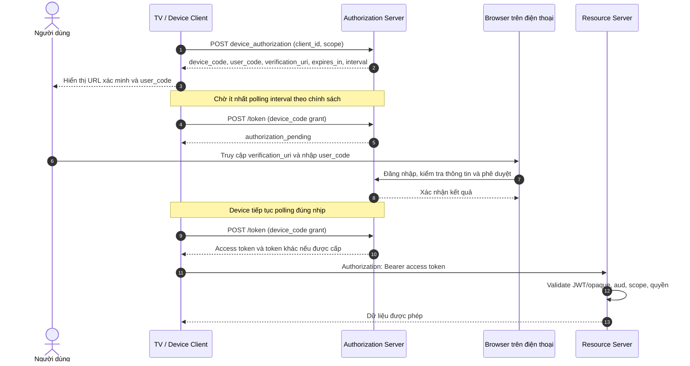
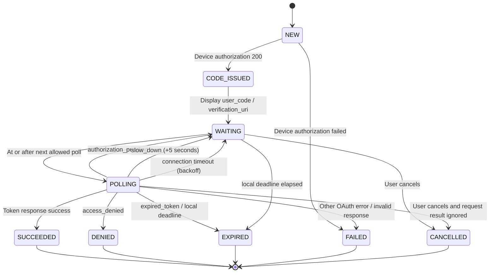

# Polling interval

Một chiếc TV cần đăng nhập vào ứng dụng xem nội dung nhưng không thuận tiện nhập mật khẩu trên điều khiển từ xa. TV hiển thị một **mã cho người dùng** và một địa chỉ xác minh; người dùng dùng điện thoại mở trang của authorization server (AS), đăng nhập rồi phê duyệt. Trong khi chờ, TV gửi yêu cầu định kỳ đến **token endpoint** để hỏi trạng thái. Nếu TV gửi yêu cầu liên tục mỗi 100 ms, hàng nghìn thiết bị có thể làm quá tải AS. Nếu TV dừng hỏi quá sớm, người dùng vừa phê duyệt xong cũng không đăng nhập được.

**`Polling interval`** là khoảng chờ tối thiểu giữa các lần client kiểm tra trạng thái cấp token trong **OAuth 2.0 Device Authorization Grant (RFC 8628)**. Nó không phải thời gian hết hạn access token, không phải `expires_in` của `device_code` và không phải một “thời gian chờ cố định 5 giây bất kể server nói gì”. Client cần xử lý **`authorization_pending`**, **`slow_down`**, timeout mạng, thời hạn phiên và hủy từ người dùng theo đúng trạng thái.

Bài thuộc chương **Device authorization** của module `SECURITY_TOKEN_SECURITY_FUNDAMENTALS`. Trọng tâm là thiết kế polling đúng chuẩn trong OAuth 2.0/OIDC, từ yêu cầu cấp `device_code` tới khi nhận access token JWT/opaque, bảo vệ scope–audience và trạng thái token, giảm nguy cơ token/code bị đánh cắp hoặc phát lại, cùng ví dụ Java/Spring và các ca kiểm thử.

## 1. Device Authorization Grant dành cho trường hợp nào?

**Device Authorization Grant** phục vụ thiết bị có kết nối Internet nhưng hạn chế khả năng nhập liệu hoặc không có browser thích hợp, ví dụ:

- TV thông minh, thiết bị phát media, máy chơi game.
- Thiết bị IoT có màn hình nhỏ hoặc bàn phím hạn chế.
- CLI chạy trên máy không thuận tiện mở browser.
- Một số ứng dụng đăng nhập qua thiết bị thứ hai theo chính sách AS.

Đây là **một OAuth grant riêng**, không đồng nghĩa:

- **Authorization Code + PKCE:** browser redirect về client với `code` rồi client đổi code; device flow không cần redirect authorization code về TV.
- **Client Credentials:** client tự xác thực và xin token phục vụ danh tính dịch vụ, không cần người dùng phê duyệt phiên thiết bị theo device flow.
- **Refresh Token grant:** dùng refresh token đã cấp để xin access token mới; không dùng `device_code` để làm mới access token.
- **OIDC ID token:** dùng để xác nhận người dùng với client khi OIDC được sử dụng; không được gửi thay access token đến resource API.

Thiết bị thường thuộc loại **public client** vì một client secret nhúng vào firmware hoặc gói ứng dụng có thể bị trích xuất. Tuy nhiên, một số client có khả năng bảo vệ credential và được AS đăng ký như confidential client; khi đó phải tuân thủ client authentication của AS. **`client_id` tự nó không phải secret**.

### Vai trò trong luồng

| Vai trò | Trách nhiệm |
|---|---|
| Resource owner / người dùng | Đăng nhập và phê duyệt hoặc từ chối yêu cầu trên thiết bị thứ hai. |
| Device client | Xin mã thiết bị, hiển thị hướng dẫn, thực hiện polling theo `interval` và nhận token khi thành công. |
| Authorization server (AS) | Cấp mã, hiển thị màn hình xác minh, quản lý trạng thái phiên, kiểm tra polling và phát token đúng grant. |
| Resource server (RS) | Nhận access token, kiểm tra issuer/audience/scope, thời hạn và quyền tài nguyên. |

## 2. Toàn bộ luồng và vị trí của polling



**Polling chỉ diễn ra giữa device client và token endpoint**. Người dùng nhập `user_code` tại **verification URI**, không phải gửi mã đó trong mỗi token request. Thiết bị gửi **`device_code`**, là chuỗi dành cho giao tiếp với AS và phải được bảo vệ như credential tạm thời.

### Tại sao AS không tự đẩy access token cho TV?

RFC 8628 giả định thiết bị phê duyệt (điện thoại/browser) **không có một kênh phản hồi trực tiếp đáng tin cậy** tới TV. Polling hoạt động khi TV chỉ tạo được kết nối outbound tới AS. Nếu môi trường có một kênh notification đáng tin, có thể thiết kế cơ chế ngoài phạm vi polling cơ bản; không tự biến callback không được xác minh thành nguồn token.

## 3. Device authorization response: đọc đúng các trường

Device client khởi tạo yêu cầu, ví dụ:

```http
POST /oauth2/device_authorization HTTP/1.1
Host: id.example.test
Content-Type: application/x-www-form-urlencoded

client_id=tv-orders&scope=orders.read
```

Địa chỉ endpoint chỉ là minh họa; AS có thể công bố `device_authorization_endpoint` trong RFC 8414 metadata.

Response JSON:

```http
HTTP/1.1 200 OK
Content-Type: application/json
Cache-Control: no-store

{
  "device_code": "DEVICE_CODE_SECRET_EXAMPLE",
  "user_code": "ABCD-EFGH",
  "verification_uri": "https://id.example.test/device",
  "verification_uri_complete":
    "https://id.example.test/device?user_code=ABCD-EFGH",
  "expires_in": 900,
  "interval": 5
}
```

| Trường | Bắt buộc? | Ý nghĩa |
|---|---|---|
| `device_code` | Có | Credential tạm thời mà **device client** dùng ở token endpoint. Không hiển thị nó như mã để user gõ. |
| `user_code` | Có | Mã người dùng nhập để liên kết phiên xác minh trên thiết bị thứ hai. |
| `verification_uri` | Có | Địa chỉ người dùng mở tại AS và nhập `user_code`. |
| `verification_uri_complete` | Không | URI đã chứa thông tin mã dùng trong trải nghiệm QR hoặc chuyển URI phi văn bản. |
| `expires_in` | Có | Thời hạn sống tính bằng **giây** của `device_code` và `user_code`. |
| `interval` | Không | Khoảng chờ polling tối thiểu tính bằng **giây**; khi không có, client phải dùng **5 giây**. |

**Không trộn lẫn hai bộ định thời**: `expires_in=900` cho biết phiên xác minh sống tối đa khoảng 15 phút từ thời điểm cấp; `interval=5` cho biết nhịp polling. Một phiên có thể hết hạn trước khi người dùng phê duyệt dù client đã polling đều đặn.

Tất cả các URL và codes trên là **dữ liệu giả lập**. Khi triển khai, dùng AS tin cậy, kết nối TLS và không đưa mã thật vào tài liệu, log hoặc hệ thống phân tích.

## 4. Quy tắc chuẩn của `interval` trong RFC 8628

RFC 8628 §§3.2 và 3.5 định nghĩa:

1. AS **có thể** gửi trường `interval` trong response device authorization; đơn vị là **giây**.
2. Nếu trường này **vắng mặt**, client **phải dùng mặc định 5 giây**.
3. Khi token endpoint trả `authorization_pending`, client có thể tiếp tục hỏi, nhưng **phải chờ ít nhất khoảng `interval` đang áp dụng trước mỗi yêu cầu polling kế tiếp**.
4. Khi nhận `slow_down`, client **phải tăng khoảng chờ thêm 5 giây**, áp dụng cho lần polling kế tiếp và mọi lần sau.
5. Sau timeout kết nối, client **phải tự giảm tần suất polling**; exponential backoff như nhân đôi khoảng chờ sau mỗi timeout là phương án RFC khuyến nghị.
6. Chỉ `authorization_pending` và `slow_down` có ý nghĩa **tiếp tục polling** theo RFC; các lỗi khác phải làm vòng polling dừng, trừ khi có một protocol extension riêng được thiết kế và thỏa thuận.

### Ví dụ `interval` có hoặc không có

| Response của AS | Khoảng chờ ban đầu |
|---|---:|
| `"interval": 5` | Ít nhất 5 giây |
| `"interval": 10` | Ít nhất 10 giây |
| Không có field `interval` | **5 giây** theo RFC 8628 |
| `"interval": 2` | Ít nhất 2 giây theo field; client có thể chọn chờ lâu hơn theo chính sách |
| `"interval": "5"` (string thay vì số) | Dữ liệu không đúng kiểu theo hợp đồng; không ép kiểu tùy tiện |
| Giá trị âm hoặc phi thực tế | Xử lý như metadata không hợp lệ, không biến thành vòng lặp liên tục |

**Không suy rằng `interval=0` là lời khuyên gửi request không giới hạn.** Với dữ liệu 0 hoặc giá trị thiếu an toàn, client nên áp dụng guardrails bảo thủ hoặc từ chối giao dịch theo hợp đồng AS, tránh busy loop. Đây là **chính sách phòng vệ bổ sung**, khác với quy tắc mặc định 5 giây dành riêng cho trường hợp `interval` **vắng mặt**.

## 5. Polling request dùng `device_code`, không dùng `user_code`

Mỗi lần polling, device client gửi POST tới **token endpoint của AS đã chọn**, với extension grant type chuẩn:

```http
POST /oauth2/token HTTP/1.1
Host: id.example.test
Content-Type: application/x-www-form-urlencoded

grant_type=urn%3Aietf%3Aparams%3Aoauth%3Agrant-type%3Adevice_code&device_code=DEVICE_CODE_SECRET_EXAMPLE&client_id=tv-orders
```

- `grant_type` phải là **`urn:ietf:params:oauth:grant-type:device_code`**.
- `device_code` là mã thiết bị AS đã cấp ở bước trước.
- `client_id` là bắt buộc theo RFC 8628 khi client **không xác thực với AS**; confidential client có credential/xác thực phải tuân thủ yêu cầu AS.
- Yêu cầu được gửi qua TLS; không gửi secret trong URL query.
- Không gửi `user_code` tới token endpoint để thay `device_code`.
- Không tự chuyển sang `grant_type=authorization_code` hoặc `grant_type=refresh_token` khi vẫn đang chờ người dùng.

Với public client, một chuỗi `client_id` nhận diện ứng dụng **không đủ** để chứng minh chính thiết bị đáng tin; AS phải liên kết đúng device code, client, hạn dùng và phê duyệt. Với confidential client, client authentication phải được thực thi đúng; không tin client secret cứng được rải trong firmware.

## 6. Bốn phản hồi quyết định của token endpoint

Trong lúc chờ, token endpoint có thể trả một trong bốn mã lỗi được RFC 8628 quy định:

| `error` | Ý nghĩa | Device client phải làm gì? |
|---|---|---|
| **`authorization_pending`** | Người dùng chưa hoàn tất bước phê duyệt. | Tiếp tục polling, **chờ ít nhất interval hiện hành**. |
| **`slow_down`** | Vẫn đang chờ nhưng AS yêu cầu giảm tốc. | **Tăng interval thêm 5 giây**, giữ mức mới cho các yêu cầu tiếp theo. |
| **`access_denied`** | Người dùng/AS từ chối yêu cầu. | **Dừng polling**, thông báo trạng thái phù hợp. |
| **`expired_token`** | `device_code` hết hạn, phiên device authorization kết thúc. | **Dừng polling**, không dùng lại mã; có thể khởi tạo flow mới sau tương tác người dùng. |

Ví dụ phản hồi trong lúc chưa được cấp quyền:

```http
HTTP/1.1 400 Bad Request
Content-Type: application/json
Cache-Control: no-store

{"error":"authorization_pending"}
```

Khi tốc độ polling quá cao hoặc chính sách AS cần giảm tải:

```http
HTTP/1.1 400 Bad Request
Content-Type: application/json
Cache-Control: no-store

{"error":"slow_down"}
```

Lỗi khác, ví dụ `invalid_client`, `invalid_grant`, `invalid_request` hoặc error không được hỗ trợ trong RFC/device profile, **không được mặc định retry polling như `authorization_pending`**. RFC 8628 quy định gặp **mã lỗi khác** thì dừng polling và xử lý theo tình huống. Những quy tắc riêng của một nhà cung cấp, ví dụ `HTTP 429 Retry-After`, cần được đánh giá theo **hợp đồng extension**; không tự thay thế hành vi `slow_down` trong implementation portable.

### Response thành công

Sau khi người dùng phê duyệt và device code vẫn hợp lệ, AS có thể trả:

```http
HTTP/1.1 200 OK
Content-Type: application/json
Cache-Control: no-store
Pragma: no-cache

{
  "access_token": "ACCESS_TOKEN_PLACEHOLDER",
  "token_type": "Bearer",
  "expires_in": 600,
  "scope": "orders.read"
}
```

Khi thành công, **dừng polling ngay** và bảo vệ access token được cấp. Tùy AS, grant và OIDC profile, response có thể có ID token hoặc refresh token; **không mặc định luôn có**.

Đặc biệt, `expires_in=600` trong **token response** là thời hạn sống của **access token**, khác `expires_in=900` ở response **device authorization** (thời hạn mã thiết bị).

## 7. Lịch polling đúng với `interval=5`

Giả sử response device authorization đến lúc T=0, AS gửi `interval=5` và `expires_in=30`.

Một client chọn **chờ interval trước cả lần polling đầu tiên** — cách bảo thủ, tránh request vội — có lịch:

| Thời điểm dự kiến | Hành động | Kết quả |
|---:|---|---|
| T=0 s | Nhận `device_code`, hiển thị `user_code`. | Bắt đầu đếm hạn 30 giây. |
| T=5 s | Poll #1. | `authorization_pending`. |
| T=10 s | Poll #2. | `authorization_pending`. |
| T=15 s | Poll #3. | Người dùng vừa phê duyệt, AS có thể cấp token. |
| T=15 s | Nhận token, ngừng polling. | Thành công. |

**Lưu ý về thời điểm poll đầu tiên:** `interval` được chuẩn mô tả là **khoảng chờ giữa các polling requests**; việc client chờ một nhịp trước lần đầu là **lựa chọn bảo thủ của ví dụ**, không phải tuyên bố RFC bắt buộc poll đầu tiên phải đợi đúng 5 giây. Mọi request liên tiếp vẫn phải tôn trọng khoảng cách tối thiểu hiện hành.

Với mạng thực, các response có độ trễ và không phải luôn vào đúng giây nguyên. Client nên đặt lịch **sau response trước** để chắc chắn request tiếp theo không đến sớm; điều này có thể làm thời gian giữa hai request dài hơn interval nhưng an toàn cho AS.

## 8. `slow_down`: cộng thêm 5 giây có tính tích lũy

Giả sử AS trả `interval=5`. Client đang chờ người dùng xác minh:

| Thời điểm minh họa | Response vừa nhận | Khoảng chờ **trước request tiếp theo** |
|---:|---|---:|
| T=5 s | `authorization_pending` | 5 s |
| T=10 s | `slow_down` | **10 s** |
| T=20 s | `authorization_pending` | **10 s** |
| T=30 s | `slow_down` | **15 s** |
| T=45 s | `authorization_pending` | **15 s** |
| T=60 s | Người dùng đã phê duyệt → token. | Dừng polling |

Đây là lịch **không tính thời gian mạng** nhằm minh họa mức chờ. Nếu response đến muộn, request kế tiếp cũng muộn hơn, không được “bù tiến độ” bằng một loạt request nhanh.

### Hai lỗi cần tránh

**Lỗi 1 — chỉ cộng 5 giây một lần:**

```text
AS interval ban đầu: 5
Lần 1 slow_down -> client 10
Lần 2 slow_down -> client vẫn 10   // SAI
```

Phải tăng **thêm 5 giây cho mỗi `slow_down`**, tức 5 → 10 → 15 → 20, miễn phiên vẫn còn hạn.

**Lỗi 2 — trở về 5 giây sau `authorization_pending`:**

```text
slow_down -> client nâng interval lên 10
authorization_pending -> client đặt lại 5   // SAI
```

Mức đã tăng **tiếp tục áp dụng cho những lần sau**, không giảm chỉ vì response tiếp theo là `authorization_pending`. Đây là quy tắc **bắt buộc** của RFC 8628.

## 9. Timeout kết nối: backoff khác `slow_down`

Khi client gọi token endpoint nhưng **connection timeout**, có thể AS đang quá tải hoặc mạng chập chờn. RFC 8628 yêu cầu client **tự giảm tần suất polling** trước khi retry, và **khuyến nghị exponential backoff**, ví dụ nhân đôi khoảng chờ trên mỗi connection timeout.

Ví dụ:

| Sự kiện | Khoảng chờ hiện hành |
|---|---:|
| Ban đầu, AS interval 5 s | 5 s |
| Một connection timeout | 10 s (backoff ×2) |
| Timeout tiếp theo | 20 s |
| Response `authorization_pending` | Không tự giảm xuống 5 s; giữ ít nhất mức an toàn đã nâng |
| Response `slow_down` | Tăng tiếp thêm 5 s: 25 s |
| `device_code` hết hạn | Dừng, không tiếp tục chỉ vì đang backoff |

**Phân biệt:**

- `slow_down` là **mã lỗi giao thức từ AS**; bắt buộc **cộng 5 giây**.
- **Connection timeout** là **sự cố truyền thông**, không khẳng định AS đã xử lý request hay chưa; cần **giảm tần suất**, ví dụ nhân đôi.
- `authorization_pending` không phải timeout và không phải HTTP 5xx; nó là trạng thái nghiệp vụ bình thường của device flow.
- Một kết nối chậm hoặc response tới muộn không cho phép client lập tức phát nhiều poll để “bắt kịp” lịch cũ.
- Backoff không cho phép vượt qua hạn của device code.

Có thể thêm **positive jitter** để tránh nhiều thiết bị cùng polling một nhịp. Jitter phải **chỉ làm chờ lâu hơn hoặc bằng** khoảng tối thiểu; không được trừ ngẫu nhiên khiến request sớm hơn `interval`.

## 10. `expires_in` là deadline, không phải khoảng polling

`expires_in` ở device authorization response là số giây mã còn hợp lệ. Khi hết hạn:

- AS có thể trả `expired_token`.
- Client nên **ngừng polling theo deadline local** để không tiếp tục gọi AS vô ích.
- Người dùng phê duyệt quá trễ không làm mã cũ sống lại.
- Client muốn tạo phiên mới nên có **tương tác người dùng** hoặc một yêu cầu rõ, tránh tự động tạo device codes vô hạn.

### Nên lưu deadline như thế nào?

Một cách phổ biến:

```text
receivedAt = thời điểm nhận device authorization response
deadline   = receivedAt + expires_in giây
```

Tính deadline khi nhận response **có thể hơi muộn hơn thời điểm AS thực sự tạo mã**, vì mạng có độ trễ. Vì vậy:

1. Dùng đồng hồ **monotonic** cho bộ đếm trong runtime nếu có, tránh đồng hồ hệ thống nhảy làm thay đổi timer.
2. Cân nhắc **safety margin** khi gần hết hạn; không gửi token request nếu khoảng thời gian còn lại không đủ cho request theo chính sách.
3. Xem AS là nguồn quyết định cuối cùng: nếu `expired_token` xuất hiện sớm hơn deadline local, **dừng ngay**.
4. Sau ứng dụng sleep/restart, không tự cho rằng mã vẫn hợp lệ; đối chiếu thời gian và trạng thái phiên.
5. Hủy polling khi người dùng chọn Cancel hoặc thiết bị/ngữ cảnh đăng nhập bị chuyển.

**Không phải access-token TTL.** Một access token được cấp lúc cuối device flow có thể sống 10 phút dù device code chỉ còn 5 giây tại thời điểm cấp.

## 11. State machine của polling client

Một state machine giúp tránh vòng `while(true)` không có điều kiện dừng:



**Không tồn tại chuyển trạng thái từ DENIED hoặc EXPIRED về WAITING bằng chính mã cũ.** Nếu cần thử lại, tạo **một device authorization transaction mới** theo tương tác người dùng và chính sách AS.

Khi nhận token thành công, **hủy timer**; không để callback polling trước đó tiếp tục gửi thêm request hoặc ghi đè token.

## 12. Thuật toán polling tham khảo

Pseudocode áp dụng cho một session/device code:

```text
device = requestDeviceAuthorization()
validate required fields and trusted issuer endpoints

interval = device.interval if present else 5 seconds
reject malformed interval; enforce local safety floor if needed
deadline = monotonicNow() + device.expires_in - safetyMargin
sessionId = new unique local generation

show verification_uri and user_code
wait interval before first poll (conservative choice)

while currentSession == sessionId AND not cancelled:
    if monotonicNow() >= deadline:
        finish EXPIRED
        break

    wait until nextAllowedPollTime, never poll before interval
    if deadline reached OR cancelled:
        stop

    result = tokenEndpoint.exchange(
        grant_type = device_code,
        device_code = device.device_code,
        client_identity = registered client
    )

    if result is SUCCESS:
        validate token response, store credentials safely
        finish SUCCEEDED
    else if result.error == authorization_pending:
        nextAllowedPollTime = monotonicNow() + interval
    else if result.error == slow_down:
        interval = interval + 5 seconds
        nextAllowedPollTime = monotonicNow() + interval
    else if result is CONNECTION_TIMEOUT:
        interval = increaseByBackoff(interval)
        nextAllowedPollTime = monotonicNow() + interval
    else:
        finish DENIED/EXPIRED/FAILED as appropriate
```

**Quan trọng:** chỉ dùng method `increaseByBackoff` làm tăng hoặc giữ khoảng chờ, không giảm dưới interval mà AS đã yêu cầu. Sau mỗi response, đặt lịch dựa trên **thời điểm hiện tại** (hoặc một điểm thời gian bảo thủ), không dùng công thức “từ T0 cứ phát mọi 5 giây” bất chấp response trả chậm.

Đây là thuật toán minh họa; sản phẩm cần xử lý async cancellation, đồng hồ, timeout, parsing JSON, client authentication, token storage và AS endpoint discovery.

## 13. Java: bộ chính sách nhịp polling tách khỏi HTTP

Ta có thể tách quy tắc thời gian khỏi kết nối HTTP để dễ unit test. Ví dụ Java 17:

```java
import java.time.Duration;

public final class DevicePollPolicy {
    private Duration delay;

    public DevicePollPolicy(Long intervalSeconds) {
        long seconds = intervalSeconds == null ? 5L : intervalSeconds;
        // Guardrail riêng của ứng dụng, không phải RFC bắt buộc nếu interval=1.
        if (seconds < 1 || seconds > 3_600) {
            throw new IllegalArgumentException("Unsupported polling interval");
        }
        delay = Duration.ofSeconds(seconds);
    }

    public Duration nextDelay() {
        return delay;
    }

    public void onAuthorizationPending() {
        // Giữ nguyên; không reset về 5 giây sau slow_down.
    }

    public void onSlowDown() {
        delay = delay.plusSeconds(5);
    }

    public void onConnectionTimeout() {
        // Ví dụ exponential backoff: tăng, không bao giờ giảm nhịp.
        delay = delay.multipliedBy(2);
    }
}
```

**Chức năng:** `DevicePollPolicy` giữ khoảng chờ hiện hành, tăng 5 giây mỗi `slow_down` và nhân đôi sau connection timeout. Nó **chưa** xử lý deadline, timer, nhiều phiên, token parsing hoặc HTTP. Guardrail `1..3600` giây là **quy tắc riêng của ví dụ**, không phải giới hạn do RFC 8628 định nghĩa.

### Unit test Java/JUnit 5 với thời gian giả lập

```java
import static org.junit.jupiter.api.Assertions.*;
import org.junit.jupiter.api.Test;
import java.time.Duration;

class DevicePollPolicyTest {

    @Test
    void usesFiveSecondsWhenIntervalMissing() {
        DevicePollPolicy policy = new DevicePollPolicy(null);
        assertEquals(Duration.ofSeconds(5), policy.nextDelay());
    }

    @Test
    void addsFiveForEverySlowDownAndNeverResetsOnPending() {
        DevicePollPolicy policy = new DevicePollPolicy(5L);
        policy.onSlowDown();
        assertEquals(Duration.ofSeconds(10), policy.nextDelay());

        policy.onAuthorizationPending();
        assertEquals(Duration.ofSeconds(10), policy.nextDelay());

        policy.onSlowDown();
        assertEquals(Duration.ofSeconds(15), policy.nextDelay());
    }

    @Test
    void backsOffAfterConnectionTimeout() {
        DevicePollPolicy policy = new DevicePollPolicy(5L);
        policy.onConnectionTimeout();
        assertEquals(Duration.ofSeconds(10), policy.nextDelay());

        policy.onConnectionTimeout();
        assertEquals(Duration.ofSeconds(20), policy.nextDelay());
    }
}
```

Unit test này **không chứng minh** token endpoint thực thi RFC 8628 hoặc deadline thực sự được tôn trọng. Integration tests cần ghi timestamp từng request, trả responses giả lập của AS và kiểm tra không request nào đến sớm.

## 14. Java: vòng polling trên worker riêng và deadline

Đoạn dưới là **pseudocode Java gần mã thật**, giả định đã có `DeviceSession` và `TokenEndpointClient` do ứng dụng định nghĩa. Không chạy blocking loop trên JavaFX/Swing UI thread, request thread của server hoặc event loop phản ứng.

```java
// Pseudocode: các lớp, enum và method này do ứng dụng triển khai.
DeviceSession session = deviceAuthorizationClient.start();
DevicePollPolicy policy = new DevicePollPolicy(session.intervalSeconds());
long startedNanos = System.nanoTime();
long deadlineNanos =
    startedNanos + java.util.concurrent.TimeUnit.SECONDS.toNanos(
        session.expiresInSeconds());

showUserCodeAndVerificationUri(session);

while (!session.isCancelled()) {
    long remaining = deadlineNanos - System.nanoTime();
    if (remaining <= 0) {
        showExpiredState();
        break;
    }

    long delayNanos = policy.nextDelay().toNanos();
    if (delayNanos >= remaining) {
        showExpiredState();
        break;
    }

    // Dùng executor/scheduler có thể hủy trong triển khai thật.
    java.util.concurrent.TimeUnit.NANOSECONDS.sleep(delayNanos);
    if (session.isCancelled() || System.nanoTime() >= deadlineNanos) {
        break;
    }

    try {
        TokenPollResult result = tokenEndpointClient.poll(
            session.deviceCode(), session.clientId());

        switch (result.kind()) {
            case SUCCESS -> {
                storeTokenResponseSafely(result.tokenResponse());
                showAuthenticatedState();
                return;
            }
            case AUTHORIZATION_PENDING -> policy.onAuthorizationPending();
            case SLOW_DOWN -> policy.onSlowDown();
            case ACCESS_DENIED -> {
                showDeniedState();
                return;
            }
            case EXPIRED_TOKEN -> {
                showExpiredState();
                return;
            }
            default -> {
                showProtocolError();
                return;
            }
        }
    } catch (ConnectionTimeoutException ex) {
        policy.onConnectionTimeout();
    }
}
```

**Giới hạn của ví dụ:** phép cộng deadline cần xác minh `expires_in` hợp lệ và tránh overflow; trong code production nên dùng một lớp time source/monotonic deadline được kiểm thử, timeout request nhỏ hơn thời hạn còn lại và giao diện hủy hợp lý. `ConnectionTimeoutException` là placeholder, không phải exception Java chuẩn. Phải phân biệt **connection timeout** với OAuth error response đã parse; không catch mọi lỗi rồi retry.

Nếu người dùng hủy **đúng lúc HTTP response thành công trở về**, phải kiểm tra generation/session ID trước khi lưu token. Nếu request trước đã hoàn tất nhưng state đã chuyển CANCELLED, không được “hồi sinh phiên” chỉ vì callback đến muộn.

## 15. Spring Boot: cấu hình HTTP và phản hồi `slow_down`

Với Java/Spring, có thể dùng `WebClient` hoặc `RestClient` để gọi token endpoint. Ví dụ dưới minh họa **một request polling**, không phải scheduler:

```java
// Spring WebFlux client style; phản hồi OAuth lỗi cần parse riêng.
Mono<String> pollOnce(
        WebClient asClient,
        String deviceCode,
        String clientId) {

    return asClient.post()
        .uri("/oauth2/token")
        .contentType(MediaType.APPLICATION_FORM_URLENCODED)
        .body(BodyInserters.fromFormData(
                "grant_type",
                "urn:ietf:params:oauth:grant-type:device_code")
            .with("device_code", deviceCode)
            .with("client_id", clientId))
        .exchangeToMono(response ->
            response.bodyToMono(String.class));
}
```

Đoạn ví dụ **cố ý chưa parse và chưa xác minh HTTP status/body**. Khi triển khai:

- Dùng AS/token endpoint được cấu hình từ **issuer tin cậy** hoặc metadata RFC 8414, không lấy endpoint do user nhập.
- Xác minh TLS, timeout, response size và Content-Type.
- Phân biệt HTTP `200` token response với HTTP `400` có OAuth error JSON, không biến `authorization_pending` thành exception retry vô hạn.
- Không tự dùng `retryWhen` chung cho mọi HTTP 4xx/5xx; `slow_down` cần tăng interval, `access_denied`/`expired_token` phải dừng.
- Không log request body thô chứa `device_code` hoặc response có access/refresh token.
- Dùng scheduler dành riêng cho long-running device flow, hủy theo session/generation và giới hạn concurrency.
- Nếu client là confidential, áp dụng client authentication đã đăng ký thay vì chỉ gửi `client_id`.

**Spring Security OAuth2 Client thông thường không nên được giả định tự triển khai đầy đủ Device Authorization Grant chỉ nhờ cấu hình `authorization-grant-type`.** Cần kiểm tra phiên bản/framework, hoặc triển khai một component tích hợp RFC 8628 với AS theo hợp đồng thực tế; không tự “chế” bằng client credentials.

## 16. Polling nhiều thiết bị: jitter, fairness và chống quá tải

Giả sử một đội triển khai 20.000 TV bắt đầu đăng nhập ngay sau khi firmware được cập nhật. Nếu mọi TV cùng poll vào T=5,10,15,... giây, AS có thể gặp **thundering herd**.

Các biện pháp hữu ích:

| Biện pháp | Đối tượng thực hiện | Lưu ý |
|---|---|---|
| Positive jitter | Device client | Cộng một khoảng ngẫu nhiên không âm vào interval; không làm request sớm hơn tối thiểu. |
| Giới hạn concurrent polling sessions | Client và gateway | Không để một thiết bị mở vô hạn session/device codes. |
| Rate limiting theo client/device/session | AS/token endpoint | Không chỉ theo IP chung của NAT; theo nhiều tín hiệu và threat model. |
| `slow_down` theo giao thức | AS → client | Client phải cộng 5 giây cho tất cả lần sau. |
| Timeout backoff | Client | Giảm tần suất khi kết nối timeout, tránh retry storm. |
| TTL và cleanup | AS/client | Hết hạn device code/session thì ngừng polling. |
| Client telemetry không chứa codes | Cả hai | Theo dõi requests/s, latency, pending duration, slow_down ratio. |

### Jitter chỉ được làm chậm

```text
minDelay = 10 seconds
positiveJitter = random between 0 and 2 seconds
nextDelay = 10..12 seconds          // ĐÚNG

nextDelay = random between 8 and 12 seconds
                                  // SAI: có thể nhỏ hơn minDelay
```

Nếu device code sắp hết hạn, không nên bỏ qua minDelay để “tranh thủ poll một lần cuối”. Có thể kết thúc nhẹ nhàng và hướng dẫn người dùng bắt đầu lại. Nếu đã có một đường thông báo đáng tin sau khi user phê duyệt, nó phải được thiết kế/đánh giá riêng thay vì tự coi notification là proof of authorization.

## 17. Phía authorization server: theo dõi trạng thái phiên và polling

AS cần duy trì một bản ghi logic cho device authorization session:

| Thuộc tính | Ý nghĩa |
|---|---|
| `device_code_digest` | Tra cứu device code an toàn, tránh lưu plaintext nếu thiết kế cho phép. |
| `user_code_digest` hoặc lookup phù hợp | Liên kết mã nhập của người dùng với đúng session. |
| `client_id` / client authentication binding | Không cho client khác đổi mã. |
| `requested_scope` / granted scope | Ngăn cấp scope vượt quyền/consent. |
| `resource/audience policy` | Giới hạn resource server nhận token. |
| `issued_at`, `expires_at` | Vòng đời của device/user codes. |
| `status` | `PENDING`, `APPROVED`, `DENIED`, `CONSUMED`, `EXPIRED`. |
| `last_poll_at`, `poll_count`, policy flags | Rate limiting, phát hiện bất thường và phản hồi slow_down. |
| `subject_ref` sau phê duyệt | Người phê duyệt đã được xác minh từ AS. |
| `grant_ref` / `audit_ref` | Theo dõi grant, reuse và thu hồi. |

Không có yêu cầu chuẩn rằng tất cả các trường phải lưu y hệt tên trên; đây là **thiết kế server-side minh họa**. Dữ liệu phải được bảo vệ, có TTL/cleanup và ràng buộc issuer, client, session.

### AS kiểm tra một request polling

```text
receive grant_type=device_code on trusted token endpoint
authenticate or identify registered client
lookup device_code by protected reference
verify client binding and device code expiration
verify session is not already consumed/denied/revoked
enforce polling/rate policy; return slow_down when appropriate

if status == PENDING:
    return authorization_pending
if status == DENIED:
    return access_denied
if code expired:
    return expired_token
if status == APPROVED:
    atomically consume code/grant authorization
    issue access token in approved scope/audience
    return OAuth token response
otherwise:
    reject request and audit
```

**Tránh race:** nếu hai requests đồng thời nhìn thấy `APPROVED` và cùng phát token, hệ thống cần **atomic consume** hoặc cơ chế tương đương theo chính sách. Không nên cho một device code đã hoàn thành tiếp tục phát access token vô hạn.

AS cần **rate limit `user_code` attempts** ở trang xác minh vì user code thường ngắn để dễ gõ. `device_code` phải có entropy cao, không hiển thị cho user và không lọt vào log/tracing.

## 18. Polling interval và an toàn người dùng: tránh device-flow phishing

Polling interval không trực tiếp chống **phishing**, nhưng những luồng device authorization bị lạm dụng có thể dùng mã thật để dụ người dùng phê duyệt phiên của attacker.

Ví dụ rủi ro:

1. Attacker khởi tạo device authorization cho client/ứng dụng mà họ kiểm soát hoặc có thể quan sát mã thiết bị.
2. Attacker gửi đường dẫn và mã xác minh cho nạn nhân, yêu cầu nạn nhân đăng nhập/phê duyệt.
3. Nếu nạn nhân phê duyệt mà không nhận ra phiên không do mình khởi tạo, attacker có thể nhận token khi polling.

Vì vậy:

- Chỉ bắt đầu device flow theo **tác động rõ ràng của người dùng trên thiết bị**; không tự khởi tạo hàng loạt lúc app start.
- Màn hình xác minh tại AS phải hiển thị **tên ứng dụng, yêu cầu quyền và ngữ cảnh thiết bị/phiên** theo khả năng.
- Hướng dẫn người dùng **chỉ nhập mã từ thiết bị chính mình đang đăng nhập**, không dùng mã do người lạ gửi qua chat/email.
- Kiểm tra domain của `verification_uri`: phải thuộc **AS tin cậy**, dùng HTTPS; không tin QR code/URL bất kỳ.
- Nếu dùng `verification_uri_complete` trong QR, người dùng vẫn cần **kiểm tra user code/chi tiết phê duyệt** theo thiết kế bảo mật, không chỉ bấm “Approve” vì QR đã mở sẵn trang.
- Không hiển thị `device_code` cho người dùng như một mật khẩu hoặc trộn nó vào link chia sẻ.
- Trên AS, giới hạn nhập thử `user_code`, TTL ngắn và audit những phê duyệt bất thường.

**Không nhầm `user_code` với access token.** `user_code` là đầu vào liên kết phiên xác minh; `device_code` là credential polling tạm thời; cả hai có vòng đời giới hạn và không được dùng gọi business API.

## 19. Hoàn thành device flow rồi mới áp dụng JWT/opaque token validation

Sau polling thành công, device có thể nhận access token dành cho API. Định dạng JWT hay opaque **không do interval quyết định**.

### JWT access token

Một payload minh họa:

```json
{
  "iss": "https://id.example.test",
  "sub": "user-123",
  "aud": "orders-api",
  "scope": "orders.read",
  "iat": 1795410000,
  "exp": 1795410600
}
```

Đây **không phải JWT đã được ký**, chỉ mô tả claims. Resource server phải kiểm tra chữ ký và thuật toán từ issuer đã tin, token type/profile, `iss`, `exp`/`nbf`, `aud` và scope, rồi kiểm tra quyền tenant/owner của dữ liệu.

### Opaque access token

Với opaque token, RS có thể dùng introspection RFC 7662 từ AS tin cậy:

```json
{
  "active": true,
  "iss": "https://id.example.test",
  "sub": "user-123",
  "aud": "orders-api",
  "scope": "orders.read",
  "exp": 1795410600
}
```

HTTP 200 từ introspection endpoint **không tự chứng minh token active**; response `{"active":false}` phải bị từ chối. RS cần kiểm tra đúng audience/scope, không lấy quyền từ `scope` người dùng đã yêu cầu trong device authorization request.

### Tương quan với OIDC ID token và refresh token

- **ID token** khi dùng OIDC dành cho client/relying party; API không chấp nhận nó thay access token.
- **Refresh token** có thể được AS cấp theo chính sách; không mặc định luôn có. Với public clients, cần rotation hoặc sender constraint phù hợp theo OAuth Security BCP.
- **Device code** không phải refresh token và **không được dùng lại** sau khi đã hoàn thành.
- Kể cả khi device flow và polling đều đúng, Bearer access token bị đánh cắp vẫn có thể bị phát lại trong phạm vi `aud` và `scope` đến khi hết hạn hoặc bị chặn bởi revocation/sender constraint.

## 20. Sự khác biệt giữa interval, timeout, TTL và retry

| Tham số/khái niệm | Áp dụng ở đâu? | Vai trò | Không được nhầm |
|---|---|---|---|
| `interval` | Device authorization response | Tối thiểu giữa polling requests. | Không phải access-token TTL. |
| `expires_in` của device authorization | Device/user codes | Deadline cho một phiên xác minh. | Không phải khoảng chờ giữa hai polls. |
| HTTP connection timeout | HTTP client | Giới hạn một request bị treo quá lâu. | Không phải một OAuth error code. |
| `slow_down` | Token endpoint error | Tăng nhịp chờ +5 giây cho polling tiếp theo. | Không đồng nghĩa `HTTP 429`. |
| Exponential backoff | Client khi timeout | Giảm tải mạng/AS sau sự cố. | Không được làm chờ ít hơn interval yêu cầu. |
| `expires_in` của access token | Token response | TTL access token mới được cấp. | Không kéo dài device code. |
| Refresh token lifetime | Grant/token policy | Có thể xin access token mới trong tương lai. | Không phải lý do tiếp tục poll device code cũ. |

Một thiết kế tốt quản lý **ít nhất ba thời gian độc lập**: deadline device code, khoảng chờ giữa polls, timeout của mỗi HTTP request. Sau thành công còn có TTL riêng của access token và có thể refresh token.

## 21. Lỗi thiết kế hay gặp

| Sai lầm | Tác động | Cách sửa |
|---|---|---|
| Poll mỗi 100 ms vì giao diện muốn cập nhật tức thì. | Overload AS, bị rate limit hoặc từ chối. | Tôn trọng `interval`, mặc định 5 s nếu vắng mặt. |
| Không nhận `slow_down` là trạng thái tiếp tục. | Dừng đăng nhập sai hoặc retry quá nhanh. | Cộng thêm 5 s và tiếp tục cho đến deadline. |
| Chỉ tăng +5 một lần dù AS trả `slow_down` nhiều lần. | Vi phạm yêu cầu giảm tốc tích lũy. | Cộng 5 s cho **mỗi** response slow_down. |
| Reset về base interval khi gặp `authorization_pending`. | Poll sớm sau slow_down. | Giữ khoảng chờ đã tăng. |
| Timeout mạng rồi retry ngay. | Retry storm, gây thêm quá tải. | Giảm polling frequency, ví dụ exponential backoff. |
| Dùng negative jitter. | Có request ngắn hơn khoảng tối thiểu. | Chỉ dùng positive jitter hoặc chờ dài hơn. |
| Quên `expires_in`. | Poll vô hạn khi người dùng đã rời phiên. | Đặt deadline và chặn retry sau hạn. |
| Nhận `access_denied` vẫn polling. | Trái ý định từ chối, tốn tài nguyên. | Dừng ngay, hiển thị kết quả. |
| Nhận `expired_token` rồi dùng lại device code. | Mã hết hạn bị phát lại, có thể gây nhầm phiên. | Chờ tương tác người dùng để tạo flow mới. |
| Các HTTP errors đều được generic retry policy retry. | 4xx được lặp, phá protocol. | Phân loại lỗi RFC 8628 và dừng với lỗi khác. |
| Tự tạo device flow mới mỗi lần app mở. | Tăng device sessions và phishing surface. | Chỉ tạo khi người dùng yêu cầu. |
| Dùng một `device_code` trong nhiều phiên/tài khoản. | Nhầm grant, token response có thể ghi sai phiên. | Isolation bằng session/generation. |
| Cho polling response đến muộn ghi token sau Cancel. | Phiên bị “hồi sinh” ngoài ý muốn. | Cancel token/ignore stale response. |
| Log raw `device_code` hoặc token response. | Credential bị đánh cắp và phát lại. | Redact, lưu correlation ID/tham chiếu an toàn. |
| Coi `device_code` là access token. | Token confusion và bypass API. | Chỉ access token đúng profile/audience được gọi RS. |
| Chỉ kiểm JWT signature, bỏ audience/scope. | Nhận token của API khác hoặc vượt quyền. | Validation và authorization đầy đủ. |
| Hệ thống cấp refresh token cho public client mà không bảo vệ. | Credential dài hạn bị reuse. | Rotation/sender constraint, storage và revocation. |
| AS chỉ đếm poll theo IP, khóa nhầm hàng nghìn TV sau NAT. | Availability kém/DoS gián tiếp. | Rate limit theo nhiều tín hiệu và client/session policy. |

## 22. Ma trận kiểm thử polling interval

Giả sử AS trả `interval=5`, `expires_in=120` giây trừ khi test ghi khác; client có một scheduler và device code riêng mỗi phiên.

| ID | Tình huống | Kỳ vọng |
|---|---|---|
| P01 | AS trả `interval=5`. | Client không gửi requests liên tiếp cách nhau dưới 5 s. |
| P02 | AS **không có** `interval`. | Client áp dụng mặc định **5 s**. |
| P03 | AS trả `interval=10`. | Client chờ ít nhất 10 s. |
| P04 | AS trả `interval=2` hợp lệ theo hợp đồng. | Client chờ ít nhất 2 s, có thể chờ dài hơn theo policy. |
| P05 | AS trả `interval` âm hoặc sai kiểu. | Client từ chối dữ liệu hoặc áp dụng guardrail bảo thủ; không busy loop. |
| P06 | Poll trả `authorization_pending`. | Tiếp tục với interval hiện hành, không reset. |
| P07 | Poll #1 trả `slow_down`. | Interval 5 → 10 s. |
| P08 | Poll #2 tiếp tục trả `slow_down`. | Interval 10 → 15 s, có tính tích lũy. |
| P09 | Sau `slow_down`, response `authorization_pending`. | Interval vẫn 10/15 s, không trở về 5 s. |
| P10 | Connection timeout lần đầu. | Giảm tần suất polling, ví dụ 5 → 10 s. |
| P11 | Connection timeout liên tiếp. | Backoff tăng theo policy, ví dụ 10 → 20 s. |
| P12 | Timeout rồi nhận `slow_down`. | Vẫn tăng thêm 5 s từ nhịp chờ hiện hành. |
| P13 | HTTP request trả chậm 8 s. | Không cố “bù lịch” bằng poll ngay, giữ spacing hợp lệ. |
| P14 | Positive jitter khi interval=10. | Không request nào sớm hơn 10 s. |
| P15 | Negative jitter có thể làm poll sau 8 s. | Test phải phát hiện và từ chối scheduler sai. |
| P16 | User đã phê duyệt trước poll tiếp theo. | Token chỉ được nhận tại polling thành công (trừ extension riêng). |
| P17 | Token endpoint trả access token. | Dừng timer, bảo vệ token, không poll tiếp. |
| P18 | Token endpoint trả `access_denied`. | Dừng ngay, hiển thị từ chối. |
| P19 | Token endpoint trả `expired_token`. | Dừng, không dùng lại device code. |
| P20 | Local deadline kết thúc trước lần poll dự kiến. | Dừng, không gửi request quá hạn. |
| P21 | Người dùng bấm Cancel trong lúc chờ. | Hủy session/timer, không phát request mới. |
| P22 | Poll response SUCCESS đến sau Cancel. | Response thuộc session cũ không ghi token. |
| P23 | Token endpoint trả `invalid_client` hoặc mã lỗi không hỗ trợ. | Dừng polling, không generic retry vô hạn. |
| P24 | HTTP 429 không có extension được thỏa thuận. | Không tự coi là `authorization_pending`; xử lý theo hợp đồng an toàn. |
| P25 | Client gửi sai `grant_type`. | AS từ chối; không tự fallback grant khác. |
| P26 | Public client không có `client_id`. | Token endpoint từ chối theo RFC 8628. |
| P27 | Client khác dùng `device_code` của phiên hiện tại. | AS từ chối do client binding/authentication policy. |
| P28 | Device code bị replay sau khi đổi thành công. | AS không cấp tiếp access token không hạn chế. |
| P29 | AS rate limit user_code nhập sai liên tục. | Chặn brute force theo policy mà không lộ trạng thái không cần thiết. |
| P30 | Màn hình hiển thị `device_code` thay `user_code`. | UX/security test thất bại, sửa hiển thị. |
| P31 | Hướng dẫn người dùng tới phishing domain thay `verification_uri` tin cậy. | Test xác minh domain/issuer và phát hiện URL sai. |
| P32 | `verification_uri_complete` có QR prefilled user code. | User vẫn phải có thông tin/phê duyệt rõ ràng; không tự cấp token. |
| P33 | Hai luồng đăng nhập đồng thời trên một thiết bị. | Mỗi flow có session/generation riêng, không ghi token chéo. |
| P34 | 20.000 thiết bị poll đồng loạt. | Positive jitter, rate limiting và AS capacity đạt mục tiêu. |
| P35 | AS/JWKS/introspection tạm lỗi sau khi cấp token. | Không bỏ signature/status validation để giữ UX. |
| P36 | Access token đúng issuer/chữ ký nhưng sai `aud`. | RS từ chối. |
| P37 | Access token đúng `aud` nhưng thiếu scope. | RS từ chối `403` theo policy. |
| P38 | Opaque token introspection `active=false`. | RS từ chối. |
| P39 | Access token Bearer bị sao chép sau polling thành công. | Test phản ánh rủi ro replay trong aud/scope và biện pháp bổ sung. |
| P40 | Raw device_code/access token xuất hiện trong logs/tracing. | Redaction/security test thất bại. |

### Các tầng test nên tách

- **Unit test timing:** dùng monotonic fake clock hoặc injected scheduler để kiểm tra khoảng cách, slow_down tích lũy, backoff, deadline và cancel **không cần `Thread.sleep` thật**.
- **Protocol integration test:** mô phỏng/triển khai AS với HTTP `authorization_pending`, `slow_down`, `access_denied`, `expired_token` và token response; xác nhận timestamps của polling requests.
- **Concurrency test:** cùng device code trên nhiều threads/nodes, hủy request khi logout, late response sau cancel và atomic consume phía AS.
- **Security test:** brute force user code/device code, trusted verification URI, QR/phishing, TLS, log redaction và token storage.
- **RS integration test:** JWT signature/issuer/audience/scope, opaque introspection, principal/tenant, expiry/revocation và sender constraint khi áp dụng.

**Không dùng một test UI “người dùng đăng nhập thành công” làm bằng chứng polling đúng chuẩn.** Nó có thể che giấu việc client gửi 100 requests/s hoặc lặp mã hết hạn; cần đo lịch request thực tế.

## 23. Audit và quan sát hệ thống không lộ mã

Nên ghi những sự kiện như:

| Sự kiện | Trường gợi ý |
|---|---|
| `DEVICE_FLOW_STARTED` | Correlation ID, client ID, issuer, requested scope/resource, time. |
| `DEVICE_CODE_ISSUED` | Session reference/HMAC, thời hạn, configured interval, policy. |
| `DEVICE_POLL_PENDING` | Session reference, count, elapsed time, không log code. |
| `DEVICE_POLL_SLOW_DOWN` | Old interval/new interval, reason/policy version. |
| `DEVICE_POLL_TIMEOUT` | Retry count, next safe delay, network error class. |
| `DEVICE_FLOW_APPROVED` | Verified subject reference, client, grant reference. |
| `DEVICE_FLOW_DENIED_OR_EXPIRED` | Reason code, thời điểm terminal. |
| `DEVICE_TOKEN_ISSUED` | Grant reference, audience và granted scope, không ghi raw token. |

Theo dõi các metrics như polls/s, p95/p99 token endpoint latency, tỷ lệ `slow_down`, phân phối polling interval, expired sessions, tỷ lệ phê duyệt, timeout và số session đồng thời. Phát hiện bất thường theo client, issuer, user_code verification endpoint, IP/device tín hiệu hợp lý.

**Không log** raw `device_code`, `user_code` khi có rủi ro bị lạm dụng, access token, refresh token, ID token, client secret, Authorization header hoặc payload đầy đủ của token response. Dùng reference/HMAC có kiểm soát khóa, scope access và retention để điều tra.

## 24. Các tình huống thực hành

### A. Không có `interval`, developer nghĩ phải poll ngay lập tức

AS trả `expires_in=900`, không có `interval`. Client đặt scheduler mỗi 200 ms vì muốn trải nghiệm “tức thì”.

**Kết luận:** Sai. RFC 8628 yêu cầu **mặc định 5 giây** khi `interval` vắng mặt. Không dùng `expires_in` như gợi ý về tần suất polling.

### B. Hai lần `slow_down`

AS ban đầu yêu cầu 5 giây. Poll thứ hai trả `slow_down`, poll sau lại trả `slow_down`.

**Kết luận:** Tăng khoảng chờ **5 → 10 → 15 giây**. Response `authorization_pending` xen giữa không làm interval trở lại 5 giây.

### C. Internet bị timeout ba lần

Client chưa nhận được OAuth error, chỉ thấy kết nối đến AS liên tục timeout.

**Kết luận:** Client phải **giảm tần suất polling**, ví dụ exponential backoff, đồng thời tôn trọng deadline. Retry ngay sau mỗi timeout có thể biến sự cố mạng thành DoS.

### D. User phê duyệt ngay trước khi hết hạn

Device code hết hạn ở T=60 s. User bấm Approve ở T=59 s nhưng client dự kiến poll tiếp ở T=65 s.

**Kết luận:** Client không được bỏ qua khoảng chờ để cố lấy token từ mã hết hạn. AS quyết định trạng thái cuối; nếu phiên hết hạn, cần flow mới theo tương tác user.

### E. User chọn Cancel nhưng polling response đến muộn

Client hủy flow ở T=20 s. Một request đang bay trả access token thành công ở T=21 s.

**Kết luận:** Client phải **kiểm tra session/generation đã bị hủy** trước khi lưu token. Response hợp lệ về giao thức không tự có quyền hồi sinh phiên mà người dùng đã bỏ.

### F. Device flow cấp token cho API khác

TV nhận access token có `aud=payments-api` nhưng dùng ở Orders API; token endpoint đã trả success đúng theo device code.

**Kết luận:** Orders API phải từ chối audience sai. Polling đúng không thay token validation/authorization. Cần sửa resource/scope policy ở AS/client, không sửa JWT payload tại TV.

### Tự kiểm tra

1. `interval` được trả ở endpoint nào? Đơn vị là gì?
2. Khi AS không gửi `interval`, RFC 8628 quy định mặc định bao nhiêu giây?
3. `slow_down` khác `authorization_pending` ở tác động lên lịch polling ra sao?
4. Hai response `slow_down` liên tiếp tác động thế nào đến interval?
5. Khi connection timeout, vì sao client phải tự giảm tần suất thay vì retry ngay?
6. `expires_in` của device authorization khác `expires_in` của access token ở đâu?
7. Khi nào polling phải dừng ngay dù device code còn hạn?
8. Mã nào người dùng nhập và mã nào device client gửi token endpoint?
9. Vì sao client public vẫn phải gửi `client_id` dù không có client secret?
10. Vì sao polling phải có session/generation guard khi user Cancel?
11. Positive jitter giúp gì và tại sao không được trừ vào khoảng chờ tối thiểu?
12. Tại sao người dùng phê duyệt một user code do kẻ lạ gửi có thể nguy hiểm?
13. Vì sao `JWT aud`/scope vẫn cần kiểm tra sau khi device polling thành công?
14. Để test đúng interval, nên dùng fake clock hay chờ thời gian thật trong hàng trăm test cases?

## 25. Ghi nhớ

- **Polling interval trong RFC 8628** điều tiết số lần device client hỏi **token endpoint** khi chờ người dùng phê duyệt.
- **`interval` là số giây tùy chọn** trong device authorization response; **thiếu field thì dùng mặc định 5 giây**.
- **`authorization_pending` → tiếp tục chờ**, không đổi khoảng chờ đã được tăng.
- **`slow_down` → cộng 5 giây cho mỗi lần nhận**, áp dụng cho tất cả những lần polling tiếp theo; không reset khi pending.
- **Connection timeout → tự giảm tần suất**, exponential backoff là cách được RFC khuyến nghị.
- **`access_denied`, `expired_token` và các OAuth errors khác ngoài hai trạng thái tiếp tục → dừng polling**.
- **`expires_in` là hạn của device/user codes**, không phải interval; client phải ngừng khi deadline hoặc khi user Cancel, tránh loop vô hạn.
- **`device_code` và `user_code` có vai trò khác nhau**. Bảo vệ cả hai, tránh brute force/phishing và không làm lộ tokens vào URL/logs.
- **Sau thành công vẫn phải xác minh access token ở RS**: JWT/opaque, issuer, audience, scope, thời hạn, quyền đối tượng và revocation theo chính sách.
- **PKCE, client credentials, refresh token và device polling là các cơ chế khác nhau**. Không lấy kết quả polling làm bằng chứng cho mọi quyền hay người dùng cuối.
- **Dùng state machine, scheduler có hủy, positive jitter, audit an toàn và integration tests đo timestamps** để giữ cả bảo mật lẫn khả năng chịu tải.

### Tài liệu chuẩn tham khảo

- [RFC 8628 — OAuth 2.0 Device Authorization Grant](https://www.rfc-editor.org/rfc/rfc8628): §§3.2–3.5 về `device_code`, `interval`, polling errors; §5 về bảo mật.
- [RFC 6749 — OAuth 2.0 Authorization Framework](https://www.rfc-editor.org/rfc/rfc6749): roles, token endpoint, access/refresh token và grant types.
- [RFC 8414 — OAuth 2.0 Authorization Server Metadata](https://www.rfc-editor.org/rfc/rfc8414): discovery và `device_authorization_endpoint` extension khi AS hỗ trợ RFC 8628.
- [RFC 9700 — Best Current Practice for OAuth 2.0 Security](https://www.rfc-editor.org/rfc/rfc9700): bảo vệ authorization flow, refresh tokens, giới hạn quyền và giảm replay.
- [RFC 6750 — OAuth 2.0 Bearer Token Usage](https://www.rfc-editor.org/rfc/rfc6750): truyền access token, `invalid_token` và `insufficient_scope`.
- [RFC 9068 — JWT Profile for OAuth 2.0 Access Tokens](https://www.rfc-editor.org/rfc/rfc9068): JWT access token type/issuer/audience/scope validation.
- [RFC 7662 — OAuth 2.0 Token Introspection](https://www.rfc-editor.org/rfc/rfc7662) và [RFC 7009 — Token Revocation](https://www.rfc-editor.org/rfc/rfc7009): trạng thái opaque token và thu hồi.
- [RFC 8707 — Resource Indicators for OAuth 2.0](https://www.rfc-editor.org/rfc/rfc8707): chỉ định resource/audience khi AS hỗ trợ.
- [RFC 9449 — OAuth 2.0 DPoP](https://www.rfc-editor.org/rfc/rfc9449) và [RFC 8705 — OAuth 2.0 mTLS](https://www.rfc-editor.org/rfc/rfc8705): sender-constrained tokens theo profile tương ứng.
- [OpenID Connect Core 1.0](https://openid.net/specs/openid-connect-core-1_0.html): ID token và phạm vi OIDC khi device grant được AS/OP hỗ trợ.
- [Spring Security — OAuth 2.0 Client Core](https://docs.spring.io/spring-security/reference/servlet/oauth2/client/core.html): OAuth client integration và token lifecycle; device polling cần bảo đảm RFC 8628 theo phiên bản/implementation.
