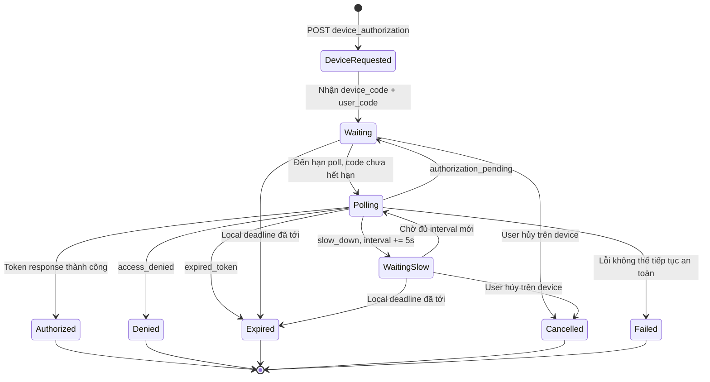

# Slow down response trong OAuth 2.0 Device Authorization Grant

Một ứng dụng chạy trên smart TV, máy in, thiết bị IoT hoặc CLI có thể không có bàn phím và trình duyệt phù hợp để người dùng đăng nhập. **OAuth 2.0 Device Authorization Grant** (RFC 8628) cho phép thiết bị hiển thị một địa chỉ xác minh và mã ngắn, còn người dùng mở địa chỉ ấy trên điện thoại hoặc máy tính để đăng nhập, cấp quyền. Trong lúc chờ, thiết bị phải **thăm dò (poll)** token endpoint của authorization server (AS) để biết yêu cầu đã được chấp thuận hay chưa.

Điểm khó là thiết bị không biết chính xác **khi nào người dùng sẽ hoàn tất**. Nếu client cứ gọi token endpoint liên tục, một thiết bị có thể gây tải đáng kể cho AS; hàng nghìn TV/CLI đang chờ cùng lúc sẽ biến thành **polling storm**. Để kiểm soát nhịp độ, AS có thể trả mã lỗi OAuth **`slow_down`**, yêu cầu client **tăng khoảng cách giữa các lần polling**.

Bài thuộc chương **Device authorization** của module **SECURITY_TOKEN_SECURITY_FUNDAMENTALS**. Trọng tâm là phản hồi `slow_down` theo RFC 8628, thuật toán xử lý `interval` và timeout, khác biệt với `authorization_pending`/`access_denied`/`expired_token`, đồng thời đặt hành vi polling trong mô hình tin cậy, vòng đời access/refresh token, JWT/opaque token, audience/scope, lưu trữ, thu hồi và phòng chống đánh cắp/phát lại.

> **Quy tắc quan trọng nhất:** khi token endpoint trả `slow_down`, client **phải tăng polling interval thêm 5 giây** so với interval đang áp dụng, và **duy trì khoảng mới cho các lần request tiếp theo**. Mỗi lần tiếp tục nhận `slow_down` thì tăng tiếp 5 giây. Không được lập tức retry chỉ vì phản hồi có chữ "error".

## 1. Device Authorization Grant giải quyết vấn đề nào?

Device Grant tách **thiết bị đang xin token** khỏi **user agent nơi người dùng xác thực**. Nó là một luồng cấp quyền OAuth được thiết kế cho thiết bị hạn chế tương tác, không phải cách để ứng dụng thu thập password rồi tự gọi AS.

Các vai trò:

| Vai trò | Chức năng trong Device Grant | Ví dụ |
| --- | --- | --- |
| **Resource owner** | Người dùng quyết định có cấp quyền cho client hay không | Người sở hữu tài khoản streaming |
| **Device client** | Khởi tạo device authorization, hiển thị hướng dẫn, polling để nhận token | Smart TV, CLI, máy in |
| **Authorization server (AS)** | Phát `device_code`/`user_code`, xác thực người dùng tại trang verification, quản lý trạng thái, phát token | `https://auth.example.test` |
| **Resource server (RS)** | Chỉ cho truy cập tài nguyên khi access token đúng issuer/audience/scope/quyền | `media-api`, `printers-api` |
| **Browser/secondary device** | Hiển thị trang xác minh cho người dùng | Điện thoại mở verification URI |

Thiết bị thường là **public client**, vì mã ứng dụng và credential gắn trong firmware/binary có thể bị sao chép. Tuy nhiên, loại client và yêu cầu client authentication tại token endpoint vẫn phải theo **registration/profile thực tế**; không tự đưa `client_secret` cố định vào firmware rồi coi đó là confidential authentication.

### 1.1. Luồng tổng quát

```mermaid
sequenceDiagram
    actor U as Người dùng
    participant D as Device/CLI client
    participant AS as Authorization Server
    participant B as Browser trên điện thoại
    participant RS as Resource Server

    D->>AS: POST device_authorization (client_id, scope)
    AS-->>D: device_code, user_code, verification_uri, expires_in, interval
    D-->>U: Hiển thị URL và user_code
    par Thiết bị chờ
        D->>AS: POST token endpoint (device_code)
        AS-->>D: authorization_pending
        Note over D: Chờ ít nhất interval
        D->>AS: Poll lần tiếp theo
        AS-->>D: slow_down
        Note over D: Tăng interval thêm 5 giây; chờ theo interval mới
    and Người dùng hoàn tất ở browser
        U->>B: Mở verification_uri và nhập user_code
        B->>AS: Xác thực, xem thông tin client và consent
        AS-->>B: Thông báo đã cấp hoặc từ chối quyền
    end
    D->>AS: Poll sau khoảng chờ đủ dài
    AS-->>D: Access token (và token khác nếu được phép)
    D->>RS: Bearer/PoP access token đúng audience
    RS->>RS: Validate token, scope, quyền tài nguyên
    RS-->>D: API response
```

**Hai request không được nhầm lẫn:**

1. **Device authorization request** gửi đến **device authorization endpoint** để bắt đầu quy trình và nhận các code/hướng dẫn.
2. **Device token request** gửi đến **token endpoint** nhiều lần cho đến khi được chấp thuận, bị từ chối, hết hạn hoặc client ngừng chờ. **`slow_down` là phản hồi của bước polling token endpoint**, không phải tín hiệu thông thường từ trang nhập `user_code`.

## 2. Các trường của device authorization response

Một request khởi tạo minh họa:

```http
POST /oauth2/device_authorization HTTP/1.1
Host: auth.example.test
Content-Type: application/x-www-form-urlencoded

client_id=tv-public-client&scope=media%3Aread
```

AS có thể trả:

```http
HTTP/1.1 200 OK
Content-Type: application/json
Cache-Control: no-store
Pragma: no-cache

{
  "device_code": "<long-opaque-device-code>",
  "user_code": "ABCD-EFGH",
  "verification_uri": "https://auth.example.test/device",
  "verification_uri_complete": "https://auth.example.test/device?user_code=ABCD-EFGH",
  "expires_in": 900,
  "interval": 5
}
```

Đây là các giá trị **minh họa**. AS thực tế tự tạo code có entropy, giới hạn tuổi và đường dẫn phù hợp; ví dụ ở đây không phải credential có thể dùng.

| Trường | Ý nghĩa | Yêu cầu sử dụng |
| --- | --- | --- |
| `device_code` | Credential/handle khó đoán đại diện cho yêu cầu đang chờ trên thiết bị | **Chỉ gửi đến token endpoint**; giữ kín, không hiển thị như mã người dùng |
| `user_code` | Mã ngắn cho người dùng nhập trên browser khác | Hiển thị dễ đọc; AS phải chống đoán/brute force ở verification flow |
| `verification_uri` | Địa chỉ người dùng mở để xác minh | Hiển thị rõ host HTTPS tin cậy; không lấy từ nguồn không đáng tin |
| `verification_uri_complete` | URI tùy chọn đã bao gồm `user_code` nhằm thuận tiện cho QR/link | Có thể hiển thị QR, nhưng người dùng phải xác nhận đúng thiết bị/app |
| `expires_in` | Thời gian sống của **device authorization request/device_code**, tính bằng giây | Client lưu deadline, dừng polling khi hết hạn |
| `interval` | **Khoảng chờ tối thiểu tính bằng giây** giữa các request polling tới token endpoint | Nếu thiếu, **RFC 8628 quy định client dùng mặc định 5 giây** |

**Không nhầm `expires_in` của bước này với `expires_in` của access token response**. Cùng tên tham số nhưng ngữ cảnh khác nhau: lúc khởi tạo nó là thời hạn device code; sau khi token endpoint phát token, nó là lifetime của access token đầu ra.

### 2.1. Vì sao có cả `device_code` và `user_code`?

`device_code` là giá trị đủ entropy để client gửi qua **back-channel** trong request polling. Người dùng không cần thấy nó. `user_code` ngắn hơn, thiết kế để người dùng gõ được, nên nguy cơ đoán cao hơn và AS phải hạn chế số lần thử/thời gian sống.

Không nên dùng `user_code` thay `device_code` để polling. Không đưa `device_code` vào QR code, URL công khai, analytics hoặc UI. Ngược lại, việc một người nhìn thấy `user_code` **không nên** trực tiếp cấp quyền truy cập tài nguyên: AS còn phải xác thực resource owner, consent và ràng buộc phiên device authorization phù hợp.

## 3. Polling tại token endpoint

Client gửi device grant type được định nghĩa bởi RFC 8628:

```http
POST /oauth2/token HTTP/1.1
Host: auth.example.test
Content-Type: application/x-www-form-urlencoded

grant_type=urn%3Aietf%3Aparams%3Aoauth%3Agrant-type%3Adevice_code
&device_code=<long-opaque-device-code>
&client_id=tv-public-client
```

Body được xuống dòng trong ví dụ để dễ đọc; request thực phải form-encode đúng. Với confidential client nếu registration/profile yêu cầu, client còn cần xác thực với AS bằng phương thức tương ứng. **Không đưa device code vào query string** hoặc header forward tới RS.

Nếu người dùng chưa hoàn tất, token endpoint có thể trả:

```http
HTTP/1.1 400 Bad Request
Content-Type: application/json
Cache-Control: no-store
Pragma: no-cache

{"error":"authorization_pending"}
```

Client **không được polling liên tục** sau response này; phải đợi đủ `interval`. Nếu AS thấy client polling quá nhanh hoặc cần giảm tải, phản hồi có thể là:

```http
HTTP/1.1 400 Bad Request
Content-Type: application/json
Cache-Control: no-store
Pragma: no-cache

{"error":"slow_down"}
```

**Mã `slow_down` là phần body JSON `error` của OAuth device token request**, không phải HTTP status code `429`, không phải access token và không phải `invalid_grant`. Trong một số triển khai có rate limiting HTTP bổ sung, mã HTTP/headers có thể khác theo hợp đồng; client vẫn phải hiểu **quy tắc `slow_down` của RFC 8628** khi nhận nó.

## 4. Ngữ nghĩa chính xác của `slow_down`

Theo **RFC 8628, mục 3.5**, khi token endpoint trả `slow_down`, client tiếp tục polling nhưng **MUST tăng khoảng polling thêm 5 giây cho request tiếp theo và tất cả request sau đó**. Cần hiểu theo **giá trị interval tích lũy**, không phải trì hoãn 5 giây đúng một lần.

Giả sử `interval=5`:

```text
Khởi tạo: currentInterval = 5s

authorization_pending -> giữ currentInterval = 5s
slow_down             -> currentInterval = 10s
authorization_pending -> giữ currentInterval = 10s
slow_down             -> currentInterval = 15s
authorization_pending -> giữ currentInterval = 15s
```

Nếu server không gửi `interval` ban đầu, client cũng bắt đầu **5 giây** theo mặc định của RFC 8628. Nếu server gửi `interval=8`, lần `slow_down` đầu tiên nâng lên **13 giây**, lần tiếp theo nâng lên **18 giây**, không quay về 5 giây.

### 4.1. Công thức và invariant

```text
initialInterval =
    deviceResponse.interval nếu có
    ngược lại 5 giây

currentInterval := initialInterval

Khi nhận "authorization_pending":
    currentInterval giữ nguyên

Khi nhận "slow_down":
    currentInterval := currentInterval + 5 giây

Trước lần polling tiếp theo:
    wait >= currentInterval
    và now < deviceCodeExpiresAt
```

**Invariant cần kiểm:** với cùng một device authorization transaction, `currentInterval` **không giảm** sau `slow_down`. Không thiết lập lại về giá trị ban đầu sau lần `authorization_pending` tiếp theo, sau một HTTP timeout, sau khi process retry hoặc sau khi frontend render lại màn hình.

### 4.2. Timeline cụ thể

Để thấy rõ điều chỉnh, giả sử `interval=5`, việc gửi/nhận response gần như tức thì (thời gian thực có network latency nên chênh một chút):

| Thời điểm tương đối | Client gửi poll | Response | `currentInterval` sau response | Poll sớm nhất tiếp theo |
| --- | --- | --- | --- | --- |
| `t=0s` | Poll #1 | `authorization_pending` | `5s` | `t=5s` |
| `t=5s` | Poll #2 | `slow_down` | **`10s`** | `t=15s` |
| `t=15s` | Poll #3 | `authorization_pending` | `10s` | `t=25s` |
| `t=25s` | Poll #4 | `slow_down` | **`15s`** | `t=40s` |
| `t=40s` | Poll #5 | `authorization_pending` | `15s` | `t=55s` |
| `t=55s` | Poll #6 | Success nếu user đã duyệt | Dừng | Không poll tiếp |

Khoảng chờ nên được tính bảo thủ **từ khi request trước hoàn tất/response được xử lý** thay vì gửi request mới trong lúc request cũ chưa xong. RFC quy định tốc độ polling tối thiểu; việc đợi dài hơn là hợp lệ miễn không vượt deadline/kỳ vọng trải nghiệm.

### 4.3. `slow_down` không đổi điều gì?

Khi nhận `slow_down`:

- **Không tạo device authorization mới** và không reset `device_code`.
- **Không buộc người dùng nhập lại `user_code`** chỉ vì nhịp polling cần chậm hơn.
- **Không gia hạn `expires_in` hoặc expiry của device code**; hạn này vẫn tính từ authorization response ban đầu.
- **Không biến trạng thái pending thành denied**; người dùng vẫn có thể hoàn tất trước deadline.
- **Không được phát access token hay refresh token** chỉ vì client đã chờ đủ lâu.
- **Không thay scope/audience/grant/consent** của transaction.

Nếu thiết bị hiển thị «Đang chờ xác nhận», UI vẫn có thể cập nhật trạng thái cục bộ mà **không gọi token endpoint thường xuyên**. Một đồng hồ đếm ngược trên TV không đồng nghĩa gửi HTTP request mỗi giây.

## 5. Phân biệt bốn phản hồi chuẩn trong giai đoạn polling

RFC 8628 có bốn mã lỗi quan trọng trên token endpoint khi xử lý device grant:

| Mã `error` | Ý nghĩa | Client có polling tiếp không? | Ảnh hưởng interval |
| --- | --- | --- | --- |
| `authorization_pending` | User chưa hoàn tất authorization | **Có**, nếu device code còn hạn | Giữ interval hiện tại |
| `slow_down` | Client đang polling quá nhanh hoặc AS yêu cầu giảm tần suất | **Có**, nếu device code còn hạn | **Tăng thêm 5 giây, giữ cho các lần sau** |
| `access_denied` | Resource owner/AS từ chối yêu cầu | **Không** | Dừng; không retry cùng device code |
| `expired_token` | Device code đã hết hạn | **Không** | Dừng; phải bắt đầu device flow mới nếu người dùng yêu cầu |

Đây là các mã **error trên token endpoint của Device Grant**, không phải cùng ngữ cảnh với `access_denied` được redirect về client trong Authorization Code Flow.

### 5.1. `authorization_pending` không có nghĩa là lỗi hệ thống

Khi người dùng vẫn đang tìm điện thoại hoặc nhập mã, AS trả `authorization_pending` là tình huống **bình thường**. Client tiếp tục chờ theo `interval`.

**Sai:** diễn giải HTTP `400` của response này là «đăng nhập thất bại», tạo thêm device code rồi gửi lại user code mới. Điều đó làm người dùng rối, nhân số transaction và có thể tăng polling storm.

### 5.2. `slow_down` không phải lệnh dừng hẳn

Client vẫn chờ user hoàn tất. Chỉ thay đổi **lịch gửi token request**. Không bắt user đăng nhập lại, không gọi `/device_authorization` liên tục và không sử dụng access token cũ để «vượt qua» trạng thái chưa được chấp thuận.

### 5.3. `access_denied` là kết thúc

Nếu user nhấn «Không cho phép» tại verification page hoặc AS từ chối theo policy, client phải **dừng polling device code đó**. Một lần từ chối không được xem như yêu cầu «chờ thêm 5 giây rồi thử lại».

Nếu người dùng chủ động muốn thử lại, client có thể bắt đầu **flow mới** và hiển thị `user_code` mới theo chính sách; không lặp im lặng để ép người dùng đồng ý.

### 5.4. `expired_token` là kết thúc

Device authorization có hạn được AS quản lý. Khi AS trả `expired_token`, client dừng; không cố gửi lại cùng `device_code`, không tự tăng `expires_in` và không suy rằng user đã duyệt nhưng token còn đang «trên đường».

Một clock cục bộ có thể sai, nên **AS là nguồn quyết định cuối** về expiry. Client vẫn nên tính deadline từ `expires_in` để dừng sớm, tiết kiệm tài nguyên, nhưng **không ép AS chấp nhận code đã hết hạn**.

### 5.5. Lỗi OAuth khác

`invalid_client`, `invalid_request`, `unsupported_grant_type`, `invalid_grant` hoặc lỗi riêng của AS không có cùng ngữ nghĩa tiếp tục polling. Client cần xác định lỗi theo **hợp đồng token endpoint**:

- Sai client authentication: không thử lại vô hạn với cùng credential.
- Sai grant/body/device code: không mặc định chờ rồi retry.
- AS outage/timeout: xử lý network failure riêng (xem phần sau).
- HTTP rate limit bổ sung: tôn trọng `Retry-After` khi có và policy, nhưng không cho phép nhanh hơn interval đã tích lũy từ `slow_down`.

**Fail closed:** không trả token giả, không đánh dấu «đã đăng nhập» và không tự nới grant khi không hiểu response.

## 6. Mô hình trạng thái cho một thiết bị đang chờ



**`WaitingSlow` không cần là state riêng trong database**, nhưng trong triển khai phải có dữ liệu `currentInterval`, `nextPollAt` và lý do giãn cách. Nếu chỉ lưu enum `PENDING` mà quên interval, client dễ reset tần suất sau restart.

### 6.1. Trạng thái tối thiểu phía client

```text
DeviceAuthorizationTransaction {
  client_id,
  as_issuer,
  token_endpoint,
  device_code_secret,
  user_code_for_display,
  verification_uri,
  requested_scope,
  requested_resource_if_supported,
  started_at,
  device_code_expires_at,
  current_poll_interval,
  next_poll_eligible_at,
  consecutive_network_timeouts,
  terminal_state
}
```

Mô hình chỉ nhằm minh họa, không phải schema RFC. Nếu client khởi động lại, nó có thể chọn **hủy flow và yêu cầu user bắt đầu lại** thay vì lưu `device_code` dài hạn. Nếu cần resume, phải bảo vệ device code trong storage phù hợp và khôi phục interval đã tích lũy **mà không polling quá sớm**.

### 6.2. Một transaction chỉ có một polling coordinator

Không cho nhiều thread, browser tab, UI component hoặc replica cùng polling **một `device_code`**. Một instance có thể đang đợi đúng 10 giây nhưng hai instance khác gửi xen kẽ làm tổng tần suất thực tế vượt giới hạn. Cần:

- **Single-flight**: tối đa một token request đang bay cho mỗi device authorization transaction.
- Đồng bộ `nextPollEligibleAt` và `currentInterval` đủ mạnh nếu có nhiều process.
- Khi success/denied/expired/cancelled: **dừng toàn bộ lịch polling cũ**.
- Một response chậm/cũ về sau không được hồi sinh transaction đã terminal.
- Khi retry do lỗi mạng, không gửi một request thứ hai khi request trước còn đang chờ hoặc có kết quả chưa rõ.

## 7. Thuật toán polling an toàn và ví dụ Java

**Java pseudocode** dưới đây thể hiện cách xử lý theo RFC 8628. Các interface `DeviceAuthorization`, `DeviceTokenClient`, `PollResult`, `Scheduler` và `TokenStore` là abstraction minh họa; không phải API có sẵn của Java hoặc Spring Security. Mã được rút gọn để tập trung vào interval, không thể copy chạy production.

```java
final class DevicePollingCoordinator {
    private final DeviceTokenClient tokenClient;
    private final Scheduler scheduler;
    private final Clock clock;
    private final TokenStore tokenStore;

    // Chỉ một coordinator chạy cho mỗi device code.
    void start(DeviceAuthorization grant, String clientId) {
        long currentIntervalSeconds =
            grant.intervalSeconds().orElse(5L);
        Instant deadline = clock.instant()
            .plusSeconds(grant.expiresInSeconds());

        PollSession state = new PollSession(
            clientId,
            grant.deviceCode(),
            deadline,
            currentIntervalSeconds
        );
        // Không nhất thiết gọi poll ngay; theo lịch và policy client.
        scheduler.schedule(() -> pollOnce(state), Duration.ZERO);
    }

    void pollOnce(PollSession state) {
        if (state.isTerminal()) {
            return;
        }
        if (!clock.instant().isBefore(state.deadline())) {
            state.finishExpired();
            return;
        }

        // Ngăn concurrent poll cho cùng device_code.
        if (!state.tryMarkInFlight()) {
            return;
        }

        PollResult result;
        try {
            result = tokenClient.pollDeviceGrant(
                state.clientId(), state.deviceCode()
            );
        } catch (NetworkTimeout timeout) {
            state.clearInFlight();
            state.increaseNetworkBackoff();
            // Retry chậm hơn, không nhỏ hơn interval của RFC.
            scheduleIfStillValid(state,
                state.effectiveDelayAfterTimeout());
            return;
        } catch (NetworkError error) {
            state.clearInFlight();
            state.handleTransportError(error);
            return;
        }

        state.clearInFlight();
        if (state.isTerminal()) {
            return;
        }

        switch (result.kind()) {
            case AUTHORIZATION_PENDING -> {
                state.resetNetworkTimeoutCount();
                scheduleIfStillValid(
                    state,
                    Duration.ofSeconds(state.currentIntervalSeconds())
                );
            }
            case SLOW_DOWN -> {
                // RFC 8628: cộng 5s mỗi lần, giữ cho request tiếp theo.
                state.increasePollingIntervalByFiveSeconds();
                state.resetNetworkTimeoutCount();
                scheduleIfStillValid(
                    state,
                    Duration.ofSeconds(state.currentIntervalSeconds())
                );
            }
            case ACCESS_DENIED -> state.finishDenied();
            case EXPIRED_TOKEN -> state.finishExpired();
            case TOKEN_ISSUED -> {
                tokenStore.storeSecurely(result.tokens());
                state.finishAuthorized();
            }
            default -> state.finishWithSafeError();
        }
    }

    void scheduleIfStillValid(PollSession state, Duration delay) {
        if (state.isTerminal()) {
            return;
        }
        if (!clock.instant().plus(delay).isBefore(state.deadline())) {
            state.finishExpired();
            return;
        }
        scheduler.schedule(() -> pollOnce(state), delay);
    }
}
```

### 7.1. Những chi tiết mã giả cố ý chưa triển khai

- `PollSession` phải quản lý interval, `nextPollEligibleAt` và terminal state **nguyên tử**; ví dụ này chưa triển khai class đó.
- `increasePollingIntervalByFiveSeconds()` phải tránh overflow, giữ interval tăng đơn điệu. Không đặt **cap dưới minimum** AS đã yêu cầu.
- `tryMarkInFlight()` cần đúng khi nhiều thread/process; `clearInFlight()` phải được xử lý an toàn ở mọi nhánh lỗi. Trong production, có thể dùng `try/finally` hoặc thư viện async có state transition rõ.
- Scheduler cần dùng **monotonic clock cho delay** (ví dụ nguồn `System.nanoTime`/event-loop timer) để tránh máy chỉnh đồng hồ làm timer chạy sớm. `Instant` dùng để mô tả thời gian hết hạn; AS vẫn quyết định expiry thực.
- Với network timeout, cần **exponential backoff hoặc giãn nhịp hợp lý** như RFC 8628 khuyến nghị; `effectiveDelayAfterTimeout` phải không nhỏ hơn polling interval hiện hành.
- Khi token response thành công, chỉ lưu credential sau khi kiểm định dạng/issuer/recipient và policy phù hợp; **không ghi access/refresh token vào log**.
- Nếu device code đã expired tại AS dù local còn thời gian, `EXPIRED_TOKEN` phải kết thúc flow ngay.
- Trong tình huống response về sát deadline, cách bắt đầu request và xử lý timeout phải bảo thủ; không kéo dài deadline tự động.

### 7.2. Pseudocode kiểm tra tính đơn điệu của interval

```java
final class PollTimingState {
    private long minIntervalSeconds;
    private long networkBackoffSeconds;

    PollTimingState(long serverInterval) {
        minIntervalSeconds = serverInterval; // Mặc định 5s nếu thiếu.
        networkBackoffSeconds = 0;
    }

    void onAuthorizationPending() {
        // Không được giảm minIntervalSeconds.
        networkBackoffSeconds = 0;
    }

    void onSlowDown() {
        // Cần kiểm overflow / giới hạn tài nguyên ở production.
        minIntervalSeconds += 5;
        networkBackoffSeconds = 0;
    }

    void onNetworkTimeout() {
        // Ví dụ backoff: bắt đầu ít nhất min interval, sau đó nhân đôi.
        networkBackoffSeconds = networkBackoffSeconds == 0
            ? minIntervalSeconds
            : Math.min(networkBackoffSeconds * 2, 300L);
    }

    long nextDelaySeconds() {
        return Math.max(minIntervalSeconds, networkBackoffSeconds);
    }
}
```

**Chú ý:** `300L` ở đây là **cap minh họa chỉ cho network backoff**; `nextDelaySeconds()` luôn dùng `max(minIntervalSeconds, networkBackoffSeconds)` nên không vi phạm minimum interval nếu nhiều `slow_down` làm nó vượt 300 giây. Đoạn code thực tế phải xử lý overflow và deadline, không tự động retry vô hạn.

### 7.3. Chọn thời điểm lần poll đầu tiên

RFC 8628 quy định `interval` là khoảng tối thiểu giữa các polling requests và mặc định 5 giây nếu thiếu; nhiều client có thể gửi lần polling đầu sau khi nhận device authorization response hoặc lập lịch trễ theo chính sách. Với quy mô lớn, **jitter và pacing hợp lý** giúp tránh hàng nghìn client cùng gửi request đúng một giây. Không diễn giải «poll có thể bắt đầu» thành «poll liên tục trước khi user nhập code».

## 8. Mạng lỗi/timeout và `slow_down` khác nhau

RFC 8628 cũng bàn tới **connection timeout** trong polling: client **SHOULD giảm tần suất polling** khi gặp timeout, với **exponential backoff** là cách được khuyến nghị, ví dụ tăng gấp đôi khoảng đợi cho những timeout liên tiếp.

Khác nhau:

| Tình huống | Nguồn tín hiệu | Cách thay đổi lịch |
| --- | --- | --- |
| `authorization_pending` | AS trả lỗi OAuth hợp lệ | Giữ interval |
| `slow_down` | AS chủ động yêu cầu | **Tăng interval +5 giây** và ghi nhớ |
| Connection timeout | Client không nhận được kết quả chắc chắn | **Giãn polling**, thường exponential backoff |
| HTTP `429` với `Retry-After` | Chính sách HTTP rate limit của AS/proxy | Chờ theo hướng dẫn bổ sung, **không nhanh hơn** interval OAuth hiện hành |
| HTTP `5xx`/TLS/network error | AS/proxy/network tạm lỗi | Retry có giới hạn khi an toàn, không tạo busy loop |

Không dùng response `slow_down` để suy đoán rằng access token đã được cấp hoặc user vừa từ chối. Với timeout, **có thể AS đã nhận request nhưng client mất response**; retry chỉ sau khoảng đợi hợp lý, không gửi nhiều request song song cùng device code để «tăng khả năng nhận token».

### 8.1. Exponential backoff kết hợp interval tích lũy

Ví dụ `currentInterval=10s` sau một `slow_down`; client gặp ba timeout liên tiếp:

```text
slow_down            -> minInterval = 10s
timeout #1           -> retryDelay = max(10s, 10s) = 10s
timeout #2           -> retryDelay = max(10s, 20s) = 20s
timeout #3           -> retryDelay = max(10s, 40s) = 40s
successfully pending -> minInterval vẫn 10s
```

Sau khi mạng hồi phục, client có thể giảm **phần backoff do timeout** theo policy, nhưng không được giảm **minimum polling interval do `slow_down` tạo ra**. Nếu AS trả `slow_down` lần nữa, minimum tăng từ 10 lên 15 giây.

### 8.2. Có nên tin HTTP `Retry-After`?

Nếu AS/proxy trả `Retry-After` trong ngữ cảnh rate limit, client có thể dùng để chọn delay **dài hơn**; phải parse đúng dạng thời gian, giới hạn giá trị bất thường và kiểm source đáng tin. Nhưng đừng tự áp đặt rằng `slow_down` luôn kèm `Retry-After` hoặc HTTP `429`. RFC 8628 mô tả **mã OAuth `slow_down`** và quy tắc cộng 5 giây **độc lập**.

Một công thức thực dụng:

```text
effectiveWait = max(
    currentDevicePollingInterval,
    networkTimeoutBackoff,
    retryAfterDelayIfTrustedAndApplicable,
    localRateLimitDelay
)
```

Trong đó mọi deadline vẫn chịu `deviceCodeExpiresAt` và chính sách hủy flow. Không chuyển timeout thành lý do tạo hàng loạt `device_code` mới; như vậy vừa không giúp user login nhanh hơn vừa làm AS quá tải.

## 9. Server-side rate limiting và lý do AS phát `slow_down`

Một AS phục vụ nhiều loại thiết bị có thể gặp:

- Smart TV đang mở màn hình đăng nhập nhưng người dùng rời phòng.
- CLI trong CI/CD bị cấu hình lỗi, liên tục xin user confirmation.
- Nhiều pod cùng polling một device code do thiết kế concurrency sai.
- Bot gọi token endpoint bằng device code đoán được hoặc đã thu thập.
- Một user có nhiều thiết bị đồng thời đang đợi chấp thuận.

**`slow_down` cho phép AS yêu cầu client hợp tác giảm tần suất.** Nó không thay mọi biện pháp server-side. Một client độc hại có thể phớt lờ phản hồi và tiếp tục flood.

### 9.1. Giới hạn theo nhiều chiều

AS nên đánh giá rate limit theo:

| Chiều kiểm soát | Mục tiêu | Lưu ý |
| --- | --- | --- |
| `device_code` / transaction | Ngăn một authorization request bị poll quá thường xuyên | Không để client tăng song song để vượt limit |
| `client_id`/client registration | Ngăn một client gây tải lớn | Public client ID dễ bị copy; không dùng như duy nhất bằng chứng caller |
| IP/network hoặc authenticated peer | Thêm tín hiệu phát hiện lạm dụng | NAT/corporate proxy có nhiều user; tránh false positive |
| Device/session | Quản lý số flow đang chờ của một thiết bị | Device ID tự khai không phải chứng cứ danh tính |
| User account ở verification step | Ngăn brute force user code, lạm dụng consent | Không lộ user có tồn tại hay không |
| Toàn hệ thống/AS cluster | Tránh overload token endpoint/JWKS/DB | Có khả năng backpressure, circuit breaker |

Server phải kiểm mọi điều kiện grant trước khi phát token: **device code tồn tại, đúng client binding, chưa hết hạn/tiêu thụ, user thật sự chấp thuận, scope/audience được phép và trạng thái không bị revoke**.

### 9.2. Có cần AS tăng interval trong body lỗi?

RFC 8628 quy định xử lý `slow_down` bằng **cộng 5 giây** vào polling interval của client. **Đừng yêu cầu field `interval` mới trong mỗi error response như điều kiện để hoạt động**, vì mẫu lỗi chuẩn có thể chỉ chứa:

```json
{"error":"slow_down"}
```

Một nhà cung cấp có thể có extension riêng trả thêm metadata, nhưng client phải biết rõ profile áp dụng. Không lấy `error_description` như số giây và không parse text tự nhiên để quyết định polling.

### 9.3. Chống cấp token hai lần do polling race

Người dùng có thể chấp thuận đúng lúc thiết bị gửi hai polling requests. AS phải quản lý state transaction **nhất quán và chống sử dụng lại device code** theo thiết kế; việc phát token phải được gắn với authorization đã được chấp thuận, client binding và chính sách tiêu thụ code.

Không để hai request đồng thời sinh hai nhánh refresh token không kiểm soát hoặc thay đổi grant trái phép. Nếu client nhận token thành công, nó phải **dừng polling** thay vì tiếp tục xin thêm token cùng device code.

## 10. Device code và user code là hai loại thông tin nhạy cảm khác nhau

### 10.1. Bảo vệ `device_code` như credential tạm thời

`device_code` là giá trị client trình ở token endpoint. Nếu bị lộ, attacker có thể tìm cách polling thay thiết bị. AS phải bảo vệ ngữ cảnh và ràng buộc nó với `client_id`/client authentication khi áp dụng.

Ở phía client:

- Giữ trong memory hoặc storage tạm có bảo vệ; không ghi raw device code vào log, trace, crash dump, URL hoặc clipboard tùy tiện.
- Không gửi code đến resource server hoặc domain ngoài token endpoint đã cấu hình.
- Xóa khi flow thành công, bị từ chối, hết hạn hoặc user hủy.
- Không tái sử dụng code của phiên người dùng khác hoặc sau restart theo cách làm rối state.

### 10.2. `user_code` phải dễ nhập, nhưng phải chống đoán

`user_code` được **hiển thị cho người dùng** và thường có entropy thấp hơn device code. AS phải giới hạn số lần thử, hạn hiệu lực, kiểm tra format và chặn brute force theo RFC 8628/security policy; không cho mã ngắn là credential tự gọi API.

Không tiết lộ chi tiết tài khoản hoặc trạng thái đăng nhập của người khác chỉ qua việc thử user code. Một attacker có thể dùng mã giả hoặc phishing page để dụ user cấp quyền cho **thiết bị do attacker kiểm soát**; màn hình xác minh phải giúp user hiểu đang xác nhận client nào, thiết bị nào và scope nào.

### 10.3. QR code không loại bỏ social engineering

`verification_uri_complete` và QR có thể giúp người dùng không phải gõ mã, nhưng attacker có thể đưa một QR của **flow khác** cho user. Người dùng nên kiểm domain HTTPS chính thức và thông tin thiết bị/app trước khi chấp thuận.

Ứng dụng không được hiển thị một trang đăng nhập giả rồi thu mật khẩu; authentication/consent diễn ra trên **origin AS tin cậy**. `slow_down` chỉ giúp kiểm tốc độ polling, **không chống phishing** nếu user bị lừa duyệt flow sai.

## 11. Vòng đời access token và refresh token sau khi polling thành công

Khi user chấp thuận, token endpoint có thể trả:

```http
HTTP/1.1 200 OK
Content-Type: application/json
Cache-Control: no-store
Pragma: no-cache

{
  "access_token": "<new-access-token>",
  "token_type": "Bearer",
  "expires_in": 600,
  "scope": "media:read",
  "refresh_token": "<refresh-token-if-policy-allows>"
}
```

`refresh_token` **không phải trường bắt buộc**. AS quyết định có phát hay không theo grant, client type, policy và rủi ro.

### 11.1. Không lấy device code làm access token

**`device_code` không được gửi trong `Authorization: Bearer` tới media API.** Nó chỉ dành cho token endpoint của AS. Access token mới phát mới là credential RS kiểm tra.

RS không cần biết TV đã từng bị `slow_down` bao nhiêu lần. Nó phải kiểm tra:

- **JWT**: chữ ký, thuật toán và JWKS tin cậy, `iss`, `aud`, `exp`/`nbf`, token type/profile.
- **Opaque token**: introspection hoặc kiểm trạng thái theo hợp đồng, resource binding phù hợp.
- **Scope**: ví dụ `media:read`, không tự chuyển thành `media:write`.
- **Authorization thực tế**: thiết bị/user có quyền đọc nội dung nào, tenant/đối tượng nào.

Không nhầm `client_id=tv-public-client` với `aud=media-api` hoặc dùng OIDC ID token thay access token.

### 11.2. Refresh token và quyền hoạt động lâu dài

Nếu AS phát refresh token:

- Client bảo vệ storage; thiết bị công cộng hoặc dùng chung cần rủi ro và logout/đổi user rõ.
- AS giới hạn absolute/idle expiry, client binding, rotation hoặc sender constraint theo policy.
- Khi refresh token bị thu hồi/rotate, client không dùng lại token cũ.
- Logout/gỡ thiết bị nên có cơ chế revoke grant/token family nếu được hỗ trợ; xóa UI state đơn thuần không khiến bản sao refresh token bị lộ mất hiệu lực.

**`slow_down` không áp dụng cho mọi request refresh token**. Nó là mã lỗi đặc thù cho **polling trong Device Authorization Grant**; refresh token grant có lỗi/giới hạn riêng của AS và không được tự áp quy tắc `+5s` cho mọi OAuth flow.

### 11.3. Sender-constrained token

AS có thể áp dụng mTLS hoặc DPoP khi kiến trúc thiết bị hỗ trợ, để hạn chế bearer token bị phát lại mà không có private key:

- DPoP proof được xác minh theo từng request với method/URI, `jti`, thời gian và binding theo RFC 9449.
- mTLS certificate-bound token có ràng buộc với cert/key ở kết nối phù hợp theo RFC 8705.
- Thiết bị bị chiếm cùng private key vẫn tạo rủi ro; cần expiry, revoke và kiểm quyền.

Một lần `slow_down` **không làm token trở thành sender-constrained**, không tự phát hiện token theft và không thay validation của RS.

## 12. So sánh Device Grant với Authorization Code Flow và Client Credentials

| Đặc điểm | Device Authorization Grant | Authorization Code + PKCE | Client Credentials |
| --- | --- | --- | --- |
| Thiết bị/ứng dụng | TV, console, CLI, thiết bị nhập liệu hạn chế | Web/mobile/desktop có browser/system browser | Backend-to-backend |
| Người dùng tương tác | Trên **thiết bị thứ hai** qua verification URI | Qua redirect/login ở browser | Thường không có user tương tác trực tiếp |
| Cách chờ | **Polling token endpoint** | Chờ browser redirect với code | Gửi request token, không chờ user approval |
| Mã đặc thù | `device_code`, `user_code` | `authorization_code`, PKCE verifier/challenge | Client authentication credential |
| Response trung gian | `authorization_pending`, `slow_down` | Callback code hoặc `error`/`state` | Thông thường token/error ngay |
| AS cấp quyền | Theo user authorization/consent và client policy | Theo user grant/consent và PKCE | Theo quyền service principal/client |
| Cơ chế chống request quá dày | `interval`, `slow_down`, timeout backoff | Không phải cùng device polling protocol | Rate limit/retry policy chung, không dùng `slow_down` RFC 8628 |

**Không dùng Device Grant chỉ vì lười triển khai browser redirect** khi ứng dụng hoàn toàn có thể dùng authorization code + PKCE an toàn. Tương tự, grant `client_credentials` dành cho quyền của client/service principal, không phải giải pháp thay thế việc người dùng xác nhận Device Grant. Mỗi flow có threat model riêng; việc tăng polling là chi phí tự nhiên của thiết bị không nhận redirect trực tiếp.

### 12.1. Phân biệt với lỗi authorization endpoint

Trong authorization code flow, user từ chối có thể khiến AS redirect callback với `error=access_denied&state=...`. Trong Device Grant, client polling token endpoint có thể nhận **JSON error** `access_denied`. Cùng tên lỗi không làm hai response có cùng kênh, cùng tham số hoặc cùng cách xử lý.

### 12.2. `slow_down` không đồng nghĩa HTTP `429`

`429 Too Many Requests` là HTTP status cho rate limiting chung; một hệ thống có thể dùng thêm nhưng không phải mã OAuth định nghĩa polling interval tại Device Grant. **`slow_down` có ngữ nghĩa cụ thể +5 giây theo RFC 8628**. Client cần hiểu cả hai nếu hệ thống có profile rate limit riêng, nhưng không được lẫn.

## 13. Các lỗi triển khai thường gặp

| Anti-pattern | Hậu quả | Hướng xử lý đúng |
| --- | --- | --- |
| Poll mỗi giây dù `interval=5` | AS quá tải, nhận `slow_down`/rate limit | Chờ ít nhất interval server đưa |
| Poll ngay sau `slow_down` | Vi phạm RFC 8628, tăng tải | Tăng interval **+5 giây** rồi chờ |
| `slow_down` chỉ đợi thêm một lần | Request sau quay về tốc độ cũ | Lưu interval tích lũy suốt transaction |
| Hai lần `slow_down` nhưng chỉ tăng tổng 5 giây | Vi phạm quy tắc tăng cho mỗi response | +5 sau **mỗi** `slow_down` |
| Reset interval khi `authorization_pending` | Vô hiệu hiệu lực slow down trước | Pending giữ nguyên interval |
| Timeout thì retry lập tức | Bão request khi AS/network yếu | Exponential backoff có giới hạn |
| Backoff cap thấp hơn interval yêu cầu | Retry nhanh hơn mức tối thiểu | `effectiveDelay=max(minInterval, backoff)` |
| Mỗi màn hình UI mở thêm polling thread | Nhiều poll cùng `device_code` | Single-flight/one coordinator |
| Token request bị timeout, gửi thêm song song | Race, double-use, tải AS | Chờ kết thúc timeout và lịch retry |
| Tạo device_code mới sau mỗi pending | Người dùng nhập mã cũ bị vô hiệu/rối, nhiều transaction | Giữ một flow cho tới terminal/timeout |
| Tiếp tục poll sau `access_denied` | Không tôn trọng quyết định người dùng | Dừng; chỉ flow mới theo hành động user |
| Tiếp tục poll sau `expired_token` | Gửi credential hết hạn vô ích | Dừng và cho user bắt đầu lại |
| Coi `slow_down` là permission denied | UX sai, ngắt flow hợp lệ | Chỉ giảm nhịp polling |
| Diễn giải `expires_in` ban đầu như access token TTL | Hiểu sai thời hạn transaction | Tách device_code expiry với access token expiry |
| Đưa `device_code` ra màn hình/QR/log | Credential bị lộ | Chỉ hiển thị user code/URI; bảo vệ device code |
| Dùng `user_code` gọi API/token endpoint | Sai mục đích, brute force | Poll bằng device code tại AS, xác minh user ở browser |
| Tin `verification_uri` từ nguồn ngoài AS | Phishing/redirect đến site độc hại | Tin endpoint AS đã cấu hình và HTTPS |
| Tự phát token khi không nhận response | Bypass authorization | Chỉ tin token endpoint response hợp lệ |
| Nhận token không đúng `aud`/scope tại RS | Token substitution/privilege escalation | RS kiểm audience, scope, rights |
| Cho nhiều TV dùng chung refresh token | Khó thu hồi, rò credential giữa user/device | Binding và token family theo thiết bị/client |
| Retry `invalid_client` như pending | Che lỗi cấu hình, bão request | Dừng/cảnh báo, sửa client registration |
| Log raw OAuth response/device code/token | Tiết lộ credential | Redaction và hạn truy cập observability |
| Chỉ dùng `slow_down` để chống bot | Attacker có thể bỏ qua yêu cầu | AS rate limit, client binding, entropy và abuse detection |

## 14. Case study: TV đăng nhập kho nội dung

Một nhà cung cấp streaming triển khai Device Grant:

```text
AS:              https://auth.media.example.test
Device client:   living-room-tv
Resource:        media-api
Requested scope: media:read
Initial interval: 5s
Device code TTL: 10 phút
```

### 14.1. Thiết bị hiển thị hướng dẫn

TV gọi device authorization endpoint và nhận `device_code` (giữ kín), `user_code` và `verification_uri`. TV hiển thị:

```text
1. Mở: https://auth.media.example.test/device
2. Nhập mã: ABCD-EFGH
3. Kiểm tra tên ứng dụng/thiết bị và cấp quyền nếu đúng
```

Nếu AS cung cấp `verification_uri_complete`, TV có thể thêm QR, nhưng vẫn hiển thị domain và hướng dẫn xác nhận cho người dùng.

### 14.2. Người dùng mất thời gian lấy điện thoại

TV poll lần đầu, AS trả `authorization_pending`. Lần thứ hai, AS thấy tốc độ/ tải yêu cầu cần giảm nên trả `slow_down`. TV tăng khoảng chờ từ 5 lên 10 giây. Trong lúc người dùng nhập code, TV **không tạo một flow mới** và chỉ hiển thị trạng thái chờ.

Nếu AS trả `slow_down` lần nữa, TV nâng lên 15 giây. User hoàn tất sau 70 giây, TV có thể chỉ nhận token ở **poll hợp lệ tiếp theo**, không phải ngay thời điểm browser hiển thị «Thành công». Đây là trade-off được chấp nhận của polling.

### 14.3. Nếu user từ chối hoặc hết hạn

- User bấm **Từ chối**: token endpoint trả `access_denied` ở lần polling tiếp theo; TV dừng và hiển thị thông báo, không tự yêu cầu lại liên tục.
- Code hết hạn: token endpoint trả `expired_token` hoặc TV tự nhận ra deadline trước đó; TV dừng, chỉ tạo flow mới khi user chọn thử lại.
- Kết nối internet chập chờn: TV tăng network backoff, không reset current interval sau `slow_down`.

### 14.4. Nếu user chấp thuận

AS xác nhận giao dịch, phát access token đúng `aud=media-api` và `scope=media:read`. TV dừng polling, lưu token an toàn; `media-api` kiểm token và quyền nội dung. Nếu được cấp refresh token, AS và TV quản lý rotation/expiry/revocation riêng. TV không được phát token tự chế vì đã nhận `slow_down` hay vì UI user hiển thị một trạng thái khác.

## 15. Ma trận kiểm thử bắt buộc

| Ca kiểm thử | Dữ liệu/điều kiện | Kết quả mong đợi |
| --- | --- | --- |
| Response có `interval=5` | Device authorization thành công | Client dùng minimum interval 5 giây |
| Response không có `interval` | AS bỏ trường tùy chọn | Client dùng mặc định **5 giây** |
| Response có `interval=8` | Server chỉ định 8 giây | Client dùng 8 giây, không ép về 5 |
| Pending lần đầu | `authorization_pending` | Giữ interval và tiếp tục đúng lịch |
| Slow down lần đầu | Interval hiện tại 5 giây | **Tăng thành 10 giây** |
| Slow down lần thứ hai | Interval hiện tại 10 giây | **Tăng thành 15 giây** |
| Pending sau slow down | Interval hiện tại 15 giây | **Giữ 15 giây** |
| Network timeout sau slow down | Interval 15 giây | Backoff không nhỏ hơn 15 giây |
| Timeout liên tiếp | 3 lần timeout | Tần suất giảm theo backoff; không busy loop |
| Network hồi phục | Pending sau timeout | Không hạ minimum interval tích lũy |
| Server có HTTP 429/Retry-After | Retry-After 30 giây, currentInterval 15 giây | Chờ ít nhất 30 giây nếu áp dụng |
| Server có Retry-After ngắn hơn | Retry-After 3 giây, currentInterval 15 giây | Vẫn chờ ít nhất 15 giây |
| Device code hết hạn theo local deadline | `now >= expiresAt` | Dừng polling |
| AS báo `expired_token` sớm hơn local clock | Clock skew/AS state | Dừng, không tranh luận hạn bằng clock client |
| User từ chối | `access_denied` | Dừng, không xin thêm token |
| User chấp thuận | Token response hợp lệ | Lưu an toàn, dừng tất cả lịch poll |
| User hủy trên TV | Transaction cancelled | Dừng timer/request mới |
| Hai thread cùng poll một device code | Concurrent race | Tối đa một request in-flight |
| Client restart sau slow down | State phục hồi nếu được thiết kế | Không reset interval và poll sớm |
| Token success về sau khi đã cancelled | Late response từ request cũ | Không hồi sinh transaction hoặc tự login trái ý user |
| Invalid client | Sai registration/authentication | Dừng/cảnh báo, không retry như pending |
| Invalid request | Sai device grant body | Không retry vô hạn |
| HTTP 5xx | AS quá tải | Backoff/circuit breaker, fail closed |
| Device code lộ trong log | Telemetry full body | Test phát hiện và redaction |
| User code bị brute force | Nhiều lần thử trên verification page | AS áp dụng rate limit/đóng flow theo policy |
| QR flow độc hại | User quét verification URI giả/flow khác | UI/AS hiển thị domain, app/device context và consent rõ |
| Client không thuộc registration | Device code thuộc client A, token request B | AS từ chối |
| Device code đã dùng sau success | Poll lại cùng code | Không cấp thêm token trái policy |
| Token đích sai audience | `aud=payments-api` đưa vào media API | RS từ chối |
| Token hết hạn | `now >= exp(access_token)` | RS từ chối dù device flow từng thành công |
| Scope thiếu | Token chỉ `media:read` dùng endpoint write | RS từ chối phân quyền |
| OIDC ID token vào API | `aud=client_id`, không phải RS | RS không chấp nhận thay access token |
| Refresh token bị rotate | Trình lại refresh token cũ | AS từ chối theo refresh policy |
| Opaque access token inactive | Introspection `active=false` | RS từ chối |
| Gateway/proxy mất kết nối | Timeout với token endpoint | Không poll nhanh thêm, không gửi credential sang host khác |

**Cách kiểm thử:** dùng đồng hồ giả và scheduler có thể điều khiển để kiểm chính xác các mốc giây; kiểm integration test qua AS/token endpoint thật hoặc mô phỏng giao thức sát thực tế. Unit test chỉ so số lần gọi trong một method không chứng minh timer/concurrency vẫn đúng khi app sleep/resume, restart hay mạng chậm.

## 16. Tình huống ranh giới và tính toán số request

### 16.1. Vì sao tăng 5 giây có tác dụng?

Giả sử 10.000 thiết bị chưa được chấp thuận, mỗi thiết bị poll mỗi 1 giây: lý thuyết có thể tạo khoảng 10.000 requests/giây. Nếu các thiết bị tôn trọng `interval=5`, con số lý tưởng giảm còn khoảng 2.000 requests/giây. Sau `slow_down` lên 10 giây, giảm về khoảng 1.000 requests/giây trong cùng giả định.

Đây chỉ là **phép tính minh họa** với các thiết bị phân tán đều, chưa tính burst, latency, jitter, số flow kết thúc và năng lực AS thực tế. Không dùng các con số đó như benchmark bảo đảm. Mục đích là thấy giảm tần suất polling có lợi cho cả AS và độ ổn định của hệ thống.

### 16.2. Nếu interval mới lớn hơn thời gian còn lại?

Ví dụ device code còn 8 giây nhưng vừa nhận `slow_down`, tăng current interval lên 15 giây. Client **không được gửi request mới sau 8 giây chỉ để «kịp trước hạn»**. Nếu không còn thời gian cho một poll tuân thủ interval, hãy dừng và hiển thị flow hết hạn/cho user bắt đầu lại khi muốn.

Không coi deadline là lý do được **bỏ qua `slow_down`**.

### 16.3. Nếu AS báo chậm quá nhiều lần?

Nếu tiếp tục nhận `slow_down`, interval tích lũy có thể trở nên lớn. Client phải tiếp tục tôn trọng minimum tương ứng hoặc dừng flow khi đạt expiry; **không tự reset interval để «thử một lần cuối»**. Nếu app cần thông báo cho user rằng còn ít thời gian, cập nhật UI mà không tăng nhịp token requests.

### 16.4. Nếu thiết bị bị sleep rồi resume?

Thiết bị có thể sleep 30 giây và resume khi deadline gần tới. Nó nên kiểm:

1. Transaction còn active hay đã terminal?
2. `device_code` còn trước deadline không?
3. `nextPollEligibleAt` đã qua chưa?
4. Có request cũ đang in-flight hoặc response về trễ không?

Nếu đủ điều kiện, client **có thể** tiếp tục theo nhịp hiện hành; không tạo nhiều request để «bù» khoảng thời gian đã ngủ.

## 17. Checklist triển khai production

1. **Đúng RFC/profile:** AS hỗ trợ Device Authorization Grant RFC 8628; client dùng đúng device authorization endpoint và token endpoint, không nhầm authorization code callback?
2. **Response validation:** client parse `device_code`, `user_code`, `verification_uri`, `expires_in` và `interval` an toàn, từ AS HTTPS đáng tin?
3. **Default interval:** nếu `interval` không có, dùng **5 giây**; nếu có, tuân thủ minimum server thông báo?
4. **`slow_down`:** cộng **5 giây cho mỗi response**, giữ cho mọi poll tiếp theo, kể cả sau `authorization_pending` hoặc network recovery?
5. **Timeout backoff:** mạng timeout giảm tần suất (exponential backoff); không override minimum interval bởi cap nhỏ?
6. **Polling concurrency:** chỉ một coordinator/in-flight request mỗi transaction, không restart timer về tốc độ cũ sau UI rerender/restart?
7. **Terminal states:** `access_denied`, `expired_token`, success và user cancel đều dừng lịch; không retry code đã terminal?
8. **Expiry:** device code deadline không tự gia hạn khi `slow_down`; AS là nguồn xác thực hạn cuối?
9. **Client binding:** token endpoint kiểm đúng `client_id`/client authentication, device code và grant state, không chỉ thấy mã là phát token?
10. **User verification:** trang AS hiển thị client/device/scope rõ, chống brute force user code và phishing/QR-flow swapping?
11. **Secrets:** không hiển thị/log device code, raw token, refresh token hoặc client secret; storage tạm được bảo vệ?
12. **Issued tokens:** RS kiểm JWT/opaque access token đúng `iss`/`aud`/`scope`/expiry và quyền tài nguyên; không dùng device code hoặc ID token thay access token?
13. **Refresh lifecycle:** nếu cấp refresh token, có rotation/expiry/client binding/revocation; không suy `slow_down` làm refresh token hợp lệ hơn?
14. **Failure handling:** AS outage, HTTP 429/5xx, timeout và response không biết đều fail closed, không sinh polling storm?
15. **Audit:** metric pending/slow_down/success/denied/expired, current interval và rate limit violations, không chứa credential?
16. **Testing:** đã chạy timeline hai `slow_down`, multiple timeout, app sleep/resume, expiration boundary, concurrency, user denial, user approval, wrong client, wrong audience và credential leakage?

## Tổng kết

**`slow_down` là phản hồi đặc thù của token endpoint khi thiết bị polling theo OAuth 2.0 Device Authorization Grant (RFC 8628).** Nó có nghĩa «tiếp tục chờ nhưng gửi ít request hơn»: client phải **tăng polling interval thêm 5 giây mỗi khi nhận `slow_down`** và giữ mức mới cho các lần sau. `authorization_pending` giữ nguyên interval; network timeout cần backoff; `access_denied` và `expired_token` kết thúc flow.

Device code vẫn có **deadline cố định**, user code chỉ phục vụ xác minh trên browser khác, và chỉ sau khi AS chấp thuận mới có access token hợp lệ. Việc tuân thủ polling interval **không thay** authentication, consent, scope/audience, token validation, refresh token expiry/rotation, thu hồi hay phòng chống token theft/replay. Một client đúng chuẩn phải vừa **giữ nhịp polling an toàn**, vừa **không bao giờ cấp quyền chỉ vì đã chờ lâu hoặc nhận lỗi từ AS**.

**Tài liệu tham khảo:** RFC 8628 (OAuth 2.0 Device Authorization Grant, đặc biệt mục 3.2 Device Authorization Response, 3.4 Device Access Token Request và 3.5 Device Access Token Response); RFC 6749 (OAuth 2.0 Authorization Framework và token endpoint errors); RFC 9700 (Best Current Practice for OAuth 2.0 Security); RFC 6750 (Bearer Token Usage); RFC 7662 (Token Introspection); RFC 7009 (Token Revocation); RFC 9068 (JWT Profile for OAuth 2.0 Access Tokens); RFC 8705 (OAuth mTLS); RFC 9449 (DPoP); RFC 7519 (JWT); OpenID Connect Core 1.0.
