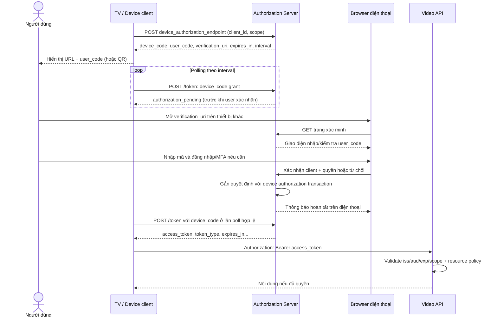
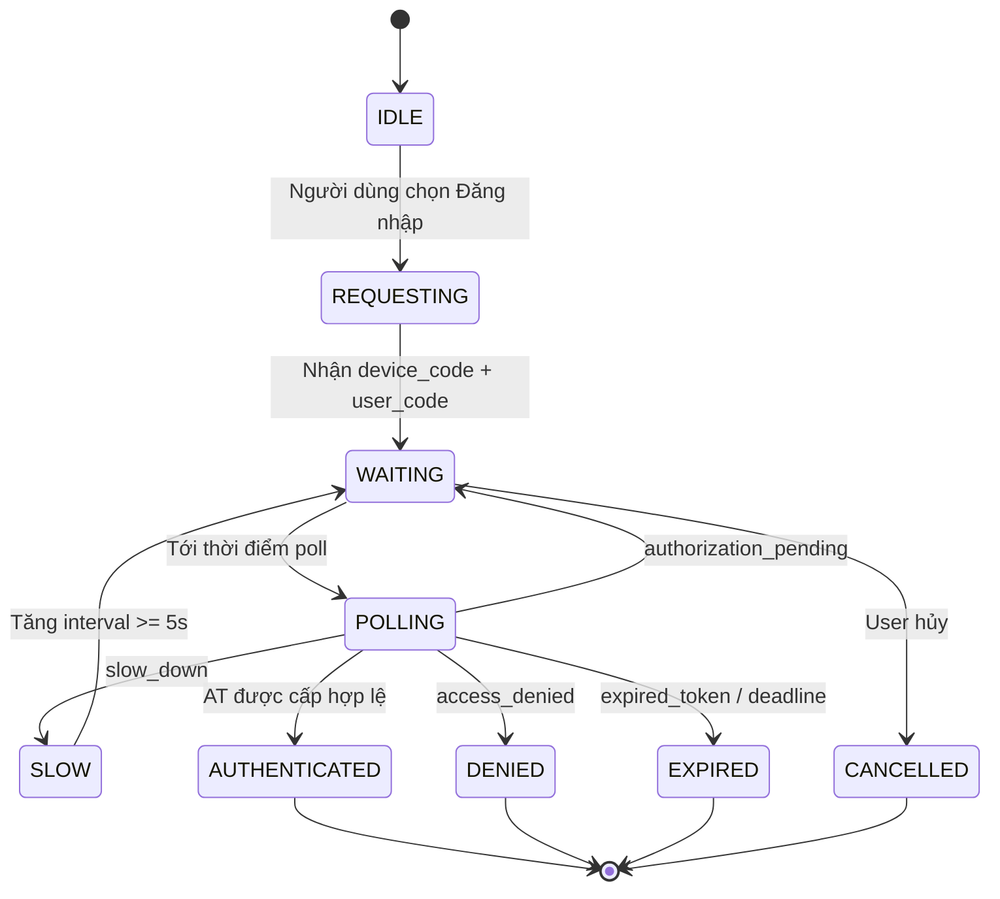

# User completes authentication on another device

## 1. Tình huống: đăng nhập TV bằng điện thoại

Một ứng dụng phát video chạy trên TV chỉ có remote với vài nút điều khiển. Người dùng muốn đăng nhập tài khoản để xem nội dung đã mua, nhưng việc nhập mật khẩu hoặc mã MFA bằng remote rất bất tiện. Một kỹ thuật thiếu an toàn là yêu cầu user gõ tên đăng nhập, mật khẩu và mã OTP trực tiếp lên TV, nơi trình duyệt, phần mềm hệ thống hoặc thiết bị có thể không hỗ trợ giao diện xác thực an toàn.

**OAuth 2.0 Device Authorization Grant (RFC 8628)** giải quyết bài toán này bằng cách **tách nơi người dùng xác thực khỏi thiết bị cần nhận quyền truy cập**:

1. **TV** gọi authorization server (AS) để bắt đầu một device authorization transaction.
2. AS trả một **`device_code` bí mật**, một **`user_code` để người dùng nhìn/nhập**, và URL xác minh `verification_uri`.
3. TV hiển thị: “Trên điện thoại hoặc máy tính của bạn, mở `https://auth.example.com/activate` và nhập mã `WDJB-MJHT`.”
4. **Người dùng** mở URL hợp lệ trên điện thoại, đăng nhập tại AS bằng phương thức phù hợp (mật khẩu/passkey/MFA nếu cần), thấy ứng dụng/quyền đang được yêu cầu và **chấp thuận hoặc từ chối**.
5. Trong lúc đó, TV **poll token endpoint** với `device_code`. Chỉ sau khi AS xác nhận yêu cầu đã được cấp phép, TV mới được cấp access token.
6. TV dùng access token để gọi resource server (RS) theo **audience, scope, thời hạn và các kiểm tra bảo mật** đã được định nghĩa.

Màn hình điện thoại **không gửi access token trực tiếp sang TV**; AS là nơi ràng buộc kết quả xác thực/ủy quyền với device transaction mà TV đã khởi tạo.

> **Nguyên tắc:** User thực hiện authentication/authorization trên **một thiết bị khác**; **thiết bị bị giới hạn khả năng nhập liệu** nhận token qua back-channel polling. `user_code` không phải access token hoặc mật khẩu, còn `device_code` không phải mã để người dùng chia sẻ công khai.

Bài **“User completes authentication on another device”** thuộc chương **Device authorization** của module `SECURITY_TOKEN_SECURITY_FUNDAMENTALS`. Nội dung kết nối OAuth 2.0/OIDC, JWT/opaque token, access/refresh token, scope, audience, phát hành–xác minh–lưu trữ–thu hồi và phòng chống credential bị đánh cắp hoặc phát lại.

## 2. Mục tiêu học tập

Sau khi học, bạn có thể:

- Giải thích khi nào Device Authorization Grant phù hợp cho TV, console, CLI hoặc thiết bị IoT có giao diện hạn chế.
- Phân biệt **device authorization endpoint**, **verification URI**, **token endpoint** và **resource server endpoint**.
- Hiểu đầy đủ ý nghĩa của `device_code`, `user_code`, `verification_uri`, `verification_uri_complete`, `expires_in` và `interval`.
- Mô tả cách **user đăng nhập/consent trên thiết bị khác** mà không chia sẻ mật khẩu với TV.
- Triển khai thuật toán polling không chồng chéo, tuân thủ `authorization_pending`, `slow_down`, `access_denied` và `expired_token`.
- Phân tích các tấn công **remote phishing, device misbinding, user-code guessing, token theft/replay**.
- Xây dựng chính sách cho thiết bị công cộng/chia sẻ: quyền tối thiểu, token storage, logout, thu hồi và xóa dữ liệu.
- Phân biệt **OAuth cấp access token** và **OIDC xác thực danh tính người dùng**.
- Thiết kế kiểm thử đúng transaction binding, token audience và quyền tài nguyên.

## 3. Ai làm gì trong Device Authorization Grant?

| Vai trò | Ví dụ | Nhiệm vụ |
| --- | --- | --- |
| **Resource owner/end-user** | Chủ tài khoản xem video | Xác thực và quyết định cấp quyền cho client |
| **OAuth client / thiết bị** | Ứng dụng TV có `client_id=stream-tv` | Bắt đầu giao dịch, hiển thị mã, polling và dùng token |
| **Authorization server (AS)** | `https://auth.example.com` | Phát code, xác thực người dùng trên browser, ghi nhận consent, phát token |
| **User agent trên thiết bị khác** | Browser điện thoại/laptop | Hiển thị trang AS cho người dùng xác thực/cấp phép |
| **Resource server (RS)** | `https://video-api.example.com` | Xác minh access token, scope/audience và quyền xem nội dung |

**Hai thiết bị có vai trò khác nhau:**

- **TV**: cần access token; có thể không có browser đủ tốt hoặc bàn phím; giữ `device_code` trong quá trình polling.
- **Điện thoại**: chỉ dùng để **tương tác với AS** trong một session riêng. Không cần Bluetooth, QR scanner, mạng nội bộ hoặc kết nối trực tiếp tới TV để token được cấp.

Không có quy tắc nói “điện thoại phải là thiết bị riêng của người dùng” trong mọi trường hợp, nhưng người dùng nên dùng **thiết bị/browser đáng tin** và biết rõ mình đang xác nhận cho client nào.

### 3.1. Vì sao không dùng Authorization Code + PKCE trên TV?

Nếu thiết bị có thể dùng **system browser/external user-agent** và callback đáng tin, Authorization Code + PKCE vẫn có thể phù hợp. Device Authorization Grant đặc biệt hữu ích khi thiết bị **input-constrained** hoặc browser/redirect callback kém tiện dụng.

Không nên chọn device flow chỉ vì muốn bỏ các bước security:

- User vẫn cần authentication/consent khi chính sách yêu cầu.
- AS vẫn xác minh client registration/grant và giới hạn scope/resource.
- Token endpoint vẫn phải xử lý code, expiration, rate limiting và replay.
- RS vẫn phải xác minh JWT/opaque token, audience, thời hạn và quyền nghiệp vụ.

### 3.2. Không phải Client Credentials Grant

**Client Credentials Grant** cấp token theo quyền của **workload/client**; không có end-user tương tác. Device Authorization Grant thường cần **người dùng trên thiết bị khác xác thực và phê duyệt**.

Ví dụ:

```text
TV cần truy cập danh sách nội dung của tài khoản user:
  -> Device Authorization Grant, người dùng approve trên điện thoại

Background server cần đọc cấu hình của chính dịch vụ:
  -> Client Credentials Grant nếu confidential client/grant phù hợp
```

Đừng dùng client credentials token có quyền toàn bộ tài khoản người dùng để “bỏ qua” xác thực trên điện thoại.

## 4. Sơ đồ end-to-end: điện thoại xác thực, TV nhận token



**Điểm then chốt:** Khi điện thoại báo “thành công”, nó không nhất thiết tự điều khiển TV. TV phải **tiếp tục polling đúng token endpoint** rồi nhận response. Nếu TV mất kết nối hoặc `device_code` hết hạn, user có thể phải khởi tạo yêu cầu mới.

## 5. Device authorization endpoint: nơi khởi tạo giao dịch

RFC 8628 định nghĩa một **device authorization endpoint** do AS công bố. Nó khác authorization endpoint thông thường (thường `/authorize`) mà browser dùng cho Authorization Code flow.

Ví dụ discovery metadata giản lược:

```json
{
  "issuer": "https://auth.example.com",
  "token_endpoint": "https://auth.example.com/token",
  "device_authorization_endpoint": "https://auth.example.com/device_authorization",
  "grant_types_supported": [
    "authorization_code",
    "urn:ietf:params:oauth:grant-type:device_code"
  ]
}
```

Đây là **ví dụ**, không phải tên path/metadata đầy đủ của mọi AS. OAuth 2.0 Authorization Server Metadata (RFC 8414) và các extensions liên quan có thể công bố endpoint/capabilities. Ứng dụng **phải lấy URL từ issuer/cấu hình được tin cậy**, không theo URL bất kỳ mà người dùng hay attacker gửi tới TV.

### 5.1. HTTP request khởi tạo

Với một public device client ví dụ:

```http
POST /device_authorization HTTP/1.1
Host: auth.example.com
Content-Type: application/x-www-form-urlencoded
Accept: application/json

client_id=stream-tv&scope=video%3Aread
```

Theo RFC 8628:

- `client_id` xác định client; **bắt buộc nếu client không xác thực theo cơ chế client authentication khác**, theo cách AS hỗ trợ.
- `scope` là **tùy chọn** theo chuẩn; AS kiểm soát default/allowed scopes.
- Request được gửi tới **device authorization endpoint**, không phải `/authorize` hoặc `/token`.
- Form body phải mã hóa đúng `application/x-www-form-urlencoded`.
- Endpoint cần HTTPS/TLS và bảo vệ đầu vào/abuse.

Client có thể là public hoặc confidential tùy khả năng giữ credential và chính sách AS. **Một ứng dụng TV đóng gói sẵn client secret trong firmware/app không nên mặc định được xem là confidential client**.

### 5.2. AS phải kiểm tra gì?

1. Client ID/registration có tồn tại, active và được phép dùng Device Authorization Grant không?
2. Nếu client authentication được yêu cầu/đăng ký, phương thức xác thực có hợp lệ không?
3. Scope/resource đề nghị có thuộc chính sách client không?
4. Có giới hạn rate, số device sessions đang chờ và thời hạn không?
5. Device transaction mới có ID/code đủ entropy và **không trùng** không?
6. Mapping giữa `device_code`, `user_code`, client, scope/resource, expiry được lưu an toàn không?
7. Địa chỉ `verification_uri` có thuộc origin AS được tin cậy và đã cấu hình không?
8. Có chống log sensitive codes/token request body không?

AS không phải cấp quyền ngay ở bước này. **Device authorization response chỉ mở một yêu cầu chờ người dùng xác nhận**, không có nghĩa đã có user identity hoặc consent hợp lệ.

## 6. Device authorization response: sáu trường quan trọng

Ví dụ:

```http
HTTP/1.1 200 OK
Content-Type: application/json
Cache-Control: no-store
Pragma: no-cache

{
  "device_code": "<high_entropy_device_code>",
  "user_code": "WDJB-MJHT",
  "verification_uri": "https://auth.example.com/activate",
  "verification_uri_complete":
      "https://auth.example.com/activate?user_code=WDJB-MJHT",
  "expires_in": 600,
  "interval": 5
}
```

Đây là **giá trị minh họa**; response thực tế có thể có format/code/URI khác tùy AS. `verification_uri_complete` là **tùy chọn**; `interval` cũng **tùy chọn**, mặc định 5 giây nếu AS không trả.

| Trường | Mục đích | Ai sử dụng? |
| --- | --- | --- |
| `device_code` | Credential/handle có entropy cao để client **poll token endpoint** | **TV**; không hiển thị cho user |
| `user_code` | Mã dễ nhập để user liên kết thao tác với yêu cầu trên device | **User** trên trang xác minh |
| `verification_uri` | Trang chính thức nơi user nhập mã | **Browser điện thoại** |
| `verification_uri_complete` | URL đầy đủ có thông tin user code để đơn giản hóa/QR | **Browser điện thoại**, nếu AS hỗ trợ |
| `expires_in` | Số giây trước khi device code/user code không còn hiệu lực | TV tính deadline và AS enforce |
| `interval` | Số giây tối thiểu giữa các lần polling theo AS | TV polling scheduler |

### 6.1. `device_code` không phải `user_code`

**`device_code`** là giá trị dùng **tại token endpoint** để lấy access token sau khi user phê duyệt. Nó phải khó đoán, được giữ bí mật trong device client và không xuất hiện trong QR hoặc UI công khai. AS cần ràng buộc device code với đúng client và transaction.

**`user_code`** được thiết kế để **người dùng thấy và nhập**. Nó thường ngắn, dễ đọc/đánh máy, vì vậy có ít entropy hơn device code. AS phải bảo vệ endpoint nhập mã bằng thời hạn ngắn, rate limiting và chống đoán mã.

Không viết:

```text
Sai:
  Hiển thị device_code trên TV cho người dùng gõ.

Sai:
  TV gửi user_code tới /token như grant credential.

Đúng:
  TV giữ device_code và poll /token.
  Người dùng dùng user_code tại verification_uri của AS.
```

### 6.2. `verification_uri_complete` và QR

Một QR code có thể chứa `verification_uri_complete` để người dùng quét, mở trang AS và **tự động điền user code**.

Nhưng:

- URL vẫn phải là **AS origin đáng tin**, dùng HTTPS.
- Việc prefill code **không được tự động đồng nghĩa user đã đồng ý**.
- AS cần hiển thị đúng client/quyền và yêu cầu user **xác nhận có chủ ý**; với use case nhạy cảm nên có bước so khớp thiết bị/code.
- Người dùng có thể nhập thủ công mã tại `verification_uri` nếu không dùng QR.
- QR không được chứa `device_code`, access token, refresh token hoặc client secret.

Một mã QR có URL tới domain trông giống AS nhưng thực tế là website khác có thể là **phishing**. TV nên lấy URL từ response/cấu hình của **AS đã được kiểm tra**, không dùng URL người dùng tự cung cấp.

### 6.3. `expires_in` khác `interval`

```text
expires_in = 600:
  Device authorization transaction hết hạn sau khoảng 10 phút.

interval = 5:
  Client không poll liên tục; ban đầu phải chờ ít nhất 5 giây giữa các requests.
```

Hai giá trị có mục đích khác nhau. Không lấy `expires_in=600` làm chu kỳ polling, cũng không coi `interval=5` là thời hạn access token sau khi được cấp.

## 7. TV hiển thị gì cho người dùng?

Một giao diện tốt cần ngắn gọn, rõ ràng, dễ nhìn:

```text
┌─────────────────────────────────────────┐
│ Kết nối tài khoản Video                 │
│                                         │
│ 1. Mở trên điện thoại hoặc máy tính:    │
│    https://auth.example.com/activate    │
│                                         │
│ 2. Nhập mã:                             │
│               WDJB-MJHT                 │
│                                         │
│ 3. Kiểm tra tên ứng dụng và cho phép    │
│    nếu chính bạn đang đăng nhập TV này. │
│                                         │
│ Mã hết hạn sau 10 phút.                 │
│ [Tạo mã khác]       [Hủy]               │
└─────────────────────────────────────────┘
```

**Lưu ý:** Địa chỉ, mã và thời gian trong hình là ví dụ. Không hiển thị dấu `<device_code>` hoặc JSON token response.

### 7.1. Hướng dẫn người dùng đối chiếu đúng thiết bị

Nếu user đang đứng trước TV và bấm “Đăng nhập” rồi nhìn thấy mã trên TV, họ có ngữ cảnh rõ ràng để xác nhận. Giao diện điện thoại nên giúp user trả lời:

- Tôi có **vừa yêu cầu kết nối** TV/console/CLI này không?
- Mã tôi nhập có **đúng mã trên màn hình** không?
- Trang AS có đúng **tên miền và HTTPS** không?
- Client được AS hiển thị có đúng **ứng dụng** mong đợi không?
- Scope/quyền được xin có phù hợp không?
- Tài khoản đang đăng nhập trên điện thoại có đúng tài khoản tôi muốn dùng trên TV không?

Nếu **không tự khởi tạo yêu cầu**, phải **từ chối**. Đó là lớp bảo vệ rất quan trọng chống **device-code phishing**.

### 7.2. Không yêu cầu user nhập mật khẩu trên TV

Trong luồng device grant chuẩn, TV **không cần biết mật khẩu, mã OTP, passkey secret hoặc cookie phiên AS**. Người dùng hoàn thành authentication tại browser của thiết bị khác, trực tiếp với AS.

Nếu ứng dụng TV yêu cầu người dùng gõ mật khẩu của IdP vào TV rồi “đồng bộ sang điện thoại”, đó **không phải luồng device authorization đã mô tả** và cần đánh giá rủi ro credential collection/phishing.

## 8. Trên điện thoại, người dùng thực sự làm gì?

Giai đoạn này là chủ đề trung tâm của bài: **User completes authentication on another device**.

### 8.1. Mở trang xác minh thuộc AS

Người dùng mở:

```text
https://auth.example.com/activate
```

hoặc quét QR tới URL hoàn chỉnh do AS cấp.

Browser thiết lập kết nối HTTPS với AS. Nếu browser đã có session SSO với AS, AS **có thể** dùng session đó; nếu chưa, AS yêu cầu người dùng đăng nhập bằng phương thức được hỗ trợ.

**Đăng nhập tại điện thoại là xác thực với AS**, không phải gửi mật khẩu sang TV. User agent chỉ truyền form/challenge giữa browser và AS theo giao thức đăng nhập của AS.

### 8.2. Nhập `user_code`

Trang AS có thể yêu cầu:

```text
Nhập mã hiển thị trên thiết bị:

[ W D J B - M J H T ]

[Tiếp tục]
```

AS kiểm tra mã:

- Có tồn tại và còn hạn?
- Có bị nhập sai quá số lần?
- Có đang gắn với client đã đăng ký, transaction active và trạng thái chờ?
- Có bị phê duyệt/từ chối hoặc consumed trước đó?
- Có đúng format và canonicalization policy đã công bố không?

AS không nên cho phép brute force user codes bằng hàng nghìn thử liên tục. Tùy thiết kế, có thể bỏ dấu gạch nối/không phân biệt chữ hoa/thường trong **giao diện nhập mã**, nhưng cách chuẩn hóa phải **ổn định và không làm suy giảm đáng kể entropy/chống đoán mã**.

### 8.3. Xác thực người dùng

Nếu chưa có session hợp lệ hoặc hành động yêu cầu xác thực lại, AS có thể yêu cầu:

- Passkey/WebAuthn.
- Username/password theo chính sách.
- MFA/OTP hoặc xác thực bổ sung.
- SSO tổ chức đã được liên kết đúng.
- Kiểm tra rủi ro/step-up cho quyền nhạy cảm.

**Device grant không quy định cụ thể một phương thức đăng nhập**. Nó quy định cách kết nối kết quả user authorization với device transaction; AS áp dụng chính sách authentication của mình.

### 8.4. Hiển thị xác nhận trước khi approve

AS nên thể hiện đủ thông tin để người dùng đánh giá:

```text
Ứng dụng "Video TV" muốn kết nối với tài khoản của bạn.

Thiết bị đang yêu cầu: TV phòng khách (nếu thông tin đã được xác minh)
Quyền yêu cầu:
  - Xem danh sách nội dung đã mua
  - Phát video theo gói thuê bao

Bạn có vừa nhập mã WDJB-MJHT từ TV của mình không?

[Không, từ chối]         [Đúng, cho phép]
```

**Không tin hoàn toàn tên thiết bị do client tự nhập.** Attacker có thể gửi chuỗi “TV phòng khách” nếu AS không có nguồn xác thực độc lập. Có thể hiển thị tên client từ **registration đáng tin** và trình bày metadata thiết bị ở mức xác thực tương ứng.

Đặc biệt, nếu `verification_uri_complete` tự điền `user_code`, AS vẫn cần **xác nhận có chủ ý**, không tự approve do người dùng chỉ mở URL.

### 8.5. AS ghi nhận quyết định và TV được thông báo gián tiếp

Nếu user chọn **Cho phép**, AS:

1. Xác nhận user session và authentication context hợp lệ.
2. Xác nhận `user_code` map đúng device authorization transaction còn hạn.
3. Kiểm tra client registration, scopes/resources và consent/policy.
4. Gắn **user subject/authorization grant** với transaction đó.
5. Chuyển trạng thái sang **approved/authorized** theo cơ chế nguyên tử.
6. Hiển thị thông báo “Có thể quay lại TV” trên điện thoại.

**AS không cần đẩy raw access token vào browser điện thoại**. TV sẽ nhận token ở **lần poll token endpoint hợp lệ** kế tiếp.

Nếu user chọn **Từ chối**, transaction chuyển sang denied và TV nhận `access_denied` khi poll.

### 8.6. Tài khoản điện thoại có thể khác tài khoản user mong đợi

Nếu browser điện thoại đang đăng nhập tài khoản của người thân, user có thể vô tình cho TV dùng **sai tài khoản**. Giao diện xác nhận phải hiển thị **danh tính/tài khoản đang được cấp quyền**, cho phép đổi tài khoản hoặc từ chối.

Đừng giả định “điện thoại này thuộc user A nên AS session chắc chắn là user A”. Authorization gắn với **session đã được xác minh trên browser**, không phải tên thiết bị vật lý.

## 9. AS ràng buộc user-code và device-code ra sao?

Một bản ghi logic:

```text
transaction_id: tx-901
client_id: stream-tv
device_code_digest: HMAC(server_key, raw_device_code)
user_code_lookup: protected mapping for "WDJB-MJHT"
status: PENDING
created_at: T0
expires_at: T0 + 600 s
poll_interval: 5 s
requested_scope: video:read
requested_resource: https://video-api.example.com
authorized_subject: null
grant: null
```

Sau khi user xác nhận:

```text
transaction_id: tx-901
status: AUTHORIZED
authorized_subject: user-123
granted_scope: video:read
granted_resource: https://video-api.example.com
authorized_at: T1
```

Khi TV poll thành công:

```text
transaction_id: tx-901
status: CONSUMED
access_token: issued according to grant/policy
```

Đây chỉ là **mô hình dữ liệu minh họa**, không phải cấu trúc bắt buộc của RFC 8628.

### 9.1. Ràng buộc quan trọng ở AS

AS phải có tính chất:

- `user_code` ánh xạ **đúng một transaction active** trong chính sách cho phép.
- `device_code` được xác thực như credential có entropy cao, **không chỉ bằng client_id**.
- Token request chỉ hợp lệ cho **client** mà device transaction được tạo (và client authentication nếu có).
- User approval áp dụng **đúng requested/granted scope/resource**.
- Transaction có thời hạn, không thể approved sau expiry.
- Sau khi token được cấp thành công, device code không thể tiếp tục được dùng để cấp nhiều token độc lập.
- Từ chối/thu hồi/timeout phải chặn phát token.
- Trên nhiều AS nodes, trạng thái phê duyệt/tiêu thụ phải có **atomicity/consistency** phù hợp.

### 9.2. Mã hiển thị ngắn không thể là bí mật có entropy cao

`user_code` được thiết kế dễ nhập, nên việc đoán mã có thể thực tế hơn đoán `device_code`. Bảo vệ user-code verification cần:

- Thời hạn ngắn và ít mã đang active nếu có thể.
- Rate limit theo nhiều tín hiệu thích hợp.
- Không cho phép thử hàng loạt mà không bị kiểm soát.
- Chính sách chống enumeration và abuse.
- Tránh lộ chi tiết tài khoản hoặc client metadata quá mức cho mã chưa được xác thực.
- Yêu cầu authentication/consent thực sự trước approval.

**Chỉ biết user code không đủ để poll token endpoint và nhận access token**. AS phải đòi `device_code` đúng, client binding và trạng thái approved. Nếu server cho người biết user code lấy token trực tiếp, nó đã phá mô hình RFC 8628.

## 10. Polling token endpoint: request chuẩn

TV gọi token endpoint bằng **HTTP POST form-encoded**:

```http
POST /token HTTP/1.1
Host: auth.example.com
Content-Type: application/x-www-form-urlencoded
Accept: application/json

grant_type=urn%3Aietf%3Aparams%3Aoauth%3Agrant-type%3Adevice_code&device_code=<device_code>&client_id=stream-tv
```

Giá trị grant type sau khi decode form:

```text
urn:ietf:params:oauth:grant-type:device_code
```

Đối với public client như TV trong ví dụ:

- `grant_type`: **bắt buộc** và phải là Device Authorization Grant URN.
- `device_code`: **bắt buộc** và đúng code AS cấp.
- `client_id`: cần có khi client không xác thực bằng phương thức khác, theo RFC 8628.
- Không gửi `user_code` vào token request.
- Không gửi user password, browser session cookie hoặc MFA secret cho TV.
- Nếu confidential client có phương thức xác thực đã đăng ký, AS kiểm tra tương ứng.

### 10.1. Tại sao không poll bằng GET?

Đây là credential-bearing request. `device_code` phải được bảo vệ và không được đưa vào URL/query string:

```text
Sai:
  GET /token?device_code=<secret>&grant_type=...

Đúng:
  POST /token
  Content-Type: application/x-www-form-urlencoded
  body: grant_type=...&device_code=...&client_id=...
```

Query string có thể xuất hiện trong access logs, proxies và hệ thống giám sát. HTTPS/TLS, log masking và giới hạn request cũng rất quan trọng.

### 10.2. Một lần poll trước khi user approve

AS trả lỗi OAuth:

```http
HTTP/1.1 400 Bad Request
Content-Type: application/json
Cache-Control: no-store

{
  "error": "authorization_pending"
}
```

**Đây là trạng thái bình thường của flow**, không phải dấu hiệu user sai mật khẩu hoặc AS bị lỗi. TV nên tiếp tục chờ rồi poll ở interval thích hợp.

Không được tạo lại device authorization transaction sau **mỗi lần** `authorization_pending`, vì như vậy user đang nhập mã cũ sẽ không bao giờ được khớp với transaction mới.

## 11. Bốn lỗi polling quan trọng nhất theo RFC 8628

| `error` | Nghĩa | Hành vi của TV |
| --- | --- | --- |
| `authorization_pending` | User chưa hoàn tất authorization | **Tiếp tục poll**, không nhanh hơn interval |
| `slow_down` | Client poll quá nhanh hoặc AS yêu cầu giảm tần suất | **Tăng interval thêm ít nhất 5 giây cho lần này và các lần sau** |
| `access_denied` | User/AS đã từ chối authorization | **Dừng polling**, hiển thị từ chối |
| `expired_token` | Device code hết hạn hoặc yêu cầu không còn hiệu lực | **Dừng polling**, đề nghị user khởi tạo flow mới |

Các lỗi khác như `invalid_client`, `invalid_request`, `unauthorized_client`, `invalid_grant`, lỗi mạng hoặc lỗi server có thể xuất hiện theo OAuth/profile/AS. Không gom mọi lỗi thành `authorization_pending` để poll vô hạn.

### 11.1. `authorization_pending`

Luồng:

```text
t0: TV nhận interval = 5
t5:  poll -> authorization_pending
t10: poll -> authorization_pending
t15: user trên điện thoại approve
t15+: TV poll hợp lệ -> có thể nhận token
```

Thời điểm chỉ minh họa. Thực tế phải kiểm soát deadline và tránh đồng thời nhiều requests.

### 11.2. `slow_down`

Nếu AS trả:

```json
{"error":"slow_down"}
```

theo RFC 8628, client phải **tăng polling interval thêm 5 giây** so với interval đang dùng **cho lần này và các lần tiếp theo**. Ví dụ:

```text
Initial interval = 5 s
AS returns slow_down
New interval >= 10 s
Next slow_down
New interval >= 15 s
```

Không xử lý `slow_down` bằng cách chỉ “sleep 5 giây một lần rồi trở về interval cũ”. Không tạo hai polling timers chạy song song.

### 11.3. `access_denied`

Khi user từ chối tại điện thoại, TV phải **dừng polling** và hiển thị một thông báo an toàn:

```text
Yêu cầu kết nối đã bị từ chối.
Bạn có thể thử lại bằng một mã mới nếu đây là thiết bị của mình.
```

Không tự động tạo một yêu cầu cấp phép khác ngay lập tức, không spam user approval và không thử tăng scope cho đến khi được chấp thuận.

### 11.4. `expired_token`

Khi device authorization hết hạn:

```text
Mã đã hết hạn.
Chọn "Tạo mã mới" nếu bạn vẫn muốn đăng nhập.
```

TV phải **xóa state cũ** và chỉ dùng device code mới sau khi tạo một transaction mới có chủ ý. AS phải enforce expiry kể cả khi client tiếp tục poll vì đồng hồ sai.

### 11.5. Lỗi kết nối hoặc request timeout

RFC 8628 khuyến nghị khi kết nối timeout, client phải **giảm tần suất polling** theo hướng exponential backoff thay vì làm server quá tải. Một scheduler thực tế:

- Chờ ít nhất `interval` mà AS yêu cầu.
- Với timeout/5xx/429, áp dụng backoff/jitter theo policy và thông tin `Retry-After` khi có.
- Không retry `device_code` vô hạn sau deadline.
- Nếu một request poll đang chạy, **không gửi request poll khác đồng thời**.
- Không đoán user đã approved chỉ vì không nhận response.

**Lưu ý:** `slow_down` có quy tắc **tăng interval ít nhất 5 giây** cụ thể; backoff do lỗi mạng là chính sách bổ sung, không được làm polling nhanh hơn interval tối thiểu.

## 12. Polling state machine trên TV

Một client có thể quản lý các trạng thái:

```text
IDLE
  -> REQUESTING_DEVICE_CODE
  -> WAITING_FOR_USER
  -> POLLING
      -> AUTHORIZATION_PENDING  -> WAITING -> POLLING
      -> SLOW_DOWN              -> WAITING_LONGER -> POLLING
      -> TOKEN_RECEIVED         -> AUTHENTICATED
      -> ACCESS_DENIED          -> STOPPED
      -> EXPIRED                -> STOPPED
      -> NETWORK_ERROR          -> BACKOFF or STOPPED
  -> USER_CANCELLED             -> STOPPED
```



Mô hình thực tế có thể lưu deadline, interval, ID giao dịch, request-in-flight, cancel token và các sự kiện thay đổi mạng. Mục đích là **mỗi transaction có một owner và một polling loop có kiểm soát**.

### 12.1. Tại sao không dùng `setInterval` đơn giản?

Một anti-pattern:

```javascript
// Anti-pattern: request có thể chồng nhau nếu mạng chậm.
setInterval(async () => {
  await pollTokenEndpoint(deviceCode);
}, 1000);
```

Rủi ro:

- Poll nhanh hơn `interval` mà AS cấp.
- Request trước chưa kết thúc, request mới đã được gửi.
- Một request nhận token, request khác tiếp tục poll device code đã consumed.
- Vi phạm `slow_down`.
- Tăng tải cho AS và tạo nhiều lỗi khó chẩn đoán.

Nên dùng **vòng lặp tuần tự**: chờ, gửi **một** request, xử lý response, cập nhật delay và deadline, rồi mới cho lần tiếp theo.

### 12.2. Dùng thời gian monotonic khi phù hợp

Ở device client, một mốc `deadline = monotonic_now + expires_in` giúp đo thời gian đã trôi mà không bị ảnh hưởng nhiều bởi việc người dùng chỉnh đồng hồ. Tuy nhiên, **AS là bên quyết định expiry cuối cùng**; bất kỳ code nào hết hạn tại AS phải bị từ chối dù device clock tính khác.

## 13. Mã giả polling đúng cơ bản

```text
function waitForDeviceAuthorization(deviceResponse):
    require deviceResponse.device_code is nonempty
    require deviceResponse.expires_in > 0

    deviceCode = deviceResponse.device_code
    deadline = monotonicNow() + deviceResponse.expires_in
    pollInterval = max(allowedMinimum, deviceResponse.interval or 5s)

    while not cancelled:
        if monotonicNow() >= deadline:
            return EXPIRED

        sleepUntilNextAllowedPoll(pollInterval, deadline)
        if monotonicNow() >= deadline:
            return EXPIRED

        response = POST trustedTokenEndpoint with:
            grant_type = "urn:ietf:params:oauth:grant-type:device_code"
            device_code = deviceCode
            client_id = registeredClientId

        if response is valid token success:
            stopPolling()
            securelyAcceptAndStoreToken(response)
            return SUCCESS

        switch response.error:
            case "authorization_pending":
                continue

            case "slow_down":
                pollInterval = pollInterval + atLeast(5 seconds)
                continue

            case "access_denied":
                return DENIED

            case "expired_token":
                return EXPIRED

            case network_timeout:
                pollInterval = applyExponentialBackoffAtLeastCurrent(pollInterval)
                continueIfBeforeDeadline()

            default:
                return FAILED_SAFELY

    return CANCELLED
```

Đây là **pseudocode giáo dục**, không phải OAuth client production. Một implementation phải giới hạn response size, HTTP timeout, TLS, phân loại các lỗi khác, state cancellation, clock skew và lưu token đúng profile. **Không gửi device_code tới API nghiệp vụ**.

## 14. Ví dụ Java 17: device request và polling

Ví dụ dưới đây sử dụng `java.net.http.HttpClient` và Jackson Databind để dễ đọc. Nó minh họa **public device client** với AS đã được cấu hình tin cậy, không có client secret đóng gói trên TV. Trong production nên ưu tiên SDK OAuth/OIDC phù hợp và bổ sung đầy đủ cấu hình, telemetry an toàn, retry chính sách và bảo vệ storage.

### 14.1. Code ví dụ

```java
import com.fasterxml.jackson.databind.JsonNode;
import com.fasterxml.jackson.databind.ObjectMapper;
import java.net.URI;
import java.net.URLEncoder;
import java.net.http.HttpClient;
import java.net.http.HttpRequest;
import java.net.http.HttpResponse;
import java.nio.charset.StandardCharsets;
import java.time.Duration;

public final class DeviceAuthorizationExample {
    private static final String CLIENT_ID = "stream-tv";
    private static final URI DEVICE_ENDPOINT =
            URI.create("https://auth.example.com/device_authorization");
    private static final URI TOKEN_ENDPOINT =
            URI.create("https://auth.example.com/token");
    private static final String GRANT_TYPE =
            "urn:ietf:params:oauth:grant-type:device_code";

    private static final ObjectMapper JSON = new ObjectMapper();
    private static final HttpClient HTTP = HttpClient.newBuilder()
            .connectTimeout(Duration.ofSeconds(5))
            .followRedirects(HttpClient.Redirect.NEVER)
            .build();

    private static String form(String value) {
        return URLEncoder.encode(value, StandardCharsets.UTF_8);
    }

    private static JsonNode postForm(URI endpoint, String formBody)
            throws Exception {
        HttpRequest request = HttpRequest.newBuilder(endpoint)
                .timeout(Duration.ofSeconds(10))
                .header("Content-Type", "application/x-www-form-urlencoded")
                .header("Accept", "application/json")
                .POST(HttpRequest.BodyPublishers.ofString(
                        formBody, StandardCharsets.UTF_8))
                .build();

        HttpResponse<String> response = HTTP.send(request,
                HttpResponse.BodyHandlers.ofString(StandardCharsets.UTF_8));

        // Ví dụ parse JSON cả success/error; không log raw response body.
        if (response.statusCode() != 200 && response.statusCode() != 400) {
            throw new IllegalStateException(
                    "Unexpected AS response status: " + response.statusCode());
        }
        return JSON.readTree(response.body());
    }

    private static JsonNode beginAuthorization() throws Exception {
        return postForm(
                DEVICE_ENDPOINT,
                "client_id=" + form(CLIENT_ID)
                        + "&scope=" + form("video:read"));
    }

    private static JsonNode pollOnce(String deviceCode) throws Exception {
        String body = "grant_type=" + form(GRANT_TYPE)
                + "&device_code=" + form(deviceCode)
                + "&client_id=" + form(CLIENT_ID);
        return postForm(TOKEN_ENDPOINT, body);
    }

    public static void main(String[] args) throws Exception {
        JsonNode device = beginAuthorization();

        String deviceCode = device.path("device_code").asText();
        String userCode = device.path("user_code").asText();
        String verificationUri = device.path("verification_uri").asText();
        long expiresIn = device.path("expires_in").asLong();
        long interval = device.has("interval")
                ? device.path("interval").asLong()
                : 5L;

        if (deviceCode.isEmpty() || userCode.isEmpty()
                || expiresIn <= 0 || interval < 0) {
            throw new IllegalStateException("Invalid device response");
        }

        // Chỉ hiện user code + verification URI từ AS đã tin cậy.
        // Production: kiểm tra HTTPS và origin của verification URI.
        System.out.println("Open: " + verificationUri);
        System.out.println("Enter user code: " + userCode);
        // Không in deviceCode hoặc access token.

        long deadline = System.nanoTime()
                + Duration.ofSeconds(expiresIn).toNanos();
        long currentInterval = Math.max(1L, interval);

        while (System.nanoTime() < deadline) {
            Thread.sleep(Duration.ofSeconds(currentInterval).toMillis());

            if (System.nanoTime() >= deadline) {
                break;
            }

            JsonNode response = pollOnce(deviceCode);
            if (response.hasNonNull("access_token")) {
                // Production: kiểm tra token_type, expires_in,
                // scope/resource, lưu token an toàn, không log.
                System.out.println("Authorization completed.");
                return;
            }

            String error = response.path("error").asText();
            switch (error) {
                case "authorization_pending" -> {
                    // Tiếp tục chờ.
                }
                case "slow_down" -> currentInterval += 5L;
                case "access_denied" -> {
                    System.out.println("User denied authorization.");
                    return;
                }
                case "expired_token" -> {
                    System.out.println("Device code expired.");
                    return;
                }
                default -> throw new IllegalStateException(
                        "Device authorization cannot continue; error=" + error);
            }
        }

        System.out.println("Device authorization expired locally.");
    }
}
```

### 14.2. Giới hạn bảo mật của ví dụ

Đoạn mã cố tình tập trung vào **bản chất tương tác giữa hai thiết bị** và **polling**; chưa đủ cho production:

1. **Không hardcode client secret** vào app TV. Nếu client có authentication method được AS hỗ trợ, cần thực hiện đúng registration.
2. Kiểm tra các trường device response theo **schema, giới hạn kích thước, kiểu số** và reject URI không thuộc AS origin được cấu hình. Ví dụ chỉ ghi chú, chưa tự xác minh `verification_uri`.
3. HTTP error status có thể khác 200/400 theo AS/profile. Client thực tế cần parse body/schema và handling chuẩn, giới hạn content length, không trả lời giả 200 như token.
4. Không tự chấp nhận mọi JSON có field `access_token` khi `token_type` hoặc các điều kiện khác sai; ví dụ này **chưa xác minh token response**.
5. Kiểm soát timeout, cancellation, connection failures, Retry-After, exponential backoff và đồng hồ monotonic an toàn với overflow.
6. Nếu AS trả `interval=0` hoặc giá trị không hợp lý, hành vi thực phải theo **giao thức/metadata/policy**, không mặc định bỏ mọi giới hạn và hammer token endpoint. Mã minh họa đặt sàn một giây, không phải yêu cầu RFC.
7. Không thể kết luận AS đã từ chối user chỉ vì một lỗi mạng. Phải phân loại lỗi mơ hồ.
8. Nếu token được cấp, triển khai thật cần **lưu access/refresh token an toàn**, bảo vệ API và làm mới theo policy; ví dụ chỉ in “completed”.
9. Không tự follow HTTP redirect của token endpoint tới host lạ khiến `device_code` bị chuyển đi.
10. Không chạy nhiều instances của polling loop cho cùng `device_code`.
11. Không gửi raw device code, user code, access token hoặc response JSON lên logs/crash reports.
12. Không bỏ HTTPS certificate verification chỉ vì thiết bị có trust store cũ.

### 14.3. Ví dụ chạy không cần tạo class mới?

Nếu sử dụng framework OAuth/OIDC cho Java/Spring, ưu tiên dùng **client library/authorized-client manager** hỗ trợ device flow theo thư viện/phiên bản đã kiểm chứng, thay vì tự viết parser HTTP và polling. Nhưng dù dùng thư viện, người triển khai vẫn phải hiểu **cách xử lý `slow_down`, tính deadline và khả năng cancel**.

## 15. Khi token được cấp, TV nhận gì?

Một response sau khi user đã chấp thuận:

```http
HTTP/1.1 200 OK
Content-Type: application/json
Cache-Control: no-store
Pragma: no-cache

{
  "access_token": "<access_token>",
  "token_type": "Bearer",
  "expires_in": 3600,
  "scope": "video:read"
}
```

Một số AS/grants **có thể** cấp thêm `refresh_token` hoặc, nếu có OIDC hợp lệ, token/metadata danh tính theo profile. Không tự cho rằng mọi device response đều phải có refresh token hoặc ID token.

### 15.1. `device_code` không trở thành access token

Token endpoint phải:

- Xác minh device transaction còn hiệu lực và đúng client.
- Xác minh user đã approve hợp lệ và scopes/resources được cấp.
- Đánh dấu transaction **đã tiêu thụ** theo cơ chế nguyên tử.
- Phát **access token mới** theo policy.
- Từ chối dùng lại device code sau khi token response thành công.
- Không phát token cho giao dịch bị denied/expired.

Device code là credential tạm thời cho **quy trình cấp token**; nó không phải token để gọi Video API.

### 15.2. RS vẫn phải kiểm tra access token

TV gọi:

```http
GET /library HTTP/1.1
Host: video-api.example.com
Authorization: Bearer <access_token>
Accept: application/json
```

Video API kiểm tra:

1. Access token đúng profile/type (không nhận ID token hoặc device code).
2. Chữ ký JWT hoặc opaque token introspection đáng tin.
3. `iss` đúng AS được tin cậy.
4. `aud` đúng Video API.
5. `exp`, `nbf` và các điều kiện thời gian.
6. `scope` đủ cho endpoint, ví dụ `video:read`.
7. Quyền user/tenant/gói nội dung hiện hành.
8. DPoP/mTLS sender binding nếu token bị ràng buộc.

**Đã xác thực trên điện thoại không có nghĩa user được xem mọi nội dung trên TV**. RS cần kiểm tra gói thuê bao, độ tuổi, quyền phân phối nội dung theo policy.

### 15.3. JWT và opaque access token

| Loại | RS xác minh ra sao? | Đánh đổi |
| --- | --- | --- |
| **Signed JWT access token** | Xác minh chữ ký, issuer, audience, expiration, scope và profile | Có thể xác minh cục bộ nhưng quyền/thu hồi có thể bị stale |
| **Opaque access token** | Introspection/tra cứu từ AS có thẩm quyền | Dễ ẩn claims khỏi client hơn, nhưng có độ trễ/khả năng phụ thuộc AS |
| **Sender-constrained token** | Ngoài token, xác minh proof/key binding | Giảm replay của bản sao token đơn lẻ khi khóa còn được bảo vệ |

Định dạng không phải bằng chứng chắc chắn user đã nhập code trên điện thoại; **AS issuance và RS validation** là ranh giới tin cậy cần triển khai đầy đủ.

## 16. OIDC: khi mục tiêu thực sự là đăng nhập danh tính

Device Authorization Grant của RFC 8628 là **một OAuth 2.0 authorization grant**, không tự động là một flow OIDC đầy đủ. Nếu ứng dụng muốn xác nhận **user đã đăng nhập là ai**, AS/OP và client cần hỗ trợ profile OIDC tương ứng.

Nếu client yêu cầu `scope=openid` và hệ thống hỗ trợ device authorization cho OIDC, token endpoint có thể trả **ID token** theo profile.

### 16.1. Phân biệt ID token và access token

| Token | Bên nhận dự kiến | Mục đích |
| --- | --- | --- |
| `device_code` | Token endpoint AS | Tra cứu device transaction đã approved |
| `user_code` | Trang xác minh AS | Gắn thao tác người dùng với transaction |
| **Access token** | Video API/RS có audience phù hợp | Truy cập protected resource |
| **ID token** | OIDC client, thường `aud=client_id` | Xác minh thông tin sự kiện authentication |
| **Refresh token** | AS token endpoint | Xin AT mới nếu grant/policy cho phép |

**ID token không phải access token của Video API** dù cả hai có thể là JWT do cùng issuer ký.

### 16.2. Những kiểm tra OIDC còn cần

Khi nhận ID token, OIDC client xác minh:

- Signature/JWKS và thuật toán được cho phép.
- Issuer và audience dành cho đúng client.
- Expiration, các claims bắt buộc.
- `nonce` nếu profile/request sử dụng hoặc yêu cầu.
- Các điều kiện `auth_time`, `acr`/`amr` hoặc authentication freshness nếu ứng dụng cần.

Không “tin tên hiển thị” từ màn hình TV, user code hoặc response body chưa được xác minh như danh tính người dùng.

### 16.3. Không tự nhầm account linking với login

Một sản phẩm có thể dùng device flow để **liên kết tài khoản** trên thiết bị, hoặc để cấp quyền truy cập API. Giao diện phải nói rõ:

- User đang đăng nhập/ủy quyền **cho client nào**?
- Thiết bị sẽ được truy cập những gì?
- Tài khoản nào đang cấp quyền?
- Quyền kéo dài trong bao lâu?
- Làm thế nào để user **thu hồi thiết bị đã liên kết**?

Nếu ứng dụng cho TV lưu phiên lâu dài, cần quản lý **device sessions/account linking records** ở backend, không chỉ tin rằng một user code đã nhập thành công mãi mãi.

## 17. Refresh token và duy trì phiên trên TV

Một số TV cần giữ phiên vài tuần/tháng. Nếu AS cấp refresh token trong device authorization grant, phải bảo vệ nó theo **loại client, grant và threat model**.

### 17.1. Vì sao không mặc định cấp refresh token?

RT có tuổi thọ có thể dài hơn AT. Với TV:

- Thiết bị có thể bị đánh cắp, bán lại hoặc dùng chung.
- Ổ đĩa và app data có thể bị truy cập nếu thiết bị bị root/jailbreak.
- Một firmware/app có lỗ hổng có thể làm lộ token.
- User có thể quên logout trước khi trả TV cho khách sạn hoặc bán thiết bị.

AS phải cân nhắc có cấp RT không, TTL, inactivity/absolute lifetime và khả năng thu hồi. **Scope `offline_access` không buộc AS cấp refresh token trong mọi deployment**.

### 17.2. Rotation hoặc sender-constraining

Khi public clients được cấp RT, OAuth Security BCP (RFC 9700) yêu cầu cơ chế chống replay phù hợp, như:

- **Refresh token rotation**: mỗi lần refresh thành công phát RT mới và invalid RT cũ; reuse detection/thu hồi family theo chính sách.
- **Sender-constrained RT**: ràng buộc RT với khóa/chứng chỉ mà caller phải chứng minh theo profile.

Đặc biệt với các thiết bị có nhiều threads/services, phải có **single-flight refresh** để hai request hợp lệ không cùng trình lại RT0 và kích hoạt reuse detection.

### 17.3. Lưu token trên thiết bị

Không lưu AT/RT bằng plaintext không được bảo vệ chỉ vì “TV chỉ có một người dùng”. Cân nhắc:

- Secure storage/keystore/TPM nếu nền tảng hỗ trợ.
- Quyền hệ điều hành riêng cho ứng dụng.
- Tách credential theo user profile của thiết bị.
- Mã hóa dữ liệu at rest theo key management phù hợp.
- Không gửi tokens qua logs, analytics, screenshot hoặc thông báo lỗi.
- Không lưu password/MFA secret của user trên TV để tự đăng nhập thay.

**Mã hóa local không chống được mọi compromise**: kẻ tấn công chiếm quyền app hoặc thiết bị có thể yêu cầu ứng dụng sử dụng token/khóa. Vẫn cần TTL, thu hồi, least privilege và cập nhật phần mềm.

## 18. Thiết bị chia sẻ, TV khách sạn và quyền riêng tư

Device authorization đặc biệt nhạy cảm khi client device **không thuộc sở hữu lâu dài của user**.

### 18.1. Kịch bản TV khách sạn

Người dùng đăng nhập Video TV ở phòng khách sạn bằng điện thoại. Khi trả phòng, họ quên đăng xuất. TV giữ access token hoặc refresh token và người thuê phòng tiếp theo có thể tiếp tục dùng session.

**Biện pháp giảm rủi ro:**

1. Giao diện hiển thị rõ **“Bạn đang kết nối tài khoản với TV này”**.
2. AS/resource owner có trang quản lý **thiết bị đã cấp quyền** và revoke từ xa.
3. TV có thao tác logout/“Xóa tài khoản và dữ liệu” dễ tìm.
4. Phiên guest/public có TTL ngắn hoặc yêu cầu xác thực lại theo risk policy.
5. Khi logout, xóa AT/RT khỏi thiết bị và yêu cầu revoke token/grant tại AS nếu hỗ trợ.
6. Không lưu dữ liệu lịch sử xem, thanh toán hoặc profile nhạy cảm quá mức.
7. Thiết bị reset phải xóa state/token hoặc bảo vệ key khiến dữ liệu không thể tiếp tục dùng.

**Chỉ xóa icon tài khoản trên màn hình không đồng nghĩa credential đã bị xóa hoặc revoke**. Phải kiểm thử thực sự không thể tiếp tục gọi API bằng state cũ.

### 18.2. Quyền xóa và thu hồi từ điện thoại

Sau khi hoàn tất device flow, user nên có khả năng truy cập trang AS/account security và thu hồi phiên/device grant của TV. Khi revoke:

- AS ngừng cho phép refresh hoặc dùng token nếu RS có introspection/denylist phù hợp.
- JWT AT đã phát có thể **vẫn còn hiệu lực đến `exp`** nếu RS không kiểm tra trạng thái bổ sung.
- Ứng dụng TV nên phản ứng với `401 invalid_token` bằng cách xóa phiên cũ, không lặp cấp mã tự động rồi bỏ qua chính sách.

Thiết kế mục tiêu **thời gian ngắt quyền** và đo khả năng propagation; không hứa “bấm revoke là mọi JWT trên toàn mạng mất hiệu lực tức thì” nếu kiến trúc không bảo đảm.

## 19. Phishing đặc thù: attacker đưa user_code của chính họ cho nạn nhân

Đây là nguy cơ quan trọng nhất khi **user hoàn thành authentication trên thiết bị khác**.

### 19.1. Kịch bản device-code phishing

1. Attacker khởi tạo device authorization request trên **thiết bị/ứng dụng do attacker kiểm soát**, nhận `user_code=A1B2-C3D4` và một `device_code` tương ứng.
2. Attacker gửi tin nhắn cho nạn nhân: “Để xác minh tài khoản, hãy mở trang AS chính thức và nhập mã A1B2-C3D4”.
3. Nạn nhân thực sự mở **trang AS thật** và đăng nhập tài khoản của mình.
4. Nếu nạn nhân phê duyệt mà không nhận ra họ không hề yêu cầu kết nối thiết bị đó, AS đánh dấu transaction **của attacker** là authorized.
5. Attacker poll bằng `device_code` của họ và có thể nhận access token theo grant.

**Điểm đáng chú ý:** Trang AS có thể là **domain thật** và TLS vẫn hợp lệ. Lỗ hổng ở đây là **người dùng bị lừa cấp quyền cho device transaction không do mình chủ động yêu cầu**.

### 19.2. Biện pháp phòng vệ

**Ở AS/UI xác minh:**

- Nhấn mạnh: **chỉ nhập mã nếu bạn vừa khởi tạo yêu cầu trên một thiết bị bạn đang sử dụng**.
- Hiển thị tên client, quyền được xin, account và thông tin thiết bị có thể xác thực.
- Hỏi rõ **người dùng có nhận ra thiết bị/ứng dụng này không**.
- Không tự approve khi chỉ mở QR URL hoặc có SSO session.
- Yêu cầu xác nhận chủ động, có thể step-up với quyền nhạy cảm.
- Giám sát chiến dịch abuse và rate-limit device authorization requests.
- Có quy trình cảnh báo, revoke và điều tra khi phát hiện sai lệch.

**Ở TV:**

- Chỉ hiển thị code khi user chủ động chọn đăng nhập.
- Không dùng code nhận từ email/chat bên ngoài như một lời mời xác thực.
- Cho phép user so sánh mã hiển thị với mã đang nhập hoặc được xác nhận ở browser.
- Giải thích nếu user không nhận ra yêu cầu thì phải từ chối.

**Ở người dùng:** Nếu nhận một mã từ người lạ để “xác minh tài khoản” mà **không tự bắt đầu trên TV/CLI của mình**, không nhập hoặc approve mã đó.

### 19.3. Vì sao MFA không tự ngăn phishing này?

MFA có thể chứng minh **người dùng thật** đăng nhập tại AS. Nhưng attacker muốn người dùng thật **phê duyệt grant cho device của attacker**. Nếu UI thiếu context và người dùng bị lừa, MFA thành công vẫn có thể đi kèm **authorization nhầm thiết bị**.

Vì vậy cần bảo vệ **user intent/device binding**, không chỉ user authentication.

### 19.4. Verification URI Complete không được bỏ bước so sánh/consent

Quét QR để prefill user code làm UX nhanh hơn, nhưng cũng có thể làm user không để ý mã nào đang được xử lý. RFC 8628 nêu các xem xét về **remote phishing**; một triển khai an toàn cần tránh “chạm QR = tự cấp token”.

Giao diện nên trình bày client/quyền và yêu cầu người dùng xác nhận họ đang cấp quyền cho **đúng phiên đang hiển thị trên thiết bị**. Trong hệ thống rủi ro cao, có thể bổ sung so khớp code/thiết bị qua các cơ chế an toàn.

## 20. Nguy cơ user-code guessing và brute force

`user_code` phải dễ nhập, nên độ dài thường ngắn hơn `device_code`. Nếu AS không rate-limit, attacker có thể thử hàng loạt mã đang tồn tại.

### 20.1. Chống đoán mã phía AS

- Sinh mã đủ ngẫu nhiên cho số lượng giao dịch đang chờ và lifetime.
- Dùng alphabet dễ đọc, tránh nhầm `0/O` hoặc `1/I` nếu profile chọn.
- Mã hết hạn sau thời gian hợp lý.
- Giới hạn số lần nhập sai theo IP/session/device/account và tín hiệu abuse phù hợp.
- Chặn/giảm tốc độ thử mã hàng loạt.
- Không công bố danh sách user codes hoặc chi tiết grant trước khi user authentication hợp lệ.
- Không dùng các mã tuần tự `00000001`, `00000002`...
- Đảm bảo user code không bị gán cho hai transaction active cùng lúc trong policy.

### 20.2. Không yêu cầu entropy giống nhau cho hai loại code

`device_code` phải khó đoán như một credential mạnh vì được dùng trực tiếp tại token endpoint. `user_code` cần balance giữa entropy và usability, nhưng phải được bổ trợ bởi rate limiting và expiry.

**Không cho phép chỉ user_code đổi token**. Chênh lệch entropy của user code không phải lý do biến user code thành bearer grant.

## 21. Client binding và chống token theft/replay

### 21.1. Device-code theft

Nếu attacker lấy được **device_code** từ log hoặc bộ nhớ TV, họ có thể thử poll token endpoint. Mức độ rủi ro phụ thuộc **client binding/client authentication**, trạng thái approval và việc AS quản lý transaction.

Các kiểm soát:

- Không log raw device code.
- Không truyền device code tới điện thoại/QR.
- Ràng buộc với client ID và client authentication nếu áp dụng.
- Không cho device code dùng lại sau token issuance.
- Hạn dùng ngắn, giới hạn số giao dịch active.
- Nếu client là public client, đừng coi việc biết `client_id` là bằng chứng caller đúng thiết bị; cần đánh giá threat model lộ device code.

**PKCE không nằm trong grant device-code theo cách giống Authorization Code Grant.** Không tự thêm một `code_verifier` ngẫu nhiên rồi coi đã thay thế client binding của RFC 8628 khi AS không hỗ trợ profile đó.

### 21.2. Access-token theft sau khi cấp

Khi TV có bearer access token, attacker lấy bản sao AT có thể thử gọi API nếu không có sender-constraining. Không nhầm ba lớp:

1. **User approval**: user đã đồng ý cấp quyền cho transaction.
2. **Token issuance**: AS cấp token sau khi kiểm tra device_code và policy.
3. **Token presentation**: RS kiểm tra token và bằng chứng người gọi nếu profile yêu cầu.

Rotation của refresh token **không tự chống replay của access token**. Scope hẹp, audience đúng, TTL ngắn và revocation/PoP làm giảm hậu quả nếu AT lộ.

### 21.3. DPoP và mTLS khi phù hợp

- **DPoP (RFC 9449)** có thể ràng buộc token với khóa công khai và yêu cầu proof ký theo request. AS/RS phải thực hiện binding/proof đúng profile.
- **mTLS-bound tokens (RFC 8705)** có thể hữu ích cho thiết bị/doanh nghiệp có certificate management phù hợp.
- Không phải mọi TV đều có keystore/clock/certificate lifecycle đáng tin.
- Nếu attacker chiếm chính thiết bị và có thể dùng khóa, sender-constraining không ngăn được mọi lạm dụng.

**Không mô tả DPoP/mTLS là phần bắt buộc của RFC 8628**; chúng là lớp tăng cường tùy client/AS/RS và kiến trúc.

## 22. Scope, resource/audience và quyền hiện hành

Một client xin scope:

```text
video:read
```

AS có thể cấp đúng scope này hoặc phạm vi hẹp hơn theo policy. Token dành cho:

```text
aud = https://video-api.example.com
```

Video API **phải từ chối** một token dành cho Payments API, cho dù issuer và chữ ký hợp lệ.

### 22.1. Resource Indicators nếu AS hỗ trợ

Nếu AS hỗ trợ **RFC 8707**, device authorization request hoặc các bước cấp token có thể có resource indication theo capability/profile. Khi AS cho phép, nó phải gắn request/resource đã được phê duyệt với token issuance.

Không giả định `resource` luôn được hỗ trợ ở device authorization endpoint chỉ vì OAuth Core có token endpoint; cần xác minh **metadata và chính sách AS**.

### 22.2. Quyền truy cập nội dung có thể thay đổi

Sau khi user approve video:read trên điện thoại, gói thuê bao có thể hết hạn. JWT access token có scope `video:read` chưa chắc cho phép phát **nội dung trả phí** sau đó.

RS cần:

- Kiểm tra quyền xem nội dung cụ thể.
- Xem subscription/tenant/resource policy khi cần.
- Tôn trọng revocation/lifecycle.
- Không dựa vào claims cũ như dữ liệu “luôn mới nhất”.
- Không nâng scope vì TV hiển thị “Đã đăng nhập”.

## 23. Xử lý các tình huống UX thường gặp

### 23.1. User mở URL nhưng chưa nhập mã

TV vẫn hiển thị mã và chờ. Polling trả `authorization_pending` cho tới khi user hoàn thành hoặc transaction hết hạn.

### 23.2. User nhập sai mã

AS hiển thị lỗi phù hợp và cho phép thử lại trong giới hạn rate/security policy. **Không** nói sai mã đồng nghĩa TV đã bị đăng xuất. TV vẫn có thể chờ device transaction hiện hành.

### 23.3. User đăng nhập trên điện thoại bằng sai tài khoản

AS nên hiển thị tài khoản đang cấp quyền trước khi approve; cho phép switch account/hủy. Nếu user đã lỡ approve, cần có cách **revoke device grant/logout TV** và khởi tạo lại bằng tài khoản đúng.

### 23.4. User phê duyệt sau khi mã đã hết hạn

AS phải từ chối late approval; không phát token cho device transaction expired. Browser điện thoại hiển thị “Mã hết hạn, hãy tạo mã mới trên thiết bị”. TV không tiếp tục poll mã cũ.

### 23.5. TV mất mạng trong khi user đang xác nhận

AS có thể đã chuyển transaction sang authorized. Khi mạng quay lại **trước expiry**, TV có thể tiếp tục poll theo quy tắc và nhận token nếu AS còn cho phép. Nếu quá deadline hoặc AS không còn state, cần khởi tạo lại với mã mới.

**Không tự khẳng định user chưa approved chỉ vì TV chưa nhận response.**

### 23.6. TV bị tắt nguồn giữa flow

Khi TV khởi động lại, tùy thiết kế có thể resume một transaction chưa hết hạn từ storage được bảo vệ hoặc hủy và tạo yêu cầu mới. Không lưu device_code plaintext dài hạn; không hiển thị lại `user_code` sau khi mã đã hết hạn.

### 23.7. Hai người cùng thử đăng nhập một TV

Ứng dụng cần chính sách rõ:

- Chỉ **một login transaction active** tại một thời điểm, hoặc
- Nhiều profile/user slots được phân tách và ràng buộc riêng.

Tránh trường hợp user A vừa approve transaction cũ nhưng UI đã chuyển sang mã của user B; TV phải biết token response thuộc đúng transaction và profile, không ghi đè phiên người dùng khác.

### 23.8. User bấm “Hủy” trên TV

TV dừng polling, xóa local device code/UI. Nếu AS hỗ trợ cơ chế hủy/revoke device transaction, có thể thông báo để AS vô hiệu ngay. Nếu không, AS vẫn phải để state hết hạn; một user approval đến sau không được làm ứng dụng đã hủy **tự động đăng nhập lại**.

## 24. Chẩn đoán và log an toàn

Một hệ thống có nhiều endpoints/hops:

```text
TV -> AS device_authorization endpoint
Phone -> AS verification URI / login / consent
TV -> AS token endpoint (polling)
TV -> Video API
```

Khi user nói “Tôi đã nhập mã nhưng TV không đăng nhập”, cần phân biệt:

- AS có nhận device authorization request không?
- `user_code` còn hạn và map đúng transaction không?
- Điện thoại có xác thực đúng tài khoản và consent không?
- AS đã chuyển trạng thái thành approved/denied chưa?
- TV có poll đúng `device_code`/client không?
- TV có chờ đúng `interval` và xử lý `slow_down` không?
- Token endpoint có cấp AT và đánh dấu code consumed không?
- RS có từ chối AT vì `aud`/scope/token type/expiry khác không?
- TV có lỗi lưu token/session hoặc bị tắt nguồn không?

### 24.1. Event audit tối thiểu

```json
{
  "event": "device_authorization_approved",
  "client_id": "stream-tv",
  "device_transaction_ref": "tx-901",
  "result": "approved",
  "grant_scope": "video:read",
  "request_id": "req-sample-32",
  "occurred_at": "2026-11-23T03:00:00Z"
}
```

Đây là metadata minh họa. Không ghi raw `device_code`, `user_code` nếu không cần và chưa bảo vệ, Authorization header, access/refresh token, user password, OTP, session cookie hoặc verification URL có chứa mã.

### 24.2. Metrics có thể đo

- Tỷ lệ device requests được hoàn tất/denied/expired.
- Thời gian từ bắt đầu đến user approval.
- Tỷ lệ `authorization_pending`, `slow_down` và token issuance success.
- Số polling requests mỗi transaction, 429/5xx/timeout.
- Tỷ lệ user-code nhập sai và cảnh báo brute force.
- Số phê duyệt bất thường theo client, vùng/thiết bị rủi ro.
- Số lượt logout/revoke thiết bị đã liên kết.
- Tỷ lệ access token từ chối tại RS vì audience/scope/expiry.
- Số transaction bị tạo lại do TV reload/mất mạng.

**Không đưa code/token vào metric labels**, vì chúng có cardinality rất cao và là dữ liệu nhạy cảm.

## 25. Các anti-pattern phổ biến

| Sai lầm | Vì sao nguy hiểm/sai giao thức | Cách đúng |
| --- | --- | --- |
| Yêu cầu gõ mật khẩu IdP trên TV | Lộ credential/phishing, UX kém | Login trên browser thiết bị khác tại AS |
| Hiển thị `device_code` trên TV | Lộ secret dùng để poll/token | Chỉ hiển thị `user_code` và verification URI |
| TV poll bằng `user_code` | Nhầm vai trò hai mã | Poll bằng `device_code` |
| QR chứa access token/refresh token | Lộ credential có thể dùng trực tiếp | QR chỉ dùng verification URI phù hợp |
| QR mở URL là tự động approve | Thiếu user intent/consent | Xác nhận chủ động với client/quyền |
| Người dùng nhập mã do người lạ gửi | Phishing cấp token cho attacker | Chỉ nhập mã vừa xuất hiện trên thiết bị của mình |
| Dùng `client_id` như client secret | Public client ID có thể sao chép | Binding đúng và authentication khi cần |
| Không kiểm tra client binding device code | Client khác có thể poll giao dịch | Bind transaction với client |
| User code tuần tự, không rate limit | Brute force/enumeration | Random code, TTL, throttling |
| Device code không hết hạn | Tăng cửa sổ token theft | TTL ngắn và AS expiry enforcement |
| Poll mỗi 100 ms | Flood token endpoint | Tôn trọng `interval`, `slow_down` |
| Khi `slow_down` chỉ sleep thêm một lần | Những poll sau vẫn quá nhanh | Tăng interval ≥ 5 giây cho phần còn lại |
| Khi `authorization_pending` tạo mã mới | Mã user đang nhập không còn khớp | Giữ transaction hiện hành |
| Bỏ qua `expired_token` | Poll không giới hạn | Dừng, yêu cầu tạo mã mới |
| Poll đồng thời nhiều request | Code race/token issuance confusion | Một polling loop tuần tự |
| Token được phát nhiều lần từ cùng device code | Replay token issuance | One-time code consumption |
| User từ chối nhưng TV tự xin mã mới | Spam consent/phishing UX | Dừng và cần hành động mới của user |
| TV lưu refresh token plaintext | Credential theft trên shared device | Secure storage/rotation/revoke |
| API chấp nhận device code làm AT | Token-type confusion | RS chỉ nhận access token đúng profile |
| RS kiểm tra chữ ký nhưng không `aud` | Cross-resource token use | Audience validation |
| Phone gửi token trực tiếp cho TV | Mở thêm kênh truyền token rủi ro | TV lấy token từ AS token endpoint |
| Lộ mã trong telemetry/QR screenshot | Credential/transaction abuse | Giảm log và hạn chế lưu ảnh mã |
| AS tin tên thiết bị do client gửi | Attacker giả thông tin thiết bị | Registration/verified device metadata |
| Xem MFA là đủ chống device phishing | User thật có thể approve nhầm attacker device | Bảo vệ user intent và device recognition |
| Logout chỉ xóa icon profile | Credential vẫn còn sử dụng | Clear token state và revoke theo policy |
| Tin SSO session điện thoại luôn đúng user | Account mix-up | Hiển thị account đang authorize |
| Cho phép scope tăng sau approval | Privilege escalation | Grant-specific scope/resource policy |

## 26. Ma trận kiểm thử bảo mật

Giả định AS tin cậy `https://auth.example.com`, client TV `stream-tv` được phép Device Authorization Grant, scope `video:read` và resource Video API.

| # | Ca kiểm thử | Kết quả mong đợi |
| --- | --- | --- |
| 1 | POST device authorization hợp lệ | Trả `device_code`, `user_code`, `verification_uri`, `expires_in` |
| 2 | Thiếu `client_id` với public client không xác thực | Từ chối theo RFC/policy |
| 3 | Client ID không đăng ký | Không tạo transaction |
| 4 | Client chưa được phép Device Grant | Từ chối |
| 5 | Scope ngoài registration | Không cấp quyền vượt policy |
| 6 | Resource Payments trong request TV chỉ dùng Video | Từ chối hoặc thu hẹp đúng policy |
| 7 | Response không có `verification_uri_complete` | UI vẫn hoạt động qua manual code |
| 8 | Response không có `interval` | Client dùng mặc định 5 giây |
| 9 | Response `expires_in` không hợp lệ | Client từ chối response an toàn |
| 10 | Verification URI không thuộc AS tin cậy | Client không hiển thị như URL đáng tin |
| 11 | Device code bị ghi log | Test thất bại, phải redact |
| 12 | User code có entropy thấp/tuần tự | Security test phát hiện |
| 13 | Nhập sai user code liên tục | AS rate limit/throttle |
| 14 | Nhập user code chính xác nhưng chưa login | AS yêu cầu authentication hợp lệ |
| 15 | Browser điện thoại đã có SSO session | AS kiểm tra đúng user/consent, không auto-approve mù quáng |
| 16 | QR prefill user code | Vẫn có bước user confirmation |
| 17 | Mã người lạ gửi tới nạn nhân | UI cảnh báo/xác nhận user intent |
| 18 | User từ chối tại điện thoại | TV nhận `access_denied` và dừng |
| 19 | User approve khi code còn hạn | TV nhận token qua poll tiếp theo |
| 20 | User approve sau deadline | AS không cấp token |
| 21 | Poll trước approval | `authorization_pending` |
| 22 | Poll nhanh hơn interval | `slow_down` theo policy/AS |
| 23 | Nhận `slow_down` liên tiếp | Interval tăng ≥ 5 giây mỗi lần |
| 24 | Token request dùng `user_code` thay device code | Từ chối |
| 25 | Device code sai/ngẫu nhiên | Từ chối, không leak transaction data |
| 26 | Client B poll device code của client A | Từ chối |
| 27 | Confidential client được yêu cầu authentication nhưng bỏ qua | Từ chối |
| 28 | Một device code được poll thành công hai lần | Chỉ một lần token issuance thành công |
| 29 | Hai AS nodes nhận poll đồng thời sau approval | Atomic code consumption; không cấp lặp |
| 30 | Device code hết hạn | `expired_token`/error theo profile; không cấp AT |
| 31 | TV bị hủy UI rồi có late approval | Không tự đăng nhập lại vào transaction đã hủy |
| 32 | TV mất mạng trước approval | Poll/backoff đúng, không tạo mã liên tục |
| 33 | TV mất mạng sau approval, trước token response | Hành vi phục hồi theo policy, không phát token trùng |
| 34 | Timeout network liên tục | Backoff tăng, dừng khi deadline đến |
| 35 | User dùng nhầm account trên điện thoại | Hiển thị account, cho đổi/hủy |
| 36 | Hai users dùng chung một TV | Không ghi đè phiên sai profile/transaction |
| 37 | AT đúng issuer nhưng sai audience | RS từ chối |
| 38 | AT đúng audience nhưng thiếu scope | RS từ chối |
| 39 | AT hết hạn | RS từ chối |
| 40 | ID token gửi Video API | RS từ chối token-type confusion |
| 41 | `device_code` gửi Video API như Bearer | RS từ chối |
| 42 | Opaque AT introspection `active=false` | RS từ chối |
| 43 | JWT AT ký bằng khóa issuer không tin cậy | RS từ chối |
| 44 | User mất quyền nội dung sau khi approve | RS áp policy hiện hành đúng |
| 45 | DPoP-bound AT không có proof | RS từ chối |
| 46 | mTLS-bound AT dùng cert khác | RS từ chối |
| 47 | RT bị trình lại sau rotation | AS phát hiện reuse/revoke theo policy |
| 48 | TV khách sạn logout | Xóa credentials; revoke grant khi hỗ trợ |
| 49 | User revoke TV từ account security | Không tiếp tục refresh; RS tuân revocation contract |
| 50 | Refresh token sao chép từ thiết bị bị đánh cắp | Biện pháp rotation/sender-binding giới hạn lạm dụng |
| 51 | Email giả yêu cầu nhập mã để “xác minh tài khoản” | User education và consent UI giảm phishing |
| 52 | AS bị flood hàng nghìn device requests | Rate limit, TTL, quotas |
| 53 | Polling 1.000 clients cùng thời điểm | AS chịu tải; clients tôn trọng interval/backoff |
| 54 | Token response body được log nguyên văn | Test thất bại |
| 55 | User code và verification URI bị gửi vào analytics | Rà soát privacy/log minimization |
| 56 | TV restart khi transaction chưa hết hạn | Resume/hủy an toàn theo thiết kế |
| 57 | Device flow qua proxy thay HTTP URL | Không hạ TLS, xác minh issuer/origin |
| 58 | QR link dẫn tới hostname giống AS nhưng khác host | Không coi là origin tin cậy |
| 59 | User phê duyệt scope khác scope ban đầu | Không cấp rộng hơn grant/policy |
| 60 | Device grant hoàn tất nhưng account linking UI hiện sai user | Test phát hiện session confusion |

### 26.1. Tích hợp test xuyên hai thiết bị

Một bài integration test phải kiểm tra cả **TV client lẫn browser xác minh**:

```text
TV: beginDeviceAuthorization()
  -> AS: tạo transaction PENDING
  -> TV: hiển thị user_code + verification_uri

Phone browser:
  -> mở verification_uri
  -> nhập user_code
  -> login/MFA (nếu cần)
  -> kiểm tra tên client + scopes + account
  -> approve/deny

TV:
  -> polling đúng interval
  -> xử lý pending/slow_down
  -> nhận AT hoặc lỗi
  -> API request
  -> RS xác minh token + quyền
```

**Chỉ test “AS trả device_code” là chưa đủ.** Một lỗi trong mapping user-code, approval session, token polling, audience hoặc device logout có thể khiến hệ thống không an toàn.

## 27. Hai tình huống phân tích

### 27.1. Case study A: đăng nhập ứng dụng TV gia đình

**Bối cảnh:** User mở ứng dụng Video TV và chọn kết nối. TV hiển thị mã `WDJB-MJHT`. Người dùng dùng điện thoại có session AS, nhập mã đúng và chọn “Cho phép xem thư viện”.

**Kỳ vọng:**

1. AS liên kết user đã xác thực với chính device transaction của TV.
2. AS chỉ cấp scope `video:read` và access token dành cho Video API.
3. TV poll đúng interval, không gửi user code vào token endpoint.
4. Video API kiểm tra `aud` và quyền gói nội dung.
5. TV lưu token theo chính sách secure storage, có nút logout và trang revoke từ xa.
6. Nếu user không approve kịp, TV hủy mã cũ và tạo mã mới khi user yêu cầu.

**Điểm kiểm tra an ninh:** Browser điện thoại hiển thị đúng account và client, TV giữ bí mật `device_code`, và một user không thể dùng token của tenant/tài khoản khác.

### 27.2. Case study B: attacker gửi user_code qua chat

**Bối cảnh:** Attacker mở device flow trên thiết bị mình, nhắn cho nạn nhân “Tài khoản sắp bị khóa, vào trang auth chính thức và nhập mã A1B2-C3D4”.

**Nguy cơ:** Nạn nhân thật sự vào AS, login/MFA rồi **approve cho device của attacker**. Đây là device-code phishing, không nhất thiết cần website giả.

**Cách giảm thiểu:**

- AS hỏi rõ “Bạn có đang cố đăng nhập trên TV/thiết bị khác không?”.
- Chỉ approve khi user xác nhận có chủ ý và nhận diện đúng client/device.
- Giới hạn scope, quyền nhạy cảm và mã ngắn hạn.
- Rate-limit attempts/monitor abusive clients.
- Người dùng có thể revoke device grant từ tài khoản.
- Không chấp nhận quan điểm “login thành công bằng MFA tức là yêu cầu nào cũng hợp lệ”.

**Bài học:** Security token được cấp cho **transaction nào** quan trọng không kém việc user **là ai**.

## 28. Checklist review thiết kế

1. **Client suitability:** Thiết bị có thực sự bị hạn chế nhập liệu/browser nên dùng RFC 8628 không?
2. **AS discovery:** `device_authorization_endpoint`, `token_endpoint` và issuer đến từ cấu hình đáng tin?
3. **Client registration:** Client được phép dùng device grant, scope/resource/TTL đúng policy?
4. **Device request:** POST form-encoded, client_id/client authentication theo loại client?
5. **Code roles:** `device_code` chỉ cho token endpoint, `user_code` chỉ cho user verification?
6. **Origin:** `verification_uri` HTTPS và nằm trong AS origin được phép?
7. **QR:** QR chỉ chứa `verification_uri_complete` phù hợp; không chứa device token hay access token?
8. **User authentication:** User xác thực tại AS trên browser khác, không nhập mật khẩu vào TV?
9. **User intent:** Consent UI yêu cầu user xác nhận đúng device/client, không auto-approve do SSO hoặc QR?
10. **Account:** AS hiển thị đúng account trước khi authorize, tránh account misbinding?
11. **Short codes:** User code đủ entropy, không trùng và có rate-limit/chống brute force?
12. **Expiry:** AS enforce device transaction lifetime và dừng late approval?
13. **Polling:** Chỉ một loop/request in flight; interval mặc định 5 giây nếu AS không trả?
14. **Slowdown:** `slow_down` làm tăng interval ít nhất 5 giây cho mọi poll sau?
15. **Errors:** Pending tiếp tục; denied/expired dừng; network timeout backoff, không poll vô hạn?
16. **Atomicity:** Token endpoint tiêu thụ device code một lần dù nhiều AS nodes?
17. **Binding:** Device code gắn đúng client, scope/resource và user approval?
18. **OAuth/OIDC:** Access token và ID token không bị nhầm; OIDC validation nếu login identity được dùng?
19. **RS:** API kiểm tra issuer, audience, expiry, scope, quyền dữ liệu và token type?
20. **Storage:** TV dùng secure storage nếu có, không ghi raw token/code vào logs?
21. **Refresh:** RT chỉ được cấp theo policy, rotation/sender-constraining khi phù hợp, logout/revocation?
22. **Shared device:** Có chế độ khách, account removal, revoke từ xa và xóa dữ liệu khi chuyển chủ?
23. **Threats:** Đã kiểm tra device-code theft, user-code phishing, token replay, brute force, DNS/origin và compromised TV?
24. **Monitoring:** Có audit/metrics không lộ code/token/PII không?
25. **Tests:** Đã chạy matrix polling, two-device integration, code expiry, slow_down, concurrent polls, denied và revoked session?

## 29. Tổng kết

**User completes authentication on another device** là đặc điểm cốt lõi của **OAuth 2.0 Device Authorization Grant (RFC 8628)**. Một TV/CLI/console không cần nhận mật khẩu người dùng. Nó khởi tạo device transaction và nhận **`device_code` bí mật để polling**, trong khi người dùng nhìn **`user_code` và `verification_uri`**, mở trang AS trên điện thoại hoặc máy tính, đăng nhập và xác nhận quyền. Sau khi AS gắn kết quả phê duyệt với đúng transaction, **thiết bị ban đầu** lấy access token từ token endpoint và dùng tại resource server.

Một triển khai đúng phải bảo vệ **cả hai mặt**: UX xác nhận trên browser khác và giao thức machine polling. `authorization_pending` là trạng thái chờ bình thường; `slow_down` buộc tăng interval; `access_denied`/`expired_token` buộc dừng. AS cần code ngẫu nhiên, TTL, rate limit, ràng buộc client/transaction và atomic one-time issuance.

Rủi ro nổi bật là **device-code phishing**: người dùng có thể bị lừa đăng nhập trên trang AS thật nhưng approve một device transaction do attacker khởi tạo. Vì thế việc bảo vệ **user intent, device recognition và consent** quan trọng không kém MFA. Cuối cùng, access token được cấp vẫn phải **đúng issuer, audience, scope, thời hạn và quyền hiện hành**; TV chia sẻ cần secure storage, logout và revoke từ xa, không nhầm device code, ID token hoặc refresh token với access token.

## Tài liệu chuẩn để tìm hiểu thêm

- **RFC 8628 — OAuth 2.0 Device Authorization Grant:** device authorization endpoint, user code, device code, user verification, polling và bảo mật remote phishing.
- **RFC 6749 — The OAuth 2.0 Authorization Framework:** token endpoint, access/refresh token, client registration và OAuth error handling.
- **RFC 9700 — Best Current Practice for OAuth 2.0 Security:** bảo vệ OAuth grant, token replay, refresh token và client security.
- **RFC 8414 — OAuth 2.0 Authorization Server Metadata:** issuer, token endpoint và discovery; device endpoint được công bố khi hỗ trợ extension.
- **RFC 8707 — Resource Indicators for OAuth 2.0:** chỉ định resource/audience khi được AS hỗ trợ.
- **RFC 6750 — OAuth 2.0 Bearer Token Usage:** trình access token tại API và nguy cơ bearer replay.
- **RFC 7519 — JSON Web Token (JWT):** các claims `iss`, `aud`, `exp`.
- **RFC 9068 — JWT Profile for OAuth 2.0 Access Tokens:** token type, claims và validation ở RS.
- **RFC 7662 — OAuth 2.0 Token Introspection:** xác minh trạng thái của opaque token.
- **RFC 7009 — OAuth 2.0 Token Revocation:** thu hồi token/grant khi logout hoặc nghi ngờ compromise.
- **RFC 9449 — OAuth 2.0 Demonstrating Proof of Possession (DPoP):** sender-constrained tokens bằng proof of possession.
- **RFC 8705 — OAuth 2.0 Mutual-TLS Client Authentication and Certificate-Bound Access Tokens:** ràng buộc token bằng certificate theo profile.
- **OpenID Connect Core:** ID token, scope `openid`, xác minh issuer/audience và các điều kiện OIDC authentication.
- **OWASP OAuth2 Cheat Sheet / Authentication Cheat Sheet:** gợi ý phòng chống phishing, quản lý phiên và bảo vệ token.
