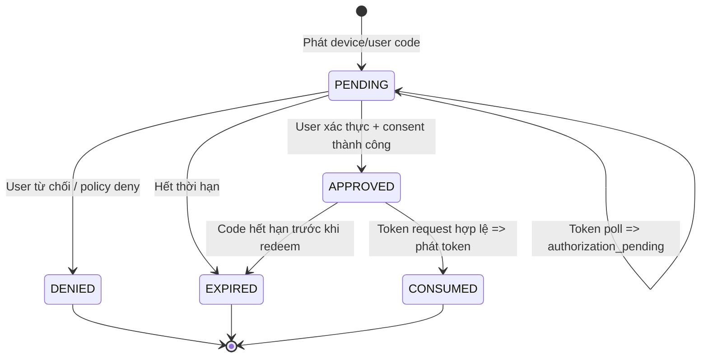
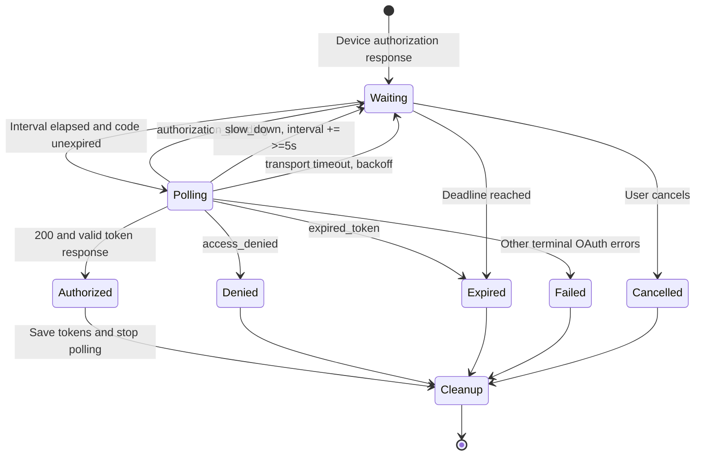
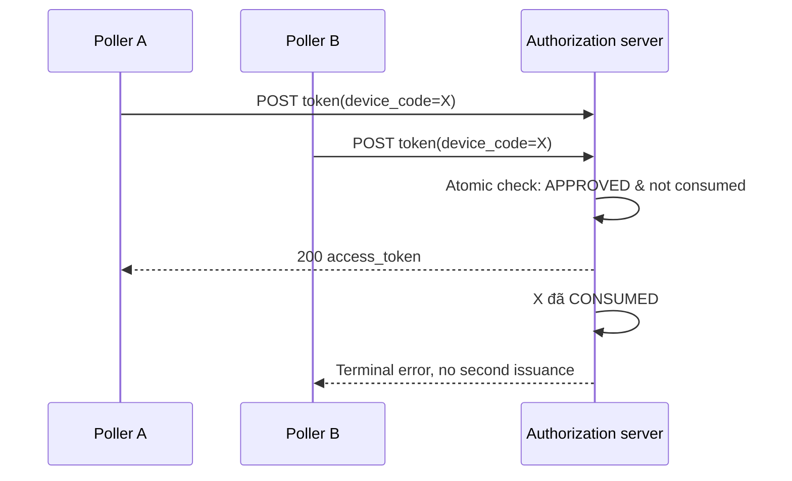

# Token request after approval

Một ứng dụng trên smart TV vừa hiện thông báo: “Vào trang kích hoạt trên điện thoại và nhập mã”. Người dùng đã đăng nhập trên điện thoại, kiểm tra tên ứng dụng và nhấn **Cho phép**. Tuy nhiên, TV vẫn đang ở màn hình “Đang chờ xác nhận”. Điều gì cần xảy ra để TV thực sự nhận được access token?

Trong **OAuth 2.0 Device Authorization Grant** (RFC 8628), **phê duyệt trên thiết bị thứ hai không trực tiếp chuyển token sang TV**. Sau khi người dùng phê duyệt, **device client vẫn gửi token request tới token endpoint** bằng `device_code` đã được cấp từ trước. Authorization server (AS) xác minh rằng giao dịch **đã được phê duyệt, còn hiệu lực, thuộc đúng OAuth client và chưa được tiêu thụ**, rồi mới phát access token. Request sau phê duyệt **có cùng cấu trúc** với các request polling trước phê duyệt; **không có tham số `approved=true` hay authorization code mới**.

Đây là bài **“Token request after approval”** trong chương **Device authorization** của module **SECURITY_TOKEN_SECURITY_FUNDAMENTALS**. Bài đặt bước đổi `device_code` lấy token vào mô hình tin cậy, vòng đời token và kiểm soát quyền: JWT/opaque access token, refresh token, scope, audience, claims, storage, revocation, token theft và replay. Trọng tâm là **chính xác những gì client và AS phải làm từ lúc phê duyệt tới lúc sử dụng token**, thay vì nhắc lại toàn bộ flow ở mức khái quát.

**Sau bài học, bạn có thể:**

- Viết đúng HTTP `POST` đến token endpoint theo RFC 8628, phân biệt `device_code`, `user_code` và `client_id`.
- Giải thích vì sao client **tiếp tục polling**, tại sao phê duyệt không phải token response, và cách xử lý các trạng thái cuối cùng.
- Xác định **những điều kiện AS phải kiểm tra trước khi phát token**: client binding, thời hạn, consent/policy, scope/resource và replay.
- Đọc đúng token response gồm `access_token`, `token_type`, `expires_in`, `scope` và refresh token tùy chọn.
- Thiết kế cơ chế polling với `interval`, `slow_down`, timeout, backoff, hủy và truy cập đồng thời.
- Xử lý mất HTTP response sau khi AS đã tiêu thụ device code mà **không làm phát token lần hai** hoặc retry vô hạn.
- Kết nối access token vừa cấp với xác minh JWT/opaque tại resource server, giới hạn audience/scope và lưu trữ an toàn.
- Viết kiểm thử tích hợp, negative tests và quy trình xử lý sự cố cho TV/CLI/native devices.

## 1. Chính xác “after approval” nghĩa là gì?

Trong Device Authorization Grant, thiết bị cần quyền thường **không có trình duyệt hoặc nhập liệu thuận tiện**. AS cấp hai mã:

1. **`user_code`:** mã ngắn hiển thị để người dùng nhập tại `verification_uri` của AS bằng browser trên điện thoại/laptop.
2. **`device_code`:** mã có entropy cao mà **device client giữ**, dùng làm credential tạm thời ở token endpoint.

Người dùng nhập user code, xác thực và phê duyệt trên trang AS. Bước này làm **trạng thái giao dịch phía AS** chuyển sang **được phê duyệt**, không tự mở một kết nối trả token về TV.

Các trạng thái khác nhau:

| Thời điểm | Trạng thái giao dịch phía AS | Thiết bị biết gì? |
| --- | --- | --- |
| AS vừa cấp device/user code | Pending, chưa có quyết định | Đã có mã để hiển thị và poll |
| Client poll trước khi người dùng quyết định | Pending | Nhận `authorization_pending` |
| Người dùng vừa nhấn Cho phép trên browser | Approved, chưa chắc đã redeem | Client có thể **chưa biết** nếu chưa poll tiếp |
| Client gửi một token request hợp lệ sau approval | Approved và code còn hiệu lực | AS phát token nếu mọi kiểm tra thành công |
| AS hoàn tất issuance và tiêu thụ code | Consumed/completed | Client nhận token nếu HTTP response về được |
| User từ chối hoặc code hết hạn | Denied/expired | Client nhận lỗi terminal hoặc tự hết deadline |

**Phê duyệt là điều kiện cần, không phải điều kiện duy nhất.** AS phải đánh giá client identity, device-code binding, expiry, grant, scope/resource và các policy hiện hành ngay lúc token request.

### 1.1. Device authorization không phải Authorization Code callback

Device flow **không** phát authorization code qua redirect URI về TV như Authorization Code flow. TV **không nhận `code` và `state` từ browser callback** theo RFC 8628; nó tiếp tục poll bằng `device_code`.

Phân biệt nhanh:

| Flow | Sau khi user chấp thuận | Client làm gì để lấy token? |
| --- | --- | --- |
| Authorization Code + PKCE | Browser redirect về client với authorization `code` và `state` | Client kiểm callback rồi `POST /token` bằng `code` và `code_verifier` |
| **Device Authorization Grant** | AS đánh dấu device transaction được phê duyệt | Client `POST /token` bằng **`device_code`**, cùng grant type đặc biệt |
| Client Credentials | Không có user approval ở từng request | Workload tự xác thực với AS, xin token theo client identity |

Không tự bổ sung `code_verifier`, `redirect_uri` hoặc `authorization_code` vào device token request rồi coi là yêu cầu của RFC 8628.

## 2. Bối cảnh trước khi gửi token request

Để hiểu bước sau phê duyệt, giả sử **public OAuth client** có tên `tv-library` đã gọi device authorization endpoint:

```http
POST /oauth2/device_authorization HTTP/1.1
Host: login.example.com
Content-Type: application/x-www-form-urlencoded
Accept: application/json

client_id=tv-library&scope=library.read%20playback.start
```

AS đã trả:

```http
HTTP/1.1 200 OK
Content-Type: application/json
Cache-Control: no-store

{
  "device_code": "dvc_P4Qv57xeF2R9m0-example-secret",
  "user_code": "WDJB-MJHT",
  "verification_uri": "https://login.example.com/activate",
  "verification_uri_complete": "https://login.example.com/activate?user_code=WDJB-MJHT",
  "expires_in": 600,
  "interval": 5
}
```

Đây là **giá trị giả minh họa**, không phải mã có thể dùng trên hệ thống thật. `verification_uri_complete` là **tùy chọn**; nếu thiếu, client vẫn hiển thị verification URI và user code bình thường.

Client giữ lại:

- `device_code` — mã bí mật tạm thời gửi tới **token endpoint**.
- `client_id` đã đăng ký, cùng thông tin client authentication nếu client thực sự confidential.
- **Deadline** dựa trên `expires_in`; AS mới là bên quyết định code còn hiệu lực.
- **Polling interval** từ `interval`, hoặc mặc định 5 giây nếu AS không trả trường này.
- Scope/resource đã yêu cầu và định danh AS đáng tin để diễn giải token response sau này.

Client **không giữ password/OTP của người dùng**, không trông đợi secondary browser gửi JWT hoặc access token trực tiếp sang TV.

## 3. Đường đi của phê duyệt và token request

```mermaid
sequenceDiagram
    participant TV as Device client / TV
    participant AS as Authorization server
    participant PHONE as Browser trên điện thoại
    participant USER as Người dùng
    participant RS as Library resource server
    TV->>AS: POST /device_authorization (client_id, scope)
    AS-->>TV: device_code, user_code, verification_uri, expires_in, interval
    TV-->>USER: Hiển thị verification_uri và user_code
    TV->>AS: POST /token (device_code, grant_type, client_id)
    AS-->>TV: 400 authorization_pending
    USER->>PHONE: Mở đúng verification_uri của AS
    PHONE->>AS: Đăng nhập, nhập user_code
    AS-->>PHONE: Hiện client/thiết bị/scopes đang xin
    USER->>PHONE: Chấp thuận
    PHONE->>AS: Xác nhận đồng ý cho transaction
    AS->>AS: PENDING -> APPROVED; chưa phát access token cho TV
    Note over TV,AS: Chờ ít nhất interval trước lần token request tiếp theo
    TV->>AS: POST /token như trước, với chính device_code đó
    AS->>AS: Kiểm client, expiry, APPROVED, consent, one-time use
    AS-->>TV: 200 access_token, token_type, expires_in, scope nếu cần
    TV->>TV: Dừng polling, lưu tokens theo threat model
    TV->>RS: GET /library/me + Authorization Bearer access_token
    RS->>RS: Kiểm issuer/audience/scope/object policy
    RS-->>TV: Dữ liệu được phép
```

Điểm quyết định: **client không có một token-request API khác chỉ dành cho “sau approval”**. Sự khác biệt nằm ở **trạng thái mà AS đã lưu** khi request đến.

### 3.1. Các ranh giới tin cậy

- **Browser trên điện thoại ↔ AS:** người dùng xác thực và phê duyệt. Browser không chuyển access token cho TV.
- **TV ↔ AS/token endpoint:** device client giữ device code, dùng HTTPS và tuân thủ interval/expiry.
- **AS ↔ lưu trữ giao dịch:** trạng thái code, client, approved subject, scopes, resource và consumed flag phải được quản lý đáng tin.
- **TV ↔ resource server:** TV chỉ gửi **access token đúng API**, không gửi user code hoặc device code.
- **Resource server ↔ policy:** API xác minh access token và quyền trên dữ liệu; không cấp quyền chỉ vì TV đã hiển thị “Đã đăng nhập”.

## 4. HTTP token request sau khi người dùng phê duyệt

RFC 8628 mục 3.4/3.5 dùng token endpoint bình thường của OAuth 2.0. Client gửi **`application/x-www-form-urlencoded`** qua HTTPS:

```http
POST /oauth2/token HTTP/1.1
Host: login.example.com
Content-Type: application/x-www-form-urlencoded
Accept: application/json

grant_type=urn%3Aietf%3Aparams%3Aoauth%3Agrant-type%3Adevice_code&device_code=dvc_P4Qv57xeF2R9m0-example-secret&client_id=tv-library
```

| Tham số | Vai trò | Quy tắc |
| --- | --- | --- |
| **`grant_type`** | Xác định Device Authorization Grant | Giá trị chính xác **`urn:ietf:params:oauth:grant-type:device_code`** |
| **`device_code`** | Credential của giao dịch đã bắt đầu | Lấy từ device authorization response, không lấy từ user code |
| **`client_id`** | Định danh client public không xác thực | **Bắt buộc khi client không xác thực** với AS, và phải khớp binding |
| **Client authentication** | Chứng minh confidential client identity nếu áp dụng | Theo registration; không thay bằng client ID tự khai |

**Form URL encoding:** chuỗi URN được mã hóa trong request thành `urn%3Aietf%3Aparams%3Aoauth%3Agrant-type%3Adevice_code`. AS giải mã form rồi so giá trị grant type nguyên bản. Không gửi URN chưa encode vào các vùng HTTP không cho phép, không chuyển `device_code` lên URL query.

### 4.1. Những thứ không thuộc token request này

- **Không gửi `user_code`** — đây là mã dùng trên verification UI của AS.
- **Không gửi `verification_uri`** — client không cần trình URL người dùng đã mở.
- **Không gửi username/password/OTP của resource owner** — user đã xác thực trên secondary browser.
- **Không gửi `approved=true` hoặc `consent=yes`** — client không được tự tuyên bố người dùng đã đồng ý.
- **Không gửi authorization `code` hoặc `redirect_uri` của Authorization Code flow** trừ khi AS hỗ trợ một extension riêng có hợp đồng rõ.
- **Không gửi refresh token làm device code** — hai grant types khác nhau.

Nếu mã code hoặc grant type sai, AS phải **từ chối**, không suy đoán rằng một request “gần đúng” là hợp lệ vì người dùng từng phê duyệt.

### 4.2. Phân biệt public client và confidential client

TV/mobile/CLI phân phối cho người dùng thường là **public clients**: `client_id` **không phải secret**. Nếu firmware chứa shared client secret, attacker có thể trích xuất secret; nó không tự biến ứng dụng thành confidential client.

Nếu backend/thiết bị chuyên dụng được AS đăng ký là **confidential client** và có thể bảo vệ credential, token request phải xác thực client bằng phương thức đã đăng ký, chẳng hạn `private_key_jwt` hoặc mTLS, khi áp dụng. **Biết đúng `client_id` không đủ** để thay client authentication.

```http
POST /oauth2/token HTTP/1.1
Host: login.example.com
Authorization: Basic <encoded-confidential-client-credentials>
Content-Type: application/x-www-form-urlencoded

grant_type=urn%3Aietf%3Aparams%3Aoauth%3Agrant-type%3Adevice_code&device_code=<device-code>
```

Ví dụ trên chỉ minh họa một phương thức **confidential client authentication**. Trong thực tế, AS phải áp dụng cơ chế đã đăng ký và kiểm ràng buộc client/device code; không cho token endpoint chấp nhận cùng giao dịch dưới danh tính client khác.

## 5. Sau phê duyệt, request có khác request lúc pending không?

**Không.** Đối với token endpoint, hai request có thể mang **cùng grant type, device code và client identity**. Chỉ có **trạng thái giao dịch phía AS** thay đổi.

| Thời điểm token request | Ví dụ response | Client làm gì? |
| --- | --- | --- |
| User chưa hoàn tất xác thực/consent | `authorization_pending` | Chờ interval rồi thử tiếp |
| Client hỏi quá nhanh | `slow_down` | Tăng interval ít nhất 5 giây |
| User đã từ chối | `access_denied` | Dừng, không tự chuyển sang approval |
| Code hết hạn | `expired_token` | Dừng, bỏ mã cũ |
| User đã đồng ý, code còn hiệu lực, client đúng | **HTTP 200 + token response** | Dừng polling, lưu/đánh giá tokens |
| Code đã bị tiêu thụ/redeem không hợp lệ | Lỗi OAuth theo AS policy | Không nhận lại token chỉ nhờ code cũ |

### 5.1. Vì sao cần tiếp tục polling?

RFC 8628 không yêu cầu AS có kết nối push tới thiết bị. TV có thể ở mạng riêng, không mở inbound port và không có browser callback. Client tự poll, tránh yêu cầu AS chủ động kết nối vào thiết bị.

**Hành vi UI đúng:** sau khi user nhấn Cho phép trên điện thoại, TV có thể còn hiển thị “Đang chờ” **tới lần poll hợp lệ tiếp theo**. Điều này không đồng nghĩa approval thất bại. UX nên hiển thị trạng thái trung lập và tránh kích hoạt nhiều poll requests chỉ vì user nhấn nút “Đã xong”.

### 5.2. Không có “approval token” gửi qua user code

`user_code` giúp AS tìm giao dịch chờ để người dùng phê duyệt. Client không đổi `user_code` lấy token. Một flow tự phát minh “đưa user code vào /token” thay `device_code` phá vỡ tính chất entropy và client binding của RFC 8628.

## 6. Authorization server quyết định có phát token như thế nào?

Một backend AS hợp lý lưu bản ghi giao dịch device authorization, ví dụ:

```text
DeviceGrantTransaction {
    transaction_id: internal-id,
    device_code_digest: protected-digest,
    user_code_lookup_key: protected-lookup-value,
    registered_client_id: tv-library,
    requested_scopes: ["library.read", "playback.start"],
    granted_scopes: ["library.read"],
    requested_resource: "https://api.example.com/library",
    expected_client_authentication: public-or-method,
    created_at: ...,
    expires_at: ...,
    min_poll_interval: 5,
    state: PENDING | APPROVED | DENIED | EXPIRED | CONSUMED,
    approved_subject: null | trusted-user-42,
    approved_at: null | timestamp,
    consumed_at: null | timestamp
}
```

Đây là **mô hình dữ liệu minh họa**, không phải schema RFC bắt buộc. Digest/HMAC/lookup storage phải bảo vệ device code có entropy cao; vì token endpoint phải tìm transaction theo device code, thiết kế cần lookup hiệu quả và chống rò code từ DB/log.

### 6.1. Những điều kiện tối thiểu cần kiểm

Trước khi phát token, AS phải kiểm theo profile/policy:

1. **HTTP request hợp lệ:** POST, form body, grant type chính xác, device code không rỗng/quá dài và client context đúng.
2. **Client identity:** client đã đăng ký; `client_id` của public client phù hợp code đã cấp; nếu confidential thì client authentication thành công.
3. **Device-code binding:** code thật, thuộc đúng client, đúng authorization transaction và không bị tráo bằng user code.
4. **Lifetime:** code chưa hết hạn, transaction chưa bị hủy/đã dùng.
5. **Approval:** AS có quyết định chấp thuận hợp lệ từ người dùng đã xác thực; không dựa vào tham số `approved` do client khai.
6. **Policy/consent:** scopes/resources được chấp thuận và client vẫn được phép nhận token theo chính sách.
7. **Token grant properties:** chủ thể/actor, token audience, TTL, token type và các claims được tính từ nguồn tin cậy.
8. **One-time consumption:** issuance và đánh dấu code đã dùng được phối hợp **nguyên tử/nhất quán**, kể cả khi có nhiều request đồng thời.
9. **Audit:** ghi metadata cần thiết, không lưu token thô/device code thô trong log.

**Phê duyệt không được biến thành một “vé mở” để client tự yêu cầu bất kỳ scope nào.** Token endpoint phải phát **quyền đã được AS cho phép**, không lấy danh sách scope mới từ form do client thêm vào sau khi user đồng ý.

### 6.2. State machine của giao dịch phía AS



Đây là state machine khái niệm. Trạng thái `APPROVED` không bảo đảm code tồn tại mãi: **nếu hết hạn trước khi TV poll**, AS không nên phát token cho mã không còn hiệu lực chỉ vì trước đó user đã nhấn Cho phép.

### 6.3. Một lần phát token hay nhiều lần?

AS cần ngăn **reuse/race**: hai token requests cùng mang device code đã approved không được khiến **cả hai** cùng tiêu thụ giao dịch và nhận token trái chính sách. Có thể dùng transaction locking, compare-and-swap trên state/version, atomic update trong DB hoặc cơ chế tương đương.

```text
BEGIN TRANSACTION
  grant = loadDeviceGrantForUpdate(device_code_digest)
  require grant.status == APPROVED
  require grant.expires_at > now
  require grant.client_id == verified_client_id
  require grant.consumed_at == null
  issue_or_reserve_authorization_result_under_policy()
  mark grant.consumed_at = now
  mark grant.status = CONSUMED
COMMIT
return success token response
```

Đây là **pseudocode giao dịch**: trong hệ thống thật, phát hành JWT/opaque và commit state cần thiết kế chống mất kết quả, duplicate response và race. Không ngây thơ gọi remote issuer rồi giữ DB transaction không giới hạn. Điều cần bảo đảm là **ngữ nghĩa một lần** và khôi phục nhất quán khi lỗi.

## 7. Token response thành công: HTTP 200 không phải tất cả

Sau approval, AS có thể trả OAuth 2.0 token response:

```http
HTTP/1.1 200 OK
Content-Type: application/json
Cache-Control: no-store
Pragma: no-cache

{
  "access_token": "<access-token-for-library-api>",
  "token_type": "Bearer",
  "expires_in": 900,
  "scope": "library.read",
  "refresh_token": "<optional-refresh-token>"
}
```

Theo RFC 6749, `access_token` và `token_type` là những trường bắt buộc của **successful OAuth access token response**, `expires_in` được khuyến nghị và `refresh_token` là tùy chọn theo grant/provider policy. Trong RFC 8628, AS có thể cấp refresh token nếu policy cho phép; **không mặc định luôn có refresh token**.

### 7.1. Ý nghĩa từng trường

| Trường | Client phải hiểu | Không được suy ra |
| --- | --- | --- |
| `access_token` | Credential trình với resource server thích hợp | Có thể dùng mãi hoặc với mọi API |
| `token_type` | Phương thức token usage, ví dụ Bearer | Token nhất định là JWT |
| `expires_in` | Thời gian sống access token **tính bằng giây** từ response | Là hạn của device code; hai thời hạn khác nhau |
| `scope` | **Phạm vi đã cấp** theo AS; khi khác requested scope phải được khai | Client đã có mọi scope từng yêu cầu |
| `refresh_token` | Credential tùy chọn dùng ở AS/token endpoint để xin access token mới | Có thể gửi tới API hoặc tồn tại vĩnh viễn |
| `id_token` nếu có theo OIDC extension | Dành cho OIDC client kiểm kết quả authentication theo profile | Có thể dùng làm OAuth access token |

**Quan trọng:** `device_authorization.expires_in=600` và `token_response.expires_in=900` không phải cùng một TTL. Cái đầu giới hạn **giao dịch xin quyền**, cái sau áp dụng cho **access token vừa cấp**.

### 7.2. Requested và granted scopes

TV ban đầu xin:

```text
requested scopes = library.read playback.start
```

AS chỉ chấp thuận:

```text
granted scopes = library.read
```

Theo RFC 6749 mục 5.1, **nếu granted scope khác requested scope, AS phải trả `scope` trong token response**. Nếu giống, `scope` có thể bị bỏ. Client **không được mặc định** vẫn có `playback.start` khi AS chỉ cấp `library.read`; resource server phải dựa vào token/introspection đáng tin thay vì scopes do client tự khai.

### 7.3. Access token không phải authorization code và không phải ID token

Đừng gọi mọi token “JWT”: `access_token` có thể **opaque** (không giải mã được) hoặc là JWT đã ký theo profile. `token_type=Bearer` chỉ là **kiểu sử dụng token**; nó không chỉ định định dạng. OIDC `id_token`, nếu được OP cấp theo một extension/profile device flow được hỗ trợ, dành cho **OIDC client** để kiểm danh tính; không phải credential gọi Library API.

## 8. Nhận response thành công: các bước ở device client

Client nên có **hợp đồng rõ** về token response và cách tạo session:

1. **Dừng ngay vòng polling** của transaction; không lập thêm token requests với cùng device code.
2. Parse JSON an toàn, yêu cầu `access_token` và `token_type` phù hợp; xử lý errors trên token endpoint theo chuẩn.
3. Kiểm định danh AS/token endpoint đã cấu hình, TLS và cấu trúc response; không dùng token trả từ endpoint ngoài trust list.
4. Xác định **granted scopes** theo RFC/provider profile; nếu thiếu quyền bắt buộc cho chức năng, hiển thị trạng thái chỉ đọc/hạn chế hoặc xin grant mới theo policy.
5. Lưu access token trong **memory/protected storage** đúng threat model; refresh token tùy chọn ở OS credential store/secure storage.
6. Xóa/hủy transaction tạm: `device_code`, `user_code`, deadline/poll timer và trạng thái UI nhạy cảm.
7. Chỉ gửi access token đến **resource server đúng audience**, bằng token usage scheme được cấp.
8. Khi access token hết hạn, áp dụng refresh grant nếu có/hợp lệ, hoặc bắt đầu lại device authorization khi người dùng chủ động.
9. Có đường **logout/unlink/revoke** khi user thay đổi thiết bị, mất máy hoặc chuyển quyền sử dụng.

### 8.1. Đừng tin mọi JSON HTTP 200 đều là token response hợp lệ

Một proxy/API bị cấu hình sai có thể trả HTML/JSON không đúng schema hoặc HTTP 200 nhưng không có `access_token`. Client không tự tạo phiên với quyền mặc định. Nó phải:

- Kiểm status, content type/syntax và required fields.
- Không chấp nhận chuỗi token rỗng, `token_type` lạ hoặc `expires_in` không hợp lệ nếu profile cần trường đó.
- Ràng buộc response với **một transaction đang chờ và token endpoint tin cậy**.
- Chặn việc trộn token result của transaction A vào UI/user session B.
- Tránh in response đầy đủ vào logs trong exception/debug output.

Nếu token response hợp lệ nhưng **scope thiếu**, không tự kích hoạt UI/action ngoài quyền. “Đã đăng nhập” và “Đã được cấp mọi quyền” là hai kết luận khác nhau.

## 9. Khi tiếp tục polling vẫn thấy authorization_pending

Giả sử người dùng vừa approve ở thời điểm T nhưng client poll ở T-1 rồi nhận:

```http
HTTP/1.1 400 Bad Request
Content-Type: application/json
Cache-Control: no-store

{
  "error": "authorization_pending"
}
```

Đây là phản hồi **bình thường** trước khi approval hoàn tất phía AS. Client phải giữ interval và deadline:

- Không hiển thị ngay “Đăng nhập thất bại”.
- Không gửi request mới lập tức, không vòng lặp busy-wait.
- Không tạo device authorization transaction mới chỉ vì một lần `authorization_pending`.
- Không để người dùng nhìn thấy device code; chỉ hiển thị user code/verification URI khi pending.

**Sau khi approval**, nếu request vẫn trả `authorization_pending` lâu bất thường, điều tra **transaction binding, replica/DB consistency, wrong AS environment, user code collision, clock/expiry và network lag**. Tuy nhiên client không được tự kết luận “phê duyệt rồi, cứ cấp quyền tạm” mà phải đợi **AS phát token thật**.

## 10. Polling interval, slow_down và lỗi mạng

RFC 8628 yêu cầu client **tôn trọng khoảng cách tối thiểu** giữa token requests. Khi AS không trả `interval`, **mặc định 5 giây**.

```http
HTTP/1.1 400 Bad Request
Content-Type: application/json

{
  "error": "slow_down"
}
```

Với `slow_down`, client phải **tăng polling interval ít nhất 5 giây cho lần tiếp theo và các lần sau**:

| Lần | Server response | Khoảng cách tối thiểu kế tiếp |
| --- | --- | --- |
| Sau device authorization | `interval=5` | 5 giây |
| Token request #1 | `authorization_pending` | Ít nhất 5 giây |
| Token request #2 | `slow_down` | Ít nhất 10 giây |
| Token request #3 | `slow_down` | Ít nhất 15 giây |
| Token request #4 | Thành công | Dừng, không poll nữa |

**Không giảm ngay về 5 giây** khi response kế tiếp lại là `authorization_pending`; tăng interval được duy trì cho transaction sau `slow_down`.

### 10.1. Khi token endpoint timeout hoặc trả HTTP 5xx

Một timeout không phải `access_denied`. Client cần:

1. **Giảm tần suất polling** khi connection timeout — RFC 8628 khuyến nghị backoff, ví dụ exponential backoff.
2. Không retry ngay tức thì bằng vòng lặp thiếu giới hạn.
3. Giữ deadline của **device code**, không kéo dài vì AS đang lỗi.
4. Phân biệt HTTP/OAuth error **terminal** với lỗi transport tạm thời.
5. Không tự coi HTTP 5xx là dấu hiệu được phê duyệt.
6. Nếu response thành công đã bị mất sau khi AS consume code, không có quyền giả định retry sẽ lại cấp token.

Khi deadline đã hết, dừng; có thể hướng dẫn người dùng khởi tạo giao dịch mới. Mọi policy retry thực tế còn cần rate limits, jitter/timeout và giới hạn vận hành.

### 10.2. Gợi ý state machine client



## 11. Token request lỗi terminal sau approval

Đừng trộn tất cả HTTP 400 thành “user chưa đồng ý”. RFC 8628 có bốn error codes đặc trưng:

| OAuth error | Ngữ nghĩa | Client hành động |
| --- | --- | --- |
| **`authorization_pending`** | Chưa có quyết định cuối | Tiếp tục poll đúng interval |
| **`slow_down`** | Poll quá nhanh/AS yêu cầu chậm lại | Tăng interval ≥5 giây, tiếp tục |
| **`access_denied`** | User/AS từ chối request | **Dừng**; không retry cùng code |
| **`expired_token`** | Device code đã hết hạn | **Dừng**, có thể bắt đầu flow mới |
| `invalid_client` hoặc `unauthorized_client` | Client auth/registration/flow sai | **Dừng**, sửa registration/credential |
| `invalid_grant` hoặc `invalid_request` | Grant/code/request không hợp lệ | Không dùng cùng code để retry vô hạn |

RFC 8628 yêu cầu **dừng polling với lỗi OAuth khác `authorization_pending` và `slow_down`**. Với `expired_token` hoặc `access_denied`, client phải báo trạng thái rõ ràng, không giả lập approval bằng UI.

### 11.1. Dữ liệu lỗi không phải bằng chứng quyền

```http
HTTP/1.1 400 Bad Request
Content-Type: application/json
Cache-Control: no-store

{
  "error": "expired_token"
}
```

Ngay cả khi người dùng nói đã nhấn Approve, AS vẫn có thể trả `expired_token` vì code hết hạn trước lần request thành công. **Không phát token cho code hết hạn**, không thay đổi `expires_in` phía client để “khắc phục”.

### 11.2. Đúng HTTP status nhưng sai ý nghĩa

HTTP `200 OK` của **device authorization endpoint** chỉ cho biết đã cấp **device/user code**. HTTP `200 OK` của **verification page** chỉ cho biết người dùng đã tương tác. Chỉ **successful token response từ token endpoint** mới cấp OAuth access token cho client.

## 12. Mã đã được phê duyệt nhưng response phát token bị mất

Đây là failure mode đặc biệt quan trọng trong bước “after approval”:

1. AS nhận token request cho `device_code=X` khi trạng thái `APPROVED`.
2. AS phát token, đánh dấu code X đã tiêu thụ.
3. Trước khi HTTP response đến TV, mạng đứt hoặc device tắt nguồn.
4. TV **không có token**, dù AS có thể đã hoàn tất issuance.
5. TV retry code X. AS có thể trả **terminal error** theo code đã dùng/không còn hợp lệ.

**Không thể giả định “retry cùng device code là idempotent và sẽ trả token cũ”.** RFC 8628 không cung cấp một cơ chế chuẩn lấy lại token response đã mất. Một AS có thể có cơ chế recovery riêng, nhưng client chỉ được dựa trên **hợp đồng được công bố và kiểm thử**.

### 12.1. Hành vi client nên có

- Khi lỗi mạng, áp dụng backoff và retry có giới hạn **khi giao dịch còn hạn**.
- Nếu nhận lỗi terminal/expired, **dừng**; không request vô hạn.
- Không tự tạo access token từ user code hoặc hiển thị “đã đăng nhập” khi chưa có token.
- Hướng dẫn user bắt đầu lại Device Authorization Grant nếu cần, có giải thích rằng xác minh cũ không hoàn tất trên thiết bị.
- Cleanup state của request cũ và bảo vệ credential chưa dùng.

### 12.2. Hành vi AS cần thiết

AS nên bảo đảm **device code không thể bị redeem trái chính sách nhiều lần**, xử lý issuance/consumption transactionally và có log metadata để điều tra response loss. Việc trả lại token cũ, nếu từng được hỗ trợ trong một extension, đòi hỏi threat model và chống token disclosure/replay rất chặt; **không nên tự triển khai** như mặc định để “tiện retry”.

## 13. Race condition: hai pollers cùng redeem approved device code

Một TV có thể khởi tạo hai HTTP loops do:

- Người dùng nhấn nút “Đã xác nhận” nhiều lần.
- UI component mount lại hoặc app bị resume.
- Network retry tạo request song song.
- Một process khác đọc được device code và cạnh tranh redeem.



Client cần **single active poller** cho mỗi transaction, một cancellation handle, mutex/single-flight hoặc state machine bảo đảm request không chồng lấn. AS cần **atomic consume** để chống cạnh tranh thực tế từ cả client lẫn attacker.

### 13.1. Không nhầm “một poller” với “một lần request”

Trong một transaction, client được phép **gửi nhiều token requests** ở trạng thái pending theo interval. “Một lần” ở đây là **một redemption/issuance thành công** và một giao dịch kết thúc, **không phải** cấm request polling lặp hợp lệ trước approval.

### 13.2. User hủy khi AS đã phát token

Nếu UI user nhấn Cancel ngay khi AS đang hoàn tất issuance, có thể xuất hiện race:

- Client nên cố gắng hủy request/poller và không tự coi phiên đã sẵn sàng nếu workflow đã bị hủy.
- Nếu token response đã nhận và user không còn muốn liên kết, phải **xóa token và revoke/unlink** khi có thể, chứ không chỉ ẩn UI.
- AS có thể vẫn có grant/token đã cấp; xử lý dọn phiên theo policy và observability.

## 14. Device-code theft ngay trước và sau approval

**Device code là secret tạm thời**, khác user code. Nếu attacker lấy được device code của TV khi giao dịch còn hạn, họ có thể thử redeem nó ở token endpoint.

### 14.1. Public client: `client_id` không phải proof of possession

Vì `client_id` của public client là công khai, AS kiểm “đúng client ID” **không ngăn** attacker đã có device code gửi request với client ID đó. Chính việc giữ **device code khó đoán và bí mật**, TTL ngắn, rate limiting, client binding, one-time use và sender constraints bổ sung nếu hệ sinh thái hỗ trợ mới giới hạn nguy cơ.

Kịch bản:

1. TV nhận `device_code=X` và bắt đầu polling.
2. Log/debug endpoint làm lộ X.
3. User approve đúng TV.
4. Attacker có X và client ID công khai gửi token request trước TV.
5. Nếu AS chấp nhận, attacker có thể nhận token hoặc làm giao dịch thất bại cho TV.

**Không được coi approval trên điện thoại là bằng chứng token chắc chắn sẽ về đúng thiết bị vật lý** nếu thiết kế cho phép device code bị sao chép và sử dụng bởi một public client khác. Giữ kín device code và phòng trộm runtime là bắt buộc.

### 14.2. Confidential client có cải thiện gì?

Nếu client **thật sự bảo vệ được** private key/secret và AS yêu cầu xác thực, attacker chỉ có device code thường **chưa đủ** để redeem dưới danh tính confidential client. Tuy nhiên, nếu attacker chiếm runtime hoặc credential của client, rủi ro quay lại. **Không nhúng một shared secret vào app public rồi coi đó là bí mật**.

### 14.3. User code không được dùng làm bí mật redeem

`user_code` ngắn để người dùng dễ nhập, có ít entropy hơn device code và có thể bị lộ do người nhìn màn hình. AS phải rate limit việc dò user code; token endpoint **không cho `user_code` đổi token**. Một thiết kế cho phép “nhập mã 8 ký tự vào /token là được access token” phá mô hình bảo vệ.

## 15. Phishing qua phê duyệt: user approve nhầm giao dịch

Một kiểu tấn công khác **không cần biết device code của TV nạn nhân**:

1. Attacker tự khởi tạo Device Authorization Grant cho một OAuth client và nhận `user_code=ABCD-EFGH`.
2. Attacker nhắn nạn nhân “truy cập trang kích hoạt chính thức của dịch vụ và nhập mã này để xác minh tài khoản”.
3. Nạn nhân mở **đúng trang AS thật**, đăng nhập và nhập mã do attacker cung cấp.
4. Nếu nạn nhân phê duyệt, AS cấp token cho **client đang nắm device code của attacker**.

Vì vậy **dùng đúng domain AS chưa đủ chống device-code phishing**. Khi user phê duyệt, AS nên hiển thị:

- Client/app đang xin quyền.
- Scopes và tài nguyên được xin.
- Thông tin thiết bị/phiên, thời điểm bắt đầu và rủi ro nếu có.
- Cảnh báo chỉ chấp thuận **mã đang hiện trên thiết bị người dùng chủ động kết nối**.
- Nút từ chối và nơi quản lý các thiết bị/clients đã cấp quyền.

AS cần rate limit nhập user code, chống spoof tên client/branding và có các policy/risk signals phù hợp. **Không dùng approval như một OTP đăng nhập được người khác gửi qua chat**.

## 16. Scope và audience của token sau approval

AS phải phát quyền dựa trên **client registration + requested scope + user consent/policy + resource binding**, không dựa vào một tên scope do client tự thêm ở token request cuối.

Ví dụ:

```text
Device authorization request:
    client_id = tv-library
    requested_scope = "library.read playback.start"
    resource = "https://api.example.com/library"    # Khi AS hỗ trợ RFC 8707

User approval:
    granted_scope = "library.read"
    approved_user = "user-42"

Token response:
    access_token = ...
    scope = "library.read"
    audience = "https://api.example.com/library"    # Trong token/profile tin cậy
```

**`resource` là tùy chọn theo khả năng AS**, không thuộc bộ tham số bắt buộc của RFC 8628. Nếu AS không dùng RFC 8707, audience vẫn cần ràng buộc bằng registration/policy/trust profile khác được RS hiểu.

### 16.1. Access token JWT

Payload **minh họa** theo một profile access-token JWT:

```json
{
  "iss": "https://login.example.com",
  "sub": "user-42",
  "aud": "https://api.example.com/library",
  "client_id": "tv-library",
  "scope": "library.read",
  "iat": 1795000000,
  "nbf": 1795000000,
  "exp": 1795000900,
  "jti": "example-library-token-id"
}
```

Đây chỉ là **claims chưa xác minh**, không phải JWT có chữ ký thật. Resource server phải xác minh chữ ký/JWKS, issuer, token type/profile, audience, thời hạn, scope và **quyền object/tenant**. `sub` ở ví dụ là user đã approve; trong grant khác, ngữ nghĩa `sub` có thể khác — không tự suy ra từ mọi token.

### 16.2. Opaque access token

Nếu access token là opaque, client chỉ dùng nó theo `token_type`. Library API có thể introspect qua AS:

```json
{
  "active": true,
  "client_id": "tv-library",
  "sub": "user-42",
  "aud": "https://api.example.com/library",
  "scope": "library.read",
  "exp": 1795000900
}
```

AS có thể không trả tất cả các trường ở mọi introspection response; **`active=true` không đủ** nếu RS không có resource binding tin cậy. JWT/opaque không quyết định scope mạnh hay yếu: **AS cấp** và **RS thực thi** quyền.

### 16.3. OIDC ID token không thay access token

Device flow RFC 8628 là **OAuth grant**, không tự đảm bảo OIDC ID token. Nếu OP hỗ trợ một **OIDC/device-flow extension hoặc profile rõ ràng** và cấp `id_token`, client xác minh chữ ký, issuer, audience là **client ID**, thời hạn và nonce/claims theo profile. **Library API không chấp nhận ID token thay OAuth access token**, dù cùng `sub`.

## 17. Dùng token tại resource server sau approval

Sau token response thành công, TV gọi:

```http
GET /v1/library/me HTTP/1.1
Host: api.example.com
Accept: application/json
Authorization: Bearer <library-access-token>
```

Resource server cần kiểm theo thiết kế:

| Điều kiện | Ví dụ | Trách nhiệm |
| --- | --- | --- |
| Token type | OAuth access token, không phải device/refresh/ID token | RS |
| Issuer | `https://login.example.com` | RS |
| Signature/trạng thái | JWS signature hoặc opaque `active=true` | RS |
| Audience | `https://api.example.com/library` | RS |
| Expiry/nbf | `exp`, `nbf`, cache/revocation policy | RS |
| Scope | `library.read` cho endpoint đọc | RS |
| Subject/tenant/object | User 42 chỉ xem dữ liệu được phép | RS/business policy |
| Sender constraint nếu có | DPoP/mTLS proof/binding | RS |

**User đã nhấn Approve không đồng nghĩa API được bỏ qua token validation.** Nếu TV gửi `device_code` như Bearer token, RS phải từ chối; nếu access token có `aud=billing-api`, Library API cũng phải từ chối.

### 17.1. JWT offline và revocation latency

Một access token JWT đã phát, khi được RS xác minh offline, có thể còn hiệu lực đến `exp` dù user đã unlink thiết bị, trừ khi RS có denylist/state check. Opaque introspection có thể phát hiện revocation nhanh hơn nhưng cache làm trễ. **Phải định nghĩa mục tiêu thu hồi (revocation latency budget)** theo rủi ro thay vì nghĩ “xóa token trên TV là API tự ngừng chấp nhận nó”.

## 18. Lưu trữ access và refresh token trên thiết bị

Sau approval, device client phải **bảo vệ token vừa nhận**. Rủi ro phụ thuộc loại thiết bị:

| Thiết bị | Access token | Refresh token nếu được cấp | Thách thức |
| --- | --- | --- | --- |
| Smart TV cá nhân | Memory/protected platform storage theo UX | Secure platform keystore khi có | Remote người khác dùng, reset/bán lại |
| TV công cộng/kiosk | Phiên ngắn, dọn khi user rời | Hạn chế hoặc không giữ lâu nếu có thể | Nhiều người dùng luân phiên |
| Native mobile | Memory | Keychain/Android Keystore-backed secure storage | Lost device, backup, malware |
| CLI cá nhân | Memory, cache ngắn hạn | OS credential manager/secure store | Terminal history, logs, shared account |
| Embedded IoT không có secure element | Cân nhắc TTL rất ngắn và server mediation | Đánh giá có nên cấp hay không | Firmware extract, physical access |

### 18.1. Refresh token là tùy chọn và không gửi tới resource server

Nếu AS cấp refresh token cho public device client, OAuth Security BCP (RFC 9700) yêu cầu bảo vệ refresh token bằng **rotation hoặc sender constraint** theo điều kiện áp dụng, kèm policies expiry/revocation và scope/resource binding. Không lưu plaintext ở file cấu hình/console nếu có giải pháp OS/platform an toàn hơn.

Khi refresh token rotation được sử dụng, client phải lưu token mới thay token cũ **đúng thứ tự/nguyên tử**, tránh concurrent refresh và reuse false alarms. **Không dùng lại `device_code` để refresh access token**: sau thành công, device code đã hoàn tất vai trò.

### 18.2. Logout/unlink và thiết bị dùng chung

Logout đúng bao gồm:

1. Dừng sử dụng token trong app, dọn access token cache.
2. Xóa refresh token/session credentials được lưu cục bộ.
3. Gọi revocation endpoint/unlink grant khi AS hỗ trợ và policy yêu cầu.
4. Xử lý JWT access token còn hạn theo TTL/state policy.
5. Xóa thông tin user/tenant khỏi UI, local cache và dữ liệu tạm khi TV đổi người dùng/chủ sở hữu.

Xóa file token **không tự thu hồi token đã bị trộm**; AS/RS cần cơ chế revoke hoặc chờ TTL hết hiệu lực theo rủi ro.

## 19. Java-style pseudocode: nhận approval qua polling rồi dùng token

Trong ứng dụng Java, nên dùng thư viện OAuth hỗ trợ RFC 8628. Ví dụ sau minh họa **logic nghiệp vụ và state machine**, không định nghĩa các API Java có thật:

```java
// PSEUDOCODE Java-style: OAuthDeviceSdk, DeviceGrant và TokenResult
// là các abstraction giả định, không phải lớp Java SE có sẵn.
final class DeviceLoginService {
    private final OAuthDeviceSdk sdk;
    private final ProtectedCredentialStore store;

    TokenResult awaitApprovedToken(DeviceGrant grant, Cancellation cancel) {
        long deadline = monotonicClock.nowNanos()
                + secondsToNanos(grant.expiresIn());
        long waitSeconds = grant.intervalOrDefault(5);

        showActivationUriAndUserCode(
                grant.verificationUri(),
                grant.userCode()
        );

        // Bảo đảm chỉ một poller hoạt động cho transaction này.
        while (!cancel.isRequested()
                && monotonicClock.nowNanos() < deadline) {

            waitAtLeast(waitSeconds);
            if (cancel.isRequested()
                    || monotonicClock.nowNanos() >= deadline) {
                break;
            }

            try {
                TokenPollResult result = sdk.requestDeviceToken(
                        configuredTrustedTokenEndpoint(),
                        registeredClientIdentity(),
                        grant.deviceCode()
                );

                switch (result.kind()) {
                    case AUTHORIZATION_PENDING:
                        continue;
                    case SLOW_DOWN:
                        waitSeconds += 5; // Ít nhất 5 giây mỗi slow_down
                        continue;
                    case ACCESS_DENIED:
                        throw new UserRejectedAuthorization();
                    case EXPIRED_TOKEN:
                        throw new DeviceCodeExpired();
                    case SUCCESS:
                        TokenResult tokens = result.requireValidTokenResponse();
                        store.saveForThisDevice(tokens);
                        return tokens;  // Dừng polling hoàn toàn.
                    default:
                        throw new TerminalOAuthError(result.errorCode());
                }
            } catch (TemporaryTransportFailure transientError) {
                // Có thể response đã bị mất sau khi AS consume code.
                // Retry chỉ khi còn hạn, giảm polling frequency.
                waitSeconds = boundedBackoff(waitSeconds);
            }
        }

        throw new CancelledOrExpiredDeviceAuthorization();
    }
}
```

**Đừng copy pseudocode thành production code** mà bỏ qua timeout cho mỗi HTTP request, shutdown hooks, concurrent cancellation, SSL/TLS, token-response schema, rate limit, metrics và secret redaction. SDK phải bảo đảm **token request đúng RFC 8628**, client binding và xử lý đủ trạng thái lỗi.

### 19.1. Vì sao cần monotonic deadline?

`expires_in` là số giây tương đối từ lúc nhận device authorization response, không phải timestamp tuyệt đối. Device client nên dùng **monotonic clock** để đo elapsed time, tránh người dùng thay đổi giờ hệ thống làm kéo dài deadline. AS vẫn là nguồn xác định code hết hiệu lực.

### 19.2. Không dùng polling interval như access-token TTL

`interval=5` nghĩa là **chờ ít nhất 5 giây giữa token requests**. Nó **không** có nghĩa access token chỉ sống 5 giây; access-token lifetime được AS trả ở **token response riêng** (ví dụ `expires_in=900`).

## 20. Kiểm thử HTTP thủ công có kiểm soát

Trong môi trường thử nghiệm được phép, có thể quan sát token request bằng công cụ HTTP client. Ví dụ form request ở mức curl **chỉ dùng code test**:

```bash
curl --request POST 'https://login.example.com/oauth2/token' \
  --header 'Content-Type: application/x-www-form-urlencoded' \
  --data-urlencode 'grant_type=urn:ietf:params:oauth:grant-type:device_code' \
  --data-urlencode 'device_code=<test-device-code>' \
  --data-urlencode 'client_id=tv-library'
```

**Cảnh báo:** command-line arguments có thể xuất hiện trong shell history, process inspection hoặc session recording. Không thử bằng device code/token thật ở máy dùng chung; ưu tiên SDK/HTTP client test harness giữ secrets ngoài logs, và không dùng `curl -v`/verbose dumps trong môi trường có credential thật.

Mong đợi trong cùng một giao dịch test:

1. Trước approval: `authorization_pending`.
2. Poll quá nhanh: có thể nhận `slow_down`, client phải tăng interval.
3. Sau approval, khi code chưa hết hạn và client đúng: token response thành công.
4. Redeem lại code đã tiêu thụ: không được cấp token ngoài policy.
5. Token sau thành công: RS kiểm scope/audience và quyền dữ liệu.

**Không chạy một vòng lặp curl mỗi 0,1 giây** để quan sát “nhanh hơn”. Điều đó có thể tạo DoS, rate limiting và sai logic bảo mật.

## 21. Case study 1: phê duyệt thành công nhưng TV chưa hiển thị tên người dùng

**Bối cảnh:** TV nhận device code có `interval=5`, `expires_in=600`. Người dùng nhập user code trên điện thoại và nhấn Cho phép ở giây thứ 27. TV vừa poll ở giây 25 và nhận `authorization_pending`.

**Đúng:** TV chờ đến lần poll kế tiếp **đủ interval**, ví dụ khoảng giây 30 (tùy lịch thật), gửi **cùng device code** và nhận token khi AS đã ghi `APPROVED` và mọi điều kiện hợp lệ. TV sau đó kiểm token response, lưu credentials và gọi Library API.

**Sai:** TV bắt đầu một flow mới ở giây 27, khiến user code thay đổi, hoặc thêm `approved=true` vào request vì nghĩ AS cần client xác nhận. **Client không thể tự xác nhận consent**.

**Rủi ro còn lại:** Token có thể được cấp scope hẹp hơn request; TV phải tắt chức năng không được cấp và RS vẫn kiểm quyền.

## 22. Case study 2: attacker lấy device code từ log sau approval

**Bối cảnh:** Client public ghi toàn bộ HTTP request vào telemetry. Device code bị attacker đọc. Người dùng approve trên điện thoại, attacker lập tức gửi token request với device code và client ID công khai.

**Hậu quả:** Nếu attacker redeem trước và AS không có sender constraint khác, attacker có thể nhận access token. TV có thể chỉ thấy terminal error vì code đã bị tiêu thụ. **Chữ ký JWT hoặc HTTPS của các kết nối hợp lệ không ngăn attacker dùng một device code đã bị tiết lộ từ log**.

**Biện pháp:** Không log device code, giới hạn telemetry, client/transaction binding, expiry, atomic consumption, TLS, rate limiting và sender constraint nếu profile hỗ trợ. Nếu có bằng chứng lộ token/grant, cần revoke/rotate và điều tra.

## 23. Case study 3: phản hồi token bị mất và retry vô hạn

**Bối cảnh:** AS đã approved giao dịch. TV poll thành công nhưng Wi-Fi rớt ngay trước khi nó nhận JSON. AS đã đánh dấu device code consumed. TV cứ retry code cũ mỗi giây và hiển thị “Waiting…” vô hạn.

**Sai:** Coi mọi terminal error là pending, bỏ qua expires_in, hoặc cho AS phát token mới vô điều kiện với code consumed.

**Đúng:** TV áp dụng backoff, retry hạn chế khi còn deadline; dừng khi nhận terminal error hoặc expiry, giải thích giao dịch chưa hoàn tất trên thiết bị và cho phép user chủ động tạo flow mới. AS audit bằng transaction metadata, không tiết lộ access token cũ trong logs.

**Bài học:** “Đã approved” không đồng nghĩa client **đã nhận** token; và retry at-least-once của HTTP **không được biến** một device grant thành cấp token không giới hạn.

## 24. Case study 4: token hợp lệ nhưng scope/audience không phù hợp

**Bối cảnh:** TV xin `library.read playback.start`. AS chỉ cấp `library.read` cho `aud=library-api`. UI TV vẫn bật nút phát nội dung yêu cầu `playback.start`; thậm chí chuyển token sang Payments API.

**Sai:** Bỏ qua `scope` trong token response/claims, dùng chung một token cho mọi API vì issuer đã ký đúng.

**Đúng:** TV lưu quyền được cấp, chỉ hiển thị hoặc gọi chức năng phù hợp; Library API kiểm `aud=library-api`, `scope=library.read` và business policy; Payments API **từ chối** token sai audience. Để xin `playback.start`, client dùng authorization/consent flow mới theo chính sách, không sửa JWT cũ.

## 25. Các anti-pattern và cách sửa

| Anti-pattern | Vì sao nguy hiểm/sai chuẩn? | Cách đúng |
| --- | --- | --- |
| Browser sau approve gửi access token trực tiếp cho TV | Không phải luồng RFC 8628; dễ lộ credential | TV nhận token qua AS/token endpoint |
| Client gửi `user_code` tới token endpoint | Mã dễ đoán, không dùng để redeem | Gửi **`device_code`** |
| Client gửi `approved=true` | Client tự tuyên bố consent | AS xác định approval từ giao dịch tin cậy |
| Client tạo device code mới sau khi user approve | Giao dịch mới chưa được approve | Tiếp tục poll **giao dịch ban đầu** |
| TV dùng `client_id` như client secret | Public identifier bị spoof | Client auth thực nếu confidential; bảo vệ device code |
| AS chỉ kiểm `status=APPROVED` | Bỏ expiry, client binding, scope, replay | Kiểm đầy đủ điều kiện trước issuance |
| AS cho user code đổi token | Người quan sát màn hình có thể redeem | User code chỉ dùng trang xác minh |
| AS phát token nhiều lần khi concurrent polls | Lỗ hổng replay/duplicate issuance | Atomic consume và code binding |
| Client poll liên tục vì đã approve | Vi phạm interval, DoS | Chờ interval, xử lý slow_down |
| Client nhận slow_down rồi không tăng chờ | Polling quá nhanh | Tăng ít nhất 5 giây mỗi lần |
| Client retry mọi OAuth error | Không dừng denied/expired | Dừng với lỗi terminal |
| Client tiếp tục sau expires_in | Dùng giao dịch hết hạn | Dừng, flow mới nếu user muốn |
| AS trả access token chỉ dựa vào HTTP 200 từ trang consent | Không có token request/binding | Chỉ phát khi token endpoint kiểm giao dịch |
| User approve là đủ cho API truy cập mọi thứ | Bỏ audience, scope, object policy | RS kiểm JWT/opaque token và quyền |
| Lưu refresh token plaintext trên TV dùng chung | Chiếm quyền dài hạn | Protected storage/expiry/revocation hoặc không lưu |
| Public client có secret cố định trong firmware | Secret dễ trích xuất | Public client + code protection, hoặc secure client auth thật |
| Log toàn bộ token response/device code | Lộ credential | Redaction, protected observability |
| Dùng ID token làm OAuth access token | Token type/audience confusion | API chỉ nhận access token đúng profile |
| Retry code đã consumed để “lấy lại token” | Không có cơ chế recovery chuẩn mặc định | Dừng/restart theo policy |
| Access token có scope đúng nhưng sai audience | Token substitution giữa APIs | RS enforce audience/resource binding |

## 26. Ma trận kiểm thử “Token request after approval”

| # | Tình huống | Kết quả mong đợi |
| --- | --- | --- |
| 1 | Device client gửi grant type chuẩn và device code hợp lệ khi pending | `authorization_pending` |
| 2 | User vừa approve, poll tiếp đúng interval và code còn hạn | Token response thành công nếu các điều kiện khác đúng |
| 3 | Token request có thêm `approved=true` nhưng transaction vẫn pending | Không được cấp token |
| 4 | Token request dùng `user_code` thay `device_code` | Từ chối |
| 5 | Token request thiếu `grant_type` hoặc URN sai | Từ chối |
| 6 | Public client thiếu `client_id` khi không có client authentication | Từ chối |
| 7 | Client B trình device code cấp cho client A | Từ chối client binding |
| 8 | Confidential client authentication sai | Từ chối, không hạ xuống public mode |
| 9 | Device code không tồn tại hoặc sai cấu trúc | Từ chối |
| 10 | Device code đã bị tiêu thụ | Không phát token lần hai |
| 11 | Hai pollers gửi đồng thời cùng approved device code | Atomic consume, không double issue |
| 12 | User approve **sau** khi device code hết hạn | Không cấp token |
| 13 | User approve **trước** deadline nhưng client poll **sau** deadline | Không cấp token cho code đã hết hạn |
| 14 | User từ chối | `access_denied` và client dừng |
| 15 | AS trả `expired_token` | Client dừng và bỏ transaction |
| 16 | AS trả `authorization_pending` nhiều lần | Client tiếp tục đúng interval, trong deadline |
| 17 | AS trả `slow_down` lần đầu | Client tăng interval ≥5 giây |
| 18 | AS trả `slow_down` hai lần | Tăng thêm lần nữa; không trở lại interval cũ |
| 19 | AS không có `interval` ở response ban đầu | Client dùng mặc định 5 giây |
| 20 | Network timeout khi polling | Backoff, không retry lập tức |
| 21 | HTTP response token thành công bị mất sau AS consume | Client xử lý recovery/terminal status, không suy ra idempotent |
| 22 | User nhấn Cancel ngay trước token response | Không duy trì phiên trái ý; dọn/revoke theo policy |
| 23 | Token endpoint HTTP 200 nhưng thiếu `access_token` | Client không tạo phiên |
| 24 | Token response có `token_type` không hỗ trợ | Client không tự gửi như Bearer |
| 25 | AS cấp scope hẹp hơn requested | Client chỉ dùng granted scopes, RS kiểm đúng |
| 26 | Token response thiếu refresh token | Client không giả định có khả năng refresh |
| 27 | AS cấp refresh token public client, token bị reuse sau rotation | Reuse policy/revocation hoạt động |
| 28 | `device_code` bị lộ qua log/telemetry | Kiểm thử redaction phát hiện và chặn |
| 29 | User code bị đoán liên tục trên verification UI | AS rate-limit và chống enumeration |
| 30 | Phishing: user nhập code do attacker gửi | AS hiển thị app/quyền/thiết bị, có từ chối và cảnh báo |
| 31 | JWT access token đúng chữ ký nhưng `aud` sai RS | Resource server từ chối |
| 32 | JWT access token hết hạn/`nbf` chưa tới | RS từ chối |
| 33 | OIDC ID token gửi làm Bearer tới Library API | RS từ chối |
| 34 | Opaque token introspection `active=false` | RS từ chối |
| 35 | Opaque `active=true` nhưng không có resource binding tin cậy | RS không tự cho phép |
| 36 | Access token scope đủ nhưng dữ liệu user/tenant khác | RS từ chối object-level authorization |
| 37 | User unlink/logout sau khi token cấp | Local cleanup và revocation theo mục tiêu thiết kế |
| 38 | AS gặp outage khi chưa có token | Không fail-open bằng quyền giả |
| 39 | TV dùng chung reset/bán lại | Không chuyển credential phiên cũ sang người mới |
| 40 | DPoP/mTLS-bound access token thiếu proof/certificate đúng | RS từ chối theo token profile |

**Chiến lược kiểm thử:** unit tests cho interval/deadline/state machine; integration tests với AS cho pending/approve/redeem; concurrency tests cho atomic consumption; fault injection cho lost response/timeouts; security tests cho code theft/phishing; và RS authorization tests cho JWT/opaque token, scope, audience, tenant.

Chỉ thực hiện thử mã đoán/phishing/rate limit trên môi trường được phép của tổ chức; không tạo lưu lượng tấn công lên AS production bên thứ ba.

## 27. Checklist production sau phê duyệt

1. **Device authorization transaction đúng chưa?** `device_code`, `user_code`, issuer, client ID, expiry, scopes/resources được lưu/ràng buộc rõ?
2. **UI approval có xác thực và consent thật?** Trang AS cho user biết client, thiết bị, scope và cảnh báo code phishing?
3. **Token request đúng RFC 8628?** HTTPS `POST` form, đúng grant type URN, `device_code`, `client_id` nếu public và client authentication nếu confidential?
4. **Không dùng nhầm mã?** `user_code` chỉ nhập tại AS; `device_code` không hiển thị/gửi vào browser/URL?
5. **AS kiểm approval từ state đáng tin?** Không chấp nhận `approved=true` do client tự gửi?
6. **AS kiểm binding/expiry/replay?** Device code đúng client, còn hạn, chưa tiêu thụ và phát token một lần theo policy?
7. **Polling đúng nhịp?** Dùng `interval` hoặc mặc định 5 giây, tăng ≥5 giây sau `slow_down` và backoff khi timeout?
8. **Client có dừng đúng không?** Dừng sau success, denial, expiry, terminal OAuth error hoặc user cancel?
9. **Không duplicate pollers?** Mỗi transaction một active poller; AS atomic consume kể cả request đồng thời?
10. **Mất response có recovery plan?** Không giả định token request idempotent; không retry code đã consumed vô hạn?
11. **Token response được kiểm?** `access_token`/`token_type` đúng schema, `expires_in` và granted scopes có ngữ nghĩa rõ?
12. **Audience/resource đã ràng buộc?** Token chỉ dùng ở RS đích, RS xác minh JWT hoặc opaque metadata đáng tin?
13. **API còn thực thi quyền?** Issuer, signature/`active`, expiry, scope, owner/tenant/object và sender constraints khi có?
14. **Storage phù hợp thiết bị?** Access token ngắn hạn, refresh token tùy chọn được bảo vệ bởi OS/platform secure storage hoặc session management?
15. **Logout/unlink được xử lý?** Thiết bị dùng chung, mất/bán lại, revoke grant/token và JWT còn hạn có kế hoạch?
16. **Không lộ bí mật trong logs?** Device code, access/refresh token, client secret và HTTP bodies nhạy cảm được redact?
17. **Observability đủ nhưng không quá mức?** Audit theo transaction ID an toàn, trạng thái, client, thời gian, error code và counts?
18. **Negative tests đã chạy?** Pending/approve/deny/expired, wrong client, code replay, concurrent polls, slow_down, timeout, phishing và sai audience?

## 28. Câu hỏi thường gặp

**Q1. Khi người dùng nhấn Approve, TV có cần gọi một API “confirm” không?**  
Không theo RFC 8628. TV chỉ **tiếp tục gửi token request chuẩn** bằng device code. AS đã ghi quyết định phê duyệt qua browser.

**Q2. TV nên dùng user code hay device code để lấy token?**  
**Device code**. User code là mã nhập trên verification UI và không được dùng để redeem tại token endpoint.

**Q3. Có thể poll ngay lập tức khi điện thoại báo thành công không?**  
Device client vẫn cần tôn trọng **polling interval**. Nếu hệ thống tự có push extension, nó phải được thiết kế/tài liệu hóa an toàn; RFC 8628 **không quy định** tín hiệu đó và không cho bỏ kiểm code/client/expiry.

**Q4. User đồng ý trước lúc hết hạn nhưng TV bị mất mạng, liệu mã luôn còn hiệu lực?**  
Không. **Device code có deadline riêng**. Khi AS xử lý token request sau khi code hết hạn, approval trước đó không tự kéo dài code.

**Q5. Sau response thành công, có tiếp tục dùng device code để xin token mới không?**  
Không. Device code chỉ dành cho **giao dịch device authorization ban đầu**; để xin token mới dùng refresh token nếu AS cấp và còn hợp lệ, hoặc thực hiện authorization flow mới.

**Q6. Dùng HTTPS có đủ để ngăn token theft không?**  
Không. HTTPS bảo vệ transport, nhưng token/device code còn có thể rò qua logs, telemetry, XSS/RCE, malware, shared device hoặc backups. Cần storage, redaction, TTL, revocation và sender constraints phù hợp.

**Q7. Vì sao đã được AS approve nhưng API vẫn trả 403?**  
Approval là quyết định **cấp grant**, không đồng nghĩa resource server cho phép mọi hành động. API có thể từ chối vì **thiếu scope hoặc quyền object/tenant**; client phải giải quyết qua authorization/policy hợp lệ, không chỉnh token.

**Q8. Nếu token response có `token_type=Bearer` thì chắc chắn là JWT?**  
Không. Bearer là **token usage scheme**; access token có thể là JWT hoặc opaque. RS dùng verifier theo profile tương ứng.

**Kết luận:** **“Token request after approval” là bước chuyển một quyết định phê duyệt đáng tin tại AS thành access token cấp cho đúng device client**. Token request **không thay đổi cấu trúc** so với lúc pending: vẫn `grant_type=urn:ietf:params:oauth:grant-type:device_code`, `device_code` và client identity/authentication phù hợp. AS phải kiểm **client binding, approval, expiry, grant, scopes/resource và one-time consumption**, rồi mới trả token. Client dừng polling sau thành công, bảo vệ credential và gọi đúng resource server; RS tiếp tục xác minh **issuer, audience, scope, trạng thái token và quyền dữ liệu**. Kiểm soát polling, lỗi mạng, code theft, phishing, revocation và replay quyết định liệu sự phê duyệt đúng của người dùng có dẫn tới một phiên **thực sự an toàn** hay không.

## Tài liệu tham khảo

- [RFC 8628 — OAuth 2.0 Device Authorization Grant](https://www.rfc-editor.org/rfc/rfc8628): device authorization, token request, polling interval, `authorization_pending`, `slow_down`, approval, error semantics và security considerations.
- [RFC 6749 — The OAuth 2.0 Authorization Framework](https://www.rfc-editor.org/rfc/rfc6749): client/AS/RS roles, `client_id`/client authentication, scope, access/refresh token response và lỗi token endpoint.
- [RFC 9700 — Best Current Practice for OAuth 2.0 Security](https://www.rfc-editor.org/rfc/rfc9700): refresh token protection, audience restriction, token theft, sender constraints và OAuth deployment security.
- [RFC 6750 — OAuth 2.0 Bearer Token Usage](https://www.rfc-editor.org/rfc/rfc6750): `Authorization: Bearer`, xử lý 401/403 và bảo vệ bearer tokens.
- [RFC 8707 — Resource Indicators for OAuth 2.0](https://www.rfc-editor.org/rfc/rfc8707): `resource`/audience restriction theo profile AS.
- [RFC 9068 — JWT Profile for OAuth 2.0 Access Tokens](https://www.rfc-editor.org/rfc/rfc9068): JWT access token, `aud`, `iss`, `scope` và RS validation.
- [RFC 7519 — JSON Web Token (JWT)](https://www.rfc-editor.org/rfc/rfc7519): JWT claims và NumericDate.
- [RFC 7662 — OAuth 2.0 Token Introspection](https://www.rfc-editor.org/rfc/rfc7662): opaque token `active` và metadata.
- [RFC 7009 — OAuth 2.0 Token Revocation](https://www.rfc-editor.org/rfc/rfc7009): thu hồi access/refresh tokens sau logout/unlink.
- [RFC 9449 — OAuth 2.0 Demonstrating Proof of Possession (DPoP)](https://www.rfc-editor.org/rfc/rfc9449): DPoP proof và sender-constrained access tokens.
- [RFC 8705 — OAuth 2.0 Mutual-TLS Client Authentication and Certificate-Bound Access Tokens](https://www.rfc-editor.org/rfc/rfc8705): client authentication và certificate-bound access tokens.
- [OpenID Connect Core 1.0](https://openid.net/specs/openid-connect-core-1_0.html): ID token, OIDC client authentication context và access token distinction.
- [OWASP OAuth 2.0 Cheat Sheet](https://cheatsheetseries.owasp.org/cheatsheets/OAuth2_Cheat_Sheet.html): OAuth threat modeling, client security, token handling và authorization controls.
- [OWASP Session Management Cheat Sheet](https://cheatsheetseries.owasp.org/cheatsheets/Session_Management_Cheat_Sheet.html): phiên ứng dụng và logout an toàn.
