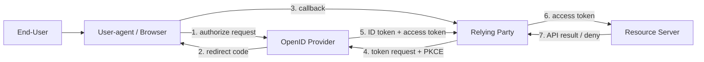
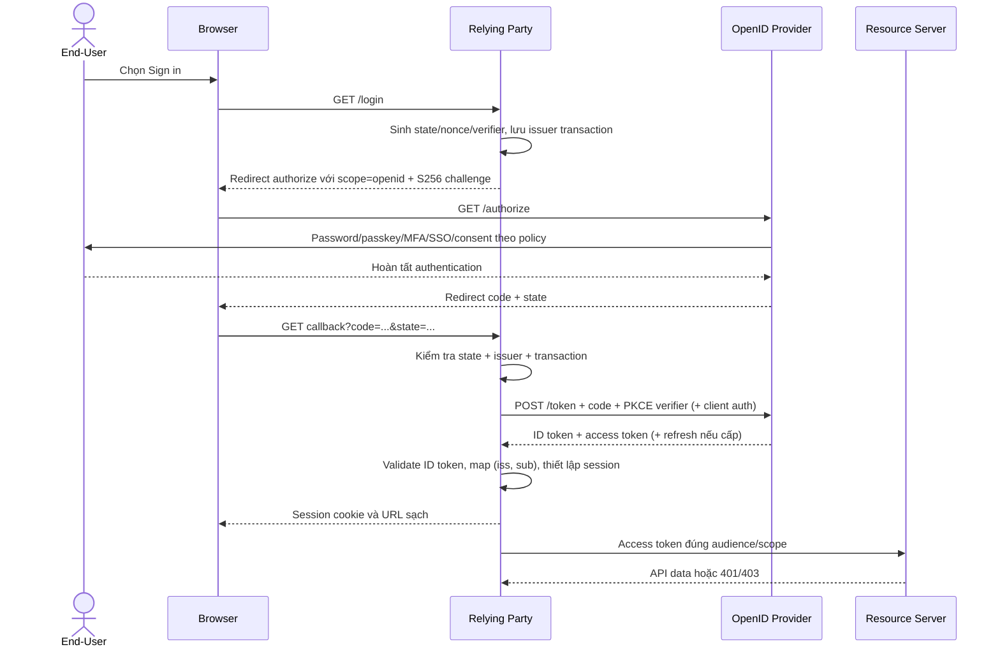

# OpenID Connect mở rộng OAuth2 cho identity

**OAuth 2.0 và OpenID Connect (OIDC) trả lời hai câu hỏi liên quan nhưng khác nhau.** OAuth 2.0 là một **khung ủy quyền** (*authorization framework*): client được phép truy cập tài nguyên nào, với phạm vi quyền nào và bằng access token nào? **OpenID Connect 1.0** xây trên OAuth 2.0 để bổ sung một **lớp xác thực danh tính** (*identity layer*): ai là người dùng đã được OpenID Provider xác thực, kết quả xác thực thuộc phiên yêu cầu nào và ứng dụng có thể tin kết quả đó dựa trên các kiểm tra giao thức nào?

Trong ứng dụng web, người dùng chọn “Đăng nhập bằng tài khoản tổ chức”. Trình duyệt được đưa đến **OpenID Provider (OP)** để xác thực và quay lại ứng dụng. Sau khi thực hiện đúng **Authorization Code Flow + PKCE**, ứng dụng có thể nhận **ID token** — một bằng chứng xác thực được ký, có chủ đích gửi tới **Relying Party (RP)**, tức ứng dụng đang đăng nhập người dùng. Nếu ứng dụng cần gọi API nghiệp vụ, nó dùng **access token** dành cho API, **không dùng ID token**.

```text
OAuth 2.0:
  "Client có quyền gọi API nào và làm gì?"
      -> Access token có audience/scope/policy tương ứng.

OpenID Connect:
  "OP đã xác thực chủ thể nào cho RP này, vào thời điểm/ngữ cảnh nào?"
      -> ID token được RP kiểm tra chữ ký, issuer, audience, thời hạn...

Ứng dụng hoàn chỉnh:
  OIDC login -> RP thiết lập session của riêng ứng dụng
  OAuth access token -> gọi resource server khi có quyền phù hợp
```

**Không được rút gọn thành “OAuth là đăng nhập bằng token”**: một access token có thể là token của **service không có người dùng cuối**, một token chỉ dành cho API khác, hoặc không chứa thông tin nhận diện user theo hợp đồng. Việc nhận được một access token không tự chứng minh người dùng là ai. OIDC xác định các vai trò, endpoint, claims và quy tắc xác minh để ứng dụng nhận **authentication result** có ý nghĩa.

Bài thuộc chương **OpenID Connect** của module **SECURITY_TOKEN_SECURITY_FUNDAMENTALS**. Module nghiên cứu mô hình tin cậy và vòng đời JWT/opaque token, access/refresh token trong authentication, authorization và OAuth 2.0/OIDC; cách phát hành, kiểm tra claims, scope/audience, lưu trữ, thu hồi và chống token theft/replay. Bài này tập trung vào **OIDC mở rộng OAuth 2.0 cho identity**, chỉ ra ranh giới giữa ID token, access token, xác thực danh tính, phiên ứng dụng và quyền truy cập tài nguyên.

## 1. Mục tiêu học tập

Sau bài này, bạn có thể:

1. Giải thích vì sao **OAuth 2.0 tự thân không phải giao thức đăng nhập**, và OIDC bổ sung điều gì.
2. Nhận diện **Relying Party**, **OpenID Provider**, **End-User**, **Authorization Server**, **Resource Server** và user-agent.
3. Mô tả OIDC Authorization Code Flow với `scope=openid`, `state`, **PKCE `S256`**, redirect URI và code exchange.
4. Phân biệt **ID token**, **access token**, **refresh token**, **authorization code** và **session cookie** theo mục đích và đối tượng nhận.
5. Giải thích các claims `iss`, `sub`, `aud`, `exp`, `iat`, `auth_time`, `nonce`, `acr`, `amr` và `azp` khi áp dụng.
6. Xác minh ID token đúng **issuer, audience, chữ ký/thuật toán, expiry, nonce, authorized party** và những điều kiện profile yêu cầu.
7. Sử dụng **OIDC Discovery**, JWKS và UserInfo mà không tin URL hoặc claims chưa xác thực.
8. Thiết kế khóa danh tính **(issuer, subject)**, tránh gộp tài khoản theo `email` chưa chứng minh và xử lý multi-provider/multi-tenant.
9. Phân biệt đăng nhập OIDC với **phân quyền API**, scope, audience và chính sách tài nguyên.
10. Áp dụng các nguyên tắc vào **Java/Spring Security**, session, logout, kiểm thử âm tính và xử lý sự cố.

## 2. Vì sao không thể coi OAuth 2.0 là login?

OAuth 2.0 định nghĩa cách một client nhận và sử dụng **access token** để truy cập resource server. Nó **không định nghĩa một định dạng chung** bảo đảm access token chứa danh tính người dùng và không quy định mọi client phải xác minh người dùng cuối đã đăng nhập theo những yêu cầu riêng của ứng dụng.

### 2.1. Ví dụ access token hợp lệ nhưng không chứng minh người dùng

```text
grant_type=client_credentials
client_id=nightly-report-job
aud=reports-api
scope=reports:generate
```

Token được AS cấp hợp lệ cho tác vụ nền nhưng **không có người dùng tương tác**. Nếu ứng dụng lấy token đó làm căn cứ tạo session cho “người dùng đăng nhập”, ứng dụng đang **nhầm service identity với end-user identity**.

Ngay cả token phát từ một flow có người dùng cũng **có chủ đích dành cho resource server**, không phải bằng chứng mà mọi RP bất kỳ được phép chấp nhận. Với opaque access token, RP còn có thể không hiểu claims bên trong nếu không được AS cung cấp theo một giao thức tin cậy.

### 2.2. “Đăng nhập qua OAuth” có thể dẫn tới token confusion

Giả sử RP nhận JWT access token có:

```json
{
  "iss": "https://id.example.test",
  "aud": "orders-api",
  "scope": "orders:read",
  "sub": "user-42"
}
```

Đây chỉ là **payload minh họa**, không phải token thật. RP `web-client` **không được** coi token này là ID token dành cho mình:

- `aud=orders-api`: token dành cho **API**, không phải RP.
- `sub` trong access token cần được hiểu theo **access-token profile** và grant.
- Token có thể có ngữ nghĩa dành riêng cho RS hoặc điều kiện xác thực không phù hợp để thiết lập session tại RP.

**OIDC giải quyết khoảng trống này bằng ID token và các quy tắc xác minh danh tính rõ ràng.**

### 2.3. So sánh chính xác

| Thuộc tính | OAuth 2.0 | OpenID Connect |
| --- | --- | --- |
| Mục tiêu chính | Ủy quyền truy cập tài nguyên | Xác thực danh tính end user cho RP dựa trên OAuth 2.0 |
| Token trọng tâm | **Access token** | **ID token**, đồng thời có access token theo flow |
| Đối tượng nhận | Resource server theo audience/grant | ID token hướng tới **OIDC client/RP** |
| Thông tin danh tính chuẩn | Không bắt buộc theo OAuth core | `iss` + `sub`, cùng claims xác thực được chuẩn hóa |
| Cách xin chức năng identity | Không có marker thống nhất trong core | **`scope=openid`** kích hoạt OIDC request |
| Endpoint bổ sung | Authorization/token endpoints tùy grant | UserInfo, discovery/JWKS và các metadata/claims theo OIDC |
| Xác minh | Access token theo RS/profile | ID token validation ở RP theo OIDC |
| Phiên ứng dụng | Không được OAuth tự tạo | RP **tự thiết lập và quản lý session** sau khi validate |
| Phân quyền API | Access token + audience/scope/policy | **Vẫn dùng access token và kiểm tra RS riêng** |

**OIDC không thay OAuth 2.0.** OIDC mở rộng các luồng OAuth để thêm thông tin xác thực; phần ủy quyền API tiếp tục có các ranh giới tin cậy riêng.

## 3. Các vai trò và ranh giới tin cậy

Trong OIDC, ta thường gặp:

- **End-User:** cá nhân là chủ thể được xác thực.
- **Relying Party (RP):** ứng dụng muốn xác minh danh tính end user qua OP; về mặt OAuth, RP thường là **client**.
- **OpenID Provider (OP):** bên có khả năng xác thực end user và cấp ID token; OP có vai trò của **OAuth Authorization Server**.
- **Resource Server (RS):** API bảo vệ tài nguyên bằng access token.
- **User-agent:** trình duyệt/system browser điều hướng giữa RP và OP. Nó **không phải vai trò OAuth thứ năm**.



**Ranh giới quan trọng**:

1. **OP xác thực người dùng** theo chính sách của OP, có thể dùng password, passkey, MFA hay phiên SSO.
2. **RP không tự tin redirect callback** chỉ vì URL chứa `code`; nó kiểm tra giao dịch và token.
3. **ID token là thông điệp từ OP tới RP** sau khi được xác minh.
4. **Access token là credential dùng tại RS**, không phải giấy thông hành cho mọi RP/API.
5. **Session của RP** là trạng thái ứng dụng riêng, có vòng đời/CSRF/cookie policy riêng.

## 4. OIDC thêm những thành phần nào?

OIDC Core định nghĩa một tập thành phần chính:

| Thành phần | Vai trò |
| --- | --- |
| **`scope=openid`** | Đánh dấu authorization request là yêu cầu OpenID Connect |
| **ID token** | Security token biểu diễn kết quả xác thực end user cho RP |
| **Standard claims** | `sub`, `name`, `email`, `email_verified`, `preferred_username`, v.v. theo hợp đồng |
| **UserInfo endpoint** | API chuẩn để lấy claims về end user bằng access token có quyền phù hợp |
| **Discovery metadata** | `issuer`, authorize/token/UserInfo/JWKS endpoints, capabilities |
| **JWKS** | Public keys giúp RP xác minh chữ ký JWT ID token |
| **Authentication request parameters** | `nonce`, `prompt`, `max_age`, `login_hint`, `acr_values` theo ngữ nghĩa OIDC |
| **Authentication context** | `auth_time`, `amr`, `acr` khi có/được yêu cầu |
| **Logout/session specs** | Những profile bổ sung cho logout và session management |

**Không phải mọi ID token đều chứa tên, email, vai trò hoặc quyền API.** Claims nào được cấp tùy scope, yêu cầu `claims`, consent và OP policy. RP không được giả định luôn có `email` hoặc `groups`.

## 5. `scope=openid`: điểm khác biệt dễ nhận ra

Một OIDC authentication request điển hình:

```http
GET /authorize?response_type=code
    &client_id=storefront-web
    &redirect_uri=https%3A%2F%2Fapp.example.test%2Flogin%2Foauth2%2Fcode%2Fstorefront
    &scope=openid%20profile%20email
    &state=STATE_FROM_CSPRNG
    &code_challenge=CHALLENGE_S256
    &code_challenge_method=S256
    &nonce=NONCE_FROM_CSPRNG HTTP/1.1
Host: id.example.test
```

Các dòng được tách **để dễ đọc**; request thực phải có URL được encode chính xác. Giá trị `STATE_FROM_CSPRNG`, `CHALLENGE_S256`, `NONCE_FROM_CSPRNG` là **placeholder**, không phải bí mật đủ an toàn.

### 5.1. Các scope OIDC tiêu chuẩn

| Scope | Ý nghĩa chính |
| --- | --- |
| **`openid`** | Yêu cầu authentication theo OIDC |
| **`profile`** | Xin nhóm profile claims cơ bản như `name`, `preferred_username`, `picture` theo OP |
| **`email`** | Xin `email` và `email_verified` nếu được cấp |
| **`address`** | Xin nhóm address claims nếu được cấp |
| **`phone`** | Xin phone-related claims nếu được cấp |
| **`offline_access`** | Theo OIDC, xin khả năng lấy refresh token trong những điều kiện/consent/policy phù hợp; không tự bảo đảm được cấp |

Scopes khác như `orders:read`, `payments:write` thường là **OAuth API scopes** theo hệ thống, không tự là claim danh tính trong ID token.

### 5.2. Scope được yêu cầu không phải scope đã cấp

RP có thể gửi:

```text
scope=openid profile email orders:write
```

OP/AS có thể từ chối hoặc giới hạn grant. Client phải xét **quyền thực tế được cấp**, token response và token claims theo hợp đồng. Một request có `orders:write` không đủ để kết luận API cho phép sửa đơn hàng.

### 5.3. `scope=openid` không có nghĩa user đã login thành công

Request vẫn có thể đang chờ authentication, MFA, consent hoặc bị từ chối. RP chỉ thiết lập authenticated session **sau** khi callback giao dịch hợp lệ, code exchange thành công và **ID token được xác minh đầy đủ**. Một `scope=openid` trong authorize URL không phải bằng chứng xác thực.

## 6. OIDC Authorization Code Flow + PKCE từng bước

Với hệ thống mới, **Authorization Code Flow + PKCE `S256`** là lựa chọn nền tảng phù hợp cho RP web/native/browser-based theo profile an toàn. OIDC còn có các response types/flows lịch sử (Implicit/Hybrid), nhưng chúng đưa thêm thông điệp identity/token qua front-channel và cần các kiểm tra riêng. Không chọn Implicit Flow cho ứng dụng mới chỉ để tiết kiệm một bước token request.

### Bước 0 — RP đăng ký tại OP

OP cung cấp **client ID**, allowed redirect URI(s), client type và client authentication method; RP cấu hình **issuer** tin cậy và scope/profile. Ví dụ:

```text
issuer:            https://id.example.test
client_id:         storefront-web
redirect_uri:      https://app.example.test/login/oauth2/code/storefront
response_type:     code
scope:             openid profile email
PKCE method:       S256
```

### Bước 1 — RP tạo một authentication transaction

RP tạo:

- `state` không đoán được, gắn với browser session/authorization transaction để chống CSRF/nhầm callback.
- PKCE `code_verifier` mới bằng CSPRNG, tính `code_challenge=S256(verifier)`.
- `nonce` mới nếu dùng/được profile yêu cầu; nó sẽ được so với claim `nonce` của ID token khi áp dụng.
- Thông tin **expected issuer, client ID, redirect URI, token endpoint** từ cấu hình tin cậy.
- Thời hạn ngắn của transaction, thông tin để xử lý multi-tab và consume một lần.

RP đưa user-agent đến **authorization endpoint của OP** với `scope` chứa `openid` và challenge, **không** gửi verifier trong URL.

### Bước 2 — OP xác thực end user và giải quyết grant

OP kiểm tra client/redirect request, authentication session của user, MFA/passkey, consent và chính sách liên quan. OP có thể tái dùng SSO nếu chính sách cho phép; hoặc yêu cầu xác thực lại bằng `max_age`/`prompt`, điều kiện `acr_values` hay policy.

**Đăng nhập bằng OIDC không tự thay thế chính sách xác thực của OP.** Nếu yêu cầu MFA/step-up chưa hoàn tất, OP không được phát kết quả authentication hoàn tất cho yêu cầu yêu cầu mức đó.

### Bước 3 — OP redirect authorization code về RP

```http
HTTP/1.1 302 Found
Location: https://app.example.test/login/oauth2/code/storefront?code=CODE_TEST_ONLY&state=STATE_FROM_CSPRNG
Cache-Control: no-store
```

RP so khớp `state` với transaction thực đã bắt đầu, kiểm tra issuer binding/mix-up defense và không chấp nhận callback lạ. **Authorization code không phải ID token** và chưa đủ để tạo session.

### Bước 4 — RP đổi code qua token endpoint

```http
POST /oauth2/token HTTP/1.1
Host: id.example.test
Content-Type: application/x-www-form-urlencoded
Accept: application/json

grant_type=authorization_code&client_id=storefront-web&code=CODE_TEST_ONLY&redirect_uri=https%3A%2F%2Fapp.example.test%2Flogin%2Foauth2%2Fcode%2Fstorefront&code_verifier=VERIFIER_TEST_ONLY
```

Đây là minh họa request **public client**. Với **confidential client**, còn cần client authentication theo phương thức đã đăng ký (Basic, private_key_jwt, mTLS...). Mọi thành phần trao đổi qua HTTPS; `VERIFIER_TEST_ONLY` không đáp ứng cú pháp PKCE thật.

OP/AS kiểm tra authorization code còn hạn, chưa dùng, đúng client và redirect URI, PKCE verifier đúng challenge và grant còn hợp lệ rồi trả token response.

### Bước 5 — RP xác minh ID token

Response minh họa:

```http
HTTP/1.1 200 OK
Content-Type: application/json
Cache-Control: no-store
Pragma: no-cache

{
  "access_token": "FAKE_ACCESS_TOKEN_FOR_API",
  "token_type": "Bearer",
  "expires_in": 600,
  "id_token": "FAKE_SIGNED_ID_TOKEN",
  "scope": "openid profile email"
}
```

Token giả không thể giải mã hoặc dùng thật. **RP phải validate ID token theo OIDC trước khi coi user đã đăng nhập**; việc response là HTTP 200 không thay signature/issuer/audience/nonce checks.

### Bước 6 — RP thiết lập phiên ứng dụng

Sau khi ID token hợp lệ và account mapping/policy đạt:

1. RP xác định khóa identity **(`iss`, `sub`)**.
2. Áp dụng account provisioning/linking policy, trạng thái user/app permission.
3. Tạo/rotate **session ứng dụng** và cookie an toàn cho browser.
4. Giữ token ở nơi thích hợp, thường ở backend với web confidential client/BFF.
5. Redirect browser đến URL sạch, không chứa code, state, access/refresh/ID token.

### Bước 7 — Dùng access token riêng để gọi API

```http
GET /v1/orders HTTP/1.1
Host: api.example.test
Authorization: Bearer <ACCESS_TOKEN_FOR_ORDERS_API>
```

Orders API xác minh access token đúng `iss`, `aud`, `exp`, chữ ký hoặc opaque introspection, scope và resource policy. API không sử dụng ID token có `aud=storefront-web` làm access token.



## 7. ID token là gì? Không nhầm với access token

**ID token** là một **JWT** chứa claims về **authentication event** và end user, được OP phát hành để RP xác minh. Nó thường ở dạng **JWS ký số** và trong các profile cũng có thể được **mã hóa thành JWE**; phải xử lý theo registration/profile thay vì giả định token nào cũng có ba đoạn `header.payload.signature`.

### 7.1. Một ví dụ payload ID token

```json
{
  "iss": "https://id.example.test",
  "sub": "opaque-stable-subject-4217",
  "aud": "storefront-web",
  "exp": 1800000600,
  "iat": 1800000000,
  "auth_time": 1799999950,
  "nonce": "NONCE_TEST_ONLY",
  "amr": ["pwd", "otp"],
  "acr": "urn:example:assurance:level2"
}
```

Đây là **payload minh họa**, không phải token ký thật. Timestamp, `acr` và `amr` chỉ là dữ liệu ví dụ; không suy ra một mức MFA chuẩn từ các chuỗi tự đặt. ID token thật cần thỏa các yêu cầu của OIDC và OP profile.

### 7.2. Các claims quan trọng

| Claim | Ý nghĩa | RP cần chú ý |
| --- | --- | --- |
| **`iss`** | Issuer identifier của OP | Phải khớp **chính xác** expected issuer |
| **`sub`** | Định danh end-user theo issuer, không tự tái gán | Dùng cùng `iss` để ánh xạ account; không coi là email |
| **`aud`** | Audience gồm RP client ID | Phải có **client ID hiện tại** trong tập audience |
| **`exp`** | Hết hạn ID token | Không chấp nhận ID token đã hết hạn |
| **`iat`** | Thời gian ID token được phát hành | Kiểm tra hợp lý theo profile/clock policy |
| **`auth_time`** | Khi end user được OP xác thực | Dùng cho `max_age`/reauth và những yêu cầu về authentication age |
| **`nonce`** | Gắn ID token với authentication request | Nếu đã gửi/được yêu cầu, so khớp với nonce lưu trong transaction |
| **`acr`** | Authentication Context Class Reference | Chỉ tin giá trị có hợp đồng/semantics rõ và đã được policy đánh giá |
| **`amr`** | Authentication Methods References | Cho biết phương pháp xác thực được OP biểu diễn, không tự là role/permission |
| **`azp`** | Authorized party trong một số tình huống nhiều audience | Kiểm tra theo quy tắc OIDC nếu có/được yêu cầu |
| `at_hash` | Hash của access token theo những response type/profile | Kiểm tra khi profile/flow yêu cầu |
| `c_hash` | Hash của authorization code theo những response type/profile | Kiểm tra khi profile/flow yêu cầu |

Không phải mọi optional claim đều có mặt. Thiếu `amr` hoặc `acr` không tự chứng minh user không dùng MFA, nhưng **nếu ứng dụng đòi hỏi bằng chứng mức xác thực cụ thể**, thiếu claim đã yêu cầu phải được xử lý bằng policy thích hợp, không đoán.

### 7.3. `sub` không phải email, username hay số điện thoại

Một email có thể đổi tên, tái sử dụng hoặc có quy tắc verification khác nhau ở các provider. `sub` được định nghĩa là một identifier thuộc namespace của `iss`, với **public/pairwise subject** theo cấu hình OP. Định danh cần lưu cho RP là **cặp (`iss`, `sub`)**.

```text
OP-A:
  iss = https://id-a.example.test
  sub = 10042

OP-B:
  iss = https://id-b.example.test
  sub = 10042

=> KHÔNG tự coi đây là cùng người dùng.
```

Ngay cả hai RP cùng dùng một OP cũng **không được đòi `sub` phải bằng nhau** khi OP sử dụng pairwise subject identifiers cho các sector identifiers khác nhau. Điều này là tính năng bảo vệ riêng tư, không phải lỗi.

### 7.4. ID token không mang mặc định quyền API

`aud=storefront-web` cho biết **ID token dành cho RP**, không nói user có scope `orders:delete`. Dùng ID token ở resource server là **token-type confusion**. Ngược lại, gửi access token `aud=orders-api` cho RP rồi cố nhận diện login cũng là sai ranh giới.

## 8. Các bước kiểm tra ID token ở RP

ID token phải được xem là **dữ liệu chưa được tin cậy cho tới khi toàn bộ validation thành công**. Một hàm `decodeBase64(payload)` chỉ đọc dữ liệu, **không** xác thực chữ ký hay issuer.

### 8.1. Kiểm tra issuer và nguồn khóa tin cậy

RP phải biết **issuer dự kiến** từ registration/discovery được cấu hình đáng tin, ví dụ `https://id.example.test`. ID token `iss` phải khớp identifier đó theo OIDC. Không chọn URL lấy JWKS bằng một chuỗi `iss`/`jku`/`x5u` chưa xác minh từ token, nếu có thể khiến RP tải key từ server của attacker.

**Đúng về nguyên lý:** RP đã pin trust vào issuer/OP metadata và chỉ lấy public keys từ **JWKS URI tin cậy** của issuer đó.

### 8.2. Kiểm tra chữ ký, thuật toán và key selection

- Dùng thư viện JOSE/JWT/OIDC phù hợp; kiểm tra chữ ký của ID token theo thuật toán **đã đăng ký/cho phép**.
- Không chấp nhận `alg=none` khi flow/profile cần ký.
- Không cho token tự chọn thuật toán hoặc giải mã sai giữa symmetric/asymmetric keys (**algorithm confusion**).
- Dùng `kid` để tìm key từ **JWKS đã tin**, không coi `kid` là path hoặc URL do attacker có quyền chỉ định.
- Hỗ trợ key rotation có cache và TTL hợp lý; khi không có key phù hợp, **fail closed** thay vì bỏ kiểm signature.
- Với JWE, cần xử lý đúng tầng decrypt và JWT validation theo registration/profile.

### 8.3. Kiểm tra audience và authorized party

ID token `aud` phải chứa **`client_id` của RP**. Khi có nhiều audience hoặc claim `azp`, RP áp dụng những kiểm tra theo OIDC Core, đặc biệt trường hợp có nhiều đối tượng nhận và authorized party khác:

```text
expected client_id = storefront-web
ID token aud = ["other-web-client"]
=> REJECT

ID token aud = ["storefront-web", "partner-client"]
ID token azp = "partner-client"
=> Không tự chấp nhận; kiểm tra azp theo OIDC/profile
   và client identifier dự kiến của RP.
```

Không dùng substring hay prefix match `aud`. Một ID token được ký hợp lệ nhưng **dành cho RP khác** vẫn không phải bằng chứng đăng nhập của ứng dụng này.

### 8.4. Kiểm tra thời hạn và authentication age

- `exp` phải còn hiệu lực, với clock skew có kiểm soát.
- `iat` không được xử lý tùy tiện; có thể kiểm tra độ mới hợp lý và giới hạn ID token quá cũ theo policy.
- Nếu RP yêu cầu `max_age` hoặc `auth_time`, phải kiểm tra `auth_time` và thời gian xác thực phù hợp.
- Nếu ứng dụng cần reauthentication mới cho tác vụ nhạy cảm, **không suy từ `iat` rằng user vừa xác thực lại**: `iat` là thời điểm phát hành token, không phải `auth_time`.

### 8.5. Kiểm tra nonce khi áp dụng

`nonce` là giá trị RP đưa vào authentication request để ràng buộc ID token với request theo OIDC. Trong Authorization Code Flow, `nonce` không bắt buộc trong mọi trường hợp theo OIDC Core, nhưng nếu RP đã gửi nonce hoặc profile yêu cầu, ID token cần có và **khớp chính xác** với giá trị transaction đã lưu.

**Không tự lấy nonce từ URL callback rồi coi là expected nonce**; phải so với dữ liệu RP tạo trước request.

### 8.6. Kiểm tra ID token không chỉ là “JWT đúng chữ ký”

```text
verifySignature(idToken, trustedJwks) == true
  KHÔNG đủ.

RP vẫn cần:
  iss == expectedIssuer
  aud includes expectedClientId
  exp/iat/auth_time hợp lệ theo policy
  nonce matches transaction (nếu sử dụng/yêu cầu)
  azp / token profile hợp lệ khi áp dụng
  transaction/state/PKCE và issuer binding hợp lệ
  user/account policy cho phép thiết lập session
```

## 9. `state`, PKCE `S256` và OIDC `nonce` không thay thế nhau

| Giá trị | Ai tạo? | Truyền ở đâu? | Tác dụng |
| --- | --- | --- | --- |
| **`state`** | RP/client | Authorize request ↔ callback | Ràng buộc callback với transaction/browser, chống CSRF/nhầm phiên |
| **`code_verifier`** | RP/client | Chỉ token request | Bí mật chứng minh quyền đổi authorization code |
| **`code_challenge`** | RP/client dẫn xuất từ verifier | Authorize request | Cam kết PKCE mà OP/AS gắn với authorization code |
| **`nonce`** | RP/client | Authentication request và claim ID token khi áp dụng | Ràng buộc ID token với authentication request |
| **Issuer binding** | RP từ registration | Lưu transaction, kiểm authorization response/token | Chống authorization server mix-up |

`state` thuộc **authorization response**, `code_verifier` thuộc **code exchange**, `nonce` thuộc **ID token/authentication replay binding**. Với một giao thức web an toàn, cần thiết kế từng lớp theo threat model và profile chứ không bỏ state vì đã có nonce hay bỏ PKCE vì dùng confidential client.

### 9.1. Lỗi login CSRF

Attacker cố chèn callback OAuth của một giao dịch khác vào browser nạn nhân. Nếu RP không kiểm `state` và transaction/session, nạn nhân có thể bị đăng nhập dưới một tài khoản không dự kiến (*session swapping*), dẫn tới rò dữ liệu khi nạn nhân nhập thông tin.

**Chặn:** `state` một lần, gắn session, PKCE, issuer binding, không tạo session từ raw callback.

### 9.2. Lỗi ID token replay

Attacker lấy ID token hợp lệ từ một giao dịch khác rồi thử dùng nó như kết quả login mới. Chữ ký vẫn đúng nhưng token có thể **không thuộc request RP hiện tại** hoặc đã quá thời hạn. Nonce (khi dùng), transaction binding, token audience, expiry và session policy giảm rủi ro.

### 9.3. Lỗi authorization code interception

Attacker lấy code từ URL/callback nhưng không biết `code_verifier`. Khi OP/AS thực thi PKCE `S256` và binding code đúng, code đơn lẻ không đủ để xin token. **PKCE không bảo vệ nếu verifier cũng bị lộ** qua XSS/log/storage hoặc client tự gửi nó sang endpoint sai.

## 10. UserInfo endpoint: lấy claims về user bằng access token

OIDC định nghĩa **UserInfo Endpoint** — một resource server chuẩn của OP để RP lấy thông tin về authenticated end user sau khi được cấp quyền phù hợp.

Request minh họa:

```http
GET /userinfo HTTP/1.1
Host: id.example.test
Authorization: Bearer <ACCESS_TOKEN_FOR_USERINFO>
```

Response minh họa:

```json
{
  "sub": "opaque-stable-subject-4217",
  "name": "Nguyen Example",
  "preferred_username": "example.user",
  "email": "user@example.test",
  "email_verified": true
}
```

Trong thực tế response có thể chứa ít claims hơn, phụ thuộc OP/scope/consent; có những profile dùng response ký/mã hóa. **Không yêu cầu mọi OP trả email hoặc profile.**

### 10.1. Quy tắc `sub` tại UserInfo

RP phải kiểm tra **`sub` trong UserInfo response khớp chính xác `sub` của ID token** đã xác minh trước khi sử dụng claims từ UserInfo. Nếu không, có thể lấy profile của một subject khác do token mix-up, lỗi client cache hoặc nguồn phản hồi không đúng.

```text
Verified ID token:
  iss = https://id.example.test
  sub = subject-A

UserInfo response:
  sub = subject-B

=> REJECT UserInfo claims. Không gộp 2 users.
```

**UserInfo response không thay ID token validation.** Nó là nguồn claims bổ sung, dùng access token theo policy. Nếu một API khác trả JSON chứa `email` và `name`, điều đó không tự biến API đó thành OP hoặc làm JSON thành ID token.

### 10.2. `email_verified` không đồng nghĩa identity proofing mức cao

`email_verified=true` chỉ biểu thị OP đã xác minh địa chỉ email theo cách của OP. Nó **không** chứng minh giấy tờ pháp lý/KYC, quyền trên dữ liệu mọi tổ chức hay tư cách nhân viên được quản trị của một doanh nghiệp.

Không tự động ghép hai account quan trọng chỉ vì hai OP trả cùng email. Khi yêu cầu linking, cần quy trình có bằng chứng/step-up phù hợp và kiểm soát chống account takeover.

## 11. OIDC Discovery, issuer metadata và JWKS

RP không nên tự đoán endpoint của OP từ chuỗi URL; OIDC Discovery định nghĩa metadata để client biết **issuer**, authorization endpoint, token endpoint, JWKS URI, UserInfo endpoint và khả năng hỗ trợ.

Ví dụ:

```http
GET /.well-known/openid-configuration HTTP/1.1
Host: id.example.test
Accept: application/json
```

Metadata minh họa:

```json
{
  "issuer": "https://id.example.test",
  "authorization_endpoint": "https://id.example.test/authorize",
  "token_endpoint": "https://id.example.test/oauth2/token",
  "userinfo_endpoint": "https://id.example.test/userinfo",
  "jwks_uri": "https://id.example.test/.well-known/jwks.json",
  "response_types_supported": ["code"],
  "subject_types_supported": ["public", "pairwise"],
  "id_token_signing_alg_values_supported": ["RS256"]
}
```

Đây là **metadata giả định**, không phải server thật. Các trường, thuật toán và endpoint phụ thuộc cấu hình OP.

### 11.1. Discovery phải có trust anchor

Nếu ứng dụng cho phép input người dùng tùy ý làm `issuer-uri` và tự fetch metadata/JWKS, attacker có thể tạo **issuer giả**, dụ RP tin ID token ký bởi khóa của họ hoặc gây SSRF. Hãy:

1. Có **allowlist/registration tin cậy** của issuer(s) được phép.
2. Kiểm tra giá trị `issuer` trong metadata **khớp issuer cấu hình**.
3. Dùng HTTPS/TLS, URL validation và bảo vệ SSRF theo threat model.
4. Đọc JWKS từ URI đáng tin của issuer, không từ `jku`/`x5u` do token tự khai.
5. Cho phép key rotation có cache và cập nhật an toàn; không tắt signature validation khi gặp `kid` lạ.

### 11.2. JWKS và key rotation

Public keys của OP có thể được công bố qua **JSON Web Key Set (JWKS)**. RP dùng key phù hợp với algorithm/key ID để kiểm chữ ký ID token. Cần xử lý:

- Nhiều key hiện hữu trong đợt rotation.
- Cache TTL phù hợp với key rollover policy.
- Ký thuật toán đã cho phép, không chấp nhận `none` hoặc confusion.
- Không cho `kid` trở thành path injection, SQL query hoặc URL tự fetch.
- Fail closed nếu chữ ký/issuer không thể kiểm chứng.

### 11.3. Nhiều OP không được trộn trust

```text
Enterprise OP: https://employee-id.example.test
Consumer OP:   https://consumer-id.example.test
```

RP phải lưu expected issuer/client ID/token endpoint theo **mỗi authorization transaction**. Một ID token được ký hợp lệ bởi Consumer OP **không** được coi là employee token chỉ vì cả hai OP có người dùng cùng email. Khi dùng authorization response issuer identification (RFC 9207) hoặc distinct redirect URIs để chống mix-up, phải kiểm theo profile.

## 12. Account mapping: khóa định danh là (`iss`, `sub`)

Khi RP lần đầu nhận ID token hợp lệ, nó cần quyết định user đó là account nội bộ nào. **Không nên dùng chỉ `email`, `preferred_username` hoặc `name` làm khóa identity**: chúng có thể thay đổi, trùng, bị thu hồi hoặc thuộc nhiều OP khác nhau.

### 12.1. Thiết kế dữ liệu ánh xạ danh tính

Một mô hình tham khảo:

```text
users:
  id              = internal immutable user identifier
  status          = ACTIVE | SUSPENDED | DELETED
  app_roles       = assigned by trusted application policy

federated_identities:
  issuer          = exact OIDC issuer identifier
  subject         = exact subject from verified ID token
  user_id         = foreign key to users.id
  linked_at       = time of verified linking

UNIQUE(issuer, subject)
```

Lúc đăng nhập:

1. Kiểm tra ID token theo OIDC, bao gồm issuer/client audience.
2. Lấy (`iss`, `sub`) **đã xác minh**, tìm mapping tin cậy.
3. Nếu chưa tồn tại, áp dụng **provisioning/account-linking policy**; không gộp ngầm chỉ theo email.
4. Kiểm tra user nội bộ có bị khóa, tenant membership và policy ứng dụng không.
5. Thiết lập session sau khi toàn bộ kiểm tra bắt buộc thành công.

Một user nội bộ có thể liên kết nhiều identities từ các OP khác nhau **khi có quy trình linking được kiểm soát**. Điều đó không có nghĩa hai OP tự động đáng tin ngang nhau hoặc các mức `acr` tương đương.

### 12.2. Public và pairwise subject identifiers

**Public subject identifier:** OP có thể trả cùng một `sub` cho end user tới nhiều RP phù hợp policy.

**Pairwise subject identifier:** OP tạo định danh khác nhau theo RP/sector identifier để giảm khả năng các ứng dụng tự liên kết hoạt động người dùng với nhau. Cả hai đều là `sub` hợp lệ theo OP. RP không được suy ra user nội bộ từ format của `sub` hoặc yêu cầu các ứng dụng khác phải có cùng một chuỗi.

```text
User thuộc OP X:
  RP Finance: sub = pairwise-finance-9da4
  RP Sales:   sub = pairwise-sales-f1b0

=> Không kết luận hai sub khác nhau là hai người khác nhau
   nếu không có một quy trình liên kết danh tính được xác minh.
```

### 12.3. Multi-tenant và tài khoản doanh nghiệp

Trong một ứng dụng SaaS, một user có thể có membership ở nhiều tenant. Identity (`iss`, `sub`) giúp nhận diện user, **không tự xác định tenant hiện tại hoặc quyền admin**. Cần nguồn entitlement/SCIM/role policy tin cậy:

```text
authentication:
  issuer + subject verified

authorization:
  user active?
  belongs to requested tenant?
  role/permission valid for this action?
  owns or may access requested resource?
```

Nếu OP phát claim `groups` hoặc `roles`, RP chỉ sử dụng chúng nếu có **hợp đồng tin cậy, mapping và validation** rõ. Một `name=Administrator` hoặc `email` có hậu tố doanh nghiệp không tự cho quyền admin.

## 13. Authentication context: `auth_time`, `amr`, `acr`

OIDC không chỉ truyền `sub`; trong một số flow, RP cần biết **người dùng đã được xác thực gần đây chưa** hoặc **có đáp ứng mức bảo đảm cần thiết không**.

### 13.1. `iat` khác `auth_time`

- `iat`: thời điểm ID token được **phát hành**.
- `auth_time`: thời điểm OP **xác thực end user**.

Nếu browser đã có SSO session từ vài giờ trước, OP có thể phát ID token **mới** mà không yêu cầu user nhập credential lại. Do đó:

```text
iat = 12:00     (ID token mới)
auth_time = 08:00  (user xác thực SSO trước đó)

Yêu cầu "đã xác thực trong 5 phút gần nhất"
=> Không thể chỉ nhìn iat.
```

### 13.2. `max_age` và `prompt=login`

RP có thể gửi `max_age` để yêu cầu giới hạn tuổi của authentication tại OP. Khi `max_age` xuất hiện, OIDC yêu cầu thông tin `auth_time` trong ID token để RP có thể kiểm tra kết quả. Với nhu cầu reauthentication, `prompt=login` yêu cầu OP nhắc đăng nhập lại theo semantics tương ứng; **RP vẫn phải kiểm tra kết quả** thay vì chỉ tin một query parameter đã gửi.

```text
scope=openid
response_type=code
max_age=300
prompt=login
```

Các tham số có thể có ràng buộc/ảnh hưởng khác theo OP profile. Không dùng `max_age` để biểu diễn quyền nghiệp vụ hay thay chính sách session timeout của RP.

### 13.3. `amr` không tự là MFA claim phổ quát

`amr` có thể là mảng tham chiếu phương thức như `pwd`, `otp`, `hwk`, `fpt` theo danh mục/issuer. Một triển khai không nên tự suy rằng **hễ có hai giá trị trong mảng là MFA đạt chuẩn**, hoặc token nào không có `amr` thì chắc chắn user không dùng MFA.

### 13.4. `acr` chỉ có nghĩa trong hợp đồng tin cậy

`acr` biểu diễn lớp/ngữ cảnh authentication đã được OP thực hiện; ý nghĩa của giá trị cụ thể cần OP và RP thống nhất. Ví dụ `urn:example:assurance:high` **không tự đồng nghĩa với một cấp NIST/FIDO được công nhận** nếu nó chỉ là chuỗi do ứng dụng tự đặt.

Nếu endpoint thanh toán yêu cầu bảo đảm cao, RP:

1. Xác định chính sách bắt buộc và OP được tin.
2. Yêu cầu/đàm phán `acr_values` hoặc `claims` thích hợp theo OP profile.
3. Sau OIDC login, kiểm tra `acr`, `auth_time` và các dấu hiệu cần thiết **trên ID token đã xác minh**.
4. Từ chối hoặc đưa người dùng qua step-up nếu không đáp ứng; không tự tạo `mfa=true` từ query/front-end.

### 13.5. `prompt=none`

`prompt=none` yêu cầu OP **không tương tác** với user; nếu không thể hoàn tất authentication/consent im lặng, OP phải trả lỗi OIDC phù hợp như `login_required`, `consent_required` hoặc `interaction_required` theo trường hợp.

Một client không nên retry vô hạn `prompt=none` khi browser chặn third-party cookies hoặc OP không có phiên. Chuyển sang flow tương tác khi thích hợp thay vì bỏ state/nonce hoặc token verification.

## 14. OIDC và session: đăng nhập thành công chưa phải API authorization

OIDC giúp RP **nhận kết quả xác thực**, nhưng không tự quản lý phiên cookie của từng ứng dụng. Sau khi ID token hợp lệ, RP có thể thiết lập **application session** để browser không phải gửi lại ID token trên mỗi HTTP request.

### 14.1. Ba vòng đời khác nhau

| Đối tượng | Chủ thể quản lý | Chức năng | Khi hết hạn/thu hồi |
| --- | --- | --- | --- |
| **OP SSO session** | OP | Trạng thái đăng nhập tại IdP | Có thể yêu cầu reauthentication |
| **RP application session** | RP | Browser đã đăng nhập vào ứng dụng này | RP logout, idle/absolute timeout, session revoke |
| **Access/refresh tokens** | AS + client/RS | Quyền gọi API/đổi token theo grant | `exp`, rotation, revocation, client/grant policy |

**Ba vòng đời không đồng bộ một cách tự động.** OP logout không nhất thiết xóa ngay cookie phiên RP khi chưa có cơ chế tích hợp; RP logout cũng không luôn thu hồi mọi access token đã cấp.

### 14.2. Cookie phiên của RP

Với server-side web app, cookie thường cần:

- `Secure` trên HTTPS.
- `HttpOnly` để JavaScript không đọc cookie.
- `SameSite` phù hợp OIDC callback GET hay `form_post`, kết hợp chống CSRF.
- Giới hạn `Domain`/`Path`, session rotation sau login, timeout phù hợp.
- Lưu access/refresh token ở server-side store khi kiến trúc hỗ trợ, không nhét token vào cookie/URL tùy tiện.

`SameSite=Lax` thường tương thích top-level GET callback nhưng **không tự phù hợp cross-site `form_post`**; cần xét response mode và correlation cookie. `HttpOnly` giảm việc đọc cookie, không ngăn mọi request bị kích hoạt bởi XSS.

### 14.3. Logout cần thiết kế riêng

Các thành phần liên quan:

- **Local RP logout:** kết thúc session ứng dụng, dọn authorized client/token store theo chính sách.
- **RP-Initiated Logout:** chuyển user-agent đến end-session endpoint của OP nếu OP/profile hỗ trợ, theo các tham số an toàn.
- **Front-Channel/Back-Channel Logout:** các cơ chế riêng giúp RP biết sự kiện logout của OP nếu được triển khai.
- **Token revocation:** yêu cầu AS thu hồi refresh/access token theo cơ chế và policy phù hợp.

Không giả định gọi `/logout` của RP sẽ tự làm token đã bị sao chép ở ngoài hết hiệu lực. Với JWT access token offline, nếu không có denylist/introspection/session binding, nó có thể còn giá trị tới `exp`.

### 14.4. URL sạch sau callback

Callback có authorization code và `state` không nên tải analytics hoặc script ngoài trước khi được xử lý. Khi hoàn tất, RP chuyển browser về URL sạch:

```http
HTTP/1.1 303 See Other
Location: /dashboard
Cache-Control: no-store
```

Không thêm `id_token`, `access_token`, `refresh_token`, `code_verifier` vào `Location`. Đặt `Referrer-Policy` thích hợp, tắt logging full callback URI và không tạo open redirect qua `next` tùy ý.

## 15. Token lifecycle của OIDC: ID, access và refresh

### 15.1. ID token: dùng để RP xác thực

ID token là **kết quả authentication** dành cho RP. Nó có thời hạn và cần validate khi được tiếp nhận; không phải token có thể dùng để gọi mọi API. Một ID token hết hạn không nhất thiết tự kết thúc session của RP tại đúng thời điểm đó, bởi RP session có policy riêng và có thể cần reauthentication/step-up theo rủi ro.

### 15.2. Access token: dùng để gọi resource server

Access token có thể là **JWT access token** (ví dụ profile RFC 9068) hoặc **opaque token**. Resource server xác minh:

- Token type, issuer và signature/JWKS hoặc introspection.
- `aud` là resource hiện tại, thời hạn hiệu lực và trạng thái revoke theo profile.
- Scope/quyền đã cấp, actor/client/user subject semantics, tenant/ownership.
- Sender-constrained proof (mTLS/DPoP) nếu token bound.

**Không dùng ID token làm `Authorization: Bearer` cho API nghiệp vụ.**

### 15.3. Refresh token: không tự động có vì dùng OIDC

OP/AS **có thể** cấp refresh token nếu flow và policy cho phép. `offline_access` là một phạm vi OIDC có ngữ nghĩa xin offline access trong điều kiện nhất định, nhưng **không bảo đảm refresh token luôn được cấp**. Một số OP yêu cầu consent, confidential client, rotation, sender constraining hoặc chính sách cụ thể.

Refresh token bị lộ có thể giúp attacker xin access token mới liên tục. Cần:

- Lưu trong khu vực client được bảo vệ, ưu tiên server-side khi có thể.
- Xoay vòng khi AS hỗ trợ/yêu cầu, phát hiện reuse/replay theo policy.
- Ràng buộc client/grant/scope, TTL và account/session risk.
- Thu hồi khi logout, mất thiết bị, đổi mật khẩu hoặc sự cố theo policy.
- Không gửi refresh token đến resource server hoặc browser analytics.

### 15.4. JWT/opaque không quyết định login đúng hay sai

Access token JWT chỉ nói nó có thể tự kiểm chứng theo profile, **không biến nó thành ID token**. Access token opaque không nói người dùng “ẩn danh” hay “đã xác thực”: authorization context là theo AS/RS và grant. Login RP dựa **OIDC authentication result đã validate**, không dựa vào việc token chuỗi có ba dấu chấm.

## 16. OIDC trên web, SPA, native và server-to-server

### 16.1. Server-side web RP

- Backend giữ `state`/PKCE verifier, đổi code qua token endpoint, xác minh ID token.
- RP tạo cookie session cho browser; access/refresh tokens có thể được giữ phía backend.
- Backend gọi API bằng access token đúng audience/scope.
- Cần chống CSRF, session fixation, cookie theft, proxy misconfiguration và logging token.

### 16.2. SPA/public browser RP

- Dùng Authorization Code + PKCE; **không nhúng client secret** trong JavaScript.
- Giữ transaction/nonce/verifier đúng phiên và bảo vệ origin khỏi XSS.
- Access/refresh tokens trong browser làm tăng exposure khi XSS hoặc third-party script bị xâm nhập.
- Cân nhắc **BFF** để token và code exchange nằm ở backend nếu threat model phù hợp.
- CORS ở token endpoint có thể cần cho SPA nhưng **không thay** redirect URI, PKCE, state và token validation.

### 16.3. Native mobile/desktop RP

- Theo RFC 8252, dùng **external user-agent/system browser** thay embedded WebView để người dùng xác thực tại OP.
- Callback qua app-claimed HTTPS, private-use URI scheme hoặc loopback với ngoại lệ port theo platform/profile.
- Dùng PKCE `S256` để bảo vệ code bị chặn qua custom scheme/loopback.
- Không để app thu thập password của OP, không hardcode client secret như một bí mật đáng tin cậy.

### 16.4. Client Credentials M2M không đồng nghĩa OIDC user login

Một job dùng:

```text
grant_type=client_credentials
client_id=inventory-worker
```

Thường không có end user, authorization code hoặc OIDC ID token của người dùng. Nếu API chấp nhận access token M2M, đó là **service authentication/authorization**, không phải OIDC login của con người. Không tạo user session giả bằng `sub` của client credentials.

## 17. Java/Spring Security: OIDC login cho web RP

Spring Security **OAuth2 Client/OIDC Login** hỗ trợ discovery, Authorization Code Flow, ID token validation và thông tin OIDC user theo cấu hình. Ưu tiên dùng thư viện chuẩn, không tự cài đặt một bộ JWT/OIDC validator bằng cách `split(".")` rồi parse JSON.

### 17.1. Cấu hình client registration

Ví dụ Spring Boot server-side RP:

```yaml
spring:
  security:
    oauth2:
      client:
        registration:
          company-login:
            provider: company-op
            client-id: storefront-web
            client-secret: REPLACE_WITH_SECRET_MANAGER_VALUE
            authorization-grant-type: authorization_code
            redirect-uri: "{baseUrl}/login/oauth2/code/{registrationId}"
            scope:
              - openid
              - profile
              - email
        provider:
          company-op:
            issuer-uri: https://id.example.test
```

**Không commit secret thật** hoặc để placeholder làm cấu hình production. Cách Spring phát PKCE/nonce, client authentication và validation phụ thuộc version/client registration; cần kiểm tra **Authorization Code + PKCE `S256`** được thực thi theo chính sách môi trường của RP/OP, kể cả confidential client. `redirect-uri` sau khi render `baseUrl` phải khớp chính xác registration ở OP.

### 17.2. Filter chain cho login

```java
import org.springframework.context.annotation.Bean;
import org.springframework.context.annotation.Configuration;
import org.springframework.security.config.Customizer;
import org.springframework.security.config.annotation.web.builders.HttpSecurity;
import org.springframework.security.web.SecurityFilterChain;

@Configuration
class OidcWebSecurity {
    @Bean
    SecurityFilterChain web(HttpSecurity http) throws Exception {
        http
            .authorizeHttpRequests(auth -> auth
                .requestMatchers("/", "/public/**", "/error").permitAll()
                .anyRequest().authenticated()
            )
            .oauth2Login(Customizer.withDefaults());

        return http.build();
    }
}
```

Đây là ví dụ web RP cơ bản, chưa có app-specific role/tenant mapping, CSRF customization, success/failure handlers, session/logout, network timeout và security headers. **Không tắt CSRF hoặc ID token verification** chỉ để flow dễ chạy.

### 17.3. Đọc danh tính từ OIDC principal đã xác minh

Trong controller được bảo vệ sau login:

```java
import org.springframework.security.core.annotation.AuthenticationPrincipal;
import org.springframework.security.oauth2.core.oidc.user.OidcUser;
import org.springframework.web.bind.annotation.GetMapping;
import org.springframework.web.bind.annotation.RestController;
import java.util.Map;

@RestController
class MyIdentityController {
    @GetMapping("/me")
    Map<String, String> me(@AuthenticationPrincipal OidcUser user) {
        if (user == null || user.getIdToken() == null) {
            throw new IllegalStateException("OIDC login is required");
        }

        String issuer = user.getIdToken().getIssuer().toString();
        String subject = user.getSubject();
        // Truy vấn mapping nội bộ bằng (issuer, subject), không bằng email.
        return Map.of(
            "identity_provider", issuer,
            "subject", subject
        );
    }
}
```

Đoạn code đọc `OidcUser` **do Spring Security tạo sau xử lý OIDC**; nó không nhận JWT tự khai từ request body. Trong production, không nhất thiết trả raw `iss`/`sub` tới mọi client nếu ứng dụng không cần; nên trả **internal user ID** hoặc profile field đã được policy cho phép. Không biến `OidcUser.getEmail()` thành primary key.

### 17.4. Ánh xạ user nội bộ và authorization

Mẫu service logic:

```java
record FederatedIdentity(String issuer, String subject) {}

AppUser resolveUser(OidcUser oidcUser) {
    FederatedIdentity key = new FederatedIdentity(
        oidcUser.getIdToken().getIssuer().toString(),
        oidcUser.getSubject());

    AppUser user = federatedIdentityRepository
        .findInternalUserByIssuerAndSubject(key)
        .orElseThrow(AccountNotProvisionedException::new);

    if (!user.isActive()) {
        throw new AccountDisabledException("Account is not active");
    }
    return user;
}
```

**Đây là mã giả Java/thiết kế**, các lớp/repository/exception là abstraction của ứng dụng. Nên áp dụng unique constraint (`issuer`, `subject`), transaction và quy trình account linking riêng; đừng tự đăng ký quyền admin từ `email` hay trường profile chưa được chuẩn hóa.

### 17.5. Reverse proxy và URL callback

Nếu RP chạy sau gateway `https://app.example.test` nhưng backend nội bộ nhận HTTP `localhost:8080`, cấu hình `{baseUrl}` và forwarded headers sai có thể sinh `http://` redirect URI không khớp OP registration.

Chỉ tin `Forwarded`/`X-Forwarded-*` do **proxy được quản trị** ghi, không để attacker đặt `X-Forwarded-Host` rồi làm RP đưa callback tới attacker domain. Đăng ký URI công khai HTTPS, đúng path và hostname, không dùng wildcard host rộng.

## 18. Java/Spring Resource Server: phần OAuth vẫn độc lập

Một RP OIDC đăng nhập user xong có thể gọi `orders-api`. Resource server phải có cấu hình riêng; không chấp nhận ID token chỉ vì cùng issuer với access token.

### 18.1. Spring Resource Server JWT

```yaml
spring:
  security:
    oauth2:
      resourceserver:
        jwt:
          issuer-uri: https://id.example.test
```

`issuer-uri`/JWKS là nền tảng xác minh token nhưng **không đủ để khẳng định audience đúng trong mọi cấu hình**. Cần kiểm tra `aud`, token type, scope và resource policy.

### 18.2. Audience validator minh họa

```java
import org.springframework.security.oauth2.core.OAuth2Error;
import org.springframework.security.oauth2.core.OAuth2TokenValidator;
import org.springframework.security.oauth2.core.OAuth2TokenValidatorResult;
import org.springframework.security.oauth2.jwt.Jwt;

public final class OrdersAudienceValidator
    implements OAuth2TokenValidator<Jwt> {

    @Override
    public OAuth2TokenValidatorResult validate(Jwt jwt) {
        if (jwt.getAudience().contains("orders-api")) {
            return OAuth2TokenValidatorResult.success();
        }
        return OAuth2TokenValidatorResult.failure(
            new OAuth2Error("invalid_token", "Wrong audience", null)
        );
    }
}
```

Validator phải được **ghép với các validator issuer/expiry mặc định** khi cấu hình `JwtDecoder`, không thay cả chain bằng mỗi audience validation. Cũng cần token type/profile validation và scope/resource authorization. Opaque token nên dùng introspection hoặc phương pháp được AS/RS hỗ trợ.

### 18.3. Một endpoint yêu cầu user không tự cho phép M2M token

Nếu API có cả bearer token cấp theo user và service, `sub` không tự cho biết principal là **USER** hay **SERVICE**. API cần token profile/grant semantics và policy rõ, không lấy `sub=inventory-job` đưa vào database users rồi cho nó xem dữ liệu người dùng.

## 19. Những lỗ hổng thường gặp khi biến OAuth thành login

### 19.1. Chỉ decode JWT, không verify

Sai:

```java
// SAI: parse phần payload của token mà không verify chữ ký/issuer/audience.
String[] parts = token.split("\\.");
String json = new String(
    java.util.Base64.getUrlDecoder().decode(parts[1]));
String user = parseSub(json);
createSession(user);
```

Attacker có thể thay payload nếu ứng dụng không kiểm chữ ký. **Dùng OIDC/JWT library đã kiểm thử, xác minh đầy đủ trước khi tạo session**.

### 19.2. Nhận access token làm ID token

Token `aud=orders-api` được gửi tới RP `web-client`. Nếu RP nhận chỉ vì `iss` và chữ ký đúng, RP đã bỏ audience/type boundary. **Từ chối**; ID token phải dành cho đúng client và đúng OIDC profile.

### 19.3. Nhận ID token của client khác

Một ID token được ký hợp lệ bởi OP nhưng `aud=mobile-client` không hợp lệ để RP `admin-console` dùng đăng nhập. Không coi việc hai client thuộc cùng doanh nghiệp là lý do bỏ audience check.

### 19.4. Account linking theo email

Hai OP trả `email=user@example.test`, trong đó một bên không chứng minh quyền sở hữu email ở mức RP yêu cầu. RP gộp account và cấp quyền nhạy cảm. **Cách phòng:** định danh bằng (`iss`, `sub`); linking phải có xác minh/step-up và policy.

### 19.5. ID token replay hoặc nonce mismatch

Nếu RP đã gửi nonce, ID token thiếu/sai nonce phải bị từ chối. Nếu RP chấp nhận ID token từ transaction khác, attacker có thể lợi dụng login swapping/replay, kể cả khi token signature còn hợp lệ.

### 19.6. Issuer mix-up

RP hỗ trợ nhiều OP nhưng chọn token endpoint dựa vào `provider` trên callback chưa tin. Code/verifier có thể bị gửi nhầm AS, hoặc RP nhận ID token từ OP không đúng lần login. **Gắn expected issuer/token endpoint/client ID với transaction**, kiểm authorization response issuer theo profile và ID token `iss`.

### 19.7. Open redirect và callback leak

OP cho wildcard/prefix `redirect_uri` hoặc RP callback có `next=https://evil.test`. Code có thể đi sang host không được phép, cùng rủi ro log/referrer. **Exact redirect URI registration**, callback tối giản và chỉ redirect tới internal route được kiểm soát.

### 19.8. Lạm dụng `acr`/`amr`

RP nhận claim `amr=["pwd"]` rồi tự chuyển thành `mfa=true` vì công ty “mặc định tất cả login là MFA”. Một endpoint nhạy cảm dựa vào giá trị sai. **Chỉ chấp nhận context đủ bằng chứng theo OP/profile**, không tự thêm claim/bỏ step-up.

### 19.9. Token theft qua browser

SPA lưu refresh/access token dài hạn ở JavaScript-readable storage, rồi XSS đọc được. PKCE không ngăn token đã bị sao chép. **Giảm XSS, hạn chế third-party scripts, token lifetime, refresh rotation/sender constraint, cân nhắc BFF** và bảo vệ logging.

### 19.10. Lỗ hổng `alg`, `kid`, `jku`

Ứng dụng cho JWT header tự quyết định thuật toán và public key location; attacker cung cấp key của mình và ký ID token giả. **Pin issuer/JWKS trust**, kiểm allowed algorithm, không tự fetch arbitrary key URL, không coi `kid` là quyền điều hướng.

## 20. Ma trận kiểm thử OIDC authentication

| Ca kiểm thử | Input/bối cảnh | Kết quả kỳ vọng |
| --- | --- | --- |
| OIDC Code + PKCE hợp lệ | Scope openid, state/issuer đúng, code/verifier đúng, ID token hợp lệ | Tạo session RP theo policy |
| OAuth code flow không `openid` | Không phải OIDC request | Không tự giả định có ID token/user login |
| Callback thiếu state | RP đã tạo state | Từ chối trước token exchange |
| Callback state sai | Không có transaction tương ứng | Không tạo session |
| Code của tab khác | Verifier/nonce không thuộc transaction | Từ chối |
| Code replay | Code đã dùng | OP token endpoint từ chối |
| Code verifier sai | PKCE mismatch | Không cấp token |
| OP issuer khác | Multi-provider mix-up | RP từ chối callback/token |
| ID token signature sai | JWT giả | Không đăng nhập |
| JWT `alg=none` trái policy | Không có signature hợp lệ | Từ chối |
| JWKS key do token tự chỉ định | `jku` attacker host | Không tải/tin key tùy ý |
| ID token `iss` sai | Token từ OP khác | Từ chối |
| ID token `aud` sai | Dành client khác | Từ chối |
| `azp` không phù hợp | Multi-audience khác expected client | Từ chối theo OIDC rules |
| ID token hết hạn | `exp` trước now | Từ chối |
| `iat` bất thường | Token time trái policy | Từ chối hoặc audit theo chính sách |
| Nonce sai/thiếu | RP đã gửi nonce | Từ chối |
| `max_age` được yêu cầu | `auth_time` cũ/quá hạn hoặc thiếu | Không chấp nhận reauth chưa đáp ứng |
| ACR không đáp ứng | App yêu cầu assurance profile khác | Từ chối/step-up |
| UserInfo `sub` khác ID token | Profile mix-up | Bỏ UserInfo claims, từ chối đồng nhất user |
| Hai OP cùng `sub` | Issuer khác | Hai identity keys riêng |
| Hai OP cùng email | Không có verified link | Không tự gộp account |
| ID token gửi cho API | `aud=RP` không phải API | RS từ chối |
| Access token gửi làm ID token | `aud=API` không phải RP | RP từ chối |
| Service token Client Credentials | Không có end user | Không tạo user login |
| Scope API chưa được cấp | RP xin thêm `orders:write` | API không tự cấp |
| Tenant mismatch | User hợp lệ nhưng không thuộc tenant | 403 hoặc deny application policy |
| Cookie SameSite sai | Cross-site callback không có correlation | Fail closed; sửa cookie/flow, không bỏ state |
| Redirect URI sai | Callback chưa đăng ký | OP từ chối, không redirect đến host lạ |
| OP JWKS rotation | `kid` mới hợp lệ từ issuer | Refresh cache an toàn và verify |
| JWKS network outage | Không xác minh được token | Fail closed, không bỏ signature check |
| Raw token vào logs | DEBUG/app/proxy/APM | Security test báo lỗi |

### 20.1. Kiểm thử negative path phải xem side effects

Với ID token sai audience/signature/nonce, không chỉ assert HTTP 401/400. Còn cần kiểm tra:

1. **Không tạo authenticated session** hoặc mapping account mới.
2. Không cấp role/tenant membership.
3. Không lưu refresh token/authorized client từ transaction bị từ chối.
4. Không gọi UserInfo bằng token chưa gắn đúng authentication result.
5. Không ghi raw code/state/nonce/tokens vào log.
6. Không redirect tùy ý đến một `next` do attacker chỉ định.

### 20.2. JUnit/Spring test: tài khoản chưa được provision

Một số phiên bản Spring Security Test hỗ trợ giả lập `oidcLogin()` để kiểm authorization của app. Nhưng việc mock OIDC principal **không chứng minh production ID token signature validation đúng**. Cần test riêng với OP/JWT/JWKS test environment.

```java
// Mã giả kiểm tra service map identity: sử dụng fixtures không phải API built-in.
@Test
void loginWithUnknownIssuerSubjectDoesNotBecomeAdmin() {
    VerifiedOidcIdentity identity = verifiedIdentity(
        "https://other-op.example.test", "subject-123");

    assertThrows(AccountNotProvisionedException.class,
        () -> accountResolver.resolve(identity));

    verifyNoInteractions(adminRoleGrantService);
    verifyNoInteractions(sessionEstablishmentService);
}
```

**`verifiedIdentity`**, `accountResolver` và các service test là abstraction minh họa. Integration tests cần xác minh RP **không tin identity tự khai** từ HTTP input.

### 20.3. E2E test xuyên OP, RP và RS

1. RP bắt đầu OIDC flow với `openid`, `state`, PKCE `S256`, nonce khi áp dụng.
2. User xác thực tại OP test, hoàn tất MFA/consent theo policy.
3. OP trả code đúng registered redirect URI.
4. RP validate state, issuer và đổi code bằng verifier đúng.
5. RP validate ID token rồi map (`iss`, `sub`); thiết lập session nội bộ.
6. RP gọi resource API bằng **access token** đúng audience/scope.
7. Gửi ID token thay access token vào API → RS từ chối.
8. Lặp với sai issuer, client audience, nonce, expired ID token, mismatched UserInfo `sub` và wrong tenant.
9. Test session logout/revocation boundary và log sinks không chứa raw tokens.

## 21. Chẩn đoán sự cố OIDC trong vận hành

| Triệu chứng | Nguyên nhân thường gặp | Hướng xử lý an toàn |
| --- | --- | --- |
| `redirect_uri_mismatch` | URI registration sai scheme/path/host, reverse proxy cấu hình lỗi | Kiểm exact URI và trusted forwarded headers |
| Login loop | State/nonce/session cookie mất, callback fail rồi restart | Kiểm SameSite/TTL/session, không bỏ state |
| `invalid_grant` | Code hết hạn/đã dùng, PKCE verifier hoặc redirect URI sai | Dùng giao dịch mới; kiểm binding |
| `invalid_client` | Client secret/key/cert sai, registration hết hạn | Rotate/fix credential có phê duyệt |
| Invalid ID token signature | JWKS rotation, issuer sai hoặc token giả | Kiểm trusted issuer/key cache; fail closed |
| `invalid_issuer` | Metadata/ID token issuer khác config | Sửa issuer registration, không chấp nhận mọi issuer |
| Audience mismatch | ID token dành cho client khác | Cấu hình đúng client registration, không tắt aud |
| Nonce mismatch | Transaction sai, multi-tab/SPA storage ghi đè | Lưu nonce theo transaction, không bypass |
| UserInfo sub mismatch | Lẫn access token/user/OP | Từ chối UserInfo claims, kiểm token binding |
| Tài khoản mới không đúng | Linking bằng email/username | Dùng (`iss`, `sub`) và linking policy |
| User login được nhưng API 401 | Sai access token audience/issuer/type/expiry | Sửa resource indicator/token issuance/RS config |
| User login được nhưng API 403 | Thiếu scope/role/tenant/resource permission | Kiểm policy, không “nới JWT validation” |
| OP báo `login_required` | `prompt=none` không có SSO session | Cho user flow tương tác phù hợp |
| Step-up thất bại | `acr`/`auth_time` không đáp ứng | Yêu cầu reauth/MFA, không giả lập claims |
| Logout RP nhưng API vẫn dùng token | Token chưa bị revoke/hết hạn | Thiết kế revoke/denylist/introspection/TTL |

### 21.1. Logging đủ để debug, không lộ credential

Sự kiện minh họa:

```json
{
  "event": "oidc_login_rejected",
  "client_registration": "company-login",
  "expected_issuer_ref": "company-op",
  "reason_code": "NONCE_MISMATCH",
  "result": "DENIED",
  "request_id": "test-request-208"
}
```

Không log raw `code`, `state`, `nonce`, PKCE verifier, access/refresh/ID token, `Authorization` header, cookie session, client secret/`client_assertion` hoặc full callback URI. Có thể log **reason code**, registration name, request ID và timing được kiểm soát.

## 22. Ứng phó sự cố identity và token

### 22.1. ID token giả được chấp nhận do bỏ kiểm chữ ký

Nếu RP từng tạo session từ ID token chỉ decode JSON:

1. Khóa/bật lại đầy đủ ID token validation, issuer/audience/algorithm pinning; **fail closed** trên lỗi key.
2. Xác định phiên/tài khoản bị tạo sai, thu hồi session/authorized client liên quan và xem xét access/refresh tokens đã lưu.
3. Kiểm account linking, role/tenant grants bị nâng trái policy.
4. Kiểm log/audit theo safe references, không đưa raw ID token vào ticket.
5. Bổ sung negative tests cho unsigned token, wrong issuer/audience, nonce và forged UserInfo claims.

### 22.2. Refresh token hoặc session cookie bị lộ

- **Refresh token:** có thể cho attacker xin access token mới; cần thu hồi grant/token family, xử lý rotation reuse, đánh giá downstream API.
- **RP session cookie:** có thể cho attacker chiếm phiên RP ngay cả khi không có ID token; cần rotate/invalidate session, kiểm CSRF/XSS.
- **Access token:** bearer token bị sao chép có thể bị replay cho tới hết hạn/thu hồi; xét audience/scope và sender constraint.
- **Client secret:** attacker có thể tự xin token trong những grant client được phép; rotate/disable credential, không chỉ thu hồi access token.

Các credential này có **threat model khác nhau**, không thể dùng một lệnh logout chung rồi kết luận tất cả đã vô hiệu.

### 22.3. OP bị xâm nhập hoặc issuer trust sai

Nếu một OP/khóa ký bị xâm nhập, mức ảnh hưởng liên quan mọi RP tin issuer/key đó, không chỉ một account. Có thể cần disable issuer/keys, chặn login mới, vô hiệu session bị nghi, rà mapping và phối hợp quy trình rotation/incident response. Không để một URL metadata không được kiểm soát tự mở rộng tập issuer đáng tin.

## 23. Bài thực hành

### Bài A — OAuth và OIDC khác nhau ở đâu?

Cho hai tình huống:

1. `nightly-report-job` xin access token theo `client_credentials` để gọi `reports-api`.
2. Người dùng chọn “Sign in”, RP yêu cầu `scope=openid profile`, nhận và xác minh ID token sau Authorization Code + PKCE.

Hãy xác định trường hợp nào có bằng chứng **end-user authentication** theo OIDC. Vì sao trường hợp 1 không được tạo user session?

### Bài B — Phân loại token

```text
authorization_code = CODE_TEST
id_token.aud = storefront-web
access_token.aud = orders-api
refresh_token = REFRESH_TEST
browser_cookie = SESSION_TEST
```

Giải thích **ai nhận, dùng để làm gì, ai xác minh và vì sao không hoán đổi** bốn loại credential/code này.

### Bài C — Kiểm ID token

RP `storefront-web` đã đăng ký issuer `https://id.example.test` và gửi nonce `N1`. Token A:

```json
{
  "iss": "https://id.example.test",
  "sub": "person-100",
  "aud": "other-client",
  "nonce": "N1",
  "exp": 1800000600
}
```

Dù giả sử chữ ký còn hợp lệ và token chưa hết hạn tại thời điểm test, RP có được chấp nhận? Vì sao **wrong audience** là lỗi?

### Bài D — UserInfo bị lẫn subject

ID token đã verify có `sub=person-A`; UserInfo endpoint trả `sub=person-B` và email của người B.

RP phải xử lý thế nào? Vì sao không chỉ tin UserInfo có HTTPS hoặc JSON từ OP?

### Bài E — Hai OP, cùng email

OP nhân viên và OP cộng đồng cùng trả `email=alice@example.test` nhưng (`iss`, `sub`) khác nhau. Xây dựng quy trình account mapping/linking bảo vệ account takeover; định nghĩa khi nào cần user xác nhận/step-up và ai có quyền cấp role.

### Bài F — Phân biệt `iat` và `auth_time`

User có SSO session từ 08:00. OP phát ID token lúc 12:00. Endpoint nhạy cảm yêu cầu authentication trong 10 phút gần nhất.

Có được dùng `iat=12:00` để cho phép không? Hãy mô tả cách RP yêu cầu reauthentication và kiểm `auth_time`/`max_age`.

### Bài G — PKCE, state và nonce

Vẽ bảng ba tấn công:

1. Callback của flow khác được gửi vào browser nạn nhân.
2. Authorization code bị chặn nhưng attacker không có verifier.
3. ID token từ một authentication request cũ bị phát lại.

Gắn cơ chế **state/transaction**, **PKCE**, **nonce/ID token validation** phù hợp và giải thích tại sao không một giá trị nào thay thế cả ba.

### Bài H — RP login được nhưng API báo 401/403

ID token `aud=storefront-web` được RP xác minh thành công. Access token `aud=orders-api` có scope `orders:read`. Người dùng gọi `POST /orders/42/delete`.

Giải thích: login thành công chứng minh điều gì; vì sao API không được nhận ID token; vì sao có access token nhưng vẫn không được xóa đơn?

### Bài I — Spring Security OIDC login

Dùng `spring.security.oauth2.client.registration` và `issuer-uri`:

1. Cấu hình `scope=openid`, client registration và redirect URI chính xác.
2. Kiểm PKCE `S256`/state/nonce theo version/profile đang dùng.
3. Sau login, lấy (`iss`, `sub`) từ `OidcUser` đã xác minh để map user.
4. Dùng test user bị disable để chứng minh không tự cấp role/admin.
5. Kiểm callback logs không chứa code/nonce/tokens.

### Bài J — Threat model logout

RP kết thúc cookie session nhưng access JWT còn hiệu lực thêm 15 phút và refresh token đã lưu chưa được revoke. Hãy mô tả ba vòng đời, nguy cơ token replay và cơ chế revoke/denylist/TTL cần thiết tùy security objective.

## 24. Checklist triển khai OIDC an toàn

- [ ] Hiểu **OAuth 2.0 là ủy quyền**, **OIDC là identity layer**; không dùng access token đơn thuần làm kết quả login.
- [ ] RP chọn **issuer/OP tin cậy** từ registration/allowlist, kiểm discovery `issuer` và JWKS URI.
- [ ] OIDC authentication request chứa **`scope=openid`**, response type phù hợp và registered redirect URI chính xác.
- [ ] Dùng Authorization Code + **PKCE `S256`** theo profile OAuth hiện đại; không lộ `code_verifier` ở browser URL/log.
- [ ] Mỗi transaction có `state`, issuer, client ID, redirect URI, verifier và nonce khi sử dụng/yêu cầu; có TTL và one-time consume.
- [ ] OP hoàn tất authentication/consent/MFA/step-up theo policy **trước khi cấp kết quả**.
- [ ] RP kiểm state/issuer transaction trước token request; không tạo session chỉ từ `?code=...`.
- [ ] RP xác minh **ID token**: chữ ký/JWKS tin cậy, allowed algorithm, `iss`, `aud`, `azp` khi áp dụng, `exp`/`iat` và `nonce` khi dùng/yêu cầu.
- [ ] Không chấp nhận `alg=none`/key location do JWT header tự chỉ định trái registration/profile; key rotation phải fail closed.
- [ ] RP dùng **(`iss`, `sub`)** để map account, không dùng email/name làm khóa tự động.
- [ ] Nếu dùng UserInfo, **`sub` phải khớp ID token** đã xác minh; claims không được nâng quyền ngoài policy.
- [ ] Khi cần MFA assurance/reauth, kiểm `acr`/`auth_time`/`amr` theo **hợp đồng OP đã định nghĩa**, không tự suy từ `iat` hoặc query.
- [ ] Application session, OP SSO session và access/refresh token lifecycle được thiết kế riêng, có logout/revoke policy.
- [ ] Cookie RP có `Secure`/`HttpOnly`/`SameSite` và CSRF/session fixation protection phù hợp callback response mode.
- [ ] Access token chỉ dùng tại **resource server đúng audience**, scope và resource authorization policy; API từ chối ID token/refresh token.
- [ ] Resource server kiểm issuer, chữ ký hoặc opaque introspection, token type, `aud`, expiry, scope, tenant và sender binding khi áp dụng.
- [ ] Không đưa ID/access/refresh token, code, state, nonce, verifier hoặc client secret vào URL, logs, analytics, crash report/ticket.
- [ ] Không gộp hai issuer theo cùng email, không nhầm `sub` service principal trong Client Credentials thành end user.
- [ ] Nếu hỗ trợ nhiều OP, có issuer binding/mix-up defense; không lấy token endpoint từ callback/query chưa tin cậy.
- [ ] Không làm RP callback thành open redirect; kiểm reverse proxy `Host`/`Forwarded` chỉ từ nguồn tin cậy.
- [ ] Đã test wrong issuer/audience/nonce/signature/algorithm, UserInfo `sub` mismatch, CSRF, code replay và key rotation.
- [ ] Có kiểm thử logout/token revocation, token cache, multi-tab, cookie SameSite, session refresh và no-credential logging.

## 25. Câu hỏi tự kiểm tra

**1. OAuth 2.0 có tự định nghĩa đăng nhập user bằng access token không?** Không. OAuth 2.0 là authorization framework; OIDC chuẩn hóa identity layer và ID token cho RP.

**2. `scope=openid` dùng để làm gì?** Đánh dấu authentication request OIDC, không tự chứng minh user đã login xong.

**3. RP là ai?** Relying Party, ứng dụng sử dụng kết quả xác thực của OpenID Provider; thường là OAuth client.

**4. OP có quan hệ gì với OAuth AS?** OP cung cấp OIDC identity services và đảm nhiệm chức năng OAuth Authorization Server cho flow.

**5. ID token khác access token ở đâu?** ID token biểu diễn authentication event cho RP; access token là credential gọi resource server theo audience/scope.

**6. ID token bắt buộc phải chứa email không?** Không. `sub` là định danh chuẩn bắt buộc; profile/email claims tùy scope và OP.

**7. Định danh ổn định của user được lưu theo khóa nào?** **(`iss`, `sub`)**, không chỉ `sub` hoặc `email`.

**8. Một OP có thể trả `sub` khác nhau cho cùng user ở hai RP không?** Có, theo pairwise subject identifiers.

**9. Vì sao `email_verified=true` không tự chứng minh KYC/membership?** Nó chỉ thể hiện trạng thái email verification theo OP, không phải bảo đảm pháp lý hoặc quyền nội bộ.

**10. RP nhận ID token ký hợp lệ nhưng sai `aud` có được đăng nhập không?** Không. Token không dành cho client hiện tại.

**11. Nếu RP gửi nonce thì phải làm gì?** Kiểm ID token có nonce khớp transaction; sai/thiếu thì từ chối.

**12. `iat` có chứng minh user vừa nhập lại password không?** Không. Đó là thời điểm phát token; `auth_time` liên quan thời điểm xác thực.

**13. `amr=["pwd","otp"]` có phải quyền admin không?** Không. Nó mô tả authentication methods theo semantics OP, không là authorization permission.

**14. `acr` có nghĩa “MFA mạnh” ở mọi issuer không?** Không. Cần OP/RP thỏa thuận ý nghĩa và policy đánh giá.

**15. `state` và PKCE có giống nonce không?** Không. Chúng ràng buộc những bước khác nhau của authorization/authentication.

**16. UserInfo `sub` khác ID token thì sao?** Không dùng claims UserInfo đó; không gộp nhầm subject.

**17. ID token JWT có thể decode mà không verify để lấy `sub` không?** Có thể decode kỹ thuật nhưng **không được tin** nội dung để đăng nhập trước khi verify toàn diện.

**18. Spring `oauth2Login()` có tự cấp quyền sửa mọi order không?** Không. App policy và resource server phải kiểm scope/permission riêng.

**19. RP logout có tự thu hồi JWT access token đã phát không?** Không nhất thiết. Cần thiết kế token revocation/denylist/TTL và OP/RP session riêng.

**20. Client Credentials có chứng minh end user đăng nhập không?** Không. Nó đại diện client/service principal theo grant/policy, khác OIDC user authentication.

## 26. Tài liệu tiêu chuẩn tham khảo

- **OpenID Connect Core 1.0:** ID token, standard claims, UserInfo, `nonce`, `acr`/`amr`/`auth_time`, authentication request và validation.
- **OpenID Connect Discovery 1.0:** `.well-known/openid-configuration`, OP metadata, issuer, endpoints, JWKS và client discovery.
- **OpenID Connect RP-Initiated Logout 1.0:** logout do RP yêu cầu theo hỗ trợ của OP.
- **OpenID Connect Back-Channel Logout 1.0 / Front-Channel Logout 1.0:** các profile truyền thông tin logout giữa OP và RP.
- **RFC 6749 — The OAuth 2.0 Authorization Framework:** Authorization Code Grant, clients, authorization/token endpoints và scopes.
- **RFC 7636 — Proof Key for Code Exchange (PKCE):** `code_verifier`, `code_challenge` và `S256`.
- **RFC 9700 — Best Current Practice for OAuth 2.0 Security:** bảo vệ flow, redirect, PKCE, token leakage và mix-up.
- **RFC 9207 — OAuth 2.0 Authorization Server Issuer Identification:** issuer binding trong authorization response.
- **RFC 8252 — OAuth 2.0 for Native Apps:** external user-agent và redirect trong native client.
- **RFC 9068 — JWT Profile for OAuth 2.0 Access Tokens:** kiểu JWT access token, claims và xác minh ở resource server.
- **RFC 6750 — OAuth 2.0 Bearer Token Usage:** access token transport và bảo vệ Bearer credentials.
- **RFC 7662 — OAuth 2.0 Token Introspection:** xác minh opaque access token ở RS.
- **RFC 7009 — OAuth 2.0 Token Revocation:** cơ chế thu hồi token theo hỗ trợ của AS.
- **RFC 8414 — OAuth 2.0 Authorization Server Metadata:** metadata của AS; phân biệt và sử dụng đúng profile discovery.
- **RFC 8693 — OAuth 2.0 Token Exchange:** delegation/on-behalf-of khi hệ thống thực sự yêu cầu.
- **OWASP OAuth 2.0 Security Cheat Sheet:** các kiểm soát triển khai cho OAuth/OIDC login, token và client.

**Kết luận:** **OIDC mở rộng OAuth 2.0 từ việc cấp quyền truy cập tài nguyên sang một kết quả xác thực danh tính tiêu chuẩn dành cho RP.** `scope=openid`, **ID token**, issuer/subject, UserInfo, Discovery/JWKS và các kiểm tra authentication context giúp ứng dụng biết **OP đã xác thực ai và kết quả đó có dành cho chính ứng dụng không**. Nhưng chỉ khi **ID token được xác minh**, callback/state/PKCE/issuer đúng, account mapping và app policy đạt thì RP mới được tạo phiên đăng nhập. **ID token không thay access token**, và đăng nhập thành công không tự cấp quyền API: resource server vẫn phải kiểm audience, scope, thời hạn và quyền tài nguyên. Bảo vệ token, cookie, client credential, logout và revocation xuyên suốt vòng đời để tránh đánh cắp, phát lại và nhầm lẫn danh tính.
