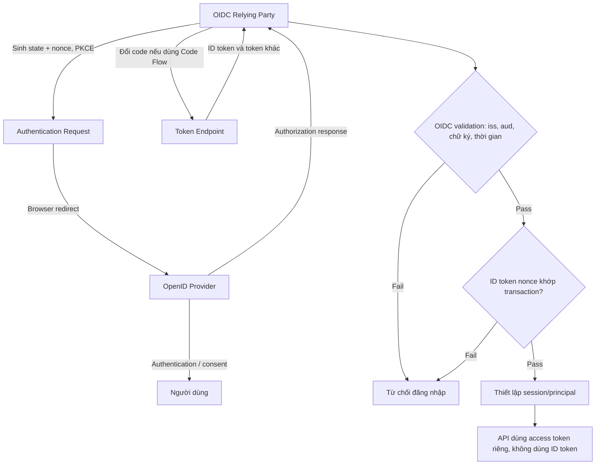
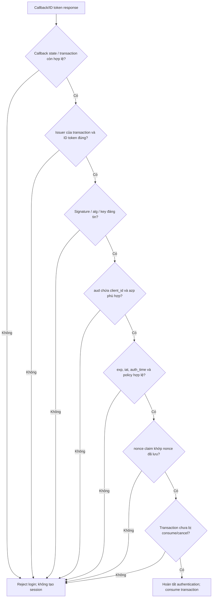

# Nonce bảo vệ replay trong OIDC

Giả sử ứng dụng web `orders-web` cho phép người dùng đăng nhập qua một OpenID Provider (OP). Sau khi đăng nhập, ứng dụng nhận **ID token** có chữ ký hợp lệ, issuer đúng và chưa hết hạn. Liệu chỉ như vậy đã đủ chắc chắn ID token đó thuộc **lần đăng nhập người dùng vừa bắt đầu**? Chưa chắc. Một ID token hợp lệ từ một lần đăng nhập khác có thể bị đưa nhầm vào giao dịch hiện tại, đặc biệt khi client xử lý callback, nhiều tab hoặc nhiều nhà cung cấp danh tính không chặt chẽ.

**`nonce` trong OpenID Connect (OIDC)** giúp ràng buộc **ID token** với một **Authentication Request** cụ thể. Client tạo một giá trị khó đoán cho từng giao dịch, gửi nó trong request tới OP, rồi đối chiếu với claim `nonce` mà OP đưa vào ID token. Nếu giá trị không khớp, client phải **từ chối kết quả đăng nhập** thay vì tự thiết lập phiên người dùng.

Bài thuộc chương **OpenID Connect** của module `SECURITY_TOKEN_SECURITY_FUNDAMENTALS`. Trọng tâm là sinh, gửi, lưu, đối chiếu và tiêu thụ nonce để giảm **ID token replay/substitution**; phân biệt nonce với `state`, PKCE, token lifetime và `jti`; hiểu các flow OIDC; triển khai và kiểm thử bằng Java/Spring Security; đồng thời giữ đúng ranh giới giữa ID token, JWT/opaque access token, scope, audience và bảo vệ token khi bị đánh cắp.

## 1. OIDC nonce giải quyết bài toán gì?

OIDC mở rộng OAuth 2.0 để client (Relying Party, viết tắt **RP**) có thể xác thực người dùng bằng **ID token** từ OpenID Provider (**OP**). ID token là JWT chứa các claims như `iss`, `sub`, `aud`, `exp`, `iat` và có thể có `nonce`.

Một ID token hợp lệ về chữ ký **không nhất thiết** là ID token do **giao dịch xác thực hiện tại** tạo ra. Ví dụ:

1. Client bắt đầu đăng nhập mới cho browser B, đặt nonce là `N-new`.
2. Một ID token cũ có nonce `N-old` bị đưa vào bước xử lý kết quả.
3. Nếu client chỉ kiểm tra chữ ký, `iss` và `exp`, nó có thể không phát hiện token không thuộc request đang chờ.
4. Nếu client còn kiểm tra nonce của transaction, `N-old != N-new` và kết quả bị từ chối.

**Nonce là một giá trị ràng buộc giao dịch**, không phải mật khẩu, session cookie, refresh token hoặc access token. Nó giúp giảm nguy cơ dùng lại/misbind một ID token đã được phát hành. **Không có nonce nào tự bảo vệ được một ứng dụng đã bị chiếm toàn bộ runtime** hoặc một bearer access token bị đánh cắp sau khi cấp.

### Hai câu hỏi riêng biệt

| Câu hỏi | Cơ chế chính |
|---|---|
| “ID token này thực sự do OP tin cậy phát hành, dành cho client này và còn hợp lệ không?” | Xác minh chữ ký, issuer, audience, thời gian, thuật toán và các claims OIDC. |
| “ID token này có gắn với Authentication Request **đang được xử lý** không?” | Đối chiếu nonce đã lưu trong transaction với claim `nonce` của ID token, kèm `state`/session binding. |

**Cần cả hai lớp.** Nonce đúng trong một JWT có chữ ký giả không làm token đáng tin; chữ ký đúng nhưng nonce sai không được hoàn tất transaction.

## 2. Vai trò OAuth 2.0/OIDC trong việc kiểm tra nonce

| Thành phần | Việc làm liên quan đến nonce |
|---|---|
| **Relying Party (RP)/OAuth client** | Sinh nonce ngẫu nhiên, gắn với login transaction, gửi tới OP, kiểm tra claim trong ID token và tiêu thụ state của transaction. |
| **OpenID Provider (OP)/Authorization Server (AS)** | Nhận nonce trong Authentication Request; khi được yêu cầu, đưa giá trị tương ứng vào ID token theo quy tắc OIDC. |
| **Browser/user-agent** | Chuyển authorization request/response qua front channel; không phải nơi cuối cùng ra quyết định ID token có hợp lệ hay không. |
| **Resource server (RS)** | Nhận **access token**, kiểm tra issuer/audience/scope và quyền tài nguyên; thường **không** đối chiếu nonce đăng nhập của RP. |
| **Resource owner/end user** | Thực hiện đăng nhập tại OP; không cần tự chọn nonce hay gõ nonce vào giao diện. |

Một OP có thể đồng thời là OAuth AS. RP có thể đồng thời là confidential web application hoặc public SPA/mobile. **Issuer tin cậy và client registration được cấu hình trước**; nonce không cho phép RP tin bất kỳ OP nào mà caller chỉ định.



Sơ đồ là mô hình **Authorization Code flow** khi token endpoint trả ID token. Trong các flow có ID token đi qua front channel, client phải xử lý validation tương ứng trước khi tin kết quả.

## 3. Định nghĩa `nonce` trong OpenID Connect Core

OIDC Core định nghĩa `nonce` là một **chuỗi dùng để liên kết client session với ID token và giảm replay**. Giá trị được truyền từ **Authentication Request** tới claim **`nonce`** của **ID token**, không được tùy tiện thay đổi ý nghĩa giữa hai bước.

Ví dụ authorization request có:

```text
nonce = Qovm9MGzcKduP7jnL3lSP7L34ShCbb6U
```

ID token được OP cấp cho request đó có thể mang:

```json
{
  "iss": "https://id.example.test",
  "sub": "user-123",
  "aud": "orders-web",
  "exp": 1795410600,
  "iat": 1795410000,
  "nonce": "Qovm9MGzcKduP7jnL3lSP7L34ShCbb6U"
}
```

Đây **chỉ là payload minh họa**, chưa phải ID token JWT đã ký. Các timestamp là dữ liệu ví dụ và không có ý nghĩa phiên thực tế.

### Nguyên tắc validation

- Nếu client gửi nonce trong OIDC Authentication Request, OP phải đưa claim nonce phù hợp vào ID token theo flow/profile.
- RP phải đối chiếu claim với **giá trị nonce của đúng transaction đã gửi**, không đối chiếu với một giá trị “mới nhất” dùng chung toàn ứng dụng.
- **Thiếu claim, sai kiểu dữ liệu hoặc khác giá trị kỳ vọng ⇒ từ chối** khi nonce đã được yêu cầu.
- So sánh **chính xác**, không chuyển thành lowercase, không trim/cắt chuỗi, không coi các chuỗi gần giống nhau là bằng nhau.
- Nonce phải đủ entropy để attacker không đoán trước và phải được quản lý theo vòng đời transaction.
- Chỉ kiểm tra nonce **sau hoặc trong quy trình xác minh ID token đáng tin**; không lấy claim từ payload JWT chưa được xác minh để xác định danh tính.

**Không có một độ dài nonce bắt buộc duy nhất cho mọi OIDC flow** như giới hạn 43–128 ký tự của PKCE `code_verifier`. Ứng dụng nên định nghĩa chính sách thực tế đủ entropy, ví dụ **16–32 byte CSPRNG** mã hóa Base64URL.

## 4. Nonce khác `state` như thế nào?

Đây là cặp dễ nhầm nhất.

| Tiêu chí | `state` | `nonce` |
|---|---|---|
| Bản chất | Giá trị gắn authorization response với authorization transaction/client session. | Giá trị gắn **ID token** với OIDC Authentication Request/client transaction. |
| Nơi client gửi | Authorization request. | OIDC Authentication Request. |
| Nơi kiểm tra chính | `state` trong **authorization response/callback**. | Claim `nonce` trong **ID token**. |
| Mục tiêu nổi bật | Chống CSRF, response injection, login session confusion. | Giảm replay/substitution của ID token giữa các giao dịch. |
| Có phải scope/role? | Không. | Không. |
| Có phải access token? | Không. | Không. |
| Được chuẩn yêu cầu giống nhau ở mọi flow? | Tùy OAuth/OIDC profile, cần transaction binding đúng. | OIDC Code Flow optional; trong Implicit/Hybrid Flow theo OIDC Core có yêu cầu nonce. |
| Có nên trùng giá trị? | Nên dùng hai giá trị riêng/độc lập theo thiết kế, dễ kiểm soát ranh giới. | Nên được tạo độc lập cho giao dịch tương ứng. |

Ví dụ cùng một request dùng:

```text
state = Ax2R7X8VCFhRhD0TUE8ahA
nonce = Qovm9MGzcKduP7jnL3lSP7L34ShCbb6U
```

AS redirect về:

```text
https://app.example.test/login/callback?
  code=AUTHORIZATION_CODE_EXAMPLE&
  state=Ax2R7X8VCFhRhD0TUE8ahA
```

**Callback không bắt buộc mang nonce trong URL**. Client lấy nonce đã lưu từ transaction gắn với `state`, đổi authorization code, nhận và xác minh ID token, rồi so sánh **claim `nonce` của ID token**.

### Vì sao không dùng nonce thay state?

Nếu chỉ có nonce trong ID token mà **callback bị ghép sai login transaction**, ứng dụng vẫn có thể xử lý code/issuer/session không đúng trước khi hoàn tất validation hoặc có lỗi login CSRF. `state` giúp xác minh callback thuộc request nào **trước token exchange**. Nonce được kiểm tra trên **ID token** sau khi token đến.

### Vì sao không dùng state thay nonce?

`state` trong callback không chứng minh một **ID token cũ** được đưa vào token-processing stage thuộc request hiện tại. Nonce ràng buộc token với authentication transaction và kiểm tra thêm trên chính ID token đã xác minh.

**Thực hành tốt:** dùng state + nonce + PKCE (nếu Authorization Code flow hỗ trợ), cùng issuer/redirect/ID token validation. Một lớp không làm lớp khác trở nên vô dụng.

## 5. Nonce khác PKCE, `jti` và `auth_time`

| Cơ chế | Được dùng cho | Không thay thế |
|---|---|---|
| **Nonce OIDC** | Ràng buộc ID token với Authentication Request. | State, PKCE, ID token signature/audience, revocation. |
| **PKCE `code_verifier`/`code_challenge`** | Ràng buộc authorization code với client giữ verifier tại token endpoint. | ID token nonce, state, RS token validation. |
| **`jti`** | Định danh JWT theo issuer/profile, hữu ích cho replay detection/denylist. | Nonce ràng buộc OIDC login transaction. |
| **`auth_time`** | Thời điểm người dùng được OP xác thực, dùng khi có yêu cầu về độ mới xác thực. | Nonce hoặc `exp`. |
| **`max_age`** | Client yêu cầu giới hạn độ tuổi authentication tại OP. | Nonce; nonce mới không có nghĩa user vừa nhập lại mật khẩu. |
| **`exp` / `iat`** | Thời hạn hiệu lực/thời điểm phát hành token. | Transaction binding hoặc logout. |
| **DPoP/mTLS** | Sender-constrained access token, giới hạn replay bởi bên không giữ khóa. | OIDC nonce; áp dụng ở bề mặt khác. |

Ví dụ: client gửi nonce mới và ID token có nonce đúng, nhưng `auth_time` là 4 giờ trước. Nếu nghiệp vụ yêu cầu **người dùng vừa xác thực trong 5 phút**, chỉ nonce không đáp ứng; cần `max_age`/`auth_time` và chính sách reauthentication phù hợp.

**Nonce không phải bằng chứng “authentication vừa xảy ra”**; OP có thể dùng phiên SSO hiện có. Nó liên kết ID token với request, không buộc người dùng nhập lại credential.

## 6. Yêu cầu nonce theo từng OIDC flow

OIDC Core phân biệt nhiều response types:

| OIDC flow | Authorization `response_type` | ID token được nhận chủ yếu ở đâu? | Quy tắc nonce theo OIDC Core |
|---|---|---|---|
| **Authorization Code Flow** | `code` | Token endpoint sau khi đổi code. | Nonce **tùy chọn** trong request; **nếu gửi thì phải được kiểm tra**. |
| **Implicit Flow** | `id_token` hoặc `id_token token` | Authorization response/front channel. | Nonce **bắt buộc** theo flow này. |
| **Hybrid Flow** | `code id_token`, `code token` hoặc `code id_token token` | Có thể nhận ID token qua authorization response và/hoặc token endpoint tùy biến thể. | Nonce **bắt buộc** theo flow/profile OIDC Core. |

**Ghi chú bảo mật hiện đại:** Authorization Code + PKCE là lựa chọn ưu tiên cho các ứng dụng mới. Những flow trả token ở browser/front channel tăng bề mặt lộ token và phải được cân nhắc theo OAuth/OIDC security best practice. Việc hiểu nonce trong implicit/hybrid giúp đọc hệ thống cũ và đánh giá security, **không phải khuyến khích tạo ứng dụng mới bằng implicit flow**.

### Code Flow có nên dùng nonce dù optional?

**Nên**, nếu framework/OP hỗ trợ đúng. Code Flow đã có state, redirect URI, PKCE và token endpoint; nonce tạo thêm ràng buộc **trong ID token** với đúng Authentication Request. Các security profiles hoặc chính sách tổ chức có thể yêu cầu nonce ngay cả khi base Code Flow định nghĩa nó là tùy chọn.

Không được tuyên bố mọi request Code Flow **không có nonce** là sai chuẩn OIDC; phải phân biệt **yêu cầu chuẩn tối thiểu** với **chính sách triển khai nghiêm ngặt**.

## 7. Luồng Authorization Code + PKCE + OIDC nonce

Giả sử:

| Thông số | Giá trị minh họa |
|---|---|
| Issuer tin cậy | `https://id.example.test` |
| Client ID | `orders-web` |
| Redirect URI | `https://app.example.test/login/oidc/callback` |
| Scope OIDC | `openid profile` |
| PKCE method | `S256` |
| API dự kiến nhận access token | `orders-api` |

```mermaid
sequenceDiagram
    autonumber
    participant B as Browser
    participant RP as OIDC Relying Party
    participant OP as OpenID Provider
    participant RS as Orders API
    B->>RP: GET /login
    RP->>RP: Sinh state, nonce, PKCE verifier/challenge
    RP->>RP: Lưu pending transaction gắn browser session
    RP-->>B: Redirect authorize?response_type=code&scope=openid&nonce=...
    B->>OP: OIDC Authentication Request + state + S256 challenge
    OP->>OP: Authentication / consent theo policy
    OP-->>B: Redirect callback?code=...&state=...
    B->>RP: Callback code + state
    RP->>RP: Kiểm tra state, issuer và transaction
    RP->>OP: POST /token + code + code_verifier
    OP-->>RP: ID token có nonce + access token
    RP->>RP: Validate ID token iss/signature/aud/time
    RP->>RP: So nonce claim với nonce đã lưu
    RP->>RP: Consume transaction; tạo authenticated session
    RP->>RS: Access token dành cho Orders API
    RS->>RS: Kiểm tra aud/scope/quyền resource
    RS-->>RP: Data hoặc DENY
```

**Không nhầm ID token và access token**:

- **ID token** chứa nonce để RP xác nhận authentication transaction.
- **Access token** được dùng tại resource server. Tùy profile, access token có thể là JWT hoặc opaque; RS **không dùng nonce của RP làm điều kiện thay issuer, audience, scope và chữ ký/trạng thái**.
- **Refresh token**, nếu được cấp, chỉ gửi đến AS token endpoint cho refresh grant và cần storage/rotation/revocation riêng.

## 8. OIDC Authentication Request gửi nonce ra sao?

Ví dụ GET authorization request, xuống dòng để đọc; request HTTP thực tế phải URL-encode thành một request target hợp lệ:

```http
GET /oauth2/authorize?
  response_type=code&
  client_id=orders-web&
  redirect_uri=https%3A%2F%2Fapp.example.test%2Flogin%2Foidc%2Fcallback&
  scope=openid%20profile&
  state=STATE_FOR_LOGIN_TRANSACTION&
  nonce=NONCE_FOR_LOGIN_TRANSACTION&
  code_challenge=BASE64URL_SHA256_VERIFIER&
  code_challenge_method=S256
HTTP/1.1
Host: id.example.test
```

Trong request thực:

- `response_type=code` chọn Authorization Code flow.
- `scope` có `openid` để đây là Authentication Request OIDC.
- `state` ràng buộc callback với pending transaction.
- `nonce` ràng buộc ID token dự kiến với Authentication Request.
- `code_challenge` và `method=S256` ràng buộc code exchange với verifier.
- `client_id` và `redirect_uri` phải khớp client registration/AS policy.

**Không đưa `code_verifier` vào authorization URL.** Nonce **có thể xuất hiện trong URL front channel**, nhưng nó không phải proof secret giống PKCE verifier; bảo mật dựa trên tính khó đoán, ràng buộc transaction và việc RP kiểm tra ID token. Dù vậy, nên hạn chế ghi nguyên URL callback/request vào logs và analytics.

## 9. ID token nhận về chứa nonce thế nào?

Sau code exchange, token endpoint có thể trả:

```http
HTTP/1.1 200 OK
Content-Type: application/json
Cache-Control: no-store
Pragma: no-cache

{
  "access_token": "ACCESS_TOKEN_PLACEHOLDER",
  "token_type": "Bearer",
  "expires_in": 600,
  "id_token": "SIGNED_ID_TOKEN_PLACEHOLDER"
}
```

RP xác minh JWT ID token, sau đó đọc claim:

```json
{
  "iss": "https://id.example.test",
  "sub": "user-123",
  "aud": "orders-web",
  "exp": 1795410600,
  "iat": 1795410000,
  "nonce": "NONCE_FOR_LOGIN_TRANSACTION"
}
```

**Nếu nonce đã được gửi trong request**, RP không được coi token hợp lệ khi:

- ID token **không có** claim `nonce`;
- Claim `nonce` là `null`, array, number hoặc một kiểu không đúng hợp đồng;
- Claim khác giá trị kỳ vọng dù chỉ một ký tự;
- Claim khớp một giao dịch **khác** (tab khác, session khác, issuer khác);
- Transaction đã hoàn thành, bị hủy hoặc hết hạn, mặc dù nonce cũ khớp;
- ID token sai chữ ký, issuer, audience hoặc thời hạn ngay cả khi nonce khớp.

### Vì sao không tin ID token chỉ bằng cách Base64 decode?

JWT payload có thể đọc mà **chưa xác minh chữ ký**. Một attacker có thể tạo JSON chứa `nonce` đúng rồi mã hóa Base64URL. Điều đó không chứng minh nguồn gốc. RP phải xác minh ID token bằng khóa/thuật toán và issuer tin cậy, **sau đó** mới dùng claim nonce làm bằng chứng ràng buộc transaction.

## 10. Sinh nonce bằng CSPRNG

Nonce phải khó đoán: không dùng timestamp, số tăng dần, user ID, client ID, email hoặc một giá trị toàn cục.

**Khuyến nghị triển khai:** sinh 16–32 bytes ngẫu nhiên bằng CSPRNG rồi mã hóa Base64URL **không padding**. Ví dụ 32 bytes có khoảng 256 bit entropy khi bộ sinh hoạt động đúng.

```text
random = CSPRNG(32 bytes)
nonce = BASE64URL(random, no padding)
```

Một nonce như `login-2026-11-23-user-123` có thể độc nhất nhưng **dễ đoán** và có thể làm lộ thông tin riêng tư. Một chuỗi 32 ký tự chữ `A` cũng không đủ entropy dù dài.

### Java 17: sinh nonce

```java
import java.security.SecureRandom;
import java.util.Base64;

public final class OidcNonceGenerator {
    private static final SecureRandom RANDOM = new SecureRandom();
    private static final Base64.Encoder BASE64_URL =
            Base64.getUrlEncoder().withoutPadding();

    private OidcNonceGenerator() { }

    public static String generate() {
        byte[] bytes = new byte[32];
        RANDOM.nextBytes(bytes);
        return BASE64_URL.encodeToString(bytes);
    }

    public static void main(String[] args) {
        String nonce = generate();

        // Không in nonce trong production log.
        System.out.println("nonceLength=" + nonce.length());
    }
}
```

Ví dụ output chỉ báo độ dài (43 ký tự khi Base64URL 32 bytes), **không xuất giá trị nonce thật**. Trong ứng dụng thực, nonce phải được đưa vào Authentication Request và lưu an toàn trong pending transaction.

### Browser/SPA: dùng Web Crypto

```javascript
function base64Url(bytes) {
  let binary = "";
  for (const byte of bytes) binary += String.fromCharCode(byte);
  return btoa(binary)
    .replaceAll("+", "-")
    .replaceAll("/", "_")
    .replace(/=+$/, "");
}

function newOidcNonce() {
  const bytes = new Uint8Array(32);
  crypto.getRandomValues(bytes);
  return base64Url(bytes);
}

const nonce = newOidcNonce();
// Lưu theo từng pending OIDC transaction.
// Không dùng Math.random(), timestamp hoặc một nonce global.
```

Browser JS có thể bị ảnh hưởng bởi XSS. Nếu ứng dụng nhạy cảm, cân nhắc **Backend-for-Frontend (BFF)** giữ transaction và OAuth tokens phía server. Sinh nonce đúng **không tự giải quyết XSS hoặc chiếm session**.

## 11. Lưu nonce theo transaction: không dùng một biến toàn cục

Trong BFF/server-side client, có thể lưu một bản ghi pending login:

| Trường | Ý nghĩa |
|---|---|
| `transaction_id` | Định danh nội bộ, không phải credential. |
| `state_digest`/state reference | Ràng buộc callback với transaction. |
| `nonce` hoặc giá trị tương ứng được bảo vệ | So sánh với claim ID token khi xác minh. |
| `pkce_verifier` | Dùng tại token endpoint, **không gửi ở front channel**. |
| `expected_issuer` | OP đã được client chọn/tin cậy. |
| `expected_client_id` | Audience ID token phải chứa client này. |
| `redirect_uri` | Địa chỉ callback được đăng ký cho transaction. |
| `browser_session_ref` | Ràng buộc giao dịch với browser session/cookie hoặc state storage. |
| `created_at`, `expires_at` | TTL ngắn cho transaction đang chờ. |
| `status` | PENDING, PROCESSING, COMPLETED, EXPIRED hoặc CANCELLED. |

**Không phải mọi framework lưu tất cả trường dưới cùng tên**, đây là mô hình logic. Trong ứng dụng nhiều node, store phải có TTL, đồng bộ và thao tác tiêu thụ một lần. Không để attacker chỉ biết state/nonce mà có thể lấy transaction từ phiên browser khác.

### Nhiều tab

Tab A và tab B bắt đầu login gần nhau:

```text
Tab A: state=A1, nonce=N1, verifier=V1
Tab B: state=B1, nonce=N2, verifier=V2

Callback A:
    lấy đúng transaction A1
    token response ID token phải có nonce N1

Callback B:
    lấy đúng transaction B1
    token response ID token phải có nonce N2
```

Sai lầm:

```javascript
// SAI: tab mới ghi đè nonce của mọi transaction trước.
window.currentNonce = newOidcNonce();
```

Nếu callback A đến sau khi B ghi đè biến global, ứng dụng có thể từ chối login hợp lệ hoặc, với logic xử lý lỏng lẻo, nhận nhầm kết quả. **Ánh xạ bằng state/transaction và browser session**, không bằng “nonce cuối cùng”.

## 12. Quy trình kiểm tra ID token tại Relying Party

Nonce chỉ là **một** bước trong validation OIDC. Thứ tự triển khai cụ thể có thể khác nhau, nhưng phải bảo đảm tất cả điều kiện trước khi tạo authenticated session.



### Những kiểm tra quan trọng

1. **Nguồn issuer:** OP phải nằm trong cấu hình/allowlist tin cậy; không chọn OP/JWKS từ JWT header hay query của callback chưa xác minh.
2. **Chữ ký và thuật toán:** dùng public key/alg được profile cho phép, với các quy tắc OIDC về signing/encryption khi áp dụng.
3. **Audience:** ID token `aud` phải chứa **client ID của RP**, không phải `orders-api`; với nhiều audience, xử lý `azp` theo OIDC.
4. **Thời gian:** kiểm tra `exp`, `iat` và clock skew hợp lý; nếu `max_age` yêu cầu thì kiểm tra `auth_time`/reauth theo policy.
5. **Nonce:** khi request có nonce, ID token phải có claim tương ứng và khớp đúng pending transaction.
6. **Các hash claims theo flow:** `at_hash`, `c_hash` nếu được OIDC flow/profile yêu cầu; nonce không thay các kiểm tra này.
7. **Transaction lifecycle:** state, issuer, PKCE, redirect URI, mã code một lần và phiên browser phải đúng.
8. **Session:** chỉ thiết lập principal sau khi hoàn thành kiểm tra; không lấy `sub` từ JWT chưa verified.

**Không dùng mỗi nonce để quyết định login thành công.** Một ID token bị hết hạn dù nonce khớp vẫn phải bị từ chối. Ngược lại, một JWT đúng issuer, chữ ký và audience nhưng nonce sai phải bị từ chối nếu nonce được dùng trong request.

## 13. Nonce và audience: ID token khác access token

Một OIDC token response có thể chứa **hai token** nhưng chúng có mục đích khác nhau:

| Thuộc tính | ID token | Access token |
|---|---|---|
| Bên nhận | **OIDC client/Relying Party**. | **Resource server/API** đúng audience. |
| Mục đích | Xác nhận sự kiện authentication/danh tính theo OIDC. | Cho phép truy cập tài nguyên theo OAuth authorization. |
| Claim `nonce` | Ràng buộc ID token với Authentication Request khi nonce được sử dụng. | Không phải một claim bắt buộc chung của OAuth access token. |
| Audience | Client ID của RP. | Resource identifier/API (theo profile). |
| Scope | Có thể tương quan request `openid`; không phải nguồn quyền API đầy đủ. | Scope thực tế được AS cấp cho token để RS xét quyền. |
| Kiểm tra | OIDC ID Token Validation tại RP. | JWT validation hoặc opaque introspection tại RS, cộng authorization. |

Ví dụ ID token:

```json
{
  "iss": "https://id.example.test",
  "sub": "user-123",
  "aud": "orders-web",
  "nonce": "N1",
  "exp": 1795410600
}
```

Ví dụ access token JWT cho API:

```json
{
  "iss": "https://id.example.test",
  "sub": "user-123",
  "aud": "orders-api",
  "scope": "orders.read",
  "exp": 1795410600
}
```

Cả hai chỉ là **payload minh họa**. **Orders API không được nhận ID token** rồi dùng `nonce` làm bằng chứng đủ quyền truy cập. API cần access token đúng issuer, audience, type, thời hạn, scope và quyền bản ghi.

Nếu access token là **opaque**, RS dùng introspection/trạng thái đáng tin, không tự đọc ID token để suy quyền cho API. OIDC nonce được kiểm tra ở phía RP, **không thay validation access token ở RS**.

## 14. Một replay thực tế: ID token từ giao dịch cũ

Giả sử RP nhận một ID token `T-old` trước đó:

```text
T-old:
    iss   = https://id.example.test
    aud   = orders-web
    nonce = N-old
    exp   = tương lai gần
```

Khi người dùng bắt đầu transaction mới:

```text
Transaction A:
    state = S-new
    nonce = N-new
```

Một thành phần lỗi hoặc attacker đưa `T-old` vào xử lý transaction A. Kết quả:

| Kiểm tra | Kết quả | Vì sao |
|---|---|---|
| Signature hợp lệ? | Có thể có | Token cũ vẫn do OP ký. |
| Issuer đúng? | Có thể có | Cùng OP. |
| Audience đúng? | Có thể có | Cùng RP/client ID. |
| Expiry còn hạn? | Có thể có | Token chưa đến `exp`. |
| Nonce đúng transaction A? | **Không** | `N-old != N-new`. |
| Có được tạo session từ T-old không? | **Không** | Replay/substitution bị chặn ở nonce binding. |

Nếu RP **không lưu nonce theo transaction** hoặc chỉ so sánh với một nonce global đã bị attacker thao túng, lớp phòng vệ có thể thất bại.

### Replay sau khi transaction đã hoàn tất

Ngay cả khi token có nonce đúng với transaction cũ, nếu transaction đó đã ở trạng thái **COMPLETED**, RP không được cho phép cùng kết quả đăng nhập **mở lại transaction** hay tạo thêm session ngoài chính sách. Nonce ngẫu nhiên phải đi cùng **one-time/expiry semantics của pending login**.

**Giới hạn:** OIDC nonce không phải một cơ chế chuẩn hóa buộc OP ghi nhớ tất cả nonce từng cấp và chặn toàn cầu mọi ID token cũ. **RP** phải quản lý pending transactions và quyết định chấp nhận ID token đúng giao dịch của nó.

## 15. Nonce trong Implicit và Hybrid Flow

Những flow OIDC cũ có thể nhận ID token qua authorization response/front channel, khiến lộ diện/nhầm ID token dễ xảy ra hơn Code Flow.

### OIDC Implicit Flow

Ví dụ:

```text
response_type=id_token
scope=openid
nonce=UNPREDICTABLE_NONCE
state=RANDOM_STATE
```

ID token được đưa về theo response mode/front-channel của flow. Client cần kiểm chữ ký, issuer, audience, thời hạn và nonce **trước khi chấp nhận đăng nhập**.

### OIDC Hybrid Flow

Ví dụ:

```text
response_type=code id_token
scope=openid
nonce=UNPREDICTABLE_NONCE
state=RANDOM_STATE
```

Hybrid có thể trả **authorization code và ID token** trong authorization response. Tùy biến thể, client có thể nhận thêm token tại token endpoint; phải áp dụng validation của từng giai đoạn, kể cả `c_hash`/`at_hash` khi profile yêu cầu.

**Nonce không đủ để làm implicit/hybrid trở thành mặc định an toàn cho ứng dụng mới.** Dùng Authorization Code + PKCE khi có thể và tuân thủ security profile của OP/client.

### Không nhầm nonce với fragment token

Ở implicit/hybrid, ID token có thể đi qua URL fragment hoặc form post theo response mode. Fragment mang ID token là dữ liệu nhạy cảm hơn nonce: cần tránh lộ qua JavaScript, browser storage, extensions và logs. Nonce chỉ là một phần validation, không bảo vệ token khỏi mọi bề mặt lộ thông tin.

## 16. Java: kiểm tra claim nonce sau khi ID token đã được xác minh

Trong ứng dụng thực, nên để **OIDC library/framework** kiểm tra ID token theo chuẩn, bao gồm issuer, signature, audience và thời gian. Sau đó, một lớp riêng kiểm tra nonce của **pending transaction**.

Mã Java 17 minh họa:

```java
import java.nio.charset.StandardCharsets;
import java.security.MessageDigest;

public final class OidcNonceVerifier {
    private OidcNonceVerifier() { }

    public static void requireMatch(
            String expectedNonce,
            Object verifiedNonceClaim) {

        if (expectedNonce == null || expectedNonce.isBlank()) {
            throw new IllegalArgumentException("Missing expected nonce");
        }
        if (!(verifiedNonceClaim instanceof String actual)
                || actual.isBlank()) {
            throw new SecurityException("Missing ID token nonce");
        }

        byte[] expected =
                expectedNonce.getBytes(StandardCharsets.US_ASCII);
        byte[] received =
                actual.getBytes(StandardCharsets.US_ASCII);

        if (!MessageDigest.isEqual(expected, received)) {
            throw new SecurityException("OIDC nonce mismatch");
        }
    }
}
```

**Tiền điều kiện:** `verifiedNonceClaim` phải đến từ một **ID token đã xác minh chữ ký, issuer, audience và thời hạn**, không phải JSON do client đưa vào. `expectedNonce` phải lấy từ transaction được tìm bằng `state` và ràng buộc với đúng browser session/issuer.

Ví dụ sinh nonce trước đó dùng Base64URL ASCII. Nếu ứng dụng hỗ trợ nonce theo charset rộng hơn, phải có chính sách encode/so khớp tương thích; không tự biến chuỗi Unicode thành ASCII thay thế gây collision. Việc dùng so sánh byte khó bị phân biệt thời gian là một **lớp phòng vệ**, không thay entropy.

## 17. Java: mô hình pending transaction và tiêu thụ một lần

Một hệ thống Spring có thể có logic khái niệm như sau:

```java
// Các class/interface ở đây do ứng dụng tự triển khai.
record PendingOidcLogin(
    String expectedIssuer,
    String expectedClientId,
    String expectedNonce,
    String stateReference,
    java.time.Instant expiresAt
) {}

void handleOidcCallback(
        String browserSessionId,
        String state,
        String authorizationCode) {

    // Lấy transaction thuộc đúng browser session + state.
    PendingOidcLogin tx = pendingStore.find(
            browserSessionId, state)
        .orElseThrow(() -> new SecurityException("Unknown state"));

    if (java.time.Instant.now().isAfter(tx.expiresAt())) {
        pendingStore.invalidate(browserSessionId, state);
        throw new SecurityException("Expired login transaction");
    }

    // Đổi code bằng verifier của tx, tại đúng issuer; OIDC library
    // xác minh ID token signature, iss, aud, exp và yêu cầu khác.
    VerifiedOidcIdToken idToken =
            oidcClient.exchangeAndValidate(authorizationCode, tx);

    OidcNonceVerifier.requireMatch(
            tx.expectedNonce(), idToken.claim("nonce"));

    // Atomic consume: chỉ một callback hoàn tất được transaction này.
    if (!pendingStore.consumeOnce(browserSessionId, state)) {
        throw new SecurityException("Login transaction reused");
    }

    establishAuthenticatedSession(
            browserSessionId, idToken.verifiedSubject());
}
```

**Đây là pseudocode Java có các abstractions tự định nghĩa**, không phải mã Spring APIs đầy đủ. Trên hệ thống đa node, `consumeOnce` phải nguyên tử và quản lý trạng thái chuyển từ pending sang completed; không cho hai callback đồng thời cùng thành công. Cần thêm PKCE, issuer response binding (RFC 9207 khi áp dụng), redirect URI, client authentication, state/session/cookie protections, timeout và xử lý lỗi.

Lưu ý giao dịch đang chờ có thể cần được **khóa hoặc đánh dấu đang xử lý** trước lúc token exchange để tránh hai callback đồng thời gửi cùng authorization code. Khi exchange lỗi, quyết định có tiêu thụ/hủy transaction phải được thiết kế an toàn; không tạo retry vô hạn đối với code một lần.

## 18. Spring Boot/Spring Security: dùng OIDC Login đúng cấu hình

Spring Security hỗ trợ OIDC thông qua OAuth2 Login khi client registration có scope `openid`.

Ví dụ cấu hình web backend:

```yaml
spring:
  security:
    oauth2:
      client:
        registration:
          orders-login:
            provider: orders-op
            client-id: "OIDC_CLIENT_ID_PLACEHOLDER"
            client-secret: "OIDC_CLIENT_SECRET_FROM_SECRET_MANAGER"
            authorization-grant-type: authorization_code
            redirect-uri: "{baseUrl}/login/oauth2/code/{registrationId}"
            scope: openid,profile
        provider:
          orders-op:
            issuer-uri: "https://id.example.test"
```

Đây là ví dụ **confidential web client**; `client-secret` là placeholder, phải được tải từ secret manager/môi trường bảo vệ thay vì commit vào repository. SPA/mobile là **public clients**, không thể bảo vệ một static secret như backend.

Security chain minh họa:

```java
@Configuration
public class OidcLoginConfig {

    @Bean
    SecurityFilterChain webSecurity(HttpSecurity http)
            throws Exception {
        http.authorizeHttpRequests(auth -> auth
            .requestMatchers("/", "/health").permitAll()
            .anyRequest().authenticated()
        );

        http.oauth2Login(Customizer.withDefaults());

        return http.build();
    }
}
```

Mã bỏ `import` và cấu hình session, CSRF, reverse proxy, redirect URIs. **Framework chuẩn có thể sinh/xử lý nonce cho OIDC flow**, nhưng không nên dựa vào phỏng đoán: cần xác minh **đúng phiên bản và cấu hình** đang dùng bằng integration test rằng:

1. Authentication Request mang `nonce` khi chính sách ứng dụng yêu cầu.
2. OP phản hồi ID token có `nonce` tương ứng.
3. ID token thiếu/sai nonce bị từ chối.
4. Hai login transactions song song không ghi đè nonce.
5. RP kiểm tra issuer, chữ ký, audience, thời hạn và các điều kiện OIDC khác.

**Không tự viết lại toàn bộ ID token validator chỉ để thêm nonce.** Ưu tiên cấu hình/cắm extension vào một OIDC client library đáng tin và không vô hiệu những kiểm tra mặc định.

## 19. Một trường hợp khó: framework gửi hash của nonce

Một số thư viện có thể giữ nonce gốc trong transaction nhưng **gửi giá trị dẫn xuất** (ví dụ hash) tới OP theo hợp đồng của thư viện. Điều quan trọng là client phải kiểm tra **giá trị thực tế được gửi trong Authentication Request** với claim do OP phản ánh; không được so sánh nhầm hai representations.

Ví dụ mang tính minh họa về việc tách các giá trị:

```text
rawNonce = CSPRNG()
requestNonce = DERIVE(rawNonce)  // Chỉ khi thư viện định nghĩa rõ.
Authentication Request nonce = requestNonce

ID token nonce = requestNonce
RP validation = đối chiếu theo protocol/thư viện tương ứng
```

OIDC không yêu cầu ứng dụng tự hash nonce, và **không nên tự phát minh biến đổi** nếu thư viện không hỗ trợ. Với OIDC Core, OP phản ánh giá trị nonce trong Authentication Request; nếu RP gửi `requestNonce` thì phải đối chiếu với giá trị đó.

**Mục tiêu không phải “nonce phải luôn đi trong JWT dưới dạng hash”**, mà là **ràng buộc đúng giá trị request đã gửi với ID token** và bảo vệ nguồn expected nonce.

## 20. Bảo vệ transaction/session khỏi nonce replay

Một giải pháp đầy đủ nên có các lớp kiểm soát:

| Lớp | Quy tắc |
|---|---|
| Sinh | CSPRNG, entropy đủ, mới cho từng login transaction. |
| Lưu | Ràng buộc vào browser session/state và issuer/client registration. |
| TTL | Pending transaction sống ngắn; xóa khi timeout, cancel hoặc hoàn tất. |
| Kiểm tra | So nonce đã lưu với claim trong ID token **đã được xác minh**. |
| Consume | Một transaction chỉ được xử lý thành công một lần; thao tác nguyên tử khi đa node. |
| Multi-tab | Không dùng một nonce toàn cục. |
| Error handling | Nonce mismatch ⇒ fail closed; không tạo phiên rồi “cảnh báo”. |
| Logging | Không ghi raw ID token, state/verifier hoặc toàn bộ callback URL; hạn chế ghi nonce. |
| Session | Cookie/session secure, HttpOnly, SameSite phù hợp; chống session fixation/CSRF. |
| Issuer | Pin/allowlist OP, kiểm issuer ở callback/token; ngăn mix-up. |

### Nonce có phải bí mật tuyệt đối không?

Nonce thường xuất hiện ở **authorization request front channel**, nên không nên coi nó như một private key. Tính chất quan trọng là **khó đoán trước, gắn đúng giao dịch và được xác minh**. Tuy nhiên, giá trị này vẫn có thể là dữ liệu tương quan login; hạn chế đưa vào analytics và nhật ký có quyền đọc rộng.

**Không gửi nonce tới resource API như Bearer token** hoặc dùng nonce làm session ID. Nếu nonce cũ lọt log, một attacker vẫn **không nên** dùng nó để mở lại một pending transaction đã bị consume.

## 21. Các lỗi triển khai phổ biến

| Lỗi | Tác động | Cách phòng ngừa |
|---|---|---|
| RP chỉ decode JWT, đọc `nonce` mà không xác minh chữ ký. | Token giả có thể chứa nonce đúng. | Kiểm signature/iss/aud/time trước khi tin claim. |
| Nonce được tạo bằng timestamp hoặc `Math.random()`. | Dễ đoán hoặc lặp. | CSPRNG và policy entropy. |
| Dùng một nonce cố định cho mọi người dùng. | Không còn ràng buộc từng transaction. | Nonce mới cho mỗi Authentication Request. |
| Dùng global nonce, nhiều tab ghi đè nhau. | Login confusion/false rejection. | Pending store keyed bằng state + browser session. |
| So nonce với claim của ID token thuộc issuer khác. | Identity provider mix-up. | Bind issuer/client registration và kiểm `iss`. |
| Chấp nhận ID token thiếu nonce dù request có nonce. | Không kiểm tra điều kiện ràng buộc. | Fail closed. |
| Trim/lowercase nonce trước khi so sánh. | Nới lỏng đối chiếu ngoài hợp đồng. | Exact match. |
| Nhận đúng nonce nhưng bỏ qua `exp` hoặc `aud`. | ID token hết hạn/sai client vẫn được nhận. | Full OIDC ID Token Validation. |
| Gắn một nonce cũ vào nhiều lần login. | Có thể lặp ID token trong nhiều transaction. | Fresh nonce và consume once. |
| Tạo session trước khi token exchange/nonce check hoàn tất. | Session được xác thực quá sớm. | Hoàn thành validation trước khi tạo session. |
| Lấy issuer/JWKS URI từ claims/header của JWT chưa tin. | Key substitution/SSRF. | Issuer trust anchor và JWKS allowlist. |
| Coi `state` đúng nghĩa là nonce không cần kiểm. | Replay/substitution ID token có thể lọt. | Kiểm hai cơ chế độc lập theo flow. |
| Coi PKCE pass nghĩa là ID token nonce pass. | Mất binding ở lớp ID token. | Ràng buộc code exchange và ID token riêng. |
| So nonce trong access token thay vì ID token. | Sai token type và trust boundary. | RP kiểm nonce ID token; RS kiểm aud/scope access token. |
| Gửi ID token tới API do cùng issuer ký. | Token confusion, truy cập sai audience. | API chỉ chấp nhận access token. |
| Tắt nonce validation để “sửa” lỗi SSO. | Mở nguy cơ replay. | Sửa transaction/state/cookie/multi-tab hoặc cấu hình thư viện. |
| Log raw ID token/client secret/nonce kèm callback. | Rò credential và context đăng nhập. | Redaction, mã lỗi và trace references. |
| Không consume transaction sau thành công. | Callback cũ có thể bị xử lý lại. | Atomic consume và TTL. |

## 22. Ma trận kiểm thử nonce trong OIDC

Giả sử OP tin cậy `https://id.example.test`, client `orders-web`, redirect URI đã đăng ký; ứng dụng sử dụng Authorization Code + PKCE, **chính sách yêu cầu nonce** cho mọi login.

| ID | Tình huống | Kỳ vọng |
|---|---|---|
| N01 | RP sinh nonce bằng 32 bytes CSPRNG. | Nonce mới khó đoán, không trùng có hệ thống. |
| N02 | RP sinh nonce bằng timestamp tăng dần. | Review/security test phát hiện sai thiết kế. |
| N03 | Authentication Request có `nonce=N1`. | OP đưa N1 vào ID token theo OIDC. |
| N04 | ID token đã xác minh chứa `nonce=N1`, transaction cần N1. | Nonce check pass. |
| N05 | ID token có `nonce=N2`, transaction cần N1. | Từ chối login. |
| N06 | Request có nonce nhưng ID token thiếu claim. | Từ chối login. |
| N07 | Claim `nonce` là `null`, array hoặc number. | Từ chối, không tự ép kiểu. |
| N08 | Nonce khác duy nhất chữ hoa/thường. | Từ chối, exact comparison. |
| N09 | Nonce có ký tự thừa/khoảng trắng. | Từ chối, không trim để “khớp”. |
| N10 | ID token có nonce đúng nhưng chữ ký JWT sai. | Từ chối, nonce không thay signature validation. |
| N11 | ID token nonce đúng nhưng `iss` lạ. | Từ chối issuer. |
| N12 | ID token nonce đúng nhưng `aud=other-client`. | Từ chối sai audience. |
| N13 | ID token nonce đúng nhưng `exp` đã qua. | Từ chối token hết hạn. |
| N14 | ID token có multiple aud nhưng `azp` sai theo profile. | Từ chối. |
| N15 | RP nhận ID token cũ còn hạn với nonce N-old cho transaction N-new. | Từ chối replay/substitution. |
| N16 | ID token của transaction đã COMPLETED được gửi lại. | Không mở lại transaction, không tạo session mới. |
| N17 | Callback dùng state khác transaction được lưu. | Từ chối trước token exchange. |
| N18 | RP nhận code đúng nhưng PKCE verifier không khớp. | AS từ chối token exchange, nonce không cứu được. |
| N19 | Two-tab login A/B có N1/N2 khác nhau. | Mỗi callback dùng đúng nonce theo state/browser transaction. |
| N20 | Tab B ghi đè biến global của tab A. | Test phát hiện lỗi mapping, không nhận nhầm token. |
| N21 | Browser session khác đoán/biết state của A rồi cố dùng callback A. | Không lấy được pending transaction không thuộc session. |
| N22 | Transaction đã CANCELLED, response token đến muộn. | Không tạo authenticated session. |
| N23 | Transaction đã EXPIRED dù ID token nonce khớp. | Từ chối session cũ. |
| N24 | Hai callback đồng thời cố consume cùng một transaction. | Chỉ một callback có thể hoàn thành. |
| N25 | OP A/B được cấu hình; callback issuer không khớp OP đã chọn. | Từ chối mix-up. |
| N26 | OIDC Code Flow không gửi nonce theo base specification. | Hiểu đúng là optional theo Core, nhưng **không đạt policy nonce-required của app**. |
| N27 | Implicit Flow thiếu nonce. | Từ chối theo yêu cầu nonce của flow/profile. |
| N28 | Hybrid Flow có ID token front-channel nhưng nonce sai. | Từ chối trước khi tin authentication result. |
| N29 | OIDC request có `max_age`, `auth_time` quá cũ nhưng nonce đúng. | Từ chối theo freshness policy. |
| N30 | JWT có `nonce` đúng nhưng thiếu/không đạt `at_hash`/`c_hash` khi bắt buộc. | Từ chối theo flow/profile. |
| N31 | RP gửi hash-derived nonce theo thư viện và OP phản ánh đúng sent value. | Validation theo hợp đồng, không so nhầm raw/hash. |
| N32 | Framework upgrade khiến request không còn nonce dù app yêu cầu. | Integration test phát hiện cấu hình/behavior sai. |
| N33 | Token response có ID token nhưng RP chưa kiểm nonce mà đã tạo session. | Security test thất bại. |
| N34 | Client dùng ID token `aud=orders-web` để gọi Orders API. | RS từ chối sai token type/audience. |
| N35 | JWT access token đúng nguồn nhưng `aud=payments-api` tại Orders API. | RS từ chối, dù OIDC nonce đã pass. |
| N36 | Opaque access token introspection `active=false`. | RS từ chối, không lấy nonce làm quyền API. |
| N37 | Access token có scope đọc nhưng thao tác cần scope phê duyệt. | `403` theo API policy. |
| N38 | Access token đủ scope nhưng order thuộc tenant khác. | RS từ chối theo object authorization. |
| N39 | Access Bearer token bị sao chép sau login OIDC. | Nonce không tự ngăn replay token đó; áp dụng biện pháp thêm. |
| N40 | Raw ID token, access token hoặc nonce của pending login xuất hiện trong logs. | Security/log-redaction tests phát hiện. |

### Tách tầng test

- **Unit tests:** CSPRNG nonce generator, exact compare, missing claim, pending transaction TTL/consume logic, multi-tab mapping.
- **OIDC integration tests:** dựng OP/JWKS thử nghiệm với **ID token ký thật** có nonce đúng/sai, issuer, audience và `exp` biến thể; không chỉ mock principal.
- **Browser end-to-end tests:** callback, cookie, SameSite, state/CSRF, nhiều tab, hủy và back-button.
- **Authorization Code/PKCE tests:** code one-time, verifier/challenge S256, issuer binding và token endpoint errors.
- **Resource server tests:** access-token JWT signature/aud/scope, opaque introspection, quyền owner/tenant và revoke/cache.
- **Security tests:** token substitution/replay, login CSRF/mix-up, URL/log redaction và XSS/token storage.

Một test tạo fake `OidcUser` hoặc dùng Spring Security test `jwt()` có thể kiểm tra application authorization nhưng **không chứng minh OP ký ID token đúng hoặc nonce validation đã được thực thi**. Cần test đi qua OIDC client validator thật.

## 23. Audit và quan sát lỗi nonce an toàn

Cần quan sát đủ để phân biệt lỗi người dùng, lỗi cấu hình OP và tấn công replay, nhưng **không biến logs thành kho credential**.

| Sự kiện | Trường nên ghi |
|---|---|
| `OIDC_LOGIN_STARTED` | Transaction reference, issuer đã chọn, client ID, thời điểm UTC. |
| `OIDC_CALLBACK_RECEIVED` | Callback outcome, state match flag, transaction age, trace ID. |
| `OIDC_ID_TOKEN_VALIDATED` | Issuer/client references, validation outcome, không ghi raw JWT. |
| `OIDC_NONCE_MISMATCH` | Transaction reference, reason code, policy version; không ghi actual/expected nonce nguyên bản. |
| `OIDC_TRANSACTION_CONSUMED` | One-time consume outcome, session reference. |
| `OIDC_REPLAY_DETECTED` | Token/transaction digest hoặc HMAC reference an toàn, issuer, thời điểm. |
| `OIDC_LOGIN_DENIED` | Reason code và correlation ID. |

**Không ghi** raw ID token, access token, refresh token, PKCE verifier, client secret, cookie phiên hoặc toàn bộ authorization callback URL. Nếu cần tương quan nonce/token, dùng reference hoặc digest/HMAC được quản lý khóa theo retention/access policy, không ghi nguyên giá trị nhạy cảm.

### Nhiều lần nonce mismatch là dấu hiệu gì?

Có thể là:

- RP mất state hoặc transaction storage do cookie/session hết hạn.
- Nhiều tab bị ghi đè nonce.
- OP/thư viện gửi nonce representation không giống giá trị đã lưu.
- Callback nhầm issuer/redirect URI.
- Token cũ bị replay hoặc bị inject.
- XSS, session confusion hoặc thành phần xử lý token lỗi.

**Không tự kết luận mọi nonce mismatch đều là tấn công**, nhưng cũng không được bỏ kiểm tra để giảm tỷ lệ lỗi. Ghi nhận mã lỗi và điều tra nguyên nhân mà không lộ credential.

## 24. Tình huống thực hành

### Tình huống A — ID token cũ còn hạn

RP đã xác minh ID token T1 có `nonce=N1`. Sau đó người dùng bắt đầu giao dịch mới với `nonce=N2`. T1 vẫn còn hạn và chữ ký hợp lệ.

**Câu hỏi:** Có được dùng T1 để hoàn tất login N2 không?

> **Không.** T1 thuộc transaction N1. RP phải so nonce của ID token với transaction đang chờ và từ chối mismatch. Chữ ký đúng hoặc token chưa hết hạn không thay nonce binding.

### Tình huống B — `state` đúng, `nonce` sai

Browser callback trả `state=S1` khớp pending transaction; sau token exchange, ID token có nonce khác giá trị N1 đã gửi.

**Câu hỏi:** Có thể cho phép vì state đã khớp không?

> **Không.** State kiểm soát callback/authorization transaction; nonce kiểm soát **ID token**. Hai lớp độc lập, nonce sai phải khiến login thất bại khi request đã gửi nonce.

### Tình huống C — PKCE đã pass

Client đổi authorization code thành công với đúng `code_verifier`. Tuy nhiên ID token có `nonce=N-old` trong khi transaction cần `N-new`.

**Câu hỏi:** PKCE thành công có làm nonce check thừa không?

> **Không.** PKCE chứng minh code exchange gắn với verifier; nonce ràng buộc ID token với authentication request. RP phải từ chối kết quả nếu nonce sai.

### Tình huống D — người dùng không nhập lại mật khẩu

RP gửi nonce mới. OP còn phiên SSO và phát ID token hợp lệ với nonce đúng, nhưng không hiển thị màn hình nhập mật khẩu lại.

**Câu hỏi:** Nonce đúng có chứng minh vừa xác thực lại không?

> **Không.** Nonce chứng minh ID token liên quan Authentication Request. Nếu yêu cầu xác thực gần đây, dùng `max_age`/`auth_time` và chính sách tái xác thực.

### Tình huống E — hai tab đăng nhập đồng thời

Tab 1 tạo S1/N1; tab 2 tạo S2/N2. Server chỉ giữ một biến `currentNonce=N2`. Tab 1 nhận callback và ID token đúng N1.

**Câu hỏi:** Nên “bỏ kiểm nonce” để tránh lỗi không?

> **Không.** Cần sửa storage: mỗi login transaction có nonce riêng, ràng buộc `state` với browser session. Nonce N1 vẫn hợp lệ cho transaction S1 nếu transaction còn hiệu lực.

### Tình huống F — đưa ID token vào resource API

RP có ID token hợp lệ, `aud=orders-web` và nonce đúng. Lập trình viên gửi ID token làm `Authorization: Bearer ...` tới Orders API.

**Câu hỏi:** API có nên chấp nhận vì ID token được OP ký?

> **Không.** ID token dành cho RP, không phải Orders API. RS phải yêu cầu access token đúng audience/scope và kiểm tra quyền resource.

### Tự đánh giá

1. Nonce OIDC được tạo ở đâu, gửi tại endpoint nào và kiểm tra trong token nào?
2. Vì sao JWT có chữ ký đúng và chưa hết hạn vẫn có thể không phù hợp transaction hiện tại?
3. `nonce` khác `state` ở vị trí phản hồi và mục tiêu an ninh thế nào?
4. PKCE bảo vệ authorization code khác nonce bảo vệ ID token ra sao?
5. Trong OIDC Code Flow, nonce là optional theo Core; nếu client gửi thì phải làm gì?
6. Trong implicit/hybrid, nonce giúp gì và vì sao không nên ưu tiên các flow này khi thiết kế mới?
7. Vì sao RP phải lấy expected nonce từ pending transaction thay vì một biến global?
8. Một nonce đủ entropy nên được sinh bằng cơ chế nào? Có quy định độ dài cứng giống PKCE verifier không?
9. Nếu nonce đúng nhưng ID token sai issuer/audience/exp thì kết quả thế nào?
10. Nonce có bảo đảm người dùng vừa nhập lại mật khẩu không?
11. Làm sao xử lý hai callback đồng thời cho một state/nonce?
12. Nếu framework dùng nonce đã dẫn xuất, RP cần so sánh representation nào?
13. ID token và access token khác nhau về audience và bên nhận ra sao?
14. Vì sao nonce không ngăn một bearer access token đã bị lộ được phát lại?
15. Những test nào chứng minh nonce validation thật thay vì chỉ mock một principal đã xác thực?

## 25. Ghi nhớ

- **OIDC nonce là giá trị ngẫu nhiên ràng buộc ID token với Authentication Request**, giúp giảm replay và substitution giữa các giao dịch.
- **RP tạo nonce mới đủ entropy**, gửi trong Authentication Request, lưu theo transaction/browser session, rồi đối chiếu **claim `nonce` của ID token đã được xác minh**.
- **Nếu request đã dùng nonce, ID token thiếu/sai nonce phải bị từ chối**; không trim/lowercase, không bỏ validation để “sửa” lỗi login.
- **Code Flow có nonce optional theo OIDC Core, nhưng nên dùng; Implicit/Hybrid yêu cầu nonce** và các flow front-channel cần đánh giá bảo mật nghiêm ngặt.
- **Nonce khác state, PKCE, jti, auth_time, max_age và DPoP**. Các cơ chế giải quyết những bề mặt rủi ro khác nhau, không thay thế nhau.
- **Full ID token validation vẫn bắt buộc**: chữ ký/thuật toán, issuer, audience, azp khi cần, exp/iat và các hash claims theo flow.
- **Lưu nonce theo từng pending transaction, TTL ngắn và consume một lần**; tách tab, issuer, client registration và browser session.
- **ID token dành cho RP; access token dành cho RS**. RS kiểm JWT/opaque, issuer, audience, scope, thời hạn và owner/tenant, không dùng OIDC nonce làm quyền API.
- **Nonce không tự ngăn lộ/replay access/refresh token**. Bảo vệ storage, thời hạn, revocation, rotation và sender constraints khi phù hợp.
- **Kiểm thử nonce bằng ID token ký thật và browser transactions**, không chỉ test route đã có principal giả.

### Tài liệu chuẩn tham khảo

- [OpenID Connect Core 1.0](https://openid.net/specs/openid-connect-core-1_0.html): §2 ID Token, §3 Authentication Flows, `nonce` và ID Token Validation.
- [OpenID Connect Discovery 1.0](https://openid.net/specs/openid-connect-discovery-1_0.html): issuer, OP metadata và JWKS discovery.
- [RFC 6749 — OAuth 2.0 Authorization Framework](https://www.rfc-editor.org/rfc/rfc6749): authorization endpoint, state, code exchange và OAuth roles.
- [RFC 7636 — Proof Key for Code Exchange (PKCE)](https://www.rfc-editor.org/rfc/rfc7636): PKCE khác OIDC nonce và bảo vệ authorization code.
- [RFC 9207 — OAuth 2.0 Authorization Server Issuer Identification](https://www.rfc-editor.org/rfc/rfc9207): ngăn mix-up giữa nhiều issuer.
- [RFC 9700 — OAuth 2.0 Security Best Current Practice](https://www.rfc-editor.org/rfc/rfc9700): token security, redirect/flow hardening và giảm replay.
- [RFC 7519 — JSON Web Token (JWT)](https://www.rfc-editor.org/rfc/rfc7519) và [RFC 8725 — JWT Best Current Practices](https://www.rfc-editor.org/rfc/rfc8725): xác minh chữ ký, audience và tránh token confusion.
- [RFC 9068 — JWT Profile for OAuth 2.0 Access Tokens](https://www.rfc-editor.org/rfc/rfc9068): phân biệt access token JWT với ID token OIDC.
- [RFC 7662 — OAuth 2.0 Token Introspection](https://www.rfc-editor.org/rfc/rfc7662) và [RFC 7009 — Token Revocation](https://www.rfc-editor.org/rfc/rfc7009): trạng thái và thu hồi access/refresh tokens.
- [RFC 9449 — OAuth 2.0 DPoP](https://www.rfc-editor.org/rfc/rfc9449) và [RFC 8705 — OAuth 2.0 mTLS](https://www.rfc-editor.org/rfc/rfc8705): hạn chế phát lại sender-constrained access tokens, khác nonce.
- [Spring Security — OAuth 2.0 Login](https://docs.spring.io/spring-security/reference/servlet/oauth2/login/index.html) và [OAuth 2.0 Client Core](https://docs.spring.io/spring-security/reference/servlet/oauth2/client/core.html): cấu hình OIDC client, đăng nhập và vòng đời token với Spring Security.
