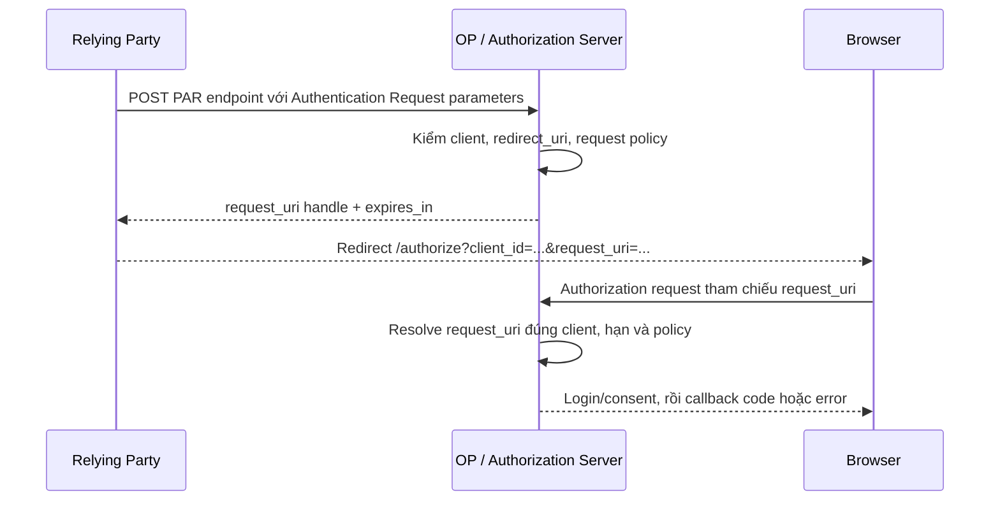

# Authentication request trong OpenID Connect

Một ứng dụng web có nút **«Đăng nhập bằng tài khoản tổ chức»**. Khi người dùng bấm nút, ứng dụng không nên nhận mật khẩu rồi tự xác thực thay nhà cung cấp danh tính. Thay vào đó, ứng dụng chuyển trình duyệt đến **OpenID Provider (OP)** bằng một **OpenID Connect Authentication Request**. Request này cho OP biết *ứng dụng nào đang yêu cầu đăng nhập, cần xác thực người dùng ở mức nào, sẽ trả kết quả về đâu và phản hồi nào thuộc đúng phiên đã khởi tạo*.

Ví dụ, `shop-web` mở một URL tại `https://login.example.test/authorize` với `scope=openid`, `response_type=code`, `client_id=shop-web`, `redirect_uri`, `state`, `nonce` và PKCE `code_challenge`. Nếu thành công, OP chuyển về một **authorization code** để backend/client đổi lấy **ID token** và các token khác theo chính sách. Nếu người dùng hủy, phiên hết hạn hoặc request sai, OP trả **lỗi thích hợp** chứ không tạo một phiên đăng nhập giả.

Trong chương **OpenID Connect** của module **SECURITY_TOKEN_SECURITY_FUNDAMENTALS**, bài này tập trung vào việc **xây dựng, gửi, kiểm tra và xử lý Authentication Request** trong mô hình tin cậy OAuth 2.0/OIDC. Kiến thức liên quan gồm JWT và opaque token, access token và refresh token, token claims, issuer, audience, scope, kiểm tra, lưu trữ, thu hồi và phòng chống đánh cắp/phát lại.

> **Điểm cốt lõi:** **Authentication Request là lời đề nghị xác thực**, không phải bằng chứng người dùng đã đăng nhập. Chỉ sau khi RP kiểm tra authorization response, đổi code đúng cách và **xác minh ID token** theo OIDC, RP mới có thể thiết lập phiên đăng nhập. Access token dành cho API phải được kiểm riêng tại resource server.

## 1. Bối cảnh: OIDC bổ sung gì cho OAuth 2.0?

OAuth 2.0 chủ yếu là framework **ủy quyền truy cập tài nguyên**. OpenID Connect (OIDC) xây trên OAuth 2.0 để cung cấp tầng **xác thực danh tính**: client có thể biết OP đã xác thực một End-User, khi nào và theo phương thức/độ bảo đảm nào trong phạm vi các claims được cung cấp.

| Khái niệm | Vai trò trong OIDC/OAuth | Ví dụ |
| --- | --- | --- |
| **End-User** | Người dùng đang được xác thực tại OP | `user-123` |
| **Relying Party (RP)** | OAuth client dùng kết quả xác thực từ OP | `shop-web` |
| **OpenID Provider (OP)** | Authorization server hỗ trợ OIDC, xác thực user và phát ID token | `https://login.example.test` |
| **Authorization endpoint** | Nơi browser được chuyển đến để bắt đầu Authentication Request | `/authorize` |
| **Token endpoint** | Nơi client đổi authorization code lấy token | `/token` |
| **UserInfo endpoint** | Endpoint tùy luồng/phạm vi để lấy claims bổ sung về user | `/userinfo` |
| **Resource server (RS)** | API nhận access token theo audience/scope | `orders-api` |

Trong OIDC, RP thường dùng **ID token**, là một JWT chứa claims mô tả sự kiện xác thực và subject. **ID token không phải access token** và thường có `aud` là **`client_id` của RP**; còn access token dành cho RS/API phải có audience và quyền thích hợp theo hợp đồng của AS/RS.

### 1.1. Authentication Request khác Authorization Request thuần OAuth ở đâu?

Về đường truyền, cả hai thường bắt đầu bằng redirect đến **authorization endpoint**. Nhưng với OIDC, request phải chứa **`openid` trong `scope`** để yêu cầu xử lý theo OIDC, đồng thời có thể chứa các tham số dành riêng cho xác thực như:

- `nonce` để liên kết ID token với yêu cầu ban đầu.
- `prompt` để yêu cầu/giới hạn tương tác login, consent hoặc chọn tài khoản.
- `max_age` để giới hạn độ cũ của lần xác thực.
- `acr_values` để gợi ý/đề nghị authentication context class.
- `login_hint`, `id_token_hint`, `claims` và các tùy chọn về giao diện.

**`scope=openid` không trao quyền API nghiệp vụ.** Nó yêu cầu OIDC Authentication Request và cho phép RP nhận ID token theo flow tương ứng. Scope `profile`/`email` yêu cầu claims danh tính ở mức OP hỗ trợ/cho phép; scope `orders:read` chỉ có ý nghĩa API nếu AS/RS định nghĩa và cấp theo policy.

## 2. Authentication Request được gửi ở đâu?

Trong **OIDC Authorization Code Flow**, RP tạo một authorization transaction, rồi đưa browser sang authorization endpoint đã được cấu hình/discover từ OP đáng tin:

```mermaid
sequenceDiagram
    actor U as End-User
    participant B as Browser
    participant RP as Relying Party
    participant OP as OpenID Provider
    participant API as Resource Server

    U->>RP: Chọn Đăng nhập
    RP->>RP: Tạo state, nonce, PKCE verifier/challenge
    RP-->>B: 302 đến OP /authorize (Authentication Request)
    B->>OP: response_type=code, scope=openid, client_id, redirect_uri...
    OP->>OP: Kiểm client, redirect URI, request, login, policy
    OP->>U: Đăng nhập/consent khi cần
    alt Thành công
        OP-->>B: Redirect callback?code=...&state=...
        B->>RP: Authorization response
        RP->>RP: Kiểm state và issuer response theo profile
        RP->>OP: POST /token: code + code_verifier + client auth nếu cần
        OP-->>RP: ID token + access token (và refresh tùy chính sách)
        RP->>RP: Verify ID token: iss, aud, exp, nonce nếu đã gửi...
        RP-->>U: Thiết lập phiên đăng nhập hợp lệ
        RP->>API: Gọi API với access token đúng audience/scope nếu cần
    else Không được cấp hoặc có lỗi
        OP-->>B: Error response tới redirect URI hợp lệ
        B->>RP: error + state
        RP->>RP: Kiểm correlation và xử lý lỗi; không gọi /token
    end
```

**Authorization code đi qua browser; ID token và access token trong code flow thường được nhận tại token endpoint.** Browser callback chứa code chưa đủ để biết user là ai. Chính RP phải đổi code và kiểm ID token; RS kiểm access token độc lập.

### 2.1. RP là public hay confidential client?

Một **server-side web app/BFF** có thể là **confidential client** nếu bảo vệ được credential cho token endpoint. Một **SPA hoặc mobile/native app** thông thường là **public client** và không thể giữ `client_secret` nhúng trong JavaScript/binary một cách bí mật.

Trong cả hai trường hợp, Authorization Code Flow + **PKCE** là lựa chọn phù hợp với bảo vệ hiện đại. Confidential client còn phải xác thực tại token endpoint nếu registration yêu cầu. **`client_id` được gửi công khai trong request**, không phải secret; việc biết `client_id` không chứng minh caller là ứng dụng chính thức.

## 3. Tham số quan trọng của OIDC Authentication Request

Một request chuẩn có các tham số kế thừa OAuth 2.0 và mở rộng OIDC.

| Tham số | Mức yêu cầu trong ngữ cảnh code flow | Ý nghĩa | Lưu ý bảo mật |
| --- | --- | --- | --- |
| `scope` | **Bắt buộc**, chứa `openid` | Kích hoạt OIDC; có thể kèm `profile`/`email` hoặc scope API | Không tự suy ra quyền API từ scope được xin |
| `response_type` | **Bắt buộc** | Với code flow là `code` | Không fallback implicit/hybrid khi không có policy |
| `client_id` | **Bắt buộc** | Xác định RP registration tại OP | Là public identifier, không là bằng chứng xác thực |
| `redirect_uri` | **Bắt buộc trong OIDC Authentication Request** | Đích OP gửi authorization response về | Phải khớp URI được đăng ký theo profile |
| `state` | Tùy chọn theo cú pháp OIDC nhưng **rất nên dùng** | Gắn response với transaction/session, chống login CSRF/mix-up | CSPRNG, session-bound, one-time, không lộ token |
| `nonce` | **Tùy chọn trong code flow**; bắt buộc ở các flow OIDC trả ID token trực tiếp qua authorization endpoint theo profile | Gắn ID token với Authentication Request, chống replay/injection | Nếu đã gửi thì OP phản ánh vào ID token và RP phải đối chiếu |
| `response_mode` | Tùy chọn | Định dạng/cách gửi authorization response | Phải tương thích flow và cấu hình RP |
| `display` | Tùy chọn | Gợi ý cách hiển thị UI, như `page`/`popup` | Không là cơ chế bảo mật |
| `prompt` | Tùy chọn | Yêu cầu tương tác hoặc không tương tác | `none` không được kết hợp giá trị prompt khác |
| `max_age` | Tùy chọn | Số giây tối đa kể từ lần xác thực gần nhất | OP phải xét auth freshness; ID token phải có `auth_time` khi dùng |
| `ui_locales` | Tùy chọn | Ngôn ngữ UI OP ưa thích theo BCP 47 | Chỉ là preference; không tin để phân quyền |
| `id_token_hint` | Tùy chọn | ID token đã phát trước đó làm gợi ý cho OP | Không tự là bằng chứng user vừa xác thực |
| `login_hint` | Tùy chọn | Gợi ý tài khoản/định danh muốn đăng nhập | Có thể chứa PII, không chứng minh danh tính |
| `acr_values` | Tùy chọn | Authentication Context Class Reference ưa thích | RP cần kiểm `acr` thực tế, không coi request là đáp ứng |
| `claims` | Tùy chọn, khi OP hỗ trợ | Xin thêm claims ở ID token/UserInfo, có thể đánh dấu `essential` | Không phải mọi claim xin đều bảo đảm được cấp |
| `claims_locales` | Tùy chọn | Ngôn ngữ ưu tiên cho claim text | Không quyết định quyền |

Những tham số `request` hoặc `request_uri` có thể được sử dụng với **Request Object (JAR)** hoặc **Pushed Authorization Requests (PAR)** theo profile. Chúng **không được mặc nhiên chấp nhận như đường dẫn tự do tới JSON** do attacker chỉ định.

### 3.1. Mục tiêu học tập: hiểu các nhóm tham số

- **Định danh và định tuyến:** `client_id`, `redirect_uri`, `response_type`, `scope`.
- **Liên kết và chống giả mạo luồng:** `state`, `nonce`, PKCE `code_challenge`/`code_challenge_method`.
- **Yêu cầu trải nghiệm/xác thực:** `prompt`, `max_age`, `acr_values`, `login_hint`, `display`.
- **Yêu cầu claims:** `claims`, `claims_locales`, `ui_locales`.
- **Bảo vệ nội dung request:** Request Object, PAR, metadata/registration.

Đừng biến tất cả tham số thành tùy chọn «cho OP tự đoán». Một Authentication Request an toàn có cấu hình rõ **issuer, endpoint, client registration, redirect URI, flow, scope, state và PKCE**.

## 4. Ví dụ Authentication Request với Authorization Code + PKCE

Giả sử:

```text
Issuer/OP:      https://login.example.test
Client ID:      shop-web
Redirect URI:   https://app.example.test/oidc/callback
Scopes:         openid profile email
Response type:  code
PKCE method:    S256
```

RP tạo giá trị ngẫu nhiên cho `state`/`nonce` và tạo PKCE `code_verifier`, sau đó tính `code_challenge = BASE64URL(SHA256(ASCII(code_verifier)))` không padding theo RFC 7636.

HTTP redirect minh họa (URL nhiều dòng cho dễ đọc, **không copy nguyên dòng xuống HTTP request**):

```http
HTTP/1.1 302 Found
Location: https://login.example.test/authorize?response_type=code&client_id=shop-web&redirect_uri=https%3A%2F%2Fapp.example.test%2Foidc%2Fcallback&scope=openid%20profile%20email&state=<random-state>&nonce=<random-nonce>&code_challenge=<s256-challenge>&code_challenge_method=S256
Cache-Control: no-store
```

Trong request này:

1. `response_type=code` yêu cầu **authorization code**, không yêu cầu OP trả access token thẳng về browser.
2. `scope` chứa `openid`, nên đây là **OIDC Authentication Request**.
3. `client_id` xác định registration mà OP kiểm tra, không là secret.
4. `redirect_uri` phải so khớp registration, không lấy từ query do người dùng nhập.
5. `state` liên kết callback với authorization transaction hiện tại.
6. `nonce`, nếu RP đã gửi, phải được đối chiếu với claim `nonce` trong ID token theo OIDC.
7. `code_challenge` chống kẻ đánh cắp authorization code đem đổi token mà không có `code_verifier`.

**Không gửi `code_verifier` trong authorization URL.** Client giữ nó cho bước `POST /token`. Không đưa password, refresh token, client secret hoặc ID token đang hoạt động vào URL để «giúp OP đăng nhập nhanh».

### 4.1. `scope` có phải luôn `openid profile email`?

Không. Chỉ **`openid`** là điều kiện thiết yếu để nhận OIDC semantics. Các scope bổ sung tùy nhu cầu:

| Scope ví dụ | Yêu cầu về thông tin/quyền | Điều không được suy diễn |
| --- | --- | --- |
| `openid` | Xác thực danh tính và nhận ID token theo flow | Không có quyền đọc API đơn hàng |
| `profile` | Nhóm claims profile chuẩn nếu OP cấp | Không bảo đảm mọi claim profile đều hiện diện |
| `email` | Claims email/email_verified khi được cấp | Email không phải identifier ổn định thay `iss+sub` |
| `phone` | Claims số điện thoại khi được cấp | Không bảo đảm phone đã xác minh |
| `address` | Claim địa chỉ khi được cấp | Không bảo đảm dữ liệu đủ mới hoặc đủ tin |
| `offline_access` | Yêu cầu khả năng truy cập offline theo chính sách OP | Không bảo đảm có refresh token |
| `orders:read` | Scope API riêng của hệ thống, nếu AS định nghĩa | Không tự cấp quyền với mọi đơn hàng |

**Scope xin là yêu cầu, scope được cấp mới là thực tế.** Với API, RS vẫn phải xác minh access token có `aud` của mình và scope/quyền trên tài nguyên.

## 5. `state`: gắn authorization response với đúng phiên

Một callback hợp lệ về hình thức có thể chứa:

```text
https://app.example.test/oidc/callback?code=abc...&state=s91...
```

Nhưng nếu RP không biết request đó thuộc **phiên browser nào** hoặc **AS nào đã chọn**, kẻ tấn công có thể thử gắn authorization response của một phiên khác vào session nạn nhân (*login CSRF*, *session swapping* hoặc *response injection*).

### 5.1. Cách dùng `state` đúng

RP nên lưu một authorization transaction:

```text
OIDCTransaction {
    transaction_id,
    session_binding,
    state_random_or_digest,
    nonce_random_or_digest,
    pkce_verifier_reference,
    expected_issuer,
    expected_client_id,
    registered_redirect_uri,
    expected_response_mode,
    request_started_at,
    expires_at,
    consumed_at
}
```

**`state` cần giá trị khó đoán do CSPRNG tạo**, có thời hạn ngắn, ràng buộc với user agent/session và chỉ xử lý một lần. Khi callback:

1. Lấy **duy nhất một** `state` từ response; từ chối duplicate/ambiguous.
2. Đối chiếu chính xác với transaction còn hiệu lực của browser/session tương ứng.
3. Kiểm đúng **issuer/OP** mà transaction được tạo cho.
4. Đánh dấu transaction đã dùng bằng thao tác nguyên tử khi xử lý theo policy.
5. Nếu success: chỉ khi correlation đạt mới đổi code; nếu error: xử lý lỗi an toàn nhưng **không tạo phiên đăng nhập**.

**Không dùng `state` như secret lâu dài để truy cập API.** Tránh chứa access token, refresh token, mật khẩu hoặc dữ liệu cá nhân plaintext trong state. Query callback có thể bị log hoặc truyền qua `Referer` nếu ứng dụng không kiểm soát.

### 5.2. PKCE có thay thế `state` được không?

PKCE chủ yếu ràng buộc **authorization code** với client đã tạo code challenge. Trong một số profile/triển khai có thể dùng các biện pháp kết hợp để giảm tấn công CSRF, nhưng đối với ứng dụng OIDC có nhiều phiên và nhiều OP, **dùng state được ràng buộc phiên là lựa chọn rõ ràng, dễ kiểm chứng**. Không bỏ state chỉ vì «đã dùng PKCE» mà chưa chứng minh cách ràng buộc response với session/issuer theo threat model.

### 5.3. Kiểm cả error callback

Một callback chứa `error=access_denied` cũng là **front-channel input**. Nếu attacker tự mở URL:

```text
/oidc/callback?error=access_denied&state=fake
```

RP không được coi đây là kết quả thật của phiên rồi tự xóa tài khoản/đăng xuất user. **Xác minh state/correlation trước khi hành động**, không chỉ ở nhánh có code.

## 6. `nonce`: liên kết ID token với Authentication Request

`nonce` là giá trị do RP tạo để ràng buộc ID token với một lần Authentication Request, giúp hạn chế replay/token injection. Với **Authorization Code Flow thuần**, nonce **không bắt buộc theo cú pháp OIDC Core** nhưng nên dùng khi phù hợp. Với các flow OIDC trả **ID token trực tiếp ở authorization endpoint** (implicit/hybrid theo profile), `nonce` là yêu cầu bắt buộc.

Khi RP gửi:

```text
nonce=rp-generated-random-nonce
```

và OP trả ID token có:

```json
{
  "iss": "https://login.example.test",
  "sub": "user-123",
  "aud": "shop-web",
  "exp": 1893456900,
  "iat": 1893456000,
  "nonce": "rp-generated-random-nonce"
}
```

RP phải **xác minh claim `nonce` khớp giá trị của transaction**, bên cạnh chữ ký, issuer, audience, expiry và những điều kiện profile khác. Nếu nonce bị thiếu/sai khi RP đã gửi, không được tự bỏ kiểm.

| Cơ chế | Bảo vệ chính | Bước kiểm tra | Không thay thế |
| --- | --- | --- | --- |
| `state` | Correlation authorization response với phiên đã khởi tạo | Front-channel callback | Xác minh ID token, quyền API |
| `nonce` | Correlation ID token với Authentication Request | ID token validation | `state`/PKCE trong mọi threat model |
| **PKCE** | Chứng minh bên đổi authorization code giữ `code_verifier` | Token endpoint | Token validation và chính sách login |
| **Client authentication** | Xác thực confidential client tại AS/token endpoint | Token request | Quyền người dùng hay quyền API |

**Cần phân biệt:** một ID token có `nonce` đúng nhưng `aud` sai vẫn bị từ chối. Một authorization callback có `state` đúng nhưng code bị kẻ khác đánh cắp vẫn cần PKCE/token endpoint checks. Các lớp này bổ sung, không hòa làm một.

## 7. `prompt`: yêu cầu tương tác và giới hạn tương tác

OIDC Core định nghĩa các giá trị `prompt` thường gặp:

| Giá trị | Mục tiêu | Điểm cần hiểu |
| --- | --- | --- |
| `none` | OP **không được hiển thị UI tương tác** cho user | Nếu không hoàn tất im lặng, phải trả lỗi OIDC thích hợp |
| `login` | Yêu cầu OP xác thực lại user | Không tự chứng minh đã dùng MFA; kiểm kết quả xác thực thực |
| `consent` | Yêu cầu OP trình bày consent khi thích hợp | Consent theo chính sách OP; không tự cấp thêm quyền |
| `select_account` | Yêu cầu OP cho user chọn tài khoản | Không phải cơ chế xác minh danh tính độc lập |

`prompt` có thể là danh sách giá trị cách nhau bởi khoảng trắng trong những trường hợp hỗ trợ. Nhưng **`none` không được đi cùng giá trị khác**; ví dụ `prompt=none login` là request mâu thuẫn.

### 7.1. `prompt=none`

Client muốn kiểm tra đăng nhập mà không làm user thấy màn hình:

```text
response_type=code
scope=openid
prompt=none
state=<correlation>
nonce=<nonce>
```

Nếu OP không có phiên đăng nhập đủ điều kiện, hoặc cần consent/account selection, OP không thể âm thầm hoàn tất và có thể trả:

- `login_required`: cần đăng nhập/xác thực lại.
- `consent_required`: phải xin consent.
- `account_selection_required`: cần user chọn tài khoản.
- `interaction_required`: cần tương tác khác.

RP phải kiểm correlation rồi **dừng thử silent** hoặc đưa người dùng vào interactive flow hợp lệ. Không tự lặp `prompt=none` vô hạn, không giả định error có nghĩa user đã logout trên mọi thiết bị.

**Giới hạn hiện đại:** silent login qua iframe/cross-site cookie có thể không hoạt động do browser chặn third-party cookies hoặc chính sách privacy. `prompt=none` không ép browser gửi cookie. Nên thiết kế fallback theo OP và trình duyệt thực tế, không bỏ bảo mật SameSite/CSRF để chữa lỗi.

### 7.2. `prompt=login` có thay xác thực mạnh không?

Nó yêu cầu OP thực hiện login lại theo ngữ nghĩa profile, nhưng **không đảm bảo riêng lẻ** mức bảo đảm đủ cho chuyển tiền hay thay đổi thông tin đặc biệt nhạy cảm. Với nghiệp vụ cần step-up, RP phải xét **`auth_time`, `acr`, `amr`**, chính sách OP và kết quả hiện tại.

### 7.3. `prompt=consent` khác `scope`

`prompt=consent` là yêu cầu về **tương tác UI/cấp quyền**, không phải một scope. Nếu RP xin `orders:read`, OP vẫn quyết định có cho phép scope đó theo client registration, user/grant và resource policy. Không hiển thị consent hoặc user chọn Allow không tự vượt giới hạn API.

## 8. `max_age` và `auth_time`: độ mới của xác thực

**`max_age`** biểu diễn **số giây tối đa kể từ khi người dùng được OP xác thực tích cực gần nhất** mà RP chấp nhận. Ví dụ một trang thông tin chung có thể chấp nhận phiên từ nhiều giờ trước, trong khi thay đổi phương thức thanh toán có thể cần xác thực mới.

Authentication Request:

```text
max_age=300
```

Ý nghĩa: RP không muốn dựa vào lần active authentication **cũ hơn 300 giây**. Khi `max_age` được yêu cầu, **ID token phải chứa `auth_time`** theo OIDC Core. RP cần so với thời điểm hiện tại, xét clock skew hợp lý và policy rủi ro.

Ví dụ:

```json
{
  "iss": "https://login.example.test",
  "sub": "user-123",
  "aud": "shop-web",
  "iat": 1893456000,
  "exp": 1893456900,
  "auth_time": 1893455940,
  "nonce": "rp-generated-random-nonce"
}
```

Nếu RP nhận token tại thời điểm `1893456000` và `auth_time=1893455940`, lần xác thực active gần nhất cách 60 giây; điều kiện `max_age=300` có thể đạt nếu các điều kiện khác cũng đạt.

### 8.1. `max_age=0`

OIDC định nghĩa `max_age=0` tương ứng yêu cầu xác thực lại, có ý nghĩa tương đương `prompt=login` ở góc độ yêu cầu OP. Ưu điểm của `max_age` là nó còn dẫn đến **claim `auth_time` để RP kiểm chứng độ mới**, thay vì tin hoàn toàn vào việc đã gửi một request parameter.

**Không dùng `iat` thay `auth_time`.** `iat` là thời điểm ID token được phát hành; một OP có thể cấp token mới dựa trên phiên đăng nhập cũ. Một token mới không chứng minh user vừa xác thực lại.

### 8.2. Kiểm tra freshness tại RP

```text
requiredMaxAge = 300 giây
now = RP.currentTime()
authTime = verifiedIdToken.auth_time

if authTime missing:
    reject when max_age was requested

if now - authTime > requiredMaxAge + allowedClockTolerance:
    reject or require step-up/re-authentication
```

Phép tính là pseudocode; chính sách cần xét thời điểm xác thực, thời điểm nhận token, clock skew và yêu cầu bảo mật của tác vụ. **Không chấp nhận auth_time trong tương lai bất thường** hoặc một token có chữ ký/issuer sai chỉ vì con số thời gian thỏa.

## 9. `acr_values`, `acr` và `amr`: mức/method xác thực

Ba khái niệm dễ nhầm:

| Thành phần | Nằm ở đâu? | Ý nghĩa |
| --- | --- | --- |
| `acr_values` | Authentication Request | Danh sách Authentication Context Class Reference **ưu tiên**, theo thứ tự ưa thích |
| `acr` | ID token | Authentication Context Class Reference thực tế OP báo cho lần xác thực |
| `amr` | ID token | Authentication Methods References: các phương thức liên quan đến xác thực, ví dụ mật khẩu hoặc OTP theo từ điển/provider |

Ví dụ request:

```text
acr_values=urn:example:loa:high urn:example:loa:medium
```

Đây là **giá trị minh họa do hệ thống định nghĩa**, không phải các mức chuẩn có sẵn cho mọi OP. OP có thể xem như **ưu tiên**, không phải cam kết sẽ cấp đúng giá trị đầu. Với tác vụ cần mức bảo đảm bắt buộc, RP phải kiểm **`acr` trong ID token** hoặc dùng profile/`claims` với yêu cầu được OP hỗ trợ; nếu không đạt, từ chối tác vụ hoặc yêu cầu step-up.

Ví dụ:

```json
{
  "iss": "https://login.example.test",
  "sub": "user-123",
  "aud": "shop-web",
  "exp": 1893456900,
  "iat": 1893456000,
  "acr": "urn:example:loa:medium",
  "amr": ["pwd", "otp"]
}
```

**Không đồng nhất `amr` chứa `otp` với mức `acr` cao trong mọi tổ chức.** Mức bảo đảm phụ thuộc registration của OP, ngữ nghĩa phương thức và policy. Nếu RP cần xác thực mạnh, nó phải biết OP đã định nghĩa `acr`/`amr` như thế nào.

### 9.1. `acr_values` có làm tăng quyền API không?

Không. Authentication assurance và authorization là hai lớp:

```text
User đã xác thực đủ mạnh?        -> OP, acr/amr/auth_time
Token có quyền gọi API?          -> AS/RS, aud/scope/permissions
User được thao tác trên object?   -> RS, owner/tenant/business rules
```

Ngay cả nếu ID token có `acr=high`, RP vẫn không được biến nó thành access token `aud=payments-api` với scope `payments:refund`. API phải kiểm access token và chính sách tài nguyên riêng.

## 10. `login_hint`, `id_token_hint` và trải nghiệm chọn tài khoản

### 10.1. `login_hint`

`login_hint` có thể chứa email, số điện thoại hoặc định danh mà OP dùng để gợi ý tài khoản. Nó chỉ nhằm **giảm thao tác nhập liệu**:

```text
login_hint=user%40example.test
```

**Không xem `login_hint` như bằng chứng user sở hữu email đó.** Attacker có thể sửa URL và gửi login_hint của người khác. OP phải thực hiện authentication/authorization bình thường.

Vì URL có thể bị ghi log, truy vết hoặc history, **hạn chế đưa PII vào query**. Có thể dùng PAR/JAR hoặc cơ chế đăng nhập tương ứng để giảm exposure theo threat model.

### 10.2. `id_token_hint`

RP có thể gửi ID token đã được OP phát trước đó để **gợi ý phiên/subject** khi yêu cầu xác thực mới, nhất là các flow OIDC chuyên biệt. OP cần xử lý theo spec/profile và chính sách, không coi giá trị bất kỳ do browser gửi là quyền đăng nhập mới.

Đừng dùng `id_token_hint` như access token, refresh token hoặc phương tiện bỏ qua authentication. Nếu token đã hết hạn, bị sửa hoặc sai issuer/audience, OP phải xử lý theo profile, không «tin luôn vì nó trông giống JWT».

### 10.3. `display` và `ui_locales`

`display=page`, `display=popup` hoặc các mode đã định nghĩa có thể giúp OP chọn giao diện phù hợp. `ui_locales=vi en` ưu tiên tiếng Việt rồi tiếng Anh theo cú pháp địa phương hóa. Cả hai **không ảnh hưởng** bản chất authentication, consent, grant hoặc token validation.

## 11. `claims` parameter: yêu cầu thông tin chi tiết

Khi OP hỗ trợ `claims`, RP có thể yêu cầu claims cụ thể trong ID token hoặc UserInfo. Ví dụ JSON **minh họa trước khi URL-encode**:

```json
{
  "id_token": {
    "auth_time": {"essential": true},
    "acr": {
      "essential": true,
      "values": ["urn:example:loa:high"]
    }
  },
  "userinfo": {
    "email": {"essential": true},
    "email_verified": null
  }
}
```

Các tham số `essential` có ý nghĩa đặc biệt trong OIDC claims request, nhưng **client vẫn phải xác minh response thực tế**. Không tự giả định OP chắc chắn trả claim hoặc đúng giá trị chỉ vì RP đã ghi `essential: true`. Một số OP có thể không hỗ trợ claims parameter hoặc không thể đáp ứng yêu cầu; behavior còn phụ thuộc spec/profile và policy. Với tác vụ bắt buộc độ bảo đảm cao, RP phải **fail closed** khi thiếu claim cần thiết.

### 11.1. ID token claims và UserInfo claims khác vai trò

ID token là bằng chứng xác thực được OP ký/theo profile và RP xác minh. UserInfo endpoint trả claims bổ sung, thường được gọi bằng **access token phù hợp UserInfo**; RP phải kiểm `sub` trong UserInfo response **khớp chính xác `sub` từ ID token đã xác minh**, tránh kết hợp dữ liệu của hai người khác nhau.

**Không lấy email làm khóa định danh chính.** Email có thể thay đổi, chưa xác minh hoặc bị tái sử dụng. Với OIDC, định danh đáng tin cho một subject trong phạm vi issuer thường là **cặp `(iss, sub)`**, còn kiểu subject public/pairwise phụ thuộc OP registration và chính sách.

### 11.2. Khi nào không nên dùng `claims`?

Nếu ứng dụng chỉ cần đăng nhập thông thường, `scope=openid` và những claims thiết yếu theo profile có thể đủ. Xin quá nhiều thông tin cá nhân làm tăng rủi ro privacy, consent và lưu trữ. **Data minimization** áp dụng cho cả first-party lẫn third-party RP.

## 12. OIDC Discovery và đăng ký client trước khi tạo request

Một RP tốt không hardcode ngẫu nhiên các URL nhận được từ browser. OP thường công bố **OpenID Provider Configuration** qua OIDC Discovery.

Ví dụ địa chỉ metadata có dạng:

```text
https://login.example.test/.well-known/openid-configuration
```

Metadata **minh họa rút gọn**:

```json
{
  "issuer": "https://login.example.test",
  "authorization_endpoint": "https://login.example.test/authorize",
  "token_endpoint": "https://login.example.test/token",
  "jwks_uri": "https://login.example.test/keys",
  "response_types_supported": ["code"],
  "subject_types_supported": ["public", "pairwise"],
  "id_token_signing_alg_values_supported": ["RS256"],
  "scopes_supported": ["openid", "profile", "email"]
}
```

Đây là ví dụ không đầy đủ metadata của một OP thực. RP phải chọn OP từ **issuer được cấu hình hoặc được chọn tin cậy**, rồi kiểm metadata đúng issuer và yêu cầu HTTPS/JWKS/algorithm allowlist; không lấy `issuer`, `jwks_uri` hoặc token endpoint từ một query callback không tin cậy.

### 12.1. Client registration chứa những gì?

| Metadata đăng ký | Chức năng | Liên hệ Authentication Request |
| --- | --- | --- |
| `client_id` | Định danh RP | Được đưa vào request |
| `redirect_uris` | Các callback hợp lệ | `redirect_uri` phải match |
| `response_types` | Các response type được phép | Ví dụ chỉ `code` |
| `grant_types` | Các grant client có thể sử dụng | `authorization_code` cho code flow |
| `token_endpoint_auth_method` | Cách confidential client chứng minh danh tính | Không gửi client secret trong auth request |
| `application_type` / subject type | Ứng dụng web/native, public/pairwise subject theo profile | Ảnh hưởng redirect và cách dùng `sub` |
| Scope/resource policy | Tập quyền được phép | Không cấp tự động mọi scope client yêu cầu |

**First-party không đồng nghĩa confidential.** Một SPA chính thức vẫn là public; một backend đối tác có thể là confidential. Cả hai cần đúng registration, redirect URI và token/audience policy.

### 12.2. Exact redirect URI matching

Với RP web:

```text
Registered:
  https://app.example.test/oidc/callback

Accept:
  https://app.example.test/oidc/callback

Reject:
  https://app.example.test.evil.net/oidc/callback
  http://app.example.test/oidc/callback
  https://evil.example.net/callback
  https://app.example.test/oidc/callback/another
```

OP phải áp dụng registration/profile, không dùng so sánh prefix hoặc wildcard host. Native apps có ngoại lệ cụ thể cho loopback port theo RFC 8252; **không biến ngoại lệ đó thành quy tắc cho web callback**.

**Khi `client_id` hoặc `redirect_uri` không hợp lệ, OP không được redirect browser đến URI không đáng tin chỉ để báo lỗi.** Với request hợp lệ về client/redirect nhưng người dùng từ chối hoặc scope sai, OP có thể trả error response về URI đã xác minh.

## 13. Bảo vệ Authentication Request bằng PAR, JAR và các profile khác

### 13.1. Rủi ro khi truyền mọi tham số qua URL

Authorization URL có thể xuất hiện trong browser history, access logs, analytics hoặc referer nếu ứng dụng không bảo vệ. Một attacker cũng có thể cố sửa tham số khi request đi qua user agent, ví dụ `scope`, `prompt` hoặc `login_hint`.

**TLS bảo vệ đường truyền**, nhưng không loại bỏ khả năng người dùng/các script và thành phần không tin cậy nhìn thấy/sửa URL ở ranh giới client-side. AS phải kiểm request params theo registration và policy, **không tin query chỉ vì được gửi qua HTTPS**.

### 13.2. Pushed Authorization Requests (PAR, RFC 9126)

Với **PAR**, client gửi authorization parameters tới **PAR endpoint** của AS qua back-channel được bảo vệ; AS trả một `request_uri` handle ngắn hạn. Browser chỉ cần được chuyển đến authorization endpoint với `client_id` và `request_uri` phù hợp.



PAR giúp giảm tham số nhạy cảm xuất hiện trên browser URL và hạn chế một số dạng tampering, **nhưng không thay thế** state, nonce, PKCE, redirect registration, client/grant policy hoặc ID token validation. `request_uri` là handle có hạn, không nên được RP tái sử dụng bừa bãi.

### 13.3. JWT-Secured Authorization Request (JAR, RFC 9101)

**JAR** cho phép đóng gói các tham số authorization vào một **Request Object JWT** được bảo vệ tính toàn vẹn theo profile. Điều này giúp OP biết tham số request có bị sửa hay không và từ RP nào nếu chữ ký được xác minh.

Nhưng:

- Request Object JWT **không phải ID token** và không phải OAuth access token.
- OP phải xác minh issuer/audience, chữ ký/thuật toán, thời hạn và client binding theo profile.
- Không tự tin key URL do client gửi trong JWT header; dùng trust anchors/registration.
- Một Request Object đã hợp lệ về chữ ký vẫn có thể **không được phép** xin scope hay redirect URI đó.

PAR và JAR có thể được kết hợp hoặc bắt buộc trong các security profile (ví dụ profile có yêu cầu độ bảo đảm cao). **Không tự cho rằng mọi OP đều hỗ trợ chúng**; kiểm discovery/registration và contract của AS.

### 13.4. Response Mode và JARM

`response_mode` quyết định cách gửi authorization response, trong đó:

- **Query GET** là lựa chọn thông thường của code flow.
- **Form POST** theo mở rộng được hỗ trợ gửi response qua form về callback.
- **JARM (RFC 9102)** là profile response được bảo vệ bằng JWT khi AS/client hỗ trợ, không phải tính năng mặc định của mọi Authentication Request.

Nếu callback dùng cross-site `form_post`, cookie RP `SameSite=Lax` thường **không đi kèm cross-site POST**; phải thiết kế session correlation/CSRF phù hợp. **Không bỏ kiểm state** để khắc phục cookie thiếu.

## 14. Java pseudocode: RP xây dựng Authentication Request

Mã dưới là **pseudocode gần Java**, không dùng API cụ thể của Spring Security hay một OIDC SDK. Mục tiêu thể hiện **nguồn dữ liệu đáng tin** và việc lưu authorization transaction. Trong ứng dụng thực, ưu tiên OIDC client library đã kiểm thử.

```java
URI beginOidcLogin(BrowserSession session) {
    // 1. Đọc từ cấu hình / discovery đã xác minh.
    OpenIdProvider op = providers.requireTrustedIssuer(
        "https://login.example.test"
    );
    RegisteredOidcClient client = clients.requireRegistered("shop-web");

    // 2. Tạo random state/nonce và PKCE verifier cho MỘT flow.
    String state = secureRandom.urlSafeRandom(32);
    String nonce = secureRandom.urlSafeRandom(32);
    String codeVerifier = pkce.createVerifier();
    String codeChallenge = pkce.s256Challenge(codeVerifier);

    // 3. Lưu context trước khi chuyển browser sang OP.
    OidcTransaction tx = new OidcTransaction(
        session.binding(),
        hash(state),
        nonce,
        codeVerifier,
        op.issuer(),
        client.clientId(),
        client.redirectUri(),
        clock.instant().plus(Duration.ofMinutes(5))
    );
    transactions.save(tx);

    // 4. Chỉ build URL từ endpoint/redirect đã được cấu hình.
    return uriBuilder.fromTrusted(op.authorizationEndpoint())
        .queryParam("response_type", "code")
        .queryParam("client_id", client.clientId())
        .queryParam("redirect_uri", client.redirectUri())
        .queryParam("scope", "openid profile email")
        .queryParam("state", state)
        .queryParam("nonce", nonce)
        .queryParam("code_challenge", codeChallenge)
        .queryParam("code_challenge_method", "S256")
        .buildWithCorrectEncoding();
}
```

### 14.1. Điều kiện bắt buộc khi triển khai

- `providers.requireTrustedIssuer` không khám phá issuer tùy ý do browser yêu cầu; dùng allowlist/selection logic bảo vệ khỏi SSRF/metadata poisoning.
- `secureRandom.urlSafeRandom(32)` có nghĩa lấy **32 byte ngẫu nhiên đủ mạnh**, mã hóa an toàn cho URL; không dùng timestamp/Math.random/username làm state/nonce.
- `hash(state)` chỉ là cách lưu state để so khớp mà không cần giữ plaintext; cần so sánh chính xác và chống đoán.
- Transaction phải gắn đúng user agent/browser session và sống đủ ngắn; cleanup sau success/error/expiry.
- `client.redirectUri()` đến từ registration, không từ query `next=...` hoặc header Host không tin cậy.
- `buildWithCorrectEncoding` biểu diễn URI builder chuẩn, không nối chuỗi mơ hồ hoặc double-encode.
- Với PAR/JAR, phần request construction thay đổi theo profile nhưng **state, nonce, client/redirect binding và PKCE vẫn cần**.

### 14.2. Vì sao không lấy toàn bộ URL từ frontend?

Một thiết kế sai:

```java
// SAI: request từ browser quyết định OP và redirect.
String issuer = request.query("issuer");
String redirectUri = request.query("redirect_uri");
return redirect(issuer + "/authorize?redirect_uri=" + redirectUri);
```

Attacker có thể hướng user tới OP giả, callback khác hoặc URL có thông số nguy hiểm. Nếu sản phẩm thực sự cho người dùng chọn tổ chức IdP, cần quy trình discovery và trust bootstrap được kiểm soát, issuer binding và kiểm tra redirect chính xác — không chấp nhận URL bất kỳ.

## 15. Java pseudocode: nhận callback và xác minh ID token

Sau khi OP gửi authorization response, RP phải phân biệt success/error:

```java
LoginResult oidcCallback(CallbackRequest callback) {
    callbackPolicy.rejectDuplicateOrAmbiguousParameters(callback);
    callbackPolicy.requireExpectedResponseMode(callback);

    String returnedState = callback.requireSingle("state");
    OidcTransaction tx = transactions.requireMatchingActive(
        callback.browserSessionBinding(),
        returnedState
    );
    if (tx.expired(clock.instant()) || tx.consumed()) {
        throw invalidCallback("Unknown or expired transaction");
    }

    // Nếu profile yêu cầu issuer identification (RFC 9207),
    // verify callback iss trước khi dùng code/token endpoint.
    issuerBinding.requireExpectedIfConfigured(
        callback.optionalSingle("iss"), tx.expectedIssuer()
    );

    boolean hasError = callback.hasSingle("error");
    boolean hasCode = callback.hasSingle("code");
    if (hasError == hasCode) {
        throw invalidCallback("Expected exactly one of error or code");
    }

    // Không cho hai callback đồng thời sử dụng cùng transaction.
    transactions.consumeOnce(tx.id());

    if (hasError) {
        return LoginResult.deniedOrFailed(
            safeMessages.forOAuthError(callback.requireSingle("error"))
        );
    }

    TokenResponse response = tokenClient.exchangeAuthorizationCode(
        tx.expectedIssuer(),
        callback.requireSingle("code"),
        tx.clientId(),
        tx.registeredRedirectUri(),
        tx.codeVerifier()
    );

    // Validator phải dùng issuer/JWKS/alg allowlist tin cậy,
    // kiểm signature, iss, aud, exp, iat và nonce đã gửi.
    VerifiedIdToken idToken = idTokenVerifier.verify(
        response.idToken(),
        tx.expectedIssuer(),
        tx.clientId(),
        tx.nonce()
    );
    if (tx.requestedMaxAge().isPresent()) {
        authFreshness.requireSatisfied(
            idToken.authTime(), tx.requestedMaxAge().get()
        );
    }

    // Identity trong session đến từ ID token đã xác minh,
    // không từ code, URL hay email do client tự khai.
    UserIdentity identity = new UserIdentity(
        idToken.issuer(),
        idToken.subject()
    );
    return sessions.createLoggedInSession(identity);
}
```

Mã này chỉ minh họa **thứ tự kiểm tra**:

1. Một authorization response hợp lệ cho code flow phải có **đúng một đường success/code hoặc error** theo contract, không cùng lúc.
2. `state` ràng buộc với session và transaction được kiểm trước khi xử lý lỗi hoặc gửi code tới token endpoint.
3. Nếu hỗ trợ/đòi hỏi issuer identification, phải so `iss` với **OP đã chọn lúc khởi tạo**; không dùng callback `iss` để tự chọn endpoint mới.
4. Code chỉ được đổi **một lần**, dùng `code_verifier` của chính transaction và client authentication nếu confidential.
5. RP kiểm ID token theo OIDC Core: chữ ký, issuer, audience, expiry, issued-at/nonce và những claim/ràng buộc khác theo profile. Với ID token nhiều audience, cân nhắc `azp` theo quy tắc OIDC.
6. `auth_time` phải được kiểm nếu RP đã yêu cầu `max_age` hoặc profile cần freshness.
7. Nếu cần UserInfo, phải kiểm `sub` của UserInfo **bằng** `sub` ID token.
8. Không đồng nhất «login thành công» với «được phép gọi mọi API»: access token và resource authorization độc lập.

**Không copy pseudocode như implementation production.** Phần xử lý SSL/TLS, redirect/HTTP parsing, retry, token response caching, client assertion, key rotation, replay và session fixation cần thư viện/profile bảo mật cụ thể.

## 16. Xác minh ID token: điều gì chứng minh người dùng đã đăng nhập?

Một ID token là JWT do OP phát theo OIDC; **nội dung JSON khi decode Base64URL không tự đáng tin**. RP phải dùng validator phù hợp với **issuer và client registration**.

### 16.1. Ví dụ ID token payload rút gọn

```json
{
  "iss": "https://login.example.test",
  "sub": "user-123",
  "aud": "shop-web",
  "exp": 1893456900,
  "iat": 1893456000,
  "auth_time": 1893455940,
  "nonce": "rp-generated-random-nonce",
  "acr": "urn:example:loa:medium",
  "amr": ["pwd", "otp"]
}
```

Đây **chỉ là payload minh họa**, chưa có JOSE header/signature. Ý nghĩa:

| Claim | Bên phải kiểm / sử dụng | Lỗi thường gặp |
| --- | --- | --- |
| `iss` | RP so khớp issuer chính xác đã chọn | Chấp nhận ID token từ OP khác vì cùng tên user |
| `sub` | RP dùng cùng issuer làm khóa identity | Dùng email làm subject thay thế |
| `aud` | RP xác minh chứa `client_id` | Dùng ID token cấp cho client khác |
| `exp` | RP từ chối token hết hạn | Tạo session từ token expired |
| `iat` | RP kiểm issued-at phù hợp profile và tính hợp lý | Nhầm `iat` với lần xác thực mới |
| `nonce` | RP kiểm nếu request đã gửi nonce | Replay ID token cũ/sai flow |
| `auth_time` | RP kiểm khi `max_age` yêu cầu | Không xác minh độ mới login |
| `acr`/`amr` | RP đánh giá assurance theo policy nếu cần | Suy MFA/high assurance chỉ từ request `acr_values` |
| `azp` | RP áp dụng quy tắc OIDC khi có nhiều audience/ủy quyền bên trình token | Bỏ kiểm authorized party khi profile yêu cầu |

### 16.2. `iss` khác `aud`

Một token:

```json
{
  "iss": "https://login.example.test",
  "aud": "other-client",
  "sub": "user-123"
}
```

dù được OP đáng tin ký, vẫn **không phải ID token dành cho `shop-web`**. `iss` chỉ biết ai phát hành; `aud` biết RP nào được phép tiếp nhận. Không chỉ kiểm signature và `sub`.

### 16.3. ID token không thay access token

Khi gọi `orders-api`:

```http
GET /orders HTTP/1.1
Host: api.example.test
Authorization: Bearer <access-token-for-orders-api>
```

**Không** đặt ID token `aud=shop-web` vào header `Authorization` gửi tới RS. Với access token JWT, RS kiểm signature, issuer, `aud=orders-api`, scope và expiry; với opaque token, RS dùng introspection/hợp đồng tương đương. Sau đó vẫn phải kiểm **owner, tenant, role và trạng thái tài nguyên**.

## 17. Trả lỗi khi Authentication Request không hoàn tất

Các mã lỗi ở authorization endpoint có thể bao gồm:

| Lỗi | Ngữ cảnh điển hình | Client xử lý |
| --- | --- | --- |
| `invalid_request` | Request thiếu/sai tham số, response mode/claims không hợp lệ | Dừng/sửa cấu hình; không tạo login giả |
| `unauthorized_client` | Client không được phép dùng flow | Kiểm registration/grant |
| `invalid_scope` | Scope không được hỗ trợ/cho phép | Xin đúng scope, không tự nới quyền |
| `access_denied` | User hoặc OP từ chối | Tôn trọng từ chối, không tự retry vô hạn |
| `login_required` | `prompt=none` không thể hoàn tất khi user chưa đăng nhập | Chuyển sang interactive flow nếu user muốn |
| `consent_required` | OP cần consent nhưng không thể làm âm thầm | Hiển thị flow phù hợp |
| `account_selection_required` | Cần user chọn account | Bắt đầu luồng tương tác nếu phù hợp |
| `interaction_required` | Cần tương tác khác | Không lặp silent login |
| `server_error` / `temporarily_unavailable` | OP lỗi/tạm quá tải | UI thông báo và retry có giới hạn |

Với request có **client và redirect URI hợp lệ**, OP có thể trả error redirect tới callback kèm `error` và `state` nếu đã gửi. Nhưng nếu **`client_id` không hợp lệ hoặc `redirect_uri` không được xác minh**, OP **không được redirect tới URI chưa đáng tin** chỉ để báo lỗi. Có thể hiển thị trang lỗi ngay tại origin của OP.

### 17.1. Ví dụ callback lỗi

```http
HTTP/1.1 302 Found
Location: https://app.example.test/oidc/callback?error=login_required&state=<original-state>
Cache-Control: no-store
```

Đây là **OIDC authorization error response**, không phải JSON error của token endpoint. RP xác minh state/issuer correlation trước khi quyết định UI. Một HTTP `302` không có nghĩa đăng nhập đã thành công.

### 17.2. Token endpoint errors là chuyện khác

Sau callback có code, nếu RP gửi `code_verifier` sai hoặc code đã dùng/hết hạn, token endpoint có thể trả:

```http
HTTP/1.1 400 Bad Request
Content-Type: application/json
Cache-Control: no-store
Pragma: no-cache

{"error":"invalid_grant"}
```

**`invalid_grant` tại token endpoint không phải authorization endpoint error redirect.** Nếu confidential client authentication thất bại, có thể nhận `invalid_client` theo OAuth. Không hồi phục bằng cách bỏ PKCE, lấy token từ URL hoặc tin một ID token cũ chưa được đối chiếu.

## 18. Threat model và những lỗi Authentication Request điển hình

### 18.1. Login CSRF và session swapping

Attacker cố làm nạn nhân sử dụng callback `code`/`state` thuộc transaction khác. Nếu RP không kiểm state và session binding, nó có thể tạo phiên cho tài khoản không đúng ý user. Phải kiểm **correlation trước token exchange** và áp dụng cookie/session chống fixation.

### 18.2. Authorization code interception và injection

Authorization code là credential tạm; bị lộ qua callback/open redirect/log hoặc intercepted native redirect có thể bị kẻ tấn công thử đổi token. **PKCE `S256`** khiến attacker thiếu `code_verifier` không đổi được code theo binding đã thiết lập. AS cần dùng code ngắn hạn, một lần và gắn client/redirect URI.

### 18.3. Mix-up giữa nhiều OP

Ứng dụng hỗ trợ login bằng OP A hoặc OP B. Nếu callback chỉ có code và RP tự đoán AS theo input attacker, RP có thể gửi code đến token endpoint sai. Lưu `expected_issuer` theo transaction, áp dụng issuer identification RFC 9207 khi thích hợp và luôn gọi endpoint đã cấu hình đáng tin.

### 18.4. ID token substitution và cross-JWT confusion

Một JWT được ký bởi OP có thể là **ID token cho client khác** hoặc **access token cho API khác**. RP phải kiểm type/profile, issuer, audience và claims đúng vai trò. Không dùng validator «JWT signature valid» chung cho mọi token.

### 18.5. Redirect URI/open redirect

Nếu OP chấp nhận `redirect_uri=https://evil.example.net` do query, code có thể đi tới attacker. Ngay cả khi URI đã được đăng ký, nếu callback RP tự redirect `?next=https://evil...` và làm lộ `code`/`state`, vẫn có đường tấn công. **So khớp URI chính xác và khóa việc chuyển tiếp bí mật**.

### 18.6. Prompt/assurance downgrade

RP yêu cầu `acr_values=high` nhưng không kiểm `acr` thực tế, hoặc yêu cầu `max_age=0` nhưng chỉ nhìn `iat`. Người dùng có thể đi qua tác vụ nhạy cảm với mức xác thực thấp. **RP phải kiểm outcome**, không chỉ các tham số đã gửi.

### 18.7. Claim/user identity spoofing

`login_hint=user@example.test` hoặc profile email hiển thị trong UI không phải proof. RP không được gán account nội bộ chỉ từ `email` chưa xác minh hoặc đầu vào từ browser. Ưu tiên mapping **`iss+sub`**, có quy trình account linking an toàn và kiểm email_verified khi dùng email cho quyết định phù hợp.

### 18.8. SameSite/cookie correlation

Cookie session `HttpOnly; Secure; SameSite=Lax` là lựa chọn phổ biến cho RP web, nhưng callback GET từ OP có hành vi cross-site khác callback `form_post`. SameSite không thay CSRF/state; subdomain same-site có thể vẫn gửi cookie. Chống XSS riêng, không cho script truy cập refresh token nếu kiến trúc có thể giữ server-side.

### 18.9. Phát lại ID token và refresh token

Một ID token cũ có thể vẫn có chữ ký đúng nhưng không thuộc Authentication Request mới; dùng `nonce`/session correlation và expiry. Refresh token bị đánh cắp có thể dùng xin access token nếu chưa bị chặn; áp dụng client binding, rotation/sender constraint, absolute/idle expiry và revocation theo chính sách AS.

## 19. Case study: đăng nhập trang quản trị và yêu cầu step-up

Một nền tảng thương mại có:

```text
OP / Issuer:       https://login.shop.example.test
RP (admin web):    https://admin.shop.example.test
Client ID:         shop-admin
Callback:          https://admin.shop.example.test/oidc/callback
RS:                orders-api, payments-api
```

### 19.1. Đăng nhập thông thường

RP gửi:

```text
response_type=code
client_id=shop-admin
scope=openid profile
redirect_uri=https://admin.shop.example.test/oidc/callback
state=<random>
nonce=<random>
code_challenge=<s256>
code_challenge_method=S256
```

OP xác thực user, trả code. RP kiểm state và issuer, đổi code, xác minh ID token có `iss` đúng, `aud=shop-admin`, `nonce` khớp và còn hạn. Từ đó RP tạo session web **cho đúng cặp issuer/subject**. Việc user đăng nhập không tự cho phép hoàn tiền.

### 19.2. Quản trị viên muốn hoàn tiền

Ứng dụng cần một lần xác thực mới với assurance cao hơn. RP có thể khởi tạo Authentication Request mới với:

```text
max_age=300
acr_values=urn:example:loa:high
prompt=login
```

Đây là **yêu cầu** tới OP. Khi nhận ID token, RP phải kiểm `auth_time` không quá cũ và `acr` thực tế thuộc mức được policy cho phép. Nếu không đạt, RP từ chối thao tác hoặc yêu cầu step-up đúng cách.

Ngay cả khi đạt authentication freshness, backend vẫn cần **access token đúng `aud=payments-api` và scope hoàn tiền hợp lệ**, kiểm role, hạn mức, tenant và phê duyệt nghiệp vụ.

### 19.3. Mở liên kết đăng nhập với `prompt=none`

Nếu user hết session ở OP nhưng RP thử `prompt=none`, OP có thể trả `login_required`. RP không lặp redirect liên tục. Thay vào đó, RP hiển thị nút đăng nhập tương tác; không tự suy user đã mất mọi session API cũ, cũng không đổi `login_hint` thành bằng chứng user.

### 19.4. Callback bị tráo

Attacker gửi `/oidc/callback?code=fake&state=unknown` cho browser. RP không tìm được transaction gắn session và từ chối **trước khi** gọi token endpoint. Đây là lý do phải lưu `state` và issuer tại RP, không tin query callback như chứng nhận của OP.

## 20. Ma trận kiểm thử Authentication Request

| Ca kiểm thử | Tình huống/đầu vào | Kết quả mong đợi |
| --- | --- | --- |
| Code flow hợp lệ | `response_type=code`, `scope=openid`, client/redirect đúng | OP nhận request và xử lý theo login/policy |
| Thiếu `openid` | Scope chỉ `profile email` | Không coi là OIDC Authentication Request |
| Thiếu `client_id` | Không xác định RP | OP không redirect tới URI chưa đáng tin |
| `client_id` không đăng ký | Client giả | Không cho authorization và không dùng redirect URI tự khai |
| `redirect_uri` host ngoài | Trỏ tới attacker | Không redirect lỗi/code tới URI đó |
| Redirect gần giống | `app.example.test.evil.net` | Từ chối exact-match |
| Response type không được phép | Client chỉ code nhưng xin implicit/hybrid | Từ chối theo authorization policy |
| Scope vượt registration | Xin scope admin không được phép | OP/AS không cấp ngoài policy |
| `client_id` công khai | Attacker copy ID của RP | Không tự xác thực client/đăng nhập |
| PKCE challenge sai | Không đúng S256 format | Request bị từ chối theo policy |
| PKCE verifier sai tại /token | Code hợp lệ nhưng verifier khác | Token endpoint trả lỗi, thường `invalid_grant` |
| `state` bị sửa | Response có state khác transaction | RP từ chối |
| `state` bị phát lại | Transaction đã tiêu thụ | RP từ chối |
| `state` thuộc browser khác | Callback gửi sang phiên B | RP từ chối |
| `nonce` không khớp | ID token nonce khác request | RP từ chối ID token |
| Thiếu `nonce` sau khi đã gửi | ID token không có nonce | RP từ chối theo contract |
| Code flow không gửi `nonce` | Theo OIDC Core nonce tùy chọn | Không coi là thiếu bắt buộc; vẫn phải có các biện pháp correlation khác |
| `prompt=none` không có session | OP cần login UI | Trả `login_required`/mã OIDC thích hợp |
| `prompt=none consent` | Request mâu thuẫn | OP từ chối `invalid_request` hoặc lỗi phù hợp |
| `prompt=login` | Đã có SSO cookie | OP thực hiện yêu cầu xác thực lại theo profile |
| `max_age=300` | `auth_time` cũ 600 giây | RP yêu cầu re-auth/từ chối freshness |
| `max_age` có nhưng thiếu `auth_time` | ID token thiếu claim bắt buộc | RP từ chối |
| `iat` mới, `auth_time` cũ | OP phát token mới từ session cũ | Không coi `iat` là auth freshness |
| `acr_values=high`, kết quả `acr=low` | OP không đáp ứng mức yêu cầu | RP không cho thao tác cần assurance cao |
| `login_hint` là email người khác | Attacker sửa query | OP không coi như đã xác thực |
| `id_token_hint` không tin | JWT tự tạo/sai issuer | Không dùng để bypass login |
| `claims` yêu cầu `acr` essential | OP không trả claim đủ điều kiện | RP fail closed nếu nghiệp vụ bắt buộc |
| Claim email thiếu/không verified | RP muốn account linking | Không gắn tài khoản dựa trên suy đoán |
| UserInfo `sub` khác ID token `sub` | Claims thuộc user khác | RP từ chối kết hợp kết quả |
| ID token signature sai | JWT bị sửa | RP từ chối |
| ID token issuer sai | OP B token vào OP A transaction | RP từ chối |
| ID token audience sai | `aud=another-client` | RP từ chối |
| ID token hết hạn | `now >= exp` | RP từ chối |
| ID token có nhiều `aud` | Thiếu/`azp` không phù hợp profile | RP áp dụng đầy đủ OIDC validation |
| RFC 9207 callback issuer sai | `iss` response khác expected issuer | RP từ chối mix-up |
| Callback có code và error | Response mơ hồ | RP từ chối |
| Error callback `state` giả | User mở URL lỗi do attacker cung cấp | RP không làm thay đổi session trái phép |
| Token endpoint authentication sai | Confidential client dùng secret sai | Không phát token; lỗi `invalid_client` |
| OP discovery issuer không khớp | Metadata chứa issuer lạ | RP không tin metadata |
| JWKS header trỏ URL attacker | JWT có `jku` lạ | Validator không tải key tùy ý |
| PAR request_uri sai client | Client B dùng handle của client A | OP từ chối theo PAR/profile |
| JAR chữ ký sai | Request Object bị sửa | OP từ chối |
| JAR hợp lệ nhưng scope sai | Request Object đã ký xin scope vượt quyền | OP vẫn từ chối policy |
| Form POST callback, cookie Lax thiếu | Cross-site POST | RP không bỏ state; thiết kế correlation phù hợp |
| Access token dùng ở sai API | `aud=orders-api` sang payments | RS từ chối |
| ID token làm Bearer API | `aud=shop-web` tại orders-api | RS từ chối type/audience |
| Refresh token bị revoke/rotate | Token cũ bị trình lại | AS từ chối theo lifecycle policy |
| Thông tin nhạy cảm trong query/log | Raw code, state, login hint PII | Giảm thiểu, redact, kiểm Referrer-Policy |

**Kiểm thử end-to-end quan trọng hơn chỉ unit test URL builder.** Cần thử browser redirect, callback GET và form POST nếu dùng, proxy/CDN, OP discovery, clock skew, nhiều OP và các loại client. Test chữ ký với JWT thực sự được ký bằng khóa kiểm thử; **decode payload không thay cryptographic validation**.

## 21. Anti-pattern và cách tránh

| Sai lầm | Rủi ro | Thiết kế đúng |
| --- | --- | --- |
| Không gửi `openid` nhưng kỳ vọng ID token | Nhầm OAuth authorization request thành OIDC | Dùng `scope=openid` và profile OIDC phù hợp |
| Dùng `response_type=token` cho login mới | Token ở front-channel, thiếu bảo vệ hiện đại | Ưu tiên authorization code + PKCE |
| Lấy `redirect_uri` từ query chưa tin | Open redirect/code leakage | Registered redirect URI exact-match |
| Dùng `client_id` như secret | Bất kỳ ai cũng copy được | Xác thực confidential client ở token endpoint; public dùng PKCE |
| Đưa `client_secret`/`code_verifier` lên authorization URL | Lộ credential | Giữ secret/server-side và verifier cho /token |
| `state` bằng user ID/timestamp | Dễ đoán, login CSRF | CSPRNG, session-bound, one-time |
| Không kiểm state khi nhận `error` | URL attacker có thể gây session disruption | Kiểm correlation ở cả success/error |
| ID token nonce sai vẫn tạo phiên | Token injection/replay | So nonce khi đã gửi |
| Có PKCE nên bỏ toàn bộ correlation | Mix-up/session swapping | State/issuer binding theo threat model |
| Tin `prompt=login` là MFA thành công | Assurance downgrade | Kiểm `acr`/`amr`/`auth_time` |
| Dùng `iat` thay `auth_time` | Không biết lần user đăng nhập lại | Kiểm auth_time khi max_age yêu cầu |
| `acr_values` chứa high nên cho hoàn tiền | Request không chứng minh outcome | Kiểm `acr` và policy ở RP |
| `login_hint` là bằng chứng email | Account takeover/linking nhầm | Chỉ hint, kiểm verified identity |
| Dùng email làm ID duy nhất | Email đổi/tái sử dụng | Khóa identity bằng `iss+sub` |
| Bỏ kiểm `sub` UserInfo | Trộn claims của user khác | Yêu cầu UserInfo sub khớp ID token |
| Tin JWT chỉ vì signature hợp lệ | Token sai issuer/audience/type | Validator OIDC đầy đủ |
| Đưa ID token tới API | Sai token purpose/audience | Access token RS xác minh độc lập |
| Chọn OP/token endpoint từ callback | OAuth mix-up/credential leak | Pin issuer/metadata theo transaction |
| Silent login iframe loop vô hạn | UX hỏng khi third-party cookies bị chặn | Fallback interactive flow có kiểm soát |
| PAR/JAR dùng để bỏ state, nonce, PKCE | Chống tampering không thay flow correlation | Defense in depth |
| Truy vấn `claims` quá rộng | Thu thập dữ liệu cá nhân không cần thiết | Data minimization và consent phù hợp |
| Refresh token giữ trong localStorage không xét XSS | Token có thể bị đọc bởi script độc hại | BFF/server-side storage hoặc threat model rõ |
| Logout UI = revoke mọi token | Bản sao token có thể vẫn hợp lệ | AS revoke/rotation/session policy tách biệt |

## 22. Checklist triển khai production

1. **OP selection:** issuer và metadata được thiết lập từ nguồn đáng tin; kiểm `issuer` chính xác, authorization/token/JWKS endpoint và thuật toán theo allowlist?
2. **Client registration:** `client_id`, redirect URI, response type, grant, auth method, public/confidential classification phù hợp? Không đưa secret vào browser URL?
3. **Flow:** sử dụng code + PKCE `S256`; không fallback implicit/password chỉ vì một số client cấu hình lỗi?
4. **OIDC marker:** `scope` luôn chứa `openid` khi cần authentication; các scope khác theo quyền/consent tối thiểu?
5. **State/nonce:** sinh ngẫu nhiên đủ entropy, session-bound, có expiry; lưu transaction và kiểm/consume trên success/error?
6. **Redirect URI:** exact-match theo profile; OP không redirect đến URI chưa được xác minh; RP không mở redirect thứ hai làm lộ code/state?
7. **Prompt/freshness:** xử lý `prompt=none` và lỗi OIDC đúng; nếu yêu cầu `max_age`, xác minh `auth_time` và clock skew?
8. **Assurance:** `acr_values` chỉ là yêu cầu; đánh giá `acr`/`amr` thực tế và step-up policy trước hành động nhạy cảm?
9. **Claims:** `claims`/`profile`/`email` theo data minimization; UserInfo `sub` phải khớp ID token `sub`; không tin `login_hint` như credential?
10. **PAR/JAR/response mode:** khi áp dụng, kiểm request object/handle đúng client và hạn; xử lý callback form_post/SameSite mà không bỏ correlation?
11. **Callback:** reject duplicate/ambiguous params, sai state/issuer, code+error cùng lúc, callback replay; chỉ gọi /token trên success?
12. **Token response:** code single-use, PKCE verifier đúng, confidential client auth đúng; ID token validator kiểm signature/issuer/audience/expiry/nonce/azp theo profile?
13. **API boundary:** RS kiểm access token JWT/opaque theo issuer/audience/scope/type/expiry và quyền owner/tenant; không nhận ID token?
14. **Token lifecycle:** refresh token storage, client binding, rotation/sender constraint, absolute/idle expiry và revocation theo policy? Không đồng nhất hết session với revoke tất cả API tokens?
15. **Frontend security:** cookie `Secure; HttpOnly; SameSite` phù hợp, CSRF protection, chống XSS, Referrer-Policy, URL cleanup và không log raw token?
16. **Audit và test:** theo dõi error rates, issuer mix-up, token validation failures, replay; kiểm positive/negative tests trên browser/OP/RS thật?

## Tổng kết

**OIDC Authentication Request** là request từ **Relying Party** tới **OpenID Provider** tại authorization endpoint để yêu cầu đăng nhập và claims theo chính sách. Cốt lõi trong Authorization Code Flow là `scope=openid`, `response_type=code`, `client_id`, `redirect_uri`, **`state` và PKCE để bảo vệ luồng**, cùng `nonce` khi dùng để liên kết ID token với request. Các tùy chọn như `prompt`, `max_age`, `acr_values`, `claims` và `login_hint` tác động cách OP thực hiện xác thực và trả claims, nhưng **không tự chứng minh user đã xác thực hoặc được cấp quyền API**.

Sau callback, RP phải kiểm **state/issuer**, đổi code với `code_verifier` và client authentication khi cần, rồi xác minh ID token bằng **chữ ký, issuer, audience, expiry, nonce, auth_time/assurance** theo profile. Access token/refresh token có **mục đích, audience, lifetime và chính sách bảo vệ riêng**; RS không được nhận ID token thay access token. **Một Authentication Request tốt không chỉ có URL đúng cú pháp — nó bảo vệ toàn bộ ranh giới từ browser, OP, RP đến resource server.**

**Tài liệu tham khảo:** OpenID Connect Core 1.0 (Authentication Request, Authentication Response, ID Token Validation, Standard Claims, UserInfo, Prompt và max_age); OpenID Connect Discovery 1.0; OpenID Connect Dynamic Client Registration 1.0; RFC 6749 (OAuth 2.0); RFC 7636 (PKCE); RFC 9700 (OAuth 2.0 Security Best Current Practice); RFC 9207 (Authorization Server Issuer Identification); RFC 9126 (Pushed Authorization Requests/PAR); RFC 9101 (JWT-Secured Authorization Request/JAR); RFC 9102 (JWT-Secured Authorization Response Mode/JARM); RFC 8252 (OAuth for Native Apps); RFC 8707 (Resource Indicators); RFC 9068 (JWT Access Token Profile); RFC 7662 (Introspection); RFC 7009 (Revocation); RFC 8705 (mTLS); RFC 9449 (DPoP); RFC 7519 (JWT).
