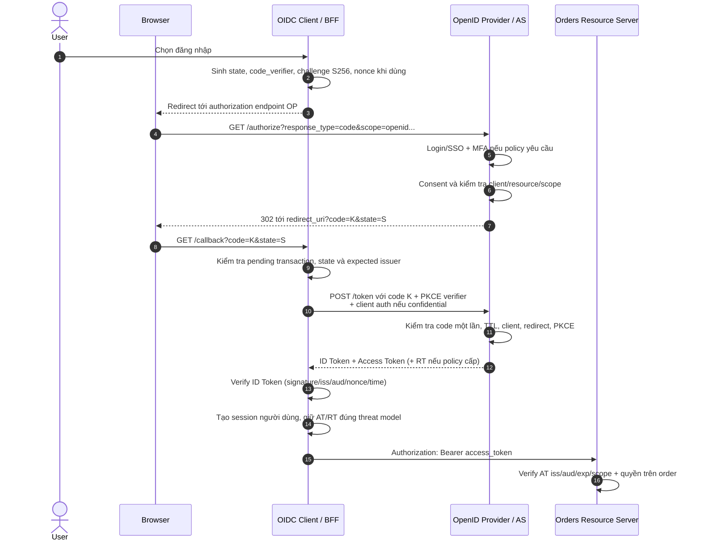
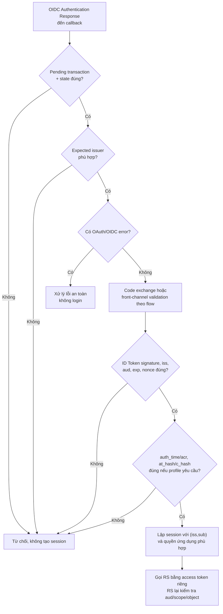

# Authentication response

## Mục tiêu học tập

Trong module **SECURITY_TOKEN_SECURITY_FUNDAMENTALS**, người học xây dựng mô hình tin cậy và hiểu vòng đời token bảo mật: phân biệt JWT với opaque token, access token với refresh token, xác thực và phân quyền trong OAuth 2.0/OIDC, kiểm tra claims, scope, audience, issuer, thời hạn, lưu trữ, thu hồi và phòng chống đánh cắp/phát lại. Ở chương **OpenID Connect**, bài **“Authentication response”** trả lời câu hỏi: **một ứng dụng có thể tin điều gì khi người dùng được xác thực qua OpenID Provider, và phải kiểm chứng những thông điệp nào trước khi thiết lập phiên đăng nhập?**

Sau bài học, bạn có thể:

- Phân biệt **OIDC Authentication Response tại authorization endpoint**, **token response** tại token endpoint và **ID Token** — ba khái niệm có liên quan nhưng không đồng nhất.
- Diễn giải luồng **Authorization Code + PKCE**: browser nhận `code`/`state`, client đổi code, rồi xác minh ID Token trước khi tạo session.
- Nhận diện `response_type=code`, các dạng **implicit/hybrid** trong OIDC Core, `response_mode=query`, `fragment` và `form_post`; hiểu vì sao không nên chọn implicit cho thiết kế mới.
- Xác minh ID Token đúng nguồn tin cậy: **chữ ký và thuật toán, `iss`, `sub`, `aud`/`azp`, `exp`, `iat`, `nonce`**, và `auth_time`/`acr`/`amr` khi policy cần.
- Hiểu tác dụng của **`state`, PKCE, issuer binding**, `nonce`, `at_hash` và `c_hash` trong ngăn login CSRF, code/token substitution, replay và các nhầm lẫn front-channel.
- Phân biệt **đã đăng nhập** với **được cấp quyền truy cập API**, tránh đưa ID Token đến Resource Server hoặc chấp nhận access token như bằng chứng OIDC login tùy tiện.
- Xử lý response lỗi `access_denied`, `login_required`, `consent_required` và `interaction_required` một cách fail-closed.
- Đưa ra cách kiểm thử, logging/redaction, quản lý session BFF và quy trình phản ứng khi authentication response có dấu hiệu không hợp lệ.

> **Nguyên tắc:** **OIDC client/Relying Party chỉ thiết lập phiên người dùng sau khi liên kết authorization response với giao dịch đã khởi tạo và xác minh ID Token từ OP tin cậy.** Nhìn thấy `code`, `id_token` hoặc `sub` trong một URL/JSON **chưa đủ** để tin người dùng đã đăng nhập.

## 1. “Authentication response” chỉ điều gì trong OIDC?

**OpenID Connect (OIDC)** bổ sung lớp xác thực danh tính lên OAuth 2.0. Khi một ứng dụng yêu cầu `scope=openid` theo flow được hỗ trợ, **OpenID Provider (OP)** đóng vai trò Authorization Server; **Relying Party (RP)** là OIDC client nhận và xác minh kết quả xác thực.

Trong OIDC, từ *response* xuất hiện ở nhiều vị trí:

| Khái niệm | Vận chuyển | Thành phần có thể thấy | Chứa gì trong Code Flow? |
| --- | --- | --- | --- |
| **Authentication/Authorization Response** | **Front-channel**, OP redirect browser tới `redirect_uri` của client. | Browser và endpoint callback của RP. | `code` và `state` khi thành công; hoặc `error` và `state` khi thất bại. |
| **Token Response** | **Token endpoint**, trao đổi code bằng HTTP request theo giao thức, thường ở back-channel của backend/BFF. | OIDC client (hoặc runtime SPA public client nếu cấu hình cho phép). | `id_token`, `access_token`, `token_type`, `expires_in`; `refresh_token` nếu được cấp. |
| **ID Token** | **JWT assertion** do OP phát hành, thường nằm trong token response ở Code Flow. | **RP** cần xác minh chữ ký/claims. | Khẳng định thông tin xác thực của subject cho đúng `aud` (client), không phải giấy phép gọi mọi API. |
| **UserInfo Response** | RP gọi **UserInfo endpoint** với access token phù hợp khi cần. | RP. | Các claims về người dùng theo scope và chính sách; **`sub` phải khớp ID Token**. |
| **Resource Server Response** | API nhận OAuth access token đúng resource. | OAuth client và API. | Dữ liệu nghiệp vụ, **không tự phải là bằng chứng OIDC login**. |

**Không nhầm:** trong **Authorization Code Flow**, callback `/callback?code=...&state=...` **chưa mang ID Token**. Client cần đổi code tại token endpoint, nhận ID Token rồi **verify**. Ở các flow OIDC **implicit/hybrid cũ**, ID Token có thể đi qua front-channel; đó là threat model khác cần kiểm tra hash binding và tránh lạm dụng trong thiết kế mới.

### 1.1. OIDC client vs Resource Server

- **RP/OIDC client** xác minh ID Token: issuer OP, audience chính là client, subject, nonce và các điều kiện authentication.
- **Resource Server** xác minh **access token**: issuer của AS, audience API, thời hạn, token type, scope, quyền trên đối tượng/tenant.
- **Refresh token** được gửi **chỉ đến AS token endpoint** để làm mới token; không trình tại UserInfo/Orders API.
- Authorization code là credential **ngắn hạn, một lần** để đổi token, **không được dùng làm bearer API token**.

Một ID Token ký đúng và còn hạn **không có nghĩa** Orders API phải chấp nhận nó. Và một access token chứa `sub` **không tự biến thành ID Token** để RP đăng nhập người dùng.

## 2. Authorization Code + PKCE: phản hồi nằm ở đâu?

Đây là flow ưu tiên cho đa số ứng dụng web, SPA và native client có người dùng, với client authentication bổ sung ở backend confidential khi AS yêu cầu.



Đọc từ trái sang phải:

1. Client tạo một **pending authentication transaction** có `state`/PKCE/issuer/redirect/nonce trước redirect.
2. User xác thực **tại OP/IdP**, có thể bằng SSO, password, passkey, MFA hoặc federation; client **không nhận password**.
3. OP phát hành **authorization code** khi các điều kiện authentication/authorization đã hoàn tất.
4. Browser mang response về client; **client kiểm tra callback** trước khi gửi code tới token endpoint.
5. OP kiểm tra code và PKCE, xác thực confidential client khi cần, rồi phát hành token.
6. **Client verify ID Token trước khi tin subject** và tạo phiên ứng dụng.
7. Client dùng **access token dành riêng cho API**; API lại kiểm chứng token và quyền dữ liệu.

### 2.1. Authorization Request mẫu

Ví dụ tham số được rút gọn để học cấu trúc (chuỗi `<...>` là placeholder, không phải credential thật):

```http
GET /authorize?response_type=code&client_id=portal-bff&redirect_uri=https%3A%2F%2Fportal.example.com%2Fcallback&scope=openid%20profile%20orders%3Aread&state=<unpredictable-state>&code_challenge=<s256-challenge>&code_challenge_method=S256&nonce=<random-nonce> HTTP/1.1
Host: identity.example.com
```

Ý nghĩa:

- `response_type=code`: mong nhận **code**, **không** yêu cầu trả access token ngay trên redirect.
- `scope=openid`: yêu cầu OIDC Authentication, bên cạnh scope được AS cho phép.
- `client_id`: định danh đăng ký, **không phải** bằng chứng confidential client đã xác thực.
- `redirect_uri`: được OP kiểm tra khớp client registration.
- `state`: liên kết callback với transaction/browser session, giảm login CSRF.
- `code_challenge` với `S256`: ràng buộc code exchange với verifier do client giữ, giảm code interception.
- `nonce`: nếu gửi, client phải kiểm tra trong ID Token nhận về theo OIDC; **bắt buộc trong các OIDC implicit/hybrid flow**, tùy profile.

**Không đưa password, refresh token hoặc bearer access token vào authorization URL.** Authorization request có thể được browser/OP/gateway ghi log; dùng tham số tối thiểu cần thiết và redaction.

### 2.2. Authentication Response thành công ở callback

```http
HTTP/1.1 302 Found
Location: https://portal.example.com/callback?code=<one-time-authorization-code>&state=<original-state>
Cache-Control: no-store
```

Đây là **front-channel response** của Authorization Code Flow. `code` chỉ dùng **một lần**, có thời hạn ngắn và ràng buộc client/redirect/PKCE. Nó **vẫn là credential nhạy cảm** dù không phải bearer access token.

Client callback cần:

- Có pending transaction thật **gắn browser session** và chưa hết hạn.
- `state` khớp transaction; issuer thực tế phù hợp expected OP (ví dụ cơ chế RFC 9207 nếu OP hỗ trợ).
- Không nhận callback không rõ nguồn, không dùng `code` hai lần, không đưa query chứa code vào analytics/log.
- Nếu callback mang `error`, xử lý lỗi; **không** tạo user session từ một response thất bại.

### 2.3. Token Request và Token Response

Ví dụ confidential BFF đã được OP đăng ký dùng client authentication:

```http
POST /oauth2/token HTTP/1.1
Host: identity.example.com
Authorization: Basic <registered-client-credential>
Content-Type: application/x-www-form-urlencoded

grant_type=authorization_code&code=<authorization-code>&redirect_uri=https%3A%2F%2Fportal.example.com%2Fcallback&code_verifier=<original-verifier>
```

Ở **public client**, không nhúng shared `client_secret` vào SPA/native app; token request theo registration có `client_id`/PKCE và các tham số giao thức phù hợp. **Client authentication không phải user authentication**: secret/key xác thực ứng dụng, còn ID Token biểu thị authentication của user.

Response minh họa:

```http
HTTP/1.1 200 OK
Content-Type: application/json
Cache-Control: no-store
Pragma: no-cache

{
  "access_token": "<orders-access-token>",
  "token_type": "Bearer",
  "expires_in": 900,
  "id_token": "<signed-oidc-id-token>",
  "scope": "openid profile orders:read",
  "refresh_token": "<optional-refresh-token>"
}
```

`refresh_token` trong ví dụ là **tùy điều kiện cấp quyền/chính sách**; không được mặc định mọi Code Flow đều trả refresh token. Với OIDC, token response thành công của Code Flow **phải có ID Token**. Access token có thể là **JWT hoặc opaque** tùy AS/RS profile; **không dùng việc giải mã JWT access token làm bước xác minh user login thay OIDC**.

**Hai trường `expires_in` khác mục đích:** trong OAuth token response nó mô tả thời hạn access token, không phải hạn dùng authorization code, ID Token hoặc refresh token.

## 3. `response_type` và các hình thức Authentication Response

OIDC Core mô tả nhiều response type. Đây là thông tin cần hiểu khi bảo trì hệ thống cũ; **không có nghĩa tất cả đều nên bật cho ứng dụng mới**.

| Flow OIDC | `response_type` tiêu biểu | Response ở authorization endpoint | ID Token đến client qua đâu? |
| --- | --- | --- | --- |
| **Authorization Code** | `code` | `code`, `state` hoặc lỗi. | **Token endpoint** sau code exchange. |
| **Implicit — ID Token only** | `id_token` | `id_token` và `state` theo profile. | **Front-channel**, thường fragment. |
| **Implicit — ID + Access Token** | `id_token token` | ID Token, access token, `state`/thuộc tính liên quan. | **Front-channel**. |
| **Hybrid — Code + ID Token** | `code id_token` | Code và ID Token đồng thời. | **Front-channel** cho ID Token đầu tiên. |
| **Hybrid — Code + Access Token** | `code token` | Code và access token; ID Token nhận khi đổi code. | **Token endpoint** cho ID Token. |
| **Hybrid — Code + ID + Access Token** | `code id_token token` | Code, ID Token và access token cùng response. | Có ID Token ở **front-channel**. |

**Gợi ý lựa chọn:** với ứng dụng mới có browser/native client, ưu tiên **Authorization Code + PKCE**, thêm confidential BFF nếu cần giữ token server-side. Các kiểu implicit làm credential đi qua front-channel nên tăng nguy cơ token exposure, dễ gặp replay/substitution và khó kiểm soát log/bộ nhớ browser. **Không bật implicit chỉ vì muốn “đăng nhập không cần backend”**: public client vẫn có thể dùng Code + PKCE theo cấu hình phù hợp.

### 3.1. Vì sao Hybrid có `c_hash` và `at_hash`?

Trong một số **Hybrid/Implicit** flow, authorization response có **ID Token cùng authorization code hoặc access token**. RP cần kiểm tra ID Token ràng buộc với các giá trị đi qua front-channel:

- **`c_hash`:** giá trị hash của authorization code, bắt buộc trong ID Token được phát hành **từ authorization endpoint** khi có `code` trong response theo OIDC Core.
- **`at_hash`:** giá trị hash của access token, bắt buộc trong ID Token phát hành **từ authorization endpoint** khi access token xuất hiện cùng response theo OIDC Core.
- Các hash được tính từ token/code theo **thuật toán hash liên kết với JWS `alg`** của ID Token, lấy **nửa trái** của digest rồi Base64url không padding theo định nghĩa OIDC.
- Những claims này **không thay thế** kiểm tra chữ ký ID Token, issuer, audience, nonce, trạng thái giao dịch và token riêng.

Ví dụ: nếu `response_type=code id_token`, RP phải kiểm tra `c_hash` trong ID Token front-channel gắn với `code` nhận được. Nếu `response_type=id_token token`, RP phải kiểm tra `at_hash` gắn với access token front-channel.

Đối với **ID Token nhận tại token endpoint của Authorization Code Flow**, `at_hash` **không bắt buộc** như trường hợp front-channel. Nếu OP cung cấp `at_hash` và client có cơ chế kiểm tra, RP có thể xác minh theo profile; **không tự từ chối mọi Code Flow chỉ vì ID Token không có `at_hash`**.

### 3.2. Có cần dùng implicit/hybrid để giải quyết SSO không?

Không. **SSO thuộc trạng thái xác thực tại OP**, không phải lựa chọn cố định `response_type=id_token`. Authorization Code + PKCE vẫn có thể dùng phiên SSO, passkey, MFA và federation. Nếu user đã có OP session đủ điều kiện, OP có thể xử lý authorization request mà không yêu cầu nhập password lần nữa.

## 4. Response mode: `query`, `fragment` và `form_post`

`response_type` xác định **đối tượng trả về**, còn `response_mode` quyết định **cách vận chuyển** authentication response từ OP đến redirect URI theo profile hỗ trợ.

| `response_mode` | Đường vận chuyển | Điểm lưu ý |
| --- | --- | --- |
| **`query`** | Redirect URI chứa tham số sau `?`. | Thường dùng với `response_type=code`; **query có code** cần log redaction, chống open redirect. |
| **`fragment`** | URI fragment sau `#`, browser JavaScript có thể truy cập; fragment thường không gửi tới server HTTP. | Mặc định của một số implicit/hybrid flow cũ; **không coi fragment là kho bí mật tránh XSS**. |
| **`form_post`** (OIDC Form Post Response Mode) | OP trả HTML form được tự động POST đến redirect URI. | Client cần xử lý POST callback, CSRF/transaction binding, giới hạn body và cookie/SameSite; tránh log body. |

Ví dụ Code Flow query response:

```text
https://portal.example.com/callback?code=<short-code>&state=<state>
```

Ví dụ fragment flow cũ:

```text
https://app.example.com/callback#id_token=<signed-id-token>&state=<state>
```

Fragment không tự được gửi như phần HTTP request target, nhưng vẫn có thể được script trong browser đọc, bị ảnh hưởng bởi XSS/extension/history hoặc cách ứng dụng xử lý URL. **Không dùng fragment để lách yêu cầu bảo vệ bearer token**.

### 4.1. `form_post` có phải an toàn tuyệt đối?

Không. `form_post` giúp tránh đặt response params vào URL query/fragment trong một số kiến trúc, nhưng:

- Callback vẫn phải **ràng buộc `state`/issuer** với giao dịch đã khởi tạo; không coi mọi POST là OP tin cậy.
- Browser tự POST cross-site có thể tương tác với các quy tắc cookie `SameSite`. RP phải thiết kế session/transaction storage và CSRF thích hợp, không tùy tiện nới cookie `SameSite=None` cho mọi route.
- Reverse proxy/APM có thể ghi **request body**; mã/ID Token vẫn phải được redact.
- Phải áp dụng giới hạn body, content type, origin/redirect route và không tạo session trước khi xác minh ID Token.

**Không chọn `response_mode=query` khi flow trả ID Token/access token qua front-channel.** Với các response type chứa `id_token`/`token`, OIDC Core có ràng buộc phương thức trả response; tránh đưa credential sống dài vào query. Nếu AS hỗ trợ `form_post` hoặc response mode mở rộng, client phải tuân thủ metadata/profile đã đăng ký.

## 5. ID Token: nội dung của bằng chứng authentication

OIDC ID Token là **JWT** do OP phát hành cho RP. Nó chứa các claims giúp RP xác minh **ai được OP xác thực, cho client nào và vào thời điểm nào**, sau khi signature và các điều kiện của OIDC được kiểm chứng.

Payload minh họa (không phải JWT hoàn chỉnh và không chứa chữ ký):

```json
{
  "iss": "https://identity.example.com",
  "sub": "user-42",
  "aud": "portal-bff",
  "exp": 1800000900,
  "iat": 1800000000,
  "nonce": "nonce-from-this-login-transaction",
  "auth_time": 1799999700,
  "acr": "urn:example:assurance:high",
  "amr": ["pwd", "otp"]
}
```

Các timestamps và giá trị assurance ở ví dụ **không phải sự kiện người dùng thật**; `acr`/`amr` phụ thuộc profile và nhà cung cấp OP.

| Claim | Ý nghĩa | Kiểm soát tại RP |
| --- | --- | --- |
| **`iss`** | Identifier của OP phát hành. | So khớp **chính xác** issuer đã chọn/tin cậy cho transaction, không tự chọn OP từ nội dung token chưa verify. |
| **`sub`** | Subject identifier ổn định trong ngữ cảnh issuer. | Xác định user theo cặp **(`iss`, `sub`)**; không dùng email làm khóa danh tính mặc định. |
| **`aud`** | Audience của ID Token, thường chứa `client_id` RP. | Phải chứa client ID của RP đang xác minh, **không phải audience Resource Server**. |
| **`azp`** | Authorized party trong những trường hợp token có nhiều audience hoặc profile yêu cầu. | Kiểm tra `azp` và client ID theo OIDC; nên có chính sách chặt với multiple audiences. |
| **`exp`** | Thời điểm ID Token hết hiệu lực (NumericDate). | Không chấp nhận token đã hết hạn, chỉ cho clock skew có giới hạn theo policy. |
| **`iat`** | Thời điểm ID Token được phát hành. | Kiểm tra kiểu dữ liệu và tính hợp lý của thời gian, không coi `iat` là thời điểm user login. |
| **`nonce`** | Liên kết ID Token với authentication request. | So khớp với nonce đã lưu nếu request có gửi nonce; trong implicit/hybrid nonce là yêu cầu quan trọng của profile. |
| **`auth_time`** | Thời điểm user xác thực tại OP. | Dùng cho `max_age`/fresh login policy; khác với thời điểm token issuance. |
| **`acr`** | Authentication Context Class Reference. | Nếu yêu cầu mức assurance, đối chiếu với ngữ nghĩa/chính sách của chính OP. |
| **`amr`** | Authentication Methods References. | Nếu có, mô tả phương pháp OP công bố; không suy mọi `amr` ở mọi OP có assurance giống nhau. |
| **`at_hash`** | Hash binding của access token trong các flow liên quan. | Bắt buộc kiểm tra trong các trường hợp front-channel theo OIDC; xem mục 3. |
| **`c_hash`** | Hash binding của authorization code trong hybrid response. | Kiểm tra khi ID Token front-channel được phát hành cùng code. |

**Không tự xem một JWT có `iss`/`sub`/`aud` là ID Token hợp lệ**. Nó phải được nhận từ **flow OIDC đã khởi tạo**, dùng đúng chữ ký/alg/issuer, đúng audience, nonce/transaction/time và các quy tắc profile. Một JWT access token có thể dùng claims giống vậy, nhưng purpose và audience **khác**.

### 5.1. Vì sao không dùng `email` làm khóa tài khoản?

`sub` là identifier của subject dưới issuer. Email/display name có thể thay đổi, không phải lúc nào được verify, có thể trùng hoặc không xuất hiện; pairwise subject identifiers có thể khác nhau giữa các client dù là cùng một user theo chính sách OP. Thiết kế account binding nên dùng **`iss` + `sub`** đã verify, với quy trình liên kết/chuyển tài khoản tường minh khi cần.

Nếu RP gọi UserInfo để lấy `email`/`name`, **bắt buộc kiểm tra `sub` trong UserInfo Response đúng bằng `sub` của ID Token** trước khi dùng claims để tránh token/user confusion.

### 5.2. Độ mới xác thực và token mới là hai việc khác nhau

Một token được phát hành lúc 10:00 không có nghĩa người dùng vừa nhập credential lúc 10:00. OP có thể tái sử dụng SSO session được tạo từ 09:00.

```text
auth_time = 09:00  (user hoàn thành authentication)
iat       = 10:00  (ID Token mới được phát hành)
exp       = 10:15  (ID Token hết hạn)
```

Muốn yêu cầu login đủ mới cho thao tác nhạy cảm, RP cần **`max_age`**, kiểm tra **`auth_time`** của ID Token đã verify và chính sách assurance/step-up thích hợp. Không suy MFA từ `response_type=code`, `scope` hay việc ID Token còn hạn.

## 6. Quy trình xác minh ID Token trước khi tạo session

Đây là **danh sách kiểm tra logic** cho OIDC RP; production cần thư viện OIDC đã được kiểm chứng và áp đúng profile của OP:

1. **Nhận token từ nguồn giao dịch tin cậy:** callback `state`/issuer đã được ràng buộc, code đã đổi ở token endpoint đúng của OP; không nhận ID Token từ input tùy ý trên trang.
2. **Parse header/payload như dữ liệu chưa tin:** giới hạn kích thước, định dạng JWT và claim types. Chỉ dùng `kid` để chọn **key từ JWKS của issuer đã cấu hình**, không tải JWKS từ URL tùy ý trong token.
3. **Kiểm tra thuật toán và chữ ký:** chỉ chấp nhận `alg` đã đăng ký/cho phép, chữ ký verify được bằng key tin cậy; từ chối `alg=none` nếu không có profile/điều kiện đặc biệt được thương lượng rõ.
4. **Kiểm tra `iss`:** khớp chính xác identifier của expected OP cho transaction.
5. **Kiểm tra `aud`/`azp`:** `aud` chứa đúng `client_id`; xử lý `azp` theo OIDC khi multiple audiences hoặc claim được cung cấp. Một chính sách RP chặt có thể từ chối token nhiều audience mà không có `azp` phù hợp.
6. **Kiểm tra `exp`/`iat` và độ lệch clock có giới hạn:** không chấp nhận token đã hết hạn, issued time bất hợp lý hoặc lifetime ngoài policy.
7. **Kiểm tra `nonce`:** nếu nonce được gửi trong Authentication Request, ID Token phải phản ánh nonce đúng theo profile; so với nonce được lưu ở **chính transaction**, không so với giá trị tự khai ở callback.
8. **Kiểm tra `auth_time` và assurance** khi `max_age`, `acr`/step-up policy yêu cầu; không tự suy mức MFA từ tên scope.
9. **Kiểm tra `at_hash`/`c_hash` khi bắt buộc** theo flow (nhất là ID Token được phát hành ở authorization endpoint cùng access token/code).
10. **Chỉ sau khi đủ điều kiện**, dùng `iss` + `sub` để thiết lập subject của session, rotate session ID, quản lý token vault và audit.

### 6.1. Kiểm tra audience và `azp` đúng ngữ cảnh

RP có `client_id=portal-bff`:

```json
{
  "iss": "https://identity.example.com",
  "sub": "user-42",
  "aud": ["portal-bff", "another-audience"],
  "azp": "portal-bff",
  "exp": 1800000900,
  "iat": 1800000000
}
```

Ví dụ được rút gọn, **không phải ID Token đầy đủ**. Với multiple audiences, RP cần xác minh `client_id` của mình hiện diện trong `aud`, xem xét `azp` theo OIDC và chính sách địa phương. Nếu `aud=api://orders` mà **không có** `portal-bff`, token phải bị từ chối để login dù nó ký đúng.

### 6.2. Đừng dùng dữ liệu chưa verify để quyết định điểm kết nối

**Lỗi nguy hiểm:** đọc `iss` hoặc `jku`/`x5u` trong JWT chưa verify rồi thực hiện HTTP request tới URL đó để lấy key. Cách làm này có thể tạo SSRF, trusted-issuer bypass hoặc confusion giữa nhiều OP.

Thay vào đó, RP đã chọn **expected issuer** từ đăng ký/discovery đáng tin ở bước bắt đầu authentication; JWKS URI phải bắt nguồn từ OP metadata **đã được xác thực và allowlist**, cùng ràng buộc cấu hình. Rotation key cần áp dụng cache/refresh có giới hạn, không tự chấp nhận key của issuer lạ chỉ vì `kid` trùng.

## 7. `state`, `nonce`, PKCE và issuer binding: bốn lớp khác nhau

OIDC thường có nhiều giá trị ngẫu nhiên được tạo trước khi redirect. Không nên coi chúng hoán đổi được.

| Giá trị/kiểm soát | Xuất hiện tại đâu? | Nó bảo vệ điều gì? | Không tự giải quyết |
| --- | --- | --- | --- |
| **`state`** | Authentication Request → Authentication Response. | Liên kết callback với giao dịch/browser session đúng, chống login CSRF và response injection. | Không tự xác minh chữ ký ID Token hay bảo vệ code interception. |
| **PKCE `code_verifier`/`code_challenge`** | Challenge tại authorization endpoint; verifier tại token endpoint. | Ràng buộc **authorization code exchange** với client nắm verifier của giao dịch. | Không xác thực subject và không bảo vệ AT/RT đã bị lấy sau issuance. |
| **OIDC `nonce`** | Authentication Request → claim `nonce` trong ID Token theo profile. | Liên kết **ID Token** với Authentication Request, giảm replay/substitution của ID Token. | Không thay callback `state`/session binding hoặc code PKCE. |
| **Issuer binding** | Expected issuer trong transaction, issuer assertion/ID Token metadata. | Ngăn nhận response từ sai OP hoặc đổi code tại endpoint giả khi hỗ trợ nhiều AS. | Không tự cấp consent, scope hoặc quyền truy cập API. |

**Ví dụ transaction phía RP:**

```json
{
  "transaction_ref": "login-tx-9d3c",
  "browser_session_ref": "pending-session-ref",
  "expected_issuer": "https://identity.example.com",
  "client_id": "portal-bff",
  "redirect_uri": "https://portal.example.com/callback",
  "response_type": "code",
  "state_ref": "state-ref-in-private-store",
  "nonce_ref": "nonce-ref-in-private-store",
  "pkce_method": "S256",
  "pkce_verifier_ref": "protected-verifier-ref",
  "created_at": "2027-01-15T10:00:00Z",
  "status": "PENDING"
}
```

Đây là **metadata minh họa**: giá trị thô `state`/`nonce`/`code_verifier` cần tồn tại ở nơi RP hoặc SDK có thể đối chiếu, nhưng **không đưa vào audit log công khai**. Trong production, transaction store cần bảo vệ TTL, mã hóa/kiểm soát truy cập, ràng buộc browser session và one-time consumption.

### 7.1. Login CSRF / unsolicited authentication response

Attacker có thể cố đưa authorization response của chính họ vào browser nạn nhân để ứng dụng tạo session sai tài khoản. Nếu RP chỉ thấy `code=...` rồi đổi lấy ID Token mà không kiểm tra **transaction state**, có nguy cơ **session swapping/login CSRF**.

Một callback an toàn cần:

1. Tìm pending transaction **của browser hiện tại**, không lấy transaction tùy ý do query điều khiển.
2. Kiểm tra `state` chính xác, còn hạn và chưa tiêu thụ.
3. Xác nhận expected issuer/endpoint; không gửi code/verifier đến token endpoint ngoài trust configuration.
4. Nếu có `error`, xử lý lỗi và không tạo session.
5. Nếu có code, đổi code với PKCE và client authentication nếu áp dụng, sau đó verify ID Token.
6. Tạo/rotate session **chỉ khi các bước trước PASS**; hủy hoặc tiêu thụ pending transaction chống replay.

**Đừng kiểm tra `state` sau khi đã tạo phiên đăng nhập.** Một sai sót thứ tự xử lý có thể biến response lạ thành một identity được tin cậy.

### 7.2. AS mix-up khi một RP hỗ trợ nhiều OP

Giả sử RP tích hợp `identity.example.com` và `login.partner.example`. Nếu callback chỉ mang code mà RP không biết code xuất phát từ OP nào, nó có thể đưa code/verifier tới token endpoint sai (authorization server mix-up).

**Biện pháp:** lúc khởi tạo request, lưu **expected issuer** và token endpoint đáng tin cùng transaction. Kiểm tra issuer trong authorization response theo **RFC 9207** nếu OP có hỗ trợ hoặc biện pháp tương đương theo profile, rồi **verify `iss` trong ID Token** sau token exchange. Không tự lấy token endpoint từ `iss` chưa kiểm tra.

Trong một hệ thống có nhiều OP, `state` cũng phải xác định đúng **transaction/OP**; không chỉ là dấu hiệu “đã từng mở trang login”.

### 7.3. Nonce dùng một lần và các giới hạn của nó

Nếu RP gửi `nonce=N1`, ID Token phải chứa giá trị ràng buộc tương ứng theo OIDC; RP không được nhận ID Token chứa `nonce=N2` hoặc nonce không xuất hiện khi profile yêu cầu. Nonce ngẫu nhiên có entropy cao và **phải gắn với transaction**, không phải hằng số toàn hệ thống.

`nonce` **không thay PKCE**. Trong Code Flow, nonce là lớp ràng buộc ID Token khi dùng; PKCE bảo vệ code exchange. Khi triển khai implicit/hybrid, `nonce` là yêu cầu quan trọng theo OIDC để giảm token replay, nhưng vẫn không làm front-channel access token trở thành thiết kế ưu tiên.

### 7.4. Callback bị gửi lại

Callback có thể bị browser reload, mạng retry hoặc attacker gửi lại:

```text
T0  GET /callback?code=K&state=S
T1  RP xác minh state và đổi code thành công.
T2  RP tiêu thụ transaction, lập session.
T3  GET /callback?code=K&state=S lần thứ hai.
```

Tại T3, RP phải **từ chối/không lập phiên mới từ response đã dùng**. OP cũng phải từ chối authorization code được dùng lại. Không gửi lại code lặp vô hạn khi `invalid_grant` xảy ra.

## 8. Authentication Error Response và `prompt=none`

OP có thể từ chối request trước khi cấp code/token: user từ chối consent, login cần tương tác, client không hợp lệ hoặc policy không cho phép. **Một error response cũng phải được ràng buộc giao dịch**, không phải tín hiệu “user đã login”.

### 8.1. Lỗi `access_denied` tại authorization endpoint

Nếu redirect URI đã được xác minh và OP được phép trả lỗi về đó:

```http
HTTP/1.1 302 Found
Location: https://portal.example.com/callback?error=access_denied&state=<original-state>
Cache-Control: no-store
```

RP cần kiểm tra `state` như response thành công, sau đó ghi một kết quả **authorization denied**, không tạo session, không đổi code và không phản chiếu raw URL/ticket chứa tham số nhạy cảm.

**Quan trọng:** khi `redirect_uri` không hợp lệ hoặc không thuộc client, OP **không được redirect response tới URL do attacker tự khai**. Trong trường hợp đó OP xử lý lỗi tại chính domain của mình hoặc kênh an toàn tương ứng.

### 8.2. `prompt=none` và các lỗi OIDC

`prompt=none` yêu cầu OP cố xử lý authentication/authorization **không tương tác với người dùng**. Nó **không có nghĩa** được bỏ qua authentication, consent hoặc MFA policy.

```http
GET /authorize?response_type=code&scope=openid&client_id=portal-bff&redirect_uri=https%3A%2F%2Fportal.example.com%2Fcallback&state=<state>&code_challenge=<challenge>&code_challenge_method=S256&prompt=none HTTP/1.1
Host: identity.example.com
```

Nếu không thể hoàn thành mà không tương tác, OP có thể trả:

| Error | Nghĩa trong OIDC | Hành động phù hợp |
| --- | --- | --- |
| **`login_required`** | Cần login/reauthentication mà `prompt=none` không cho phép tương tác. | RP chuyển sang login tương tác được kiểm soát nếu UX cho phép. |
| **`consent_required`** | Cần user consent mà không thể thu thập âm thầm. | Bắt đầu authorization request có tương tác/consent hợp lệ. |
| **`interaction_required`** | Cần tương tác khác như step-up, lựa chọn phương thức hoặc policy. | Không tự coi user đã đăng nhập; khởi động flow mới phù hợp. |
| **`account_selection_required`** | OP cần user chọn tài khoản. | Chuyển sang flow có tương tác và verify subject cuối cùng. |

Các lỗi này không có nghĩa mật khẩu nhất định sai. RP **không retry `prompt=none` liên tục**, không đăng nhập bằng access token cũ không còn hợp lệ và không fallback **ROPC/password grant** để tránh tương tác.

### 8.3. Lỗi OAuth khác có thể xuất hiện

| Mã lỗi | Nguồn thường gặp | Lưu ý |
| --- | --- | --- |
| `invalid_request` | Authentication request thiếu/sai tham số hoặc token request không hợp lệ. | Không trả chi tiết credential, verifier hoặc code. |
| `invalid_scope` | Client xin scope AS không chấp nhận. | Không tự cấp scope thiếu bằng cách sửa JWT. |
| `unsupported_response_type` | OP không hỗ trợ response type yêu cầu. | Chọn flow theo OP metadata và client registration. |
| `unauthorized_client` | Client không được phép dùng flow/grant tương ứng. | Không nhúng shared secret vào SPA để “biến thành confidential”. |
| `server_error` / `temporarily_unavailable` | OP gặp sự cố hoặc tạm thời không phục vụ. | Retry có kiểm soát với giao dịch **mới** nếu cần. |
| `invalid_grant` (token endpoint) | Code sai/hết hạn/đã dùng, redirect/PKCE hoặc binding sai. | Không tạo session, không retry code vô hạn. |
| `invalid_client` (token endpoint) | Confidential client authentication thất bại. | Sửa đăng ký/secret/key, không thay thành quyền admin. |

**Không nhầm** lỗi tại authorization endpoint với lỗi ở token endpoint. Với `response_type=code`, lỗi ở authorization endpoint thường đi về RP qua browser; lỗi token endpoint là HTTP response trực tiếp tới client đang đổi code.

### 8.4. Quy tắc tạo session khi lỗi

Một tình huống nguy hiểm:

```text
RP thấy callback có query state hợp lệ
-> tạo session user từ login_hint/sub tự khai
-> OP trả access_denied hoặc token exchange lỗi
```

Đây là **fail-open**. Session chỉ được tạo sau khi **authorization transaction hợp lệ, code exchange thành công và ID Token đã verify đúng OP/khách hàng/subject** theo profile. Nếu user đã có session cũ, xử lý error không được tự nâng quyền hoặc gắn nhầm account.

## 9. Legacy implicit/hybrid: xác minh `at_hash` và `c_hash`

Các flow có ID Token trong authorization response cần nhiều kiểm tra vì token/code đi qua browser front-channel. Đây là phần **đọc hiểu hệ thống cũ** và phục vụ migration, **không phải khuyến khích triển khai implicit mới**.

### 9.1. Khi nào một hash claim là bắt buộc?

| Authentication Response | ID Token front-channel? | Hash cần đối chiếu |
| --- | --- | --- |
| `response_type=id_token` | Có. | Không có code/access token kèm theo để buộc `c_hash`/`at_hash`. Vẫn kiểm tra chữ ký, issuer, audience, nonce, expiry. |
| `response_type=id_token token` | Có, cùng access token. | **`at_hash`** của access token nhận từ authorization endpoint. |
| `response_type=code id_token` | Có, cùng code. | **`c_hash`** của authorization code nhận cùng response. |
| `response_type=code id_token token` | Có, cùng code và access token. | **`c_hash` và `at_hash`** theo profile. |
| `response_type=code` | Không; ID Token từ token endpoint. | `c_hash` không phải yêu cầu front-channel; `at_hash` ở token response là tùy trường hợp/profile. |
| `response_type=code token` | Không có ID Token front-channel; ID Token đến qua token endpoint. | Không áp nguyên quy tắc hash của ID Token front-channel vào response không chứa ID Token ở đó. |

Chỉ nên triển khai các response type legacy nếu OP/client profile thật sự yêu cầu và đã có threat model/validator đúng. Không “nâng cấp” ứng dụng bằng cách bật `id_token token` chỉ để giảm một lần HTTP request.

### 9.2. Cách tính hash binding với `RS256`

Với ID Token được ký bằng `RS256`, cách tính giá trị hash tương ứng:

```text
digest = SHA-256(ASCII(authorization_code hoặc access_token))
left_half = 16 byte đầu của digest 32 byte
hash_claim = BASE64URL-ENCODE(left_half) không padding

c_hash  = hash_claim(authorization_code)
at_hash = hash_claim(access_token)
```

**Không** lấy `SHA256` trên JWT payload hoặc issuer. Phải dùng **giá trị code/access token thô đúng từng byte** như đã nhận. Với thuật toán JWS khác, hash algorithm cần theo OIDC specification/profile tương ứng, không mặc định mọi `alg` đều dùng SHA-256.

Java pseudocode cho mục đích kiểm thử:

```java
String oidcHashForRs256(String tokenOrCode) throws Exception {
    byte[] value = tokenOrCode.getBytes(StandardCharsets.US_ASCII);
    byte[] digest = MessageDigest.getInstance("SHA-256").digest(value);
    byte[] leftHalf = Arrays.copyOf(digest, digest.length / 2);
    return Base64.getUrlEncoder().withoutPadding()
        .encodeToString(leftHalf);
}

// Sau khi đã xác minh chữ ký và claims ID Token:
requireEqual(idToken.claim("c_hash"), oidcHashForRs256(codeFromCallback));
requireEqual(idToken.claim("at_hash"), oidcHashForRs256(accessTokenFromCallback));
```

Đây chỉ là **minh họa RS256**. Ở production, dùng **OIDC library** hiểu flow/alg, validates claims bắt buộc và input encoding. Không gọi cả hai `requireEqual` nếu flow không trả cả code và access token cùng ID Token; chỉ kiểm tra hash theo yêu cầu thực tế.

### 9.3. Hash binding có thay PKCE hoặc state không?

**Không.** `at_hash`/`c_hash` ràng buộc những giá trị trả qua front-channel với **ID Token đã verify**. PKCE bảo vệ bước đổi authorization code tại token endpoint; `state` bảo vệ transaction/callback, `nonce` ràng buộc ID Token với request. Một ứng dụng hybrid đúng vẫn cần tất cả kiểm soát được áp dụng cho profile ấy.

Nếu RP nhận một ID Token front-channel chứa `c_hash` đúng nhưng `nonce` sai, **vẫn phải từ chối**. Nếu `state` sai, không được “cứu” response bằng việc `at_hash` khớp.

## 10. Mẫu xử lý Authentication Response trong Java BFF

Trong **Backend for Frontend (BFF)**, browser chỉ đi qua redirect/callback và nhận **session cookie**; backend giữ client credential, PKCE verifier, token response và refresh token trong kho server-side phù hợp.

### 10.1. Pseudocode callback handler

Đây là **logic minh họa**, không phải API có sẵn của Java/Spring hoặc code production; dùng OAuth/OIDC SDK đã được kiểm chứng.

```java
void handleOidcCallback(HttpRequest request, HttpResponse response) {
    PendingLogin tx = pendingLoginStore.forCurrentBrowserSession(request);
    requireNotExpiredAndNotConsumed(tx);

    // State phải khớp giao dịch do chính browser này khởi tạo.
    requireEqual(tx.state(), request.query("state"));
    verifyAuthorizationResponseIssuerIfSupported(request, tx.expectedIssuer());

    if (request.query("error") != null) {
        pendingLoginStore.consume(tx);
        throw publicSafeOidcError(request.query("error"));
    }

    String authorizationCode = requireNonEmpty(request.query("code"));

    // Token endpoint nằm trong cấu hình OP tin cậy của transaction.
    TokenResponse tokenResponse = trustedOidcClient.exchangeCode(
        tx.expectedTokenEndpoint(),
        authorizationCode,
        tx.redirectUri(),
        tx.codeVerifier(),
        tx.confidentialClientAuthentication()
    );

    VerifiedIdToken id = trustedOidcVerifier.verify(
        tokenResponse.idToken(),
        tx.expectedIssuer(),
        tx.clientId(),
        tx.expectedNonce(),
        tx.requiredAuthTimeAndAcrPolicy()
    );

    // Subject identity được ràng buộc với issuer.
    SubjectKey subjectKey = new SubjectKey(id.issuer(), id.subject());

    // Pseudocode: phải xử lý concurrency/commit/rollback chống replay.
    pendingLoginStore.consume(tx);
    Session session = sessionService.createWithRotatedSessionId(subjectKey);
    tokenVault.store(session.id(), tokenResponse); // Không lộ raw AT/RT cho JS.

    response.setProtectedSessionCookie(session.id());
    response.redirectToValidatedInternalReturnPath(tx.returnPath());
}
```

**Chú ý kiến trúc:**

- `verifyAuthorizationResponseIssuerIfSupported` chỉ so với issuer đã chọn **từ trước**; không coi query `iss` chưa kiểm tra là nơi lấy JWKS/token endpoint.
- `trustedOidcVerifier.verify` phải thực hiện signature/`alg`/issuer/audience/expiry/nonce và các quy tắc profile; **không chỉ parse Base64URL**.
- Callback và session creation phải có state **one-time**, TTL và xử lý race giữa hai HTTP requests. Ví dụ rút gọn không mô tả đầy đủ atomicity/transaction.
- Không gán `sub` từ một access token bất kỳ nếu đang làm OIDC login; token type/audience phải đúng.
- Trong `response_mode=form_post`, callback đọc **body form** thay `query` nhưng vẫn xác minh cùng các ràng buộc và bảo vệ CSRF/transaction.

### 10.2. Spring Security và thư viện production

Với Java/Spring, nên dùng cơ chế **OAuth 2.0 Login/OIDC client** của framework hoặc thư viện tương đương, để hệ thống xử lý:

- Authorization request repository (`state`, PKCE) và xác minh callback.
- Client registration, trusted issuer/JWKS, client authentication và code exchange.
- ID Token validation, OIDC principal và user session theo configuration.
- Lỗi OAuth/OIDC, cookie/session/CSRF và logout phù hợp threat model.

Phần **business authorization** vẫn phải được bổ sung: scope/API audience, owner/tenant/ACL, điều kiện MFA mới gần đây và bảo vệ dữ liệu. Không coi một OIDC principal hợp lệ là giấy phép tự động truy cập `/admin`.

### 10.3. Nhiều tab và login song song

Nếu người dùng mở hai tab login:

```text
Tab A -> stateA, nonceA, codeVerifierA, issuerA
Tab B -> stateB, nonceB, codeVerifierB, issuerB

Callback A: chỉ dùng transaction A.
Callback B: chỉ dùng transaction B.
```

Không lưu một biến `currentNonce`/`currentVerifier` dùng chung rồi để tab B ghi đè tab A. Nếu callback A nhận nonce B hoặc verifier B, RP phải từ chối giao dịch, **không bỏ kiểm tra vì “login đã thành công tại OP”**.

## 11. Thiết lập phiên RP sau Authentication Response

**OP session** và **RP application session** khác nhau:

- OP session cho biết user đã xác thực ở OP/IdP và có thể hưởng SSO theo chính sách.
- RP session được lập khi RP đã nhận **Authentication Response thuộc giao dịch hợp lệ** và verify ID Token.
- User logout khỏi RP **không mặc nhiên logout toàn bộ OP/SSO**, ngược lại OP session hết hạn không tự làm RP session mất hiệu lực ngay nếu không có cơ chế đồng bộ/session policy.

### 11.1. Session cookie mẫu

```http
Set-Cookie: __Host-rp-session=<opaque-session-id>; Path=/; Secure; HttpOnly; SameSite=Lax
```

Trong triển khai thực tế:

- `Secure` yêu cầu kết nối bảo mật theo quy tắc browser.
- `HttpOnly` giảm khả năng JS đọc giá trị cookie, **không chống XSS đang dùng session để gửi request**.
- `SameSite` giúp giảm một số CSRF; request thay đổi trạng thái vẫn cần CSRF protection/Origin policy theo kiến trúc.
- `__Host-` yêu cầu `Secure`, `Path=/` và không có `Domain` ở browser hỗ trợ.
- Rotate session ID sau đăng nhập/nâng quyền, kiểm tra inactivity/absolute TTL, logout/revocation và tách session giữa tenant/account khi cần.

Cookie này **không nên chứa raw ID Token, access token, refresh token hoặc client secret** trong một giá trị mà browser có thể gửi tới nhiều endpoint không cần thiết. BFF giữ token trong **server-side token vault**, browser dùng session reference.

### 11.2. Refresh và token lifecycle sau login

Khi access token hết hạn:

1. RP/BFF dùng refresh token **nếu được cấp** để xin access token mới tại AS token endpoint, theo binding và policy.
2. Nếu refresh token bị thu hồi/đã reuse/expired, RP cần xử lý session/reauthentication an toàn; không tự fallback ROPC.
3. Với public client được cấp refresh token, AS cần replay protection bằng **rotation hoặc sender-constraining** phù hợp OAuth Security BCP.
4. Revoke refresh token không nhất thiết khiến mọi JWT access token đã cấp bị RS từ chối tức thì nếu RS chỉ verify chữ ký/`exp`.
5. ID Token mới được phát hành khi refresh có thể phản ánh **authentication event cũ**; không suy một refresh thành công là user vừa MFA lại.

**Không dùng refresh token để gọi Resource Server.** RS phải xác minh access token JWT hoặc introspection opaque đúng issuer, audience, thời hạn, scope và quyền trên tài nguyên.

### 11.3. Logout và OP session

OIDC có các cơ chế logout front-channel/back-channel/RP-initiated tùy OP profile và hệ thống hỗ trợ. Không giả định mọi OP đều hỗ trợ cùng một cơ chế. Một thiết kế cần phân biệt:

- **RP logout:** đóng phiên ứng dụng, xóa cookie/session, thu hồi AT/RT nếu policy và endpoint hỗ trợ.
- **OP logout:** kết thúc phiên SSO ở Identity Provider theo cơ chế được hỗ trợ; có thể ảnh hưởng tới nhiều RP.
- **Session expiry:** phiên RP vẫn phải hết hạn theo chính sách của chính ứng dụng, kể cả OP session còn.
- **Token revocation:** refresh token family/AT theo khả năng AS/RS, không chỉ xóa cache ở browser.

Không tự suy `sid` hoặc trạng thái logout từ claim chưa verify; nếu dùng Session Management/Logout specs, áp đầy đủ validator riêng của profile.

## 12. Những sai lầm phổ biến khi xử lý Authentication Response

| Anti-pattern | Tại sao sai? | Cách xử lý |
| --- | --- | --- |
| Có `code` ở callback thì lập tức tạo session user. | Code chưa được đổi, chưa có ID Token verify; có thể bị injection/replay. | Kiểm tra `state`/issuer, code exchange/PKCE và ID Token trước session. |
| Decode Base64URL ID Token rồi tin `sub` mà không verify chữ ký. | Payload JWT dễ đọc không đồng nghĩa có bằng chứng từ OP. | Verify JWT/JWE/JWS theo profile bằng key trusted issuer. |
| Không kiểm tra `iss` vì token có `aud` đúng. | Token từ một OP khác có thể bị chấp nhận nhầm. | Gắn expected issuer với transaction và ID Token validator. |
| ID Token có `aud` là Billing API nhưng vẫn dùng login `portal-bff`. | ID Token không nhắm tới RP này. | `aud` phải chứa đúng client ID, `azp` đúng khi áp dụng. |
| Xem `client_id` hoặc `login_hint` trong callback là subject user. | Đây là dữ liệu client/request, không phải bằng chứng user authentication. | Chỉ dùng `iss`+`sub` của ID Token đã verify, account binding an toàn. |
| Bỏ `nonce` vì token đã có chữ ký. | Không kiểm tra binding giữa response và request, tăng replay/substitution. | Với transaction có nonce, kiểm tra đúng claim; tuân thủ yêu cầu implicit/hybrid. |
| Dùng một `nonce` cố định cho mọi lần login. | Nonce không còn phân biệt giao dịch, tăng cửa sổ replay. | CSPRNG và transaction-specific nonce. |
| Kiểm tra `state` nhưng không gắn với browser session. | Response của người khác có thể khớp một state tồn tại ở kho chung. | Transaction phải gắn session/browser và consume một lần. |
| Public SPA hard-code client secret và coi như confidential. | Secret có thể bị trích xuất từ bundle. | Dùng public client Code + PKCE hoặc confidential BFF thực sự. |
| Tin ID Token có `iat` mới là user vừa thực hiện MFA. | Token có thể được cấp từ SSO session cũ. | Kiểm tra `auth_time`, `acr`/`amr` và chính sách assurance đã verify. |
| Chấp nhận ID Token cũ cho login mới miễn chưa hết `exp`. | Thiếu transaction/nonce binding; có thể session swapping. | Chỉ dùng trong ngữ cảnh flow/protocol hợp lệ, chống replay. |
| Bỏ `c_hash`/`at_hash` trong hybrid có token/code front-channel. | Không phát hiện tráo code/AT so với ID Token. | Kiểm tra claims hash bắt buộc theo OIDC flow. |
| Bắt buộc `at_hash` ở mọi Code Flow ID Token nhận từ token endpoint. | Gây từ chối sai các ID Token hợp lệ không có claim tùy chọn này. | Phân biệt yêu cầu hash của front-channel và token-endpoint response. |
| Dùng ID Token làm `Authorization: Bearer` tới API. | Sai token purpose/audience; API có thể bị token confusion. | RS chỉ chấp nhận access token đúng profile/`aud`. |
| Dùng `email` chưa xác minh làm khóa duy nhất user. | Email thay đổi/tái sử dụng, không phải identifier bất biến. | Dùng `iss`+`sub`, quy trình liên kết account phù hợp. |
| Dùng `prompt=none` lỗi thì fallback password grant. | Đưa password của user qua client, phá mô hình trust. | Yêu cầu login tương tác qua OP hoặc thông báo cần đăng nhập. |
| RP chọn token endpoint/JWKS từ URL chưa verify trong response. | Có thể dẫn đến AS mix-up/SSRF/token exfiltration. | Chỉ dùng issuer/metadata được chọn trước và trust allowlist. |
| Khi OP trả `access_denied`, RP vẫn giữ session mới ở mức admin. | Error flow không phải authentication thành công. | Không nâng quyền/tạo session, audit denial trung tính. |
| Log full callback URL hoặc token response. | Lộ code/ID Token/AT/RT tới gateway/APM/analytics. | Redact ở mọi tầng, chỉ audit correlation/reference an toàn. |

### 12.1. Phân biệt sai về xác thực và phân quyền

```text
authentication_status = ID_TOKEN_VERIFIED
user_identity         = (issuer, subject)
requested_scope       = orders:read orders:admin
granted_scope         = orders:read
access_token_audience = api://orders

API request:
  PATCH /orders/101 -> require orders:write + object policy

Kết quả: từ chối nếu thiếu scope/quyền, dù user đã đăng nhập.
```

OIDC authentication trả lời **“subject nào được OP xác thực?”**. OAuth access token và Resource Server policy trả lời **“client/subject được làm gì đối với resource này?”**. Hai câu hỏi liên hệ nhưng không thay thế nhau.

## 13. Threat model: response bị đánh cắp, tráo hoặc phát lại

### 13.1. Code interception

Attacker lấy được authorization code từ browser history, proxy log hoặc redirect chain. Nếu code còn hạn và không có PKCE, attacker có thể thử đổi code. Khi dùng **PKCE `S256`**, code bị lấy riêng lẻ không đủ để đổi nếu attacker không có verifier tương ứng.

**Phòng ngừa:** HTTPS, redirect URI khớp đăng ký, `state`, PKCE, code TTL ngắn và một lần, redaction từ gateway đến APM. Không làm rò `code_verifier` cùng code trong telemetry.

### 13.2. ID Token substitution / replay

Attacker đưa một ID Token đã ký nhưng thuộc **client/nonce/giao dịch khác** cho RP. Nếu RP chỉ kiểm tra chữ ký/`exp` mà bỏ `aud`/`nonce`, nó có thể lập session sai subject.

**Phòng ngừa:** kiểm tra expected issuer, audience, nonce theo request, `auth_time`/acr nếu yêu cầu, và transaction state/one-time. Đừng nhận ID Token từ request body bất kỳ như bằng chứng login trừ khi đang triển khai một profile riêng cho phép và đã kiểm chứng đầy đủ.

### 13.3. Authorization Server mix-up

RP dùng nhiều OP, callback không gắn đúng expected issuer, hoặc attacker cố thay ID Token/callback để RP gửi code tới token endpoint sai.

**Phòng ngừa:** mỗi transaction lưu OP/issuer và token endpoint đã đăng ký; ràng buộc issuer trong authorization response (RFC 9207 hoặc biện pháp profile tương đương) và verify `iss` trong ID Token.

### 13.4. Login CSRF và account confusion

Attacker lừa RP nhận response tương ứng account của attacker vào session browser của nạn nhân. Đôi khi user thấy mình đăng nhập vào account khác và thao tác nhầm dữ liệu.

**Phòng ngừa:** `state` khó đoán, gắn session, PKCE, nonce, account binding, session ID rotation và không tự lấy subject từ query/email.

### 13.5. XSS trong SPA

Ngay cả khi Code + PKCE chuẩn, script XSS ở browser có thể đọc/sử dụng access token/ID Token đang có trong JS runtime hoặc lợi dụng phiên. `nonce` hay PKCE không thể xóa quyền thực thi của script bị tấn công.

**Phòng ngừa:** chống XSS theo nhiều lớp, CSP/Trusted Types theo nền tảng, kiểm soát dependencies, giảm thời gian tồn tại token, tránh raw refresh token ở JS-accessible storage khi có phương án an toàn hơn, cân nhắc BFF server-side.

### 13.6. Backend/BFF bị compromise

Confidential client giữ token/secret ở backend không bất khả xâm phạm: secret manager sai quyền, APM dump token, SSRF tới token endpoint, session hijacking hoặc confused deputy có thể dẫn đến token theft/cross-tenant access.

**Phòng ngừa:** quyền tối thiểu, token vault mã hóa/kiểm soát IAM, log redaction, strict issuer/redirect allowlist, session CSRF/Origin, mTLS/DPoP khi phù hợp và kiểm chứng quyền dữ liệu tại RS.

### 13.7. Hash binding không thay kiểm chứng issuer

Một `c_hash` phù hợp với code không có giá trị nếu được lấy từ **ID Token chưa verify** hoặc từ issuer không được RP tin. Thứ tự kiểm chứng phải đảm bảo **OP tin cậy, chữ ký/alg/claims**, rồi mới dùng `c_hash`/`at_hash` để liên kết phần front-channel.



Sơ đồ tổng quát; với **Code Flow**, ID Token đến qua token endpoint. Với **implicit/hybrid legacy**, token có thể đến qua front-channel và các kiểm tra hash đúng flow là thiết yếu.

## 14. Tình huống thực hành: RP, OP và hai API

Giả sử hệ thống:

```text
Trusted OIDC OP / issuer: https://identity.example.com
OIDC client:             portal-bff
OIDC redirect_uri:       https://portal.example.com/callback
Orders Resource Server:  api://orders
Billing Resource Server: api://billing
OIDC scopes:             openid profile
OAuth scopes:            orders:read, billing:approve
Flow:                    authorization_code + PKCE
```

### 14.1. User đăng nhập lần đầu

RP tạo state/verifier/nonce và redirect tới OP. User xác thực ở OP; OP phát code, RP kiểm tra callback, đổi code, verify ID Token `iss=https://identity.example.com`, `aud=portal-bff`, nonce và thời gian. RP thiết lập session của chính ứng dụng theo `(iss,sub)` rồi gọi Orders bằng access token đúng `aud=api://orders`.

**Không nhận password user tại portal BFF** và không dùng ID Token để gọi Orders API.

### 14.2. User đã có OP SSO session

RP bắt đầu flow Code + PKCE mới; OP dùng SSO session còn hiệu lực và có thể trả code mà user không phải nhập password lần nữa. ID Token có `iat` mới nhưng `auth_time` cũ. Nếu portal cần authentication đủ mới cho thao tác duyệt hóa đơn, phải áp `max_age`/assurance và verify kết quả, không suy “vừa MFA” từ code mới.

### 14.3. User từ chối quyền đọc đơn hàng

OP trả `error=access_denied` kèm `state` hợp lệ. RP ghi sự kiện từ chối, không đổi code, không tạo session mới dựa trên claim chưa xác minh. Nếu user đã có session ứng dụng cũ, RP xử lý session đó theo business policy, **không tự cấp scope đã bị từ chối**.

### 14.4. Client nhận ID Token `aud=another-client`

Chữ ký đúng, issuer đúng, exp chưa hết nhưng `aud` **không chứa `portal-bff`**. RP **phải từ chối**, không tạo session; đây là cross-client token confusion.

### 14.5. User gửi access token Orders sang Billing

Orders access token có `aud=api://orders`; Billing API yêu cầu `aud=api://billing`. Dù ID Token của cùng user đã verify ở portal, Billing **không được chấp nhận** Orders AT. Client phải dùng grant/token phù hợp với Billing; RS vẫn kiểm tra `scope=billing:approve`, tenant/owner và điều kiện nghiệp vụ.

### 14.6. UserInfo trả subject khác ID Token

RP verify ID Token `sub=user-42` rồi gọi UserInfo với access token và nhận `sub=user-99`. RP phải **từ chối sử dụng UserInfo Response** vì subject không khớp ID Token đã xác minh. Không gắn email/name của subject khác vào account hiện tại.

### 14.7. Hai login song song: nonce bị dùng nhầm

Tab A khởi tạo nonce A, tab B khởi tạo nonce B. Callback A nhận ID Token mang nonce A nhưng code B/verifier B bị dùng do bug. PKCE/transaction có thể từ chối, hoặc nonce validation của RP phải phát hiện nhầm. Cần quản lý **state→issuer/nonce/verifier** theo đúng từng transaction, không lưu giá trị chung bị ghi đè.

### 14.8. OP trả `login_required` với `prompt=none`

Không có SSO session đủ hợp lệ. RP không tự coi đây là password sai, không tạo session và không chuyển sang ROPC. Nó có thể bắt đầu authentication flow tương tác mới theo UX và chính sách, với **state/PKCE/nonce mới**.

## 15. Ma trận kiểm thử Authentication Response

Thiết lập test:

```text
Expected issuer:       https://identity.example.com
OIDC client ID:        portal-bff
Redirect URI:          https://portal.example.com/callback
ID Token audience:     portal-bff
Access token audience: api://orders
Flow mới:              response_type=code + PKCE S256
Transaction:           stateS, nonceN, verifierV
```

Chỉ dùng **test user và token giả** trong môi trường được phép. Không dump password, OTP, ID Token thật, access/refresh token hoặc raw code/verifier lên test report, screenshots hoặc issue tracker.

| Tình huống | Kết quả mong đợi |
| --- | --- |
| Code Flow: callback `code` và `state` hợp lệ, code exchange PKCE thành công, ID Token verify đúng. | RP tạo phiên ứng dụng của `(iss,sub)`; dùng access token **riêng** khi gọi API. |
| Callback không có pending transaction thuộc browser hiện tại. | **Từ chối**, không đổi code, không tạo session. |
| `state` callback sai/thiếu/đã consumed. | Từ chối login CSRF/replay; không dùng code để tạo session. |
| Callback có `error=access_denied` và `state` đúng. | Ghi denial an toàn; **không** tạo session mới hoặc cấp scope. |
| Redirect URI chưa đăng ký/khác với giá trị AS tin cậy. | OP không redirect code/error tới URI tùy ý. |
| Authorization code hết hạn hoặc đã đổi một lần. | Token endpoint từ chối `invalid_grant`; RP không retry cùng code vô hạn. |
| PKCE `code_verifier` không khớp `code_challenge`. | OP từ chối exchange; không cấp ID Token/AT/RT. |
| Confidential client dùng secret/key sai. | OP từ chối client authentication; không phát hành token. |
| ID Token có JWT payload hợp lệ dạng JSON nhưng chữ ký sai. | **Từ chối**, không tạo user principal. |
| ID Token dùng `alg` ngoài allowlist/metadata đã thương lượng. | Từ chối algorithm confusion; không tin key/alg tự khai. |
| JWT header `kid` lạ, claim chứa URL JWKS không tin cậy. | Không fetch key từ URL attacker; kiểm tra trusted issuer JWKS theo policy. |
| ID Token `iss` thuộc OP khác. | Từ chối dù `aud`/`sub`/chữ ký hợp lệ cho OP khác. |
| ID Token `aud=another-client`. | Từ chối vì `aud` không chứa `portal-bff`. |
| ID Token nhiều audience, `azp` không đúng `portal-bff`. | Từ chối theo OIDC/client policy; không nhận token cấp cho authorized party khác. |
| ID Token `exp` đã qua hoặc `iat` phi lý ngoài chính sách. | Từ chối time validation; không chấp nhận clock skew vô hạn. |
| Authentication Request có nonce N, ID Token thiếu hoặc mang nonce M. | Từ chối theo nonce binding/profile. |
| Nonce đúng về chuỗi nhưng thuộc pending transaction khác. | Từ chối vì transaction/browser state không khớp. |
| User có SSO session; OP cấp ID Token mới nhưng `auth_time` cũ. | RP không suy user vừa reauthenticate; áp `max_age`/assurance nếu cần. |
| RP yêu cầu `max_age` nhưng token thiếu `auth_time`. | Từ chối hoặc xử lý theo yêu cầu OIDC profile, không xác nhận độ mới. |
| RP yêu cầu assurance cao, `acr` đã verify không đạt chính sách. | Không cho thao tác yêu cầu step-up; yêu cầu authentication mạnh hơn nếu được hỗ trợ. |
| ID Token có `amr` nhưng OP/profile không định nghĩa nghĩa của giá trị. | Không tự suy assurance giống provider khác. |
| UserInfo `sub` khác `sub` trong ID Token. | Không sử dụng UserInfo claims, ghi anomaly an toàn. |
| ID Token của `response_type=code id_token` thiếu `c_hash` bắt buộc. | Từ chối hybrid response; không tin code front-channel. |
| Hybrid `c_hash` không khớp authorization code. | Từ chối code substitution. |
| Implicit/hybrid có access token cùng ID Token nhưng thiếu/sai `at_hash` khi bắt buộc. | Từ chối front-channel response. |
| Code Flow ID Token từ token endpoint **không có** `at_hash`. | Không từ chối chỉ vì thiếu claim không bắt buộc trong trường hợp này. |
| Client nhận ID Token front-channel qua fragment nhưng chưa kiểm tra `state`/`nonce`. | Test bảo mật FAIL, không tạo session. |
| OP trả `prompt=none` → `login_required`. | RP không tạo session mới; chỉ khởi động login tương tác khi phù hợp. |
| OP trả `prompt=none` → `consent_required`. | Không tự cấp quyền; cần tương tác consent theo policy. |
| Browser POST `form_post` đến callback với `state` sai. | RP từ chối, không tin POST chỉ vì đến đúng path. |
| Browser gửi lại callback code/state lần thứ hai. | Transaction đã consumed; không tạo session/tái đổi code. |
| RP tích hợp hai OP và callback xuất phát từ issuer khác expected issuer. | Từ chối AS mix-up trước khi gửi code/verifier sai nơi. |
| RP login thành công nhưng access token cho Orders gửi tới Billing API. | Billing từ chối sai `aud`/resource. |
| RP đưa ID Token vào `Authorization: Bearer` tới Orders. | Orders từ chối cross-token confusion. |
| Access token hợp lệ nhưng thiếu scope hoặc user không sở hữu order. | RS từ chối quyền; authentication không thay object-level authorization. |
| SPA lưu raw refresh token trong `localStorage` rồi bị XSS đọc. | Test threat model phát hiện nguy cơ; dùng biện pháp lưu trữ và replay protection phù hợp. |
| Gateway log full callback query hoặc token endpoint response. | Test bảo mật FAIL; redact code, state, ID Token, AT/RT và client credentials từ tầng đầu. |
| Logout RP xóa cookie nhưng refresh token/server session còn active. | Kiểm tra revocation/session cleanup theo policy, không tự coi token đã vô hiệu. |

### 15.1. Ví dụ unit/integration test ở mức logic

```java
// Pseudocode JUnit; fixture/validator được giả lập để minh họa.
@Test
void rejectsIdTokenFromOtherAudience() {
    FakeIdToken token = idTokenFixture
        .withIssuer("https://identity.example.com")
        .withAudience("another-client")
        .signedByTrustedTestKey();

    assertOidcRejected(() -> rpVerifier.verify(
        token, expectedIssuer, "portal-bff", nonceForCurrentTx));
}

@Test
void rejectsWrongNonce() {
    FakeIdToken token = idTokenFixture
        .withAudience("portal-bff")
        .withNonce("nonce-from-another-login")
        .signedByTrustedTestKey();

    assertOidcRejected(() -> rpVerifier.verify(
        token, expectedIssuer, "portal-bff", nonceForCurrentTx));
}

@Test
void callbackWithInvalidStateDoesNotCreateSession() {
    assertAuthorizationRejected(() ->
        rpCallback.handle("code-from-op", "wrong-state"));
    assertFalse(sessionRepository.createdForCurrentRequest());
}

@Test
void hybridRejectsWrongCodeHash() {
    FakeIdToken frontChannelIdToken = hybridFixture
        .withCodeHashOf("code-A")
        .signedByTrustedTestKey();

    assertOidcRejected(() ->
        hybridValidator.validate(frontChannelIdToken, "code-B"));
}
```

Các class `FakeIdToken`, `rpVerifier`, `rpCallback` và `hybridValidator` là **test doubles**, không phải API Spring Security. Integration test thực tế cần OP giả/lab hợp lệ, keys, redirect URI, PKCE, session cookie, nonce và key rotation được kiểm soát.

### 15.2. Kiểm thử các mốc thời gian

Đối với `exp`/`iat`/`auth_time`, test nên dùng **clock có thể điều khiển**:

```text
ID Token exp = 10:15:00 UTC
RP clock     = 10:14:59 UTC -> có thể chấp nhận nếu mọi điều kiện khác PASS
RP clock     = 10:15:00 UTC -> đánh giá token đã hết hạn theo chính sách
RP clock     = 10:16:00 UTC -> từ chối, trừ clock skew đã được đặt rõ và giới hạn

max_age = 300 giây
auth_time quá cũ -> không đủ freshness dù iat mới.
```

Độ lệch clock phải **giới hạn rõ ràng**, không cho phép một ID Token hết hạn được chấp nhận vô hạn. Trong sản phẩm thật cần kiểm tra chính xác các điều kiện thời gian của OIDC/SDK, không chỉ dùng phép so sánh text.

## 16. Câu hỏi tự kiểm tra

1. OIDC Authentication Response trong Code Flow khác Token Response ở đâu?
2. Khi callback có `code` và `state` hợp lệ, RP đã có thể tạo session chưa? Vì sao?
3. ID Token dùng để chứng minh điều gì, còn OAuth access token dùng để làm gì?
4. Tại sao `state`, `nonce` và PKCE không thể thay thế hoàn toàn cho nhau?
5. Khi RP tích hợp nhiều OP, cần ràng buộc issuer tại những bước nào?
6. Với RP `client_id=portal-bff`, ID Token có `aud=api://orders` có hợp lệ cho login không?
7. Khi nào RP cần kiểm tra `azp` và tại sao nhiều audience phải được xử lý cẩn thận?
8. `auth_time` và `iat` khác nhau thế nào? `prompt=login` có chứng minh MFA không?
9. `c_hash` và `at_hash` được dùng trong trường hợp front-channel nào?
10. Có phải ID Token ở token endpoint của Code Flow luôn buộc có `at_hash` không?
11. Khi OP trả `login_required` cho `prompt=none`, client nên làm gì?
12. Vì sao UserInfo Response có `sub` khác ID Token phải bị từ chối sử dụng?
13. Vì sao RP không nên tải JWKS từ URL được JWT header chưa xác minh chỉ định?
14. Một user đã đăng nhập OIDC có được phép tự động ghi mọi đơn hàng trong API không?
15. Logout RP có nhất thiết logout OP SSO hoặc revoke mọi JWT access token đã cấp không?

**Gợi ý trả lời:**

1. Authentication Response là front-channel redirect với code/state hoặc lỗi; token response là kết quả trao đổi code, mang ID Token/AT và có thể RT.
2. Chưa. Cần transaction/issuer binding, PKCE code exchange, verify ID Token trước session.
3. ID Token phục vụ RP xác minh authentication; access token phục vụ Resource Server cấp quyền API.
4. `state` gắn callback với phiên, PKCE gắn code exchange với verifier, `nonce` gắn ID Token với authentication request.
5. Expected issuer phải được lưu từ request, kiểm tra authorization response theo profile và `iss` ID Token sau exchange.
6. Không. ID Token `aud` phải chứa client ID RP, không phải chỉ audience API.
7. Trong token nhiều audience/`azp` được cung cấp theo OIDC; tránh token dành cho authorized party khác.
8. `auth_time` là thời điểm user thực sự xác thực tại OP; `iat` là thời điểm token phát hành. `prompt=login` không tự chứng minh MFA.
9. `c_hash` khi code được trả cùng ID Token front-channel; `at_hash` khi access token được trả cùng ID Token front-channel theo OIDC Core.
10. Không. Hash binding front-channel khác với ID Token ở token endpoint của Code Flow.
11. Không tạo session mới; khi UX cho phép, bắt đầu flow tương tác mới theo policy.
12. Vì subject không khớp, nguy cơ token substitution hoặc liên kết dữ liệu sai account.
13. Tránh SSRF/issuer spoofing và trust bypass; chỉ dùng metadata/JWKS từ issuer đã được tin.
14. Không. RS còn phải kiểm tra AT đúng audience/scope và object-level authorization.
15. Không mặc nhiên. OP session, RP session và access/refresh token có vòng đời/thu hồi riêng theo profile.

## 17. Checklist triển khai

- [ ] Dùng **Authorization Code + PKCE `S256`** cho OIDC client mới có user; không chọn implicit chỉ để tránh backend.
- [ ] Authentication Request gửi `scope=openid`, `response_type=code`, `state`, PKCE và `nonce` khi profile/chính sách yêu cầu.
- [ ] Chọn OP/issuer và redirect URI **từ cấu hình được tin cậy**, không dựng endpoint từ callback/JWT chưa verify.
- [ ] Kiểm tra callback `state` gắn với đúng browser session/transaction, TTL, chưa consumed và expected issuer.
- [ ] Không tạo session user chỉ dựa trên callback `code`, `state`, `login_hint` hoặc JSON chưa verify.
- [ ] Code exchange tại đúng token endpoint; AS verify code một-lần-dùng, client/redirect binding, PKCE và client authentication nếu confidential.
- [ ] OIDC RP **verify chữ ký/JWS/alg/JWKS** từ trusted issuer, không tự chấp nhận `alg=none` ngoài profile được kiểm soát.
- [ ] Verify ID Token `iss`, `aud`/`azp`, `exp`, `iat`, `sub`, `nonce` theo transaction và profile.
- [ ] Khi yêu cầu xác thực mới/assurance, verify `auth_time`, `acr`/`amr` theo OP policy; không suy MFA từ `iat` hoặc code.
- [ ] Với implicit/hybrid legacy, verify `at_hash`/`c_hash` đúng trường hợp front-channel; không áp sai quy tắc vào Code Flow ID Token tại token endpoint.
- [ ] Nếu dùng UserInfo, **`sub` trong UserInfo phải khớp ID Token**; không dùng email chưa xác minh làm khóa tài khoản.
- [ ] Tạo session RP bằng cặp **(`iss`, `sub`)** đã xác minh, rotate session ID và áp cookie `Secure`/`HttpOnly`/`SameSite` phù hợp.
- [ ] Chống login CSRF, AS mix-up, open redirect, code interception, token substitution và replay.
- [ ] Xử lý authorization error, `prompt=none`/`login_required`/`consent_required` mà **không** tạo session hoặc fallback ROPC.
- [ ] Với `response_mode=form_post`, xử lý POST callback đúng transaction/cookie/CSRF, không log body và không coi POST là OP authentication.
- [ ] Không đưa raw ID Token, access/refresh token, authorization code, verifier, nonce, session cookie hoặc secret vào URL/query/log/APM/tickets.
- [ ] Với BFF, giữ AT/RT và client credential server-side, browser dùng session reference; chống XSS, CSRF và bảo vệ token vault.
- [ ] Với public SPA, không nhúng shared client secret; bảo vệ JS token exposure và refresh token replay bằng rotation/sender-constraining khi AS cấp.
- [ ] RS chấp nhận **access token** đúng `iss`, `aud`, token type, `exp`, scope và owner/tenant/object policy; không nhận ID Token như API bearer token.
- [ ] Quản lý logout, refresh/revocation và TTL của OP session/RP session/token riêng biệt; không giả định revoke RT tự hủy mọi JWT AT.
- [ ] Test cả success và negative paths: sai state/nonce/issuer/aud/azp/signature/exp, wrong code/PKCE, hash binding, prompt=none, UserInfo mismatch và API cross-tenant.

## Tài liệu nền tảng

- **OpenID Connect Core 1.0:** `3.1` Authorization Code Flow, `3.2` Implicit Flow, `3.3` Hybrid Flow, Authentication Responses, ID Token Validation, UserInfo, `nonce`/`auth_time`/`acr`/`amr`, `at_hash` và `c_hash`.
- **OpenID Connect Discovery 1.0:** OP metadata, issuer, authorization/token/UserInfo endpoints, JWKS và các response types/modes được hỗ trợ.
- **OAuth 2.0 Form Post Response Mode:** phản hồi authorization bằng form POST và các điều kiện bảo vệ redirect/CSRF.
- **RFC 6749 — OAuth 2.0 Authorization Framework:** authorization endpoint, code grant, token endpoint, client authentication và OAuth errors.
- **RFC 7636 — Proof Key for Code Exchange:** `code_verifier`, `code_challenge`, `S256` và chống code interception.
- **RFC 9700 — Best Current Practice for OAuth 2.0 Security:** PKCE, chống CSRF/AS mix-up, bảo vệ refresh token và tránh các flow lỗi thời.
- **RFC 9207 — OAuth 2.0 Authorization Server Issuer Identification:** issuer identification trong authorization response khi hỗ trợ, giảm mix-up.
- **RFC 7519 — JSON Web Token (JWT):** JWT claim types và các kiểm tra thời gian/issuer/audience.
- **RFC 9068 — JWT Profile for OAuth 2.0 Access Tokens:** phân biệt access token profile và ID Token dùng cho OIDC RP.
- **RFC 6750 — OAuth 2.0 Bearer Token Usage:** `Authorization: Bearer` qua HTTPS cho Resource Server, hạn chế URL query chứa token.
- **RFC 7662 / RFC 7009:** Token Introspection và Token Revocation, xử lý opaque token/trạng thái thu hồi khi triển khai hỗ trợ.
- **RFC 8707 — Resource Indicators for OAuth 2.0:** yêu cầu giới hạn resource/audience khi AS hỗ trợ.
- **RFC 9449 / RFC 8705:** DPoP và mutual TLS sender-constrained access token theo profile.
- **OWASP OAuth 2.0 Cheat Sheet / OIDC guidance:** kiểm tra state, PKCE, nonce, redirect, token storage, XSS và session security.

**Ghi nhớ:** **Authentication Response** trong OIDC không phải tự động là một ID Token hợp lệ: với **Authorization Code + PKCE**, OP redirect **`code`/`state`** về RP, RP đổi code tại token endpoint rồi **xác minh ID Token** theo issuer, signature, audience của client, thời hạn, nonce và authentication policy trước khi lập session. Các flow implicit/hybrid cũ có thêm rủi ro front-channel và yêu cầu `at_hash`/`c_hash` đúng ngữ cảnh. **Đăng nhập thành công khác với có quyền gọi API**: Resource Server vẫn phải xác minh **access token đúng issuer, audience, scope, loại token, thời hạn và quyền trên tài nguyên**, đồng thời quản lý lưu trữ, refresh và thu hồi trong toàn bộ vòng đời token.
