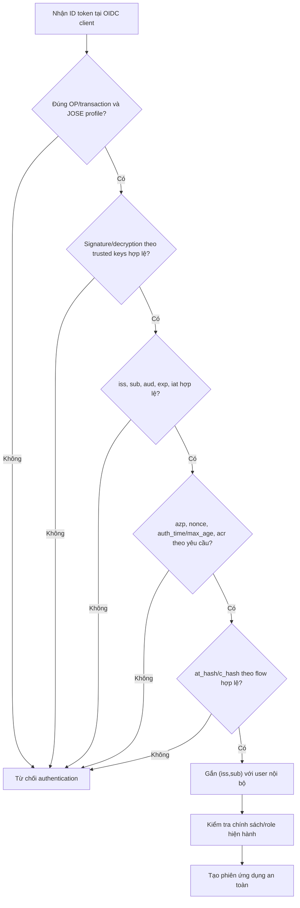

# Claims trong ID token

## 1. Tình huống mở đầu: đăng nhập thành công nhưng vẫn phải xác minh token

Một ứng dụng web `orders-web` cho phép nhân viên đăng nhập bằng OpenID Connect (OIDC). Sau khi người dùng xác thực tại OpenID Provider (OP), ứng dụng nhận một **ID token**, thường là JSON Web Token (JWT) đã ký, với payload tương tự:

```json
{
  "iss": "https://login.example.com",
  "sub": "usr-9e7d3b",
  "aud": "orders-web",
  "exp": 1900000600,
  "iat": 1900000000,
  "auth_time": 1899999970,
  "nonce": "n-4a9b7c...",
  "email": "employee@example.com",
  "email_verified": true
}
```

Các timestamp và định danh trên **chỉ để minh họa**, không phải ID token thực tế có chữ ký. Ứng dụng **không thể** chỉ Base64url-decode payload, đọc `email` rồi cho phép truy cập hệ thống. Nó phải xác minh chữ ký hoặc quy tắc bảo vệ theo profile, kiểm tra issuer, audience, expiry, nonce/transaction và những claims quan trọng khác.

Kể cả khi ID token hoàn toàn hợp lệ, hai câu hỏi sau **khác nhau**:

1. **Authentication:** “OpenID Provider đã xác thực chủ thể nào, lúc nào, theo ngữ cảnh nào?”
2. **Authorization:** “Chủ thể đó hiện được sửa đơn hàng 42 của tenant Alpha hay không?”

**ID token phục vụ xác thực danh tính tại OIDC client**, không tự trở thành access token để gọi Orders API và không tự cấp quyền nghiệp vụ. Claims như `email`, `name` hay `groups` còn có thể thay đổi sau thời điểm phát hành.

> **Nguyên tắc cốt lõi:** ID token là một **assertion về sự kiện xác thực** do OP phát hành cho **OIDC client cụ thể**. Client phải xác minh token trước khi tạo phiên, dùng cặp **(`iss`, `sub`)** làm định danh chủ thể ổn định trong phạm vi issuer, và tách dữ liệu hồ sơ/claims khỏi quyền truy cập tài nguyên.

Bài **“Claims trong ID token”** thuộc chương **OpenID Connect** của module `SECURITY_TOKEN_SECURITY_FUNDAMENTALS`. Nó liên kết mô hình tin cậy và vòng đời security token với JWT/opaque token, access/refresh token, scope, audience, phát hành, xác minh, lưu trữ, thu hồi và phòng chống token theft/replay trong OAuth 2.0/OIDC.

## 2. Mục tiêu học tập

Sau bài học này, bạn sẽ:

1. Giải thích ID token là gì, khác gì với **access token**, refresh token và authorization code.
2. Biết **năm claims bắt buộc** trong ID token OIDC Core: `iss`, `sub`, `aud`, `exp`, `iat`.
3. Phân tích điều kiện xuất hiện và cách kiểm tra `auth_time`, `nonce`, `azp`, `acr`, `amr`, `at_hash`, `c_hash`.
4. Phân biệt **authentication claims** với standard user profile claims như `name`, `email`, `phone_number` và `address`.
5. Hiểu **pairwise subject**, giới hạn dùng email/username làm khóa định danh, và nguy cơ nhầm người dùng giữa nhiều issuers.
6. Thực hiện luồng **OIDC Authorization Code + PKCE**, kiểm tra ID token sau token response.
7. Hiểu validation của JWS/JWE, algorithm allowlist, JWKS, issuer, audience, nonce, thời gian và hash-binding.
8. Biết khi nào dùng UserInfo endpoint và vì sao `sub` trong UserInfo response phải khớp ID token.
9. Áp dụng privacy, claim minimization, stale-claims và quyền hiện hành cho ứng dụng.
10. Thiết kế ma trận kiểm thử chống token substitution, replay, cross-client confusion và authentication bypass.

## 3. OIDC nằm ở đâu trong OAuth 2.0?

OAuth 2.0 chủ yếu mô tả **ủy quyền truy cập tài nguyên**. OIDC là một lớp **xác thực danh tính** trên OAuth 2.0: khi client gửi request OIDC hợp lệ, OP có thể phát ID token chứa các claims về sự kiện xác thực.

Các vai trò liên quan:

| Vai trò | Trong bài | Trách nhiệm |
| --- | --- | --- |
| **End-user** | Nhân viên đăng nhập | Xác thực với OP qua browser/user agent |
| **Relying Party (RP)/OIDC client** | `orders-web` | Khởi tạo request, nhận và xác minh ID token, quản lý phiên |
| **OpenID Provider (OP)** | `https://login.example.com` | Xác thực user, quản lý claims và phát hành ID token |
| **Resource server (RS)** | Orders API | Xác minh **access token** và quyền truy cập đơn hàng |
| **UserInfo endpoint** | Một endpoint của OP nếu được triển khai | Trả claims của user khi client trình access token phù hợp |

Trong OIDC, **OP** đồng thời đảm nhiệm vai trò authorization server theo ngữ cảnh OAuth 2.0. RP là một OAuth client được đăng ký với OP.

### 3.1. Scope `openid` là dấu hiệu yêu cầu OIDC

Một authorization request OIDC Code flow thường có:

```http
GET /authorize?response_type=code&client_id=orders-web&redirect_uri=https%3A%2F%2Forders.example.com%2Foidc%2Fcallback&scope=openid%20profile%20email&state=<state>&nonce=<nonce>&code_challenge=<challenge>&code_challenge_method=S256 HTTP/1.1
Host: login.example.com
```

- `openid` khiến request trở thành một **OIDC authentication request** theo profile.
- `profile` và `email` yêu cầu một nhóm claims, **không bảo đảm** mọi claim trong nhóm đều xuất hiện ở ID token.
- `state` ràng buộc authorization response với transaction của client.
- `nonce` ràng buộc ID token với authentication request khi được dùng/yêu cầu.
- `code_challenge` và `code_challenge_method=S256` phục vụ PKCE tại token exchange.
- `redirect_uri` phải được OP kiểm tra theo client registration.

**OIDC không đồng nghĩa quyền `orders:write`**. Nếu cần gọi Orders API, client còn phải có access token đúng audience/scope và RS phải kiểm tra quyền riêng.

### 3.2. OIDC ID token có phải luôn là JWT không?

**ID token được biểu diễn như JWT**, thường ở dạng **JWS có chữ ký**; trong các cấu hình OIDC hỗ trợ, ID token có thể được **mã hóa bằng JWE**, hoặc dạng nested JWT theo hợp đồng ký/mã hóa.

JWT là **cách biểu diễn**, không tự bảo đảm an toàn. Một chuỗi có ba dấu đoạn hoặc JSON chứa các claims đúng tên **chưa phải ID token đáng tin** nếu chưa xác minh nguồn phát hành và các điều kiện giao thức.

Không suy luận “ID token là JWT, còn access token luôn opaque”: OAuth access token cũng **có thể là JWT** hoặc opaque. Khác biệt quan trọng là **mục đích, audience và validation profile**, không đơn giản là có dấu chấm trong token.

## 4. Bốn loại credential thường bị nhầm

| Credential | Bên nhận dự kiến | Mục đích | Sai lầm cần tránh |
| --- | --- | --- | --- |
| **Authorization code** | Client đem tới OP token endpoint | Đổi code + PKCE verifier thành token | Gửi code tới Orders API |
| **ID token** | **OIDC client (RP)** | Xác thực sự kiện đăng nhập và chủ thể | Gửi ID token làm Bearer tới API |
| **Access token** | **Resource server** đúng audience | Truy cập protected resource theo scope/quyền | Dùng để tự kết luận user đã đăng nhập OIDC |
| **Refresh token** | **OP/AS token endpoint** | Xin token mới khi grant cho phép | Gửi refresh token tới API hoặc lưu bừa trong browser |

Ví dụ một response từ OP token endpoint trong OIDC Code flow:

```json
{
  "access_token": "<access_token_for_resource>",
  "token_type": "Bearer",
  "expires_in": 600,
  "scope": "openid profile email orders:read",
  "id_token": "<signed_id_token>",
  "refresh_token": "<only_if_granted>"
}
```

Response trên mang tính **minh họa**; refresh token **không bắt buộc** được cấp. Access token dành cho resource server có thể có audience khác `client_id` của RP.

### 4.1. Dữ liệu đáng tin từ ID token xuất hiện sau validation

Trình tự tư duy:

```text
Nhận id_token string
  -> Parse với giới hạn kích thước/cấu trúc
  -> Giải mã JWE nếu profile yêu cầu và đúng khóa
  -> Xác minh JWS signature hoặc cơ chế hợp lệ theo profile
  -> Kiểm tra issuer + audience + thời gian + transaction binding
  -> Kiểm tra các claims có điều kiện
  -> Tạo principal ứng dụng
  -> Tải/kiểm tra quyền nghiệp vụ hiện hành khi cần
```

**Không được** tạo session theo `sub`/`email` chỉ từ JWT payload chưa được xác minh.

## 5. Cấu trúc ID token: header, payload và signature

Một JWS compact thông thường có cấu trúc:

```text
BASE64URL(UTF8(protected_header_json))
.
BASE64URL(UTF8(id_token_claims_json))
.
BASE64URL(signature_bytes)
```

Ví dụ phần **JOSE protected header**:

```json
{
  "alg": "RS256",
  "typ": "JWT",
  "kid": "op-signing-key-2026-01"
}
```

Ví dụ phần **claims payload**:

```json
{
  "iss": "https://login.example.com",
  "sub": "usr-9e7d3b",
  "aud": "orders-web",
  "exp": 1900000600,
  "iat": 1900000000
}
```

Phần thứ ba là chữ ký. Header/claims không nên được coi đáng tin trước khi signature và toàn bộ giao thức validation thành công.

### 5.1. `alg` và `kid` nằm ở header, không phải ID token claims

- `alg` cho biết thuật toán mật mã được dùng/khai báo; RP **phải ràng buộc với thuật toán đã cho phép trong client registration/OP metadata/profile**, không tin giá trị này để tự chọn chính sách.
- `kid` giúp tìm khóa tương ứng trong **JWKS của OP đáng tin**, không chứng minh khóa đó đáng tin chỉ vì tên khóa đúng.
- `typ` có thể xuất hiện trong JOSE header; đối với ID token, không có quy tắc phổ quát rằng `typ` luôn phải bằng một chuỗi tùy ý do ứng dụng đặt. Kiểm tra theo OIDC/JWT profile thực tế.

**Không tải `jku`/`x5u` hoặc public key theo URL do token chưa xác minh tự khai.** JWKS endpoint phải được lấy từ cấu hình/discovery của issuer đáng tin, với chính sách cache/key rotation và chống SSRF.

### 5.2. JWT ký số không mặc định được mã hóa

Payload của JWS thường có thể Base64url-decode và đọc được. Chữ ký chứng minh tính toàn vẹn/nguồn phát hành theo key đã xác thực, **không che email, tên, số điện thoại hoặc các dữ liệu cá nhân**.

Nếu ứng dụng không cần PII trong ID token, **đừng yêu cầu nhúng PII** chỉ vì “JWT tiện đọc”; có thể sử dụng UserInfo hoặc một backend profile service có kiểm soát khi cần.

## 6. Năm claims bắt buộc theo OIDC Core

Các claims bắt buộc của ID token tiêu chuẩn:

| Claim | Kiểu JSON | Ý nghĩa | Kiểm tra trọng tâm |
| --- | --- | --- | --- |
| **`iss`** | String | Issuer identifier của OP | Phải khớp issuer đã tin cậy |
| **`sub`** | String | Subject identifier của end-user tại issuer đó | Phải có và không rỗng; dùng với `iss` |
| **`aud`** | String hoặc array strings | Audience gồm client ID dự kiến nhận ID token | Phải chứa RP `client_id` |
| **`exp`** | Number | Thời điểm hết hạn (NumericDate, Unix seconds) | Chưa hết hạn theo clock-skew policy |
| **`iat`** | Number | Thời điểm token được phát hành (NumericDate) | Kiểu/giá trị hợp lý, không đến từ tương lai quá mức cho phép |

Năm claims này là điều kiện **cần** để xử lý ID token chuẩn; vẫn cần xác minh signature/crypto, nonce khi có, authorized party khi cần và các quy tắc của response type.

### 6.1. Kiểm tra kiểu dữ liệu nghiêm ngặt

Các ví dụ sai:

```json
{"exp":"1900000600"}
```

```json
{"aud":12345}
```

```json
{"sub":null}
```

- `exp` phải là NumericDate, không dùng string trông giống số nếu profile không cho phép.
- `aud` là một string hoặc array gồm strings, không phải integer/JSON object.
- `sub` là string (không phải null hoặc đối tượng).
- Tránh parser cho phép **duplicate claim names** dẫn đến tầng ký và tầng nghiệp vụ đọc hai giá trị khác nhau; áp dụng JWT library/JSON parsing policy nhất quán.

**Lưu ý:** NumericDate là số giây kể từ Unix epoch, không phải Java milliseconds. Nếu library đã chuyển thành `Date`/`Instant`, không tự nhân/chia thêm lần nữa.

## 7. `iss`: ai xác thực và phát ID token?

`iss` (issuer) xác định OP phát hành ID token:

```json
{"iss":"https://login.example.com"}
```

RP phải biết trước **issuer mình đang tin** qua cấu hình hoặc discovery được ràng buộc đúng. RP phải xác minh claim `iss` **khớp chính xác issuer identifier** của OP mà transaction đã chọn.

### 7.1. Không tin issuer lấy trực tiếp từ token

Anti-pattern:

```text
id_token.iss = https://attacker.example
  -> client tải discovery/JWKS của attacker.example
  -> client kiểm tra chữ ký bằng khóa attacker
  -> client cho đăng nhập vì signature "hợp lệ"
```

Một chữ ký hợp lệ **theo khóa do attacker kiểm soát** không chứng minh token thuộc OP được ứng dụng tin cậy.

Quy trình đúng:

```text
Trusted configuration:
  issuer = https://login.example.com
  jwks_uri = (đã xác minh từ metadata thuộc issuer đó)

Received ID token:
  require iss == trusted issuer
  verify signature with trusted OP keys
```

### 7.2. Multi-issuer và nguy cơ mix-up

Một RP có thể hỗ trợ OP doanh nghiệp và OP khách hàng. Cần ràng buộc authentication transaction với **issuer được chọn trước khi redirect**, rồi xác minh ID token thuộc đúng issuer đó.

Hai OP có thể cùng cấp `sub="123"` cho hai người hoàn toàn khác. **Không dùng `sub` độc lập trên toàn bộ hệ thống**.

## 8. `sub`: định danh chủ thể, không phải email

`sub` (subject) là identifier của end-user trong phạm vi một issuer. Ví dụ:

```json
{"sub":"u-7f98c5"}
```

OIDC Core quy định `sub` là giá trị local-unique trong issuer, case-sensitive và không được OP tái phân bổ cho end-user khác. Giá trị thường opaque, ứng dụng không nên diễn giải cấu trúc của nó.

### 8.1. Khóa liên kết danh tính đúng

Khuyến nghị mô hình ứng dụng:

```text
external_identity_key = (issuer, subject)

Examples:
  ("https://login.example.com", "u-7f98c5")
  ("https://other-idp.example.org", "u-7f98c5")

Hai identity records trên KHÔNG mặc định cùng người.
```

Database có thể dùng unique constraint trên cặp `issuer` + `subject`, rồi ánh xạ tới **local internal user ID**.

### 8.2. Không dùng email làm khóa chính

Email:

- Có thể thay đổi sau khi token được phát hành.
- Có thể được chuyển sang người sở hữu khác theo thời gian hoặc domain.
- Có thể vắng mặt do thiếu consent/scope/profile.
- Có thể chưa được xác minh.
- Không bảo đảm duy nhất trên mọi issuers, nhất là môi trường federation.
- Có rủi ro account takeover nếu hệ thống **tự link hai tài khoản chỉ vì email giống nhau**.

Do đó, **không** dùng `email` thay cho cặp `(iss, sub)` khi nhận diện tài khoản OIDC.

### 8.3. Public subject và pairwise subject

Một OP có thể hỗ trợ hai loại subject identifiers:

| Kiểu | Đặc tính | Tác động |
| --- | --- | --- |
| **Public subject** | Một user thường có cùng `sub` tại các RPs của OP đó theo cấu hình | Dễ liên kết user giữa clients hơn, cần đánh giá privacy |
| **Pairwise subject** | OP tạo `sub` khác nhau cho cùng user giữa các **sector identifiers** | Giảm khả năng các RPs ở sectors khác nhau tự đối chiếu user |

Trong pairwise model, cùng user có thể có:

```text
RP A / sector A: sub = p-8c2a
RP B / sector B: sub = p-37f1
```

Đây là **cùng user tại OP** nhưng RP A và RP B không nên suy luận cặp giá trị có thể ánh xạ trực tiếp với nhau. Việc tính sector identifier phụ thuộc OIDC client registration, `sector_identifier_uri` và các quy tắc của profile.

**Không coi `sub` là định danh con người toàn cầu** dùng để join tất cả hệ thống. Nếu cần account linking nhiều issuers/RPs, hãy dùng quy trình xác minh/liên kết tài khoản có sự đồng ý và chính sách an ninh riêng.

## 9. `aud`: ID token được phát cho client nào?

`aud` (audience) trong ID token phải chứa **`client_id` của RP** dự kiến nhận ID token:

```json
{"aud":"orders-web"}
```

Hoặc một array khi profile cho phép:

```json
{"aud":["orders-web","other-client-id"]}
```

RP `orders-web` phải kiểm tra `aud` **có chứa chính client ID của mình**. Token dành riêng cho `billing-web` không được dùng để đăng nhập `orders-web` dù cùng OP và có chữ ký đúng.

### 9.1. ID token audience không phải resource-server audience

Phân biệt:

```text
ID token:
  aud = "orders-web"              <- OIDC client ID

Access token:
  aud = "https://orders-api.example.com"  <- Orders API
```

Orders API phải **từ chối ID token** được trình thay access token. Client cũng không nên coi JWT access token `aud=Orders API` là ID token xác thực người dùng.

### 9.2. `azp`: authorized party

`azp` là claim **tùy chọn** trong ID token, nêu party được ủy quyền nhận token (thường là client ID). Ví dụ:

```json
{
  "aud": ["orders-web", "another-audience"],
  "azp": "orders-web"
}
```

Theo OIDC Core, khi `aud` có nhiều giá trị, RP **SHOULD** kiểm tra `azp` hiện diện; nếu `azp` hiện diện, RP **SHOULD** kiểm tra nó bằng `client_id` của mình. Một chính sách bảo mật chặt hơn có thể **bắt buộc azp khi multiple audiences** và từ chối khi không khớp.

Không biến `azp` thành bằng chứng thay thế `aud`:

```text
Sai:
  azp == orders-web nên bỏ qua kiểm tra aud.

Đúng:
  require aud contains orders-web;
  kiểm tra azp theo điều kiện/profile và client policy.
```

## 10. `exp` và `iat`: thời gian cấp và hết hạn

### 10.1. `exp`

`exp` là Unix timestamp (số giây) sau đó token **không còn được chấp nhận** theo chính sách thời gian.

Ví dụ:

```json
{
  "iat": 1900000000,
  "exp": 1900000600
}
```

Ví dụ này minh họa thời hạn 600 giây. **Không dùng các timestamp cố định này làm token đăng nhập thật**.

Client phải xác minh `exp` chưa trôi qua, với **clock skew nhỏ và có giới hạn** nếu cần. Không chấp nhận một ID token hết hạn chỉ vì signature vẫn đúng.

### 10.2. `iat`

`iat` ghi lúc ID token được phát hành. Nó giúp client áp dụng chính sách token quá cũ, sai thời gian hoặc không phù hợp transaction.

Tuy nhiên:

- **`iat` không phải thời điểm user vừa nhập mật khẩu.**
- Không dùng `iat` thay `auth_time` khi muốn biết lần xác thực cuối.
- Chỉ vì `iat` gần hiện tại không có nghĩa OP đã yêu cầu user nhập lại credential; OP có thể dùng session SSO hợp lệ từ trước.

### 10.3. Clock skew

Ví dụ policy:

```text
now = trusted system time
skew = bounded small allowance (ví dụ 60 giây, do hệ thống quyết định)

require exp > now - skew
require iat <= now + skew
require iat/exp types and values sensible
```

Con số 60 giây **chỉ minh họa**, không phải mức bắt buộc của OIDC. Skew quá rộng làm tăng cửa sổ chấp nhận token cũ; cần giám sát đồng bộ đồng hồ NTP/host và lựa chọn tolerance theo rủi ro.

## 11. `auth_time`: người dùng xác thực lần cuối khi nào?

`auth_time` là thời điểm **End-User authentication** được thực hiện tại OP, khác với lúc ID token được tạo.

Ví dụ:

```json
{
  "iat": 1900000000,
  "auth_time": 1899996400
}
```

Trong ví dụ, ID token được phát tại thời điểm iat, còn user authentication có thể đã diễn ra **khoảng một giờ trước đó**. Điều này bình thường nếu OP dùng session SSO và profile cho phép.

### 11.1. Khi nào `auth_time` bắt buộc?

Trong OIDC Core, khi RP gửi tham số `max_age` trong authentication request, **ID token trả về phải có `auth_time`** để client kiểm tra độ mới của sự kiện xác thực. Claim cũng có thể xuất hiện vì yêu cầu claims/chính sách khác.

Ví dụ:

```http
GET /authorize?response_type=code&client_id=orders-web&scope=openid&max_age=300&state=<state>&nonce=<nonce>&code_challenge=<challenge>&code_challenge_method=S256&redirect_uri=https%3A%2F%2Forders.example.com%2Fcallback HTTP/1.1
Host: login.example.com
```

Ý nghĩa:

- RP yêu cầu thời gian kể từ lần authentication của user **không vượt 300 giây**, theo semantics OIDC.
- Nếu authentication hiện có quá cũ, OP cần thực hiện lại authentication theo yêu cầu hoặc trả lỗi phù hợp.
- RP phải **tự kiểm tra `auth_time`** trong ID token đã xác minh; không đơn giản tin OP đã làm đúng vì request có `max_age`.

### 11.2. Tại sao kiểm tra auth_time khác iat?

Giả sử:

```text
09:00 user đăng nhập OP bằng MFA
13:00 OP dùng session SSO, phát ID token mới
13:01 user muốn đổi thông tin thanh toán

iat mới gần đây (~13:00)
auth_time cũ (~09:00)
```

Nếu chức năng đổi thông tin thanh toán yêu cầu authentication trong 5 phút vừa qua, **ID token mới chưa đủ** nếu `auth_time` quá cũ. RP cần khởi tạo authentication request với `max_age` phù hợp hoặc step-up theo profile/policy.

**Không dùng `exp` hay `iat` để chứng minh người dùng mới thực hiện MFA.** Thời hạn token và freshness của authentication là hai khái niệm khác nhau.

### 11.3. `max_age=0`

Theo OIDC, `max_age=0` có ngữ nghĩa yêu cầu authentication hiện tại/re-authentication. Khi nhận ID token, RP kiểm tra `auth_time` theo policy và độ lệch đồng hồ hợp lý.

Không coi `prompt=login` hay `max_age=0` là bằng chứng **chắc chắn** user đã trải qua một phương thức MFA cụ thể; các yêu cầu assurance phải dựa trên contract với OP và `acr`/`amr` phù hợp.

## 12. `nonce`: ràng buộc ID token với authentication request

`nonce` là chuỗi do RP tạo để liên kết ID token với một authentication transaction cụ thể và giảm rủi ro replay/substitution.

Ví dụ:

```text
RP sinh nonce ngẫu nhiên: N-8ad4e...

Authorization request:
  nonce=N-8ad4e...

ID token nhận sau authentication:
  "nonce": "N-8ad4e..."

RP:
  require token.nonce == storedTransaction.nonce
```

### 12.1. Khi nào nonce bắt buộc?

- **OIDC implicit và hybrid**: `nonce` là tham số bắt buộc theo những flow đó.
- **OIDC Authorization Code flow**: `nonce` là tùy chọn theo OIDC Core, nhưng nếu client gửi nonce thì ID token **phải có claim nonce tương ứng và client phải kiểm tra**.
- Profile/AS bảo mật cao có thể yêu cầu nonce cả trong code flow.

**Không nói “OIDC nonce lúc nào cũng bắt buộc cho mọi code flow”**, nhưng cũng không bỏ verification khi chính client đã gửi nonce.

### 12.2. Cách bảo vệ nonce

1. Sinh giá trị ngẫu nhiên có entropy đủ cao, khác nhau theo transaction.
2. Lưu nonce cùng `state`, PKCE verifier, issuer, client ID và thời hạn.
3. Gửi nonce qua OIDC authentication request.
4. Sau khi ID token đã được xác minh ký/issuer/audience, so khớp nonce với transaction.
5. Dùng một lần và xóa transaction khi hoàn tất.
6. Sai/thiếu nonce khi kỳ vọng → **từ chối login**.

Không dùng `nonce=123` cố định hoặc lấy `sub`/email làm nonce. Không đưa một nonce của session này sang session khác.

### 12.3. Nonce không thay thế state hay PKCE

| Cơ chế | Mục tiêu chính | Bên kiểm tra |
| --- | --- | --- |
| `state` | Callback/authorization response thuộc transaction của RP; chống CSRF | RP tại callback |
| PKCE `code_verifier` | Bên đổi authorization code có verifier gắn với code | OP/AS tại token endpoint |
| `nonce` | ID token được trả thuộc authentication request dự kiến | RP khi kiểm tra ID token |
| `iss` | Token đến từ OP được tin | RP |
| `aud` | ID token dành cho đúng RP | RP |

Một hệ thống chỉ kiểm tra nonce nhưng **không kiểm tra `state`/issuer/PKCE** vẫn có các đường tấn công khác. Cũng không nên cho phép callback tùy ý chỉ vì ID token chứa nonce đúng.

## 13. `acr` và `amr`: mức độ và phương thức xác thực

Hai claims này thường bị diễn giải sai trong hệ thống phân quyền.

### 13.1. `acr` — Authentication Context Class Reference

`acr` là **string** biểu diễn authentication context class theo quy tắc/định nghĩa của OP và các bên liên quan.

Ví dụ minh họa:

```json
{"acr":"urn:example:assurance:high"}
```

Claim này **không tự có ý nghĩa toàn cầu** chỉ vì chứa từ `high`. RP phải có hợp đồng/metadata cho biết chính xác `acr` nào tương ứng mức assurance và các điều kiện xác thực.

### 13.2. `amr` — Authentication Methods References

`amr` thường là **array strings** mô tả các phương thức authentication đã được dùng theo cách OP báo cáo.

Ví dụ minh họa:

```json
{"amr":["pwd","otp"]}
```

Không suy ra đơn giản rằng `["pwd","otp"]` tự chứng minh mức assurance hợp lệ cho mọi giao dịch tài chính. Các giá trị/ý nghĩa phải theo profile và **trust contract** giữa RP và OP.

### 13.3. `acr`/`amr` có bắt buộc không?

Trong ID token chuẩn OIDC Core, **`acr` và `amr` là claims tùy chọn**. Sự có mặt/giá trị phụ thuộc OP, scopes, `claims` parameter, policy và profile.

Ứng dụng yêu cầu xác thực mạnh nên:

1. Xác định assurance policy cụ thể (ví dụ định nghĩa `acr` được chấp nhận).
2. Yêu cầu OP thực hiện đúng authentication context.
3. Kiểm tra `auth_time` và tuổi authentication nếu cần step-up.
4. Kiểm tra `acr`/`amr` theo hợp đồng đã thống nhất và xử lý khi thiếu.
5. Không tự “nâng quyền” bằng cách client viết lại claims.

### 13.4. `acr_values` là yêu cầu, không phải chứng cứ

Authorization request có thể có:

```text
acr_values=urn:example:assurance:high
```

Đây là đề nghị gửi tới OP. **RP phải kiểm tra ID token có `acr` đạt chính sách** nếu tác vụ yêu cầu assurance. Không được chỉ nhìn request chứa `acr_values` rồi kết luận người dùng đã xác thực ở mức đó.

## 14. `azp`, `at_hash` và `c_hash`: các ràng buộc nâng cao

### 14.1. `azp` kiểm tra authorized party

Với ID token có multiple `aud` hoặc khi profile yêu cầu, `azp` giúp RP xác định party được ủy quyền. Nó phải được xem cùng `aud` và trust contract.

Không dùng `azp` làm cách bỏ qua kiểm tra client ID trong audience.

### 14.2. `at_hash`: ràng buộc access token

`at_hash` là claim hash của **access token**, được tính theo quy tắc OIDC của thuật toán ký ID token. Về nguyên tắc:

```text
digest = HASH(ASCII(access_token))
left_half = left-most half of digest bytes
at_hash = BASE64URL(left_half), no padding
```

Ví dụ thuật toán ký ID token dùng SHA-256 (như RS256/ES256 trong những profile phổ biến), hash đầu vào là SHA-256 và giữ 128 bit bên trái trước Base64url.

**Không so sánh `at_hash` với nguyên chuỗi access token** hoặc chỉ Base64url-encode AT. Phải làm đúng phép hash và thuật toán được suy ra từ JOSE header `alg` theo OIDC specification.

### 14.3. `c_hash`: ràng buộc authorization code

Tương tự, `c_hash` ràng buộc **authorization code** xuất hiện trong authorization response với ID token theo quy tắc hash của OIDC.

```text
digest = HASH(ASCII(authorization_code))
left_half = left-most half of digest bytes
c_hash = BASE64URL(left_half), no padding
```

Cơ chế này đặc biệt liên quan các **OIDC hybrid response types** trong đó authorization code và ID token được trả qua authorization endpoint.

### 14.4. Khi nào `at_hash`/`c_hash` bắt buộc?

Không nói chúng luôn có trong mọi ID token.

| Flow/nguồn ID token | Tình huống | Định hướng theo OIDC Core |
| --- | --- | --- |
| **Code flow** tại token endpoint | ID token cùng token response | `at_hash` có thể xuất hiện; có thể kiểm tra khi hiện diện theo profile; `c_hash` không bắt buộc chỉ vì có code flow |
| **Implicit**: access token được trả từ authorization endpoint | ID token đi cùng access token trong front channel | `at_hash` cần có và được xác minh theo flow |
| **Hybrid**: authorization code được trả cùng ID token tại authorization endpoint | Code + ID token ở front channel | `c_hash` cần có và phải kiểm tra theo flow |
| **Hybrid**: access token cùng ID token tại authorization endpoint | Access token ở front channel | `at_hash` cần có và phải kiểm tra theo flow |

Lưu ý các response types OIDC cụ thể có thêm quy tắc. Dùng thư viện hỗ trợ **đúng OIDC flow**, không tự thêm một điều kiện `c_hash` cho mọi Code flow khiến client từ chối ID token hợp lệ.

### 14.5. Một ID token hợp lệ không xác thực mọi access token

Nếu RP nhận một ID token hợp lệ và một access token khác (ví dụ bị thay thế trong một response hoặc bị trộn trong cache), RP phải xử lý theo **ràng buộc token response, hash claims khi cần và profile của AS**. RS tiếp tục xác minh access token độc lập; ID token không thay thế kiểm tra audience, scope và chữ ký/introspection của access token.

## 15. Standard claims về hồ sơ người dùng

Ngoài claims authentication, OIDC định nghĩa nhiều **Standard Claims** phục vụ hồ sơ user.

| Claim | Kiểu điển hình | Ý nghĩa | Lưu ý sử dụng |
| --- | --- | --- | --- |
| `name` | String | Họ tên hiển thị | Có thể thay đổi, không làm khóa tài khoản |
| `given_name` | String | Tên | Có thể vắng mặt |
| `family_name` | String | Họ | Không suy ra pháp lý của danh tính |
| `middle_name` | String | Tên đệm | Tùy vùng/văn hóa |
| `nickname` | String | Tên gọi | Không duy nhất |
| `preferred_username` | String | Username người dùng muốn dùng | Không bảo đảm duy nhất/bất biến |
| `profile` | URL string | Trang hồ sơ | Không tự fetch URL chưa tin cậy từ backend |
| `picture` | URL string | Ảnh đại diện | Cẩn trọng SSRF/tracking/nội dung độc |
| `website` | URL string | Website cá nhân | Không dùng làm identity proof |
| `email` | String | Email user | Có thể thay đổi/chưa xác minh |
| `email_verified` | Boolean | OP xác nhận đã thực hiện bước xác minh email | Không phải bằng chứng owner vĩnh viễn |
| `gender` | String | Thông tin giới tính nếu user cung cấp | Nhạy cảm, tối thiểu hóa |
| `birthdate` | String | Ngày sinh theo định dạng OIDC | Dữ liệu nhạy cảm, hạn chế xử lý |
| `zoneinfo` | String | Time zone người dùng | Có thể vắng mặt |
| `locale` | String | Ngôn ngữ/locale ưu tiên | Không làm bằng chứng vị trí |
| `phone_number` | String | Số điện thoại | Có thể thay đổi |
| `phone_number_verified` | Boolean | OP đã xác minh kiểm soát số điện thoại theo quy trình | Không chứng minh người dùng giữ số mãi |
| `address` | JSON object | Địa chỉ gồm các thành phần định nghĩa bởi OIDC | Không phải string tùy ý |
| `updated_at` | Number | Lần cuối thông tin end-user được cập nhật theo OP | Không phải bằng chứng mọi dữ liệu hiện hành |

**Không bắt buộc** mọi claim trên có trong ID token. OIDC thường cung cấp chúng qua **UserInfo endpoint** hoặc cách yêu cầu claims của OP theo profile. RP nên chỉ yêu cầu dữ liệu thực sự cần.

### 15.1. `email_verified` không phải chứng cứ phân quyền

Một ID token có:

```json
{
  "email": "employee@example.com",
  "email_verified": true
}
```

cho biết OP báo email đã được xác minh theo quy trình của OP. Nhưng:

- Không chứng minh user đang có quyền `orders:delete`.
- Không đảm bảo địa chỉ email chưa đổi owner.
- Không tự chứng minh nhân viên vẫn thuộc công ty.
- Không là lý do an toàn để **tự động link tài khoản trên issuer khác** chỉ vì email giống nhau.
- Không đồng nghĩa email là identifier bất biến.

Nếu dùng email cho liên hệ/thông báo, RP cần cơ chế cập nhật và privacy policy. Nếu dùng domain email như tín hiệu vào tổ chức, vẫn cần chính sách IdP/tenant/assignment đáng tin và kiểm tra trạng thái hiện hành.

### 15.2. `email_verified` phải là Boolean

Sai:

```json
{"email_verified":"true"}
```

Đúng kiểu JSON:

```json
{"email_verified":true}
```

Một parser lỏng có thể coi string `"false"` là truthy trong một số ngôn ngữ, gây sai quyết định. Nếu ứng dụng thực sự dựa vào claim này, phải **kiểm tra kiểu dữ liệu** và chỉ dùng sau khi ID token/UserInfo được xác minh hợp lệ.

### 15.3. `address` là object

Ví dụ:

```json
{
  "address": {
    "formatted": "123 Example Street, Example City",
    "street_address": "123 Example Street",
    "locality": "Example City",
    "country": "VN"
  }
}
```

Không tự nhúng địa chỉ chi tiết vào ID token nếu ứng dụng chỉ cần greeting. PII làm tăng rủi ro lộ JWT qua log/browser và tạo nghĩa vụ retention/quyền riêng tư.

## 16. `scope=profile email phone address` có bảo đảm claims không?

Không. Scopes OIDC này biểu thị **yêu cầu truy cập nhóm Standard Claims** theo quy tắc OIDC; OP vẫn phải áp dụng registration, consent, privacy, dữ liệu sẵn có và các chính sách.

Ví dụ:

```text
scope=openid profile email
```

có thể dẫn tới:

- ID token có đầy đủ claims authentication bắt buộc nhưng **không chứa email/name**.
- UserInfo endpoint trả một số `name`, `email`, `email_verified` khi client được phép.
- OP trả ít claims hơn nếu user không có dữ liệu, từ chối consent hoặc profile không cung cấp.

**Không xem một claim không có mặt là bằng chứng user không có giá trị đó**. Có thể do nó không được phát hành, chưa được yêu cầu hoặc privacy policy.

### 16.1. `claims` request parameter

OIDC hỗ trợ một `claims` request parameter có thể yêu cầu claims cụ thể trong `id_token` hoặc `userinfo`.

Ví dụ minh họa JSON bên trong authorization request:

```json
{
  "id_token": {
    "auth_time": {"essential": true},
    "acr": {
      "essential": true,
      "values": ["urn:example:assurance:high"]
    }
  },
  "userinfo": {
    "email": {"essential": true},
    "email_verified": null
  }
}
```

- `essential` thể hiện một yêu cầu theo OIDC, **không phải một quyền của client để ép OP tiết lộ dữ liệu**.
- OP có thể trả lỗi nếu không thể đáp ứng các yêu cầu bắt buộc theo profile/chính sách, hoặc hành vi theo đặc tả tương ứng.
- Request phải được URL-encode, hoặc dùng request object/PAR khi AS hỗ trợ để giảm độ dài URL và bảo vệ integrity.
- Client vẫn phải **kiểm tra thực tế các claims** trong response và xử lý thiếu/sai an toàn.

Không đặt bí mật người dùng hoặc dữ liệu nhạy cảm không cần thiết vào authorization URL chỉ để request một claim.

## 17. UserInfo endpoint: lấy claims profile khi cần

**UserInfo** là endpoint OIDC được OP cung cấp theo profile để trả thông tin về end-user. RP gọi bằng **access token phù hợp với UserInfo**, không bằng ID token hoặc refresh token.

Luồng:

```mermaid
sequenceDiagram
    participant RP as OIDC Client
    participant OP as OpenID Provider
    participant UI as UserInfo Endpoint
    RP->>OP: OIDC code flow + PKCE
    OP-->>RP: id_token + access_token
    RP->>RP: Verify ID token (iss/sub/aud/exp/nonce...)
    RP->>UI: GET /userinfo; Authorization: Bearer access_token
    UI-->>RP: JSON claims (sub, name, email...)
    RP->>RP: Require UserInfo.sub == verified ID token.sub
    RP->>RP: Chỉ dùng profile claims phù hợp policy
```

Response UserInfo minh họa:

```http
HTTP/1.1 200 OK
Content-Type: application/json

{
  "sub": "usr-9e7d3b",
  "name": "Nguyễn Minh An",
  "email": "employee@example.com",
  "email_verified": true
}
```

### 17.1. Kiểm tra `sub` tại UserInfo

**OIDC Core yêu cầu** RP xác minh `sub` trong UserInfo response **khớp chính xác** `sub` của ID token đã xác minh. Nếu không khớp, **không sử dụng giá trị từ UserInfo**.

Vì sao? Client có thể vô tình sử dụng access token của một user khác do cache/session confusion. Không kiểm tra `sub` dẫn tới hồ sơ user A bị gắn vào session user B.

```text
Verified ID token:
  iss = https://login.example.com
  sub = user-A

UserInfo response:
  sub = user-B

=> REJECT; không trộn profile của B vào phiên A.
```

### 17.2. Access token gọi UserInfo không phải token cho mọi API

OP có thể cấp một access token dùng tại UserInfo; một access token dành cho Orders API có thể có audience khác. **Không gửi bừa một bearer token tới mọi endpoint** chỉ vì cùng issuer hoặc cùng account.

Resource server nào nhận token thì phải kiểm tra audience/scope theo contract. UserInfo endpoint cũng phải bảo vệ transport, claims và access token theo OIDC.

### 17.3. Aggregated/distributed claims

OIDC Core có cơ chế **Aggregated Claims** và **Distributed Claims**, trong đó một số claims có thể đến từ nguồn khác. Việc xử lý phụ thuộc OP và các nguồn claims được tin cậy, bao gồm xác minh chữ ký/nguồn phát hành và tránh SSRF khi dereference URI.

Nếu ứng dụng không có nhu cầu sử dụng cấu trúc này, **không tự theo URL bên ngoài ID token** để lấy thông tin rồi xem là đã xác minh. Chỉ bật khi client và OP hỗ trợ đầy đủ profile/trust model.

## 18. Quy trình xác minh ID token đầy đủ

Đây là phần quan trọng nhất khi chuyển kiến thức về claims thành một chính sách client thực thi được.

### 18.1. Bước 1 — lấy token từ đúng nguồn tin cậy

RP phải biết:

- OP issuer đã được chọn tin cậy.
- Token endpoint và JWKS từ OP metadata/registration đáng tin.
- Client ID, signing algorithm(s) và key material được phép.
- Response type/flow (code, implicit/hybrid nếu legacy).
- State, nonce, PKCE verifier và expected max_age/acr của transaction.

**Không lấy JWKS URL hoặc issuer từ claim của token chưa xác minh** rồi tạo niềm tin mới theo claim đó.

### 18.2. Bước 2 — kiểm tra token format và bảo vệ JOSE

- Giới hạn kích thước token, JSON nesting, số fields để chống DoS.
- Kiểm tra cấu trúc JWS/JWE theo profile.
- Nếu JWE: giải mã bằng khóa RP được cấu hình và xử lý chữ ký/inner token theo yêu cầu profile.
- Không tự chấp nhận `alg=none` hoặc thuật toán không được đăng ký chỉ vì library parse được.
- Nếu dùng chữ ký bất đối xứng, xác minh bằng public key của **đúng OP và đúng key type/alg**.
- Nếu profile dùng thuật toán đối xứng, phải có key derivation/client secret handling đúng OIDC; không cho attacker dùng public key làm HMAC key (*algorithm confusion*).
- Chỉ chấp nhận keys từ **trusted JWKS URI**; cập nhật key rotation có kiểm soát.

### 18.3. Bước 3 — xác minh claims bắt buộc

```text
require iss == configured trusted issuer
require sub is nonempty string
require aud contains this client's client_id
require exp is numeric and not expired
require iat is numeric and plausible
```

Bảo đảm parser đưa giá trị đúng kiểu. Một ID token với `aud=SomeOtherClient` không được đưa vào session hiện tại.

### 18.4. Bước 4 — kiểm tra các claims có điều kiện

```text
if aud contains multiple values:
    enforce azp according to OIDC/profile policy

if azp exists:
    require azp == expected client_id (theo client policy)

if nonce was sent or required:
    require nonce exists and equals expected transaction nonce

if max_age was requested:
    require auth_time exists and freshness <= max_age + bounded skew

if acr assurance was required:
    require returned acr satisfies agreed assurance policy

if front-channel code was returned with ID token:
    validate c_hash according to hybrid-flow rules

if front-channel access token was returned with ID token:
    validate at_hash according to flow rules

if UserInfo called:
    require userinfo.sub == validated_id_token.sub
```

**Không chấp nhận claims profile ở bước này làm quyền cao nhất**. Tất cả quyền nghiệp vụ vẫn cần policy riêng.

### 18.5. Bước 5 — tạo phiên đúng subject

Sau khi ID token hợp lệ:

1. Tra hoặc tạo mapping từ **`(iss, sub)`** tới internal principal.
2. Không tự link bằng email nếu chưa có quy trình an toàn.
3. Xác định account/tenant/role hiện hành từ nguồn phù hợp.
4. Tạo session cookie hoặc server-side session với expiry/re-auth policy thích hợp.
5. Đánh dấu transaction authorization code/state/nonce đã sử dụng.
6. Không đưa raw ID token/refresh token vào browser URL hoặc log.

### 18.6. Sơ đồ validation



## 19. Ví dụ Java 17: xác minh claims sau khi chữ ký đã được kiểm tra

Đoạn code sau chỉ xử lý **claim validation sau cryptographic validation**. Đầu vào là `JWTClaimsSet` từ thư viện Nimbus JOSE + JWT (có sẵn trong nhiều stack Java), **đã được xác minh signature/issuer trust qua một JWT processor được cấu hình đáng tin**.

**Đặc biệt: không gọi ví dụ này trực tiếp trên JWT chưa xác minh.** Nó không tự chọn JWKS URL, không giải mã JWE, không xác minh JWS và không xử lý toàn bộ OIDC hybrid/front-channel hash rules.

```java
import com.nimbusds.jwt.JWTClaimsSet;
import java.text.ParseException;
import java.time.Duration;
import java.time.Instant;
import java.util.Date;
import java.util.List;

public final class OidcIdTokenClaimsValidator {
    private OidcIdTokenClaimsValidator() {}

    public static void validate(
            JWTClaimsSet claims,          // ĐÃ verify signature bằng trusted OP keys
            String expectedIssuer,
            String expectedClientId,
            String expectedNonce,         // null nếu request không dùng nonce
            Duration maxAge,              // null nếu không yêu cầu
            Instant now,
            Duration clockSkew) throws ParseException {

        if (!expectedIssuer.equals(claims.getIssuer())) {
            throw new SecurityException("Untrusted ID token issuer");
        }

        String subject = claims.getSubject();
        if (subject == null || subject.isBlank()) {
            throw new SecurityException("Missing ID token subject");
        }

        List<String> audience = claims.getAudience();
        if (audience == null || !audience.contains(expectedClientId)) {
            throw new SecurityException("Wrong ID token audience");
        }

        Date expiration = claims.getExpirationTime();
        Date issuedAt = claims.getIssueTime();
        if (expiration == null || issuedAt == null) {
            throw new SecurityException("Missing exp or iat");
        }
        if (!expiration.toInstant().isAfter(now.minus(clockSkew))) {
            throw new SecurityException("Expired ID token");
        }
        if (issuedAt.toInstant().isAfter(now.plus(clockSkew))) {
            throw new SecurityException("ID token issued in future");
        }

        String authorizedParty = claims.getStringClaim("azp");
        if (audience.size() > 1 && authorizedParty == null) {
            // Strict local policy; OIDC Core uses SHOULD for this check.
            throw new SecurityException("Missing azp with multiple aud");
        }
        if (authorizedParty != null
                && !expectedClientId.equals(authorizedParty)) {
            throw new SecurityException("Wrong authorized party");
        }

        if (expectedNonce != null) {
            String nonce = claims.getStringClaim("nonce");
            if (!expectedNonce.equals(nonce)) {
                throw new SecurityException("Nonce mismatch");
            }
        }

        if (maxAge != null) {
            Object rawAuthTime = claims.getClaim("auth_time");
            if (!(rawAuthTime instanceof Number)) {
                throw new SecurityException("Missing numeric auth_time");
            }

            long seconds = ((Number) rawAuthTime).longValue();
            Instant authenticationTime = Instant.ofEpochSecond(seconds);
            if (authenticationTime.isAfter(now.plus(clockSkew))) {
                throw new SecurityException("auth_time in future");
            }

            Duration age = Duration.between(authenticationTime, now);
            if (age.compareTo(maxAge.plus(clockSkew)) > 0) {
                throw new SecurityException("Authentication too old");
            }
        }

        // Tiếp tục các điều kiện profile:
        // acr/amr, c_hash/at_hash, JOSE/JWE, state/PKCE binding.
        // Không xác thực tài khoản bằng email hoặc preferred_username.
    }
}
```

### 19.1. Chính xác ví dụ làm được gì?

- Kiểm tra `iss` bằng expected issuer **đã cấu hình**.
- Kiểm tra `sub` không rỗng.
- Kiểm tra `aud` chứa client ID.
- Kiểm tra `exp`/`iat` và clock skew.
- Theo chính sách ví dụ, đòi `azp` khi có multiple audience và kiểm tra nó bằng client ID.
- Kiểm tra `nonce` nếu RP gửi nonce.
- Kiểm tra `auth_time` khi có `max_age`.

### 19.2. Những gì ví dụ **chưa** làm

1. **Chưa xác minh chữ ký**: thư viện JWT processor đáng tin phải verify JWS/JWE trước.
2. Chưa xác định `JWTClaimsSet` có được parse **strict** để loại duplicate claims hay không.
3. Chưa kiểm tra type của `exp/iat` nếu parser đã coercion trước khi tạo `Date`; profile validation có thể cần strict JSON typing ở lớp parser.
4. Chưa xác minh `nonce` là transaction chưa dùng, gắn đúng browser session; điều đó phải xử lý ở transaction store.
5. Chưa xác minh `state`/PKCE verifier/callback issuer trước/ngoài ID token.
6. Chưa xác minh `acr` theo assurance policy.
7. Chưa tính `at_hash/c_hash` theo OIDC flow.
8. Chưa kiểm tra tổng lifetime/rủi ro của token ngoài `exp`; cần profile policy.
9. Chưa xử lý lỗi `Instant.ofEpochSecond` overflow hoặc giá trị numeric cực lớn; production cần giới hạn input/type an toàn.
10. Chưa xử lý quản lý phiên/logout và stale claims.
11. Chưa chứng minh access token có audience/scope đúng để gọi Orders API.
12. Chưa thay thế OIDC-certified client library.

**Ưu tiên dùng thư viện OIDC client đã được kiểm chứng**, để validation phù hợp flow, profile, JOSE key rotation và các edge cases. Code tay chỉ nên phục vụ giáo dục hoặc làm adapter bổ sung cho chính sách của ứng dụng.

## 20. Authentication freshness: thiết kế theo tác vụ

Giả sử RP có ba loại hành động:

| Hành động | Yêu cầu authentication ví dụ | Dữ liệu cần kiểm tra |
| --- | --- | --- |
| Xem dashboard | Session OIDC còn hợp lệ | Issuer/sub/session lifecycle |
| Đổi email liên hệ | Authentication gần đây theo policy | `max_age` → `auth_time` |
| Phê duyệt chuyển tiền | Assurance/step-up cao, re-auth khi cần | `auth_time`, `acr`/`amr` theo hợp đồng, policy giao dịch |

**Không dùng một ngưỡng max_age chung cho mọi nghiệp vụ** nếu rủi ro khác nhau. Đồng thời, ID token được phát lại có thể mang `iat` mới nhưng `auth_time` cũ.

### 20.1. Không sử dụng `acr` không được định nghĩa

Nếu OP phát:

```json
{"acr":"high"}
```

nhưng không có trust contract nói `high` nghĩa là gì, RP không nên tự diễn giải “MFA chống phishing đã đạt”. Trường hợp rủi ro cao cần assurance policy rõ, có thể ràng buộc phương thức xác thực, thời hạn và bằng chứng từ OP/IdP đã được kiểm toán.

### 20.2. Lỗi `login_required`, `interaction_required` và step-up

Khi RP yêu cầu authentication mới mà OP không thể hoàn tất không tương tác (ví dụ `prompt=none`), OP có thể trả lỗi OIDC như `login_required` hoặc `interaction_required`.

RP phải xử lý lỗi theo flow; không tự tạo ID token giả, không xem token cũ là đã đáp ứng step-up mới và không lặp silent auth vô hạn.

## 21. Stale claims: thông tin trong ID token không tự cập nhật

Giả sử lúc 09:00 OP phát ID token:

```json
{
  "iss": "https://login.example.com",
  "sub": "usr-9e7d3b",
  "aud": "orders-web",
  "iat": 1900000000,
  "exp": 1900000600,
  "email": "employee@old-domain.example",
  "email_verified": true,
  "department": "Sales"
}
```

Lúc 09:05 user đổi phòng ban sang Finance hoặc bị ngắt quyền truy cập. ID token đã phát **không tự thay đổi** vì user profile/role ở nguồn dữ liệu đã đổi.

### 21.1. Phân loại theo độ mới cần thiết

| Dữ liệu | Có thể lấy từ ID token không? | Độ mới thường cần |
| --- | --- | --- |
| `iss`, `sub` | Có, sau validation | Định danh gắn transaction |
| `auth_time` | Có khi OP phát theo policy | Đối chiếu với max_age/step-up |
| Tên hiển thị | Có nếu OP phát, không bắt buộc | Cập nhật khi cần hiển thị |
| Email/phone | Có nếu được cấp, nhưng có thể đổi | Tải lại/đối chiếu khi quan trọng |
| Employee status | Không nên dựa duy nhất vào snapshot dài hạn | Chính sách tổ chức hiện hành |
| Role/grant admin | Không có chuẩn mặc định OIDC Core cho mọi ứng dụng | Nguồn phân quyền có thẩm quyền |
| Tenant membership | Claims tùy biến có thể có, nhưng không đủ tự quyết | Kiểm tra mapping/ACL hiện hành |
| Quyền đối với bản ghi | Không nên nhúng toàn bộ ACL vào ID token | Kiểm tra tại resource server |

### 21.2. `updated_at` có ý nghĩa nhưng không biến token thành dữ liệu real-time

`updated_at` có thể cho biết OP báo thông tin hồ sơ cuối cùng được cập nhật lúc nào. Nó **không phải cơ chế đồng bộ lập tức giữa mọi hệ thống**, không chứng minh role/permission database ngoài OP vẫn mới.

Nếu ứng dụng cần quyền thay đổi tức thì, cân nhắc:

- Server-side authorization lookup.
- UserInfo/profile refresh theo chính sách.
- Cache TTL thấp và invalidation có kiểm soát.
- Event-driven cập nhật/thu hồi session nếu hệ thống hỗ trợ.
- Introspection hoặc kiểm tra token state với độ mới phù hợp.
- Token TTL ngắn; refresh/reissue theo policy.

Không kéo dài ID token lifetime để “giảm số lần login” rồi biến snapshot claims thành nguồn quyết định quyền duy nhất.

## 22. ID token và access token: chống cross-token confusion

Một hệ thống có thể nhận JWT ID token và JWT access token từ **cùng một OP/AS**. Nếu API chỉ kiểm tra chữ ký và `sub` mà bỏ `aud`/token profile, attacker có thể dùng nhầm ID token:

```text
ID token:
  iss = https://login.example.com
  aud = orders-web
  sub = user-123

Orders API expects:
  access token aud = https://orders-api.example.com
  scope = orders:read

Sai:
  API verify signature => 200

Đúng:
  API reject ID token vì aud/profile không thuộc Orders API.
```

### 22.1. Cần hai validation pipelines

**OIDC client (RP):**

```text
ID token -> verify OP/JWS/JWE + iss/sub/aud(client ID) + exp/iat
         -> nonce/auth_time/azp/acr/hash theo flow
         -> tạo authentication principal
```

**Orders API (RS):**

```text
Access token -> verify AS signature hoặc introspection
             -> token type/profile + iss/aud(Orders API) + exp/nbf
             -> scope, client/workload/user và resource authorization
```

Không gộp hai pipeline thành hàm `verifyJwtSignatureAndReadSub()` rồi cho qua mọi JWT.

### 22.2. RFC 9068 là access-token profile, không phải ID-token profile

RFC 9068 mô tả **JWT Profile for OAuth 2.0 Access Tokens**, với các claims/JOSE quy tắc tương ứng. **Đừng áp nguyên RFC 9068 bắt buộc `client_id`/`jti`/`typ=at+jwt` cho OIDC ID token**, cũng không lấy danh sách ID-token claims thay thế cho access token.

Một resource server cần phân biệt token types khi cùng issuer ký nhiều loại JWT. Sự tồn tại của `email` hoặc `sub` không xác định token là ID token hay access token.

## 23. Refresh token và việc nhận ID token mới

Nếu RP được cấp refresh token theo grant/policy, nó có thể xin token mới tại token endpoint. Với OIDC, một token response từ refresh có thể có **ID token mới** theo quy tắc OIDC.

### 23.1. ID token mới không nhất thiết là user vừa đăng nhập lại

Nếu OP dùng refresh token để phát ID token mới:

- `iat` sẽ phản ánh thời điểm phát hành mới.
- `sub` của user được gắn với grant cần giữ cùng ngữ nghĩa theo OIDC.
- `auth_time`, nếu có, có thể là **thời điểm authentication cũ**.
- Claims profile có thể thay đổi hoặc không, tùy OP.
- RP vẫn phải validate ID token mới đúng issuer, audience, thời gian và các điều kiện liên quan.

**Không suy ra “có ID token mới tức là user vừa thực hiện MFA”**. Nếu tác vụ nhạy cảm đòi re-auth, phải dùng OIDC authentication request thích hợp với `max_age`/assurance.

### 23.2. Không tự bỏ nonce trong refresh response theo cách gây mismatch

Nonce là giá trị của authentication transaction. Các quy tắc áp dụng nonce trong ID token nhận từ refresh/token responses phải theo OIDC Core và profile cụ thể; không áp máy móc **nonce cũ của một authorization request** cho mọi ID token tái phát sau đó nếu giao thức không yêu cầu.

Dùng thư viện OIDC phân biệt **authentication transaction** với **refresh token grant**. Không tạo session mới chỉ vì token response refresh có thêm một payload trông giống ID token.

### 23.3. Rotation và replay

Với public clients được cấp refresh token, OAuth Security BCP yêu cầu biện pháp chống replay phù hợp như rotation hoặc sender-constraining. Nhưng:

- Rotation bảo vệ **refresh token lifecycle**.
- Nonce/state bảo vệ **authentication transaction**.
- Chữ ký/claims bảo vệ **ID token acceptance**.
- Resource server bảo vệ **API access token**.

Những lớp này không thể thay thế nhau.

## 24. Logout, session và thời hạn ID token

### 24.1. ID token hết hạn không luôn là thời điểm ứng dụng logout

RP thường tạo session riêng sau khi xác minh ID token. **ID token expiration** và **application session lifetime** không bắt buộc luôn trùng nhau; chúng có threat model và cơ chế quản lý riêng.

Một ID token hết hạn không tự động xóa toàn bộ session cookie của RP nếu ứng dụng đã có session server-side; ngược lại, session đã bị revoke không nên được khôi phục chỉ vì user lưu một ID token chưa hết hạn.

### 24.2. Logout cần thiết kế riêng

Có nhiều cơ chế OIDC/OAuth liên quan:

- RP-initiated logout ở OP nếu hỗ trợ.
- Front-channel/back-channel logout theo profile.
- Session cookie invalidation tại RP.
- Token revocation tại AS nếu được hỗ trợ/áp dụng.
- Xóa token khỏi local/browser storage, revoke refresh grant khi cần.

Một số OIDC logout profiles có claim `sid` (session ID) trong ID token hoặc logout token. **`sid` không phải một trong năm claims bắt buộc của ID token OIDC Core**, và không được hiểu là mã bearer/access token.

**Logout Token** là loại token theo logout profile, không phải ID token đăng nhập bình thường; client phải validate đúng loại/thông điệp và tránh cross-token confusion.

### 24.3. Không lưu raw ID token tùy tiện

Hạn chế:

- Browser localStorage/sessionStorage nếu XSS threat model không cho phép.
- HTTP access logs/analytics.
- URL query/fragment, clipboard, issue trackers.
- Error stack traces, debug dumps hoặc CI logs.
- Hệ thống khác không phải RP được cấp ID token.

Một BFF/server-side OIDC client có thể chỉ đưa **session cookie HttpOnly/Secure/SameSite phù hợp** tới browser, giữ ID token/refresh token phía server theo chính sách. Browser cookie session vẫn cần chống CSRF và XSS; BFF không phải “chống mọi tấn công”.

## 25. Privacy và minimization trong ID token

Vì ID token thường là JWS có thể đọc payload, claims PII có thể bị lộ nếu token được lưu/log/chia sẻ sai.

### 25.1. Chỉ đưa thông tin cần cho authentication

Một ID token tối giản có thể chỉ cần những claims bắt buộc và các claims có điều kiện như nonce/auth_time theo yêu cầu:

```json
{
  "iss": "https://login.example.com",
  "sub": "usr-9e7d3b",
  "aud": "orders-web",
  "iat": 1900000000,
  "exp": 1900000600,
  "nonce": "n-4a9b7c..."
}
```

Không cần mặc định nhúng:

```text
full employee directory
all group memberships
raw permissions/ACL per resource
home address, phone, birthdate
all tenant memberships
payment/customer sensitive data
```

Dù AS có quyền cấp dữ liệu đó theo chính sách, cần đánh giá **mục đích, audience, retention và logging footprint**.

### 25.2. Custom claims cần namespace và hợp đồng rõ

Nhiều OP có claims tùy biến như `roles`, `groups` hoặc `tenant_id`. Chúng **không phải Standard Claims OIDC Core áp dụng phổ quát cho mọi OP**.

Một hệ thống có thể dùng namespaced claim:

```json
{
  "https://claims.example.com/tenant_id": "tenant-alpha",
  "https://claims.example.com/department": "sales"
}
```

Đây chỉ là **profile riêng**; semantics, type, freshness và trust phải được mô tả. Không tự tin một custom claim hiện diện trong ID token là bằng chứng user có quyền ghi dữ liệu.

### 25.3. Không fetch URL trong claim một cách mù quáng

Một claim `picture`, `profile` hoặc URL custom có thể chỉ tới trang ngoài. Backend không nên tự tải các URL từ token/UserInfo mà không có SSRF controls, scheme/host allowlist và xử lý dữ liệu phù hợp.

**Token đã xác minh không làm một URL bên trong nó trở thành endpoint tin cậy để backend gọi**.

## 26. Tình huống thực tế: hai IdP có cùng email

Ứng dụng hỗ trợ:

- OP doanh nghiệp: `https://login.corp.example`.
- OP khách hàng: `https://login.partner.example`.

Cả hai ID tokens hợp lệ có thể chứa:

```json
{"email":"alex@example.com","email_verified":true}
```

Nhưng `iss` và `sub` khác nhau.

### 26.1. Thiết kế sai

```text
onLogin(idToken):
    verifySignature(idToken)
    user = database.findByEmail(idToken.email)
    createSession(user)
```

Nếu chỉ cần một issuer khác cấp token với email giống nhau, ứng dụng có thể liên kết nhầm tài khoản theo email. Đặc biệt nguy hiểm khi OPs có quy trình email verification khác nhau hoặc user thay đổi địa chỉ.

### 26.2. Thiết kế đúng

```text
verified = validateIdTokenForTrustedIssuerAndClient(idToken)

externalKey = (verified.iss, verified.sub)
user = database.findByExternalIdentity(externalKey)

if not found:
    use trusted onboarding/account-linking flow
    do not silently link by email alone

createAppSession(user, verifiedAuthContext)
```

Có thể cho user **liên kết hai identities** bằng quy trình chứng minh quyền kiểm soát cả hai tài khoản, yêu cầu MFA/step-up khi cần, audit và đánh giá chống account takeover.

**Ý nghĩa:** `email_verified` giúp hiểu thuộc tính email tại OP, không thay định danh OIDC `(iss, sub)`.

## 27. Tình huống thực tế: đổi cấu hình MFA nhưng đọc nhầm `iat`

Một ngân hàng nội bộ yêu cầu nhân viên xác thực lại trước khi duyệt khoản thanh toán. OP vừa phát ID token lúc 10:00 nhưng user đã đăng nhập SSO từ 08:00.

### 27.1. Lỗi thường gặp

Ứng dụng kiểm tra:

```text
now - id_token.iat <= 5 minutes
=> allow payment approval
```

Vấn đề: `iat` mới không chứng minh user vừa thực hiện authentication/step-up.

### 27.2. Cách đúng

1. Trước thao tác nhạy cảm, RP yêu cầu OIDC authentication với `max_age` hoặc assurance `acr_values` phù hợp chính sách.
2. OP thực hiện authentication/step-up nếu cần.
3. RP nhận ID token và kiểm tra `auth_time`, `acr`/`amr` theo profile đã thỏa thuận.
4. RP **vẫn kiểm tra quyền phê duyệt giao dịch** trong hệ thống nghiệp vụ, số tiền/hạn mức và trạng thái hiện hành.
5. Không dùng một claim “mfa=true” tự khai thiếu hợp đồng làm bằng chứng mạnh.

**Ý nghĩa:** ID token chứa ngữ cảnh authentication, còn quyết định nghiệp vụ phải kết hợp các nguồn quyền hiện hành.

## 28. Tình huống thực tế: UserInfo thuộc sai tài khoản

Một SPA/BFF dùng access token được cache sai theo client thay vì user session. User A đăng nhập xong, nhưng request tới UserInfo lại dùng token của user B.

### 28.1. Nếu bỏ kiểm tra `sub`

RP có thể thấy UserInfo `email=B@example.com` và hiển thị B trong phiên A, hoặc nghiêm trọng hơn tạo mapping tài khoản sai.

### 28.2. Nếu kiểm tra đúng

```text
ID token verified:
  iss = https://login.example.com
  sub = user-A

UserInfo:
  sub = user-B

Outcome:
  reject UserInfo response
  invalidate wrong token cache entry
  audit session/token association
```

Kiểm tra `sub` là một **bất biến giao thức OIDC**, không chỉ lời khuyên về giao diện.

## 29. Những hiểu lầm phổ biến

| Hiểu lầm | Vì sao sai? | Cách hiểu đúng |
| --- | --- | --- |
| “ID token là access token của API” | `aud` thường là client ID, mục đích authentication | API chỉ nhận access token đúng profile/audience |
| “JWT ký đúng thì mọi claim đều dùng được” | Có thể sai issuer, audience, nonce, exp hoặc token type | Full OIDC validation |
| “Chỉ Base64url-decode là đã verify” | Decode không chứng minh chữ ký/nguồn | JOSE crypto + claims validation |
| “`sub` là email hoặc username” | Subject opaque, có thể pairwise | Dùng `(iss, sub)` |
| “Hai issuers có cùng `sub` nghĩa cùng người” | Sub unique theo issuer, không toàn cầu | Pair issuer và sub |
| “`email_verified=true` chắc chắn quyền admin” | Chỉ nói về trạng thái xác minh email tại OP | Authorization riêng |
| “`aud` của ID token là URL API” | Audience ID token là RP/client | Phân biệt ID/AT |
| “Có `azp` thì bỏ `aud`” | azp không thay audience | Kiểm tra cả hai theo profile |
| “`exp` còn hạn nghĩa user vừa đăng nhập” | Exp chỉ thời hạn token | `auth_time` với `max_age` |
| “`iat` mới tức MFA mới” | Token mới có thể từ SSO/refresh | `auth_time`, `acr`/`amr` |
| “Nonce bắt buộc mọi Code flow” | Code flow nonce optional theo OIDC Core | Nếu dùng nonce thì phải verify |
| “Có PKCE thì khỏi cần nonce/state” | PKCE bảo vệ code exchange | Transaction binding độc lập |
| “`at_hash` bắt buộc mọi ID token” | Phụ thuộc flow và nơi AT được trả | Kiểm tra theo OIDC response type |
| “`c_hash` luôn phải có trong Code flow” | Có yêu cầu đặc thù khi code ở front-channel cùng ID token | Tuân hybrid/flow rules |
| “`acr=high` luôn nghĩa MFA chống phishing” | Không có semantics toàn cầu cho string tùy biến | Trust contract/assurance policy |
| “`amr` luôn là array bắt buộc” | Claim optional | Kiểm tra khi cần theo profile |
| “`profile` scope bảo đảm email/name trong ID token” | OP có thể trả qua UserInfo hoặc không cấp | Handle missing claims |
| “UserInfo không cần so sub” | Có nguy cơ trộn sessions/users | Require exact `sub` match |
| “Claims trong JWT luôn mới nhất” | Token là snapshot đã phát hành | Fresh policy lookup/cache controls |
| “Đăng xuất OP là mọi RP session/AT lập tức vô hiệu” | Phụ thuộc logout/revocation propagation | Thiết kế session lifecycle riêng |
| “Public key lấy từ `jku` của token là tin cậy” | Attacker có thể trỏ tới JWKS của mình | Trusted OP metadata/JWKS |
| “Đổi `alg=none` vẫn là ID token hợp lệ nếu payload đúng” | Phá crypto policy và profile | Chỉ accept algorithms đã đăng ký/tin cậy |
| “Role claim trong ID token cho phép sửa mọi tenant” | Thiếu resource/tenant policy | Authorization hiện hành tại RS |

## 30. Ma trận kiểm thử ID token claims và chống giả mạo

Giả định:

- OP tin cậy: `https://login.example.com`.
- RP client ID: `orders-web`.
- Luồng OIDC Authorization Code + PKCE, có `state` và `nonce`.
- RP chỉ tạo session **sau** ID-token validation.
- Orders API nhận access token dành riêng cho API.

| # | Ca kiểm thử | Kết quả mong đợi |
| --- | --- | --- |
| 1 | JWS ID token đúng issuer/audience/signature/exp/iat/nonce | RP có thể tạo principal sau các kiểm tra khác |
| 2 | Thiếu `iss` | Từ chối |
| 3 | `iss` là OP khác dù chữ ký token được parse | Từ chối |
| 4 | `iss` khác chữ hoa/thường/path so với issuer đăng ký | Từ chối theo exact identifier |
| 5 | Thiếu `sub` | Từ chối |
| 6 | `sub=""` | Từ chối |
| 7 | `sub` là object/null | Từ chối |
| 8 | Cùng `sub` từ hai issuers khác nhau | Không tự gộp cùng user |
| 9 | Pairwise subject cùng user ở 2 sector identifiers | Không tự suy luận/merge |
| 10 | Thiếu `aud` | Từ chối |
| 11 | `aud` không chứa `orders-web` | Từ chối |
| 12 | `aud` là array có `orders-web` và audience khác | Kiểm tra `azp` theo policy |
| 13 | Multiple `aud` nhưng thiếu `azp` theo strict local policy | Từ chối |
| 14 | `azp` tồn tại nhưng khác client ID | Từ chối |
| 15 | `azp` đúng nhưng `aud` sai | Từ chối |
| 16 | Thiếu `exp` | Từ chối |
| 17 | `exp` đã hết hạn | Từ chối |
| 18 | `exp` dạng string | Từ chối strict typing |
| 19 | Thiếu `iat` | Từ chối |
| 20 | `iat` trong tương lai quá mức skew policy | Từ chối |
| 21 | ID token `alg=none` không thuộc trusted profile | Từ chối |
| 22 | ID token ký bằng OP signing key sai | Từ chối |
| 23 | `kid` không có trong trusted JWKS | Từ chối/refresh keys theo policy, không tải URL attacker |
| 24 | JWT có `jku` do attacker đưa vào | Không fetch JWKS untrusted |
| 25 | Thử algorithm confusion HS/RS | Từ chối |
| 26 | JWKS quay khóa trong thời gian triển khai | Chấp nhận chỉ trusted rotated keys theo policy |
| 27 | ID token bị sửa payload `email` sau khi ký | Signature validation thất bại |
| 28 | ID token JWE sai key/alg | Từ chối theo encryption profile |
| 29 | Nonce đúng transaction | Chấp nhận nếu còn điều kiện khác |
| 30 | Nonce thiếu khi client đã gửi nonce | Từ chối |
| 31 | Nonce sai | Từ chối |
| 32 | Nonce của session/browser khác | Từ chối |
| 33 | Callback `state` sai dù ID token signature đúng | Từ chối callback |
| 34 | PKCE verifier sai khi đổi code | OP từ chối token request |
| 35 | Authorization code được dùng lại | OP từ chối reuse |
| 36 | Multi-AS transaction issuer khác `iss` ID token | Từ chối mix-up |
| 37 | Request `max_age` nhưng ID token thiếu `auth_time` | Từ chối |
| 38 | `auth_time` vượt giới hạn freshness | Từ chối/khởi tạo re-auth |
| 39 | `auth_time` trong tương lai bất hợp lý | Từ chối |
| 40 | `iat` mới nhưng `auth_time` cũ | Không đánh đồng token issuance với authentication |
| 41 | Request assurance mạnh nhưng `acr` không đạt policy | Không cho hành động nhạy cảm |
| 42 | `amr=["pwd"]` khi policy đòi MFA | Không tự chấp nhận |
| 43 | `acr` có string “high” không được OP contract định nghĩa | Không tự nâng assurance |
| 44 | Hybrid ID token + code nhưng `c_hash` sai | Từ chối |
| 45 | Hybrid ID token + AT nhưng `at_hash` sai | Từ chối |
| 46 | Code flow token endpoint ID token không có `c_hash` | Không từ chối chỉ vì thiếu claim không bắt buộc |
| 47 | Code flow nhận `at_hash` và profile yêu cầu kiểm tra | Tính/so khớp hash đúng |
| 48 | UserInfo `sub` khớp verified ID token | Có thể sử dụng claims sau policy |
| 49 | UserInfo `sub` không khớp | Từ chối toàn bộ UserInfo values |
| 50 | UserInfo thiếu `sub` | Không dùng UserInfo như chứng cứ profile |
| 51 | `email_verified` là string `"true"` | Từ chối khi phụ thuộc claim Boolean |
| 52 | Email đổi sau token issuance | Account ID vẫn dựa `iss/sub` |
| 53 | Hai OP phát cùng email verified | Không tự link tài khoản |
| 54 | Role/tenant claim thay đổi sau login | Quyền hiện hành được kiểm tra ở nguồn có thẩm quyền |
| 55 | ID token gửi vào Orders API | RS từ chối token-type/audience |
| 56 | Access token `aud=Orders API` dùng làm ID token | RP từ chối |
| 57 | Refresh token gửi Orders API | RS từ chối |
| 58 | ID token có duplicate claim names `aud` hoặc `exp` | Parser/policy từ chối hoặc xử lý an toàn, nhất quán |
| 59 | ID token quá dài/deep nesting | Chặn theo parser/DoS limits |
| 60 | ID token/UserInfo có URL `picture` chỉ tới địa chỉ nội bộ | Không SSRF fetch URL không tin cậy |
| 61 | ID token bị log raw trong callback/error | Test thất bại, phải redact |
| 62 | Session bị revoke nhưng ID token chưa hết hạn | Không khôi phục phiên trái policy |
| 63 | RP logout nhưng refresh token vẫn active | Kiểm tra xóa/revoke theo session contract |
| 64 | ID token mới qua refresh grant nhưng `auth_time` cũ | Không coi là re-auth |
| 65 | Token có claims profile thiếu dù scope `profile email` đã xin | Client xử lý missing claims hợp lệ |
| 66 | ID token profile chứa PII không cần thiết | Privacy review phát hiện và giảm claims |
| 67 | Client dùng claims `email` làm role admin | Security review phát hiện sai quyền |
| 68 | JWKS endpoint bị lỗi khi key rotation | Fail closed/cached keys theo trust policy, không tự tin key attacker |
| 69 | Replay authorization transaction với state/nonce đã dùng | RP từ chối |
| 70 | Một token thuộc issuer khác nhưng có `sub`/email giống | Không tạo session cùng user trừ khi có account linking đáng tin |

### 30.1. Tách các lớp kiểm thử

Để xác định lỗi rõ, xây test theo tầng:

```text
1. JOSE unit tests:
   JWS/JWE, alg/kid/key rotation, parser limits

2. OIDC claims tests:
   iss/sub/aud/exp/iat, nonce, auth_time, azp, hashes

3. OAuth transaction tests:
   state, PKCE, redirect URI, issuer binding, one-time code

4. UserInfo/profile tests:
   sub exact match, PII, email_verified typing, stale claims

5. Session and authorization tests:
   account linking, MFA freshness, tenant permissions, logout/revoke

6. Resource server tests:
   reject ID token, validate access token audience/scope/type
```

Không chỉ test `JWT.decode()` trả payload JSON rồi kết luận login hợp lệ.

## 31. Checklist review trước khi dùng ID token production

1. **Issuer:** OP issuer đã được chọn từ trusted config/discovery, không từ token/URL bất kỳ?
2. **Token format:** JWS/JWE được kiểm tra theo OIDC/JOSE profile và giới hạn parser?
3. **Algorithm/key:** Chỉ dùng algorithms cho phép, JWKS của OP đáng tin và rotation an toàn?
4. **Mandatory claims:** Có kiểm tra kiểu/giá trị `iss`, `sub`, `aud`, `exp`, `iat`?
5. **Subject ID:** Dùng `(iss, sub)` để ánh xạ user, không tự link bằng email?
6. **Audience:** `aud` chứa đúng RP client ID? `azp` được kiểm tra khi cần?
7. **Expiration:** `exp`, `iat` và bounded skew đúng policy?
8. **Nonce:** Nếu client gửi/yêu cầu nonce, đã kiểm tra nonce theo transaction/session một lần?
9. **State/PKCE:** Callback state, PKCE verifier và issuer chống mix-up được ràng buộc đúng?
10. **Freshness:** Với `max_age`, có kiểm tra `auth_time` thực sự?
11. **Assurance:** `acr`/`amr` có được hiểu theo hợp đồng OP thay vì string tùy ý?
12. **Hash binding:** `at_hash`/`c_hash` được xử lý theo flow khi cần, không áp sai cho mọi token?
13. **UserInfo:** Client chỉ gửi access token phù hợp và so `sub` với ID token đã xác minh?
14. **Profile claims:** `email_verified` được đọc Boolean; claims thiếu được xử lý, không assume luôn có?
15. **Privacy:** Có loại bỏ PII/groups/ACL không cần khỏi ID token và telemetry?
16. **Fresh authorization:** Role, tenant, employee status và quyền tài nguyên được kiểm tra ở nguồn hiện hành?
17. **Cross-token:** Orders API từ chối ID token, refresh token và authorization code làm AT?
18. **Session:** RP tách thời hạn session/logout khỏi ID token `exp` đúng chính sách?
19. **Refresh:** ID token mới qua refresh không bị hiểu nhầm là user vừa thực hiện MFA?
20. **Logs:** Không có raw ID token, access token, session cookies, nonce/verifier trong logs/errors?
21. **Multi-issuer:** Có issuer binding và chống account collision/mix-up?
22. **Robust parsing:** Duplicate claims, sai kiểu, token quá lớn, JWE/alg confusion được kiểm thử?
23. **Operational:** JWKS cache/rotation, clock skew, lỗi OP và session revocation có SLO?
24. **Testing:** Ma trận signature, claims, transaction, UserInfo, session và RS đã được chạy trên môi trường tương đương production?

## 32. Tổng kết

**ID token là một assertion OIDC về authentication**, dành cho **OIDC client/Relying Party**. Năm claims bắt buộc là **`iss`, `sub`, `aud`, `exp`, `iat`**; trong đó issuer phải đáng tin, subject được hiểu theo issuer, audience phải chứa client ID, và timestamps phải hợp lệ.

Các claims **`nonce`, `auth_time`, `azp`, `acr`, `amr`, `at_hash`, `c_hash`** bảo vệ những ranh giới bổ sung theo **điều kiện và OIDC flow**: liên kết transaction, độ mới authentication, authorized party, assurance và ràng buộc code/access token. Chúng không phải tất cả đều bắt buộc trong mọi ID token. Nhóm **Standard Claims** như `name`, `email`, `email_verified`, `phone_number`, `address` là dữ liệu hồ sơ có thể vắng mặt, thay đổi và cần bảo vệ quyền riêng tư.

**Chữ ký JWT đúng chưa đủ**. Client phải xác minh toàn bộ OIDC claims/profile và liên kết transaction trước khi tạo phiên; **UserInfo `sub` phải khớp ID token `sub`**. Sau đó, quyền truy cập Orders API vẫn dựa vào **access token đúng audience/scope** và phân quyền dữ liệu hiện hành, không phải ID token hay một claim email/role cũ.

## Tài liệu chuẩn để tìm hiểu thêm

- **OpenID Connect Core 1.0:** ID Token, ID Token Claims, ID Token Validation, Authentication Request, Standard Claims, UserInfo, response types và nonce/auth_time.
- **OpenID Connect Discovery 1.0:** OP Configuration, issuer, JWKS URI, supported claims/response types.
- **OpenID Connect Dynamic Client Registration 1.0:** client ID, token signing/encryption registration và subject identifier settings.
- **RFC 7519 — JSON Web Token (JWT):** claims, NumericDate, `iss`/`sub`/`aud`/`exp`/`iat`.
- **RFC 7515 — JSON Web Signature (JWS):** chữ ký JOSE và JWS Compact Serialization.
- **RFC 7516 — JSON Web Encryption (JWE):** mã hóa token và nested token handling.
- **RFC 7517 — JSON Web Key (JWK):** key representation và JWK Sets.
- **RFC 7518 — JSON Web Algorithms (JWA):** thuật toán JOSE và ràng buộc mật mã.
- **RFC 8725 — JSON Web Token Best Current Practices:** chống algorithm confusion, key confusion, cross-JWT confusion và input parsing risk.
- **RFC 6749 — OAuth 2.0 Authorization Framework:** authorization code, access/refresh tokens và token endpoint.
- **RFC 7636 — Proof Key for Code Exchange (PKCE):** code verifier/challenge binding cho Authorization Code flow.
- **RFC 9700 — Best Current Practice for OAuth 2.0 Security:** các lớp bảo vệ OAuth/OIDC, CSRF, replay và token handling.
- **RFC 9068 — JWT Profile for OAuth 2.0 Access Tokens:** phân biệt access-token profile với ID token.
- **RFC 7662 — OAuth 2.0 Token Introspection:** xác minh trạng thái opaque access token tại resource server.
- **OpenID Connect RP-Initiated Logout / Front-Channel Logout / Back-Channel Logout:** session/logout semantics và các claims `sid` theo profile.
- **OWASP OAuth2 Cheat Sheet / Authentication Cheat Sheet:** bảo vệ phiên, token validation và phân quyền ứng dụng.
