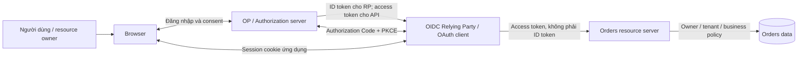
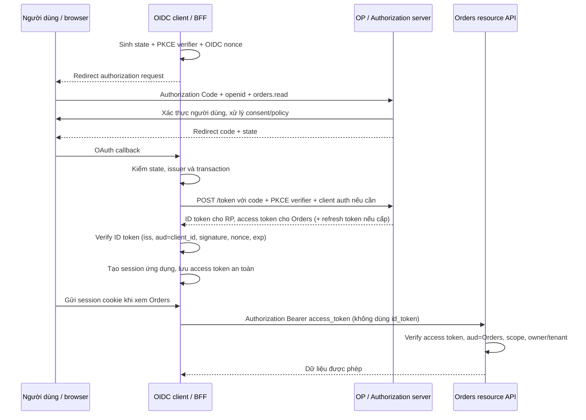
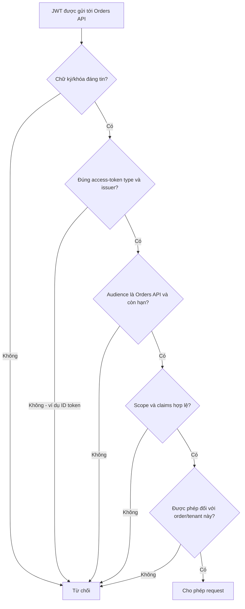
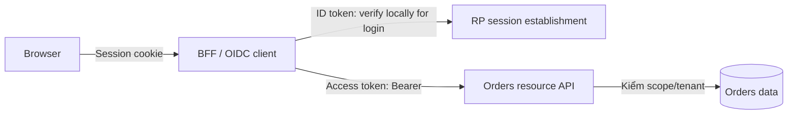
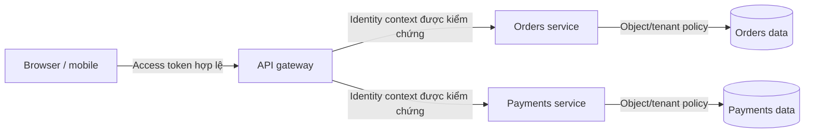
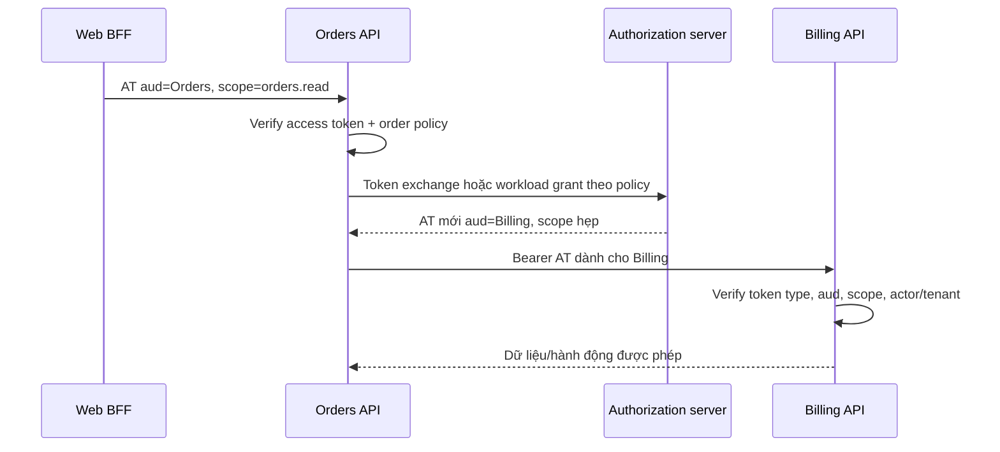
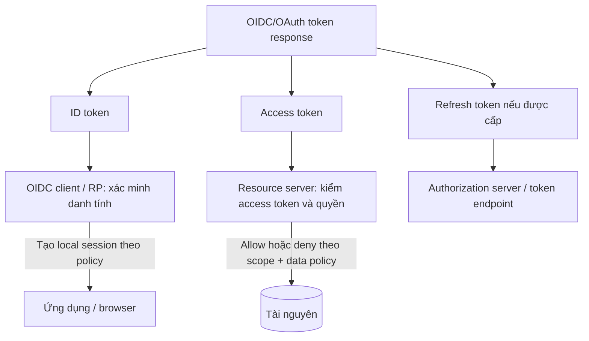

# Không gửi ID token đến resource API thay access token

Một ứng dụng web sử dụng **OpenID Connect (OIDC)** để đăng nhập. Sau khi đổi authorization code, backend nhận cả `id_token` và `access_token`. Vì `id_token` là một JWT có chữ ký số, chứa `sub`, `email` và thông tin đăng nhập, lập trình viên chọn gửi nó tới Orders API:

```http
GET /v1/orders/42 HTTP/1.1
Host: api.example.com
Authorization: Bearer <id-token-from-oidc-login>
```

Request này **sai về mục đích của credential**, ngay cả khi ID token có chữ ký hợp lệ và chưa hết hạn. **ID token dành cho OIDC client/Relying Party xác minh kết quả xác thực người dùng; OAuth access token dành cho resource server thực hiện kiểm soát truy cập API.** Orders API phải từ chối việc dùng ID token thay access token, thay vì kiểm chữ ký rồi mặc định cho phép vì thấy một `sub` hợp lệ.

Đây là bài thuộc chương **OpenID Connect**, module **SECURITY_TOKEN_SECURITY_FUNDAMENTALS**. Mục tiêu của module là hiểu mô hình tin cậy và vòng đời token bảo mật, phân biệt JWT, opaque token, access token và refresh token trong xác thực, phân quyền và OAuth 2.0/OIDC; kiểm tra issuer, audience, scope, claims; bảo vệ lưu trữ, thu hồi và phòng chống token theft/replay. Bài này tập trung **duy nhất vào nguyên tắc không chuyển ID token đến resource API để thay access token**, cùng cách thiết kế và kiểm thử ranh giới đó.

**Sau bài học, bạn có thể:**

- Giải thích sự khác biệt giữa **OIDC ID token** và **OAuth access token**, kể cả khi cả hai đều có dạng JWT và cùng issuer.
- Xác định **intended recipient/audience**, ý nghĩa `sub`, `scope`, `client_id` và thông tin xác thực ở hai loại token.
- Trình bày đúng Authorization Code + PKCE + OIDC, vai trò của `state`, `nonce`, ID token, access token và resource server.
- Xây dựng API chỉ chấp nhận **access token đúng profile**, kiểm JWT hoặc opaque token, issuer, audience, expiry và quyền dữ liệu.
- Thiết kế BFF, SPA, native app và microservices **không dùng ID token làm Bearer credential cho OAuth API**.
- Phân biệt lỗi `401 invalid_token`, `403 insufficient_scope`, sai audience và object-level authorization failure.
- Nhận diện cross-JWT confusion, token substitution, lộ identity claims, replay và lỗi logout/revocation.
- Lập phương án sửa hệ thống đang nhận ID token sai mục đích mà không vô tình nới quyền.

## 1. Bốn vai trò OAuth và Relying Party của OIDC

OAuth 2.0 định nghĩa bốn vai trò nền tảng:

| Vai trò | Nhiệm vụ | Ví dụ |
| --- | --- | --- |
| **Resource owner** | Thực thể có thẩm quyền cấp quyền đối với tài nguyên theo policy | Người sở hữu tài khoản/đơn hàng |
| **OAuth client** | Khởi tạo flow, xin access token và gọi resource server | Web app, BFF, mobile app |
| **Authorization server (AS)** | Đánh giá grant, cấp authorization code/access token, thực thi policy cấp quyền | `https://login.example.com` |
| **Resource server (RS)** | Bảo vệ tài nguyên, nhận access token và thực thi kiểm tra quyền | `https://api.example.com/orders` |

**OIDC** bổ sung lớp xác thực danh tính:

- **OpenID Provider (OP):** authorization server hỗ trợ OIDC, phát **ID token** theo giao thức.
- **Relying Party (RP):** OIDC client dựa vào kết quả xác thực từ OP, xác minh ID token rồi có thể thiết lập phiên ứng dụng.

Trong một triển khai, OP và AS có thể là **cùng service**, RP và OAuth client có thể là **cùng backend**. Tuy nhiên **vai trò logic của từng token vẫn khác nhau**.



Ở sơ đồ trên, mũi tên OP → RP biểu diễn **token response tại token endpoint**, không phải OP gửi ID token trực tiếp tới API. Trình duyệt có thể giữ phiên ứng dụng, trong khi backend giữ OAuth tokens phía server.

**Không nhầm “OAuth roles” với business roles** như `admin`, `order_viewer` hay `finance_manager`. Một RP có thể là client của API; một resource server vẫn phải áp dụng quyền nghiệp vụ ngay cả khi OP xác thực user thành công.

## 2. Tóm tắt một câu về mỗi token

| Credential | Dành cho ai? | Dùng làm gì? | Có gửi làm OAuth Bearer credential tới resource API? |
| --- | --- | --- | --- |
| **OIDC ID token** | **OIDC client/RP**; `aud` phải bao gồm client ID theo OIDC | Xác minh thông tin/kết quả xác thực danh tính từ OP | **Không** |
| **OAuth access token** | **Resource server** được AS cấp quyền truy cập | Gọi API theo audience, scope và policy | **Có**, theo `token_type` và token profile |
| **OAuth refresh token** | **AS/token endpoint** | Xin access token mới theo grant/policy | **Không** |
| **Authorization code** | **OAuth client tại token endpoint** | Đổi một lần lấy token, kèm PKCE/client authentication | **Không** |
| **Application session cookie** | **Ứng dụng web/BFF** đã tạo phiên | Duy trì phiên browser ↔ ứng dụng | **Không tự coi là OAuth access token** |

Hãy ghi nhớ:

- **ID token trả lời:** “OP đã xác thực **chủ thể nào** cho **OIDC client nào**, trong ngữ cảnh nào?”
- **Access token trả lời:** “AS đã cấp **khả năng truy cập tài nguyên** gì cho **resource server nào** theo grant?”
- **Resource authorization trả lời:** “Request hiện tại có được thực hiện **trên dữ liệu cụ thể** không?”

**Có access token hợp lệ cũng chưa đủ để được đọc mọi đơn hàng.** Resource server phải kiểm tra tiếp scope, tenant, owner và quy tắc nghiệp vụ.

## 3. ID token là gì và ai phải xác minh nó?

Theo **OpenID Connect Core 1.0**, ID token là một security token chứa claims về **authentication event** và người dùng, thường biểu diễn dưới dạng **JWT**. Nó do OP phát cho **OIDC client/Relying Party**, không phải cho mọi HTTP API trong hệ thống.

Một **payload minh họa** của ID token:

```json
{
  "iss": "https://login.example.com",
  "sub": "user-42",
  "aud": "orders-web-client",
  "exp": 1795000900,
  "iat": 1795000000,
  "auth_time": 1794999700,
  "nonce": "n-0S6_WzA2Mj"
}
```

Đây **chỉ là payload đã decode để học**, không phải JWT đã xác minh hoặc giá trị có thể sử dụng thật. Các timestamp là ví dụ, không chỉ ra giờ hiện tại.

### 3.1. Ý nghĩa các claims tiêu biểu

| Claim | Ngữ nghĩa trong ID token | Điều **không** được suy ra |
| --- | --- | --- |
| `iss` | OP phát hành ID token | Mọi API cùng issuer đều được dùng token này |
| `sub` | Subject của phiên xác thực theo OP | User có mọi quyền tại Orders API |
| **`aud`** | OIDC client/RP được nhận token, chứa **client ID** | Đây là audience của resource API |
| `exp` | Thời hạn chấp nhận ID token theo OIDC | OAuth access token cũng hết hạn cùng lúc |
| `iat` | Thời điểm ID token được phát hành | User vừa hoàn thành MFA ngay thời điểm đó |
| `auth_time` | Thời điểm xác thực người dùng khi claim được cung cấp | Một scope API đã được cấp |
| `nonce` | Giá trị liên kết ID token với authentication request khi được dùng | OAuth API có quyền nhờ nonce hợp lệ |
| `acr`, `amr` | Ngữ cảnh/phương thức xác thực khi OP cung cấp | Tự cho phép hoàn tiền hoặc đọc mọi tenant |

ID token có thể chứa thêm `name`, `email`, `email_verified`, `picture` hoặc custom claims theo scope/profile và chính sách OP. **Những dữ liệu nhận dạng này không biến token thành access token**, không cấp quyền truy cập API.

### 3.2. RP kiểm ID token, không phải Orders API

OIDC client phải xác minh ID token theo flow/profile được sử dụng: issuer, audience có client ID, chữ ký/khóa hoặc cơ chế bảo vệ tương ứng, expiry, thời gian, `nonce` nếu gửi, `azp` khi áp dụng, và các yêu cầu khác của OIDC.

RP có thể sử dụng `sub` đã xác minh để liên kết người dùng với **local account** hoặc tạo **application session**. Sau đó khi gọi API, nó dùng **access token** hoặc kiến trúc ủy quyền được thiết kế riêng, **không chuyển ID token thay token truy cập**.

### 3.3. Vì sao có ID token mà không có scope API?

ID token được cấp theo **OIDC authentication result**; `scope=openid` làm request thuộc OIDC. Một user đã đăng nhập không có nghĩa client được cấp `orders.read` hay `payments.refund`. Ngay cả khi ID token chứa custom `roles`, ý nghĩa của claim còn phụ thuộc **hợp đồng OP/RP** và không tự trở thành OAuth scope tại resource API.

## 4. Access token là gì và ai phải xác minh nó?

**OAuth access token** là credential được AS cấp để client **truy cập tài nguyên được bảo vệ** tại RS theo phạm vi grant. Access token có thể:

- Là **opaque string** mà RS không thể tự giải mã, cần **introspection** hoặc trạng thái đáng tin từ AS.
- Là **signed JWT access token (JWS)** mà RS xác minh chữ ký và claims theo một **access-token profile**.
- Có một định dạng khác được AS/RS thỏa thuận; client **không được mặc định** mọi access token đều là JWT.

Một payload **JWT access token minh họa**:

```json
{
  "iss": "https://login.example.com",
  "sub": "user-42",
  "aud": "https://api.example.com/orders",
  "client_id": "orders-web-client",
  "scope": "orders.read",
  "iat": 1795000000,
  "nbf": 1795000000,
  "exp": 1795000600,
  "jti": "access-token-example-42"
}
```

**Khác biệt quyết định với ID token:** `aud` của access token dành cho **Orders resource server**; scope `orders.read` được cấp để API xem xét, và RS phải kiểm đủ điều kiện before allow.

### 4.1. Bearer là cách trình token, không phải định dạng

```http
GET /v1/orders/42 HTTP/1.1
Host: api.example.com
Authorization: Bearer <orders-access-token>
```

`Bearer` (RFC 6750) là HTTP authentication scheme phổ biến cho OAuth access token, **không đồng nghĩa JWT**. Cả JWT access token lẫn opaque access token đều có thể dùng Bearer nếu AS cấp `token_type=Bearer`. **Không phải mọi JWT đều có thể đem đặt sau chữ Bearer để gọi API.**

### 4.2. Access token chưa phải quyền cuối cùng đối với từng đối tượng

Một access token `scope=orders.read` được cấp cho Orders API **không tự cấp quyền đọc mọi đơn**. API cần kiểm:

- Token đúng **issuer, type/profile, audience, lifetime, scope, trạng thái**.
- Subject/actor thực sự có quyền với **tenant, account, order ID** cụ thể.
- Điều kiện thời điểm thực hiện, trạng thái đơn, hạn mức hoặc các business restrictions.
- Sender binding, revocation/session state nếu threat model yêu cầu.

**OIDC là authentication layer; OAuth access token là đầu vào ủy quyền; resource server là nơi thực thi authorization đối với request cụ thể.**

## 5. ID token và access token có thể trông gần như giống nhau

Đây là nguồn gốc của **cross-JWT confusion** hoặc **token substitution**.

Hai token có thể đồng thời:

- Được phát bởi **cùng OP/AS**.
- Có `iss` và `sub` giống nhau.
- Có `iat`, `exp` gần nhau.
- Có chữ ký **JWS hợp lệ với cùng JWKS/public key**.
- Có hình thức `header.payload.signature` và cùng `alg=RS256`.

Nhưng chúng vẫn có **bên nhận và mục đích khác nhau**:

| Thuộc tính | ID token của đăng nhập web | Access token để gọi Orders |
| --- | --- | --- |
| Dành cho | OIDC client `orders-web-client` | RS `https://api.example.com/orders` |
| Mục đích | Xác minh authentication event | Quyền truy cập Orders API |
| `aud` điển hình | `orders-web-client` | `https://api.example.com/orders` |
| Scope/API permissions | Không phải ý nghĩa của ID token | AS cấp/RS kiểm `orders.read` |
| Validation profile | OIDC Core (RP) | OAuth access token profile (RS) |
| HTTP `Authorization: Bearer` tới Orders | **Sai** | **Đúng** nếu token Bearer và hợp lệ |

Nếu Orders API chỉ hỏi “JWT này có chữ ký hợp lệ không?” rồi dùng `sub` để lấy dữ liệu, API đã **nhầm loại chứng cứ**. Chữ ký bảo đảm nguồn và tính toàn vẹn trong một **profile đã định nghĩa**, không tự mở rộng intended recipient.

## 6. Authorization Code + PKCE + OIDC: token đi đâu?

Ví dụ web app/BFF xin:

```text
response_type = code
client_id = orders-web-client
scope = openid profile orders.read
redirect_uri = https://shop.example.com/oauth/callback
state = random-browser-transaction
nonce = random-oidc-nonce
code_challenge_method = S256
code_challenge = base64url-sha256(code_verifier)
resource = https://api.example.com/orders   # Khi AS hỗ trợ RFC 8707
```

Client dùng browser chuyển người dùng đến OP/AS. Khi user xác thực/đồng ý, AS trả **authorization code** qua callback; client kiểm `state`, issuer/redirect context, rồi đổi code bằng `code_verifier` PKCE và client authentication nếu client thuộc loại confidential.



**Điểm quan trọng:** Token endpoint có thể trả **cả ID token và access token trong cùng JSON response**. Việc chúng ở cùng response **không làm chúng có thể thay thế cho nhau**.

### 6.1. Token response minh họa

```http
HTTP/1.1 200 OK
Content-Type: application/json
Cache-Control: no-store
Pragma: no-cache

{
  "access_token": "<opaque-or-jwt-access-token-for-orders-api>",
  "id_token": "<signed-oidc-id-token-for-orders-web-client>",
  "token_type": "Bearer",
  "expires_in": 600,
  "scope": "openid profile orders.read",
  "refresh_token": "<optional-refresh-token>"
}
```

**Chọn đúng credential**:

- `id_token` → **OIDC client** kiểm xác thực và thiết lập/duy trì ngữ cảnh đăng nhập.
- `access_token` → **Orders API** theo audience, scope và token usage scheme.
- `refresh_token` nếu có → **AS/token endpoint** để xin access token mới; không gửi tới API.

Ví dụ scopes có `openid` để dùng OIDC. Các scopes nghiệp vụ như `orders.read` chỉ là tên ví dụ; phải được AS và RS định nghĩa thống nhất.

### 6.2. Authorization Code flow không được thay thành “đăng nhập bằng ID token gửi API”

Việc client có thể tạo local session từ ID token **không cho phép backend bỏ qua access-token issuance** rồi chuyển ID token tới API. Nếu frontend chỉ cần phiên ứng dụng web và backend gọi API, backend vẫn phải có **một cơ chế quyền API hợp lệ** (thường là OAuth access token dành cho API).

## 7. Request sai và request đúng: nhìn ở mức HTTP

### 7.1. Sai: gửi ID token sau chữ Bearer

```http
GET /v1/orders/42 HTTP/1.1
Host: api.example.com
Authorization: Bearer <id-token-aud-orders-web-client>
```

ID token thuộc **OIDC client audience**, không phải Orders API. Resource server OAuth **phải từ chối**. Không lấy `sub` trong ID token rồi mở quyền vì chữ ký có thể hợp lệ cho **mục đích khác**.

### 7.2. Đúng: gửi access token đúng API

```http
GET /v1/orders/42 HTTP/1.1
Host: api.example.com
Authorization: Bearer <access-token-aud-orders-api>
```

RS tiếp tục kiểm `issuer`, token type, signature/`active`, `audience`, `expiry`, `scope=orders.read` và owner/tenant của Order 42.

### 7.3. Sai: gửi ID token trong JSON body để “thay auth”

```http
POST /v1/orders/query HTTP/1.1
Host: api.example.com
Content-Type: application/json

{"idToken":"<oidc-id-token>","orderId":"42"}
```

Việc chuyển ID token từ `Authorization` sang body **không thay đổi mục đích của nó**. Body có thể bị ghi log hoặc đi qua nhiều dịch vụ; nếu API tự chấp nhận ID token làm OAuth credential, lỗ hổng token substitution vẫn tồn tại.

### 7.4. Sai: gọi API bằng `refresh_token` hoặc `code`

Refresh token dùng ở AS/token endpoint. Authorization code dùng để đổi token tại AS/token endpoint kèm các điều kiện flow. **Không cái nào là access token** dành cho resource API.

## 8. Vì sao cùng chữ ký đúng vẫn phải từ chối ID token?

Một hệ thống nhận JWT đúng phải kiểm **ba lớp tách biệt**:

1. **Cryptographic validity:** chữ ký/JWE bảo vệ token đúng thuật toán/khóa tin cậy; token không bị sửa.
2. **Protocol validity:** token **đúng issuer, intended recipient, token type/profile, time, claims** cho giao thức/mục đích.
3. **Resource authorization:** client/subject có được thực hiện hành động cụ thể trên resource không?

Chỉ kiểm lớp 1 là **không đủ**.



### 8.1. Token substitution và cross-JWT confusion

Nếu API nhận **mọi JWT từ issuer X** và gán user identity từ `sub`, attacker có thể:

- Lấy một **ID token dành cho OAuth client** rồi trình tới API như access token.
- Dùng JWT dành cho một API khác nếu không kiểm audience.
- Lợi dụng custom JWT có chữ ký của cùng issuer nhưng dùng cho reset password, email verification hoặc session nội bộ.

RFC 8725 (JWT Best Current Practices) khuyến nghị **validation rules khác biệt cho các loại JWT**, bao gồm token type, audience, issuer và các claims/khóa đặc thù khi phù hợp. Không tồn tại quy tắc “cùng ký bởi OP ⇒ JWT nào cũng là OAuth access token”.

### 8.2. `typ` và access-token JWT profile

**RFC 9068** chuẩn hóa một JWT profile cho OAuth access token và dùng JOSE header `typ` như `at+jwt` (hoặc `application/at+jwt` theo đặc tả) để phân biệt với những JWT khác. RS theo profile này phải kiểm token type và các claims bắt buộc.

Ví dụ **header JWT access token**:

```json
{
  "alg": "RS256",
  "kid": "signing-key-2026",
  "typ": "at+jwt"
}
```

Trong khi **ID token** có thể có header `typ=JWT` hoặc không khai `typ`, tùy profile. **Không có `at+jwt` không tự chứng minh token chắc chắn là ID token**, vì nhiều hệ sinh thái dùng access-token profile khác RFC 9068. Điều cần làm là **cấu hình RS chấp nhận đúng loại access token mà AS thực sự phát**, với validation policy tường minh.

**`typ` không thay thế `aud`, chữ ký hoặc scope.** Một string tự nhận `typ=at+jwt` trong header token chưa xác minh **không đủ để được cấp quyền**.

## 9. Audience: dấu hiệu tách ID token khỏi access token

Trong OIDC, **`aud` của ID token phải bao gồm `client_id` của Relying Party**. Với access token JWT theo RFC 9068, **`aud` xác định resource server dự kiến**. Cùng một issuer có thể phát hai token với audiences khác nhau:

```text
ID token:
    iss = https://login.example.com
    aud = orders-web-client
    sub = user-42

Access token:
    iss = https://login.example.com
    aud = https://api.example.com/orders
    sub = user-42
    scope = orders.read
```

**Orders API không được coi client ID là resource audience** chỉ vì client và API đều thuộc cùng tổ chức. Nó phải biết **resource identifier** của mình từ cấu hình AS/RS.

### 9.1. Hai audience có thể trùng tên thì sao?

Một hệ thống cấu hình sai có thể đặt **client_id giống định danh resource server** hoặc dùng một audience chung cho RP và API. Khi đó **kiểm audience đơn lẻ không ngăn được token confusion**.

Để giảm rủi ro:

- Thiết kế **client ID và resource/API identifiers tách biệt**.
- Dùng **access-token profile rõ ràng**, chẳng hạn RFC 9068 và `typ=at+jwt` khi hệ sinh thái hỗ trợ.
- Kiểm các claims bắt buộc của access-token profile, issuer, token use/type theo hợp đồng tin cậy.
- Không dùng một JWT verifier duy nhất rồi bỏ qua phân loại token.
- Nếu issuer có nhiều token purposes, cân nhắc **khóa hoặc validation key sets tách theo mục đích**, khi kiến trúc cho phép.

**Đúng audience là điều kiện cần, không tự là điều kiện đủ.**

### 9.2. ID token có thể có nhiều audiences

Theo OIDC, `aud` có thể chứa nhiều giá trị và `azp` (*authorized party*) có thể cần xử lý theo quy tắc OIDC. **OIDC RP** phải áp dụng profile validation tương ứng. Resource server **không được suy ra “cứ có tên API trong mảng `aud` của một ID token là dùng nó làm access token được”**. Token vẫn phải đúng **access-token type/profile và grant**.

### 9.3. Resource Indicators và giảm khả năng token bị dùng nhầm

Khi AS hỗ trợ RFC 8707, client có thể chỉ rõ `resource` để xin access token dành cho API cụ thể:

```text
resource = https://api.example.com/orders
scope = orders.read
```

AS kiểm registration, scopes/resources rồi cấp token theo policy. **Resource indicator không phải tên khác của ID token audience**; RP vẫn cần `aud=client_id` để xác minh ID token riêng.

## 10. Scope: quyền OAuth không được lấy từ ID token theo suy đoán

Một API cần scope `orders.read` phải kiểm **scope đã cấp trong OAuth access token** hoặc metadata AS đáng tin. Không lấy một claim `roles`, `groups`, `email` hoặc `scope` tự chế xuất hiện trong ID token rồi coi là **OAuth permission** cho Orders API.

| Dữ liệu | Nguồn sử dụng phù hợp | Điều kiện bổ sung |
| --- | --- | --- |
| `scope=orders.read` của access token đã xác minh | Orders RS dùng cho operation-level authorization | Đúng audience và owner/tenant |
| `roles=manager` của ID token | RP có thể dùng theo contract cho UX/local session | Không tự là quyền OAuth tại API |
| `sub=user-42` của ID token | RP liên kết identity từ OP | Không chứng minh quyền với order 9001 |
| `email`, `email_verified` | RP xử lý thông tin danh tính/verification theo OIDC | Không tự là authorization grant |
| `client_id` trong verified access token | RS biết client nào được cấp token theo profile | Không thay user/workload permissions |

### 10.1. Phân biệt requested và granted scopes

Client xin `openid profile orders.read orders.cancel`. AS chỉ cấp `openid profile orders.read`. Theo RFC 6749 mục 5.1, khi granted scope khác requested scope, token response phải thể hiện scope đã cấp. **Không giữ danh sách requested trong frontend rồi cho API tưởng rằng `orders.cancel` đã được cấp**.

### 10.2. OIDC scopes không tương đương API scopes

`openid` yêu cầu OIDC; `profile` và `email` liên quan standard claims/UserInfo theo OIDC. Chúng **không đồng nghĩa** `orders.read`, `billing.refunds.create` hay `inventory.write`. Một access token cho UserInfo endpoint cũng không mặc nhiên có audience/quyền gọi Orders API.

### 10.3. Object-level authorization vẫn bắt buộc

Token hợp lệ `scope=orders.read` nhưng request `GET /orders/9001` tới đơn của tenant khác vẫn phải bị chặn. Đây là lớp bảo vệ khỏi **Broken Object Level Authorization (BOLA/IDOR)**, không được giao toàn bộ cho ID token hoặc màn hình login.

## 11. Relying Party xác minh ID token như thế nào?

Vì RS không dùng ID token làm OAuth credential, không có nghĩa **ID token được tin mù quáng trong RP**. OIDC client phải thực hiện validation theo giao thức và flow.

Checklist rút gọn:

1. **`iss`** đúng OP đã chọn/được tin cậy và token đến qua flow hợp lệ.
2. **`aud`** bao gồm `client_id` của **chính OIDC client**; nếu đa audience, xử lý `azp` theo quy tắc.
3. **Chữ ký/thuật toán/JWKS** được xác minh qua khóa/alg đã cấu hình, trừ trường hợp flow profile có quy tắc bảo vệ khác hợp lệ. Không tin `alg`/`jku` từ JWT chưa được xác minh.
4. **`exp`, `iat`** và thời gian/clock skew theo quy tắc OIDC.
5. **`nonce`** khớp authentication transaction nếu nonce đã được client gửi.
6. **`auth_time`**, `acr`, `amr` và `max_age`/`acr_values` được xử lý khi policy yêu cầu.
7. **Account linking** dựa trên OP issuer và stable subject semantics, không chỉ dựa vào email tự khai.
8. Tránh dùng kết quả đăng nhập để tự cấp mọi permission ở API.

### 11.1. Phân biệt `nonce`, `state` và PKCE

| Cơ chế | Nơi kiểm | Mục tiêu |
| --- | --- | --- |
| OAuth `state` | Client khi nhận authorization callback | Liên kết browser/authorization transaction, chống CSRF |
| PKCE `code_verifier` | AS/token endpoint | Ràng buộc code với client khởi tạo, giảm code interception/injection |
| OIDC `nonce` | RP khi kiểm verified ID token | Liên kết ID token với authentication request |
| ID token `aud` | RP | Xác nhận OP phát ID token cho **OIDC client** |
| Access token `aud` | Resource server | Xác nhận AS phát access token cho **API đích** |

**Không dùng `nonce` đúng để suy rằng Orders API phải chấp nhận ID token.** Mỗi cơ chế bảo vệ **một ranh giới khác nhau**.

### 11.2. ID token chứa `auth_time` không có nghĩa AT mới có MFA mới

ID token có thể cho biết authentication event theo OP; nếu client cần step-up, phải xác minh assurance/`auth_time` theo **hợp đồng OIDC và policy**. `iat` của access token mới không phải thời điểm user vừa thực hiện MFA, và RP không được tự đưa một claim MFA chưa được xác minh vào access-control header để RS tin.

## 12. Resource server xác minh JWT access token như thế nào?

RS phải có **access-token validator riêng** theo issuer và profile đã đăng ký. Đối với signed JWT access token:

1. **Chỉ nhận access-token profile được cấu hình** — ví dụ RFC 9068: header `typ=at+jwt` hoặc `application/at+jwt`; không nhận ID token.
2. **Kiểm signature** bằng khóa tin cậy dành cho issuer, algorithm allowlist, key type phù hợp; không cho `alg=none` nếu profile yêu cầu ký.
3. **Kiểm `iss`** chính xác theo AS/trust config; không lấy issuer lạ từ payload rồi tự tin tải JWKS.
4. **Kiểm `aud`** chứa identifier của **chính API**, không phải chỉ client ID/hostname bất kỳ.
5. **Kiểm thời gian** `exp`, `nbf`, `iat` theo profile; JWT NumericDate tính bằng giây, có clock skew nhỏ có kiểm soát.
6. **Kiểm claims/types** theo token profile: `sub`, `client_id`, scope/permissions, các trường bắt buộc tùy profile.
7. **Kiểm scope** đúng thao tác, so khớp nguyên scope-token, không dùng substring.
8. **Kiểm owner, tenant, object và policy hiện hành**; xác thực token không có nghĩa cho phép mọi bản ghi.
9. **Kiểm state bổ sung** như denylist, session/account status, DPoP/mTLS binding nếu threat model yêu cầu.

### 12.1. Chọn public key an toàn

Khi AS công bố JWKS:

- `kid` chỉ giúp chọn khóa trong **tập JWKS đã được issuer tin cậy**.
- Không tự fetch `jku`/`x5u` hoặc file path lấy từ token chưa xác minh.
- Không dùng chung secret đối xứng hoặc trust configuration giữa các issuer không liên quan.
- Có chiến lược JWKS cache/key rotation và xử lý signing-key compromise.

**Không có bước nào trong danh sách cho phép fallback sang “kiểm như ID token” nếu access-token validation thất bại.**

### 12.2. JWT có `scope` vẫn có thể là token sai

Một ID token do OP phát có thể mang **custom `scope` hoặc `roles`** theo cách provider-specific. API chỉ đọc `scope` sau khi **đã xác định đúng token type/issuer/audience/profile**, chứ không kiểm quyền rồi suy ngược “có scope nên đây chắc là access token”.

## 13. Resource server xác minh opaque access token như thế nào?

Một số hệ thống không phát JWT access token cho API, mà phát **opaque token**. RS không thể “decode claims” từ chuỗi opaque; nó cần **OAuth 2.0 Token Introspection (RFC 7662)** hoặc lookup đáng tin từ AS.

```mermaid
sequenceDiagram
    participant C as OAuth client / BFF
    participant RS as Orders API
    participant AS as Authorization server
    C->>RS: Authorization Bearer opaque_access_token
    RS->>AS: Introspection qua HTTPS với RS authentication
    AS-->>RS: active, client_id, sub, scope, aud nếu được cấp
    RS->>RS: Kiểm active + resource binding + scope + business policy
    RS-->>C: 200 nếu được phép; nếu không 401/403/404
```

Response **minh họa theo một hợp đồng AS cụ thể**:

```json
{
  "active": true,
  "iss": "https://login.example.com",
  "sub": "user-42",
  "client_id": "orders-web-client",
  "aud": "https://api.example.com/orders",
  "scope": "orders.read",
  "exp": 1795000600
}
```

RS cần kiểm `active` thực sự là **boolean true**, introspection response đến từ AS tin cậy, client/RS authorization đúng, scope đủ và **token dành cho Orders**. **RFC 7662 không bắt buộc `aud` xuất hiện trong mọi response**; nếu AS không trả audience, phải có **resource binding đáng tin được AS bảo đảm**. Không mặc định `active=true` ⇒ API nào cũng nhận.

### 13.1. Opaque token không khiến ID token có thể dùng thay

ID token ký JWT và opaque access token nhìn khác nhau; API không được “nới chính sách” rằng **nếu nhận JWT thì coi là ID-token-auth còn nếu opaque thì introspect** chỉ vì cả hai đều đến từ login system. RS chỉ nhận **access tokens theo profile đã cấu hình**.

### 13.2. Introspection timeout và fail closed

Nếu AS timeout, RS không có bằng chứng token còn active theo chính sách. Phải **fail closed**: từ chối truy cập dữ liệu nhạy cảm; có thể phản hồi **503/5xx** vì lỗi hạ tầng, hoặc dùng **cache introspection còn hạn hợp lệ** theo policy. Không dùng ID token để thay opaque access token trong lúc AS bị outage.

## 14. Java-style pseudocode: cấu hình API chỉ nhận access token

Mẫu sau nhấn mạnh **trình tự kiểm tra** thay vì gắn với một version/framework cụ thể:

```java
// PSEUDOCODE: không phải API có sẵn của Spring Security.
HttpResponse getOrder(HttpRequest request, String orderId) {
    RawBearerCredential raw = bearerParser.parseStrictly(request);
    if (!raw.isPresentAndWellFormed()) {
        return unauthorizedBearerChallenge();
    }

    // Chỉ chấp nhận ACCESS TOKEN theo cấu hình RS.
    VerifiedAccessToken access = accessTokenVerifier.verify(
        raw.value(),
        TrustedIssuer.of("https://login.example.com"),
        ExpectedAudience.of("https://api.example.com/orders"),
        AccessTokenProfile.configuredBySecurityTeam()
    );

    if (!access.isAccepted()) {
        // ID token, token sai aud/type, expired, signature sai...
        return unauthorizedInvalidToken();
    }

    if (!access.scopeTokens().contains("orders.read")) {
        return forbiddenInsufficientScope("orders.read");
    }

    Order order = orderRepository.findById(orderId);
    if (order == null) {
        return notFound();
    }

    // Token hợp lệ chưa đủ: RS kiểm owner/tenant hiện hành.
    if (!orderPolicy.canRead(
            access.verifiedIssuer(),
            access.verifiedSubject(),
            access.verifiedClientId(),
            order.tenantId(),
            order)) {
        return forbiddenOrNotFoundAccordingToDisclosurePolicy();
    }

    return ok(orderPolicy.allowedView(order, access));
}
```

**Đây là pseudocode**, các class ở trên chỉ minh họa. Khi dùng Spring Security hoặc framework khác, hãy cấu hình **resource-server OAuth2 JWT/opaque validation** phù hợp, yêu cầu **issuer, expected audience, token type/profile, signature/introspection** và policies ở layer endpoint/data. **Không dùng generic JWT decoder không kiểm intended use rồi coi mọi claims là quyền**.

### 14.1. Phân loại lỗi phải rõ

| Lỗi | Nên xử lý thế nào? |
| --- | --- |
| Client gửi ID token vào Orders API | **401 invalid_token** theo Bearer error policy |
| Client gửi access token hết hạn/sai chữ ký | **401 invalid_token** |
| Client gửi access token dành cho Billing | **401 invalid_token** do sai audience |
| Access token đúng nhưng thiếu `orders.read` | **403 insufficient_scope** khi phù hợp |
| Token/scope đúng nhưng order của tenant khác | **403 hoặc 404**, không lộ dữ liệu |
| AS introspection unavailable | Fail closed, có thể **503** thay vì xác thực token sai |

Không trả chi tiết token claims, signing keys hay nội dung bí mật trong lỗi HTTP.

## 15. Browser + BFF: giữ ID token và access token đúng phía

**Backend for Frontend (BFF)** là kiến trúc phổ biến khi ứng dụng web có backend đáng tin nhận OIDC token response:

1. Browser bắt đầu đăng nhập qua BFF.
2. BFF thực hiện Authorization Code + PKCE, lưu `state`/`nonce` transaction.
3. BFF đổi code với AS, **xác minh ID token cho chính BFF/RP**.
4. BFF tạo application session và gửi session cookie bảo vệ.
5. BFF giữ access/refresh token trong server-side store theo threat model.
6. Browser gọi endpoint BFF bằng session cookie.
7. BFF gọi resource API bằng **access token đúng audience**.



**Không gửi `id_token` qua `Authorization` từ BFF đến Orders API.** Không gửi ID token cho browser chỉ để browser chuyển tiếp đến backend; điều đó tăng token exposure mà không cần thiết.

### 15.1. Session cookie không phải access token

Browser ↔ BFF có thể xác thực bằng cookie `HttpOnly`/`Secure`/`SameSite` theo thiết kế. BFF phải có chống CSRF khi cookie là ambient credential, bảo vệ XSS, session fixation, session expiry và logout.

**HttpOnly không chặn XSS gửi các thao tác thay mặt user**, nó chỉ giảm khả năng script đọc trực tiếp giá trị cookie. BFF vẫn phải kiểm user/session authorization của các endpoint và API downstream.

### 15.2. API nội bộ sau BFF

Nếu BFF và Orders cùng deploy trong một service, một request nội bộ có thể dùng **session authorization riêng** thay vì OAuth Bearer. Nhưng đó là **một cơ chế security khác được thiết kế tường minh**. Không nên đặt ID token sau `Bearer` rồi gọi nó là access token chỉ vì hai logic nằm cùng application.

## 16. SPA hoặc native app: lấy đúng access token cho API

Một **SPA** hoặc **mobile native app** dùng Authorization Code + PKCE có thể nhận cả ID token và access token, tùy OIDC client/OP support. Phân công đúng:

- **ID token:** xác minh kết quả đăng nhập và quản lý user identity/session của client theo OIDC.
- **Access token:** sử dụng để gọi API theo granted scopes, audience và token type.
- **Refresh token:** nếu được AS cấp, giữ theo policy, rotation/sender constraint và chỉ gửi tới token endpoint.

**CORS và redirect không xác nhận quyền API.** Browser có thể cho phép `fetch` cross-origin nhờ CORS, nhưng RS vẫn phải kiểm access token. Native app có thể nhận deep link callback đúng, nhưng nếu lấy nhầm `id_token` để gọi API thì request vẫn sai.

### 16.1. Đừng lấy `id_token` làm cache key cho API token

Một lỗi thực tế:

```javascript
// SAI: id_token không phải OAuth access token cho Orders API.
const idToken = oidcSession.id_token;
await fetch("https://api.example.com/orders", {
  headers: { Authorization: "Bearer " + idToken }
});
```

Thay vào đó:

```javascript
// ĐÚNG VỀ Ý TƯỞNG; SDK/API tên giả định, không phải code hoàn chỉnh.
const accessToken = await oauthClient.getAccessTokenFor({
  resource: "https://api.example.com/orders",
  scopes: ["orders.read"]
});

await fetch("https://api.example.com/orders", {
  headers: { Authorization: "Bearer " + accessToken }
});
```

Đoạn thứ hai chỉ minh họa **chọn credential đúng mục đích**. SDK phải dùng AS tin cậy, xử lý granted scopes, expiry, token endpoint và đúng token usage scheme; resource param có thể phụ thuộc provider. Không hard-code một tên method SDK giả định vào production.

### 16.2. Token storage phụ thuộc threat model

| Client type | ID token | Access token | Refresh token nếu cấp |
| --- | --- | --- | --- |
| SPA | Giữ theo phiên/SDK, giảm PII exposure | Memory/BFF hoặc storage đánh giá XSS | Rotation/sender-constraining theo policy, tránh plaintext lâu dài |
| Native mobile | App session/secure runtime | Memory hoặc platform-protected storage | Keychain/Keystore-backed storage khi có |
| BFF confidential client | RP xác minh và giữ context server-side | Server-side token store, client-specific | Server-side encrypted store/KMS/secret manager |
| CLI cá nhân | Session info nếu dùng OIDC | Memory/OS credential context | OS credential manager/secure store |

**Không có storage nào cứu một API đang chấp nhận sai token type.** Đồng thời, bảo vệ đúng type vẫn không cứu một access token bị sao chép khi còn hiệu lực.

## 17. UserInfo endpoint cũng dùng access token

Trong OIDC, client có thể gọi **UserInfo endpoint** để nhận claims người dùng theo scopes đã cấp và hợp đồng OP. Giao thức sử dụng **access token** được phát phù hợp UserInfo, **không lấy ID token làm Bearer credential mặc định**.

```http
GET /userinfo HTTP/1.1
Host: login.example.com
Authorization: Bearer <access-token-accepted-by-userinfo>
```

Điều này minh họa một ranh giới thường bị nhầm:

- ID token **khẳng định kết quả authentication cho RP**.
- UserInfo endpoint là **protected resource** có cơ chế dùng access token theo OIDC.
- Orders API là **resource server khác**, cần access token dành cho Orders.

**Một access token hợp lệ cho UserInfo không tự hợp lệ cho Orders API.** Nếu token được audience-restricted, RS phải kiểm đúng intended audience hoặc resource binding tin cậy.

## 18. API gateway, service mesh và các header danh tính

Nhiều hệ thống kiểm JWT ở **API gateway** trước khi request đến microservice. Nếu gateway chỉ kiểm “issuer X ký token này”, nó có thể vô tình nhận ID token dành cho web client rồi chuyển danh tính tới API.



**Gateway không miễn trách nhiệm của resource server**. RS có thể được triển khai thành tổ hợp gateway + backend policy, nhưng cả chuỗi phải bảo đảm:

1. Gateway **chỉ chấp nhận access-token profile** được cấu hình, không nhận ID token chỉ vì chữ ký hợp lệ.
2. Gateway kiểm **issuer, audience cho API đích, expiry và scopes** phù hợp.
3. Backend thực thi **tenant/owner/object policy** không thể suy ra chỉ từ token.
4. Gateway loại bỏ/ghi đè mọi **trusted identity header do client bên ngoài gửi**.
5. Backend không được bị truy cập trực tiếp từ mạng không tin cậy hoặc phải tự xác thực gateway/upstream bằng mTLS/workload identity/cơ chế tương đương.
6. Không tái sử dụng kết quả validation của API A làm bằng chứng quyền truy cập API B.

### 18.1. Nguy cơ `X-Verified-Subject`

Một triển khai gateway có thể truyền:

```http
X-Verified-Issuer: https://login.example.com
X-Verified-Subject: user-42
X-Verified-Client: orders-web-client
X-Verified-Scope: orders.read
```

Đây **không phải các header OAuth được chuẩn hóa**; chỉ là **hợp đồng nội bộ minh họa**. Nếu Orders service có thể được gọi trực tiếp bằng `X-Verified-Subject: admin`, hoặc gateway **không loại header giả mạo** trước khi chèn giá trị đã xác minh, attacker có thể vượt qua security layer.

Gateway nên chuyển **verified access-token context**, không chuyển các claims chưa xác minh từ ID token. Hạ tầng nội bộ cũng phải bảo vệ sự toàn vẹn của identity context trên từng hop.

### 18.2. Shared JWKS không phải shared permission

Orders, Billing và UserInfo có thể cùng tin một OP/AS và cùng tải JWKS. Điều đó chỉ giúp **xác minh chữ ký của tokens được issuer phát hành**, không cho phép:

- Orders chấp nhận ID token của RP.
- Billing chấp nhận access token dành cho Orders.
- Bất kỳ API nào bỏ qua scope/tenant vì gateway đã kiểm `sub`.

Mỗi RS cần **một chính sách accepted audience/token profile/permissions riêng**.

## 19. Microservice gọi API khác: không forward ID token hoặc access token sai audience

Giả sử BFF nhận access token `aud=orders-api`, sau đó Orders API cần dữ liệu từ Billing API.

**Sai:** Orders lấy token trong request gốc hoặc ID token của web app rồi chuyển thẳng sang Billing, bất chấp audience.

**Đúng:** nếu cần downstream call, chọn cơ chế được AS/kiến trúc hỗ trợ:

- **Token Exchange / on-behalf-of (RFC 8693)** khi cần giữ user/delegation context và AS hỗ trợ.
- **Client Credentials** nếu tác vụ thuộc quyền riêng của workload, không mạo danh user.
- **Hợp đồng service-to-service riêng** có authentication/authorization tương đương được đánh giá đầy đủ.



**Token exchange không tự bảo đảm quyền của token mới bị thu hẹp**; AS phải kiểm source token, actor, target resource và policy. Một backend có quyền kỹ thuật cao có thể thành **confused deputy** nếu dùng quyền của chính mình để phục vụ người gọi không được phép.

### 19.1. `sub` của access token không nhất thiết là user

Một access token từ Client Credentials grant có thể có `sub` đại diện **OAuth client/workload** theo token profile. Đừng giả định `sub` nào cũng là subject của ID token hoặc user vừa đăng nhập.

Để bảo vệ resource đúng, RS cần hiểu **grant/profile/actor semantics** của verified token trước khi áp dụng user-level hoặc service-level authorization.

## 20. Có bao giờ một API sử dụng ID token không?

Điều cần tránh cụ thể là **dùng OIDC ID token thay cho OAuth access token để truy cập resource API**. Trong những giao thức khác, một thành phần có thể nhận **JWT assertion** như một đầu vào xác thực riêng, hoặc OP có thể nhận `id_token_hint` trong một luồng OIDC được chuẩn hóa. Nhưng đó **không phải cùng cơ chế** với `Authorization: Bearer <oauth-access-token>` ở một OAuth resource server.

Ví dụ phân biệt:

| Ngữ cảnh | ID token có vai trò gì? | Có tương đương access token của API không? |
| --- | --- | --- |
| OIDC Relying Party xử lý authentication response | RP xác minh và tạo local session | **Không** |
| RP hiển thị tên/avatar theo claims đã xác minh | Dùng thông tin danh tính theo policy | **Không** |
| OIDC logout có `id_token_hint` khi profile yêu cầu/hỗ trợ | Gợi ý phiên/identity cho OP trong một endpoint đặc thù | **Không** |
| API nhận JWT assertion theo **giao thức riêng được thiết kế** | Phải có một security contract khác và validation đúng | **Không tự là OAuth access token** |
| Orders API OAuth nhận `Authorization: Bearer <id_token>` | Phải từ chối | **Không** |

**Không nên tạo ngoại lệ “nếu cùng issuer thì nhận ID token”**. Nếu có một dịch vụ thật sự phải chấp nhận một loại assertion khác, hãy tách endpoint, trust model, issuer/audience, token type, replay controls và audit thành **giao thức tường minh**, thay vì ngầm nới chính sách OAuth API.

## 21. Lộ ID token: tại sao vẫn là sự cố bảo mật?

ID token không phải access token **không có nghĩa được phép công khai**. Nó có thể chứa thông tin về identity, thời điểm đăng nhập và claims người dùng. Nếu bị lấy cắp, attacker có thể:

- Đọc **PII** như email/name theo claims được phát.
- Gây **token substitution** tại API cấu hình sai chấp nhận ID token.
- Dùng dữ liệu đăng nhập/claims để liên kết danh tính, phishing hoặc xâm phạm quyền riêng tư.
- Lợi dụng ứng dụng tự tạo session từ ID token mà thiếu state/nonce/audience/replay protection.

Do đó client và backend không được:

- Đưa ID token vào URL query, analytics hoặc browser logs.
- Gửi ID token đến API khác “để tiện biết user là ai”.
- Ghi nguyên `Authorization`/token response vào log hoặc tracing.
- Coi ID token là proof dùng vô thời hạn chỉ vì chữ ký vẫn hợp lệ.

### 21.1. Token theft/replay ở API bị cấu hình sai

Giả sử attacker lấy được ID token của user qua XSS, extension trình duyệt hoặc log. Nếu API có rule `anyJwtSignedByOP ⇒ allow`, attacker có thể dùng ID token để gọi API. **Đúng token-type enforcement** sẽ chặn con đường này, nhưng **không loại bỏ XSS/credential theft** và không bảo vệ access token còn bị lộ.

### 21.2. Không dùng ID token làm “user profile API payload”

Khi một backend cần biết người dùng hiện tại, nên dùng **verified session context** hoặc access-token claims mà backend được quyền đọc theo hợp đồng. Việc chuyển nguyên ID token tới nhiều microservices có thể làm lộ thêm claims mà từng service không cần — trái **data minimization**.

Nếu API cần thông tin người dùng bổ sung, thiết kế **identity context tối thiểu**, user lookup theo authenticated subject hoặc user-delegated access tới nguồn profile đúng, chứ không broadcast JWT của RP.

## 22. Bearer theft, DPoP và mTLS không sửa được sai token type

Với **Bearer access token**, ai sở hữu chuỗi token có thể trình nó nếu không có sender constraint. DPoP (RFC 9449) hoặc certificate-bound access token qua mTLS (RFC 8705) có thể giảm khả năng kẻ lấy bản sao token sử dụng từ môi trường khác.

| Cơ chế | RS cần kiểm thêm | Có cho phép dùng ID token thay access token? |
| --- | --- | --- |
| Bearer access token | Issuer, audience, token type, lifetime, scope và object policy | **Không** |
| DPoP-bound access token | Chữ ký DPoP proof, `htm`, `htu`, `iat`, `jti`, `ath`, key binding và nonce/replay theo profile | **Không** |
| mTLS certificate-bound access token | Xác minh certificate/TLS channel và token binding | **Không** |

Khi token được phát sender-constrained, RS phải xác minh **đúng proof/certificate binding**, không hạ xuống Bearer thuần khi proof thiếu. Nhưng **chứng minh sở hữu khóa** không biến token sai mục đích thành quyền truy cập API.

### 22.1. Giới hạn của sender-constraining

Nếu attacker có RCE trên client hợp lệ, họ có thể yêu cầu runtime ký DPoP proof hoặc dùng mTLS channel đang có. **Scope tối thiểu, audience hẹp, policy dữ liệu, runtime isolation và thu hồi token** vẫn cần thiết.

### 22.2. `jti` không tự chống replay

Claim `jti` giúp định danh JWT, nhưng việc access token có `jti` không tự chặn nhiều request dùng chung bearer token. Nếu cần sender constraint hoặc chống replay trong một tình huống cụ thể, RS phải thực hiện cơ chế kiểm proof/state tương ứng; với bearer access token dùng nhiều request hợp lệ, không thể đơn giản từ chối mọi `jti` xuất hiện lần thứ hai.

## 23. Vòng đời: ID token expiry, access token expiry và refresh token

**Ba loại token không nhất thiết sống và hết hiệu lực cùng lúc**.

| Sự kiện | ID token | Access token | Refresh token (nếu có) |
| --- | --- | --- | --- |
| OP vừa xác thực user | Được cấp theo OIDC flow | Được AS cấp theo grant/policy | Có thể được cấp hoặc không |
| ID token hết `exp` | RP không tiếp tục xác minh lại token cũ như token còn hiệu lực | Có thể vẫn còn hiệu lực riêng | Có thể còn hợp lệ riêng |
| Access token hết hạn | Không dùng ID token để “thay” | Client cần token mới hoặc reauthorization | Có thể dùng tại token endpoint nếu grant cho phép |
| User logout tại app | Xóa/đóng local session theo policy | Token đã phát có thể còn hiệu lực đến `exp` nếu RS offline | Nên revoke/unlink theo policy |
| AS thu hồi refresh token | Không tự thay đổi kết quả ID token cũ | JWT AT tự chứa có thể vẫn còn hiệu lực đến `exp` | Không dùng để xin AT mới |
| User bị gỡ quyền tenant | ID token cũ có thể chứa claims stale | RS phải xét quyền hiện hành theo yêu cầu nghiệp vụ | Grant/policy có thể bị cập nhật/thu hồi |

### 23.1. Không dùng ID token làm access-token fallback

Một anti-pattern phổ biến:

```text
if access_token expired:
    call Orders API using id_token     # SAI
```

Thay vào đó, OAuth client dùng refresh grant nếu được cấp và còn hợp lệ, hoặc yêu cầu authorization flow mới. Nếu không có quyền hợp lệ, **trả trạng thái chưa đủ quyền/hết phiên**, không thử token khác mục đích.

### 23.2. Logout không tự thu hồi JWT access token offline

RS xác minh JWT offline có thể tiếp tục nhận token trước `exp` dù RP đã xóa session, trừ khi có state checks/denylist. Cần TTL phù hợp, revocation latency budget, policy hiện hành và kế hoạch security incident.

### 23.3. Refresh token không dành cho RS

Refresh token thường dành cho AS/token endpoint và có thể cho phép duy trì quyền lâu hơn. Client cần bảo vệ lưu trữ, rotation/sender constraint theo loại client và OAuth Security BCP, đồng thời không đưa refresh token vào `Authorization` của API.

## 24. HTTP errors: 401, 403 và xử lý client-side

Khi client gửi **ID token thay access token**, Orders API nên coi credential đó **không hợp lệ cho API**, thường trả:

```http
HTTP/1.1 401 Unauthorized
WWW-Authenticate: Bearer realm="orders-api", error="invalid_token"
Cache-Control: no-store
```

Không cần báo chính xác “đây là ID token của user X” trong lỗi trả client, vì có thể tiết lộ thông tin. Hệ thống audit có thể lưu **reason code nội bộ** như `wrong_token_type` sau khi xử lý an toàn.

Nếu token **đúng type/audience/issuer** nhưng thiếu scope `orders.cancel`:

```http
HTTP/1.1 403 Forbidden
WWW-Authenticate: Bearer realm="orders-api", error="insufficient_scope", scope="orders.cancel"
Cache-Control: no-store
```

Với token hợp lệ và scope đủ nhưng **không có quyền với order 42**, trả **403** hoặc **404** tùy chính sách tránh tiết lộ tồn tại của resource.

### 24.1. Client nên sửa thế nào khi gặp 401?

1. Xác định **đang gửi trường nào từ token response**: `id_token` hay `access_token`?
2. Nếu gửi ID token, **sửa logic chọn token**, không xin RP “ký lại ID token”.
3. Nếu gửi access token, kiểm đã yêu cầu **đúng resource/audience**, token còn hạn, token type/usage scheme và issuer đúng.
4. Chỉ refresh/re-authorize khi grant cho phép; retry có giới hạn, tránh loop vô hạn.
5. Không gửi token, refresh token hoặc ID token nguyên vẹn vào issue tracker/log.

### 24.2. Client nên sửa thế nào khi gặp 403?

Nếu `insufficient_scope`, kiểm requested vs granted scopes, client registration, consent/step-up requirements và scopes cần thiết. Nếu lỗi là object policy, kiểm **tenant/owner/role hiện hành**, không mặc định xin một scope rộng hơn giải quyết được.

**Không bật “skip audience validation” hoặc “allow id_token” để làm lỗi 401 biến mất.**

## 25. Troubleshooting: vì sao JWT được verify nhưng API vẫn từ chối?

Một JWT có chữ ký hợp lệ vẫn có thể sai mục đích. Các bước xác minh **không in credential ra log**:

1. **Token nguồn nào?** `access_token` hay `id_token` trong token response? Đã dùng đúng property của OAuth client SDK chưa?
2. **Token profile nào?** JWT access token RFC 9068, provider-specific JWT access token hay opaque access token?
3. **Issuer nào?** API tin issuer đó cho **OAuth resource access** hay chỉ RP đang tin OP để xác thực?
4. **Audience nào?** AT có `aud` của Orders API không? ID token có `aud=client_id`?
5. **Type header/claims nào?** RS enforce `at+jwt` nếu profile yêu cầu, hay có vendor token-use claim theo hợp đồng?
6. **Signature/key nào?** JWKS trusted và alg allowlist đúng chưa? Không tự fetch key theo URL do token cung cấp.
7. **Expiry/trạng thái?** `exp`, `nbf`, clock skew, introspection `active`, revocation policy?
8. **Scopes nào thực được cấp?** `orders.read` có trong verified AT metadata không?
9. **User/workload có quyền dữ liệu?** Tenant, owner, business status, field-level restrictions?
10. **Gateway có sửa credential không?** Authorization header forwarding, token relay, spoofed identity headers và service-to-service audience?

### 25.1. Log an toàn để phân biệt wrong-token-type

Nên ghi: request correlation ID, issuer identifier sau trust resolution, token **profile validation result**, expected audience (không phải token raw), endpoint, policy result, error category và latency. **Không ghi JWT nguyên văn, ID token claims PII không cần thiết, access/refresh tokens, `Authorization` hoặc token response body**.

Khi debugging, có thể dùng **test tokens tổng hợp** trong môi trường tích hợp được phép, không copy production tokens lên các website JWT decoder công cộng.

### 25.2. Lỗi OAuth client SDK mapping

Một SDK có thể trả object như:

```json
{
  "access_token": "<opaque-access-token>",
  "id_token": "<signed-id-token>",
  "expires_in": 600,
  "token_type": "Bearer"
}
```

Nếu code gọi `credentials.id_token` trong interceptor HTTP thay `credentials.access_token`, việc sửa là **đúng property/SDK API** và đúng resource/scope acquisition. Không chỉnh JWT payload hay lấy ID token claims để tự đúc access token.

## 26. Năm case study về nhầm ID token và access token

### 26.1. Case A — SPA gửi ID token vì “JWT decode được”

**Bối cảnh:** SPA hoàn tất OIDC Authorization Code + PKCE. Developer thấy ID token có `email` và `sub` nên dùng nó cho mọi `fetch("/api/orders")`.

**Lỗi:** Orders API dùng generic JWT validation, không có access-token type/audience checks. Nó đọc `sub` và trả đơn. Attacker có ID token trong browser storage cũng có thể lợi dụng endpoint.

**Thiết kế đúng:**

1. SPA chọn **`access_token`** được phát cho Orders API.
2. RS kiểm type/profile, issuer, audience, expiry, scope và object policy.
3. ID token chỉ dùng tại OIDC client cho login context.
4. Review XSS/storage và không để token raw trong logs.

**Bài học:** “JWT valid” không đồng nghĩa “OAuth resource credential valid”.

### 26.2. Case B — API dùng cùng client ID và resource ID

**Bối cảnh:** RP dùng client ID `shop-api`, resource server cũng tự nhận audience `shop-api`. Một ID token có `aud=shop-api`, đúng chữ ký và chưa hết hạn.

**Lỗi:** API chỉ kiểm `aud` rồi cho phép. **Audience name collision** khiến ID token được nhận nhầm.

**Thiết kế đúng:** tách resource identifier khỏi client ID, yêu cầu **access-token type/profile**, kiểm các claims/permissions của access token và không fallback sang generic JWT. Nếu sử dụng RFC 9068, kiểm `typ=at+jwt` cùng các điều kiện khác.

**Bài học:** Audience check là cần thiết nhưng **chưa đủ khi hai loại token chia sẻ identifier**.

### 26.3. Case C — BFF forward ID token cho Billing vì cần email

**Bối cảnh:** Backend BFF muốn Billing API biết email người dùng nên chuyển nguyên ID token sau chữ Bearer.

**Lỗi:** Billing nhận nhiều claims không cần thiết; nếu nó bỏ type/audience checks, token dễ bị dùng thay access token. ID token của RP còn có thể chứa PII và ngữ cảnh xác thực nhạy cảm.

**Thiết kế đúng:** BFF dùng **access token aud=Billing** khi được phép; Billing tự lấy identity tối thiểu qua verified claims/introspection/policy hoặc user lookup đáng tin. Không broadcast ID token tới mọi microservice.

**Bài học:** Truyền identity không có nghĩa phải chuyển **raw ID token**.

### 26.4. Case D — AT hết hạn, app dùng ID token để giữ tính năng hoạt động

**Bối cảnh:** Mobile app có AT TTL 10 phút, ID token chưa hết hạn. SDK trả 401 khi gọi API, developer dùng ID token thay AT như một “fallback”.

**Lỗi:** Vừa vi phạm intended use vừa che giấu lỗi refresh/grant; API sẽ bị khuyến khích chấp nhận sai token.

**Thiết kế đúng:** refresh access token bằng refresh grant khi được cấp/hợp lệ hoặc reauthorize. Nếu không có token hợp lệ, UI xử lý phiên hết hạn; API vẫn 401.

**Bài học:** Lifetime của hai token độc lập; **ID token không phải access token dự phòng**.

### 26.5. Case E — Gateway nhận ID token rồi truyền quyền admin

**Bối cảnh:** Gateway tin cùng OP/AS, kiểm signature, đọc `roles=admin` từ ID token và chèn `X-Verified-Role: admin` cho một resource API.

**Lỗi:** Gateway dùng authentication result của RP làm policy authorization cho API mà không có access-token grant/audience/scope. Nếu backend tin header bị spoof, rủi ro tăng thêm.

**Thiết kế đúng:** gateway chỉ xác minh **access token profile**, strip forged headers, bảo vệ upstream hop; backend kiểm endpoint/tenant/object policy. Nếu cần business role, lấy qua verified AT claims hoặc policy service theo contract.

**Bài học:** Gateway kiểm chữ ký không đủ; phải kiểm **token purpose trước khi truyền identity**.

## 27. Các anti-pattern cần loại bỏ

| Anti-pattern | Hậu quả | Thiết kế đúng |
| --- | --- | --- |
| Gửi `id_token` với `Authorization: Bearer` tới Orders | Cross-token confusion | Gửi access token dành Orders |
| API nhận “bất kỳ JWT có chữ ký đúng” | ID token/reset-token JWT có thể giả resource credential | Validation profile tách biệt, token type + aud |
| Chỉ kiểm `iss` và `sub` | Token đúng nguồn nhưng sai mục đích | Kiểm type, aud, expiry, scopes, policy |
| Chấp nhận ID token có `roles=admin` | Leo thang quyền | Policy từ verified access-token context/RS |
| Dùng `email` trong ID token làm quyền sở hữu mọi đơn | BOLA và liên kết account sai | Stable subject + owner/tenant policy |
| Dùng `aud=client_id` làm API audience | Token substitution | Resource identifier riêng |
| ID token có `aud` chứa API ⇒ tự allow | Coi audience là toàn bộ kiểm tra | Vẫn kiểm access-token type/profile |
| Chỉ decode Base64URL JWT payload | Claims do attacker tự tạo có thể bị tin | Verify signature/trust trước |
| Nhầm `token_type=Bearer` với JWT format | Sai verifier hoặc sai token | Parse token profile đúng AS |
| Gọi UserInfo bằng ID token | Sai credential của protected resource | Access token phù hợp UserInfo |
| Forward ID token giữa microservices | PII leakage/token confusion | Access token downstream đúng audience |
| Gửi ID token để thay AT hết hạn | Bypass access-token lifetime | Refresh/re-authorize đúng grant |
| Dùng `openid` như `orders.read` | Authentication scope bị hiểu thành quyền API | Scope contracts riêng |
| API bỏ qua owner/tenant vì `sub` hợp lệ | BOLA/IDOR | Object-level authorization |
| Gateway tin `X-Verified-User` do client gửi | Header spoofing | Strip incoming headers, secure hop |
| Introspection `active=true` ⇒ allow all | Audience/resource binding mất | Kiểm resource + scope + policy |
| JWKS/`jku` tải tùy ý từ token | Key injection/SSRF/trust confusion | Trusted issuer/JWKS allowlist |
| Chấp nhận `alg=none` với signed-token profile | Bỏ kiểm chữ ký | Algorithm allowlist |
| Xóa session nhưng coi AT cũ bị revoke ngay | Token cũ còn hạn | TTL, revocation-aware checks |
| Log `id_token` vì “không phải access token” | PII/credential leakage | Redact cả ID/AT/refresh token |
| Public browser app giữ AT/RT lâu không có policy | XSS/theft/replay | Storage/threat model, TTL, rotation/binding |

## 28. Di chuyển từ thiết kế đang nhận ID token sai cách

Nhiều hệ thống cũ đã lỡ dùng `id_token` như “API login token”. Cách sửa phải có kế hoạch **không tạo một giai đoạn bypass kéo dài**.

### 28.1. Bước 1 — Kiểm kê tất cả caller và endpoints

Tìm nơi:

- Frontend/BFF/mobile/CLI lấy `id_token` thay `access_token`.
- API gateway hoặc backend dùng generic JWT validator.
- Token acceptance policy thiếu expected audience/access-token type.
- ID token được forward giữa services hoặc dùng để tạo quyền từ `roles`, `email`.
- Logs/traces có ID token raw.

Chỉ thu thập **metadata được phép**, không sao chép production tokens vào bảng kiểm kê.

### 28.2. Bước 2 — Định nghĩa access-token contract cho từng API

Với Orders API, làm rõ:

```text
trusted_issuer = https://login.example.com
resource_identifier = https://api.example.com/orders
accepted_credential = OAuth access token
token_profile = RFC9068 JWT at+jwt OR configured opaque introspection
required_scope_for_GET_orders = orders.read
required_scope_for_POST_orders = orders.create
object_authorization = tenant + owner + business policy
```

Đây là **hợp đồng minh họa**, không phải cấu hình framework có thể chạy trực tiếp. Cần thống nhất với AS về `aud`, `scope`, token profile, TTL, introspection/resource binding và revocation.

### 28.3. Bước 3 — Cấu hình AS phát access token đúng audience

Client registration, resource indicator/profile và scopes phải cho phép phát access token dành Orders. Nếu AS hiện chỉ cấp token cho UserInfo hoặc một API khác, **không dùng ID token như giải pháp tạm**; cần sửa grant/resource configuration.

### 28.4. Bước 4 — Sửa OAuth client chọn đúng credential

Ở interceptor/BFF:

```text
wrong:
    authorizationHeader = "Bearer " + tokenResponse.id_token

correct:
    authorizationHeader = "Bearer " + tokenResponse.access_token
    require token audience/resource and granted scopes match API contract
```

Nếu provider trả opaque access token, client **không cần decode JWT** để sử dụng; RS introspect/validate theo profile.

### 28.5. Bước 5 — API loại bỏ logic nhận ID token

Resource server phải:

- Đưa access-token type/profile/audience checks thành **điều kiện bắt buộc**.
- Chặn các ID tokens cũ, kể cả khi issuer/signature/subject đều đúng.
- Kiểm scope và object policy độc lập.
- Bảo vệ gateway headers, downstream token relay và error handling.

Một migration được quản trị có thể cần phối hợp rollout client và RS theo phiên bản. **Đừng giải quyết tương thích bằng cách cho API vô thời hạn chấp nhận cả ID token lẫn access token**; nếu cần giai đoạn chuyển tiếp trong hệ thống đã tồn tại, phải có risk acceptance, giới hạn rõ, monitoring và ngày loại bỏ cụ thể.

### 28.6. Bước 6 — Kiểm thử end-to-end và quan sát

Kiểm tra:

1. Login OIDC vẫn thành công, RP kiểm ID token.
2. Client dùng AT đúng audience/scope gọi API thành công với quyền hợp lệ.
3. Cùng ID token gửi API trả 401.
4. AT sai audience, scope, owner/tenant bị từ chối.
5. Refresh/logout/revocation/AS outage tuân theo policy.
6. Không lộ token raw qua logs, metrics hoặc errors.

### 28.7. Bước 7 — Thu hồi và dọn đường dùng token cũ

Hủy config/feature flags nhận ID token ở API, xóa code path fallback, rà signing keys/policies nếu token từng bị sử dụng sai mục đích, điều chỉnh access-token TTL/revocation khi có dấu hiệu bị lộ. Cập nhật tài liệu/API SDK để lập trình viên mới không tái tạo lỗi.

### 28.8. Bước 8 — Giám sát liên tục

Đặt cảnh báo cho `wrong_token_type`, `invalid_audience`, `insufficient_scope`, anomaly issuer, replay signals, bypass gateway và PII/token redaction. Đừng coi mục tiêu “hết 401” quan trọng hơn mục tiêu **API chỉ nhận credential đúng mục đích**.

## 29. Ma trận 44 tình huống kiểm thử

Kiểm thử cả **RP/identity layer**, **OAuth client/token acquisition**, **gateway** và **resource server**. Không chỉ kiểm một case đăng nhập thành công.

| # | Tình huống | Kết quả kỳ vọng |
| --- | --- | --- |
| 1 | OIDC client nhận ID token hợp lệ với `aud=client_id` | RP xác minh theo OIDC rồi tạo login context |
| 2 | RP nhận ID token sai `iss` | RP từ chối |
| 3 | RP nhận ID token sai `aud` | RP từ chối |
| 4 | RP nhận ID token hết `exp` | RP từ chối theo OIDC validation |
| 5 | RP gửi `nonce`, ID token nonce không khớp | RP từ chối |
| 6 | RP có nhiều ID token audiences và `azp` sai theo profile | RP từ chối |
| 7 | OAuth callback `state` thuộc browser session khác | Client từ chối callback |
| 8 | Token exchange PKCE verifier sai | AS từ chối authorization code exchange |
| 9 | AT dành Orders được trình đúng Bearer scheme | RS xét tiếp nếu token/profile hợp lệ |
| 10 | **ID token** được gửi `Authorization: Bearer` đến Orders | **401 invalid_token**, không trả dữ liệu |
| 11 | ID token được đưa trong JSON body `idToken` để thay AT | API không nhận làm OAuth access token |
| 12 | ID token đúng issuer, chữ ký, subject, nhưng `aud=client_id` | RS từ chối |
| 13 | ID token chứa custom `scope=orders.read` | RS vẫn từ chối vì sai token type |
| 14 | ID token chứa `roles=admin` | RS không tự cấp admin permission |
| 15 | Resource ID vô tình trùng client ID | RS vẫn chặn ID token nhờ type/profile |
| 16 | ID token có nhiều audiences, trong đó có tên API | RS vẫn yêu cầu access-token profile |
| 17 | JWT access token RFC 9068 `typ=at+jwt` đúng và claims hợp lệ | RS xét tiếp scope/object policy |
| 18 | JWT access token theo RFC 9068 có `typ` sai | RS từ chối theo profile |
| 19 | JWT có `alg=none` trong profile yêu cầu ký | RS từ chối |
| 20 | JWT chữ ký sai hoặc `kid` chưa thuộc JWKS tin cậy | RS từ chối, không tự fetch key URL lạ |
| 21 | JWT đúng chữ ký nhưng `iss` không tin | RS từ chối |
| 22 | JWT access token sai `aud`, cùng issuer/JWKS | RS từ chối |
| 23 | JWT access token hết hạn/`nbf` chưa đến | RS từ chối |
| 24 | JWT token là email-verification/reset-token profile | RS từ chối sai token type |
| 25 | Opaque access token, introspection `active=true` đúng resource | RS xét tiếp scope/object policy |
| 26 | Opaque introspection HTTP 200 nhưng `active=false` | RS từ chối |
| 27 | Opaque `active=true` nhưng không có resource binding đáng tin | RS không tự allow |
| 28 | Introspection endpoint timeout, không có cache hợp lệ | Fail closed, có thể 503 |
| 29 | Token có scope `orders.read` nhưng thiếu `orders.cancel` | Endpoint cancel trả 403 phù hợp |
| 30 | Scope gần giống `orders.read.all` | Không tự so substring thành `orders.read` |
| 31 | Token đúng scope nhưng order thuộc tenant khác | RS từ chối 403/404 |
| 32 | UserInfo AT được gửi tới Orders API với audience khác | Orders API từ chối |
| 33 | Orders AT forward sang Billing API | Billing từ chối sai audience |
| 34 | Backend dùng token exchange cho Billing đúng policy | Billing xét AT mới + actor/tenant |
| 35 | Gateway chấp nhận ID token vì signature-only validator | Test phát hiện; gateway phải chặn |
| 36 | Client tự gửi `X-Verified-Subject` giả | Gateway strip header, backend không tin |
| 37 | Backend được gọi trực tiếp bỏ qua gateway | Mạng/auth policy chặn hoặc backend tự verify |
| 38 | Access token hết hạn, client thử ID token làm fallback | Client không gửi ID token; refresh/re-auth |
| 39 | Refresh token gửi tới Orders `Authorization: Bearer` | RS từ chối |
| 40 | Logout làm xóa local session nhưng JWT AT còn hạn | RS hành xử đúng revocation latency contract |
| 41 | DPoP-bound token thiếu proof hoặc `ath` sai | RS từ chối |
| 42 | mTLS-bound AT thiếu certificate binding | RS từ chối |
| 43 | ID token/access token xuất hiện trong logs/traces | Redaction/retention tests phát hiện và chặn |
| 44 | OIDC login thành công nhưng client chưa được cấp `orders.read` | API từ chối; không xem login là permission |

**Cách tổ chức tests:**

- **Unit tests:** token type routing, audience/scope comparison, role/tenant policies.
- **Integration tests:** OP ID-token validation, access-token JWT/JWKS/introspection, OAuth grants.
- **E2E tests:** browser login/PKCE, BFF session, API calls và refresh/logout.
- **Negative security tests:** ID token substitution, wrong audience, XSS token exposure, gateway spoofing, cross-tenant data.
- **Fault injection:** AS outage, JWKS rotation, stale introspection cache, duplicate requests.

Không đưa production tokens vào test reports, CI logs hoặc online JWT decoders.

## 30. Checklist production để ngăn ID token được sử dụng sai

1. **Phân biệt token types trong tài liệu/SDK?** Developer biết `id_token` dành cho RP, `access_token` dành cho API?
2. **Client chọn đúng credential?** Interceptor gửi `access_token`, không gửi `id_token` hoặc `refresh_token`?
3. **OP/AS issuer tin cậy?** Authorization/token endpoints và JWKS lấy từ cấu hình/discovery đã xác minh?
4. **OIDC RP validation đầy đủ?** Signature/iss/aud/exp/nonce/azp theo flow; không chỉ decode JWT?
5. **RP/RS identifiers tách biệt?** Client ID không bị nhầm với API resource identifier?
6. **AS cấp AT đúng audience?** Resource Indicators/registration/policy định rõ API đích?
7. **RS enforce access-token profile?** JWT `typ` theo RFC 9068 nếu dùng, hoặc token-use/profile tương đương?
8. **JWT verifier chặt chẽ?** Issuer, algorithm/key, signature, `aud`, expiry, claims/types theo profile?
9. **Opaque introspection đúng?** `active`, AS trust và resource binding, scope/expiry không tự đoán?
10. **RS chặn ID token tuyệt đối theo OAuth API contract?** Không có fallback generic JWT hoặc secret exception?
11. **Scope thực cấp được dùng?** Không lấy requested scopes từ frontend hoặc ID token role làm quyền?
12. **Object authorization đầy đủ?** Tenant, owner, record, business status và field-level restrictions?
13. **UserInfo dùng access token?** Không đổi ID token thành Bearer tại UserInfo hoặc API khác?
14. **Gateway có chống spoof?** Strip identity headers và chặn bypass, trusted upstream context được bảo vệ?
15. **Downstream tokens đúng audience?** Không relay ID token hoặc AT của API A sang B?
16. **BFF session an toàn?** Cookie `HttpOnly`/`Secure`/`SameSite`, CSRF/XSS, session expiry và login state?
17. **SPA/mobile token storage phù hợp?** Memory/platform secure storage, không log JWT raw, hạn chế XSS/malware?
18. **Refresh/revocation đúng?** RT chỉ ở token endpoint, rotation/sender constraint và mục tiêu thu hồi rõ?
19. **Sender constraint thực thi?** Nếu AS cấp DPoP/mTLS-bound AT, RS xác minh proof/certificate, không downgrade?
20. **HTTP lỗi rõ?** ID token/wrong audience → 401; thiếu scope → 403; policy object → 403/404?
21. **Migration an toàn?** Đã xóa đường accept ID token cũ, không để compatibility flag tồn tại mãi?
22. **Có negative tests và audit an toàn?** Tình huống token confusion, wrong audience, gateway, revocation và PII exposure được kiểm?

## 31. Câu hỏi thường gặp

**Q1. ID token có chữ ký hợp lệ, sao không dùng làm Bearer token?**  
Vì chữ ký xác nhận nguồn và tính toàn vẹn cho **một loại token với bên nhận cụ thể**. OIDC ID token dành cho RP, không được cấp theo OAuth resource access grant dành API.

**Q2. ID token và access token cùng là JWT thì có thể đổi tên property cho nhau không?**  
Không. Định dạng JWT chỉ là cách biểu diễn; **token type, audience, profile và grant semantics** khác nhau. Một access token còn có thể là opaque.

**Q3. Cả RP và Orders API đều cùng issuer, như vậy đã đủ chưa?**  
Chưa. RS còn cần **access-token type/profile, audience của chính API, expiry, scopes và object policy**.

**Q4. Nếu ID token có `roles=admin` thì Orders API có thể tin không?**  
Không nên dùng nó làm **OAuth credential hoặc OAuth authorization scope**. Roles trong ID token có thể phục vụ RP theo hợp đồng, nhưng API phải thực thi quyền trên **verified access-token context và business policy**.

**Q5. Tôi cần `sub` của user trong API; có phải gửi ID token để lấy subject không?**  
Không. Với user-delegated access, resource server có thể nhận `sub` hoặc metadata identity phù hợp từ **verified access token/introspection** theo AS profile. Không forward toàn bộ ID token chỉ để lấy một user ID.

**Q6. `scope=openid` có cho phép gọi UserInfo và Orders không?**  
`openid` xác định OIDC authentication request. UserInfo cần **access token phù hợp endpoint đó**, còn Orders cần token được cấp đúng resource/scope như `orders.read`. Không suy từ `openid` ra mọi API permissions.

**Q7. Access token hết hạn mà ID token còn hạn thì làm gì?**  
Refresh/re-authorize để lấy access token mới theo grant. Không dùng ID token làm fallback.

**Q8. Backend dùng session cookie thì API có cần OAuth access token không?**  
Nếu backend gọi **OAuth resource server**, thường cần access token đúng API. Nếu toàn bộ backend là **cùng hệ thống phiên được thiết kế riêng**, có thể dùng session authorization riêng; điều đó **không làm ID token thành OAuth access token**.

**Q9. Tôi đã kiểm `aud=api`, sao vẫn phải kiểm token type?**  
Vì client ID/resource ID có thể trùng hoặc issuer phát nhiều loại JWT. Audience đúng **không tự chứng minh access-token purpose**; cần validation rules loại token.

**Q10. Có thể dùng ID token để biết user đã đăng nhập cho chức năng hiển thị không?**  
Có, **OIDC client** có thể xác minh ID token và dùng claims theo policy cho login/session/UX. Điều bị cấm trong bài là **trình nó thay access token tới OAuth resource API**.

**Q11. API trả 403 với access token đúng issuer và audience có phải lỗi OIDC không?**  
Không nhất thiết. Có thể token thiếu scope hoặc subject không có quyền với dữ liệu/tenant. Xử lý ở **OAuth authorization/resource policy**, không đổi sang ID token.

**Q12. DPoP/mTLS có thay nguyên tắc này không?**  
Không. Sender constraint giảm nguy cơ dùng token bị sao chép nhưng **token vẫn phải đúng type, audience và scope**.

## 32. Tổng kết: ai nhận token nào?



**Kết luận:** **Không gửi ID token đến resource API để thay access token.** ID token là lời khẳng định về **authentication event dành cho OIDC client**; access token là credential được **authorization server cấp cho resource server** để kiểm soát truy cập. Cả hai có thể là JWT, cùng issuer, cùng chữ ký và cùng `sub`, nhưng **không có cùng mục đích hoặc audience**. Resource server phải **chỉ nhận access token đúng profile**, kiểm issuer, chữ ký/trạng thái opaque, audience, thời gian, scope và quyền trên dữ liệu cụ thể. Sau đó, toàn hệ thống tiếp tục bảo vệ token storage, thu hồi, giới hạn TTL, sender constraints và chống replay. Tách đúng trách nhiệm OIDC authentication và OAuth API authorization giúp tránh **cross-JWT confusion, token substitution và leo thang quyền** mà không làm mất trải nghiệm đăng nhập.

## Tài liệu tham khảo

- [OpenID Connect Core 1.0](https://openid.net/specs/openid-connect-core-1_0.html): ID token, Relying Party validation, authentication request, UserInfo, `aud`, `nonce`, `auth_time` và `azp`.
- [RFC 6749 — The OAuth 2.0 Authorization Framework](https://www.rfc-editor.org/rfc/rfc6749): OAuth roles, authorization grants, access/refresh tokens, scopes và token endpoint.
- [RFC 6750 — OAuth 2.0 Bearer Token Usage](https://www.rfc-editor.org/rfc/rfc6750): trình access token qua HTTP, `WWW-Authenticate`, lỗi `invalid_token`/`insufficient_scope` và bảo mật bearer tokens.
- [RFC 7519 — JSON Web Token (JWT)](https://www.rfc-editor.org/rfc/rfc7519): `iss`, `sub`, `aud`, `exp`, `nbf`, `iat`, `jti` và NumericDate.
- [RFC 7515 — JSON Web Signature (JWS)](https://www.rfc-editor.org/rfc/rfc7515): chữ ký và JOSE protected header.
- [RFC 7517 — JSON Web Key (JWK)](https://www.rfc-editor.org/rfc/rfc7517): JWK/JWKS và key representation.
- [RFC 8725 — JSON Web Token Best Current Practices](https://www.rfc-editor.org/rfc/rfc8725): cross-JWT confusion, token type separation, issuer/audience/algorithm/key validation.
- [RFC 9068 — JWT Profile for OAuth 2.0 Access Tokens](https://www.rfc-editor.org/rfc/rfc9068): JWT access token `typ=at+jwt`, audience/resource binding và resource server validation.
- [RFC 7662 — OAuth 2.0 Token Introspection](https://www.rfc-editor.org/rfc/rfc7662): opaque token `active` và metadata cho RS.
- [RFC 8707 — Resource Indicators for OAuth 2.0](https://www.rfc-editor.org/rfc/rfc8707): tham số `resource`, hạn chế intended audience.
- [RFC 7636 — Proof Key for Code Exchange (PKCE)](https://www.rfc-editor.org/rfc/rfc7636): `code_verifier`/`code_challenge` và bảo vệ Authorization Code.
- [RFC 9207 — OAuth 2.0 Authorization Server Issuer Identification](https://www.rfc-editor.org/rfc/rfc9207): issuer trong authorization response, chống mix-up.
- [RFC 9700 — Best Current Practice for OAuth 2.0 Security](https://www.rfc-editor.org/rfc/rfc9700): bảo vệ OAuth clients, token theft, PKCE, access/refresh token restrictions.
- [RFC 7009 — OAuth 2.0 Token Revocation](https://www.rfc-editor.org/rfc/rfc7009): thu hồi tokens/grants.
- [RFC 9449 — OAuth 2.0 Demonstrating Proof of Possession (DPoP)](https://www.rfc-editor.org/rfc/rfc9449): sender-constrained access tokens và proof validation.
- [RFC 8705 — OAuth 2.0 Mutual-TLS Client Authentication and Certificate-Bound Access Tokens](https://www.rfc-editor.org/rfc/rfc8705): mTLS và token certificate binding.
- [RFC 8693 — OAuth 2.0 Token Exchange](https://www.rfc-editor.org/rfc/rfc8693): token exchange/downstream resource access.
- [OWASP API Security Top 10 — Broken Object Level Authorization](https://owasp.org/API-Security/editions/2023/en/0xa1-broken-object-level-authorization/): owner/tenant authorization trong API.
- [OWASP OAuth 2.0 Cheat Sheet](https://cheatsheetseries.owasp.org/cheatsheets/OAuth2_Cheat_Sheet.html): OAuth token handling, client security, validation và trust boundaries.
- [OWASP Session Management Cheat Sheet](https://cheatsheetseries.owasp.org/cheatsheets/Session_Management_Cheat_Sheet.html): phiên ứng dụng, cookie, logout và session controls.
