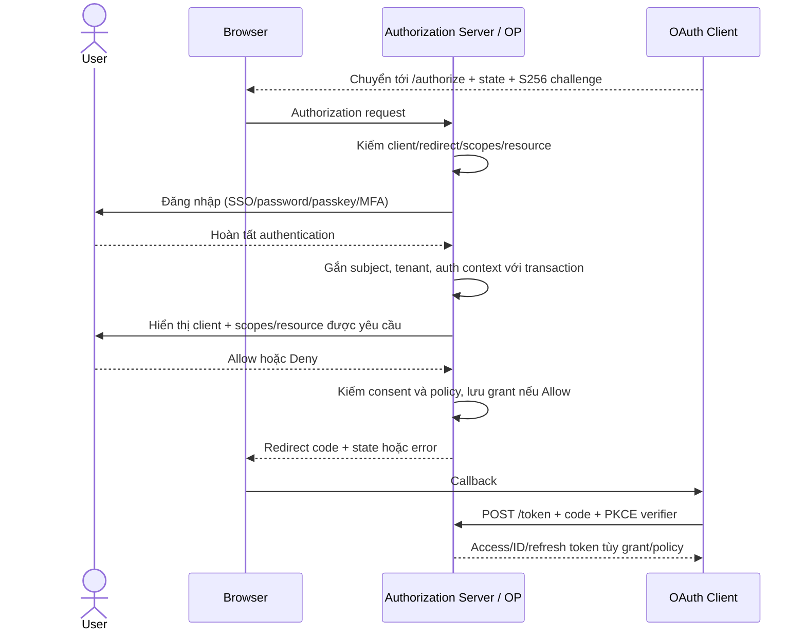
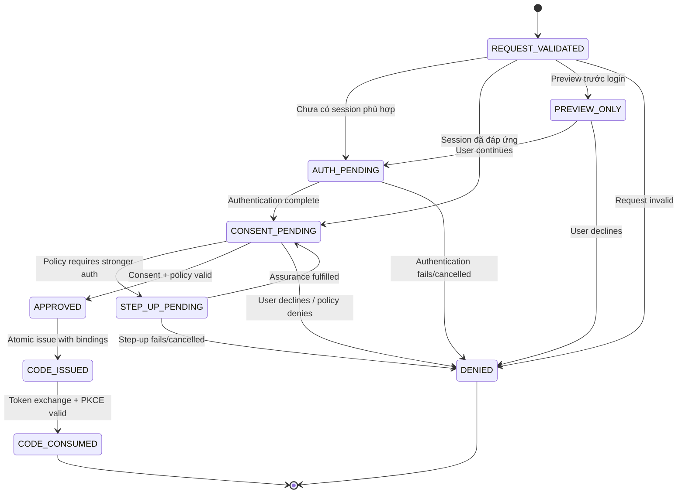

# Consent trước và sau authentication

Trong OAuth 2.0 và OpenID Connect (OIDC), **authentication** và **consent** thường xuất hiện trên cùng hành trình đăng nhập/ủy quyền, nhưng **không phải một sự kiện**. *Authentication* trả lời **“Chủ thể nào đã được xác minh, bằng cách nào và ở mức nào?”**; *consent* trong ngữ cảnh OAuth trả lời **“Chủ thể có thẩm quyền có đồng ý cho client được cấp một phạm vi truy cập cụ thể hay không?”**. Một người đã đăng nhập không đồng nghĩa họ đã chấp thuận mọi scope; ngược lại, một cú bấm “Đồng ý” trước khi biết chắc người bấm là ai **chưa đủ để tạo một authorization grant ràng buộc với danh tính người dùng đó**.

Ví dụ, một ứng dụng lịch bên thứ ba `calendar-helper` muốn đọc lịch của người dùng trên `calendar-api`. Authorization Server (AS)/OpenID Provider (OP) có thể hiển thị **tóm tắt quyền được yêu cầu trước màn hình đăng nhập**, để người dùng biết mình sắp được yêu cầu chia sẻ gì. Nhưng quyền `calendar:read` chỉ được xem là **đã cấp cho đúng chủ thể** khi AS xác định user/session phù hợp, kiểm chính sách/consent và ghi một quyết định cấp quyền gắn với **user, client, resource và scope**. Nếu người dùng đăng nhập nhầm tài khoản hoặc phải hoàn thành MFA, AS không được phát authorization code/access token như thể mọi điều kiện đã xong.

```text
Client yêu cầu truy cập calendar-api
              |
              v
AS kiểm request/client/redirect/scopes
              |
              +--> Có thể HIỂN THỊ trước login:
              |    "Ứng dụng yêu cầu đọc lịch"
              |    => thông tin/ý định tạm thời, CHƯA phải grant
              |
              v
XÁC THỰC subject đúng (SSO/password/passkey/MFA nếu cần)
              |
              v
Kiểm consent đã có hoặc hỏi consent của subject vừa xác thực
              |
              v
Kiểm scope/resource/tenant/policy và trạng thái cuối
              |
              +--> Declined/pending/step-up chưa đủ => KHÔNG phát code/token
              |
              v
Grant được phê duyệt -> cấp authorization code ràng buộc
              |
              v
Client đổi code bằng PKCE/client authentication -> access token
```

**Ý chính:** thời điểm **hiển thị một đề nghị đồng ý**, thời điểm **người dùng bấm nút**, và thời điểm **AS xác lập grant có hiệu lực** là ba khái niệm khác nhau. Thứ tự UI có thể thay đổi, nhưng mọi quyết định bảo mật phải gắn với **danh tính đã được xác minh và một yêu cầu ủy quyền cụ thể**, không dựa đơn độc vào dữ liệu trình duyệt chưa tin cậy.

Bài thuộc chương **Consent** trong module **SECURITY_TOKEN_SECURITY_FUNDAMENTALS**. Theo phạm vi module, chúng ta liên hệ consent với mô hình tin cậy và vòng đời JWT/opaque token, access token/refresh token, authentication/authorization trong OAuth 2.0/OIDC, phát hành và xác minh claims, scope, audience, lưu trữ, thu hồi và chống token bị đánh cắp hoặc phát lại. Trọng tâm là **consent trước và sau authentication**, bao gồm tương tác người dùng, lưu quyết định, cấp token và thực thi policy phía server.

## 1. Mục tiêu học tập

Sau bài này, bạn có thể:

1. Phân biệt **xác thực danh tính (authentication)**, **đồng ý cấp quyền (consent)**, **ủy quyền theo policy (authorization)** và **chứng thực client**.
2. Giải thích vì sao **một màn hình/ý định consent có thể xuất hiện trước login**, nhưng grant gắn với user phải dựa trên **subject đã xác thực** và request đã kiểm chứng.
3. So sánh thứ tự **authentication → consent**, **consent preview → authentication → final decision**, **SSO đã có → consent**, **consent → step-up**.
4. Hiểu khi nào AS có thể dùng **pre-existing consent/admin approval** mà không hiển thị màn hình chấp thuận mới; tại sao không được lẫn với user tự bấm.
5. Thiết kế dữ liệu consent theo **issuer/subject, client, resource/audience, scope, tenant, policy version, timestamp và trạng thái**.
6. Phân biệt `scope` được **request**, quyền **được grant** và quyền **RS thực thi**; không cho token chứa quyền chưa được cấp.
7. Hiểu `prompt=consent`, `prompt=login`, `prompt=none`, `login_required`, `consent_required`, `interaction_required`, `offline_access` trong OIDC.
8. Giải thích incremental authorization, re-consent, quyền nhạy cảm, refresh token và tác động của revocation.
9. Vận dụng Authorization Code + PKCE, `state`, issuer binding và CSRF/clickjacking defenses để tránh grant nhầm.
10. Phác thảo logic Java/Spring cho authorization transaction, consent decision, token issuance gate và test các đường đi fail closed.

## 2. Bốn khái niệm không được đánh đồng

| Khái niệm | Câu hỏi | Dữ liệu tin cậy chủ yếu | Kết quả |
| --- | --- | --- | --- |
| **Authentication** | “Ai đã xác thực và với mức bảo đảm nào?” | OP/AS session, subject, `auth_time`, `acr`/`amr` theo profile | Authenticated subject/session |
| **Consent** | “Chủ thể có thẩm quyền đã chấp thuận client và quyền cụ thể nào?” | Subject đã xác minh, client/resource/scope, quyết định được bảo vệ | Consent decision / grant approval |
| **Authorization policy** | “AS/RS có **được phép** cấp/thực thi quyền đó không?” | Client registration, tenant policy, risk, scopes, resource ownership | Allow/deny/step-up dù consent có thể là YES |
| **Client authentication** | “OAuth client nào đang giao tiếp với token endpoint?” | Secret, private-key JWT, mTLS, workload assertion... | Verified client identity |

**Một phép xác thực user thành công không phải consent.** Ví dụ user đăng nhập để xem ảnh nhưng chưa từng đồng ý để client thứ ba **xóa** ảnh. AS không được tự mở rộng grant.

**Một consent hợp lệ không tự vượt chính sách.** Ví dụ user muốn đồng ý cấp `payments:refund` cho client không được đăng ký scope đó; AS vẫn phải từ chối quyền ngoài allowlist.

**Một client được xác thực cũng không đại diện user.** Với `grant_type=client_credentials`, AS có thể cấp token theo policy của service principal **mà không có end user đang tương tác**. Không tự tạo “consent của Alice” từ việc backend biết `client_secret`.

### 2.1. Consent trong OAuth không đồng nhất “đồng ý xử lý dữ liệu” theo pháp luật

Một ứng dụng có thể hiển thị thông báo cookie, hợp đồng dịch vụ, chính sách dữ liệu hoặc biểu mẫu đồng ý xử lý thông tin. Những quyết định này có mục đích/điều kiện pháp lý riêng, tùy khu vực pháp lý. **OAuth consent** là một quyết định quyền truy cập cho **client** đối với **scope/resource** thông qua AS. Hai quy trình có thể phối hợp nhưng **không thay thế nhau**.

Ví dụ, chọn “Đồng ý cookie đo lường” trước khi đăng nhập **không** trao quyền `contacts:read` cho một OAuth client. Và việc chấp thuận OAuth `contacts:read` **không tự chứng minh** mọi yêu cầu pháp luật về xử lý dữ liệu đã được đáp ứng. Khi triển khai nghiệp vụ thật, cần chính sách pháp lý và quyền riêng tư của tổ chức được rà soát riêng.

### 2.2. Resource owner có thể là tổ chức, không nhất thiết user

Trong OAuth, *resource owner* có thể là người dùng hoặc một chủ thể có thẩm quyền khác. Với hệ thống doanh nghiệp, **admin approval/pre-authorization** có thể cho phép một client sử dụng phạm vi quyền nhất định theo chính sách tổ chức. Phải phân biệt rõ:

- **User consent:** người dùng chấp thuận quyền trên dữ liệu/nguồn lực mình có thẩm quyền.
- **Admin consent:** quản trị viên được ủy quyền phê duyệt quyền trong tenant/tổ chức.
- **Preconfigured authorization:** cấp quyền theo một chính sách đã được quản trị mà không cần màn hình bấm từng lần.
- **Client Credentials:** quyền của **service principal/client**, không phải một sự kiện user consent mới.

Chỉ dùng từ “người dùng đã đồng ý” trong audit nếu thực sự có quyết định của user phù hợp, không gán cho mọi loại approval khác.

## 3. Ba thời điểm: yêu cầu, hiển thị và phê duyệt grant

### 3.1. Client gửi một authorization request

Ví dụ:

```http
GET /authorize?response_type=code
    &client_id=calendar-helper
    &redirect_uri=https%3A%2F%2Fhelper.example.test%2Fcallback
    &scope=openid%20calendar%3Aread
    &state=STATE_TEST_PLACEHOLDER
    &code_challenge=CHALLENGE_S256_TEST_PLACEHOLDER
    &code_challenge_method=S256 HTTP/1.1
Host: id.example.test
```

Đây là request **tách dòng để minh họa**, không phải HTTP request-line hợp lệ khi gửi nguyên trạng. Giá trị state/challenge là placeholder, không dùng trong hệ thống thật.

AS phải kiểm client registration, redirect URI, grant type, syntax/scope, resource và policy ban đầu **trước khi hiển thị giao diện yêu cầu quyền**. Không tin description/logo/scopes chỉ vì URL của client truyền tới.

### 3.2. Có thể xem trước quyền trước khi đăng nhập

AS có thể hiển thị một **pre-auth information screen**:

> “Calendar Helper muốn đọc lịch của tài khoản bạn sẽ chọn. Hãy đăng nhập để xác định tài khoản và xem quyền trước khi chấp thuận.”

Màn hình này giúp **minh bạch** nhưng không có nghĩa AS đã cấp `calendar:read` cho một user chưa xác thực. Nếu UI có nút “Tiếp tục” hay “Đồng ý” trước login, hệ thống nên coi đó là **ý định tạm thời** gắn với transaction; ở điểm rủi ro, xác nhận lại dưới danh tính thực sau authentication/step-up.

### 3.3. Grant phải được xác lập ở điểm tin cậy

Tại thời điểm AS đánh dấu grant `APPROVED`, nó phải có cơ sở đáng tin rằng:

1. Client và request được định danh, ràng buộc và chưa bị thay đổi.
2. Subject/resource owner có thẩm quyền đã được xác minh theo chính sách.
3. Nếu cần MFA/step-up, trạng thái assurance đã đạt.
4. Consent decision tương ứng **đúng subject, tenant, client, resource, scopes/authorization details**, không chỉ là một boolean mơ hồ.
5. Scope và audience thực sự cấp **không vượt** chính sách AS.
6. Transaction chưa hết hạn, chưa bị hủy, chưa bị approve/consume trái quy tắc.

AS mới được cấp authorization code hoặc token theo flow tương ứng. **Không dùng một cookie "clicked_accept=true" do browser gửi như quyết định final độc lập.**

## 4. Mô hình A: Authentication trước, consent sau

Đây là thứ tự phổ biến và dễ giải thích:



**Ưu điểm:** AS biết ngay **ai** đang phê duyệt; nội dung consent có thể dùng tên tài khoản/tenant đã được xác minh để giảm nhầm lẫn. Những quyền gắn tài khoản cụ thể (lịch, danh bạ, dữ liệu doanh nghiệp) nên được trình bày với bối cảnh subject.

### 4.1. Nếu user đã có session tại OP

**Authentication có thể đã xảy ra trước authorization request**. AS có thể tái sử dụng SSO session đang còn hiệu lực theo policy. Khi đó màn hình consent là bước tương tác đầu tiên người dùng nhìn thấy trong flow mới, nhưng **về mặt bảo mật subject đã được xác thực từ phiên trước**.

Do đó, câu “consent xuất hiện trước login UI” **không đủ kết luận** consent diễn ra trước authentication. Cần kiểm **thực tế state của OP session** chứ không chỉ trình tự các trang màn hình.

### 4.2. Nếu không cần hỏi consent lại

AS có thể biết **pre-existing consent hợp lệ** hoặc policy preauthorization cho cùng client/resource/scope/subject và không cần một consent dialog mới. Điều này **không đồng nghĩa consent chưa từng có**, cũng không đồng nghĩa mọi API call tương lai đều được cấp quyền vô hạn:

- Kiểm subject/tenant/client/scope/resource matching.
- Kiểm consent có bị thu hồi, hết hiệu lực hoặc thay đổi policy không.
- Nếu yêu cầu scope mới, offline access hoặc rủi ro cao hơn, xem xét re-consent/step-up.
- Không dùng old grant của user A cho user B chỉ vì hai tài khoản cùng browser.

## 5. Mô hình B: Preview hoặc ý định consent trước authentication

Một số sản phẩm muốn user biết ngay ứng dụng sẽ xin những quyền nào trước khi quyết định đăng nhập. Điều này có thể hợp lý về UX, nhưng **phải tách "người dùng thấy/bấm" khỏi "AS đã cấp grant"**.

```mermaid
sequenceDiagram
    actor U as User
    participant B as Browser
    participant AS as Authorization Server
    participant DB as Auth Transaction Store
    participant C as OAuth Client
    C-->>B: /authorize request
    B->>AS: client + scope/resource + state + PKCE challenge
    AS->>DB: Validate, create PENDING transaction
    AS->>U: Hiển thị preview quyền trước login
    U-->>AS: Tiếp tục / biểu lộ ý định tạm
    AS->>DB: Mark PROVISIONAL_INTENT (no grant)
    AS->>U: Đăng nhập và MFA nếu yêu cầu
    U-->>AS: Authenticated subject
    AS->>DB: Bind verified subject/tenant/auth context
    AS->>U: Xác nhận quyền trong danh tính hiện tại khi cần
    U-->>AS: Chấp thuận hoặc từ chối cuối
    AS->>DB: Recheck policy; APPROVED hoặc DENIED
    AS-->>B: Code + state chỉ sau APPROVED
    B->>C: Callback
```

**Phân biệt trạng thái rõ ràng**: `PROVISIONAL_INTENT` là dữ liệu UI/giao dịch tạm thời, **không phải `GRANT_APPROVED`**.

### 5.1. Vì sao click trước login có thể nguy hiểm?

Trước khi biết subject, AS có thể không xác định được:

- User đang chọn **tài khoản cá nhân hay doanh nghiệp**.
- Resource thuộc tenant nào và ai có thẩm quyền đồng ý.
- Scope rủi ro cao có cần MFA/step-up hay admin approval.
- Tài khoản sẽ đăng nhập có bị khóa, thuộc policy cấm grant hay không.
- Consent cũ cho client này đã bị user này thu hồi chưa.

Nếu AS coi nút “Agree” trước login là grant cuối và sau đó tự gắn vào **bất kỳ user nào đăng nhập**, attacker có thể gây **consent/session swapping** hoặc quyền bị gắn sai tài khoản.

### 5.2. Điều kiện giữ provisional intent an toàn

AS phải:

1. Tạo **server-side transaction** gắn request/client/redirect/scope/resource/issuer/state và TTL.
2. Xem click là **ý định tạm**, không phát code/token và không tạo durable grant.
3. Sau khi authentication hoàn tất, ràng buộc subject/tenant dựa vào OP session đáng tin, kiểm tra request không bị đổi.
4. Áp dụng consent requirement, re-prompt hoặc xác nhận lần cuối khi account/context/risk cần; không để UI trước login trở thành quyền cấp nhầm.
5. Kiểm CSRF/session binding và chống thay đổi `transaction_id`, `subject_id` hay approved scopes từ browser.
6. Chỉ chuyển trạng thái final **sau khi** user/auth policy và grant policy đạt.

**Cách thiết kế bảo thủ dễ audit:** preview trước login → authentication → màn hình consent gắn tài khoản đã xác minh → grant. Nếu muốn rút gọn bước xác nhận cuối bằng pre-existing consent hoặc cơ chế khác, phải có **policy rõ và bằng chứng được phép**, không chỉ viện lý do UX.

### 5.3. Consent âm tính trước login

Nếu user **từ chối** ngay ở preview, AS có thể kết thúc yêu cầu mà **không cần xác thực**. Điều này an toàn hơn việc tự tạo một approval chưa xác minh. Tuy nhiên cần:

- Trả lỗi OAuth thích hợp qua redirect URI **đã xác thực** hoặc hiển thị lỗi an toàn theo tình huống.
- Không lộ user enumeration hoặc trạng thái tài khoản từ câu trả lời.
- Không làm thay đổi durable consent grant của một user chưa xác thực.

## 6. Mô hình C: Consent rồi phát hiện cần step-up authentication

Có những flow user đã đăng nhập SSO ở mức cơ bản và đang xem consent. Khi scope nhạy cảm được yêu cầu, AS phát hiện cần **MFA/reauth**:

```text
SSO session: authenticated at basic assurance
    |
    v
Consent UI: requests payments:write
    |
    v
User clicks Allow
    |
    v
Policy: HIGH_RISK -> requires step-up
    |
    v
MFA / WebAuthn / recent reauthentication
    |
    +-- FAIL/CANCEL -> no grant, no code/token
    |
    v
Revalidate subject, consent intent, requested permissions and risk
    |
    v
Final grant approved -> authorization code issued
```

Ở đây có thể nói **nút đồng ý đã được bấm trước khi hoàn thành step-up**, nhưng quyết định final và token issuance vẫn phải đợi authentication đạt mức yêu cầu. Nên kiểm subject sau step-up **vẫn là subject ban đầu**, tránh nâng quyền nhầm khi người dùng đổi tài khoản giữa chừng.

### 6.1. `auth_time` khác `iat`

Với OIDC, `auth_time` liên quan thời điểm end user được xác thực; `iat` là thời điểm ID token phát hành. Nếu yêu cầu quyền nhạy cảm đòi reauthentication gần đây, AS/RP không được xem ID token vừa được phát tại 12:00 là bằng chứng user vừa đăng nhập lại nếu `auth_time` thực tế từ 08:00.

### 6.2. Consent không “thực thi” MFA

Việc user bấm “Allow” không phải sở hữu khóa, passkey, OTP hoặc bước xác thực khác. Nếu policy yêu cầu `acr`/`amr` cụ thể, phải kiểm authentication result của OP theo hợp đồng đáng tin. Không tự gán `mfa=true` vì user đã đồng ý quyền nhạy cảm.

### 6.3. Failure/timeout sau provisional consent

Nếu MFA bị hủy, sai, hết hạn hoặc risk policy đổi, giao dịch phải kết thúc theo state thích hợp và **không phát code/token**. Không để một callback MFA đến muộn “hoàn tất” một grant đã hết hạn hoặc đã deny.

## 7. State machine cho authorization + consent

Một thiết kế rõ trạng thái giúp tránh cấp token khi transaction mới đạt một phần điều kiện.



Đây là **mô hình minh họa**, không phải state machine bắt buộc của mọi AS. Trong triển khai cần bổ sung `EXPIRED`, `CANCELLED`, `REVOKED` và TTL; các giao dịch có pre-existing consent có thể bỏ qua UI nhưng **không bỏ checks**. Mục đích chính là **không có cạnh từ `PREVIEW_ONLY`/`AUTH_PENDING`/`STEP_UP_PENDING` tới `CODE_ISSUED`** nếu chưa hoàn tất đủ các điều kiện.

### 7.1. Invariants phải giữ

**Invariant A:** `authorization_code_issued => authenticated_subject_or_valid_owner_authorization && grant_policy_approved`.

**Invariant B:** `granted_scopes ⊆ requested_scopes ∩ allowed_client_scopes ∩ approved_scopes`.

**Invariant C:** `grant.subject`/tenant/client/resource lấy từ transaction tin cậy và quyết định final; không lấy trực tiếp từ form approval không xác thực.

**Invariant D:** code dùng một lần, hết hạn ngắn, ràng buộc `client_id`, redirect URI, PKCE challenge/method, user/grant context.

**Invariant E:** thay đổi subject, client, scope, resource, tenant hay mức bảo đảm có thể làm mất hiệu lực consent tạm/cũ; phải revalidate.

### 7.2. Ví dụ record giao dịch

```yaml
authorization_transaction:
  id: opaque_random_reference
  expected_issuer: https://id.example.test
  client_id: calendar-helper
  redirect_uri: https://helper.example.test/callback
  requested_scopes: [openid, calendar:read]
  requested_resource: calendar-api
  pkce_method: S256
  pkce_challenge_ref: stored_in_trusted_transaction
  state_binding_ref: session_bound_reference
  authenticated_subject: null
  tenant_id: null
  assurance: null
  provisional_intent: NONE
  consent_decision: PENDING
  policy_version: consent-policy-v3
  status: AUTH_PENDING
  expires_at: bounded_server_time
```

Đây là **mô hình dữ liệu giả**, không phải file cấu hình sẽ được ứng dụng tự động nạp. Không lưu raw verifier ở AS: AS thường cần **challenge** để kiểm code exchange; `code_verifier` do client giữ. Không dùng transaction ID đoán được làm bearer credential.

## 8. Thứ tự kiểm tra tại Authorization Server

Một authorization request chỉ hợp lệ khi AS giải quyết cả **giao thức** và **nghiệp vụ**.

1. **Client & endpoint:** kiểm `client_id`, registered redirect URI, response type, PKCE/challenge, state handling và AS issuer.
2. **Scope/resource syntax:** loại bỏ/deny scope chưa hỗ trợ, parameter sai và resource identifier không hợp lệ.
3. **Authentication state:** subject đã được OP xác minh chưa, session còn hạn không, có cần reauth/MFA không.
4. **Authority:** subject/admin có quyền chấp thuận cho dữ liệu/tenant/resource đang xin không.
5. **Consent state:** đang pending, từ chối, đã grant trước đó, hay cần re-consent.
6. **Policy check:** client allowlist, tenant policy, scope ceilings, authorization details, sensitivity, thời hạn grant.
7. **Final binding:** quyết định final đúng client + subject + scope/resource + transaction và anti-CSRF.
8. **Issuance:** cấp authorization code **sau khi** tất cả điều kiện bắt buộc đạt.
9. **Token exchange:** PKCE/client authentication, code one-time, redirect/client match và grant liveness.
10. **RS authorization:** access token đúng audience/scope chưa đủ nếu business/resource policy từ chối.

**Không có “consent = true” như một cờ toàn cục** cấp mọi quyền vĩnh viễn. Một quyết định phải có **phạm vi cụ thể** và chính sách thay đổi được.

## 9. Requested scope, granted scope và effective permission

Ví dụ client yêu cầu:

```text
requested scopes = ["calendar:read", "calendar:write", "contacts:read"]
```

Người dùng chấp thuận chỉ:

```text
consented scopes = ["calendar:read"]
```

AS policy chỉ cho client:

```text
allowed scopes = ["calendar:read", "calendar:write"]
```

Nếu profile/UX hỗ trợ **chấp thuận từng scope**, tập scope cuối được cấp chỉ có thể nằm trong giao:

\[
G \subseteq R \cap C \cap A
\]

Trong đó `R` là requested scopes, `C` là consented scopes và `A` là AS-allowed scopes. **Không giả định mọi AS cho phép partial approval**: tùy chính sách, AS có thể bắt chấp thuận tất cả quyền được yêu cầu hoặc từ chối toàn request; client phải xử lý token response/granted scope thực tế.

### 9.1. Access token không có quyền chưa grant

Nếu AS phát token access JWT minh họa:

```json
{
  "iss": "https://id.example.test",
  "sub": "user-42",
  "aud": "calendar-api",
  "scope": "calendar:read",
  "exp": 1800000600
}
```

Resource server **không được cho `calendar:write`** vì client từng request scope đó. Phải kiểm scope thực sự ở token, audience và resource authorization. JWT chỉ là **định dạng token**, không thay AS/RS policy.

### 9.2. Audience và resource không được mở rộng theo client request

`resource=https://api.example.test/payments` (RFC 8707, nếu AS hỗ trợ) giúp chỉ định resource, nhưng **client tự yêu cầu không tự có quyền** tới API đó. Consent UI cần thể hiện **tài nguyên/loại dữ liệu thực**, còn AS phải xác nhận audience phù hợp với grant. Token `aud=calendar-api` không được nhận tại `payments-api` chỉ vì cùng issuer.

### 9.3. Rich Authorization Requests và quyền chi tiết

Với nghiệp vụ phức tạp, scope như `payments:write` có thể quá rộng để diễn tả “chuyển tối đa 500.000 VND đến tài khoản X”. **RFC 9396 Rich Authorization Requests (RAR)** định nghĩa `authorization_details` cho một số tình huống cần cấu trúc quyền chi tiết:

```json
{
  "type": "payment_initiation",
  "actions": ["initiate"],
  "locations": ["https://api.example.test/payments"],
  "instructedAmount": {"currency": "VND", "amount": "500000"}
}
```

Đây là **ví dụ profile nghiệp vụ minh họa**; fields và security semantics phụ thuộc hệ thống hỗ trợ RAR. AS phải **xác minh tất cả tham số**, hiển thị bản tóm tắt an toàn cho user rồi ghi đúng authorization details đã được cấp, không chỉ boolean `allow_all`. Resource server tiếp tục kiểm giao dịch thực tế khớp quyền được grant.

## 10. Consent screen: hiển thị đúng người, đúng ứng dụng, đúng quyền

Một màn hình consent an toàn giúp người dùng hiểu quyết định:

| Thành phần UX | Nội dung nên thể hiện | Rủi ro nếu thiếu |
| --- | --- | --- |
| **Ứng dụng yêu cầu** | Tên client đáng tin từ registration, publisher, logo có kiểm duyệt | Client giả nhãn “Google/Admin” để lừa consent |
| **Tài khoản/tenant** | Subject/tenant đã xác thực khi thích hợp | User đồng ý bằng nhầm account |
| **Quyền** | Mô tả cụ thể quyền đọc/ghi/xóa, tránh ngôn ngữ quá chung | Người dùng không hiểu hậu quả |
| **Đối tượng dữ liệu** | Calendar, contacts, orders, payment details, resource | Scope trừu tượng che giấu phạm vi |
| **Thời hạn/offline** | Có dùng khi user không online, refresh token hay không theo policy | Người dùng tưởng chỉ có truy cập một lần |
| **Từ chối** | Nút Deny/Cancel rõ ràng | UX cưỡng ép, lỗi khi user không đồng ý |
| **Đổi account** | Cách chọn đúng subject/tenant nếu có nhiều phiên | Consent được gắn nhầm người |
| **Quản lý lại quyền** | Nơi xem/thu hồi grant sau này | User không kiểm soát vòng đời |

Không dùng dynamic HTML từ `client_name` hoặc description chưa kiểm duyệt để render consent text; cần **output escaping** và nguồn metadata đã xác minh. Không cho client tự đặt logo URL/script gây XSS/tracking trong consent page.

### 10.1. Granularity và quyền nhạy cảm

Consent “đọc sự kiện lịch” khác consent “xóa tất cả lịch”; “đọc contacts” khác “đọc email nội dung” hoặc “chuyển tiền”. Thông tin cần **có ý nghĩa đối với người dùng**:

- Đọc (read) khác ghi (write), xóa (delete) hoặc quản trị (admin).
- Truy cập một lần khác truy cập lâu dài/offline.
- Chỉ dữ liệu của user khác quyền truy cập toàn tenant.
- Quyền chia sẻ ra bên thứ ba khác lưu trữ nội bộ theo chính sách.

AS nên tránh trả lời “Allow” cho một permission rất rộng nếu UI che bớt quyền thực tế.

### 10.2. Đừng tin client tự báo quyền và tên hiển thị

Authorization request từ client là **yêu cầu chưa được phê duyệt**. Mọi tham số như `scope`, `resource`, `authorization_details` cần validated; màn hình phải dùng **registered client metadata** và dữ liệu AS đã chuẩn hóa. Đừng lấy nguyên `scope_description` do client đưa qua query rồi hiển thị như lời bảo đảm của OP.

## 11. Những câu trả lời đặc biệt của OIDC: `prompt` và yêu cầu tương tác

OIDC định nghĩa tham số `prompt` giúp RP yêu cầu cách OP tương tác với user. Nó **không cho phép RP tự vượt qua consent policy**.

### 11.1. `prompt=consent`

```text
scope=openid profile email
prompt=consent
```

Ý nghĩa: RP yêu cầu OP **nhắc consent**; ngay cả khi có session/login hay consent cũ, OP cần xử lý theo OIDC/profile. Nếu request còn cần authentication, OP có thể xác thực rồi hiển thị consent. Đây **không phải flag chấp thuận tự động**.

### 11.2. `prompt=login`

`prompt=login` yêu cầu OP nhắc người dùng xác thực lại. Nó **không tự yêu cầu consent mới** cho quyền, và một ID token mới được phát không tự chứng minh việc user reauth nếu RP không kiểm `auth_time`/authentication context theo policy.

### 11.3. `prompt=none`

`prompt=none` yêu cầu OP **không hiển thị giao diện**. Nếu không thể hoàn tất authentication/consent im lặng, OP trả lỗi phù hợp như:

- `login_required`: không có session/điều kiện authentication phù hợp.
- `consent_required`: phải hỏi consent mà không thể tương tác.
- `interaction_required`: cần thao tác tương tác khác.
- `account_selection_required`: cần chọn tài khoản trong bối cảnh hỗ trợ.

`prompt=none` **không được kết hợp với giá trị prompt khác** theo OIDC. Nếu cần màn hình mới, client phải chạy một **interactive flow**; không được coi lỗi `consent_required` là bằng chứng consent đã có hoặc bỏ kiểm tra grant.

### 11.4. `prompt=select_account` và `max_age`

`prompt=select_account` có thể cho người dùng chọn account. `max_age` yêu cầu giới hạn tuổi authentication; hai tham số giúp giảm nhầm subject và đáp ứng reauthentication policy. Tuy nhiên **không thay consent**, và AS vẫn phải gắn decision với đúng subject đã xác minh.

### 11.5. Ví dụ xử lý lỗi một cách có kiểm soát

```text
OIDC silent request -> OP returns consent_required
    |
    v
RP marks "interactive consent required"
    |
    v
User explicitly starts normal authorization flow
    |
    v
OP authenticates user if needed and asks consent
    |
    +-- Denied -> RP shows denial, no token-based login/grant
    |
    v
Grant approved -> valid code/token flow -> RP validates result
```

Không retry im lặng liên tục gây redirect loop; cũng không tự tạo cookie session vì callback error có một `state` hợp lệ.

## 12. `offline_access`, refresh token và consent kéo dài

OIDC scope **`offline_access`** được dùng khi RP muốn access token/refresh token có thể hỗ trợ truy cập **khi end user không đang online**. Nó không phải một access token và không bảo đảm AS sẽ phát refresh token.

```text
scope=openid profile calendar:read offline_access
response_type=code
```

Theo OIDC Core, yêu cầu `offline_access` có điều kiện chặt về consent/authorization. Với luồng OIDC, OP phải xử lý yêu cầu consent thích hợp, thường với `prompt=consent` trừ khi đã thỏa những điều kiện khác để xử lý offline access; nếu không đủ điều kiện, OP có thể bỏ qua yêu cầu offline_access/không cấp refresh token theo chuẩn và policy.

### 12.1. Consent cho đọc một lần khác quyền offline lâu dài

UX cần giúp user hiểu **phạm vi và thời điểm truy cập**:

- App có tiếp tục truy cập sau khi user đóng trình duyệt không?
- Có refresh token không, vòng đời/expiry/rotation như thế nào?
- Quyền `calendar:read` được dùng cho một tài khoản hay nhiều tenant?
- User có thể **xem và thu hồi** quyền ở đâu?

Một consent đồng ý cho `calendar:read` **không tự cho** client quyền xóa hoặc tăng scope lên `calendar:write` trong những lần refresh sau.

### 12.2. Refresh token không thay consent mới

Khi client gửi:

```text
grant_type=refresh_token
refresh_token=REFRESH_PLACEHOLDER
```

AS phải ràng buộc refresh token với client/grant/scope/resource theo profile và chỉ cấp access token đúng policy; **không cho refresh request mở rộng scope ngoài grant gốc**. Nếu client xin quyền mới, thường cần **authorization/consent flow tương ứng**.

Refresh token phải được bảo vệ, rotation/reuse detection hoặc sender-constraining khi áp dụng; consent được revoke có thể đòi vô hiệu grant/token family. Không mặc định access JWT đã phát sẽ mất hiệu lực ngay nếu RS chỉ validate offline.

## 13. Incremental consent và quyền được xin bổ sung

*Incremental authorization/consent* là việc client xin **thêm quyền khi thực sự cần** thay vì xin mọi quyền nhạy cảm từ lần login đầu.

Ví dụ:

```text
Ngày 1:
  request: openid profile calendar:read
  grant:   calendar:read

Ngày 5, user bật chức năng tạo sự kiện:
  request: calendar:write
  user consents to additional permission
  grant after policy: calendar:read + calendar:write (if supported)
```

Tùy OP, cách lưu granted scopes có thể là **cộng dồn**, một grant phiên bản mới, hoặc một token riêng cho scope mới. Client **không được giả định**:

- User đồng ý quyền cũ = tự động đồng ý quyền mới.
- Có consent ở tenant A = có consent ở tenant B.
- Scope client từng request = scope AS đã cấp.
- Re-consent UI có thể bỏ vì API vẫn chấp nhận access token cũ.

### 13.1. Granular consent và partial approval

Một OP có thể cho phép user chỉ chấp thuận một phần scopes; OP khác dùng all-or-nothing theo chính sách. Nếu partial approval được hỗ trợ:

```text
Requested: [calendar:read, calendar:write]
Approved:  [calendar:read]
Denied:    [calendar:write]
```

Client phải **kiểm tập scope thực tế được cấp**, vô hiệu chức năng write và không gọi API write chỉ vì consent screen ban đầu liệt kê nó.

### 13.2. Scope/resource thay đổi cần đối chiếu consent cũ

Nếu OP đã lưu grant cho `calendar-helper` đọc `calendar-api`, request mới tới `contacts-api` hoặc `calendar:delete` **khác bản chất**. AS phải xét consent/policy mới. Tên client giống nhau không cho phép mở rộng **audience** hoặc loại dữ liệu.

### 13.3. Policy thay đổi giữa authorization và token exchange

Grant có thể được approve lúc 12:00, nhưng lúc 12:01 admin disable client hoặc user revoke grant. Token endpoint cần áp dụng policy về **liveness/consistency**: kiểm code/grant còn hiệu lực tại token exchange theo thiết kế. Không coi việc một code đã cấp là giấy phép bất chấp mọi sự kiện revoke/risk trước khi đổi code.

## 14. Consent record: lưu đúng chủ thể, đúng quyền và có thể thu hồi

Để sử dụng pre-existing consent, AS phải có **nguồn dữ liệu đáng tin** thể hiện quyết định grant. Một boolean `user_has_consented=true` là quá yếu cho hệ thống nhiều ứng dụng/tài nguyên.

### 14.1. Mô hình dữ liệu tham khảo

```yaml
consent_grant:
  id: server_generated_opaque_reference
  issuer: https://id.example.test
  subject: stable_subject_from_authenticated_session
  actor_type: USER
  tenant: tenant-A
  oauth_client_id: calendar-helper
  resource: calendar-api
  granted_scopes: [calendar:read]
  approved_authorization_details_ref: null
  consent_policy_version: v3
  auth_context_policy_ref: login-assurance-required
  decision: APPROVED
  granted_at: trusted_server_timestamp
  expires_at: optional_policy_timestamp
  revoked_at: null
  grant_version: 12
```

Đây là **mô hình học thuật**, không phải một format tiêu chuẩn OAuth bắt buộc hoặc secret production. Một hệ thống có thể dùng nhiều record cho một subject/client và lưu scope/resource ở bảng con. Quan trọng là **binding và trạng thái**.

Các trường cần được kiểm toán:

| Trường | Mục đích | Lỗi phổ biến |
| --- | --- | --- |
| Issuer và subject | Định danh user trong namespace của OP/AS | Chỉ dùng email hoặc `sub` không có issuer |
| Actor/approver | Phân biệt USER, ADMIN hoặc preconfigured policy | Ghi mọi grant là “user clicked Allow” |
| Client ID/registration | Đúng bên được cấp quyền | Gộp mọi ứng dụng cùng publisher |
| Resource/audience | Đúng API/tập dữ liệu | Quyền đọc lịch được dùng cho payments API |
| Scopes/details | Những quyền được cấp thực | Cờ `all_scopes=true` mơ hồ |
| Tenant/boundary | Phạm vi tổ chức được phép | Consent tenant A có hiệu lực tenant B |
| Policy version | Ngữ nghĩa consent từng thời kỳ | Không biết grant cũ có còn hợp lệ |
| Timestamp/expiry | Vòng đời và tái xác nhận | Grant vô hạn trái policy |
| Revocation state | Người dùng/admin rút quyền | Cấp token mới dù đã revoke |
| Grant version | Hỗ trợ consistency/cache invalidation | AS node dùng trạng thái grant đã cũ |

### 14.2. Consent còn hiệu lực khi nào?

Pseudocode:

```text
reusableConsent(grant, authorizationRequest, authenticatedContext):
    require grant.decision == APPROVED
    require grant.revoked_at == null
    require grant.notExpired

    require grant.issuer == authenticatedContext.issuer
    require grant.subject == authenticatedContext.subject
    require grant.tenant matches requiredTenant
    require grant.client_id == verifiedClientRegistration.id

    require requestedResource is covered by approved grant
    require requestedScopes are within grantedScopes
    require authorizationDetails match the approved policy
    require grant.policyVersion still acceptable
    require authentication context / risk still sufficient

    return TRUE only if every mandatory check passed
```

Đây là **logic khái niệm**, không có nghĩa mọi grant trước đó phải có cùng database schema. Nếu một scope được mở rộng ngữ nghĩa từ “read metadata” sang “read full content”, **policy version** giúp quyết định consent cũ không còn đủ; cần re-consent theo chính sách.

### 14.3. Không dùng consent thuộc subject khác

```text
Browser session: user-A previously approved calendar-helper
User switches account: user-B logs in
Same client asks: calendar:read

Incorrect:
  find consent by browserCookie or clientId alone -> APPROVED

Correct:
  grant must match verified issuer + subject=user-B + scope/resource/tenant
  => if no matching approval, request consent again or deny
```

Đây là ví dụ tiêu biểu về lý do **UI flow khác authorization logic**. Browser có thể đang ở cùng tab, nhưng chủ thể quyền đã thay đổi.

## 15. Không cho client hoặc browser tự thay consent decision

Trang consent thường có nút Allow/Deny và form gửi về AS. Nhưng **giá trị form là input chưa đáng tin**, kể cả khi trang do AS render.

### 15.1. Quy tắc nhận POST

AS nên:

- Dùng **POST** cho thao tác thay đổi quyết định và CSRF token/session binding phù hợp.
- Giới hạn form chứa **transaction reference** đã được AS tạo, không chấp nhận client-controlled `approved_user_id`/`all_scopes`.
- Dùng **request snapshot server-side** để đọc requested scope/resource/registration, không tin text/hidden fields đã bị sửa.
- Kiểm user/tenant/mức authentication **ngay lúc submit**, không chỉ lúc render consent screen.
- Kiểm **đúng origin/session** theo kiến trúc, rate limit và xử lý retry/idempotency.
- Tiêu thụ decision transaction một lần; không phát code mới cho lần POST lại trái policy.

### 15.2. Ví dụ form tối giản

```html
<form method="post" action="/oauth2/consent/decision">
  <input type="hidden" name="tx" value="OPAQUE_SERVER_TX_REFERENCE">
  <input type="hidden" name="_csrf" value="CSRF_TEST_PLACEHOLDER">
  <button name="decision" value="allow" type="submit">
    Đồng ý cấp quyền đã hiển thị
  </button>
  <button name="decision" value="deny" type="submit">
    Từ chối
  </button>
</form>
```

Đây là **mã HTML minh họa**, không phải trang production hoàn chỉnh. Các giá trị hidden fields **có thể bị attacker thay đổi**, nên chúng phải được kiểm/tra server-side. Không cho form gửi `user_id`, `granted_scopes` tùy ý để AS mặc nhiên tin. Nếu UX hỗ trợ lựa chọn scope cụ thể, server phải **giao** lựa chọn đó với requested/allowed scopes đã lưu.

### 15.3. CSRF và clickjacking

Một người dùng đã đăng nhập vào AS có thể bị trang độc hại đánh lừa bấm hoặc bị gửi request thay đổi consent:

- **CSRF:** attacker kích hoạt POST chấp thuận trong context phiên nạn nhân nếu không có CSRF/session/origin binding.
- **Clickjacking:** trang giả nhúng consent UI trong iframe và phủ lớp UI để user bấm Allow không biết.
- **Login CSRF/session confusion:** attacker chuyển user sang một phiên/subject không mong đợi trước khi consent được ràng buộc.

Defense in depth:

- CSRF token được xác thực và binding phiên/transaction.
- `Content-Security-Policy: frame-ancestors 'none'` hoặc allowlist cực chặt, cùng `X-Frame-Options` khi cần hỗ trợ.
- Cookie `Secure`, `HttpOnly`, `SameSite` phù hợp flow/callback.
- Hiển thị tài khoản/tenant và quyền quan trọng, xác nhận riêng với thao tác high risk.
- Không cho consent endpoint hoạt động từ GET chỉ vì muốn một cú click đơn giản.

Không dùng `SameSite` như **thay thế toàn bộ CSRF defense** và không tin mỗi `Referer`/`Origin` mà bỏ ràng buộc transaction.

## 16. Nguy cơ OAuth consent phishing

Một attacker có thể tạo OAuth client hợp pháp về mặt kỹ thuật nhưng dùng tên/logo giống dịch vụ đáng tin để dụ người dùng chấp thuận `mail.read`, `files.write` hoặc offline access.

```text
Attacker controls OAuth client registration
         |
         v
Client app name: "Corporate Security Sync"
Requested scopes: email:read, offline_access
         |
         v
User sees plausible consent screen
         |
         v
User grants permission under real OP
         |
         v
Client receives access/refresh token allowed by grant
         |
         v
Client abuses authorized access
```

**Đây là tấn công bằng lừa phê duyệt**, không nhất thiết cần ăn cắp password hay bẻ chữ ký JWT. Người dùng có thể đang xác thực tại OP thật nhưng vẫn bị thuyết phục cấp quyền cho **client độc hại**.

### 16.1. Bảo vệ từ phía Authorization Server/OP

1. Đăng ký client có quy trình xác minh publisher/redirect domains phù hợp.
2. Không cho client tự sửa tên/logo thành thương hiệu của bên khác mà không kiểm soát.
3. Hiển thị **publisher verified status**, permission descriptions và tài khoản đang cấp quyền khi áp dụng.
4. Phân loại scope nhạy cảm, yêu cầu app review, admin approval hoặc step-up.
5. Giới hạn duration/audience, cân nhắc hạn chế offline access.
6. Cho người dùng/admin **xem và thu hồi app grants**.
7. Audit bất thường: consent surge, scopes nhạy cảm, app mới đăng ký, tenants bị ảnh hưởng.

### 16.2. Bảo vệ từ phía người dùng và doanh nghiệp

Một OP có thể xác thực người dùng đúng nhưng **không bảo đảm ứng dụng bên thứ ba đáng tin về mục đích sử dụng dữ liệu**. Cần đào tạo người dùng quan sát client identity và permissions; tổ chức có thể áp dụng app allowlist/admin approval cho scope rủi ro cao.

### 16.3. PKCE không chống consent phishing

PKCE bảo vệ **authorization code exchange** khỏi interception, không đánh giá **thiện chí của client**. Một client độc hại có thể dùng PKCE đúng, nhận consent thật rồi sử dụng token trong phạm vi đã cấp. Bảo vệ ở đây là **client governance, user awareness, scope minimization và revocation**, không chỉ S256.

## 17. Multi-tenant và admin consent

Trong hệ thống B2B, quyền truy cập có thể liên quan **một tổ chức** chứ không chỉ lịch cá nhân:

```text
User: alice@tenant-A
Client: analytics-partner
Requested resource: tenant-A analytics
Requested scope: reports:read-all
```

Chỉ vì Alice đã đăng nhập không có nghĩa cô ấy có thẩm quyền cấp **read-all** cho tenant-A. AS cần kiểm **role/quyền quản trị** của approver và policy về phạm vi cấp quyền.

### 17.1. Ví dụ admin consent flow

1. Client xin grant tổ chức `reports:read-all`.
2. AS xác thực approver.
3. AS kiểm approver là **tenant admin có quyền phê duyệt scope này**, không chỉ group name trong form.
4. Có thể yêu cầu MFA/step-up cho scope nhạy cảm.
5. AS hiển thị **tenant name, client, publisher, scope, duration và resource**.
6. Admin chấp thuận; AS lưu `actor_type=ADMIN`, tenant, approved scopes và policy version.
7. Token issuance sau đó dùng grant theo **ràng buộc tenant/client/resource**; RS vẫn kiểm policy.

**Không viết audit “Alice (user) đã tự consent dữ liệu của Bob”** nếu quyết định thực tế là admin consent cho tenant. Chủ thể phê duyệt và phạm vi thẩm quyền phải rõ.

### 17.2. Account switch giữa màn hình và final decision

Một trình duyệt có thể đang đăng nhập hai tài khoản: Alice ở tenant-A, Bob ở tenant-B. Nếu từ trang consent chuyển sang login/step-up rồi user đổi tài khoản:

```text
consent displayed for: Alice / tenant-A
after account selection: Bob / tenant-B

=> Old consent UI decision cannot simply bind to Bob/tenant-B.
=> Revalidate request, approver authority, subject and tenant,
   preferably re-display consent context before final grant.
```

### 17.3. Client Credentials không phải admin/user consent

Một service principal `nightly-worker` có thể được admin đăng ký và cho phép `client_credentials` theo policy. Khi nó xin token, không có màn hình user consent mới. **Không chuyển grant service thành quyền delegated user** bằng cách thêm `user_id` vào token request hoặc coi `client_id` là `sub` user.

## 18. Authorization Code + PKCE: consent chỉ là một phần điều kiện

Khi user đã đồng ý, AS **chưa nên phát access token qua browser**. Trong thiết kế OAuth hiện đại, Authorization Code Flow thường:

1. AS chỉ phát **authorization code ngắn hạn dùng một lần** khi grant được phép.
2. Redirect về **registered redirect URI** cùng `state` được client kiểm.
3. Client gửi code + `code_verifier` qua **POST token endpoint**.
4. AS kiểm **PKCE S256**, code binding, client authentication nếu cần, redirect URI, grant policy.
5. Chỉ khi mọi điều kiện đạt, AS mới phát access token/refresh token/ID token tùy flow và policy.

```http
HTTP/1.1 302 Found
Location: https://helper.example.test/callback?code=CODE_TEST_ONLY&state=STATE_TEST_ONLY
Cache-Control: no-store
```

**Consent không thay PKCE**. Ngay cả khi user đã đồng ý `calendar:read`, attacker chặn được code không được nhận token chỉ bằng code nếu AS thực thi verifier binding đúng. **PKCE cũng không thay consent**: có đúng verifier không có nghĩa user đã chấp thuận `calendar:write`.

### 18.1. Không phát code khi còn chờ consent

Anti-pattern:

```java
// SAI về nguyên tắc: password success chưa chắc đã consent/MFA/policy complete.
if (passwordVerified) {
    issueAuthorizationCode();
}
```

Một code đã cấp trước consent có thể bị exchange do lỗi xử lý bất đồng bộ. Hãy chỉ phát code khi **authorization transaction đã APPROVED** dưới subject/context đúng.

### 18.2. Không để token endpoint tin “approval flag” từ client

Sai:

```text
POST /token
grant_type=authorization_code
code=CODE_TEST
consent=true
```

`consent=true` do client khai **không chứng minh user đã đồng ý**. Token endpoint phải tra **authorization code/grant record phía AS** và kiểm chính sách. Nếu OAuth profile không định nghĩa trường này, không chấp nhận nó như đường tắt.

### 18.3. OIDC ID token khác authorization grant

Khi `scope=openid`, OP có thể phát **ID token** sau authentication để RP xác minh `iss`/`sub`/`aud`/`exp`/`nonce` khi áp dụng. Điều này **không trao tất cả API scopes**. Consent có thể liên quan profile claims hoặc offline access, nhưng RS vẫn dùng **access token** và kiểm scope/audience. Không dùng ID token làm bearer API token.

## 19. Java/Spring: xây consent service đúng ranh giới

Trong hệ sinh thái Spring, **Spring Authorization Server** có các abstraction như `OAuth2AuthorizationService` và `OAuth2AuthorizationConsentService`/`OAuth2AuthorizationConsent`. Nên dùng framework triển khai giao thức thay vì tự viết authorization endpoint/token minting. Ví dụ dưới **mô tả lớp nghiệp vụ** quanh việc quyết định consent; đây **không phải API Spring built-in hoàn chỉnh**.

### 19.1. Request context và decision độc lập UI

```java
// Các record/service là abstraction minh họa cho ứng dụng.
record ConsentDecisionCommand(
    String transactionRef,
    boolean allow,
    String csrfToken
) {}

record TrustedAuthContext(
    String issuer,
    String subject,
    String tenant,
    String sessionReference,
    String assuranceLevel
) {}

record ValidatedAuthorizationRequest(
    String transactionRef,
    String registeredClientId,
    String redirectUri,
    String resource,
    java.util.Set<String> requestedScopes,
    String policyVersion
) {}
```

Nhận xét quan trọng:

- `ConsentDecisionCommand` **không chứa `subject`/`tenant`/`grantedScopes` tùy ý** từ browser.
- `TrustedAuthContext` chỉ được lấy từ **server-side authenticated security context** và các check session/assurance.
- `ValidatedAuthorizationRequest` được xây từ **request snapshot đã được AS kiểm tra**, không parse lại từ một hidden field.
- Cho UI partial scope selection thì server mới tính tập quyền giao nhau, không lấy nguyên giá trị tùy ý do browser gửi.

### 19.2. Service logic fail closed

```java
// PSEUDOCODE Java: transactionStore, policies, csrf, consentStore
// là các abstraction cần triển khai theo hệ thống thực.
@org.springframework.transaction.annotation.Transactional
public void decideConsent(ConsentDecisionCommand command,
                          TrustedAuthContext authenticated) {
    var tx = transactionStore.lockByReference(command.transactionRef());
    if (tx == null || tx.isExpired() || tx.isConsumed()) {
        throw new InvalidAuthorizationTransaction();
    }

    csrfService.requireValid(
        command.csrfToken(), authenticated.sessionReference());

    // Không lấy subject/client/redirect/scopes từ browser form.
    var request = tx.validatedAuthorizationRequest();
    policy.requireKnownClientAndRedirect(request);
    policy.requireSameIssuerAndSubject(tx, authenticated);
    policy.requireAccountActive(authenticated);
    policy.requireTenantAuthority(authenticated, request);
    policy.requireAssuranceSatisfied(authenticated, request);

    if (!command.allow()) {
        tx.markDenied();
        transactionStore.save(tx);
        return; // Controller/framework trả access_denied qua safe callback.
    }

    var scopes = policy.computeApprovableScopes(
        request, authenticated);
    policy.requireNoUnapprovedPermission(request, scopes);

    consentStore.recordApprovedDecision(
        authenticated.issuer(), authenticated.subject(),
        authenticated.tenant(), request.registeredClientId(),
        request.resource(), scopes, request.policyVersion());

    tx.markApproved(scopes, authenticated);
    transactionStore.save(tx);

    // Framework authorization flow cấp code CHỈ sau committed approval.
    // Không mint code/access/refresh/ID token tại controller form.
}
```

**Mã này không thể chạy nguyên trạng**, vì các class/method như `transactionStore.lockByReference`, `policy` và `InvalidAuthorizationTransaction` là **khái niệm để hiểu kiến trúc**, không phải API chính thức của Spring Authorization Server.

Lưu ý kỹ thuật:

1. Các thay đổi consent và transaction nên nằm trong **consistency/transaction boundary** thích hợp.
2. Quy trình **issue code** không được chạy trước khi final approval commit an toàn, và không được trả code/token qua network trước khi trạng thái bền vững tương ứng được xác nhận.
3. Nếu consent persistence và authorization code issuance ở hai hệ thống khác nhau, phải thiết kế commit/outbox/idempotency/cancellation nhất quán; không giả định annotation `@Transactional` tự giải quyết distributed transaction.
4. Xử lý POST lặp: một `tx` đã approve/deny/expire **không được hồi sinh** để phát code ngoài policy.
5. Nếu sau consent cần step-up MFA, không đánh dấu `APPROVED` trước khi assurance requirement đã đạt.

### 19.3. Lưu consent với Spring Authorization Server

Ở một số phiên bản Spring Authorization Server, `OAuth2AuthorizationConsentService` có thể được dùng để tải/lưu/xóa `OAuth2AuthorizationConsent` cho **registered client và principal name**, và các authorities được dùng biểu diễn scope/permissions được consent theo cấu hình. Ví dụ cách tư duy:

```java
// Khung minh họa; phải điều chỉnh theo Spring Authorization Server version.
OAuth2AuthorizationConsent existing =
    authorizationConsentService.findById(registeredClientId, principalName);

// Không được tạo principalName từ hidden form hoặc raw user input.
// User phải authenticated; client/issuer/tenant/scope/risk policy phải đạt.
// Khi lưu: chỉ sử dụng authority/scope đã được policy cho phép.
```

**Hạn chế quan trọng:** API lưu consent mặc định theo registered client và principal có thể **chưa biểu diễn đầy đủ tenant/resource/authorization details/policy version** theo nhu cầu của ứng dụng. Hệ thống multi-tenant có thể cần repository/model bổ sung, principal namespace phù hợp hoặc custom consent service để chống **cross-tenant grant reuse**.

Không dùng code snippet này như một bảo đảm rằng framework **tự hiển thị UX consent an toàn**, tự xử lý mọi policy hay auto-revoke mọi token đã phát.

### 19.4. Controller nên trả lỗi và chuyển hướng như thế nào?

Với user nhấn Deny sau khi redirect URI đã được AS kiểm hợp lệ:

```http
HTTP/1.1 302 Found
Location: https://helper.example.test/callback?error=access_denied&state=STATE_TEST_ONLY
Cache-Control: no-store
```

Client kiểm `state` rồi hiển thị **quyền truy cập chưa được cấp**; không tìm cách dùng token cũ cho quyền mới khi chưa có. **Nếu request ban đầu có redirect URI không hợp lệ hoặc client không được nhận response**, AS **không được tự redirect lỗi tới địa chỉ tùy ý đó** — cần xử lý lỗi trực tiếp an toàn theo OAuth.

## 20. Transaction races và bất đồng bộ trong consent

Các luồng xác thực/consent là mục tiêu dễ gặp race condition vì có browser, backend callbacks, MFA provider và nhiều AS nodes.

### 20.1. Hai lần submit cùng form

```text
T0: Transaction PENDING_CONSENT
T1: POST allow reaches node-A
T1: POST allow retry reaches node-B
T2: node-A finalizes APPROVED, issues code-1
T2: node-B also issues code-2 if no atomic lock
```

Cần **one-time consume/atomic transition** với store chung, CAS/lock/unique constraint tùy kiến trúc; không dùng `synchronized` trên một node để giải quyết multi-node race.

### 20.2. Deny và Allow đến đồng thời

Nếu hai request `deny` và `allow` cùng đến từ UI/retry, quyết định final phải theo **state machine/policy nhất quán**, không cho một request muộn đảo `DENIED` thành `APPROVED` mà không tạo transaction mới.

### 20.3. Step-up callback đến trễ

User đã hủy consent hoặc session hết hạn, sau đó MFA callback đến:

```text
transaction.status = CANCELLED
late MFA callback reports SUCCESS

=> Do not transition to APPROVED or issue code.
=> Authentication result may be real but grant request is no longer live.
```

### 20.4. Consent bị thu hồi trong lúc code đang exchange

Khi user/admin revoke grant đồng thời client gửi `POST /token`, AS cần định nghĩa consistency policy cho code exchange/revocation. Các lựa chọn cụ thể phụ thuộc token architecture, nhưng không được bỏ qua hoàn toàn **revocation state** chỉ vì code/grant từng `APPROVED`.

### 20.5. Client registration bị disable

Nếu client bị tạm khóa sau khi user bấm consent nhưng trước token issuance, AS phải kiểm registration/grant policy ở thời điểm thích hợp và **không phát token cho client đã bị cấm theo policy**. Việc đồng ý của user không vượt quyền quản trị.

## 21. Consent revocation: rút đồng ý rồi chuyện gì xảy ra?

Một giao diện **“Ứng dụng đã kết nối”** nên cho user/admin có thẩm quyền xem và thu hồi quyền đã cấp, theo scope/tenant/actor tương ứng.

### 21.1. Phân biệt bốn thao tác

| Thao tác | Mục tiêu | Không nên giả định |
| --- | --- | --- |
| **Revoke consent/grant** | Ngăn AS sử dụng approval đó cho token mới theo policy | Mọi JWT access token đã cấp biến mất tức thì |
| **Revoke refresh token/token family** | Ngăn client tiếp tục làm mới access token | Access JWT cũ luôn hết hiệu lực ngay |
| **Revoke access token** | Chặn token cụ thể theo khả năng của AS/RS | RS offline tự biết revoke nếu không có cơ chế |
| **Logout RP/OP session** | Kết thúc phiên browser tại RP hoặc OP | Đồng nghĩa revoke mọi grants, apps và tokens |

Đây là những trạng thái/lớp khác nhau; **thao tác UX “Disconnect app” cần định nghĩa chính xác những bước backend sẽ thực hiện**.

### 21.2. JWT và opaque token ảnh hưởng thời gian thu hồi

Với **JWT self-contained**, RS chỉ xác minh chữ ký/`exp` có thể tiếp tục chấp nhận access token tới hạn nếu không dùng denylist, grant version/session validation hoặc một cơ chế kiểm revoke khác. Với **opaque token**, AS introspection có thể trả `active=false` nhanh hơn, nhưng cache introspection có thể gây trễ. Không hứa “revoke consent = dừng mọi API request ngay trong mili-giây” nếu hệ thống không hỗ trợ.

### 21.3. Refresh token cần bị ảnh hưởng theo grant

Nếu user thu hồi `calendar:read` của `calendar-helper`, một **refresh token của grant đó** không nên tiếp tục xin access token với `calendar:read`. AS phải xác định grant/token family liên quan và chính sách revoke, kiểm trạng thái trước refresh, áp dụng rotation/reuse detection khi phù hợp.

### 21.4. Tác động đối với OIDC session

User rút consent một ứng dụng có thể **vẫn đang đăng nhập vào OP** hoặc RP, tùy chính sách. Có thể phải yêu cầu RP dọn authorized client/session khi “Disconnect” được áp dụng. Nếu muốn **logout toàn hệ thống**, cần thiết kế RP-Initiated/Back-Channel Logout và revocation riêng; không dùng hai khái niệm thay thế tùy tiện.

## 22. Logging/audit: ghi quyết định, không ghi credential

Audit consent giúp trả lời:

- Ai là **actor có thẩm quyền**: USER, ADMIN hay POLICY?
- Grant liên quan issuer/subject/tenant/client nào?
- Những scope/resource/authorization details **đã approve**, không chỉ requested?
- Quyết định là approve, deny, revoke hay expire?
- Được tạo khi nào, theo policy version nào, với authentication/step-up nào?
- Những token/grant references nào cần tra cứu nếu xử lý sự cố?

### 22.1. Ví dụ audit event

```json
{
  "event": "oauth_consent_decision",
  "actor_type": "USER",
  "client_registration": "calendar-helper",
  "resource": "calendar-api",
  "decision": "APPROVED",
  "granted_scopes": ["calendar:read"],
  "policy_version": "consent-policy-v3",
  "result": "RECORDED",
  "request_id": "safe-request-74"
}
```

Đây là metadata giả. Có thể lưu **internal subject reference**/tenant reference đã được phân quyền nếu thực sự cần audit; không nên phát tán thông tin nhạy cảm cho mọi log consumer.

### 22.2. Những thứ không log

- Authorization code, PKCE `code_verifier` và raw `state`/nonce transaction.
- Access token JWT/opaque, refresh token, ID token.
- Raw `Authorization` header, client secret/private key/client assertion.
- Full callback/authorize URL chứa state/code/transaction identifiers.
- Request form chứa CSRF token/session cookie hoặc người dùng nhập thông tin nhạy cảm.
- Chi tiết scope/data cụ thể vượt nhu cầu logging được duyệt.

Không đưa credential vào APM baggage, trace attributes, error telemetry hoặc ticket hỗ trợ. Thay bằng request ID, grant ID nội bộ không phải credential và reason code.

## 23. Các lỗi phổ biến và cách sửa

| Anti-pattern | Hậu quả | Sửa như thế nào |
| --- | --- | --- |
| Click Allow trước login được lưu như durable grant | Chưa biết subject, có thể gắn quyền nhầm user | Chỉ lưu provisional intent, final binding sau xác thực |
| Không kiểm subject sau account switch | Consent của Alice áp dụng cho Bob | So khớp issuer/subject/tenant ở final decision |
| Password success = consent success | Phát code dù user chưa đồng ý | State machine riêng authentication và consent |
| MFA pending vẫn cấp code | Bỏ step-up bắt buộc | Chỉ final approve sau assurance đạt |
| `consent=true` từ client ở token endpoint | Giả mạo quyền phê duyệt | Tra code/grant server-side |
| Grant lưu một boolean cho mọi scope | Quyền bị mở rộng trái phép | Store client/resource/scopes/policy version |
| Dùng requested scopes để mint token | Cấp cả quyền user từ chối | Tính granted scopes bằng policy |
| Consent tenant A áp dụng tenant B | Cross-tenant data exposure | Ràng buộc tenant và approver authority |
| Consent UI lấy app name từ query | Phishing/spoofing publisher | Render từ registered/verified metadata |
| Trang consent trong iframe | Clickjacking | CSP frame-ancestors và UX protection |
| POST Allow không CSRF protection | Silent grant approval | CSRF/session/transaction binding |
| `prompt=none` nhưng consent cần tương tác | Silent authorization trái policy | Trả `consent_required`/lỗi phù hợp |
| Thấy `prompt=consent` thì tự approve | Nhầm request UI thành decision | Hiển thị/đánh giá consent theo policy |
| Re-consent bỏ vì user đã login | Không minh bạch scope mới | Reevaluate grant/scopes/resource |
| Admin consent không kiểm admin role | User thường cấp org-wide | Kiểm authority theo tenant và scope |
| Hai nút Allow/Deny đến đồng thời | Grant state không nhất quán | Atomic state transition |
| Callback step-up trễ vẫn approve | Hồi sinh grant đã cancel | TTL, version/state, fail closed |
| Revoke consent nhưng refresh vẫn mint | Grant đã rút quyền vẫn được dùng | Revoke grant/token family, liveness checks |
| Logout được coi như revoke mọi JWT | API vẫn nhận JWT đến `exp` | Thiết kế revocation propagation |
| ID token được gửi làm access token | Token-type confusion | RS kiểm token type/aud; chỉ access token cho API |
| Chỉ có PKCE nên không cần consent | Attacker hoặc client tự tăng quyền | Authorization/consent policy độc lập |

## 24. Ma trận kiểm thử Consent trước/sau authentication

Giả sử client `calendar-helper` xin `calendar:read` cho `calendar-api`, AS yêu cầu Authorization Code + PKCE `S256` và có màn hình consent khi cần.

| Ca | Kịch bản | Kết quả cần chứng minh |
| --- | --- | --- |
| Login → Allow | Subject đã xác thực, scope/policy đúng | Có thể approve grant và cấp code |
| Login → Deny | Subject xác thực, user từ chối | `access_denied`, không code/token mới |
| Preview trước login | User xem scope nhưng chưa login | Không tạo durable grant/code |
| Click Continue trước login | Chưa có subject | Chỉ lưu provisional intent |
| Preview → login user A → Allow | Final subject đúng | Grant chỉ cho user A theo policy |
| Preview → account switch B | Screen trước đó cho account A | Phải revalidate/reconfirm, không dùng grant A cho B |
| Preview → login fail | Password/passkey thất bại | Không grant/token |
| Preview → MFA pending | Chưa đạt assurance | Không code/token |
| Consent Allow → MFA fail | Step-up thất bại | Không final approve/code/token |
| Consent Allow → MFA complete | Đúng subject, đúng tx, policy hợp lệ | Có thể final approve |
| MFA callback đến muộn | Transaction expired/cancelled | Không hồi sinh grant |
| Existing SSO session | User đã authenticated | Có thể hỏi consent ngay, không nhầm là anonymous grant |
| Existing consent đúng scope | Grant còn hiệu lực, đúng user/client/resource | Có thể bỏ dialog theo policy |
| Existing consent đã revoke | User đã rút quyền | Không reuse, cần flow mới hoặc deny |
| User khác cùng browser | User B, consent của A | Không reuse |
| Client khác cùng publisher | Registration khác | Không reuse nếu grant không bao phủ client |
| Scope mới | Xin thêm `calendar:write` | Không tự thêm vào grant cũ |
| Resource mới | Xin `contacts-api` | Không tái sử dụng consent calendar một cách mơ hồ |
| Audience sai | Token calendar gửi payments | RS từ chối |
| Partial consent | User chỉ chấp thuận read | Token không có write |
| Consent all-or-nothing | User từ chối một quyền bắt buộc | Không cấp quyền ngoài policy |
| Tenant A → B | Scope giống, tenant đổi | Revalidate admin/user authority |
| User thường approve org-wide | Không có admin permission | Deny |
| Admin approval hợp lệ | Verified admin đúng tenant/scope | Grant ghi actor_type ADMIN |
| `prompt=consent` | Client yêu cầu nhắc consent | Không auto-approve |
| `prompt=none`, thiếu session | Không thể auth im lặng | `login_required`/lỗi phù hợp |
| `prompt=none`, cần consent | Không thể hỏi UI | `consent_required`/lỗi phù hợp |
| `prompt=none consent` | Kết hợp prompt không hợp lệ | Từ chối theo OIDC |
| `offline_access` yêu cầu mới | Offline grant chưa có consent thích hợp | Không tự cấp refresh token |
| Refresh mở rộng scope | Request quyền ngoài original grant | Không mở rộng |
| Token request khai `consent=true` | Form do client kiểm soát | Không bypass |
| Client disabled sau consent | Token exchange tới sau | Không cấp token trái policy |
| Consent revoked trước exchange | Code còn pending | Xử lý revoke/liveness theo policy |
| Submit Allow hai lần | Hai AS nodes xử lý song song | Một final transition/code hợp lệ |
| Submit Deny/Allow racing | Request cuối đến muộn | Không đảo quyết định terminal |
| CSRF POST approval | Không có CSRF/session binding | Từ chối |
| Clickjacking iframe | Cross-site frame | CSP chống frame |
| Invalid redirect URI | URL không đăng ký | Không redirect đến URI đó |
| Consent page XSS | Client display metadata độc hại | Escape/sanitize, không thực thi HTML |
| Access token bị revoke | Bearer token cũ dùng ở RS | RS từ chối theo revocation model thực tế |
| JWT offline còn hạn | Consent revoke, chưa có denylist | Nêu rõ propagation, không tuyên bố revoke tức thì |
| Logs chứa code/token | AS/proxy/APM ghi credential | Security test thất bại |

### 24.1. Test âm tính cần kiểm side effects

Ví dụ user nhấn Allow nhưng chưa hoàn tất MFA:

```text
Given:
  transaction.status = STEP_UP_PENDING
  user.click = ALLOW
  assurance.required = HIGH
  assurance.actual = BASIC

When:
  POST /consent/decision

Then:
  authorization_code_count_delta == 0
  access_token_count_delta == 0
  refresh_token_count_delta == 0
  final_approved_grant_count_delta == 0
  transaction remains pending or moves to denied/step-up according policy
```

Không chỉ assert HTTP 200 hoặc chuyển trang. Kiểm DB/issuer side effects, token service mock và audit để chắc chắn **không có credential nào được phát trước final gate**.

### 24.2. JUnit pseudocode kiểm gate

```java
// PSEUDOCODE test: các fixture/service tên theo domain, không là Spring API.
@Test
void beforeAuthenticationConsentCannotMintAuthorizationCode() {
    var tx = pendingConsentTransaction("calendar-helper", "calendar:read");

    assertThrows(AuthenticationRequiredException.class,
        () -> consentService.approve(tx.id(), anonymousContext()));

    verifyNoInteractions(authorizationCodeIssuer);
    verifyNoInteractions(accessTokenIssuer);
    assertFalse(grantRepository.hasFinalGrantFor(tx.id()));
}

@Test
void consentOfUserAIsNotReusableForUserB() {
    var prior = approvedGrant(
        "issuer-test", "user-A", "calendar-helper", "calendar:read");
    var contextB = authenticatedContext("issuer-test", "user-B");

    assertFalse(consentPolicy.canReuse(prior, contextB));
    verifyNoInteractions(accessTokenIssuer);
}

@Test
void scopeEscalationMustNotBeGrantedSilently() {
    var prior = approvedGrant(
        "issuer-test", "user-A", "calendar-helper", "calendar:read");

    assertFalse(consentPolicy.canReuseForScope(
        prior, "calendar:write"));
}
```

Các hàm `pendingConsentTransaction`, `anonymousContext`, `approvedGrant` và repository/issuer là **fixture/abstraction**, không API framework có sẵn. Test tích hợp còn cần trình duyệt thực, cookies, CSRF, consent UX và nhiều AS nodes.

### 24.3. E2E với browser và AS

1. Khởi tạo Authorization Code + PKCE với client/redirect/scope hợp lệ.
2. Nếu AS hiển thị pre-login preview, xác minh **chưa** có final grant/code.
3. Đăng nhập user A, chấp thuận scope read; kiểm code/token đúng subject/client/resource/scope.
4. Lặp với user B trong cùng browser; không reuse grant user A.
5. Lặp với MFA pending/fail/timeout; không phát code/token.
6. Lặp với deny; client nhận lỗi thích hợp, không có token mới.
7. Xin scope write sau khi chỉ consent read; không có silent escalation.
8. Test `prompt=none` khi tương tác cần thiết; OP trả OIDC error, RP không tạo login loop.
9. Test refresh token sau revoke grant và access token cũ theo thiết kế revocation.
10. Quét application/proxy/APM/audit logs bằng sentinel để chắc chắn không lộ credential.

## 25. Điều tra và ứng phó sự cố consent

### 25.1. Phát hiện một ứng dụng OAuth độc hại được nhiều user đồng ý

1. **Khoanh vùng** client ID, publisher, redirect domains, scopes, resources, tenants và các grant bị ảnh hưởng.
2. **Ngừng cấp token mới** cho client bằng registration/policy phù hợp trong phạm vi cần thiết.
3. **Thu hồi grant/refresh token family** bị ảnh hưởng, đánh giá access token còn hiệu lực và cách RS chặn sớm.
4. Xác định những API calls và dữ liệu bị truy cập bằng audit/request IDs, không copy token vào ticket.
5. Gỡ hoặc hạn chế client metadata giả mạo/đường phishing, kiểm app review policy.
6. Thông báo/khắc phục theo quy trình tổ chức, hướng dẫn người dùng kiểm connected apps.
7. Tăng test/monitoring cho consent surge, high-risk scope, offline access và client verification.

### 25.2. Lỗi lưu consent trước authentication

Nếu AS từng tạo final grant ngay khi user bấm Allow trước login:

1. Chặn logic grant sớm, tách `PROVISIONAL_INTENT` khỏi `APPROVED`.
2. Rà những record không có verified subject/tenant/auth context đáng tin.
3. Xem lại những authorization codes/tokens đã phát từ record nghi lỗi; thu hồi/hủy khi cần.
4. Kiểm cross-account/cross-tenant access, session/account switching và MFA bypass.
5. Bổ sung atomic final gate, CSRF binding và tests fail closed.

Không sửa sự cố bằng cách **tự thêm user ID đoán được** vào các grant cũ rồi coi chúng hợp lệ; cần nguồn bằng chứng và chính sách rõ.

### 25.3. “Revoked consent” nhưng API vẫn nhận JWT

Đây có thể là sự khác nhau giữa **grant revocation** và **JWT offline validation**. Điều tra:

- RS có kiểm revocation/grant version/denylist hay chỉ `sig`/`exp`?
- Token còn hạn bao lâu, audience/scope nào và liệu có sender constraint?
- Introspection/JWKS/cache propagation delay ra sao?
- AS đã chặn refresh/new code exchange chưa?

**Hành động** tùy mức rủi ro và hợp đồng; không tự kết luận revoke thất bại hay đã hoàn tất chỉ từ một phép thử duy nhất.

## 26. Bài thực hành

### Bài A — Chỉ ra điểm grant cuối

Một ứng dụng hiển thị:

```text
Step 1: Preview "Calendar Helper wants calendar:read"
Step 2: User clicks Continue
Step 3: Login (password)
Step 4: MFA
Step 5: Final confirmation as verified user-A
Step 6: AS issues authorization code
```

Đánh dấu bước nào chỉ là **thông tin/ý định tạm**, bước nào là **authentication**, bước nào **authorization/consent final** và bước nào mới có thể phát code. Nếu user hủy ở bước 4 thì code có được phát không?

### Bài B — Cùng browser, đổi tài khoản

Alice đã đồng ý `contacts:read` cho `crm-helper`. Cùng browser, Bob đăng nhập rồi client xin lại quyền.

Viết logic xác minh (`issuer`, `subject`, `client_id`, `scope`, `resource`, `tenant`) để tránh dùng consent của Alice. Vì sao cookie phiên trình duyệt không đủ để định danh grant?

### Bài C — Phân biệt `prompt`

Cho ba request:

```text
A) prompt=consent
B) prompt=none
C) prompt=login
```

Nêu mục đích từng tham số; nếu B cần consent mới mà OP không thể hiển thị UI, lỗi nào phù hợp? C có tự động cấp quyền mới cho client không?

### Bài D — Step-up xảy ra sau click Allow

User đã SSO mức cơ bản, bấm Allow cho `payments:refund`; policy yêu cầu WebAuthn. Callback WebAuthn đến trễ sau khi user đóng tab.

Thiết kế state machine và kiểm thử để chứng minh **không grant/token** nếu transaction đã CANCELLED/EXPIRED, dù WebAuthn callback có kết quả success hợp lệ về mặt authentication.

### Bài E — Scope requested khác scope granted

```text
requested = calendar:read calendar:write
allowed   = calendar:read calendar:write
consented = calendar:read
```

Nếu AS hỗ trợ partial approval, tập scopes được cấp tối đa là gì? Client có được gọi write API không? Nếu AS chỉ hỗ trợ all-or-nothing, cách xử lý đúng là gì?

### Bài F — Phishing qua client name

Một client mới đăng ký tên `Corporate Security Backup`, yêu cầu `files:read-all offline_access`, publisher chưa xác minh. Người dùng đã đăng nhập tại OP thật.

Phân tích tại sao PKCE, TLS và login đúng **không bảo đảm client đáng tin**, rồi đề xuất client review, permission disclosure, scope governance, offline access restrictions và revoke UI.

### Bài G — Admin approval

Một nhân viên thường ở tenant-A cố đồng ý `directory:read-all` cho ứng dụng phân tích. User đã xác thực/MFA.

Tại sao vẫn không có quyền phê duyệt? Đề xuất AS policy xác minh approver role, tenant binding, scope sensitivity và audit actor_type. So sánh user consent với admin consent.

### Bài H — Revoke và token propagation

User rút quyền `calendar:read` của một ứng dụng đã được cấp refresh token. Access JWT cũ có `exp` còn 8 phút, RS chỉ validate offline.

Hãy mô tả ba bước:

1. Chặn **grant/refresh/new token issuance**.
2. Xử lý **access JWT còn hạn** bằng TTL/denylist/grant version theo mục tiêu dừng truy cập.
3. Cập nhật **RP connected app UI, audit và session** nếu nghiệp vụ yêu cầu.

Vì sao chỉ xóa consent row không đủ cho mọi mục tiêu revoke?

### Bài I — Sửa anti-pattern Java

```java
// Code SAI để người học review.
if (form.get("allow").equals("true")) {
    saveConsent(form.get("userId"), form.get("clientId"), "*");
    issueAuthorizationCode(form.get("redirectUri"));
}
```

Nêu ít nhất bảy vấn đề: chưa chứng minh authentication/authority, đọc user/client/scope/redirect từ form, thiếu CSRF, thiếu tenant, thiếu transaction/PKCE, không kiểm MFA, không kiểm policy và replay/race. Đề xuất thiết kế **server-side transaction + verified security context + final gate**.

### Bài J — Mô hình hóa dữ liệu consent

Thiết kế bảng `ConsentGrant` gồm issuer, subject, actor_type, tenant, client registration, resource, granted_scopes, policy_version, issued_at, revoked_at, status. Viết unique/index/constraint để tránh consent grant bị reuse chéo tenant và hỗ trợ revoke/audit.

### Bài K — Tình huống không có consent dialog

Một service `nightly-analytics` xin access token theo Client Credentials trong khi admin đã provision policy cho service. Không có end user đang tương tác.

Giải thích vì sao việc **không hiển thị dialog** không tự là lỗ hổng nếu client auth/registration/scope/resource/tenant policy đầy đủ, và vì sao **không được audit “user Alice consented”** cho grant đó.

## 27. Checklist triển khai

- [ ] Tách rõ **authentication**, **consent**, **authorization policy** và **client authentication**.
- [ ] Không tạo **durable user grant** từ click trước khi biết chủ thể/authority được xác minh.
- [ ] Nếu có pre-login preview, lưu **provisional intent** riêng, có transaction/TTL, không phát code/token.
- [ ] Sau login/step-up, revalidate subject/issuer/tenant/client/scopes/resource; xác nhận lại consent khi account/context/risk cần.
- [ ] Với SSO session, không nhầm “không thấy login UI” với “chưa authentication”.
- [ ] Trạng thái `AUTH_PENDING`/`CONSENT_PENDING`/`STEP_UP_PENDING` không có đường bỏ qua tới code issuance.
- [ ] Consent final bị ràng buộc với **issuer + verified subject + tenant + registered client + resource/audience + granted scopes/details**.
- [ ] Kiểm quyền admin/resource-owner; một user đã login không tự có quyền consent tổ chức.
- [ ] UI dùng client metadata tin cậy, hiển thị scope/resource/duration/offline access rõ ràng, có nút Deny.
- [ ] AS chặn OAuth consent phishing bằng app governance, scope sensitivity, publisher verification và grant review/revocation.
- [ ] Form POST consent có CSRF/session/transaction binding, chống clickjacking và không tin hidden `user_id`/`scope`/`redirect_uri`.
- [ ] `prompt=consent` chỉ yêu cầu prompt, không phải approval; `prompt=none` phải xử lý `consent_required`/`login_required` đúng.
- [ ] `offline_access` được xét theo OIDC consent/policy, không tự cấp refresh token khi client yêu cầu.
- [ ] Incremental consent không mở scope/resource/tenant ngoài grant cũ; client kiểm quyền **được cấp** thật.
- [ ] Authorization Code + PKCE `S256` được thực thi, code dùng một lần, đúng client/redirect/issuer và grant còn hiệu lực.
- [ ] Chỉ phát token sau auth, consent, client, scope/audience và policy checks đạt; fail closed khi thiếu trạng thái.
- [ ] Có atomic decision/issuance và chống double-submit, Allow/Deny race, MFA callback đến muộn.
- [ ] Access token JWT/opaque chỉ dành RS đúng `aud`, có scope hẹp, TTL/sender constraint phù hợp; ID token không dùng cho API.
- [ ] Consent grant được lưu với policy version, actor_type, thời hạn, revoke state và audit metadata.
- [ ] Revoke consent kéo theo chính sách dừng mint/refresh token; đánh giá propagation của access token đã cấp.
- [ ] Logout RP/OP, grant revoke, refresh revoke và access token revoke không bị đánh đồng.
- [ ] Không log code, verifier, raw state/nonce, access/refresh/ID token, secrets, cookie, raw HTTP body.
- [ ] Test cả pre-auth, post-auth, SSO, account switch, MFA pending/fail, admin consent, partial scopes, consent phishing, revoke và token theft.
- [ ] Test negative path kiểm **không có token/code/grant được tạo**, không chỉ HTTP status.

## 28. Câu hỏi tự kiểm tra

**1. Authentication và consent có phải một không?** Không. Authentication xác minh subject; OAuth consent thể hiện quyết định cấp quyền cho client trên phạm vi cụ thể.

**2. Consent UI có thể xuất hiện trước login không?** Có thể xuất hiện dưới dạng preview/provisional intent; **final grant gắn user** cần chủ thể/authority đã xác minh và policy đầy đủ.

**3. User bấm Allow trước khi xác thực có được phát code ngay không?** Không. Một cú bấm chưa ràng buộc danh tính không đủ để mint authorization code cho user.

**4. Nếu user đã SSO và thấy consent trước màn hình login thì sao?** User có thể đã được OP xác thực qua phiên SSO trước đó; không chỉ nhìn thứ tự trang UI.

**5. MFA được yêu cầu sau click Allow, có thể phát code trước MFA không?** Không. Assurance bắt buộc chưa đạt thì grant chưa được hoàn tất.

**6. User consent có vượt client scope allowlist không?** Không. Authorization Server policy vẫn là điều kiện.

**7. Consent của user A có áp dụng cho user B trong cùng browser không?** Không, trừ một cơ chế ủy quyền khác được định nghĩa rõ; user consent phải đúng subject/grant.

**8. Phải lưu tối thiểu gì để reuse consent?** Subject/issuer, client, scope/resource, policy và trạng thái phù hợp; thường thêm tenant, actor, expiry, revoke version.

**9. `prompt=consent` có nghĩa AS tự cấp consent không?** Không, nó yêu cầu OP nhắc consent.

**10. `prompt=none` nhưng phải hỏi consent thì làm gì?** Trả lỗi OIDC phù hợp như `consent_required`, không hiển thị UI hoặc bỏ kiểm tra.

**11. `offline_access` có bảo đảm refresh token được cấp không?** Không. OP còn phải xét consent, grant, client và policy.

**12. Access token có `calendar:read` cho phép xóa lịch không?** Không. Scope và resource policy không cấp quyền `calendar:delete`.

**13. JWT đã ký đúng có nghĩa consent vẫn còn hiệu lực không?** Không tự động. JWT offline validation không chứng minh grant chưa bị revoke nếu không có cơ chế kiểm revocation.

**14. PKCE có ngăn client độc hại dụ user consent không?** Không. PKCE bảo vệ code exchange, không đánh giá uy tín hoặc ý định của client.

**15. Consent của tenant admin có giống user consent không?** Không. Admin approval có authority/scope/tenant và actor riêng; không được gán nhầm thành user tự đồng ý.

**16. Người dùng từ chối ngay ở preview trước login có cần biết user ID không?** Thường không cần để kết thúc request, nhưng không được sửa durable grant của user chưa xác minh.

**17. Access token của client credentials có cần end-user consent UI không?** Không nhất thiết; cấp theo quyền service/client và policy đã được quản trị.

**18. Form hidden `approved_scopes` có đáng tin không?** Không. Server phải lấy request snapshot và policy, validate lựa chọn final.

**19. Một consent được revoke có tự logout OP/RP không?** Không nhất thiết; session và grant/token revocation là những lớp khác nhau.

**20. Vì sao negative test cần assert token issuer không chạy?** Để chứng minh không xảy ra side effect cấp quyền dù HTTP response hoặc UI hiển thị lỗi.

## 29. Tài liệu tiêu chuẩn tham khảo

- **RFC 6749 — The OAuth 2.0 Authorization Framework:** resource owner authorization, authorization endpoint, authorization grants, client registration, scopes và token endpoint.
- **RFC 9700 — Best Current Practice for OAuth 2.0 Security:** bảo vệ OAuth authorization flows, client/redirect/PKCE/CSRF và token leakage.
- **OpenID Connect Core 1.0:** authentication requests, `prompt=login`/`prompt=consent`/`prompt=none`, `offline_access`, ID token, nonce và các lỗi OIDC.
- **RFC 7636 — Proof Key for Code Exchange:** `S256` bảo vệ authorization code tại token endpoint.
- **RFC 8707 — Resource Indicators for OAuth 2.0:** scope/resource và audience target.
- **RFC 9396 — OAuth 2.0 Rich Authorization Requests:** `authorization_details` mô tả quyền chi tiết.
- **RFC 9126 — OAuth 2.0 Pushed Authorization Requests:** bảo vệ và trao tham số authorization request theo một profile được AS hỗ trợ.
- **RFC 9207 — OAuth 2.0 Authorization Server Issuer Identification:** issuer binding và chống AS mix-up.
- **RFC 7009 — OAuth 2.0 Token Revocation:** thu hồi access/refresh token.
- **RFC 7662 — OAuth 2.0 Token Introspection:** introspection và trạng thái opaque token.
- **RFC 9068 — JWT Profile for OAuth 2.0 Access Tokens:** access JWT claims và validation.
- **RFC 8693 — OAuth 2.0 Token Exchange:** user delegation/on-behalf-of có policy riêng.
- **RFC 8705 / RFC 9449:** mTLS/DPoP sender-constrained access tokens giúp hạn chế replay của token bị sao chép.
- **OWASP OAuth 2.0 Security Cheat Sheet:** CSRF, redirect validation, secure token handling, phishing và các kiểm soát ứng dụng.

**Kết luận:** **Consent có thể được giới thiệu trước authentication ở giao diện, nhưng authorization grant gắn với một user phải được AS xác lập dựa trên subject/authority đã được xác minh, đúng client, scope, resource, tenant và policy.** Với flow đăng nhập trước rồi hỏi consent, ranh giới này trực quan; với pre-login preview hoặc step-up sau khi user đã bấm Allow, AS phải giữ trạng thái **tạm/chờ** cho tới khi mọi điều kiện final đạt. Một user đồng ý không tự tạo quyền ngoài allowlist, một login thành công không tự chứng minh consent, và một token hợp lệ vẫn cần audience/scope/resource authorization. Bảo vệ transaction, CSRF, PKCE, consent record, revoke/refresh và token lifecycle xuyên suốt là điều kiện để tránh consent nhầm tài khoản, scope escalation, phishing và token bị đánh cắp/phát lại.
