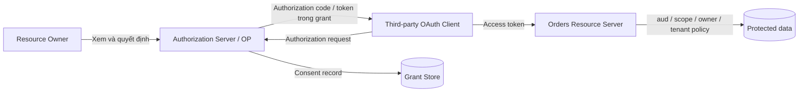
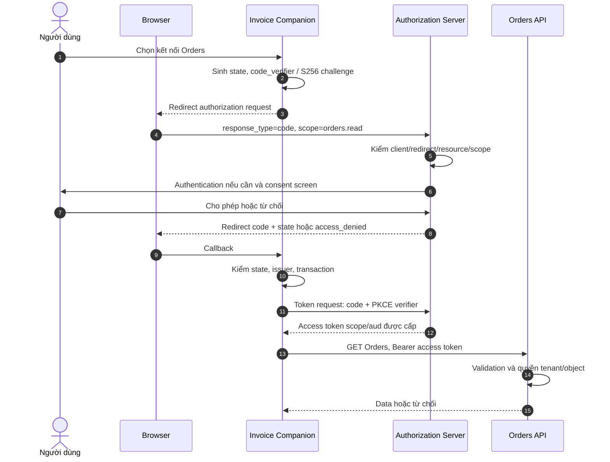
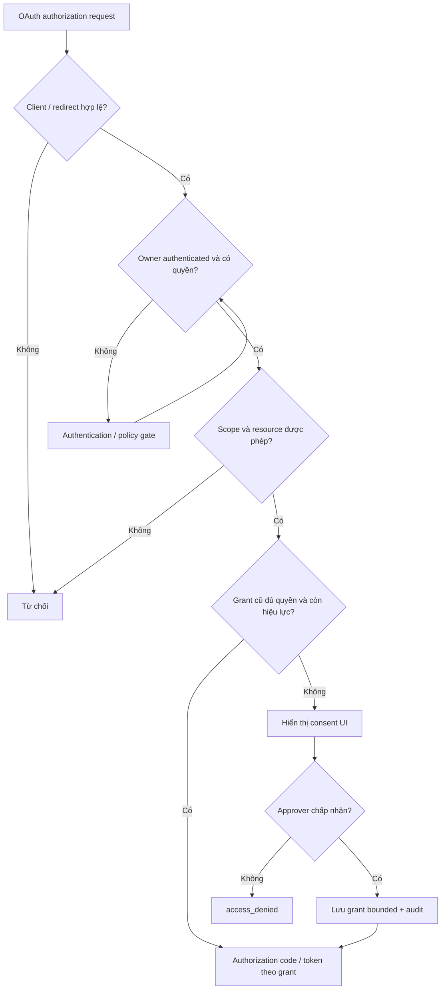

# Third-party consent

Một ứng dụng bên thứ ba tên `Invoice Companion` muốn đọc đơn hàng trong tài khoản của người dùng để tạo báo cáo hóa đơn. Ứng dụng chuyển người dùng tới authorization server (AS) của nền tảng đơn hàng. Trên trang do AS kiểm soát, người dùng thấy yêu cầu: **“Cho phép Invoice Companion đọc đơn hàng?”** và có thể đồng ý hoặc từ chối.

Nếu người dùng bấm **Cho phép**, AS có thể ghi nhận **authorization grant** cho một **client ID**, tập **scope** và **resource** cụ thể. Nhưng điều đó **không có nghĩa** bên thứ ba trở thành chủ sở hữu tài khoản, có thể gọi mọi API, giữ dữ liệu vô thời hạn hoặc được miễn kiểm tra quyền tại resource server. Khi AS phát access token, resource server vẫn cần xác minh issuer, audience, scope, thời hạn và quyền trên từng đối tượng.

Bài thuộc chương **Consent** của module `SECURITY_TOKEN_SECURITY_FUNDAMENTALS`. Trọng tâm là **third-party consent trong OAuth 2.0/OpenID Connect (OIDC)**: người nào được quyền phê duyệt, màn hình consent, scope/audience/resource, consent record, incremental và offline access, khác biệt với authentication và consent theo pháp luật, rủi ro **OAuth consent phishing**, cơ chế thu hồi, JWT/opaque token, refresh token, ví dụ Java/Spring Security và bộ kiểm thử.

## 1. Third-party consent là gì?

Trong ngữ cảnh OAuth, **third-party consent** là quá trình một resource owner hoặc người có thẩm quyền đồng ý cho một **OAuth client do bên thứ ba vận hành** yêu cầu truy cập tài nguyên được bảo vệ, theo phạm vi và chính sách của authorization server.

Ví dụ:

| Thành phần | Ví dụ minh họa | Ý nghĩa |
|---|---|---|
| **Resource owner** | `user-123` thuộc `tenant-a` | Có quyền quyết định trong phạm vi dữ liệu/tenant được phép. |
| **OAuth client** | `invoice-companion` | Ứng dụng bên thứ ba xin quyền. |
| **Authorization server** | `https://id.example.test` | Xác thực các bên, xử lý consent/grant và phát token. |
| **Resource server** | `https://api.example.test/orders` | API đơn hàng, xác minh token và quyền dữ liệu. |
| **Requested scope** | `orders.read` | Hành động client yêu cầu được xét cấp. |
| **Resource/audience** | `orders-api` | API dự kiến tiếp nhận access token. |

**Consent không phải access token.** Quyết định consent là một phần của quá trình ủy quyền; token là credential được AS phát trong phạm vi cho phép. Consent cũng không phải sự bảo đảm rằng bất kỳ request nào sau đó của bên thứ ba đều được phép.

### Consent phải trả lời những câu hỏi nào?

1. **Ai** xin quyền? Client ID, publisher, redirect URIs và trạng thái đăng ký của client.
2. **Ai** quyết định? User/admin đã được AS xác thực, có thẩm quyền với resource.
3. **Quyền gì** được yêu cầu? Các scope và mức nhạy cảm của chúng.
4. **Tài nguyên nào** bị ảnh hưởng? Audience, resource, tenant và dữ liệu liên quan.
5. **Trong bao lâu**? Grant lifecycle, offline access, access-token TTL, refresh-token policy.
6. **Thu hồi bằng cách nào**? Quản lý connected apps, revoke grant/token và chính sách xóa dữ liệu.

Không phải mọi OAuth grant đều hiển thị màn hình consent tương tác. AS có thể áp dụng grant có sẵn, policy tổ chức hoặc quyền đã được ủy quyền trước, tùy bối cảnh và loại client.

## 2. Các vai trò và ranh giới tin cậy

OAuth 2.0 phân biệt bốn vai trò: **resource owner, client, authorization server, resource server**. OIDC bổ sung **OpenID Provider (OP)** và **Relying Party (RP)** cho xác thực danh tính; một OP có thể đồng thời là AS.



**Một ứng dụng bên thứ ba không nhất thiết dùng authorization server bên thứ ba.** Nó có thể xin quyền qua **AS chính thức** của nền tảng. Việc domain đăng nhập đúng, dùng HTTPS và access token do AS thật cấp **không tự chứng minh client xin quyền là ứng dụng đáng tin**.

Một OAuth client có thể đồng thời là OIDC RP: **ID token** dùng để client nhận biết người đăng nhập; **access token** được gửi đến API đúng audience. API không được nhận ID token thay access token chỉ vì cùng OP phát hành.

## 3. First-party và third-party client khác nhau thế nào?

**First-party** thường là ứng dụng cùng tổ chức vận hành với nền tảng; **third-party** là ứng dụng đối tác/nhà phát triển bên ngoài. Đây là phân loại sản phẩm/chính sách, **không phải một giá trị bắt buộc của OAuth Core**.

| Tiêu chí | First-party | Third-party |
|---|---|---|
| Bên vận hành | Cùng nhóm/tổ chức đã biết. | Nhà phát triển hoặc tổ chức khác. |
| Đăng ký và trust | Có thể phê duyệt nội bộ. | Thường cần app review, publisher verification và giới hạn quyền. |
| Consent UI | Có thể áp dụng chính sách ít tương tác hơn. | Nên minh bạch client, quyền và dữ liệu. |
| Scope/audience validation | **Vẫn cần**. | **Vẫn cần**. |
| Nguy cơ dữ liệu | Rò rỉ/chiếm quyền trong cùng tổ chức. | Rò rỉ và sử dụng dữ liệu bên ngoài mục đích. |
| Thu hồi | Theo grant/token/session. | Cần cơ chế connected-app revoke rõ ràng cho user/admin. |

Không được nói “first-party nên được bỏ qua audience”, cũng không được nói “đối tác đã được xác minh nên có thể xin bất kỳ scope nào”. Trust publisher và quyền tài nguyên là hai quyết định riêng.

## 4. Consent khác authentication, authorization và consent pháp lý

| Khái niệm | Câu hỏi chính | Sai lầm thường gặp |
|---|---|---|
| **Authentication** | Người dùng đang đăng nhập là ai? | Đăng nhập thành công ⇒ mọi ứng dụng được đọc dữ liệu. |
| **OAuth consent** | Chủ thể có chấp thuận client này xin quyền trong phạm vi này không? | Bấm Allow ⇒ quyền không giới hạn. |
| **Authorization grant** | AS có căn cứ giao thức/chính sách nào để cấp token? | Mọi grant luôn cần consent popup mới. |
| **Token authorization** | Token đã cấp có audience/scope/expiry gì? | Scope client yêu cầu = scope được cấp. |
| **Resource authorization** | Request được phép với bản ghi/tenant cụ thể không? | Token hợp lệ ⇒ được đọc mọi dữ liệu. |
| **Consent về xử lý dữ liệu cá nhân** | Có căn cứ pháp lý phù hợp để xử lý dữ liệu không? | OAuth Allow tự động đáp ứng mọi quy định bảo vệ dữ liệu. |

**OAuth consent không tự đồng nghĩa với sự đồng ý hợp lệ theo pháp luật về dữ liệu cá nhân.** Các yêu cầu về mục đích, minh bạch, lựa chọn, rút lại và lưu trữ tùy pháp luật/hoạt động xử lý, cần đánh giá riêng. Một ứng dụng có OAuth grant hợp lệ vẫn có thể vi phạm điều khoản sử dụng dữ liệu nếu xử lý vượt mục đích được phép.

## 5. Authorization Code + PKCE với third-party consent

Một cách triển khai hiện đại cho web/SPA/mobile client là **Authorization Code flow + PKCE** với AS đã tin cậy.



**Consent screen do AS kiểm soát**, không phải màn hình giả do app tự vẽ. Client có thể giải thích nhu cầu trước redirect nhưng **không thể tự kết luận AS đã cấp quyền**.

### Vì sao các lớp khác vẫn cần?

- **`state`** ràng buộc callback với transaction, giảm CSRF/login injection.
- **PKCE S256** giảm authorization code interception.
- **Redirect URI chính xác** và **issuer binding** ngăn code gửi nhầm/đến host attacker.
- **Client authentication** (nếu confidential client) xác minh client tại token endpoint.
- **Consent decision** xác định quyền nào được chủ thể phê duyệt theo AS policy.
- **RS validation** bảo đảm token đúng nguồn/audience/scope và request đúng quyền đối tượng.

Một consent hợp lệ không tự chữa lỗi open redirect, thiếu PKCE hay bỏ audience validation.

## 6. Một consent screen tốt nên hiển thị gì?

Ví dụ minh họa:

```text
Invoice Companion muốn truy cập dữ liệu Orders

Ứng dụng: invoice-companion
Publisher: Partner Example (chỉ gắn Verified khi AS đã xác minh)
Tài khoản: user-123, tenant-a
Tài nguyên: Orders API

Quyền yêu cầu:
  [x] Xem danh sách đơn hàng (orders.read)

Không yêu cầu:
  [ ] Phê duyệt đơn hàng (orders.approve)
  [ ] Thực hiện thanh toán (payments.charge)

Thời hạn:
  Phiên truy cập và quyền offline theo chính sách hiện hành

[Không cho phép]   [Cho phép]
```

Đây là **màn hình khái niệm**, không phải câu chữ chuẩn của mọi OAuth provider.

Những điều cần tránh:

- Nhãn “Truy cập cơ bản” nhưng bao gồm quyền ghi/xóa/xuất dữ liệu nhạy cảm.
- Giấu yêu cầu offline/refresh token trong mục khó thấy.
- Tên hoặc logo giả danh app chính thức mà không có publisher verification.
- Che nút từ chối, ép người dùng đồng ý để “giữ tài khoản”.
- Hiển thị cùng một nhãn cho các scope có mức rủi ro khác nhau.
- Không thông báo app đang xin quyền cho tenant hoặc organization nào.

**Scope taxonomy là nền tảng cho consent UI.** Nếu AS chỉ có scope `full_access` cho mọi nghiệp vụ, rất khó trình bày quyền tối thiểu minh bạch.

## 7. Requested, approved và granted scope khác nhau

Một third-party client có thể gửi:

```text
scope=openid profile orders.read orders.approve
```

Sau policy/user decision, AS chỉ chấp thuận:

```text
scope=openid profile orders.read
```

Các tình huống tùy nhà cung cấp:

- AS **từ chối cả request**, ví dụ người dùng từ chối phần bắt buộc.
- AS **cấp tập quyền hẹp hơn** nếu thiết kế cho phép partial grant.
- AS **yêu cầu admin** phê duyệt scope đặc quyền.
- AS chỉ cấp quyền được client đăng ký, user có thể cấp và resource cho phép.

Một token response:

```http
HTTP/1.1 200 OK
Content-Type: application/json
Cache-Control: no-store
Pragma: no-cache

{
  "access_token": "ACCESS_TOKEN_PLACEHOLDER",
  "token_type": "Bearer",
  "expires_in": 600,
  "scope": "orders.read"
}
```

**Scope được yêu cầu ≠ scope đã cấp.** Theo RFC 6749, khi scope phát hành khác scope yêu cầu, AS phải thông báo scope thực tế theo response parameter thích hợp. RS cần kiểm tra token/introspection đã xác minh, **không dùng chuỗi scope client đưa vào authorization URL**.

### Các scope không tự bao hàm nhau

| Scope | Khả năng có thể được xét | Không tự cấp |
|---|---|---|
| `orders.read` | Đọc đơn thuộc phạm vi. | Phê duyệt hoặc xuất mọi dữ liệu. |
| `orders.write` | Sửa đơn theo policy. | Tự bao hàm `orders.approve`. |
| `orders.approve` | Phê duyệt theo quy tắc nghiệp vụ. | Bỏ qua hạn mức/phân công. |
| `orders.export` | Xuất dữ liệu được phép. | Xuất toàn bộ tenant. |
| `payments.read` | Xem thông tin thanh toán. | Thực hiện thanh toán. |
| `payments.charge` | Khởi tạo thanh toán theo policy. | Điều hành mọi tài khoản thanh toán. |

Phân biệt chữ hoa/thường và kiểm scope dưới dạng **tập giá trị**. Không dùng `rawScope.contains("orders.read")` vì `orders.read-all` có thể bị nhận nhầm.

## 8. Audience và resource giới hạn nơi token được dùng

**Scope** trả lời “token được xét làm gì?”, còn **audience** trả lời “resource server nào dự kiến nhận token?”.

Một JWT access token theo profile có thể chứa payload:

```json
{
  "iss": "https://id.example.test",
  "sub": "user-123",
  "client_id": "invoice-companion",
  "aud": "orders-api",
  "scope": "orders.read",
  "exp": 1795410600
}
```

Đây **chỉ là JSON minh họa**, không phải JWT được ký. Payments API phải từ chối token có `aud=orders-api` dù cùng AS phát hành.

### Resource Indicators (RFC 8707)

Nếu AS hỗ trợ, authorization request có thể đưa resource identifier:

```text
response_type=code
client_id=invoice-companion
scope=orders.read
resource=https://api.example.test/orders
state=RANDOM_STATE
code_challenge=PKCE_S256_CHALLENGE
code_challenge_method=S256
```

AS cần kiểm tra client có quyền xin token cho resource đó; một tham số do client gửi **không ép AS cấp audience bất kỳ**. RS cuối cùng tin `aud` từ token đã xác minh, không suy từ request.

**Tenant khác audience:** token dành cho Orders API và scope `orders.read` vẫn phải bị từ chối nếu client gọi đơn hàng của tenant khác mà không được cấp quyền. Chữ ký token không thay object-level authorization.

## 9. OIDC `prompt=consent` và `prompt=none`

OIDC mở rộng Authentication Request với tham số `prompt`.

| Giá trị | Mục đích | Giới hạn |
|---|---|---|
| `prompt=consent` | Yêu cầu OP nhắc consent theo quy tắc OIDC. | Không bỏ qua AS policy hoặc tự phát token. |
| `prompt=none` | Yêu cầu không hiển thị UI tương tác. | Nếu cần tương tác consent, có thể trả `consent_required`. |
| `prompt=login` | Yêu cầu người dùng xác thực lại. | Authentication không tự thay consent. |
| Không có `prompt` | OP áp dụng session, grant và policy hiện có. | Không có nghĩa mọi request được silent-approve. |

Ví dụ:

```text
response_type=code
scope=openid profile orders.read
prompt=consent
state=STATE_FOR_TRANSACTION
nonce=NONCE_FOR_LOGIN
code_challenge_method=S256
```

**`nonce` OIDC ràng buộc ID token với authentication request, không phải chứng nhận user đã cấp scope.** ID token dùng cho RP, access token cho resource API.

Nếu `prompt=none` nhưng không thể cấp quyền mà không hiển thị UI, OP có thể trả:

```text
error=consent_required
```

Client phải chuyển sang authorization flow có tương tác phù hợp, không coi lỗi là consent đã có. Việc gửi `prompt=consent` **chỉ là một yêu cầu đối với OP**, không biến third-party client thành chủ thể có quyền.

## 10. Incremental authorization: xin quyền khi thực sự cần

**Incremental authorization** là chiến lược xin quyền bổ sung khi người dùng sử dụng tính năng liên quan, thay vì yêu cầu toàn bộ scopes ngay lần đăng nhập đầu.

| Giai đoạn | Tính năng | Scope tương ứng |
|---|---|---|
| Kết nối ban đầu | Đọc đơn để tạo hóa đơn | `orders.read` |
| Người dùng chọn xuất | Export báo cáo | `orders.export` |
| Người dùng bật phê duyệt | Quy trình approve | `orders.approve` và policy bổ sung |
| Không dùng thanh toán | Không xin quyền Payments | Không yêu cầu `payments.charge` |

Lợi ích: dễ giải thích, giảm quyền dư thừa và thu hẹp hậu quả nếu app/token bị lộ.

Lưu ý:

- Không phải AS nào cũng hỗ trợ partial/incremental grants với cùng semantics.
- Khi quyền thay đổi, AS có thể cấp token/grant mới; client không tự cộng chuỗi scope của hai token.
- Nếu user từ chối scope thêm, client phải dừng tính năng mới, không suy quyền từ grant cũ.
- Consent cũ có thể được reuse theo chính sách nếu client/subject/resource/scopes tương ứng, nhưng không được tự mở rộng.
- Mỗi token sau đó vẫn có TTL, audience và granted scopes riêng.

**Không thiết kế loop ép user đồng ý** bằng cách liên tục bật consent screen sau mỗi lần bấm Deny.

## 11. Offline access và refresh token trong third-party consent

Ứng dụng bên thứ ba muốn đồng bộ đơn khi người dùng không mở trình duyệt có thể cần **refresh token**. Trong OIDC, scope `offline_access` thể hiện nhu cầu truy cập ngoài phiên tương tác theo quy định của OP.

```text
response_type=code
scope=openid orders.read offline_access
prompt=consent
client_id=invoice-companion
state=STATE_FOR_TRANSACTION
code_challenge_method=S256
```

OIDC có các điều kiện cho `offline_access`, bao gồm `prompt=consent` trừ khi có căn cứ/chính sách khác cho phép xử lý theo chuẩn. **Chỉ thêm `offline_access` không bảo đảm OP cấp refresh token.**

| Credential | Vòng đời | Quyết định consent liên quan |
|---|---|---|
| Access token | Thường ngắn hạn. | Bị giới hạn bởi granted scope/audience. |
| Refresh token | Có thể tồn tại lâu hơn một phiên browser. | Phải nằm trong chính sách offline access/grant, rotation/revoke. |
| Consent record | Có thể được AS duy trì theo chính sách cho nhiều lần cấp token. | Không tự hết hạn cùng access token. |
| ID token | Dành cho OIDC RP, xác thực danh tính. | Không phải token để API kiểm quyền. |

Khi người dùng logout khỏi OP, **không mặc định** refresh token của ứng dụng bên thứ ba bị revoke ngay. Người dùng cần cách xem/thu hồi các ứng dụng đã kết nối, AS cần enforce grant/refresh-token policy.

Với public clients có refresh token, OAuth 2.0 Security BCP yêu cầu rotation hoặc sender-constraining theo profile, và client vẫn cần storage thích hợp.

## 12. Consent record cần ràng buộc với những gì?

Một mô hình consent ledger ở AS có thể chứa:

| Trường | Tác dụng |
|---|---|
| `grant_id` | Định danh grant nội bộ để audit/revoke. |
| `issuer` | AS chịu trách nhiệm grant. |
| `subject_id` | Resource owner được xác thực. |
| `client_id` | OAuth client đã đăng ký. |
| `tenant_id` / `organization_id` | Phạm vi tổ chức theo policy. |
| `resource/audience` | API nằm trong quyết định cấp quyền. |
| `approved_scopes` | Tập scope thực sự được phê duyệt. |
| `purpose_version` | Thông báo mục đích/phiên bản UI theo sản phẩm. |
| `approved_at` | Thời điểm/phương thức phê duyệt. |
| `expires_at` / `review_at` | Hạn grant hoặc thời điểm cần xét lại. |
| `grant_status` | ACTIVE, SUSPENDED, REVOKED, EXPIRED. |
| `policy_version` | Phiên bản policy dùng khi cấp quyền. |
| `audit_ref` | Mã tương quan sự kiện, không chứa token thô. |

Đây là **schema tham khảo**, không phải yêu cầu cấu trúc của RFC 6749. AS có thể dùng database schema khác, nhưng phải đảm bảo không trộn consent giữa **các client IDs khác nhau dù cùng tên/logo**, giữa tenants, subjects hoặc resource scopes khác nhau.

### Grant không phải token

```text
Consent: ACTIVE, orders.read, client=invoice-companion, tenant-a

Access token #1: TTL 10 phút
Access token #2: TTL 10 phút, phát qua refresh hợp lệ
Refresh token family: trạng thái/rotation riêng
```

Access token hết hạn **không tự hủy consent**. Consent bị revoke **không tự khiến một JWT self-contained đang còn hạn thất bại ở RS** nếu RS chỉ kiểm chữ ký/expiry mà không kiểm trạng thái grant.

## 13. Authorization Server xác minh consent như thế nào?

Một luồng cấp quyền cần bảo đảm:

1. **Client registration:** client ID, grant types, redirect URIs và trạng thái bảo mật hợp lệ.
2. **Authenticated approver:** resource owner/admin đã xác thực và có authority thích hợp.
3. **Requested scope/resource:** nằm trong allowed scopes/resources của client và quyền người phê duyệt.
4. **Consent transaction:** session, CSRF protection, issuer, client, scopes và redirect ràng buộc chặt.
5. **Grant reuse:** chỉ khi grant cũ còn hiệu lực và policy thực sự cho phép phạm vi tương đương.
6. **UI:** hiển thị app thật, các quyền và điều kiện offline rõ ràng.
7. **Decision:** Allow/Deny được xác minh từ chính consent transaction, không tin body do client thao túng.
8. **Persistence:** lưu bounded grant, audit và khả năng revoke.
9. **Token issuance:** scope/audience không được rộng hơn tập đã cấp, kiểm code/PKCE/client khi đổi token.
10. **Ongoing enforcement:** refresh, revoke, client suspension, tenant changes và quyền RS.



Sơ đồ **không bắt buộc mỗi AS phải có một màn hình giống nhau**; việc sử dụng grant cũ, admin approval, step-up và hiển thị lại consent phụ thuộc sản phẩm và policy.

## 14. Reuse consent cũ mà không mở rộng quyền

AS có thể ghi nhớ consent trước đó để giảm số lần người dùng phải bấm Allow. Nhưng nên chỉ reuse khi:

- Cùng **issuer + client ID + subject + tenant**.
- Resource/audience tương ứng grant cũ.
- Requested scopes không vượt approved scopes.
- Grant còn ACTIVE, chưa suspended/revoked/expired.
- Policy/purpose/client trust level chưa thay đổi buộc phải xin lại.
- Không có yêu cầu tương tác mới như `prompt=consent` hoặc step-up.
- Approver vẫn có thẩm quyền theo tổ chức.

Ví dụ grant `orders.read` của client A không được reuse cho **client B trùng display name**. Consent cho tenant A không được dùng ở tenant B.

**SSO session khác consent record.** User có thể đăng nhập sẵn tại OP nhưng vẫn chưa cho phép app mới. Ngược lại, consent còn hiệu lực không có nghĩa mỗi lần AS cấp token phải yêu cầu nhập lại mật khẩu.

## 15. User từ chối consent: xử lý khác revoke grant cũ

Khi người dùng bấm Deny ở authorization request với redirect URI hợp lệ, AS có thể trả:

```http
HTTP/1.1 302 Found
Location: https://invoice.example.test/oauth/callback?error=access_denied&state=STATE_PLACEHOLDER
```

Client cần kiểm `state`/issuer/transaction trong callback lỗi; không tự gọi token endpoint khi không có code. Có thể giải thích tính năng không thể hoạt động nếu thiếu quyền, nhưng không ép người dùng approve bằng vòng lặp vô tận.

**Một lần Deny không nhất thiết có nghĩa revoke mọi consent/grant cũ** của cùng client. AS và UI phải phân biệt **từ chối yêu cầu cấp thêm quyền** với **thu hồi kết nối đã cấp trước đó**.

Nếu `redirect_uri` không hợp lệ, AS **không được** đưa code/error tới redirect URI đó. Với OIDC `prompt=none` mà consent bắt buộc, lỗi `consent_required` là cách phản ánh cần tương tác.

## 16. Revocation: thu hồi consent không giống revoke token

Người dùng muốn ngắt kết nối Invoice Companion. Có nhiều lớp:

| Lớp | Việc cần làm | Không được suy ra |
|---|---|---|
| Consent/grant | Chuyển grant sang REVOKED, ngừng cấp quyền theo chính sách. | Mọi token cũ tự biến mất. |
| Refresh-token family | Vô hiệu các refresh tokens liên quan để ngăn lấy access token mới. | Dữ liệu app đã tải được xóa. |
| Access token | Áp dụng token revocation/introspection/denylist theo profile. | JWT tự chứa bị từ chối tức thì nếu RS không kiểm trạng thái. |
| Connected-account state | Ngừng đồng bộ, xóa credentials local ở app. | Partner đã tuân thủ tất cả yêu cầu retention. |
| Data copies | Chính sách xóa và retention riêng. | Token revocation tự xóa bản sao dữ liệu. |

**RFC 7009** định nghĩa token revocation endpoint, nhưng **việc revoke một token không tự đồng nghĩa mọi AS sẽ xóa consent record**. Cần thiết kế rõ grant-level revocation, refresh family, access-token invalidation và độ trễ propagate tới RS.

### JWT tự chứa sau khi revoke

Nếu RS chỉ xác minh signature, issuer, `aud`, scope và `exp`, một JWT cũ **có thể vẫn được chấp nhận đến hạn**. Muốn chặn sớm cần cơ chế trạng thái: denylist `jti`, tra grant status, introspection hoặc thiết kế tương đương.

### Opaque token và introspection

RS có thể hỏi AS qua RFC 7662:

```json
{
  "active": false
}
```

Khi AS đánh dấu token inactive, RS phải từ chối. Tuy nhiên, **cache introspection `active=true`** có thể trì hoãn phát hiện revoke; phải định nghĩa latency/TTL.

### Dữ liệu đã xuất

Một third-party client đã tải báo cáo/records có thể còn bản sao trên hệ thống riêng. Revoke OAuth **ngăn truy cập trong tương lai**, không tự xóa dữ liệu đã được download. Cần cơ chế deletion request, retention, hợp đồng với đối tác và audit dữ liệu nếu sản phẩm/pháp luật yêu cầu.

## 17. Consent phishing: người dùng cấp quyền cho client độc hại

**OAuth consent phishing** có thể xảy ra **ngay trên trang consent thật của AS**. Kẻ tấn công đăng ký một OAuth client hoặc kiểm soát một ứng dụng đã bị xâm nhập, dụ người dùng cấp quyền rộng rồi nhận tokens được cấp hợp lệ theo flow.

Một tình huống:

1. App tên gần giống `Invoice Companion Official` nhưng client ID thuộc attacker.
2. App xin `orders.export`, `payments.charge` hoặc offline access dù tính năng chỉ cần xem báo cáo.
3. Người dùng được gửi lời nhắn “Cần xác nhận để không bị khóa tài khoản”.
4. Browser tới đúng domain `id.example.test` với TLS hợp lệ.
5. Người dùng đăng nhập và bấm Allow mà không xem scopes/publisher.
6. AS phát token đúng giao thức, nhưng cho **client của attacker** theo quyền bị cấp nhầm.
7. Attacker truy cập dữ liệu trong audience/scope thực tế được cấp.

**PKCE, TLS, chữ ký JWT và trạng thái `state` có thể hoạt động hoàn hảo nhưng không ngăn người dùng cấp quyền cho app độc hại.** Những công cụ này bảo vệ giao thức, không tự thẩm định mục đích của publisher.

### Dấu hiệu cảnh báo

| Dấu hiệu | Nguy cơ |
|---|---|
| App/publisher chưa xác minh, tên/logo gần giống app chính chủ. | Giả mạo client identity. |
| Quyền đọc toàn bộ dữ liệu nhưng tính năng mô tả rất nhỏ. | Scope overreach. |
| Xin quyền offline không có lý do rõ. | Truy cập kéo dài sau phiên tương tác. |
| Lời nhắn ép đồng ý ngay, đe dọa khóa tài khoản. | Social engineering. |
| Consent xuất hiện dù người dùng không bắt đầu kết nối app. | Consent injection/phishing. |
| Redirect URI/domain không phù hợp publisher. | Mạo danh hoặc code leakage. |

**Không đánh dấu publisher là verified chỉ dựa trên metadata do client tự khai**. App review, domain ownership và publisher verification phải dựa trên quy trình thực.

## 18. Các biện pháp giảm rủi ro consent phishing

### Authorization server

- Client registration và exact redirect URI checks.
- Phân cấp scopes nhạy cảm, giới hạn client chưa xác minh.
- Publisher verification/app review cho quyền rủi ro cao.
- Consent UI rõ client, scope, resource, offline và người phê duyệt.
- Có thể cần admin approval/step-up với quyền tenant-wide.
- Rate-limit và phát hiện consent bất thường, cảnh báo grant mới.
- Trang **connected apps** cho người dùng/admin xem và revoke.
- CSRF, session binding và anti-clickjacking đối với consent interactions.

### Third-party client hợp pháp

- Xin **least privilege**, dùng incremental authorization.
- Giải thích vì sao cần quyền trước khi redirect; không giả trang AS.
- Dùng Code + PKCE S256, state, issuer binding, exact redirect.
- Bảo vệ access/refresh tokens, không ghi vào logs/analytics hoặc URL.
- Tôn trọng Deny/Revoke, dừng sync và xử lý retention/deletion.
- Không tự động spam consent request sau khi user từ chối.

### Resource server

- Kiểm JWT/opaque token, issuer, type, `aud`, `exp` và scope thực tế.
- Kiểm client allowlist/tenant/object ownership theo policy.
- Rate limit export, audit dữ liệu truy cập sau grant mới.
- Enforce trạng thái revoke khi cần thu hồi nhanh.
- Không cho phép wildcard hoặc broad scope ngoài hợp đồng.

## 19. Administrative consent và tenant-wide permissions

Một số hệ thống doanh nghiệp cho phép **admin consent**: người quản trị có thẩm quyền phê duyệt một ứng dụng cho tổ chức/tenant. Đây là **tính năng theo sản phẩm**, không phải grant type chung `admin_consent` do OAuth 2.0 Core định nghĩa.

| Quyết định | Người có thẩm quyền | Phạm vi |
|---|---|---|
| User consent | Người dùng trong quyền được phép. | Dữ liệu/phạm vi cá nhân hoặc được phân quyền. |
| Admin consent | Admin đã xác thực, có quyền trong tenant. | Có thể là tenant-wide theo policy nền tảng. |
| Client authentication | AS xác minh OAuth client. | Không tự chứng minh user/admin consent. |
| Client Credentials | AS cấp token cho confidential service. | Không yêu cầu user tương tác cho mỗi request. |

Một người dùng không phải admin không được tự tạo tenant-wide grant chỉ bằng cách thêm `tenant=all` hoặc scope quản trị trong request.

**Admin tenant A cấp quyền không làm app có quyền tenant B.** RS phải bind issuer/client/tenant/subject theo policy tin cậy, không dựa trên header tự khai `X-Tenant-Id`.

Thay đổi admin/tenant policy có thể khiến grant cũ phải được review hoặc revoke; không coi một lần admin approval là bất biến mãi mãi.

## 20. Java/Spring Security OAuth2 Client: xin quyền đúng cách

Một web backend third-party client có thể dùng Spring Security OAuth2 Login/Client:

```yaml
spring:
  security:
    oauth2:
      client:
        registration:
          invoice-companion:
            provider: orders-op
            client-id: "INVOICE_CLIENT_ID_PLACEHOLDER"
            client-secret: "SECRET_FROM_SECRET_MANAGER"
            authorization-grant-type: authorization_code
            redirect-uri: "{baseUrl}/login/oauth2/code/{registrationId}"
            scope: openid,profile,orders.read
        provider:
          orders-op:
            issuer-uri: "https://id.example.test"
```

Các giá trị placeholder không phải credential thật. Confidential web client phải lấy secret từ kho được bảo vệ, không commit vào mã. Public SPA/mobile không thể giữ static secret bí mật như backend.

Ví dụ Spring Security 6.x cấu hình PKCE khi client dùng OIDC login:

```java
@Configuration
public class InvoicePartnerSecurity {

    @Bean
    SecurityFilterChain webSecurity(
            HttpSecurity http,
            ClientRegistrationRepository registrations) throws Exception {

        DefaultOAuth2AuthorizationRequestResolver resolver =
            new DefaultOAuth2AuthorizationRequestResolver(
                registrations, "/oauth2/authorization");

        resolver.setAuthorizationRequestCustomizer(
            OAuth2AuthorizationRequestCustomizers.withPkce());

        http.authorizeHttpRequests(auth -> auth
            .requestMatchers("/", "/health").permitAll()
            .anyRequest().authenticated());

        http.oauth2Login(login -> login
            .authorizationEndpoint(endpoint ->
                endpoint.authorizationRequestResolver(resolver)));

        return http.build();
    }
}
```

Code bỏ imports và chi tiết production. Đây là **client flow**, **không phải consent screen tại AS**. Framework cần được test thật về PKCE, `state`, issuer binding, token/ID token validation, session, CSRF, authorized-client storage và đúng redirect URI.

### Yêu cầu explicit re-consent ở OIDC

Khi cần người dùng xác nhận lại, có thể thêm `prompt=consent` vào authorization request bằng cách tùy biến builder:

```java
resolver.setAuthorizationRequestCustomizer(builder -> {
    OAuth2AuthorizationRequestCustomizers.withPkce().accept(builder);
    builder.additionalParameters(params ->
        params.put("prompt", "consent"));
});
```

Đoạn này phải được cài trên resolver **thực sự đang được SecurityFilterChain dùng** và kiểm chứng tương thích phiên bản framework. Không buộc mọi request dùng `prompt=consent` chỉ vì app có third-party integration; AS có policy riêng về grant reuse, consent frequency và quyền offline.

**Client chỉ yêu cầu; AS quyết định consent có hợp lệ và token có được phát hay không.**

## 21. Spring Resource Server: consent không thay audience và scope

Orders API nhận access token của Invoice Companion. Với JWT, decoder phải kiểm nguồn và audience ngoài scope:

```java
@Configuration
@EnableMethodSecurity
public class OrdersApiSecurity {

    @Bean
    JwtDecoder jwtDecoder() {
        String issuer = "https://id.example.test";
        String expectedAudience = "orders-api";

        NimbusJwtDecoder decoder =
            NimbusJwtDecoder.withIssuerLocation(issuer).build();

        OAuth2TokenValidator<Jwt> standard =
            JwtValidators.createDefaultWithIssuer(issuer);

        OAuth2TokenValidator<Jwt> audience = jwt -> {
            boolean valid = jwt.getAudience() != null
                && jwt.getAudience().contains(expectedAudience);

            return valid
                ? OAuth2TokenValidatorResult.success()
                : OAuth2TokenValidatorResult.failure(
                    new OAuth2Error(
                        "invalid_token", "Audience mismatch", null));
        };

        decoder.setJwtValidator(
            new DelegatingOAuth2TokenValidator<>(
                standard, audience));
        return decoder;
    }

    @Bean
    SecurityFilterChain api(HttpSecurity http)
            throws Exception {
        http.authorizeHttpRequests(auth -> auth
            .requestMatchers(HttpMethod.GET, "/api/orders/**")
                .hasAuthority("SCOPE_orders.read")
            .requestMatchers(HttpMethod.POST, "/api/orders/*/approve")
                .hasAuthority("SCOPE_orders.approve")
            .anyRequest().denyAll());

        http.oauth2ResourceServer(rs ->
            rs.jwt(Customizer.withDefaults()));

        return http.build();
    }
}
```

Đây là ví dụ minh họa Spring Security 6.x, **chưa phải cấu hình production**. Cần kiểm access-token type/profile, signing algorithms, JWKS/cache, expiry, tenant/owner, client policy và revocation. Nếu AS dùng resource URI làm audience, cần đổi `expectedAudience` theo hợp đồng, không dùng một giá trị do request tự khai.

Với opaque token, RS dùng introspection đáng tin, kiểm `active`, audience, scope và quyền dữ liệu. HTTP 200 introspection **không tự chứng minh token active**.

## 22. Java: quản lý grant phía Authorization Server (pseudocode)

Lưu consent phải ràng buộc quyết định người dùng vào **client, resource, scope, tenant và transaction đã xác minh**, không tin biểu mẫu POST do browser tự gửi rồi lưu như quyền tối đa.

```java
// Các class/interface dưới đây do ứng dụng tự định nghĩa.
record ConsentGrant(
    String issuer,
    String subject,
    String clientId,
    String tenantId,
    String resource,
    Set<String> approvedScopes,
    String policyVersion
) {}

ConsentGrant approveConsent(
        VerifiedApprover approver,
        RegisteredClient client,
        ConsentTransaction tx,
        Set<String> selectedScopes) {

    requireTrustedTransaction(approver, client, tx);
    requireValidCsrfAndSessionBinding(tx);
    requireApproverAuthority(approver, tx.resource());

    Set<String> grantable =
        new HashSet<>(clientPolicy.allowedScopes(
            client.id(), tx.resource()));
    grantable.retainAll(
        approverPolicy.allowedScopes(approver, tx.resource()));
    grantable.retainAll(tx.requestedScopes());

    if (!grantable.containsAll(selectedScopes)) {
        throw new AccessDeniedException("Scope not grantable");
    }
    if (selectedScopes.isEmpty()) {
        throw new AccessDeniedException("No approved scopes");
    }

    ConsentGrant grant = new ConsentGrant(
        approver.issuer(),
        approver.subjectId(),
        client.id(),
        approver.tenantId(),
        tx.resource(),
        Set.copyOf(selectedScopes),
        currentPolicyVersion());

    consentStore.save(grant);
    auditWithoutSecrets(grant);
    return grant;
}
```

Đây là **pseudocode**, không phải Spring Authorization Server API hoàn chỉnh. Nó giả định transaction đã chứng minh người dùng **đã nhìn thấy và phê duyệt đúng tập scopes**; code thật cần chống submit lại, CSRF, concurrency, grant lifecycle, consent UI transparency và policy admin. Không cho phép browser tự gửi `selectedScopes` rộng hơn request/allowlist hoặc thay `clientId`/`resource` bên trong transaction.

## 23. Phân biệt mã lỗi ở các giai đoạn

| Giai đoạn | Tình huống | Cách xử lý |
|---|---|---|
| Authorization request | Client/redirect không hợp lệ. | AS từ chối, không redirect code/error tới URI không tin cậy. |
| Consent | User từ chối. | `access_denied` nếu callback hợp lệ. |
| OIDC `prompt=none` | Cần consent mới nhưng không được có UI. | `consent_required` theo profile. |
| Code exchange | Code replay, hết hạn, PKCE sai. | Thường `invalid_grant`. |
| Token endpoint | Confidential client authentication thất bại. | `invalid_client`. |
| Resource API | Không có access token. | HTTP `401` với Bearer challenge. |
| Resource API | Sai issuer, chữ ký, audience, type, `exp`. | Thường `401 invalid_token`. |
| Resource API | Opaque token `active=false`. | Thường `401 invalid_token`. |
| Resource API | Token hợp lệ nhưng thiếu scope. | Thường `403 insufficient_scope`. |
| Resource API | Token đủ scope nhưng sai owner/tenant. | `403` hoặc `404` theo policy. |
| Grant management | User/admin revoke consent. | Thu hồi grant/tokens theo revocation contract. |

**Không nhầm `access_denied` khi user chưa cho quyền với `invalid_token` tại API.** Chúng thuộc các bước protocol khác nhau.

## 24. Ma trận kiểm thử Third-party consent

Giả sử AS tin cậy `https://id.example.test`; client `invoice-companion` chỉ được `orders.read` cho Orders API, user thuộc tenant A; có consent UI và connected-app management.

| ID | Kịch bản | Kết quả mong đợi |
|---|---|---|
| TC01 | Client hợp lệ, user Allow scope được phép. | Bounded grant, code/token theo flow. |
| TC02 | User Deny. | Không cấp grant mới; `access_denied`. |
| TC03 | Redirect URI không đăng ký. | Không chuyển code/error tới URI đó. |
| TC04 | Client tên giống app thật nhưng client ID khác. | Không kế thừa trust/consent của app thật. |
| TC05 | App chưa verified xin scope nhạy cảm. | AS áp app review/policy/approval. |
| TC06 | Client chỉ được `orders.read` nhưng xin `orders.approve`. | Không cấp scope vượt policy. |
| TC07 | UI giấu scope `payments.charge`. | Product/security review phát hiện. |
| TC08 | User chỉ Allow đọc nhưng token có approve. | Issuance security test thất bại. |
| TC09 | AS cấp scope hẹp hơn requested scope. | Client/RS dùng granted scope thực tế. |
| TC10 | User từ chối scope mới khi có grant cũ. | Không mặc định revoke grant cũ; theo policy. |
| TC11 | Consent cũ cùng client/resource/scopes còn hiệu lực. | Có thể reuse theo AS policy. |
| TC12 | App B trùng display name app A. | Không dùng consent của A cho B. |
| TC13 | Consent tenant A nhưng request tenant B. | Không dùng grant chéo tenant. |
| TC14 | Xin thêm Payments resource ngoài consent Orders. | Phải qua resource policy/consent cần thiết. |
| TC15 | OIDC `prompt=consent`. | OP áp dụng yêu cầu re-consent theo profile. |
| TC16 | `prompt=none` khi cần interaction consent. | `consent_required`. |
| TC17 | Xin `offline_access` không thỏa điều kiện OP. | Không tự phát refresh token. |
| TC18 | Offline access được phê duyệt và policy cấp. | Refresh token chỉ khi được AS cho phép. |
| TC19 | Callback `state` không khớp. | Client từ chối trước token exchange. |
| TC20 | PKCE verifier sai. | AS từ chối `invalid_grant`. |
| TC21 | Callback issuer khác transaction. | Chặn mix-up. |
| TC22 | JWT đúng chữ ký, `aud=payments-api` gửi Orders. | Orders RS từ chối. |
| TC23 | Token có `orders.read` nhưng route cần approve. | `403 insufficient_scope`. |
| TC24 | Token đủ scope nhưng order tenant khác. | RS từ chối object-level access. |
| TC25 | ID token OIDC gửi tới business API. | RS từ chối sai token type/audience. |
| TC26 | Opaque introspection `active=false`. | RS từ chối. |
| TC27 | User revoke connected app. | Grant bị vô hiệu theo policy, chặn issuance liên quan. |
| TC28 | Sau revoke, refresh token vẫn đổi được. | Security test phát hiện lỗi propagation. |
| TC29 | Access JWT còn hạn, RS không kiểm trạng thái grant. | Test phản ánh revocation latency. |
| TC30 | Cache introspection vẫn `active=true` sau revoke. | Test TTL và invalidation contract. |
| TC31 | App đã tải dữ liệu trước khi revoke. | Không tự coi dữ liệu đã được xóa. |
| TC32 | Client secret bị lộ. | Rotate credential, đánh giá tokens/grants. |
| TC33 | App attacker dùng consent screen AS thật. | Test mô phỏng consent phishing. |
| TC34 | Consent UI không hiển thị client identity. | Security/UX review thất bại. |
| TC35 | User thường cố cấp tenant-wide permission. | AS từ chối thiếu admin authority. |
| TC36 | Admin tenant A phê duyệt nhưng client gọi tenant B. | RS/AS từ chối. |
| TC37 | Consent form POST thiếu CSRF/session binding. | AS từ chối. |
| TC38 | Hai consent callbacks đồng thời replay transaction. | One-time/atomic handling. |
| TC39 | Grant expired nhưng client xin silent token. | AS không reuse grant sai. |
| TC40 | Client tự đặt resource ngoài allowlist. | AS từ chối/giới hạn. |
| TC41 | Token multi-audience được cấp hợp lệ. | Kiểm rủi ro/permission tại từng API. |
| TC42 | Logs chứa access/refresh token, code, client secret. | Log redaction tests fail. |
| TC43 | Spring RS chỉ cấu hình issuer, không audience. | Integration test phát hiện thiếu validator. |
| TC44 | User có SSO nhưng chưa consent cho client. | Không tự coi login là authorization. |
| TC45 | Consent active, access token đã hết hạn. | RS từ chối token expired. |
| TC46 | API thêm route chưa có authorization policy. | Default deny. |

### Test theo các lớp

- **AS tests:** app registration, publisher verification, consent decision binding, granted scopes/resources, admin consent và revoke.
- **Client integration tests:** Code + PKCE, state/issuer, xử lý Deny/consent_required, token storage và scope thực tế.
- **RS tests:** JWT signature/issuer/audience/time/type, opaque introspection, scope, client policy, owner/tenant và revocation latency.
- **Browser/security tests:** consent phishing, fake publisher, CSRF/clickjacking, form replay, connected-app management.
- **Privacy/ops tests:** export/retention/deletion, refresh-token rotation, secret management và audit redaction.

Mock `OidcUser` hoặc Spring Security Test `jwt()` có thể kiểm route mapping **nhưng không chứng minh AS đã ghi nhận consent đúng hoặc RS đã kiểm JWT signature thật**. Cần integration tests với AS/JWKS/introspection đáng tin.

## 25. Audit an toàn và phát hiện consent bất thường

| Event | Dữ liệu có thể ghi |
|---|---|
| `CONSENT_REQUESTED` | Issuer, client ID, requested scopes/resources, subject/tenant ref. |
| `CONSENT_DISPLAYED` | UI/policy version, quyền đã trình bày. |
| `CONSENT_APPROVED` | Granted scopes/resources, approver ref, grant ID. |
| `CONSENT_DENIED` | Client, scope, reason category, thời điểm. |
| `CONSENT_REUSED` | Grant ID và căn cứ policy. |
| `CONSENT_REVOKED` | Grant ID, initiator, revocation outcome. |
| `TOKEN_ISSUED` | Client, grant ref, audience/scope, token reference an toàn. |
| `RESOURCE_ACCESS_DENIED` | Verified client/principal, operation, resource, reason code. |
| `APP_REVIEW_REQUIRED` | Publisher/permission risk classification. |

**Không ghi** raw access token, refresh token, ID token, authorization code, client secret, private signing key, PKCE verifier hoặc nguyên header `Authorization`. Dùng correlation IDs/secured digests phù hợp để điều tra thay vì lưu credential.

Có thể cảnh báo khi một client mới được cấp nhiều quyền nhạy cảm, một grant offline xuất hiện bất thường, hoặc một đối tác tải dữ liệu ồ ạt sau consent. **Không mặc định mọi grant lớn đều là tấn công** nhưng cần review theo business context.

## 26. Tình huống thực hành

### Tình huống A — AS thật nhưng client giả

Người dùng nhận link “Nếu không xác minh sẽ khóa tài khoản”. Link tới đúng `id.example.test` với màn hình consent xin `orders.export` và `payments.charge` của một app tên gần giống app chính thức.

**Câu hỏi:** Vì URL là domain AS thật, có thể yên tâm bấm Allow không?

> **Không.** Đây có thể là **OAuth consent phishing**: client độc hại vẫn xin quyền qua AS thật. Cần xác minh app/publisher, đánh giá scopes và chỉ phê duyệt kết nối chủ động mong muốn.

### Tình huống B — scope yêu cầu rộng hơn scope được cấp

Client yêu cầu `orders.read orders.approve` nhưng token chỉ có `orders.read`.

**Câu hỏi:** API approve có được dựa trên scope từng yêu cầu không?

> **Không.** API dựa vào token/introspection đã xác minh; thiếu `orders.approve` phải từ chối.

### Tình huống C — revoke consent nhưng refresh vẫn hoạt động

User ngắt kết nối third-party app; AS cập nhật grant REVOKED nhưng token endpoint vẫn cho refresh token lấy access token mới.

**Câu hỏi:** Revoke đã hoàn chỉnh chưa?

> **Chưa.** Cần liên kết grant revocation với refresh-token family và token issuance theo policy; kiểm tra propagation và retry.

### Tình huống D — JWT còn hạn sau khi revoke

RS chỉ kiểm JWT signature, audience, expiry và scope; access JWT còn 5 phút nhưng user vừa revoke.

**Câu hỏi:** Token có tự bị chặn ngay không?

> **Không chắc.** Nếu không có denylist/introspection/trạng thái grant, token có thể còn hiệu lực tới `exp`.

### Tình huống E — admin tenant A cấp quyền

Admin tenant A phê duyệt đối tác, nhưng client gửi `X-Tenant-Id: tenant-b` để đọc dữ liệu tenant B.

**Câu hỏi:** Có được cho phép vì admin đã đồng ý không?

> **Không.** Grant phải gắn tenant A và RS xác minh tenant/object policy từ nguồn tin cậy; header tự khai không mở quyền tenant B.

### Tình huống F — app đã xuất dữ liệu

Partner tải 10.000 đơn hàng rồi user revoke consent.

**Câu hỏi:** OAuth revoke có tự xóa dữ liệu đã xuất không?

> **Không.** Cần data-retention/deletion workflow và hợp đồng riêng để xử lý bản sao đã tải.

### Tình huống G — Client Credentials không có user

Một scheduled worker dùng `grant_type=client_credentials` theo đăng ký AS, không có user đang tương tác.

**Câu hỏi:** Có bắt buộc mở consent popup cho mỗi token request?

> **Không.** Client Credentials dùng quyền của client được AS phê duyệt theo policy, không phải user tương tác cho từng lần. Vẫn cần kiểm grant/scope/audience tại AS và RS.

### Câu hỏi tự đánh giá

1. Third-party client khác third-party AS thế nào?
2. Consent khác authentication và API authorization ở đâu?
3. Một consent screen đáng tin cần công bố thông tin nào?
4. Requested, approved và granted scope khác nhau ra sao?
5. Audience khác client ID và scope thế nào?
6. `prompt=consent` và `prompt=none` có vai trò gì trong OIDC?
7. Incremental authorization giúp giảm blast radius thế nào?
8. Vì sao `offline_access` không tự bảo đảm có refresh token?
9. Những trường nào cần bind vào consent record?
10. Reuse grant cũ trong tình huống nào là nguy hiểm?
11. OAuth consent phishing có thể xảy ra ngay trên domain AS thật vì sao?
12. Revoke grant, refresh token và JWT access token khác nhau như thế nào?
13. Vì sao revoke không tự xóa dữ liệu partner đã download?
14. Admin tenant A có thể cấp quyền cho tenant B hay không?
15. Những kiểm thử nào xác minh consent end-to-end thay vì chỉ mock principal?

## 27. Ghi nhớ

- **Third-party consent cấp quyền theo client, subject, scope và resource**, không cấp quyền vô hạn.
- **Authentication khác consent; consent khác resource authorization.** User login và Allow không thay các kiểm tra tại RS.
- **AS kiểm đăng ký client, resource owner/admin authority, scopes/resources và consent transaction**, chỉ cấp bounded grant.
- **Requested scope không phải granted scope**. Client/RS phải sử dụng token/metadata thực tế.
- **Audience giới hạn resource server nhận token; scope giới hạn hành động**, nhưng vẫn phải kiểm tenant, owner và object policy.
- **Authorization Code + PKCE, state và issuer binding** bảo vệ giao thức, **không tự phòng OAuth consent phishing** khi người dùng cấp quyền cho app độc hại.
- **OIDC `prompt=consent`, `prompt=none`, `consent_required`** điều khiển tương tác theo OP policy; không cho client tự cấp quyền.
- **Incremental authorization, publisher review và least privilege** giảm quyền dư thừa và rủi ro.
- **Offline access/refresh token tạo quyền truy cập dài hạn**, cần minh bạch và hỗ trợ revoke/rotation.
- **Consent record, refresh token và access token có lifecycle riêng**; JWT tự chứa có thể tiếp tục hợp lệ sau revoke nếu RS không kiểm trạng thái.
- **Connected-app revoke không tự xóa dữ liệu đã tải**; cần quy trình bảo vệ và xóa dữ liệu riêng.
- **Admin consent là khả năng theo nền tảng**, không phải giấy phép bỏ tenant isolation.
- **Audit an toàn và integration tests** cần bao quát AS, client, RS, revoke và consent phishing.

### Tài liệu chuẩn tham khảo

- [RFC 6749 — OAuth 2.0 Authorization Framework](https://www.rfc-editor.org/rfc/rfc6749): OAuth roles, authorization grant, scopes và token issuance.
- [OpenID Connect Core 1.0](https://openid.net/specs/openid-connect-core-1_0.html): Authentication Request, `prompt`, `consent_required`, `offline_access` và ID token.
- [RFC 7636 — Proof Key for Code Exchange (PKCE)](https://www.rfc-editor.org/rfc/rfc7636): bảo vệ authorization code bằng S256.
- [RFC 9700 — OAuth 2.0 Security Best Current Practice](https://www.rfc-editor.org/rfc/rfc9700): redirect security, token theft, client/refresh-token protection.
- [RFC 7009 — OAuth 2.0 Token Revocation](https://www.rfc-editor.org/rfc/rfc7009): token revocation endpoint và các giới hạn.
- [RFC 7662 — OAuth 2.0 Token Introspection](https://www.rfc-editor.org/rfc/rfc7662): kiểm trạng thái token `active` tại RS.
- [RFC 8707 — Resource Indicators for OAuth 2.0](https://www.rfc-editor.org/rfc/rfc8707): tham số `resource` và target audience.
- [RFC 9068 — JWT Profile for OAuth 2.0 Access Tokens](https://www.rfc-editor.org/rfc/rfc9068): JWT issuer, audience, token type và scope.
- [RFC 8414 — OAuth 2.0 Authorization Server Metadata](https://www.rfc-editor.org/rfc/rfc8414): issuer và discovery endpoints.
- [RFC 9207 — OAuth 2.0 Authorization Server Issuer Identification](https://www.rfc-editor.org/rfc/rfc9207): ngăn mix-up.
- [RFC 9449 — OAuth 2.0 DPoP](https://www.rfc-editor.org/rfc/rfc9449) và [RFC 8705 — OAuth 2.0 mTLS](https://www.rfc-editor.org/rfc/rfc8705): sender-constrained tokens giảm replay.
- [Spring Security — OAuth 2.0 Login](https://docs.spring.io/spring-security/reference/servlet/oauth2/login/index.html), [OAuth 2.0 Client Core](https://docs.spring.io/spring-security/reference/servlet/oauth2/client/core.html) và [Resource Server JWT](https://docs.spring.io/spring-security/reference/servlet/oauth2/resource-server/jwt.html): OAuth/OIDC client, token validation và API authorization.
