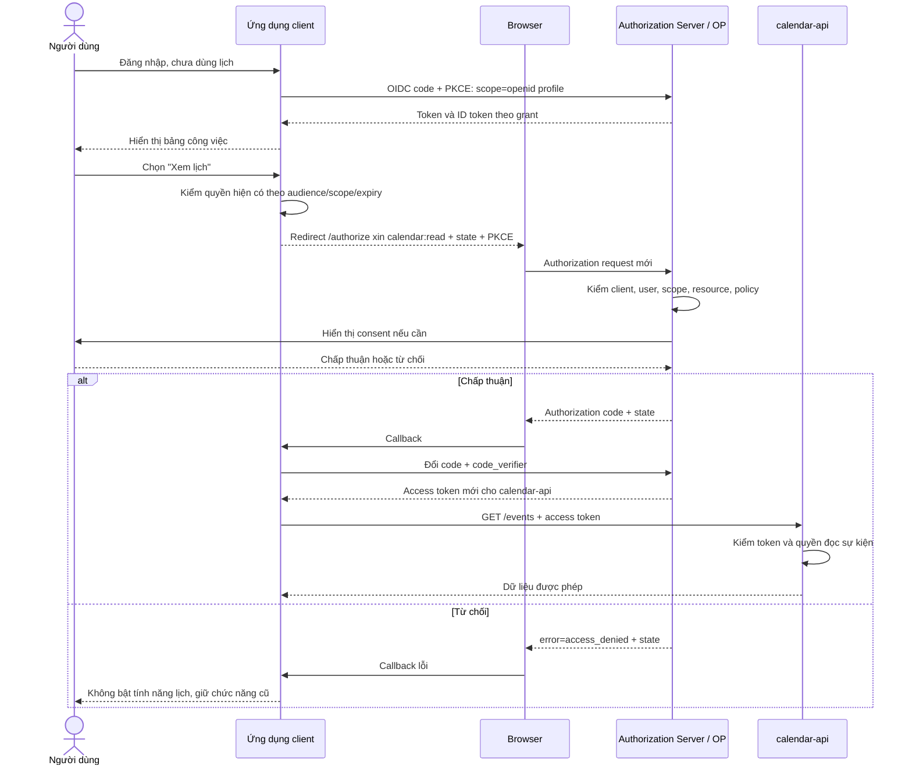
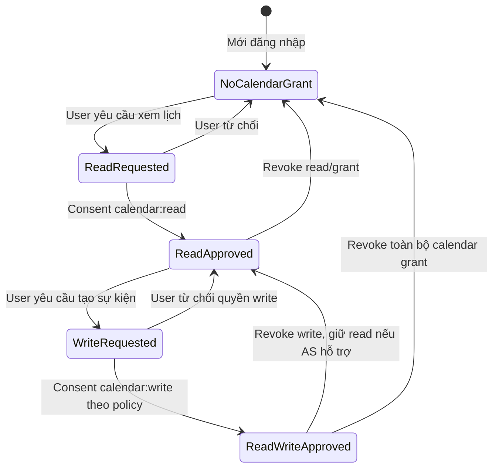

# Incremental authorization: cấp quyền tăng dần theo nhu cầu

Một ứng dụng quản lý công việc có tính năng «Đăng nhập bằng tài khoản tổ chức». Lúc đăng nhập, ứng dụng chỉ cần biết người dùng là ai, vì vậy nó yêu cầu `openid profile`. Vài ngày sau, người dùng bấm «Kết nối lịch»; lúc ấy ứng dụng mới xin quyền `calendar:read`. Khi người dùng chủ động chọn «Tạo cuộc họp từ công việc», ứng dụng mới cần `calendar:write`. Thay vì yêu cầu hàng loạt quyền ngay từ màn hình đầu, ứng dụng **xin thêm quyền đúng thời điểm người dùng cần tính năng**.

Đó là **incremental authorization** (*ủy quyền tăng dần* hoặc *cấp quyền theo từng bước*). Ý tưởng là **khởi đầu với phạm vi quyền tối thiểu**, sau đó mở một authorization request mới khi có hành động cần quyền bổ sung. Authorization server (AS) xác minh client, người dùng, grant, scope, resource và chính sách; nếu cần, nó hiển thị consent để người dùng quyết định. Kết quả có thể là token mới, grant được cập nhật hoặc yêu cầu bị từ chối.

Chủ đề nằm trong chương **Consent** của module **SECURITY_TOKEN_SECURITY_FUNDAMENTALS**. Bài liên hệ OAuth 2.0/OIDC với mô hình tin cậy, JWT/opaque token, access token/refresh token, issuer, audience, scope, phát hành, xác minh, lưu trữ, thu hồi, và phòng chống token bị đánh cắp hoặc phát lại.

> **Nguyên tắc cốt lõi:** **người dùng chấp thuận một lần không có nghĩa client được mọi quyền mãi mãi**. Quyền bổ sung phải đi qua quyết định ủy quyền mới hoặc chính sách grant được phép; scope đã *yêu cầu*, scope đã *đồng ý*, scope đã *được cấp trong token* và quyền thực tế trên tài nguyên là các khái niệm khác nhau.

## 1. Phân biệt incremental authorization, consent và scope

Trong OAuth 2.0:

- **Authorization** là quyết định cho phép client truy cập tài nguyên theo một grant và chính sách của AS/resource owner.
- **Consent** là hành động hoặc trạng thái người dùng chấp thuận một yêu cầu chia sẻ dữ liệu hay quyền thao tác, khi chính sách cần người dùng quyết định.
- **Scope** là một cách biểu diễn phạm vi truy cập được yêu cầu/cấp; ý nghĩa của chuỗi scope do AS và resource server (RS) thỏa thuận.
- **Access token** là credential được RS tiếp nhận để xác minh quyền phù hợp; token có audience, scope, thời hạn, loại và trạng thái riêng.
- **Incremental authorization** là chiến lược **yêu cầu quyền theo từng nhu cầu**, thường thông qua các authorization requests liên tiếp với scope/resource bổ sung.

**Đây không phải một grant type OAuth độc lập tên `incremental_authorization`.** OAuth 2.0 cung cấp các nền tảng như authorization code flow, scope và grant; AS/OP và sản phẩm quyết định có hỗ trợ lưu consent, gộp quyền đã cấp, hoặc cho phép lần authorization tiếp theo mở rộng grant hay không.

### 1.1. Ví dụ về ba lần yêu cầu

| Thời điểm | Người dùng làm gì? | Quyền ứng dụng cần | Request mới? |
| --- | --- | --- | --- |
| Lần đầu | Đăng nhập và xem bảng công việc | `openid profile` | OIDC Authentication Request ban đầu |
| Sau đó | Chọn «Xem lịch» | `calendar:read` | Authorization request mới nếu chưa có grant/token phù hợp |
| Khi cần | Chọn «Tạo sự kiện» | `calendar:write` | Request mở rộng quyền, subject/resource được kiểm |

Ở lần ba, **không được suy `calendar:write` đã được cấp chỉ vì `calendar:read` từng được cấp**. Quyền write có thể phải qua consent khác, policy khác hoặc bị AS/RS từ chối.

### 1.2. Incremental authorization khác progressive profiling

**Progressive profiling** thường là việc thu thập thêm *thông tin hồ sơ* qua thời gian, ví dụ hỏi người dùng về số điện thoại hoặc địa chỉ. **Incremental authorization** là yêu cầu **quyền truy cập** bổ sung, ví dụ đọc lịch, tạo sự kiện hoặc xuất báo cáo.

Hai hành vi có thể xuất hiện cùng một UX nhưng không đồng nghĩa: xin scope `email` để biết email thuộc phạm vi OIDC claims; xin `calendar:write` để tạo sự kiện là quyền thao tác API. Một ứng dụng không nên tráo việc «cập nhật hồ sơ» thành consent cho một quyền nhạy cảm mà người dùng không nhận thấy.

### 1.3. Incremental authorization khác step-up authentication

**Step-up authentication** yêu cầu người dùng chứng minh danh tính ở **mức bảo đảm cao hơn hoặc mới hơn**, ví dụ xác thực lại hoặc dùng MFA, thường liên quan `max_age`, `auth_time`, `acr`, `amr` trong OIDC.

**Incremental authorization** yêu cầu **quyền mới** như `payments:write`. Một thao tác nhạy cảm có thể cần **cả hai**: user phải được xác thực đủ mạnh **và** client phải có scope/grant phù hợp. MFA thành công **không tự tạo** quyền `payments:write`; consent cấp scope **không tự chứng minh** user vừa qua MFA.

## 2. Mô hình trust và các vai trò

| Vai trò | Trách nhiệm trong yêu cầu tăng quyền |
| --- | --- |
| **Resource owner / End-User** | Có thể chấp thuận hoặc từ chối yêu cầu trong phạm vi quyền thực sự sở hữu, theo chính sách |
| **Client / Relying Party (RP)** | Phát hiện tính năng cần thêm quyền; khởi tạo authorization request đúng scope, resource, client và session |
| **Authorization Server (AS) / OpenID Provider (OP)** | Kiểm registration, grant, user, consent, policy; phát token với quyền không vượt giới hạn |
| **Resource Server (RS)** | Xác minh token đúng issuer/audience/type/time/scope và authorization trên resource thực |



**Không được chuyển scope đã được client khai vào RS như một header có quyền**. RS phải dựa trên **access token đã xác minh**, introspection hoặc authorization context đáng tin và quyền tài nguyên thực tế. Nếu token dành cho `tasks-api`, nó không tự hợp lệ tại `calendar-api` chỉ vì cùng issuer.

## 3. Tại sao cấp quyền tăng dần?

### 3.1. Least privilege ngay từ lúc bắt đầu

Nếu đăng nhập lần đầu mà một ứng dụng yêu cầu:

```text
openid profile email calendar:read calendar:write
contacts:read drive:write payments:write
```

trong khi user chỉ cần đọc bảng công việc, người dùng phải đưa ra quyết định quá rộng trước khi thấy giá trị của sản phẩm. Quyền không cần thiết cũng làm tăng **blast radius** khi access token, refresh token, client hoặc hệ thống của đối tác bị xâm nhập.

Với incremental authorization, client có thể xin:

```text
Lúc đăng nhập:     openid profile
Khi xem lịch:      calendar:read
Khi tạo sự kiện:   calendar:write
```

Không được mặc nhiên xem `calendar:write` bao hàm `calendar:read`, trừ khi scope semantics của API định nghĩa rõ như vậy.

### 3.2. Consent dễ hiểu hơn khi gắn với hành động

Màn hình consent lúc user bấm «Tạo sự kiện» có ngữ cảnh rõ hơn màn hình lúc đăng nhập hỏi «cho phép sửa lịch không?» mà user chưa biết tại sao. AS/RP nên mô tả **ai yêu cầu, dữ liệu nào được chia sẻ, thao tác nào có thể xảy ra, và khi nào có thể ngắt kết nối**.

### 3.3. Quản trị quyền và khả năng thu hồi tốt hơn

Tách scope và audience theo tính năng giúp:

- Theo dõi loại dữ liệu nào đã được cấp cho từng client/user.
- Thu hồi một quyền mà không nhất thiết xóa toàn bộ phiên đăng nhập.
- Giới hạn token mới chỉ tới RS cần thiết.
- Phân biệt tính năng đang dùng với đặc quyền hiếm khi cần.
- Đánh giá lại quyền nhạy cảm hoặc yêu cầu consent mới theo policy.

**Giới hạn:** incremental authorization không làm dữ liệu đã bị client tải trước đó tự biến mất. **Token revocation** và **xử lý dữ liệu đã được tiết lộ** là hai bài toán khác nhau.

## 4. Năm tập quyền cần tách biệt

Một lỗi kiến trúc phổ biến là chỉ có một biến `scopes` chứa đủ mọi thứ. Thực tế nên phân biệt:

1. **Requested scopes:** client *đang xin* trong authorization request.
2. **Registered/allowed scopes:** AS cho phép client đăng ký được yêu cầu.
3. **User/subject entitlements:** user hoặc service principal **thực sự có quyền** theo hệ thống nghiệp vụ.
4. **Consented/approved scopes:** những phạm vi được resource owner hoặc policy chấp thuận cho client/grant trong ngữ cảnh nhất định.
5. **Token granted scopes:** scope **thực sự nằm trong access token** hoặc introspection response dùng cho một RS cụ thể.

Ví dụ:

```text
Client requested:        calendar:read calendar:write
Registered allowed:      calendar:read calendar:write
User entitled:           calendar:read calendar:write
Approved in this step:   calendar:read
Access token issued:     calendar:read
```

**Không có `calendar:write` trong token đầu ra** dù client đã yêu cầu cả hai, vì quyền write chưa được chấp thuận theo chính sách. Nếu AS không hỗ trợ cấp subset như vậy, nó có thể từ chối hoặc xử lý theo contract; client **không được tự suy** rằng mọi requested scopes đều được cấp.

### 4.1. Mô hình minh họa giới hạn quyền

```text
GrantEligibleScopes =
    RequestedScopes
    ∩ ClientAllowedScopes
    ∩ SubjectAllowedScopes
    ∩ ResourcePolicyScopes
    ∩ ApprovedScopesOrPolicyExemptions

GrantedScopes ⊆ GrantEligibleScopes
```

Đây là **mô hình giảng dạy**, không phải thuật toán chuẩn bắt buộc cho mọi AS: scope có thể được ánh xạ, phụ thuộc resource, action, consent version, delegation hoặc policy khác. Khi request không khai `scope`, AS có thể áp dụng default scope. Điểm không thay đổi là AS **không cấp thực quyền vượt những gì client, chủ thể và resource policy cho phép**.

### 4.2. Quyền đã consent không nhất thiết bằng scope của token hiện tại

Một client có thể từng được cấp `calendar:read` ở lần trước, còn request mới chỉ xin `calendar:write`. Sau lần hai:

- **Consent/grant record** có thể ghi cả hai scope **nếu AS hỗ trợ tích lũy theo policy**.
- **Access token mới** có thể chỉ chứa `calendar:write` vì đó là scope được xin/cấp cho request hiện tại.
- **Access token cũ** chỉ có `calendar:read` và thời hạn riêng.
- **Refresh token hiện hành** có phạm vi đã được phép theo grant gắn với nó, không tự mở rộng sang mọi consent mới.

**Không giả định «consent đã tích lũy» thì mọi token sau đó chứa hợp của mọi scope đã từng chấp thuận.** OAuth lõi không bảo đảm cách gộp scope cho các authorization transactions khác nhau; phải đọc hợp đồng của AS/OP cụ thể.

## 5. Một luồng incremental authorization hoàn chỉnh

Giả sử RP `planner-web` ban đầu đăng nhập bằng OP `https://login.example.test` và sau đó kết nối API lịch `calendar-api`.

### 5.1. Bước 1: đăng nhập tối thiểu

RP tạo transaction ngẫu nhiên và chuyển browser đến OP:

```http
GET /authorize?response_type=code&client_id=planner-web&redirect_uri=https%3A%2F%2Fplanner.example.test%2Foidc%2Fcallback&scope=openid%20profile&state=<state-A>&nonce=<nonce-A>&code_challenge=<challenge-A>&code_challenge_method=S256 HTTP/1.1
Host: login.example.test
```

Đây là URL minh họa; các placeholder phải được sinh ngẫu nhiên và URL-encode đúng. RP:

- Lưu `state-A`, `nonce-A`, `code_verifier-A` trong authorization transaction ràng buộc session.
- Xác minh callback `state`/issuer, đổi authorization code bằng `code_verifier-A`.
- Xác minh **ID token** theo issuer, `aud=planner-web`, chữ ký, `exp`, `nonce` nếu đã gửi và các quy tắc OIDC.
- Chỉ tạo session đăng nhập cho subject đã xác minh, chưa mặc định có `calendar:read`.

**ID token của OP dùng để đăng nhập RP, không được trình làm access token của `calendar-api`.**

### 5.2. Bước 2: user chủ động chọn kết nối lịch

Khi người dùng bấm «Kết nối lịch», RP kiểm tra nó đã có access token **hợp lệ dành cho calendar** với scope `calendar:read` chưa. Nếu chưa, mở một authorization request mới:

```http
GET /authorize?response_type=code&client_id=planner-web&redirect_uri=https%3A%2F%2Fplanner.example.test%2Foidc%2Fcallback&scope=openid%20calendar%3Aread&resource=https%3A%2F%2Fapi.example.test%2Fcalendar&state=<state-B>&nonce=<nonce-B>&code_challenge=<challenge-B>&code_challenge_method=S256 HTTP/1.1
Host: login.example.test
```

Tham số `resource` ở đây dùng theo **RFC 8707 Resource Indicators** **nếu OP/AS hỗ trợ**; giá trị thực phải được AS chấp nhận và ánh xạ sang audience `calendar-api` theo hợp đồng. Không phải OP nào cũng hỗ trợ tham số này, và `resource` không được dùng để chỉ tới URL tùy ý để nhận token.

**`state-B`, `nonce-B` và PKCE challenge B là giá trị mới cho một transaction mới**, không dùng lại A. RP có thể yêu cầu `openid` để nhận ID token xác minh người dùng hiện tại khi xử lý nâng quyền. Nếu luồng không xin OIDC, phải có cơ chế khác đủ chắc chắn để ràng buộc grant/token với đúng user đã đăng nhập.

### 5.3. Bước 3: OP quyết định và hiển thị consent khi cần

OP kiểm:

1. `client_id` thuộc registration đáng tin, `redirect_uri` khớp.
2. Client được phép dùng `authorization_code`, PKCE, scope và resource đã xin.
3. User đã xác thực và thực sự là resource owner có quyền cấp trong giới hạn chính sách.
4. Consent cũ còn phù hợp không; quyền mới có cần màn hình chấp thuận không?
5. Scope hoặc authorization details được cấp có vượt mức user/AS/resource policy không?
6. Có yêu cầu bảo đảm xác thực mới hơn (`max_age`/`acr`) hoặc một bước xác nhận giao dịch riêng không?

Nếu cần consent, UI nên làm rõ rằng **Planner muốn đọc lịch**, chứ không phải «cho phép tất cả dữ liệu». Nếu user từ chối, OP trả lỗi thích hợp; RP **không bật tính năng lịch**.

### 5.4. Bước 4: đổi code và kiểm token mới

Nếu được chấp thuận, OP chuyển về callback:

```http
HTTP/1.1 302 Found
Location: https://planner.example.test/oidc/callback?code=<code-B>&state=<state-B>
Cache-Control: no-store
```

RP kiểm state/issuer B, chỉ gửi code B với `code_verifier-B` tới **token endpoint đã cấu hình của OP B**. Token response minh họa:

```json
{
  "access_token": "<access-token-for-calendar-api>",
  "token_type": "Bearer",
  "expires_in": 600,
  "scope": "calendar:read",
  "id_token": "<signed-oidc-id-token>"
}
```

AS có thể cấp thêm `refresh_token` theo chính sách nhưng **không bắt buộc**. Nếu có ID token, RP xác minh và **đối chiếu `(iss, sub)` với subject đang đăng nhập**, tránh user đăng nhập tài khoản khác trong lúc consent rồi token được gán nhầm vào session cũ.

Token `calendar:read` phải có audience/resource binding dành cho `calendar-api`. Client không được gọi `payments-api` bằng token này, và không tự thêm scope `calendar:write` trong metadata local.

### 5.5. Bước 5: chỉ dùng quyền thực sự được cấp

```http
GET /events HTTP/1.1
Host: api.example.test
Authorization: Bearer <access-token-for-calendar-api>
```

`calendar-api` kiểm issuer, audience, lifetime, scope và owner/tenant của từng sự kiện. Nếu user chưa có quyền đọc một calendar được chia sẻ, scope `calendar:read` **không làm họ tự có quyền đọc**.

### 5.6. Bước 6: xin quyền ghi khi cần

Đến lúc người dùng bấm «Tạo sự kiện», client xin `calendar:write` trong **authorization transaction mới**, có thể xin cả `calendar:read calendar:write` nếu muốn token mới có đủ hai scope và AS cho phép.

Nếu user từ chối thêm quyền write, RP vẫn có thể **giữ tính năng đọc lịch** trong phạm vi token/grant đọc còn hiệu lực. Không tự xóa đăng nhập hiện có chỉ vì một lần xin quyền mở rộng bị từ chối, trừ khi policy sản phẩm yêu cầu và có thiết kế chống CSRF hợp lệ.

## 6. Consent tăng dần có luôn cộng dồn quyền không?

**Không có quy tắc chung bắt buộc mọi AS phải gộp tự động.** Các cách triển khai thường gặp:

| Mô hình | AS lưu/cấp quyền thế nào? | Client cần lưu ý |
| --- | --- | --- |
| **Cumulative consent** | User đã chấp thuận A, sau đó B; AS có thể nhớ A+B trong consent/grant context | Token mới vẫn có thể chỉ chứa scope được yêu cầu hoặc subset |
| **Per-request grant** | Mỗi authorization request tạo hoặc cập nhật grant theo contract riêng | Không giả định token/refresh grant cũ được mở rộng |
| **Resource-specific grant** | Quyền tách theo RS/resource và client/user | Token A cho RS1 không tự gọi RS2 |
| **Consent có hiệu lực theo thời gian** | Đồng ý có thời hạn hoặc phải xác nhận lại quyền nhạy cảm | Consent record active không có nghĩa quyền còn hợp lệ mãi |
| **Policy-exempt first-party** | OP có thể không hiện consent UI trong hoàn cảnh được phép | Vẫn phải kiểm scope, user, resource và authorization |

Nhiều nhà cung cấp có tham số/SDK **đặc thù** giúp yêu cầu cộng dồn scope đã cấp. **Không coi một tham số vendor như `include_granted_scopes` là thành phần chuẩn của mọi OAuth 2.0/OIDC server.** Khi đổi nhà cung cấp, hành vi hợp scope và refresh token có thể khác.

### 6.1. Ví dụ không được suy diễn

```text
Grant/consent A:
    calendar:read
Token A:
    scope=calendar:read

Request B:
    scope=calendar:write
Token B:
    scope=calendar:write

Sai:
    "Token B chắc chắn có calendar:read calendar:write"
    "Refresh token từ A chắc chắn refresh ra calendar:write"
    "Write chắc chắn bao gồm Read"
```

Để client có một token dùng cả đọc và ghi, nó phải **yêu cầu scope phù hợp và kiểm scope được cấp thực tế**, hoặc dùng các token riêng nếu AS/RS cho phép. **Không ghép raw JWT**, không sửa `scope`/`aud` rồi tự ký lại tại ứng dụng.

### 6.2. Consent từng cấp có thể đã bị revoke

Nếu user từng cho `calendar:read` nhưng đã ngắt kết nối, AS không được mặc nhiên tái sử dụng consent cũ như còn active. Khi user mở lại tính năng, cần đánh giá **trạng thái grant/consent mới nhất**, có thể yêu cầu chấp thuận lại.

## 7. `prompt=consent` trong OpenID Connect

OIDC định nghĩa tham số `prompt`; trong đó:

- `prompt=consent` yêu cầu OP hiển thị cơ chế consent theo ngữ nghĩa OIDC.
- `prompt=login` yêu cầu xác thực lại theo profile.
- `prompt=none` yêu cầu không hiển thị UI; nếu không thể hoàn tất, OP trả lỗi như `login_required` hoặc `consent_required`.

Ví dụ trong một Authentication Request mới:

```text
response_type=code
scope=openid calendar:write
prompt=consent
state=<new-state>
nonce=<new-nonce>
code_challenge=<new-challenge>
code_challenge_method=S256
```

**`prompt=consent` không tự cấp scope.** OP vẫn phải kiểm client registration, user permission, grant, resource policy; user có thể từ chối. Không phải mọi OAuth authorization server **không hỗ trợ OIDC** đều hiểu `prompt`. Không dùng `prompt=consent` như «mã mở khóa» thay cho authorization logic.

### 7.1. Có cần `prompt=consent` cho mỗi lần tăng quyền?

**Không nhất thiết.** Khi có scope mới, OP có thể phát hiện nó chưa được user chấp thuận và tự hiển thị consent theo chính sách, dù client không gửi `prompt=consent`. Ngược lại, OP có thể có quy tắc không hiển thị UI lại cho một grant còn hợp lệ.

Một client nên **phân biệt muốn hiện consent UI với muốn thêm scope**, vì hai thứ không đồng nghĩa. Nếu ứng dụng muốn buộc người dùng xác nhận một thao tác quan trọng, có thể cần **transaction authorization** hoặc authentication step-up riêng chứ không chỉ gửi lại `prompt=consent`.

### 7.2. `prompt=none` khi xin thêm scope

Nếu client thử xin `calendar:write` âm thầm bằng `prompt=none` nhưng OP cần user consent, OP không được tự giả định người dùng đã đồng ý; nó có thể trả `consent_required` hoặc mã OIDC phù hợp. RP nên chuyển sang bước **người dùng chủ động** khởi tạo luồng tương tác, không lặp silent authorization vô hạn.

**Silent authorization còn phụ thuộc browser cookies và chính sách chống theo dõi**; việc browser chặn third-party cookies không làm client có quyền bỏ state, CSRF protection hoặc tìm cách bypass OP consent.

## 8. Scope tăng thêm khác với yêu cầu độ bảo đảm xác thực

Một ứng dụng có thể gặp ba yêu cầu:

| Yêu cầu | Công cụ liên quan | Điều cần kiểm |
| --- | --- | --- |
| «Cho phép đọc lịch» | Scope `calendar:read`, consent/grant | Access token scope và audience, RS authorization |
| «Cho phép tạo sự kiện» | Scope `calendar:write`, consent/grant mới | Quyền write được cấp thực tế, object policy |
| «Xác thực lại trước khi thanh toán» | OIDC `max_age`, `prompt=login`, `acr_values` hoặc profile step-up | `auth_time`, `acr`/`amr`, policy assurance thực tế |

**Step-up authentication không tạo thêm scope**, và **incremental consent không tự nâng `acr`**.

### 8.1. Ví dụ kết hợp hai chính sách

Một thao tác hoàn tiền có thể yêu cầu:

```text
access_token.scope contains "payments:refund"
AND access_token.aud == "payments-api"
AND user.role permits refund
AND resource.owner/tenant/limit policy passes
AND current authentication assurance meets step-up policy
```

Client có thể cần một authorization request xin `payments:refund` và một bước xác thực mới với `max_age`/`acr_values`. OP/AS phải bảo vệ consent, còn RS phải kiểm quyền trên giao dịch thực. Không để frontend gửi `mfa=true` hoặc `consented=true` như bằng chứng tự khai.

### 8.2. Lỗi `insufficient_scope` tại resource server

Một RS dùng bearer token có thể trả:

```http
HTTP/1.1 403 Forbidden
WWW-Authenticate: Bearer error="insufficient_scope", scope="calendar:write"
```

Đây là **tín hiệu quyền còn thiếu**, không phải chứng nhận client được cấp scope ngay lập tức. Client có thể dùng nó **cùng policy tính năng/registration** để đề nghị người dùng mở authorization flow mới.

**Không được lặp máy móc:** mọi `403` đều xin quyền rộng hơn. Lỗi có thể do owner/tenant/role/resource state, hoặc client không bao giờ được phép có scope đó. Client phải phân biệt lỗi và tránh tạo **consent spam**.

## 9. Fine-grained consent: scope chưa chắc đủ diễn đạt quyền

Một scope `payments:write` có thể quá rộng nếu người dùng chỉ muốn cho ứng dụng thực hiện **một thanh toán cụ thể với số tiền giới hạn**. OAuth có thể kết hợp các cơ chế như **Rich Authorization Requests (RAR, RFC 9396)**, cho phép biểu diễn thông tin ủy quyền có cấu trúc.

Ví dụ `authorization_details` trong JSON trước khi form-encode:

```json
[
  {
    "type": "example_payment",
    "actions": ["initiate"],
    "locations": ["https://api.example.test/payments"],
    "amount": {
      "currency": "VND",
      "value": "250000"
    },
    "payment_id": "pay-123"
  }
]
```

**`example_payment`, `amount`, `payment_id` là schema minh họa riêng của một AS**, không phải các field bắt buộc có ý nghĩa chung cho mọi triển khai RFC 9396. AS/RS phải thống nhất kiểu, validation, canonicalization, hạn mức và ràng buộc giao dịch.

### 9.1. Incremental authorization kết hợp RAR

Khi user chọn «Thanh toán 250.000 VND»:

1. Client xin đúng authorization details cho giao dịch, không xin quyền `payments:*` vô hạn.
2. AS kiểm client, user, loại yêu cầu và scope/authorization details được phép.
3. UI cho thấy **hành động, số tiền, đối tượng nhận và thời hạn** đủ rõ để user quyết định.
4. AS cấp quyền/token có ràng buộc theo profile; RS xác minh **giao dịch hiện tại** khớp quyền đã cấp.

RAR **không thay** issuer, audience, token lifetime hoặc quyền resource. Một client không được đổi `amount` hay `payment_id` sau consent rồi gửi lại token cũ như có quyền giao dịch khác.

### 9.2. Consent gắn đối tượng hoặc tài nguyên

Một sản phẩm có thể dùng:

- Scope `calendar:read` nhưng chỉ cho calendar `C-123`.
- Scope `files:read` nhưng chỉ cho một thư mục đã chọn.
- Quyền thanh toán đúng một order/payment intent.
- Quyền truy cập hết hạn sau 24 giờ.

Nếu những ràng buộc này không được biểu diễn bằng scope, cần **authorization details, token claims/resource binding hoặc policy state tại RS**. Chỉ có `scope=files:read` không cho phép client truy cập mọi file của user.

## 10. Audience và nhiều resource trong incremental authorization

Một ứng dụng có thể dần kết nối **calendar-api**, **contacts-api** và **files-api**. Không nên biến access token ban đầu dành cho `calendar-api` thành token dùng chung chỉ vì người dùng đồng ý thêm quyền contacts.

| Tính năng | Resource/audience | Scope ví dụ | Token nên được trình đến |
| --- | --- | --- | --- |
| Đọc lịch | `calendar-api` | `calendar:read` | Chỉ calendar resource |
| Tạo sự kiện | `calendar-api` | `calendar:write` | Chỉ calendar resource |
| Đọc danh bạ | `contacts-api` | `contacts:read` | Chỉ contacts resource |
| Xuất báo cáo | `reports-api` | `reports:export` | Chỉ reports resource |

**Resource Indicators (RFC 8707)** có thể giúp client chỉ rõ tài nguyên mong muốn khi AS hỗ trợ. **Token Exchange (RFC 8693)** có thể phát token mới phù hợp với audience downstream theo policy, nhưng **không cho phép chuyển quyền sang resource bất kỳ chỉ nhờ một access token nguồn**.

### 10.1. Tại sao không dùng một token đa audience cho tiện?

Token nhiều audience có thể hợp lệ nếu AS và các RS được thiết kế rõ. Nhưng nếu bearer token bị đánh cắp ở calendar service, nó có thể bị trình tới các audience khác cũng được liệt kê. **Audience hẹp** thường giảm blast radius và tránh scope cùng tên mang ý nghĩa khác nhau ở mỗi RS.

### 10.2. ID token không tham gia quyền API

RP có thể nhận ID token trong mọi lần OIDC Authentication Request, nhưng `aud=client_id` của ID token **không phải audience của calendar-api**. **Không trình ID token vào `Authorization: Bearer` gọi API** và không đọc `email`/`name` trong ID token rồi suy user có quyền với dữ liệu lịch của người khác.

## 11. Refresh token có tự được mở rộng sau consent mới không?

**Không được giả định.** Refresh token gắn với client, grant, thời hạn, phạm vi được phép và trạng thái phía AS. Một authorization request mới có thể:

- Cấp **access token mới** với scope vừa được chấp thuận.
- Cấp một **refresh token mới** nếu AS cho phép.
- Cập nhật grant có sẵn nhưng không phát refresh token mới.
- Tạo một grant/token family riêng cho resource/scope mới.
- Từ chối cấp offline access cho public hoặc third-party client theo policy.

OAuth 2.0 **không bảo đảm** rằng refresh token cũ từ authorization A lập tức có quyền phát access token với scope B vừa được duyệt trong authorization request khác. Tùy provider, B có thể thuộc **grant mới** hoặc được xử lý theo chính sách tích lũy.

### 11.1. Refresh grant không phải lối tắt xin scope mới

Trong refresh token grant, client có thể yêu cầu scope trong **phạm vi đã được cấp cho refresh grant**, không được tự xin scope rộng hơn. Ví dụ:

```text
Refresh token R1 liên kết grant:
    calendar:read

Sai:
    POST /token grant_type=refresh_token
        refresh_token=R1
        scope=calendar:read calendar:write

    => giả định AS sẽ cấp calendar:write chỉ vì đã gửi scope
```

Nếu grant chưa cho phép write, AS phải từ chối/giới hạn theo chính sách. Client cần đưa user đi qua **authorization request phù hợp** để xin quyền mới, không hack JSON của refresh token hoặc lặp refresh.

### 11.2. Rotation, expiry và revoke của refresh token

Khi AS phát refresh token, cần xét:

- **Absolute expiry:** deadline tối đa của refresh grant/token family.
- **Inactivity expiry:** thời hạn không hoạt động theo policy.
- **Refresh token rotation:** refresh token cũ bị tiêu thụ, token mới được cấp; phát hiện reuse/replay.
- **Sender constraint/client binding:** token gắn client và có thể gắn khóa khi hỗ trợ.
- **Grant revocation:** user/admin thu hồi quyền, AS ngừng chấp nhận refresh trái chính sách.

**Đổi quyền không tự reset absolute deadline** hoặc xóa dấu vết refresh token reuse. Nếu một refresh token đã bị đánh cắp, incremental authorization càng cần ràng buộc client và user, chống replay và xem lại grant trước khi cho mở quyền.

## 12. Token đã phát trước đó có thay đổi khi user cấp quyền mới?

**Không mặc định.** Access token A trước đó có:

```json
{
  "iss": "https://login.example.test",
  "sub": "user-123",
  "aud": "calendar-api",
  "scope": "calendar:read",
  "iat": 1893456000,
  "exp": 1893456600
}
```

Sau khi user đồng ý `calendar:write`, token A **không tự đổi payload thành** `calendar:read calendar:write`. Một token B mới có thể được phát theo chính sách.

| Token/trạng thái | Khi user đồng ý scope mới | Điểm cần nhớ |
| --- | --- | --- |
| Access token JWT A | Payload/chữ ký không thay đổi | RS offline có thể vẫn nhận A tới `exp` nếu không bị chặn |
| Access token opaque A | Metadata/token state do AS quản lý | RS chỉ biết thay đổi qua introspection/cache theo contract |
| Access token B mới | AS phát với scope/audience thực tế được cấp | Client phải kiểm B, không suy từ requested scopes |
| Refresh token R1 | Phụ thuộc grant/AS policy | Không mặc định được mở rộng |
| Consent/grant record | Có thể thêm/chỉnh quyền theo policy | Không tự đồng nghĩa với mọi token đang lưu |
| Session OIDC | Có thể tiếp tục login cũ hoặc yêu cầu reauth | Login state khác delegated API grant |

**Đừng sửa JWT A trên client** bằng cách thêm `calendar:write`. Sửa payload phá chữ ký; tự ký lại bằng một key khác không biến client thành AS đáng tin. **Issuer, signature, audience, type và expiry** phải do RS xác minh.

## 13. Consent withdrawal và việc thu hồi một phần quyền

Một người dùng có thể muốn **ngắt quyền tạo sự kiện** nhưng vẫn cho ứng dụng **đọc lịch**. Đây là bài toán **partial revocation / grant management**, không chỉ là xóa cookie đăng nhập.

### 13.1. Mô hình trạng thái minh họa



Đây là **mô hình nghiệp vụ minh họa**, không phải state machine chuẩn OAuth bắt buộc. Một AS có thể chỉ hỗ trợ revoke toàn bộ grant/token chứ không hỗ trợ thu hồi riêng từng scope. Nếu cần partial revocation, kiến trúc phải quy định rõ **scope nào bị gỡ, token nào bị vô hiệu, refresh grant nào thay đổi, độ trễ đến RS và UI nào cập nhật**.

### 13.2. Revocation không làm JWT cũ hết hiệu lực ngay trong mọi hệ thống

RFC 7009 định nghĩa OAuth 2.0 Token Revocation. Nhưng khi user rút `calendar:write`:

- **AS** cần cập nhật trạng thái grant/refresh token liên quan và từ chối token issuance mới trái quyền đã rút.
- **RS dùng opaque token/introspection** có thể thấy `active=false` hoặc thông tin mới, tùy cache/freshness.
- **RS dùng JWT offline** có thể vẫn nhận access token cũ tới `exp` nếu không có denylist/event/online authorization check.
- Client cần ngừng gửi token không còn phù hợp và cập nhật UI, nhưng **UI không phải enforcement point**.

Muốn quyền nhạy cảm bị rút **gần tức thì**, phải thiết kế TTL, revocation propagation, cache invalidation và dynamic authorization rõ ràng; không chỉ ghi `consent.active=false` trong database rồi tuyên bố mọi JWT đã hết hiệu lực.

### 13.3. Thu hồi consent khác logout

| Thao tác | Ảnh hưởng điển hình | Không được tự suy |
| --- | --- | --- |
| Logout RP | Kết thúc session ứng dụng hiện tại | Không nhất thiết revoke mọi grant/token ở OP |
| Logout OP/SSO | Kết thúc phiên xác thực tại OP | Không nhất thiết revoke mọi access token đã phát |
| Revoke calendar grant | Ngắt quyền delegated calendar theo contract | Không tự xóa dữ liệu calendar đã sao chép |
| Revoke refresh token | Ngăn refresh tiếp khi AS áp dụng | Không mặc định chặn JWT access token còn hạn |
| Revoke write scope | Ngắt quyền ghi nếu AS hỗ trợ partial revoke | Không bảo đảm quyền read vẫn được giữ nếu grant không tách |

## 14. Lưu consent an toàn tại AS và ứng dụng

Một hệ thống triển khai incremental consent cần biết **grant nào còn hiệu lực**, đã phê duyệt **quyền gì** cho **client nào** và **subject/resource nào**. Không nên lưu một boolean `consented=true` chung cho mọi quyền.

### 14.1. Mô hình dữ liệu minh họa

```text
ConsentGrant {
  grant_id,
  issuer,
  client_id,
  subject_id,
  resource_id_or_audience,
  approved_scopes,
  approved_authorization_details,
  grant_version,
  approval_source,
  approved_at,
  expires_at,
  revoked_at,
  policy_version,
  assurance_context_if_needed
}

OAuthAuthorization {
  authorization_id,
  grant_id,
  requested_scopes,
  issued_scopes,
  access_token_ids_or_jti,
  refresh_token_family_id_if_any,
  issued_at,
  expires_at
}
```

Đây **không phải schema chuẩn RFC**. Nó chỉ giúp tách consent/grant với token issuance. Hệ thống thực tế có thể tách permissions theo resource/object, dùng grant ID thay vì lưu raw PII, và lưu audit event bất biến.

### 14.2. Vì sao cần `client_id`, `sub` và resource trong khóa grant?

Một consent:

```text
user-123 cho client A đọc calendar-api
```

không được tự áp cho:

```text
user-123 cho client B đọc calendar-api
user-456 cho client A đọc calendar-api
user-123 cho client A đọc payments-api
```

Nếu cache consent chỉ theo `user_id` hoặc `scope`, client khác có thể hưởng nhầm quyền. Consent phải gắn **đúng issuer/tenant, subject, client, resource, scope và authorization details theo policy**.

### 14.3. Một sơ đồ SQL tối giản

Ví dụ sau chỉ minh họa PostgreSQL-style model, không phải migration chạy được cho mọi AS:

```sql
CREATE TABLE oauth_consent_grant (
    grant_id UUID PRIMARY KEY,
    issuer TEXT NOT NULL,
    client_id TEXT NOT NULL,
    subject_id TEXT NOT NULL,
    resource_id TEXT NOT NULL,
    approved_scopes TEXT[] NOT NULL,
    policy_version BIGINT NOT NULL,
    grant_version BIGINT NOT NULL,
    approved_at TIMESTAMPTZ NOT NULL,
    expires_at TIMESTAMPTZ,
    revoked_at TIMESTAMPTZ
);

CREATE INDEX idx_oauth_grant_subject_client
ON oauth_consent_grant (issuer, subject_id, client_id, resource_id);
```

Production cần giới hạn tính duy nhất theo ngữ cảnh grant, kiểm access control, encryption, retention, xử lý concurrent updates, transaction isolation, audit sự kiện và ràng buộc authorization details. **Không lưu raw access token/refresh token trong bảng consent** chỉ để tiện truy vấn.

### 14.4. Cập nhật grant đồng thời và mất cập nhật

User có thể mở hai tab: tab A xin `calendar:read`, tab B xin `contacts:read`. Nếu mỗi tab ghi đè một trường scope không có version/transaction, lần cập nhật cuối có thể xóa quyền của tab kia hoặc tạo hợp scope ngoài ý định.

Một hệ thống **có chính sách cumulative consent** có thể:

1. Khóa/đọc consent grant đúng key trong transaction.
2. Kiểm **grant_version** và trạng thái revoke/expiry.
3. Chỉ hợp nhất **quyền đã được AS phê duyệt**, không hợp nhất scope client khai tùy ý.
4. Ghi version mới và audit event cùng transaction.
5. Không cho một consent vừa bị revoke được phục hồi bởi tab cũ dùng snapshot stale.

Nếu dùng mỗi authorization request là grant riêng, có thể không dùng phép hợp tập; quan trọng là **tính nhất quán với contract của AS và quyết định consent thực tế**.

## 15. Java pseudocode: RP kiểm quyền trước khi yêu cầu thêm

Client không nên xin quyền nhạy cảm ngay khi user mở trang; chỉ khi user chọn một hành động thực sự cần scope đó. Ví dụ mã giả Java dưới đây mô tả RP/BFF:

```java
AuthorizationStart ensureCalendarWrite(
    BrowserSession session,
    CalendarAction action
) {
    VerifiedLogin login = sessions.requireSignedIn(session);
    if (!action.isExplicitlyInitiatedByUser()) {
        throw forbidden("incremental_auth_requires_user_action");
    }

    String expectedResource = "calendar-api";
    String requiredScope = "calendar:write";

    // Không chỉ kiểm "đã từng consent"; cần token usable
    // theo đúng issuer, audience, scope, thời hạn và trạng thái.
    Optional<VerifiedTokenHandle> existing =
        tokenStore.findUsableToken(
            login.issuer(), login.subject(), "planner-web",
            expectedResource, requiredScope
        );
    if (existing.isPresent()) {
        return AuthorizationStart.useExisting(existing.get());
    }

    // Tạo transaction MỚI, không tái dùng state/nonce/PKCE.
    String state = entropy.randomUrlSafe(32);
    String nonce = entropy.randomUrlSafe(32);
    String verifier = pkce.newVerifier();

    AuthorizationTransaction tx = new AuthorizationTransaction(
        session.binding(),
        login.issuer(),
        login.subject(),
        "planner-web",
        "calendar-api",
        Set.of("openid", "calendar:write"),
        stateDigest(state),
        nonce,
        verifier,
        clock.instant().plus(Duration.ofMinutes(5))
    );
    authTransactions.store(tx);

    return AuthorizationStart.redirect(
        oidcRequestBuilder.fromTrustedRegistration(tx)
            .responseType("code")
            .state(state)
            .nonce(nonce)
            .codeChallenge(pkce.s256(verifier))
            .build()
    );
}
```

Đây là **pseudocode, không phải API thư viện có sẵn**. Khi triển khai:

- `login.issuer()`/OP metadata phải từ nguồn tin cậy, không từ URL do browser gửi.
- `isExplicitlyInitiatedByUser` là tín hiệu UX/sản phẩm, **không thay consent của AS**.
- `findUsableToken` phải xét expiry, audience và actual granted scope; nếu token bị revoke nhưng RS dùng JWT offline, cần chính sách freshness/kiểm quyền bổ sung.
- Mỗi transaction có state, nonce, PKCE verifier và deadline riêng.
- Redirect URI, `client_id`, requested resource và scope phải đến từ **route/feature policy**, không chỉ từ user-supplied query.
- Client không được tự tạo access token hay sửa claim `scope`.

### 15.1. Phải nhớ đúng mục tiêu sau redirect

RP có thể giữ **feature intent** như «quay lại màn hình tạo sự kiện» trong authorization transaction, nhưng không lấy `return_to` từ browser rồi redirect tùy ý đến host attacker khi callback thành công. Đích quay về phải thuộc allowlist/local route và **không mang raw code/token trên URL**.

## 16. Java pseudocode: xử lý callback tăng quyền

Đây là đoạn mã giả cho một authorization request có yêu cầu `openid`, nên khi nhận ID token mới cần kiểm cùng user:

```java
IncrementalResult finishIncrementalConsent(
    BrowserSession session,
    OAuthCallback callback
) {
    callbackValidator.rejectAmbiguousOrDuplicateParams(callback);

    String returnedState = callback.requireSingle("state");
    AuthorizationTransaction tx =
        authTransactions.requireActiveForSession(
            session.binding(), returnedState
        );

    if (tx.expired(clock.instant()) || tx.consumed()) {
        throw invalidCallback("Unknown or expired authorization transaction");
    }
    issuerResponseCheck.requireExpectedIssuerIfConfigured(
        callback.optionalSingle("iss"), tx.expectedIssuer()
    );

    boolean hasError = callback.hasSingle("error");
    boolean hasCode = callback.hasSingle("code");
    if (hasError == hasCode) {
        throw invalidCallback("Code/error response ambiguous");
    }
    authTransactions.consumeAtomically(tx.id());

    if (hasError) {
        // Không xóa các grants cũ chỉ vì yêu cầu bổ sung bị từ chối.
        return IncrementalResult.notGranted(
            safeErrorMapper.map(callback.requireSingle("error"))
        );
    }

    TokenResponse response = tokenClient.exchangeCode(
        tx.expectedIssuer(),
        callback.requireSingle("code"),
        tx.clientId(),
        tx.registeredRedirectUri(),
        tx.pkceVerifier()
    );

    VerifiedIdToken idToken = oidcValidator.verifyIdToken(
        response.idToken(),
        tx.expectedIssuer(),
        tx.clientId(),
        tx.nonce()
    );
    if (!idToken.subject().equals(tx.expectedSubject())) {
        // Browser có thể đã chuyển sang tài khoản khác tại OP.
        throw securityError("Different user approved incremental grant");
    }

    VerifiedAccessTokenMetadata token =
        tokenResponseValidator.requireResourceAndScope(
            response,
            tx.expectedResource(),
            "calendar:write"
        );

    // Chỉ lưu token thuộc đúng issuer/subject/client/resource.
    tokenStore.storeForContext(
        tx.expectedIssuer(),
        tx.expectedSubject(),
        tx.clientId(),
        tx.expectedResource(),
        token,
        response
    );
    return IncrementalResult.granted("calendar:write");
}
```

**Lưu ý kiến trúc quan trọng:** OAuth access token **có thể là opaque**, nên RP không nên tự giải mã JWT giả định mọi token có claim `aud` và `scope`. `tokenResponseValidator` trong ví dụ phải dùng **token response scope, grant context, AS contract và resource binding đáng tin** để quyết định cách dùng token. Bên cuối cùng xác minh access token là RS (chữ ký/JWKS hoặc introspection).

Nếu authorization response thuộc một flow không xin `openid`, callback có thể **không có ID token**; cần cơ chế khác do AS/ứng dụng thiết kế để xác định subject và không gán token của user B cho session A. Pseudocode ở trên **cố ý chỉ áp dụng flow OIDC có ID token**.

### 16.1. Một lỗi callback nguy hiểm: user đổi tài khoản

Giả sử user A đã đăng nhập RP. Trong lần xin `calendar:write`, browser đang có OP session của user B. Nếu RP chỉ nhìn thấy token mới có scope đúng rồi lưu dưới account A, A có thể sử dụng hoặc thao tác dữ liệu của B.

**Luôn ràng buộc authorization result với expected subject**. Với OIDC, kiểm `(iss, sub)` của ID token đã xác minh; với OAuth thuần, cần contract đáng tin tương đương để ngăn account mix-up.

## 17. Java pseudocode: AS quyết định scope mở rộng

AS không được tự cấp mọi scope client gửi chỉ vì người dùng từng consent một lần. Mã giả dưới đây mô tả **phía AS**:

```java
GrantDecision evaluateIncrementalGrant(
    VerifiedAuthorizationRequest request,
    AuthenticatedEndUser user
) {
    RegisteredClient client =
        clientRegistry.requireEnabled(request.clientId());
    clientPolicy.requireAuthorizationCodeGrant(client);
    redirectUriPolicy.requireRegistered(client, request.redirectUri());
    pkcePolicy.requireValidChallenge(client, request);

    Resource target = resourceRegistry.requireAllowed(
        client, request.resourceIndicatorOrDefault()
    );
    Set<String> asked = request.requestedScopes();

    if (!client.allowedScopesFor(target).containsAll(asked)) {
        throw invalidScope();
    }
    Set<String> allowedForUser = entitlementService.allowedScopes(
        user, target
    );
    Set<String> candidate = intersection(
        asked, client.allowedScopesFor(target), allowedForUser
    );

    // Consent hiện hành phải gắn subject + client + resource,
    // không chỉ là boolean global theo user.
    ApprovedGrant previous = consentStore.findActive(
        user.subject(), client.id(), target.id()
    );
    ConsentDecision consent = consentEngine.evaluate(
        user, client, target, candidate, previous
    );

    if (consent.denied()) {
        return GrantDecision.denied("access_denied");
    }

    Set<String> granted = consent.approvedScopes();
    if (!candidate.containsAll(granted)) {
        throw securityError("Consent cannot exceed eligible rights");
    }

    // Persist consent/grant với concurrency control và audit.
    consentStore.persistAuthorizedChange(
        user, client, target, previous, consent
    );

    // Authorization code sẽ được ràng buộc với client, redirect,
    // subject, granted scope, PKCE và thời hạn một lần.
    return GrantDecision.issueCode(
        authorizationCodes.issueOnce(
            client, user, target, granted, request.pkceChallenge()
        )
    );
}
```

Trong sản xuất, cần dùng AS implementation đã kiểm thử và lưu đầy đủ context (state của authorization request, session, nonce nếu OIDC, consent UI, redirect, grants, policy, response mode). Mã trên **không tự triển khai hết OAuth/OIDC**. Nếu AS hỗ trợ **cumulative grant**, `persistAuthorizedChange` có thể giữ quyền đã phê duyệt trước đó mà vẫn không cấp mọi scope trong một token mới; nếu AS dùng per-request grant, có thể tạo grant khác.

### 17.1. Cần chống «consent laundering»

Attacker hoặc một client có thể cố tạo consent UI trình bày scope A là «Xem lịch» trong khi token thực có A+B. **UI mô tả quyền và token issuance policy phải dựa cùng quyết định**. Không dùng tên scope/nhãn quyền gửi trong query do client tự đặt làm nội dung chính thức trên màn hình.

AS có thể map scope sang mô tả được phê duyệt từ registry và hiển thị **cả client identity, resource, hành động, độ nhạy cảm, tài khoản hiện tại**. Một client third-party đã verified vẫn không được miễn cơ chế này nếu chính sách yêu cầu consent.

## 18. Khi nào nên hỏi consent lại?

Consent có thể **tồn tại** và **còn hiệu lực** trong một khoảng thời gian, nhưng AS có thể cần người dùng xác nhận lại khi:

- Client xin **scope mới** hoặc resource khác.
- Quyền mới nhạy cảm hơn quyền trước.
- Đơn vị vận hành client hoặc mục đích xử lý dữ liệu thay đổi đáng kể.
- User rút quyền cũ hoặc consent hết hạn.
- Chính sách bảo mật/điều khoản xử lý dữ liệu thay đổi theo đánh giá cần thiết.
- Một transaction cụ thể cần người dùng nhìn thấy và xác nhận **đối tượng/số tiền**.
- Hệ thống cần xác thực mới hơn/mạnh hơn cho hành động.

**Consent không đồng nghĩa mọi lần đều phải hiển thị popup.** First-party client có thể được exempt theo policy ở một số tính năng, hoặc consent đã có có thể tiếp tục được dùng nếu chưa thay đổi quyền. Nhưng điều đó **không cho phép AS phát quyền chưa được đăng ký, chưa được user sở hữu hoặc vượt chính sách**.

### 18.1. Consent fatigue và dark patterns

Nếu ứng dụng liên tục xin quyền đã bị từ chối, che nút «Từ chối», hoặc khiến tính năng không liên quan dừng hoạt động cho tới khi user đồng ý, người dùng dễ nhấp Allow mà không hiểu. UX nên:

1. Hỏi đúng lúc feature cần quyền.
2. Giải thích giá trị nhận được và dữ liệu/hành động sẽ truy cập.
3. Chỉ xin scope tối thiểu.
4. Cho phép user từ chối mà vẫn dùng được phần không cần scope.
5. Có nơi xem và ngắt quyền đã cấp.

Đây là thiết kế bảo mật thực tế: **consent chính xác có giá trị hơn consent được lấy bằng thao tác ép buộc**.

## 19. Error handling: không biến lỗi thành vòng lặp xin quyền

| Trường hợp | Phía nào phát hiện? | Cách xử lý đúng |
| --- | --- | --- |
| User từ chối quyền bổ sung | AS/OP tại authorization endpoint | Trả `access_denied` với state nếu callback hợp lệ; RP giữ tính năng cũ theo policy |
| Scope chưa đăng ký | AS | `invalid_scope`/từ chối theo profile; không tự xin lại vô hạn |
| Client không được phép flow | AS | `unauthorized_client` |
| Cần login trong `prompt=none` | OP | `login_required` hoặc mã OIDC phù hợp |
| Cần consent trong `prompt=none` | OP | `consent_required` hoặc mã OIDC phù hợp |
| Scope thiếu ở API | RS | `403`/`insufficient_scope` khi phù hợp; client có thể đề nghị flow mới |
| Sai audience | RS | `401`/`invalid_token` theo bearer token policy; **không** tự xem là thiếu consent |
| Code hết hạn hoặc PKCE sai | AS token endpoint | `invalid_grant`; tạo flow mới khi user muốn, không bypass PKCE |
| Client authentication sai | AS token endpoint | `invalid_client`; sửa credential/registration |
| Token JWT hết hạn | RS | `invalid_token`; refresh nếu grant cho phép hoặc xin token mới |
| User mất quyền tài nguyên | RS | Từ chối theo authorization, dù scope có mặt |
| Consent bị revoke | AS/RS theo freshness | Ngừng phát token mới và áp dụng revoke propagation theo policy |

### 19.1. Ví dụ error callback

```http
HTTP/1.1 302 Found
Location: https://planner.example.test/oidc/callback?error=access_denied&state=<state-B>
Cache-Control: no-store
```

RP **phải kiểm `state`/issuer và transaction** trước khi xử lý lỗi. URL callback là front-channel input, attacker có thể tự mở một URL có `error=access_denied`; không để nó xóa grant/session hoặc làm thay đổi account.

### 19.2. Lỗi không làm quyền cũ tự biến mất

Một user từ chối `calendar:write` mới **không mặc định** revoke `calendar:read` đã được chấp thuận từ trước. Tuy nhiên, nếu AS quy định một grant mới **thay thế toàn bộ** grant cũ, kết quả phụ thuộc policy đó. Client phải căn cứ **trạng thái thực tế tại AS và token hợp lệ**, không suy behavior từ tên lỗi.

## 20. Bảo vệ incremental authorization khỏi các tấn công

### 20.1. Scope escalation qua client-side input

**Sai:**

```java
// SAI: browser tự quyết scope và AS tự động tin request.
String scope = httpRequest.query("scope");
return beginAuthorization(scope);
```

Attacker có thể thay `calendar:read` thành `payments:refund`. **Đúng:** server/feature policy map hành động được phép sang scope/resource đã đăng ký, AS kiểm client/user/consent, RS tiếp tục kiểm quyền tài nguyên.

### 20.2. Login CSRF và code substitution

Mỗi lần xin thêm quyền là **authorization transaction mới**, có `state` và PKCE riêng; nếu OIDC đã gửi nonce thì kiểm nonce mới. Không dùng lại `state`/`code_verifier` của đăng nhập ban đầu. Callback không matching session bị từ chối, kể cả callback báo `access_denied`.

### 20.3. Account mix-up

User A trong RP có thể đang đăng nhập tài khoản B tại OP. Khi cấp thêm quyền, client phải xác minh **subject của grant/token mới khớp account dự kiến**. Nếu khác, cần từ chối hoặc có luồng liên kết/chuyển account minh bạch, không âm thầm ghi token B vào kho của A.

### 20.4. OAuth authorization server mix-up

Với nhiều AS/OP, RP lưu **expected issuer và endpoint** theo từng transaction. Nếu hỗ trợ RFC 9207, kiểm `iss` của authorization response theo profile. **Không chọn token endpoint từ tham số callback do browser gửi**, tránh gửi authorization code/client credential đến AS sai.

### 20.5. Redirect URI và open redirect

AS phải so khớp redirect URI đăng ký; khi client/redirect URI không hợp lệ, **không redirect tới URI chưa đáng tin dù để báo lỗi**. Callback của client cũng không được redirect tiếp sang host attacker kèm code/state.

### 20.6. Token laundering qua gateway và microservice

Một client có token `aud=calendar-api` không được dùng header `X-Scope=payments:refund` hoặc `X-Audience=payments-api` để gọi dịch vụ thanh toán. Nếu cần token audience khác, phải có grant/flow như RFC 8707 resource indicator hoặc token exchange RFC 8693 theo policy.

### 20.7. Client credentials và user consent

`client_credentials` grant thường biểu diễn **quyền của client/service principal**, không phải một user consent đang xảy ra. Client có quyền service không được dùng nó để giả danh user và tự lấy thêm delegated scopes. Nếu cần on-behalf-of, phải có policy ủy quyền/trao đổi token hợp lệ.

### 20.8. Consent bị dùng lại sai mục đích

Nếu user cho client đọc lịch để hiển thị, client không được coi consent đó như quyền **xuất toàn bộ lịch rồi bán dữ liệu**. OAuth thực thi quyền truy cập API theo grant, còn **mục đích xử lý dữ liệu** có thể cần governance/hợp đồng và chính sách bổ sung, đặc biệt với third-party.

### 20.9. Token bị đánh cắp hoặc replay

Incremental authorization giảm quyền ban đầu nhưng **không tự chống replay**:

- Bearer access token bị lộ vẫn có thể được dùng ở đúng audience trong thời hạn còn hiệu lực.
- Refresh token bị lộ có thể xin access token mới trong phạm vi grant; AS cần rotation/sender constraint và revoke.
- DPoP (RFC 9449) hoặc mTLS-bound token (RFC 8705) có thể giảm nguy cơ chỉ đánh cắp chuỗi token là dùng được, nhưng cần proof validation đúng hop.
- Không ghi token vào URL/log, không lưu refresh token trong frontend không được bảo vệ.
- RS vẫn kiểm object-level authorization, hạn mức, tenant và quyền hiện hành.

### 20.10. Cached consent và quyền stale

Nếu AS lưu consent A+B nhưng user đã rút B, một cache cũ ở AS/RS có thể tiếp tục cấp/chấp nhận token vượt quyền. Cần TTL, invalidation, policy version và xác định **độ trễ thu hồi tối đa** theo rủi ro. Không cache consent `true` vô thời hạn theo `user_id`.

## 21. Case study: ứng dụng quản lý lịch và thanh toán

Một SaaS có ba client/resource:

```text
OP/AS:       https://login.example.test
Client:      planner-web
RP:          https://planner.example.test
Resources:   calendar-api, payments-api
User:        user-123
```

### 21.1. Giai đoạn 1 – Đăng nhập

`planner-web` xin `openid profile` và tạo session dựa trên ID token đã xác minh. UI cho phép người dùng xem các công việc đã lưu **trong hệ thống riêng** của Planner; chưa có quyền truy cập lịch bên ngoài.

### 21.2. Giai đoạn 2 – Kết nối lịch

User bấm «Xem lịch». RP xin `calendar:read` và audience/resource calendar. AS hiển thị mô tả «Planner có thể đọc sự kiện của bạn» nếu policy yêu cầu. User đồng ý. Token mới `aud=calendar-api, scope=calendar:read` được cấp. RS xác minh token và giới hạn dữ liệu theo owner/tenant.

### 21.3. Giai đoạn 3 – Tạo sự kiện

User chọn «Đưa công việc vào lịch». RP xin `calendar:write`. Người dùng từ chối. RP ghi **tính năng ghi chưa được cấp** nhưng vẫn cho người dùng xem lịch trong phạm vi grant read. Không tạo sự kiện bằng token đọc hoặc bằng lời gọi service principal đặc quyền.

### 21.4. Giai đoạn 4 – Kích hoạt thanh toán

User muốn mua gói trả phí. Một consent `calendar:read` không liên quan quyền `payments:write`. Ứng dụng phải dùng **quy trình thanh toán được thiết kế**, với xác thực phù hợp, chi tiết giao dịch và quyền thanh toán, không tự suy «user đã consent ứng dụng một lần». Nếu có API thanh toán được cấp token, nó phải đúng `aud=payments-api` và quyền tương ứng; RS còn kiểm số tiền/đơn hàng/hạn mức.

### 21.5. Giai đoạn 5 – Ngắt kết nối

User rút quyền truy cập lịch. AS cập nhật grant/consent và revoke tokens/family theo kiến trúc; RP xóa hoặc ngừng dùng token lịch. Với JWT RS offline, cần TTL/denylist hoặc authorization check để đáp ứng yêu cầu revocation freshness. Quyền trả phí hoặc phiên đăng nhập RP **không nhất thiết** cùng bị xóa.

**Bài học:** một lần đăng nhập, một lần kết nối lịch và một lần thanh toán là các **quyết định khác nhau**. UI có thể thống nhất trải nghiệm, nhưng backend phải giữ ranh giới scope, audience, subject và token lifecycle.

## 22. Ma trận kiểm thử incremental authorization

| Ca kiểm thử | Tình huống | Kết quả mong đợi |
| --- | --- | --- |
| Đăng nhập scope tối thiểu | RP xin `openid profile` | Không tự có `calendar:read` |
| User chọn xem lịch | Feature cần `calendar:read` | Tạo transaction mới có state/PKCE |
| Không có user action | Background code tự xin `calendar:write` | Không vượt feature/consent policy |
| Xin scope ngoài registration | `payments:refund` không được phép | AS từ chối |
| Scope có trong registration, user không được quyền | User không có entitlement write | AS/RS từ chối thực quyền |
| User đồng ý scope read | `calendar:read` được phép | Token mới chỉ chứa scope thực sự cấp |
| User từ chối scope write | `access_denied` | Không ghi nhận write; giữ read theo policy |
| Consent cũ đã revoke | Client xin token từ consent stale | AS không coi quyền cũ còn active |
| Token B chỉ có write | Request B chỉ xin `calendar:write` | Không suy B có read |
| Token A chỉ có read | Client gọi endpoint write bằng A | 403/insufficient_scope |
| Write được định nghĩa không bao hàm read | API không có quy tắc implicit | Client phải xin scope read riêng |
| Multiple resources | Token calendar đưa sang contacts | RS contacts từ chối sai audience |
| Resource indicator không được hỗ trợ | AS không hỗ trợ `resource` | Xử lý theo AS contract, không tự đổi audience |
| Client yêu cầu cumulative scope | Provider có policy riêng | Kiểm granted scopes, không suy theo vendor parameter |
| Refresh R1 cấp trước write | R1 chỉ cho read | Không tự phát write khi refresh |
| AS phát refresh R2 sau consent mới | R2 có grant/lifetime riêng | Client lưu/bảo vệ đúng token family |
| JWT A trước consent write | JWT payload chỉ read | Không tự thay đổi sau consent |
| Grant revoke scope write | AS cập nhật grant | Token mới không có write; RS freshness theo SLA |
| JWT cũ còn hạn sau revoke | RS verify offline | Kiểm hành vi revoke propagation/TTL đã cam kết |
| Opaque token inactive | Introspection `active=false` | RS từ chối |
| User A RP, user B tại OP | B đồng ý scope | RP từ chối gán token B cho A |
| Callback state sai | Response không thuộc transaction | RP từ chối |
| Callback state bị replay | Transaction đã consume | RP từ chối |
| PKCE verifier sai | Code bị đổi bởi bên khác | Token endpoint từ chối, thường `invalid_grant` |
| Callback issuer sai | Nhiều OP hỗ trợ | RP từ chối mix-up |
| Callback có cả code/error | Response mơ hồ | RP từ chối |
| OAuth code expired | Token endpoint trả `invalid_grant` | Không bypass PKCE/consent |
| `prompt=none` cần consent | OP chưa có consent phù hợp | `consent_required`/lỗi phù hợp |
| `prompt=consent` nhưng user từ chối | Có UI consent | Không phát scope mới |
| `prompt=login` nhưng assurance thấp | Step-up không đạt | Không cho thao tác nhạy cảm |
| `max_age` yêu cầu nhưng thiếu `auth_time` | ID token không đủ claims | RP từ chối reauth condition |
| RAR amount bị đổi sau consent | Giao dịch khác số tiền | RS/AS từ chối theo binding |
| RAR type client tự tạo không đăng ký | `authorization_details` loại lạ | AS từ chối theo schema/policy |
| Consent cache theo user, thiếu client | Client B dùng quyền của A | Không cho chia sẻ grant |
| Consent nhiều tab cùng update | Hai request đồng thời | Không mất cập nhật hoặc phục hồi revoked scope |
| Client scope từ query tùy ý | Browser thay `scope=admin:*` | RP/AS enforce allowlist, không nâng quyền |
| Redirect URI sai | Callback attacker host | AS không redirect tới URI không tin |
| Access token làm ID token | Token `aud=calendar-api` vào RP | RP từ chối sai type/audience |
| ID token làm access token | Token `aud=planner-web` vào calendar RS | RS từ chối |
| Logout RP nhưng grant chưa revoke | Session mất | Không tự suy mọi token đã bị thu hồi |
| Token raw trong log/query | Debug request OAuth | Redact token/code/secret, giảm PII |
| Client credentials grant | Service principal xin scope | Không mặc định đại diện user |
| Token exchange sang audience khác | Client xin token downstream | AS kiểm delegation, không tự nhân bản quyền |
| Consent dialog bị giả nhãn | UI hiển thị «read» nhưng xin «write» | Kiểm UI hiển thị từ trusted scope registry |

**Nên kiểm thử end-to-end tại AS, client callback và RS**, sử dụng JWT được ký thật bằng khóa kiểm thử hoặc opaque introspection theo contract. Dùng test clock, concurrent requests và thay đổi grant/revocation để đo đúng **thời gian hiệu lực thực tế**; không chỉ so chuỗi scope trong UI.

## 23. Những anti-pattern thường gặp

| Anti-pattern | Vấn đề | Cách làm phù hợp |
| --- | --- | --- |
| Xin tất cả scope ngay lúc login | Scope creep, consent fatigue | Xin tối thiểu, tăng theo feature |
| Cho rằng «đã đăng nhập» là «đã consent mọi API» | Nhầm identity với authorization | Tách login, grant và per-resource policy |
| Coi `prompt=consent` tự cấp scope | Bypass policy | AS kiểm user/client/scope và user có thể từ chối |
| Refresh token được dùng để xin scope tùy ý | Mở quyền trái grant | Authorization mới khi cần phạm vi ngoài grant |
| Cumulative consent = cumulative token | Token dùng sai quyền | Kiểm scope/token thực tế từng response |
| Consent read tự nâng thành write | Sai permission model | Scope riêng và kiểm action |
| Same issuer nên token dùng mọi RS | Audience confusion | Token đúng audience và kiểm tại từng RS |
| Tin `X-Granted-Scopes` từ browser | Header spoofing | Dùng claims/introspection đã xác minh |
| User đổi tài khoản giữa flow mà RP không kiểm | Account mix-up | So issuer+subject của grant mới với login |
| Dùng lại state/nonce/PKCE | Callback injection/replay | Giá trị mới mỗi authorization transaction |
| Consent bị từ chối nhưng UI ép lặp vô hạn | Dark pattern, UX và tải AS xấu | Tôn trọng quyết định, chức năng degrade an toàn |
| Coi mã `403` bất kỳ là cần scope cao hơn | Consent spam, che lỗi owner/tenant | Phân biệt insufficient_scope và resource policy |
| Client tùy ý chọn scope và resource URL | Privilege escalation, SSRF/confused deputy | Feature mapping/AS resource allowlist |
| Consent cache chỉ theo user ID | Rò quyền qua client/tenant | Cache key đầy đủ subject/client/issuer/resource |
| Revoke consent làm JWT offline tự chết | Sai kỳ vọng bảo mật | TTL/denylist/introspection/event propagation |
| Logout RP xóa mọi grant trên AS | Nhầm session và token lifecycle | Thiết kế logout/revoke riêng |
| ID token đưa tới API | Token type/audience confusion | Access token dành RS |
| RAR JSON không bind giao dịch | Sửa amount/recipient sau consent | AS/RS kiểm authorization details với request thật |
| First-party bỏ hết consent checks | Đặc quyền nội bộ quá mức | Policy documented và least privilege |
| Consent trang đối tác dùng text tự khai | Phishing/laundering | Registry mô tả scope tin cậy |
| Lưu refresh token vào log/browser không bảo vệ | Token theft/replay | BFF/secure storage, rotation và revoke |
| Token của service dùng làm quyền user | Sai subject/grant | Client credentials vs delegated rights tách biệt |

## 24. Checklist triển khai production

1. **Feature mapping:** mỗi tính năng biết scope và resource cần, không xin quyền ngoài nhu cầu hoặc từ dữ liệu client tự khai?
2. **Client registration:** `client_id`, grant types, redirect URI, PKCE, confidential/public type, allowed scopes/resources được AS kiểm?
3. **Grant semantics:** AS có cumulative consent, per-request grant hay per-resource grant? Cách token mới dùng scope cũ/refresh token được ghi rõ?
4. **Consent UX:** mô tả app, resource, data, actions, deadline và đối tượng rõ; user có thể từ chối mà không làm hỏng tính năng không liên quan?
5. **State/PKCE:** mỗi authorization request mới có `state`, `nonce` (nếu OIDC dùng) và `code_verifier` mới; callback session-bound, one-time?
6. **Issuer và subject binding:** RP kiểm đúng OP/issuer và user hiện tại; không nhận grant user B vào session user A?
7. **OIDC correctness:** `openid`, ID token validation, `prompt=consent`/`prompt=none`, `max_age`/`acr` khi dùng; không đồng nhất step-up với scope?
8. **Scope enforcement:** granted scope thực tế được kiểm; token B không mặc định chứa hợp các scope đã từng consent?
9. **Audience enforcement:** access token dành đúng RS; token của API A không gọi B; không dùng ID token làm bearer API?
10. **Refresh lifecycle:** refresh không tự mở quyền; storage, binding, rotation, idle/absolute expiry và revoke theo AS policy?
11. **Partial revocation:** nếu hỗ trợ, rút riêng scope cần được phản ánh vào token issuance, introspection/cache và quyền RS với SLA rõ?
12. **Consent persistence:** grant state gắn subject/client/issuer/resource, có audit, expiry và concurrency control; không tái kích hoạt quyền đã revoke qua snapshot stale?
13. **RAR/fine-grained:** nếu dùng `authorization_details`, có schema trusted, resource/amount/object binding và kiểm RS, không coi một scope rộng đủ cho giao dịch?
14. **Error handling:** `access_denied` không phá chức năng cũ; `insufficient_scope` không gây consent spam; unknown errors fail closed?
15. **Transport & storage:** HTTPS, secrets không vào URL/log, CSRF/SameSite/XSS protection, BFF/secure token storage theo kiến trúc?
16. **Token theft/replay:** có audience hẹp, TTL, sender-constrained token khi phù hợp, phát hiện reuse và cơ chế response/revoke?
17. **End-to-end tests:** thử positive/negative, refused consent, partial grants, identity switch, wrong audience, stale/revoked grants và concurrent updates?

## Tổng kết

**Incremental authorization** là chiến lược **yêu cầu quyền mới khi người dùng thực sự cần tính năng**, thay vì xin một tập scope rộng ngay từ lúc đăng nhập. Nó giúp duy trì **least privilege**, cung cấp ngữ cảnh rõ ràng cho consent và giới hạn tác động khi token hoặc client bị lộ. Nhưng **nó không phải grant type độc lập**, không mặc nhiên tích lũy scope trong mọi token, và **không tự làm refresh token cũ có quyền mới**.

AS phải kiểm **client, subject, scope, audience/resource, consent và grant policy**; RP phải tạo authorization transaction mới với **state/PKCE/issuer/subject binding**, chỉ dùng scope thực sự được cấp; RS phải xác minh **access token đúng issuer/audience/lifetime/scope** và quyền đối tượng. OIDC `prompt=consent` chỉ yêu cầu cách tương tác, `max_age`/`acr` kiểm độ mới/mức xác thực và **không thay quyền API**. Khi user rút consent, token/grant lifecycle và độ trễ thu hồi phải được quản lý riêng.

**Tài liệu tham khảo:** RFC 6749 (OAuth 2.0, scope, authorization code và refresh token grants); RFC 7636 (PKCE); RFC 9700 (Best Current Practice for OAuth 2.0 Security); RFC 6750 (Bearer Token Usage); RFC 8707 (Resource Indicators); RFC 9396 (Rich Authorization Requests); RFC 8693 (Token Exchange); RFC 9207 (Authorization Server Issuer Identification); RFC 7009 (Token Revocation); RFC 7662 (Token Introspection); RFC 9068 (JWT Profile for Access Tokens); RFC 8705 (OAuth mTLS); RFC 9449 (DPoP); OpenID Connect Core 1.0 (scope, prompt, max_age, ID token và consent).
