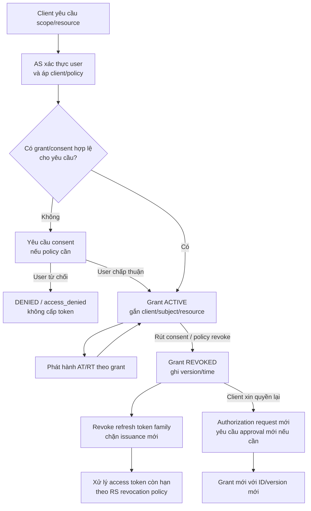
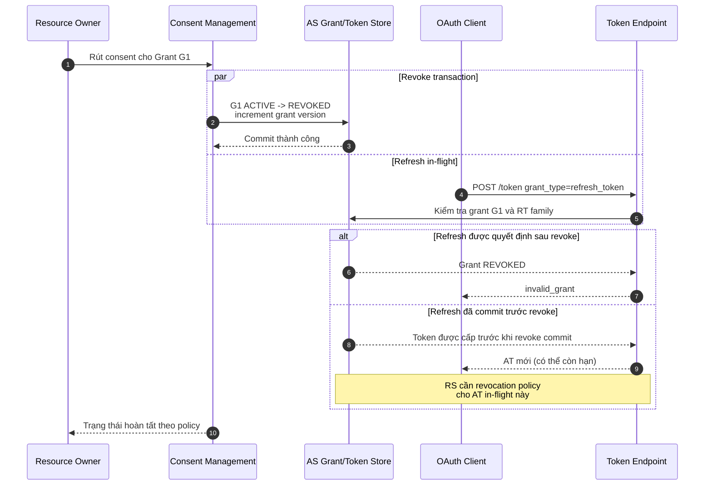
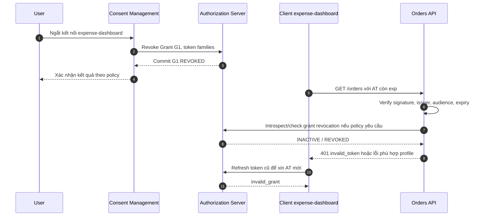
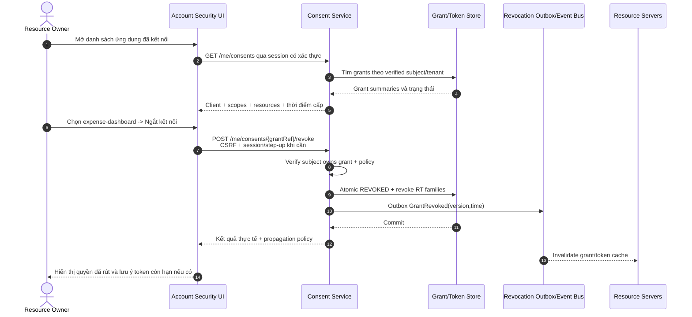
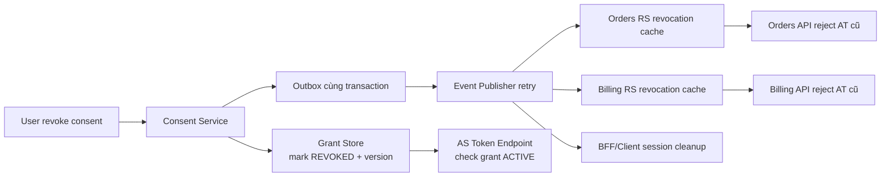

# Consent revocation

## Mục tiêu học tập

Trong module **SECURITY_TOKEN_SECURITY_FUNDAMENTALS**, người học tìm hiểu mô hình tin cậy và vòng đời token bảo mật: JWT so với opaque token, access token so với refresh token; xác thực, phân quyền và OAuth 2.0/OIDC; phát hành, kiểm tra `iss`/`aud`/`scope`, lưu trữ, vận chuyển, thu hồi và phòng chống token bị đánh cắp hoặc phát lại. Ở chương **Consent**, bài **“Consent revocation”** tập trung vào câu hỏi: **Điều gì phải xảy ra khi một Resource Owner rút lại sự chấp thuận đã cấp cho một OAuth client?**

Sau bài này, bạn có thể:

- Phân biệt **consent**, **authorization grant**, **token** và **login/session**; giải thích tại sao thu hồi một thứ không tự đồng nghĩa thu hồi tất cả những thứ còn lại.
- Thiết kế thao tác **rút consent** cho đúng user, client, scope, resource và grant; nhận diện hệ quả đối với access token, refresh token và quyền truy cập API.
- Hiểu vai trò của **OAuth 2.0 Token Revocation (RFC 7009)**: revocation endpoint, cách dùng client authentication, phản hồi `200 OK` không tiết lộ token tồn tại hay không, và giới hạn của endpoint.
- Phân tích khác biệt giữa **JWT access token được kiểm chứng offline** và **opaque access token dùng introspection**, gồm độ trễ lan truyền revocation và nhu cầu fail-closed ở Resource Server.
- Xử lý refresh token rotation/family, concurrent refresh, grant versioning, race giữa revoke và issue token.
- Đối chiếu consent revocation với **logout RP/OP**, token expiry, account lock, thay đổi scope/permission và từ chối user consent.
- Xây dựng giao diện quản lý ứng dụng được cấp quyền, audit an toàn, thông báo trạng thái và kiểm thử các đường lỗi.
- Áp dụng sơ đồ, HTTP và Java pseudocode để triển khai policy **không cấp token mới sau khi authorization grant đã bị rút**.

> **Nguyên tắc cốt lõi:** **Rút consent phải chấm dứt cơ sở ủy quyền để client tiếp tục truy cập theo grant đó.** Việc vô hiệu hóa refresh token, access token còn hiệu lực, session và cache cần được thiết kế **tường minh**. Không coi một nút “Ngắt kết nối” đã bảo vệ người dùng chỉ vì UI đã xóa một dòng khỏi database.

## 1. Consent là quyết định cấp quyền, không phải một token

Trong OAuth 2.0, bốn vai trò chính là:

| Vai trò | Trách nhiệm |
| --- | --- |
| **Resource Owner (RO)** | Chủ thể có thẩm quyền cho phép hoặc từ chối client truy cập tài nguyên được bảo vệ theo policy. |
| **Client** | Ứng dụng yêu cầu quyền truy cập và sử dụng token được cấp để gọi API. |
| **Authorization Server (AS)** | Xác thực/đánh giá authorization request, ghi nhận grant theo hệ thống và phát hành token. |
| **Resource Server (RS)** | API kiểm tra access token và thực thi quyền trên tài nguyên cụ thể. |

Một ví dụ:

```text
Resource Owner:     user-42
Client:             expense-dashboard
Authorization Server: https://identity.example.com
Resource Server:    Orders API (aud = api://orders)
Scopes đã duyệt:   orders:read, orders:summary:read
Grant reference:    grant-7c42
Refresh token:      RT0 -> RT1 -> RT2 (family thuộc grant)
Access token:       AT_a (exp sau 15 phút)
```

User đã đồng ý cho `expense-dashboard` đọc dữ liệu Orders ở phạm vi xác định. Sau đó họ muốn **thu hồi consent**, nghĩa là không tiếp tục cho ứng dụng hoạt động theo grant ấy. Điều này khác với việc user đổi mật khẩu, đóng tab trình duyệt hoặc xóa một access token khỏi bộ nhớ client.

### Phân biệt những khái niệm liên quan

| Khái niệm | Trả lời câu hỏi | Ai kiểm soát phần lớn? |
| --- | --- | --- |
| **Authentication** | User là ai, đã xác thực đủ mạnh/mới chưa? | AS/IdP; OIDC OP nếu dùng OIDC. |
| **Consent** | User có đồng ý cấp cho **client** quyền truy cập trong phạm vi cụ thể không? | RO và chính sách AS/đơn vị quản trị. |
| **Authorization grant** | Client có cơ sở ủy quyền nào để xin token? | AS; gắn subject, client, scope/resource, policy và trạng thái. |
| **Access token (AT)** | Client đang có credential nào để gọi Resource Server? | AS phát hành; RS xác minh. |
| **Refresh token (RT)** | Client có thể xin access token mới theo grant không? | AS token endpoint, token/grant policy. |
| **RP/OP session** | User còn phiên đăng nhập tại ứng dụng/Identity Provider không? | RP và OP quản lý phiên riêng theo policy. |
| **Resource authorization** | User/client có quyền trên order/tenant/object này không? | Resource Server và business authorization policy. |

**Không phải mọi client/grant đều dựa trên consent tương tác của user.** Ví dụ Client Credentials cho workload machine-to-machine dựa trên danh tính/quyền service và chính sách AS; không có bước Resource Owner đồng ý như delegated user flow. Không nên hiển thị nút “Rút quyền user” cho một service grant nếu hệ thống thực tế yêu cầu admin thay đổi phân quyền service.

## 2. Thu hồi consent là gì?

**Consent revocation** là việc Resource Owner hoặc chủ thể có thẩm quyền theo chính sách **rút lại sự cho phép đã cấp trước đó** cho client. Trong một triển khai OAuth, điều này thường dẫn tới **vô hiệu authorization grant tương ứng**, xử lý token đã cấp và từ chối những lần xin token mới dựa trên grant đó.

### Điều cần bảo đảm sau khi rút consent

1. **AS không tiếp tục phát hành token theo grant đã bị rút**, kể cả khi client vẫn giữ refresh token, authorization code hoặc session tham chiếu grant cũ.
2. **Refresh token thuộc grant bị vô hiệu** theo chính sách; rotation không được giúp client “lách” thao tác rút quyền.
3. **Access token hiện hữu được xử lý phù hợp yêu cầu an toàn**: invalidation gần ngay tức thì ở API có thể đòi introspection, denylist hoặc policy version; nếu chấp nhận TTL ngắn thì phải công khai giới hạn.
4. **Client không còn quyền dùng API thay user** theo grant đó. Nếu user cấp lại quyền, đó phải là **authorization/consent decision mới**, không âm thầm khôi phục grant cũ.
5. **Audit có bằng chứng hành động** nhưng không làm lộ raw token, dữ liệu cá nhân ngoài cần thiết hoặc lịch sử truy cập không được phép.
6. **UI phản ánh trung thực độ hoàn tất**. Nếu hệ thống chỉ chặn refresh nhưng access token JWT có thể dùng tiếp 10 phút, không nên diễn đạt “mọi truy cập đã chấm dứt ngay” trừ khi RS thực sự thực thi kiểm soát tức thời.

### Ví dụ trước và sau

```text
Trước:
  grant.status = ACTIVE
  RT2 = ACTIVE
  AT_a = VALID cho Orders API tới exp

User rút consent:
  grant.status = REVOKED
  RT family = REVOKED
  AS không issue AT mới trên grant cũ
  RS áp revocation policy với AT_a còn hạn

Sau:
  refresh(RT2) -> từ chối
  old grant reuse -> từ chối
  request với AT_a -> từ chối ngay nếu RS có revocation-aware check;
                      hoặc hết hiệu lực theo exp nếu chỉ verify JWT offline.
```

**Thu hồi consent không xóa dữ liệu mà ứng dụng đã tải xuống trước đó.** Đây là giới hạn thực tế quan trọng: token chỉ kiểm soát **quyền truy cập trong tương lai**, không xóa bản sao file, dữ liệu đã cache hoặc backup mà client có được hợp pháp/trái phép trước thời điểm revoke.

## 3. Phạm vi rút quyền: client, grant, scope và resource

Một user có thể có nhiều client, nhiều authorization grant và nhiều resource. Thiết kế cần tránh hai sai lầm đối lập: **thu hồi quá ít** khiến app vẫn có quyền ngoài ý muốn, hoặc **thu hồi quá rộng** làm ngắt các ứng dụng khác mà user không hề chọn.

| Cấp độ thao tác | Ý định của user/admin | Điều cần xét |
| --- | --- | --- |
| **Rút một grant cụ thể** | Ngắt liên kết một lần ủy quyền của client với subject. | Grant ID, client, issuer, subject, resources/scopes, token family, linked sessions. |
| **Rút quyền đối với resource** | Không cho client truy cập Orders nhưng có thể giữ Billing nếu trước đó được tách grant rõ ràng. | Granularity AS thực hỗ trợ; token có nhiều audience có thể yêu cầu revoke toàn grant và cấp lại phần còn lại. |
| **Rút một scope** | Bỏ `orders:write` nhưng giữ `orders:read`. | Có được **downgrade grant** và cấp lại token không, hay phải revoke và re-consent? |
| **Rút quyền của một client trên mọi thiết bị** | Ngắt hoàn toàn app bên thứ ba khỏi tài khoản. | Nhiều refresh families/sessions/grants của cùng client/subject. |
| **Thu hồi toàn bộ delegated grants của user** | Xử lý compromise hoặc yêu cầu bảo mật diện rộng. | Phải có authorization mạnh, hiển thị hậu quả, xử lý các client và resource liên quan. |
| **Admin revoke theo policy tổ chức** | Gỡ quyền được cấp trái chính sách. | Thẩm quyền admin, tenant boundary, audit và thông báo phù hợp. |

### 3.1. Consent chỉ gắn với một scope string?

**Không nên** thiết kế consent record chỉ bằng `user_id + scope`. Hai client khác nhau có thể xin cùng `orders:read` nhưng không vì vậy chia sẻ grant hoặc refresh token. Một consent/grant còn gắn với:

- **Issuer/Authorization Server**: tránh nhầm các nhà cung cấp danh tính.
- **Subject/Resource Owner**: danh tính đã verify, gồm tenant/context nếu cần.
- **Client registration**: client nào được cấp quyền, không phải bất kỳ app dùng cùng scope.
- **Authorized scopes và resources/audiences**: quyền/RS nào được cấp theo chính sách.
- **Grant identifier/version**, thời điểm tạo, trạng thái `ACTIVE`/`REVOKED` và revision.
- **Consent decision context**: cách/thời điểm/phạm vi user hoặc admin đã cho phép, chính sách và retention audit.
- **Token binding**: các refresh token families/access token references phát sinh từ grant, nếu AS/RS cần revoke.

**Không dùng display name hoặc email chưa xác minh làm khóa quyền.** Trong OIDC, danh tính user thường được nhận diện đáng tin theo `(iss, sub)`; client theo registration ID đã được AS xác thực/kiểm chứng phù hợp.

### 3.2. Incremental consent và scope giảm dần

Một client có thể xin `orders:read` trước, sau đó mới xin `orders:write`. Khi user rút quyền ghi nhưng vẫn muốn đọc, AS cần biết **grant model có hỗ trợ rút một phần hay không**:

```text
Grant G1: orders:read
Grant G2: orders:write          # nếu AS quản lý grant tách biệt

Hoặc:

Grant G: {orders:read, orders:write}
Revocation yêu cầu thay đổi grant G:
  - revoke G và cấp một grant G_new chỉ đọc sau authorization policy,
  - hoặc cập nhật scope + increment grant version và reissue tokens,
  theo thiết kế AS.
```

**Không đơn giản sửa scope trong database** mà giữ nguyên refresh token và JWT có scope cũ nếu chúng vẫn có thể được dùng: RS/AS cần nhận biết phiên bản quyền và token còn hạn.

### 3.3. Người dùng chỉ có quyền thu hồi grant của mình

Endpoint quản lý consent phải xác minh **chủ thể và thẩm quyền** trước khi revoke. Không tin `user_id` từ query/form hoặc grant ID tự khai mà bỏ object-level authorization:

```text
Authenticated user A
POST /account/consents/grant-belongs-to-user-B/revoke
-> DENY, không lộ private grant của B.
```

Admin có thể có quyền đặc biệt nhưng phải được kiểm soát theo role/tenant/policy, MFA/step-up khi rủi ro cao và audit thích hợp. Không dựa vào `scope=admin` của một access token bất kỳ để bỏ kiểm tra quyền object.

## 4. Vòng đời consent và trạng thái grant

Consent là quyết định có thể thay đổi theo thời gian, không phải một cờ vĩnh viễn. Một state machine có thể:



Đây là **mô hình trạng thái minh họa**, không phải một bộ API bắt buộc của RFC 6749. Điểm không được bỏ qua là **authorization grant đã REVOKED không được âm thầm phục hồi chỉ bằng refresh hoặc reuse consent cũ**.

### 4.1. Từ chối consent ≠ rút consent

- **Consent denial**: user từ chối authorization request **trước khi grant tương ứng được cấp**; OP/AS có thể trả `access_denied` nếu redirect URI hợp lệ.
- **Consent revocation**: user rút lại **grant đã tồn tại**; AS phải xử lý các token đã cấp.
- **Consent expiration**: grant hết hiệu lực theo TTL/policy nếu hệ thống có.
- **Consent supersession/update**: user chấp thuận phạm vi mới hoặc giảm quyền; cần xử lý **grant version/token đời cũ**.

Không nên hiển thị từ “Thu hồi thành công” khi thực chất chỉ đóng consent dialog mà chưa thay trạng thái grant/token.

### 4.2. Một tài khoản có nhiều phiên và refresh families

```text
User user-42
 ├─ Grant G1 cho expense-dashboard, Orders API
 │   ├─ Refresh family F1 trên laptop
 │   ├─ Refresh family F2 trên mobile
 │   └─ Access tokens AT1, AT2, AT3 (các phiên)
 ├─ Grant G2 cho calendar-sync, Calendar API
 └─ OP/SSO session: vẫn còn hợp lệ
```

Nếu user chọn **“Ngắt kết nối expense-dashboard”**, chính sách có thể phải revoke **G1 cùng F1/F2 và AT liên quan** nhưng **không đụng G2** hoặc toàn bộ OP session. Nếu UI là “Đăng xuất mọi thiết bị” thì có thể cần scope khác, và phải nói rõ hậu quả.

## 5. Consent revocation không giống logout và token revocation

| Hành động | Phần bị ảnh hưởng trực tiếp | Điều **không tự bảo đảm** |
| --- | --- | --- |
| **User revoke consent/grant** | Nền tảng AS thu hồi sự cho phép client tiếp tục truy cập theo grant. | Mọi bearer JWT AT ngoài RS hết hiệu lực tức thì nếu RS không có revocation check. |
| **Client gọi Token Revocation Endpoint (RFC 7009)** | AS vô hiệu token được trình và có thể các token liên quan theo policy. | Toàn bộ consent của user dành cho mọi client/resource bị xóa. |
| **RP/app logout** | Session tại ứng dụng/BFF bị đóng; cookie/token local có thể được xóa. | OP SSO session hoặc mọi grant của app tự hết hiệu lực. |
| **OP/SSO logout** | Phiên đăng nhập tại Identity Provider kết thúc theo profile. | OAuth AT đã cấp bị mọi Resource Server chặn ngay. |
| **Access token `exp`** | RS từ chối token sau expiry nếu validator đúng. | Refresh token/grant tự bị thu hồi. |
| **Refresh token rotation** | RT cũ không còn dùng được sau lần refresh thành công. | Grant bị revoke hoặc mọi access token hiện hành lập tức invalid. |
| **Đổi password / bật MFA** | Credential và assurance cho các lần authentication. | Grant/token hiện hữu tự mất hiệu lực nếu policy không liên kết. |
| **Đổi quyền nghiệp vụ user** | Resource authorization policy và dữ liệu mà user được phép xem/sửa. | Các scope claim trong JWT đã cấp tự thay đổi. |

**Quan trọng:** OAuth 2.0 và OpenID Connect không quy định một **API consent revocation thống nhất cho mọi provider**. Nơi user quản lý “Apps connected to account”, hành vi khi ngắt liên kết, scopes/grant persistence và propagation là **quyết định sản phẩm/AS**. RFC 7009 là chuẩn **token revocation**, không phải toàn bộ giao thức tự phục vụ consent.

### 5.1. Ví dụ: “Logout app” nhưng vẫn còn delegated grant

User logout `expense-dashboard`, trình duyệt xóa session cookie. Nếu AS vẫn giữ grant ACTIVE và refresh token trên một thiết bị khác, ứng dụng có thể tiếp tục đồng bộ nền theo scope được cấp — trừ khi logout policy đồng thời revoke grant/token.

Nếu user thực sự muốn **“Ngắt quyền truy cập từ ứng dụng này”**, cần cung cấp thao tác rút consent/grant đúng nghĩa, không chỉ logout local.

### 5.2. Ví dụ: revoke RT nhưng consent còn

Client có thể chủ động gọi RFC 7009 để vô hiệu refresh token cũ khi uninstall/log out. AS có thể vẫn lưu consent/grant, và lần authorization tiếp theo có thể không cần trình consent mới nếu policy cho phép. **Điều này khác với user đã rút sự cho phép.**

Khi user rút consent thật, AS phải thay trạng thái grant, chứ không chỉ xóa một refresh token mà bỏ lại khả năng xin token theo grant cũ.

## 6. RFC 7009: Token Revocation Endpoint là gì?

**RFC 7009 — OAuth 2.0 Token Revocation** định nghĩa endpoint để **client** yêu cầu AS vô hiệu một token đã được cấp. Đó là một phần của kế hoạch consent revocation, nhưng **không thay toàn bộ mô hình grant/permission**.

### 6.1. Request mẫu

Ví dụ confidential backend đã được AS đăng ký dùng `client_secret_basic`:

```http
POST /oauth2/revoke HTTP/1.1
Host: identity.example.com
Authorization: Basic <registered-client-credential>
Content-Type: application/x-www-form-urlencoded

token=<refresh-token>&token_type_hint=refresh_token
```

Các điểm bắt buộc về an toàn:

- Dùng **HTTPS** và endpoint AS tin cậy, không gửi token tới URL do bên không đáng tin chỉ định.
- Tham số **`token`** là credential **cần revoke**; `token_type_hint` chỉ là **gợi ý** để AS tra cứu hiệu quả, không phải bằng chứng token thuộc loại ấy.
- Confidential client phải **client authentication** theo registration. Với public client, AS áp quy tắc xác định/binding client phù hợp, không yêu cầu shared secret nhúng trong SPA/mobile.
- **AS xác minh token thuộc về client được phép revoke** theo giao thức/policy; không để client A dùng token string của client B để vô hiệu hóa quyền tùy ý.
- Không ghi raw `token`, `Authorization` header hay request form body vào access log, APM, tracing, crash dump.
- Revocation endpoint không phải là nơi client nâng scope hoặc lấy token thay thế.

### 6.2. Phản hồi `200 OK` và tính chống oracle

Theo RFC 7009, revocation thành công trả **HTTP 200 OK** với body rỗng:

```http
HTTP/1.1 200 OK
Cache-Control: no-store
```

**AS cũng trả 200 khi token được trình không hợp lệ/không nhận biết** theo quy tắc RFC 7009; client không được suy token có tồn tại hay đã được sử dụng chỉ từ status 200. Điều này hạn chế revocation endpoint trở thành *token existence oracle*.

Phản hồi **200 không phải bằng chứng mọi Resource Server trên thế giới đã ngừng chấp nhận bản sao access token**. Nó nói rằng AS đã xử lý yêu cầu revocation theo hợp đồng; độ trễ propagation phụ thuộc token format, RS validation, cache và triển khai.

### 6.3. Khi nào AS phải hỗ trợ RT/AT revocation?

RFC 7009 yêu cầu AS hỗ trợ **refresh token revocation** và khuyến nghị hỗ trợ **access token revocation** khi triển khai token revocation. AS có thể vô hiệu token liên quan thuộc cùng grant theo policy. Vì vậy:

- Revoke **refresh token** là cách thiết yếu để chặn làm mới token theo credential đó.
- Nếu AS hỗ trợ revocation access token và có cơ chế lan truyền tới RS, nó có thể vô hiệu AT còn hạn thuộc cùng grant.
- Revoke **một AT** không mặc định đồng nghĩa revoke consent/grant và **mọi RT**, trừ khi AS policy quy định.
- **Không giả định token family, scope hay resource bị revoke toàn bộ** chỉ vì một request RFC 7009 trả 200.

Ví dụ một AS có thể chọn khi user rút consent: cập nhật `grant.status=REVOKED` rồi revoke **tất cả refresh families** gắn grant và đánh dấu AT liên quan. Hành vi này cần được thiết kế và kiểm thử **ở cấp AS/grant**, không chỉ trông chờ một RFC 7009 request với RT duy nhất.

### 6.4. Error response và giới hạn

```json
{"error":"unsupported_token_type"}
```

`unsupported_token_type` là lỗi được RFC 7009 định nghĩa cho trường hợp AS không hỗ trợ revocation của loại token được trình. Lỗi client authentication/HTTP transport và triển khai vẫn cần xử lý theo RFC/profile tương ứng. Không phản chiếu token gốc, client secret hoặc thông tin “token này thuộc user X” vào response lỗi.

**Một hạn chế UX quan trọng:** dù AS có thể xử lý token revocation, **endpoint RFC 7009 không cho user một cơ chế chung để chọn và rút consent theo client/resource**. Tính năng đó thường nằm trong **Identity Account/Consent Management** hoặc một API riêng được AS bảo vệ bằng user authentication/authorization.

## 7. Refresh token rotation, grant binding và consent revocation

Refresh token có thể kéo dài khả năng truy cập API sau khi access token hết hạn. Bởi vậy, một hệ thống tuyên bố đã rút consent nhưng vẫn để client refresh thành công **là thu hồi chưa hoàn chỉnh**.

### 7.1. Refresh token family

Nhiều AS dùng **refresh token rotation**: mỗi lần refresh thành công phát một RT mới, RT trước đó ngừng sử dụng được.

```text
Grant G1 (ACTIVE)
  Family F1:
    RT0 (ROTATED) -> RT1 (ROTATED) -> RT2 (ACTIVE)

User revoke consent G1:
  G1 = REVOKED
  F1 = REVOKED
  RT0/RT1/RT2 = KHÔNG ĐƯỢC DÙNG LÀM MỚI
  AS không cấp AT từ G1 bằng bất kỳ RT nào trong family F1.
```

Nếu grant có nhiều refresh families (nhiều thiết bị/phiên), **rút toàn bộ quyền client** thường đòi revoke **tất cả families liên quan**, không chỉ RT mà server thấy gần đây nhất.

### 7.2. Refresh đồng thời và cạnh tranh với revoke



**Không thể dựa vào thứ tự hiển thị ở UI để kết luận server đã xử lý race chính xác.** Cần định nghĩa **thời điểm tuyến tính hóa** (linearization/commit point): sau khi grant được commit REVOKED, **mọi refresh/token issue mới dựa trên grant đó phải bị từ chối**. Với issuance đã commit trước thời điểm revoke, AT còn hạn phải được xử lý theo cơ chế revocation của RS.

### 7.3. Versioning/generation của grant

Một thiết kế hiệu quả là mỗi grant có revision:

```json
{
  "grant_ref": "grant-7c42",
  "issuer": "https://identity.example.com",
  "subject_ref": "user-42",
  "client_id": "expense-dashboard",
  "resources": ["api://orders"],
  "scopes": ["orders:read"],
  "version": 4,
  "status": "REVOKED",
  "revoked_at": "2027-02-10T14:30:00Z"
}
```

Refresh token hoặc server-side token family cần liên kết với **grant ID và generation/version**. Khi AS nhận refresh, nó kiểm tra **trạng thái grant**, không chỉ chữ ký RT. Token mới không được cấp nếu grant bị revoke hoặc version không phù hợp. Nếu user đồng ý lại, **grant mới hoặc generation mới** phải được phát hành theo policy, không tự cho phép RT cũ từ version 3 sống lại.

### 7.4. Replay detection khác consent revoke

Nếu AS phát hiện **refresh token reuse** sau rotation, nó có thể revoke token family để hạn chế token bị đánh cắp. Đó là hành động **bảo mật chống replay**, không nhất thiết là việc user rút consent. Tuy vậy, chính sách có thể gắn hai cơ chế:

- **RT reuse signal**: nghi ngờ bị đánh cắp, revoke family, báo user và yêu cầu authentication lại.
- **User consent revoke**: chủ thể có thẩm quyền quyết định ngừng cấp quyền cho client/grant.
- **Admin revoke**: policy organization vô hiệu client/grant trên phạm vi đã chọn.

Audit và UI nên phân biệt **lý do** và **phạm vi** để không báo “user đã rút quyền” khi thực tế AS vừa phát hiện tấn công refresh replay.

### 7.5. Public client và refresh token protection

Theo **RFC 9700 (OAuth 2.0 Security Best Current Practice)**, khi phát hành refresh token cho **public client**, AS phải dùng cách bảo vệ chống replay như **refresh token rotation hoặc sender-constrained refresh token**. Điều này **không thay yêu cầu xử lý consent revocation**. Kể cả RT được ràng buộc DPoP, user rút grant thì RT không được tiếp tục refresh.

Sender-constraining hạn chế việc attacker chỉ sao chép chuỗi RT; nó không biến một public SPA thành confidential client và không ngăn XSS đang hoạt động sử dụng khả năng ký/request của ứng dụng.

## 8. Access token còn hạn: JWT và opaque token khác nhau

Đây là **điểm dễ gây hiểu nhầm nhất** khi triển khai “Rút quyền truy cập”: **access token có thể tiếp tục được RS chấp nhận sau khi user đã revoke consent**, nếu kiến trúc không có cơ chế kiểm tra revocation động.

### 8.1. Opaque token với introspection

Với opaque access token, RS có thể gọi AS **RFC 7662 Token Introspection Endpoint** để kiểm tra tình trạng:

```http
POST /oauth2/introspect HTTP/1.1
Host: identity.example.com
Authorization: Basic <registered-resource-server-credential>
Content-Type: application/x-www-form-urlencoded

token=<opaque-access-token>&token_type_hint=access_token
```

Khi grant đã revoke, AS có thể trả:

```json
{
  "active": false
}
```

RS phải kiểm tra thêm **audience, scope, client/subject và business policy** của chính API khi introspection trả `active=true`. AS chỉ được coi token active nếu token đáp ứng các điều kiện có hiệu lực theo policy; `active=true` không có nghĩa chủ thể được xem mọi đơn hàng.

**Cẩn thận với cache:** nếu RS cache introspection `active=true` trong 5 phút, một lần revoke có thể **không được phản ánh tới RS cho tới khi cache hết hạn**, trừ khi có invalidation/event hoặc policy chặt hơn.

### 8.2. JWT access token được kiểm chứng offline

Một JWT access token có thể có payload minh họa:

```json
{
  "iss": "https://identity.example.com",
  "sub": "user-42",
  "aud": "api://orders",
  "client_id": "expense-dashboard",
  "scope": "orders:read",
  "grant_ref": "grant-7c42",
  "grant_version": 3,
  "iat": 1800000000,
  "exp": 1800000900
}
```

Claims `grant_ref` và `grant_version` là **ví dụ mở rộng riêng của hệ thống**, không phải JWT/OAuth claims bắt buộc. Một RS chỉ verify **signature + `iss` + `aud` + `exp`** sẽ không biết user đã revoke grant nếu **không có kết nối/trạng thái revocation bổ sung**. Do đó JWT vẫn có thể được dùng tới `exp` dù AS đã chặn refresh.

### 8.3. Các chiến lược vô hiệu AT đã cấp

| Chiến lược | Cách hoạt động | Đánh đổi |
| --- | --- | --- |
| **AT ngắn hạn** | JWT tự hết hạn sau khoảng thời gian nhỏ. | Đơn giản; **không chặn ngay** token còn hạn, thời gian rủi ro bằng phần TTL còn lại. |
| **AT introspection/revocation-aware check** | RS tham vấn trạng thái AS/authorization service. | Gần real-time nếu không cache quá lâu; tăng latency/phụ thuộc hạ tầng. |
| **Denylist theo `jti`/token reference** | RS kiểm tra token ID đã bị revoke. | Cần phân phối/truy vấn trạng thái cho mỗi API; quản lý TTL/size của denylist. |
| **Grant ID/version check** | RS kiểm tra grant còn ACTIVE và version hiện hành trước khi chấp nhận token. | Hiệu quả khi token mang metadata đáng tin; cần đồng bộ version/cache và authorization policy. |
| **Revocation event + RS cache invalidation** | AS phát sự kiện để RS cập nhật cache/grant state. | Có độ trễ và khả năng mất sự kiện; cần idempotency, retry, reconciliation. |
| **Đổi key ký hàng loạt** | RS ngừng tin JWT ký bằng key bị loại bỏ. | **Quá rộng**: ảnh hưởng nhiều token/client, không nên dùng như cơ chế revoke một consent. |

Một hệ thống rủi ro cao có thể kết hợp **TTL ngắn + grant revocation check + event invalidation** để giảm cửa sổ rủi ro. Với API ít rủi ro hơn, tổ chức có thể chấp nhận thời gian tồn tại của AT ngắn được công bố minh bạch. **Không gọi lựa chọn thứ hai là revoke tức thời**.

### 8.4. Giới hạn của sự kiện revocation

```text
T0: User revoke grant, AS commit REVOKED
T1: AS publish GrantRevoked event
T2: RS A nhận event -> deny AT cũ
T3: RS B đang offline hoặc queue trễ -> chưa cập nhật
T4: RS B reconnect -> replay/reconcile event -> deny AT
```

Nếu RS B chỉ tin cache ACTIVE trong khoảng trễ, đó là **stale authorization window**. Kiến trúc phải xác định **tính nhất quán**:

- **Strict**: mỗi request/hoặc mỗi request nhạy cảm kiểm tra grant hiện hành tại nguồn đáng tin, fail closed khi không thể xác minh.
- **Bounded staleness**: cache có TTL ngắn và sự kiện invalidation; chấp nhận/đo lường cửa sổ rủi ro có giới hạn.
- **Offline JWT**: chấp nhận JWT đến expiry; cần hiểu tác động bảo mật, không quảng cáo thu hồi tức thời.

**Không được tái dùng cache ACTIVE cũ sau khi đã nhận REVOKED version mới**. Event có thể đến trễ/sai thứ tự, vì vậy cần sequence/version và xử lý idempotent.

### 8.5. Sender-constrained AT có thay revocation không?

DPoP/mTLS có thể ràng buộc AT với khóa/chứng chỉ của client, làm giảm việc **chỉ sao chép chuỗi token** để phát lại. Nhưng nếu user rút consent, **khóa vẫn thuộc client** và client có thể tiếp tục dùng token cho tới khi RS áp dụng revocation policy. Vì thế sender-constraining **không phải thay thế consent revoke**.

## 9. Resource Server kiểm chứng quyền sau revocation

Resource Server phải có hợp đồng tin cậy rõ ràng với AS. Với Orders API, một request hợp lệ cần:

```text
allow(request) =
    accessTokenAuthenticAndExpectedKind
    AND issuerTrusted
    AND audienceMatchesOrdersAPI
    AND tokenTimeValid
    AND tokenNotRevokedUnderPolicy
    AND authorizationGrantStillValidUnderPolicy
    AND scopeAllowsOperation
    AND userOrClientMayAccessRequestedObject
```

### 9.1. Chữ ký đúng nhưng consent đã revoke



Sơ đồ phản ánh kiến trúc **RS có revocation-aware check**. Nếu RS chỉ verify JWT offline, bước hỏi AS không có và AT có thể còn được chấp nhận đến `exp`. Tác động này phải là **quyết định kiến trúc có chủ đích**.

### 9.2. Phân biệt authentication failure và authorization failure

| Tình huống tại Resource Server | HTTP điển hình | Vì sao? |
| --- | --- | --- |
| Không có credential khi API yêu cầu Bearer. | `401 Unauthorized` kèm challenge phù hợp. | Chưa có access token hợp lệ. |
| AT đã expired/revoked/active=false. | `401`, có thể `invalid_token` theo RFC 6750. | Credential không còn hợp lệ. |
| AT hợp lệ nhưng thiếu scope cần thiết. | `403 Forbidden`, có thể `insufficient_scope`. | Credential còn hợp lệ nhưng thiếu quyền OAuth thao tác. |
| AT hợp lệ, đủ scope nhưng user không có quyền xem order X của tenant khác. | `403` hoặc `404` theo chính sách chống enumeration. | Object-level authorization thất bại. |
| Không thể kiểm tra revocation do AS/introspection backend bị lỗi. | Lỗi hạ tầng phù hợp, thường `503`; **không tự cho phép** request trong strict mode. | Không có bằng chứng đủ để xác thực trạng thái token. |

`401` hoặc `403` là tín hiệu tới client, **không chứng minh user đã rút consent**: token có thể expired, thiếu scope, sai audience, issuer hoặc bị revoke do lý do khác. Đừng trả response tiết lộ “User X đã thu hồi quyền app Y” cho bên chưa được xác thực.

### 9.3. RS không được cấp lại quyền từ cache của chính nó

Một Orders API có thể có cache permission:

```text
Cache: user-42 canReadOrders = true (TTL 30 phút)
Grant G1 revoked tại AS
Request từ expense-dashboard dùng AT cũ
```

Nếu RS chỉ xem cache permission mà bỏ **token validity/grant status**, nó có thể tiếp tục trả dữ liệu. **Business permission cache** và **OAuth grant/token revocation state** là hai lớp khác nhau; cần xác minh cả hai theo policy.

### 9.4. API token exchange hoặc delegation

Trong kiến trúc API A gọi API B thay user, một delegated grant có thể dẫn tới nhiều AT được trao đổi qua **Token Exchange (RFC 8693)** nếu AS hỗ trợ. Thu hồi consent nền tảng có thể cần:

- Dừng issuance mới từ grant nguồn.
- Xử lý các AT đã exchange và đang còn hạn theo provenance/grant mapping.
- Đảm bảo B không chỉ tin “token từ A đã ký đúng” mà bỏ audience/scope/delegation chain.

Không suy RFC 7009 tự đi qua mọi hop và thu hồi mọi token trao đổi trong một hệ thống tùy biến.

## 10. Thiết kế Consent Management API và UI tự phục vụ

Tính năng quản lý consent thường xuất hiện dưới dạng **“Ứng dụng đã kết nối”, “Quyền truy cập tài khoản”, “Ngắt kết nối”** trong trang account/security của AS hoặc tổ chức. Đây là API sản phẩm **không đồng nhất giữa các provider**, nên phải định nghĩa hợp đồng riêng và kiểm thử thẩm quyền.

### 10.1. Luồng user chọn một ứng dụng và revoke



**Mục tiêu UI:** giúp user biết **ứng dụng nào**, **dữ liệu nào**, **quyền đọc/ghi nào** và hậu quả khi ngắt. Không nên chỉ hiển thị một danh sách token hash khó hiểu hoặc nút revoke không rõ phạm vi.

### 10.2. API sản phẩm minh họa

Liệt kê grant của **chính user đang đăng nhập**:

```http
GET /account/consents HTTP/1.1
Host: identity.example.com
Cookie: __Host-as-session=<protected-session-cookie>
```

Response tối thiểu:

```json
{
  "items": [
    {
      "grant_ref": "grant-7c42",
      "client_display_name": "Expense Dashboard",
      "client_id": "expense-dashboard",
      "resources": ["Orders API"],
      "scopes": ["orders:read", "orders:summary:read"],
      "granted_at": "2027-02-01T08:00:00Z",
      "status": "ACTIVE"
    }
  ]
}
```

**Không có `access_token` hoặc `refresh_token` trong response quản lý consent.** Display name/logo phải đến từ client metadata được AS quản lý, không trực tiếp tin `client_name` trong một request do attacker tự tạo.

Revoke grant:

```http
POST /account/consents/grant-7c42/revoke HTTP/1.1
Host: identity.example.com
Cookie: __Host-as-session=<protected-session-cookie>
Content-Type: application/json
X-CSRF-Token: <protected-csrf-token>

{"reason":"user_requested"}
```

Phản hồi:

```http
HTTP/1.1 200 OK
Content-Type: application/json
Cache-Control: no-store

{
  "grant_ref": "grant-7c42",
  "status": "REVOKED",
  "refresh_grants_blocked": true,
  "access_token_effect": "revocation-aware-policy",
  "revoked_at": "2027-02-10T14:30:00Z"
}
```

Đây là **contract giả lập cho ứng dụng**, không phải response RFC 7009. Trường `access_token_effect` chỉ có ý nghĩa nếu tổ chức định nghĩa chính xác, ví dụ `immediate`, `bounded_staleness`, `until_expiry`; không tuyên bố hiệu lực tức thì khi API chỉ tin JWT offline.

### 10.3. Quyền, CSRF và step-up

Endpoint revoke cần:

- **Authentication:** biết chắc user từ session/ID Token đã verify, không đọc `user_id` từ body để quyết định thẩm quyền.
- **Object authorization:** grant thật sự thuộc subject, đúng tenant hoặc admin scope được cho phép; chống BOLA/IDOR.
- **CSRF protection:** nếu dùng cookie session, bảo vệ request thay đổi trạng thái bằng CSRF token/Origin, `SameSite` phù hợp.
- **Step-up** khi risk cao: có thể yêu cầu xác thực lại bằng OP chính thống, không yêu cầu nhập password vào một OAuth client khác.
- **Idempotency:** user bấm revoke hai lần không được làm grant hồi sinh hoặc sinh thêm token. Có thể trả trạng thái đã REVOKED hoặc kết quả phù hợp contract, không cần bộc lộ thông tin cho caller không có quyền.
- **Transaction/retry:** nếu DB commit REVOKED nhưng response HTTP mất, lần thử lại phải giữ trạng thái REVOKED, không quay về ACTIVE.
- **Rate limit và audit:** tránh API bị dùng để enumerate consent records hoặc gây gián đoạn liên tục.

### 10.4. “Đã ngắt kết nối” phải có ý nghĩa rõ

Một giao diện nên tách:

1. **Đăng xuất khỏi ứng dụng hiện tại** — đóng session local, có thể không đụng consent.
2. **Thu hồi quyền truy cập của ứng dụng** — revoke grant, chặn refresh, xử lý AT còn hạn.
3. **Xóa dữ liệu đã chia sẻ trước đây** — có thể cần quy trình riêng giữa user và client/data controller, **không tự đạt được qua OAuth revoke**.

Điều này giúp user không hiểu sai “thu hồi token” đồng nghĩa “xóa toàn bộ bản sao dữ liệu mà app đã tải”.

## 11. Java pseudocode: revoke grant không tạo race cấp token

Ví dụ dưới đây minh họa **Consent Service và AS**; tên class/method không phải Spring API có thể dùng nguyên xi trong production. Nên dựa vào Authorization Server, transaction store và event infrastructure đã được kiểm chứng.

### 11.1. Handler thu hồi consent

```java
public final class ConsentManagementService {
    private final GrantStore grants;
    private final RefreshFamilyStore refreshFamilies;
    private final RevocationOutbox outbox;
    private final TransactionTemplate transaction;

    public RevocationResult revokeGrant(
            VerifiedSubject caller,
            String grantReference,
            RequestContext request) {
        requireAuthenticated(caller);
        requireCsrfOrAppropriateApiProtection(request);
        requireStepUpIfPolicyRequires(caller, request);

        return transaction.execute(tx -> {
            Grant grant = grants.findForUpdate(grantReference)
                .orElseThrow(() -> hiddenNotFoundOrForbidden());

            // Không tin subject/tenant do body request tự khai.
            requireOwnerOrAuthorizedAdmin(
                caller, grant.subject(), grant.tenantId());
            requireIssuerAndClientContextAllowed(caller, grant);

            if (grant.status() == GrantStatus.REVOKED) {
                return RevocationResult.alreadyRevoked(grant.safeReference());
            }

            long newVersion = grant.version() + 1L;
            grants.markRevoked(
                grant.id(), newVersion, trustedClock.instant(),
                "USER_REQUESTED"
            );
            refreshFamilies.revokeAllForGrant(grant.id(), newVersion);

            // Outbox cùng transaction với thay đổi grant.
            outbox.insertGrantRevoked(
                grant.safeReference(),
                newVersion,
                grant.issuer(),
                grant.clientId(),
                grant.affectedResources()
            );
            audit.recordSafeRevocation(
                caller.safeReference(), grant.safeReference());

            return RevocationResult.revoked(
                grant.safeReference(), newVersion);
        });
    }
}
```

**Các bất biến cần đạt:**

- Chỉ **verified subject/authorized admin** có thể revoke grant đó; không để một user chọn `grant_ref` của user khác và gây DoS.
- Grant bị REVOKED và refresh families bị chặn trong **transaction đáng tin**, hoặc có cơ chế tương đương đảm bảo không thể refresh sau commit.
- Event outbox ghi **cùng transaction** giúp không mất thông báo cho RS sau khi DB commit.
- Code xử lý revoke lặp không “reopen” grant; re-consent tạo **authorization decision mới**.
- Không log raw RT/AT, claims nhạy cảm, cookie session hoặc client secret.

### 11.2. Handler refresh token phải kiểm tra grant

```java
TokenResponse handleRefresh(RefreshRequest request,
                            AuthenticatedClient client) {
    return transaction.execute(tx -> {
        RefreshTokenRecord rt = refreshTokens.lockAndLookup(
            request.refreshToken()
        ).orElseThrow(InvalidGrantException::new);

        requireTokenBoundToClient(rt, client);
        requireRefreshTokenActive(rt);

        Grant grant = grants.findForUpdate(rt.grantId())
            .orElseThrow(InvalidGrantException::new);

        // Nếu user đã revoke consent, không cấp token mới.
        if (grant.status() != GrantStatus.ACTIVE) {
            throw new InvalidGrantException();
        }
        if (rt.grantVersion() != grant.version()) {
            throw new InvalidGrantException();
        }
        requireGrantPolicyStillValid(grant, client);

        // Rotation/issuance phải nhất quán với commit của revoke.
        RefreshTokenRecord successor = refreshTokens.rotateOnce(rt);
        TokenResponse issued = tokenIssuer.mintAuthorizedTokens(
            grant, client, successor);
        audit.outboxRefreshSuccess(rt.safeReference(), grant.safeReference());
        return issued;
    });
}
```

**Điểm mấu chốt:** nếu một handler chỉ xem RT chưa hết hạn và chữ ký hợp lệ mà **không kiểm tra grant ACTIVE/version**, một client có thể tiếp tục nhận token dù user đã rút consent. Cần đảm bảo transaction/lock hoặc concurrency control giữa `revokeGrant` và `handleRefresh`, không chỉ hai lệnh đọc rời rạc.

### 11.3. Access token check ở RS

```java
AuthorizationDecision authorizeOrdersRequest(
        VerifiedAccessToken token,
        Order order,
        String operation) {

    requireTrustedIssuer(token.issuer());
    requireAudience(token.audiences(), "api://orders");
    requireNotExpired(token);
    requireAccessTokenType(token);
    requireScopeForOperation(token.scopes(), operation);

    // Chỉ áp dụng khi token profile + AS/RS contract có grant reference.
    GrantState grant = grantStateService.requireTrustedCurrentState(
        token.issuer(), token.grantReference());

    if (!grant.active() ||
        grant.version() != token.grantVersion()) {
        throw new InvalidTokenException();
    }

    requireOwnerTenantAndObjectPermission(
        token.subject(), order, operation);
    return AuthorizationDecision.allow();
}
```

**Phạm vi ví dụ:** `grantReference`/`grantVersion` là metadata giả định của hệ thống. Một OAuth access token tùy ý **không bắt buộc có các claims này**. Nếu dùng opaque token, có thể lấy grant state qua trusted introspection thay cho đọc JWT claim. RS cần fail closed theo policy khi không thể kiểm tra trạng thái, không tin dữ liệu `grant_ref` được client tự gửi trong header.

## 12. Chống mất sự kiện và xử lý distributed revocation

Ở hệ phân tán, AS, Consent Service, Resource Servers, token vault và BFF thường chạy trên nhiều node. Vấn đề cần xử lý là **tính nhất quán của trạng thái đã REVOKED**.

### 12.1. Transactional outbox



Nếu DB đã commit nhưng process chết trước lúc gửi event, **outbox** giữ sự kiện để publisher tiếp tục gửi. Event consumer phải **idempotent** (nhận cùng event hai lần vẫn chỉ revoke một lần) và bảo vệ việc sự kiện đến sai thứ tự bằng `version`/sequence.

### 12.2. Event payload tối thiểu

```json
{
  "event_type": "AUTHORIZATION_GRANT_REVOKED",
  "event_id": "evt-cc31",
  "grant_ref": "grant-7c42",
  "grant_version": 4,
  "issuer": "https://identity.example.com",
  "client_ref": "expense-dashboard",
  "affected_resources": ["api://orders"],
  "revoked_at": "2027-02-10T14:30:00Z",
  "reason_code": "USER_REQUESTED"
}
```

Payload này chỉ là **schema thiết kế**, không phải sự kiện tiêu chuẩn OAuth. Không phát raw token, password, email, subject PII hoặc những claims không cần thiết lên event bus nếu consumer không có quyền sử dụng. Event bus cần authentication, authorization, encryption/transport protection và retention phù hợp.

### 12.3. Khôi phục sau event loss, network partition

Không chỉ dựa vào best-effort notification:

- **Outbox retry** với backoff và dead-letter handling.
- **Consumer version check:** version REVOKED cao hơn không được bị ghi đè bởi message ACTIVE cũ.
- **Periodic reconciliation** từ AS/grant store cho consumer đã offline quá lâu.
- **Cache TTL/bounded staleness** có giới hạn; API rủi ro cao có thể yêu cầu synchronous revocation check.
- **Metrics**: event lag, số grant revoked nhưng RS chưa acknowledge, introspection cache age và tỷ lệ API từ chối sau revoke.
- **Fail-closed** khi policy strict mà không thể biết grant còn hiệu lực; không tự trả `200 OK` dữ liệu nhạy cảm chỉ vì event bus lỗi.

### 12.4. Không phát token ở “cửa sổ sau revoke”

Một vấn đề race:

```text
T0  Refresh handler đọc Grant G1 ACTIVE
T1  Consent Service commit G1 REVOKED
T2  Refresh handler mint AT mới từ giá trị ACTIVE đã đọc ở T0
```

Nếu không có locking/version check ở commit, hệ thống đã **phát token sau khi revoke**. Cần yêu cầu token issuance kiểm tra grant state **vào thời điểm quyết định/commit**, hoặc dùng transaction isolation/CAS để đảm bảo không phát token dựa trên stale ACTIVE.

Với access token đã phát hành **trước** commit revoke, vấn đề chuyển sang **RS revocation enforcement** như mục 8–9.

## 13. Consent revocation khi dùng OIDC

**OpenID Connect** mô tả xác thực danh tính người dùng qua **ID Token** và các luồng login; **consent revocation chủ yếu liên quan đến quyền OAuth client được truy cập dữ liệu/tài nguyên**, và không tự đồng nghĩa user không còn đăng nhập tại OP.

### 13.1. Những thứ có thể vẫn còn hiệu lực

```text
User đã login tại OP -> OP SSO session vẫn ACTIVE
RP có local session -> có thể vẫn ACTIVE
OAuth grant G1 -> REVOKED
RT family G1 -> REVOKED
Access token G1 -> phụ thuộc RS revocation policy
ID Token đã cấp -> là assertion về authentication đã xảy ra,
                   không tự đảm bảo quyền delegated access hiện tại.
```

Không dùng ID Token còn hạn như lý do tiếp tục truy cập Orders API khi grant đã bị revoke. ID Token hướng tới RP `aud=client_id`, không hướng tới Orders RS `aud=api://orders`.

### 13.2. RP-initiated logout và consent revoke

OIDC có nhiều logout profile tùy OP (RP-Initiated, Front-Channel, Back-Channel...). Tính năng user chọn “Đăng xuất khỏi ứng dụng” có thể kết thúc RP/OP sessions mà không xóa OAuth consent. Ngược lại, thao tác “Thu hồi quyền app truy cập tài khoản” có thể giữ OP SSO session để user tiếp tục đăng nhập các ứng dụng khác.

**Không gọi OP logout endpoint thay cho consent management** nếu mục đích là gỡ quyền delegated. Cũng không dùng RFC 7009 như lời đảm bảo OP session đã kết thúc.

### 13.3. UserInfo và claims đã được cache

RP có thể từng lấy `email`, `profile` từ UserInfo theo scope được cấp. Sau khi user rút consent:

- RP không được tiếp tục gọi UserInfo với AT đã revoke hoặc grant không còn hợp lệ.
- Dữ liệu **đã được tải** vào RP cache/database vẫn tồn tại nếu không có chính sách xóa/retention riêng.
- AS/OP có thể có trách nhiệm hỗ trợ user thực hiện quyền dữ liệu theo quy định/contract của hệ thống, nhưng **OAuth consent revocation không tự thực thi xóa bản sao đã chia sẻ**.

Khi xử lý account linking, RP cần giữ định danh xác thực theo `(iss, sub)` đã verify. Không gắn lại tài khoản nhầm chỉ vì user cấp một consent mới ở OP cũ.

### 13.4. Re-consent sau khi revoke

Nếu user sau đó muốn dùng lại `expense-dashboard`, client nên khởi tạo **Authorization Code + PKCE** (và OIDC khi cần login) theo registration được cho phép. AS đánh giá:

1. Client có còn được phép hoạt động không?
2. User/tenant/resource policy còn cho phép các scope được yêu cầu không?
3. Có cần trình consent mới do user đã từng revoke không?
4. Tạo **grant/version mới** và token mới nếu authorization thành công.

**Không tái sử dụng refresh token cũ**, không đưa grant REVOKED về ACTIVE chỉ vì user vẫn có SSO session, và không khôi phục scope cũ nếu user chỉ cấp scope hẹp hơn.

## 14. Khi revoke thất bại: trạng thái và HTTP response an toàn

Consent revocation liên quan nhiều dịch vụ và token lifecycle, nên lỗi phải được phân loại rõ. Trả **200 OK** cho UI khi chỉ có một phần hệ thống thành công nhưng AS vẫn phát token mới là nguy hiểm.

| Tình huống | Phản hồi/hành động đề xuất | Không nên làm |
| --- | --- | --- |
| User gửi revoke cho grant của chính mình, DB commit REVOKED và RT family bị chặn. | Báo **grant đã bị revoke**, mô tả khả năng AT còn hạn theo policy. | Khẳng định mọi API đã chặn ngay nếu chưa xác minh propagation. |
| User revoke cùng grant lần thứ hai. | Idempotent: trả trạng thái REVOKED hoặc response phù hợp contract. | Tạo lại ACTIVE hoặc phát token mới do retry. |
| Caller chưa đăng nhập tại Consent Management API. | `401` hoặc redirect login theo ứng dụng; không thực hiện revoke. | Tin `user_id` tự khai trong body. |
| Caller đã đăng nhập nhưng grant thuộc user/tenant khác. | `403`/`404` theo anti-enumeration policy. | Tiết lộ tên app, scopes và subject của chủ grant. |
| CSRF token không hợp lệ trong cookie-authenticated revoke request. | Từ chối request; audit an toàn. | Chấp nhận vì “revoke là hành động giảm quyền nên vô hại”. |
| Database grant store không khả dụng. | Không tuyên bố đã revoke; trả lỗi vận hành phù hợp và hướng dẫn thử lại. | Xóa chỉ UI state, giữ grant ACTIVE phía AS mà báo thành công. |
| Grant đã REVOKED nhưng outbox chưa phát sự kiện đến RS. | Ghi nhận DB commit; hiển thị/công bố trạng thái propagation theo contract, retry/reconcile outbox. | Khôi phục grant về ACTIVE để “đồng bộ”. |
| Token endpoint nhận RT của grant REVOKED. | `invalid_grant` tại OAuth token endpoint theo tình huống. | Cấp AT mới vì RT còn `exp` hoặc `jti` hợp lệ. |
| RS nhận AT bị revoke/`active=false`. | `401` kèm `invalid_token` phù hợp RFC 6750. | Trả dữ liệu vì JWT có chữ ký hợp lệ. |
| RS không thể hỏi introspection trong strict mode. | Fail-closed với lỗi hạ tầng phù hợp, ví dụ `503`. | Coi tất cả token unknown là active. |
| Client gọi RFC 7009 với token đã không hợp lệ. | `200 OK` body rỗng theo RFC 7009. | Trả “token này thuộc user X” hoặc tồn tại/không tồn tại để tạo oracle. |
| User rút scope ghi nhưng AT cũ vẫn có `orders:write`. | RS áp scope/consent/grant policy động hoặc vô hiệu token cũ. | Chỉ sửa cột scopes trong DB, bỏ qua token đã ký. |

**Phân biệt hai endpoint:** RFC 7009 có semantics `200 OK` cho cả token không nhận biết, còn **API sản phẩm quản lý consent** có thể trả JSON chi tiết **cho user đã xác thực và được phép**. Không bê nguyên semantics của RFC 7009 sang API account mà vô tình che giấu lỗi DB chưa commit.

### 14.1. Lỗi hạ tầng và fail-closed

Đặc biệt với token introspection/revocation-aware RS, sự cố AS/DB có thể khiến RS không xác định token còn active hay không. Trong chế độ nghiêm ngặt:

```text
verificationStatus = UNKNOWN (AS unavailable)
NOT EQUAL TO
verificationStatus = ACTIVE

UNKNOWN + strict policy => DENY / 503 appropriate service error
```

Không viết:

```java
// PHẢN VÍ DỤ — KHÔNG AN TOÀN.
try {
    return introspection.isActive(token);
} catch (Exception error) {
    return true; // fail-open: AS outage biến thành bỏ qua revocation.
}
```

Nếu sản phẩm chọn offline JWT/TTL ngắn để giảm phụ thuộc AS, đó là một **hợp đồng rủi ro khác**, không phải fallback ngẫu hứng khi introspection thất bại.

### 14.2. Không tiết lộ lý do revoke cho bên không có thẩm quyền

Một access token có thể bị từ chối do expiry, issuer sai, audience sai, bị revoke bởi user hoặc policy security. RS nên trả lỗi giao thức đủ cho client xử lý, **không** tiết lộ người nào revoke, địa chỉ email, tenant riêng tư, chi tiết MFA hoặc lịch sử consent cho một caller chưa xác thực.

Audit nội bộ có thể lưu `reason_code=USER_REQUESTED` hoặc `ADMIN_POLICY` với truy cập giới hạn, nhưng response public thường không cần thông tin này.

## 15. Bảo mật thao tác revoke: chống misuse và abuse

Một API thu hồi quyền không chỉ cần ngăn **access trái phép** mà còn phải ngăn **từ chối dịch vụ có chủ đích**, giả mạo user và sai lệch trạng thái.

### 15.1. CSRF và session fixation

Nếu trang account sử dụng session cookie, một website attacker có thể tìm cách kích hoạt POST revoke khi user đang đăng nhập. Revoke là hành động “giảm quyền” nhưng **vẫn là thay đổi trạng thái nhạy cảm**, có thể gây gián đoạn công việc, mất đồng bộ dữ liệu và yêu cầu kết nối lại liên tục.

Áp dụng CSRF token/Origin/Referer policy phù hợp, `SameSite`, `Secure`, `HttpOnly`, HTTPS, session expiration và bảo vệ session fixation; không dựa duy nhất vào cookie `SameSite` như giải pháp CSRF hoàn chỉnh.

### 15.2. IDOR/BOLA trên grant reference

Grant reference có thể là opaque ID khó đoán, nhưng **khó đoán không thay thế object authorization**:

```text
Verified actor: tenant A / user 42
Requested grant_ref: grant belonging to tenant B / user 99

Result: DENY (403/404 theo policy)
Never revoke B's grant.
```

Không để frontend hoặc BFF có một service token quyền admin chung tự revoke bất kỳ grant theo query input chưa kiểm tra user/tenant: đó là nguy cơ *confused deputy*.

### 15.3. Scope/resource confusion

User rút quyền `orders:write` của client A; hệ thống không được vô hiệu scope `orders:read` của client B nếu user không chọn. Ngược lại, nếu client A được cấp một JWT có cả `orders:read` và `orders:write`, “rút write” có thể đòi thu hồi JWT cũ (vì vẫn chứa `orders:write`) rồi chỉ cấp token read từ một grant hợp lệ mới.

Không chỉ kiểm tra một chuỗi `scope` rồi bỏ qua **`aud`/resource indicator** và tenant. `orders:read` ở API này không tự có nghĩa đúng scope/binding ở API khác.

### 15.4. Token rò qua observability

Một user có thể revoke token nhưng bản sao token cũ vẫn nằm trong:

- Gateway access logs, HTTP request/response body capture.
- APM traces, exception messages và crash dumps.
- Browser history/query links, analytics, support screenshot.
- Backup của database/token vault, CI/CD secrets dump hoặc message queue.

**Revocation là giảm khả năng dùng credential**, không phải thao tác xóa dữ liệu tự động khỏi mọi kho. Cần redaction/retention và quy trình xử lý lộ token riêng; nếu token bị lộ ở tầng khác, đánh giá toàn bộ phạm vi compromise.

### 15.5. Admin revoke và mass revoke

Admin action ảnh hưởng nhiều user/client cần:

- Tài khoản admin được xác thực mạnh, quyền tối thiểu và separation of duties khi phù hợp.
- Giới hạn tenant/client/resource/grant selection rõ, có preview tác động.
- Bảo vệ trước mass delete do lỗi filter/wildcard.
- Audit reviewer/actor, ticket, reason, affected grant count và thời điểm commit.
- Cơ chế vận hành xử lý thứ tự propagation và recovery mà **không hồi sinh grant đã revoke**.

## 16. Case study: ba kiểu rút quyền thường gặp

### 16.1. User ngắt một ứng dụng kế toán bên thứ ba

`expense-dashboard` đã nhận grant đọc đơn hàng và refresh token. User vào trang AS, chọn **Ngắt kết nối**:

1. Consent Service xác thực user, kiểm tra owner của grant.
2. AS commit `grant=REVOKED` và revoke toàn bộ refresh families của grant.
3. AS/RS invalidation cập nhật revocation cache hoặc introspection.
4. Client thử refresh RT cũ → `invalid_grant`.
5. Client gọi Orders với AT cũ → `invalid_token` nếu RS hỗ trợ revocation check tức thời; nếu RS offline JWT thì chỉ hết hạn theo `exp`.
6. UI hiển thị đã ngắt quyền, nêu rõ giới hạn token còn hạn nếu có.

**Không ảnh hưởng** tới một ứng dụng độc lập `calendar-sync` nếu user không yêu cầu revoke của client ấy.

### 16.2. User chỉ rút quyền ghi nhưng giữ quyền đọc

Grant ban đầu có `orders:read orders:write`. User muốn chỉ đọc:

1. AS cần hỗ trợ **partial scope revocation** hoặc revoke grant cũ và cấp lại quyền đọc bằng grant mới.
2. Các AT cũ còn `orders:write` phải được vô hiệu hoặc RS kiểm tra grant version/current scopes.
3. Nếu RT vẫn được dùng, token endpoint chỉ được cấp quyền đọc dựa trên grant hiện hành, không tự khôi phục `orders:write`.
4. Nếu ứng dụng tiếp tục xin `orders:write`, user phải được đưa qua authorization/consent phù hợp, AS phải áp policy và không “auto-approve” vì trước đây từng có consent.

**Rủi ro chính:** chỉ thay đổi UI “write revoked” nhưng JWT cũ với scope write vẫn được API chấp nhận.

### 16.3. Tài khoản có dấu hiệu compromise

Security system phát hiện refresh token reuse hoặc người dùng báo mất thiết bị:

1. AS có thể revoke **token family** để ngăn replay, đồng thời đánh giá cần revoke toàn grant hoặc mọi grants của client/subject hay không.
2. Xem xét client credentials, session cookie, user sessions, tokens đã cấp và Resource Server policy.
3. Yêu cầu reauthentication/MFA theo mức rủi ro và không tái cấp quyền cũ mặc định khi user quay lại.
4. Gửi thông báo user theo chính sách bảo mật, không lộ raw token hoặc thông tin nội bộ không cần thiết.
5. Audit phân biệt `SECURITY_REPLAY_DETECTED` với `USER_CONSENT_REVOKED` để điều tra và phân tích đúng nguyên nhân.

### 16.4. Consent đã revoke nhưng dữ liệu vẫn trong app

User rút quyền đọc Orders; vài tháng trước client đã lưu bản export CSV. **OAuth revoke không thể xóa bản CSV đó**. Nên cung cấp hướng dẫn riêng về yêu cầu xóa dữ liệu/retention theo quan hệ người dùng, ứng dụng và chính sách pháp lý áp dụng; không tuyên bố giao thức revocation đã xử lý quyền riêng tư trên mọi bản sao.

## 17. Ma trận kiểm thử consent revocation

Thiết lập:

```text
Issuer:             https://identity.example.com
Owner:              user-42 / tenant-A
Client:             expense-dashboard
Grant:              grant-7c42 version 3 ACTIVE
Resource Server:    Orders API, audience api://orders
Scopes:             orders:read, orders:write
Refresh token:      family F1, token RT2 ACTIVE
Access token:       AT_a còn hiệu lực 10 phút
Grant của client B: calendar-sync (không liên quan)
```

| Kịch bản | Kết quả mong đợi |
| --- | --- |
| User có quyền chọn revoke `grant-7c42`. | Grant chuyển REVOKED, version/timestamp cập nhật, RT families bị chặn, audit an toàn. |
| User bấm revoke hai lần. | Idempotent; grant vẫn REVOKED, không reopen hoặc issue token. |
| Caller chưa đăng nhập gửi revoke request. | 401/redirect login an toàn; không cập nhật grant. |
| Caller user 99 cố revoke grant của user 42. | 403/404 theo policy, grant user 42 không thay đổi, không lộ chi tiết. |
| User 42 thuộc tenant A cố revoke grant tenant B. | Từ chối trừ khi có admin quyền được xác minh; không cross-tenant. |
| CSRF token không đúng trên cookie-authenticated POST. | Từ chối, không mutate grant. |
| Concurrent revoke và refresh RT2, refresh quyết định **sau commit revoke**. | Token endpoint trả `invalid_grant`, không cấp AT mới. |
| Refresh đã mint AT trước revoke commit. | AT đó vẫn thuộc tập AT cần xử lý theo RS revocation policy. |
| Sau revoke, RT1 đã rotated được trình lại. | Không được cấp AT; reuse policy có thể kích hoạt sự kiện khác. |
| Grant có hai RT families F1/F2, user chọn “ngắt hoàn toàn client”. | Cả hai families bị revoke theo scope đã chọn. |
| User rút G1 nhưng client B có G2. | G2 không bị ảnh hưởng, token của client B còn hợp lệ nếu policy khác PASS. |
| RFC 7009 nhận token hợp lệ và xử lý revoke. | HTTP 200, body rỗng; AS thay trạng thái theo contract. |
| RFC 7009 nhận token không tồn tại/hết hạn. | HTTP 200, body rỗng; không lộ token tồn tại hay không. |
| RFC 7009 nhận token client không được phép revoke. | Không vô hiệu grant của client khác; xử lý response an toàn theo profile. |
| API sản phẩm trả REVOKED nhưng DB commit lỗi. | Test FAIL; không được báo hoàn tất khi grant vẫn ACTIVE. |
| JWT AT_a có `exp` tương lai, RS chỉ kiểm tra chữ ký. | Test ghi nhận token có thể còn được dùng tới `exp`; không claim instant revocation. |
| JWT AT_a có grant_ref/version, RS kiểm tra DB thấy REVOKED. | RS từ chối token theo policy dù `exp` còn. |
| Opaque AT introspection trả `active=false`. | RS từ chối `401 invalid_token` theo profile, không trả dữ liệu. |
| Introspection cache `active=true` chưa hết TTL sau revoke. | Xác định/đo giới hạn stale window hoặc invalidation, không bỏ qua rủi ro. |
| Introspection service không liên lạc được trong strict mode. | Fail-closed, trả lỗi hạ tầng phù hợp; không cho phép request vì mất mạng. |
| Grant revoked event gửi lặp hai lần. | Consumers idempotent, không tạo side effect ngoài phạm vi. |
| Event ACTIVE cũ đến sau event REVOKED version cao hơn. | Consumer không downgrade trạng thái REVOKED sang ACTIVE. |
| Event bị trễ/mất sau AS commit. | Outbox retry/reconciliation phục hồi trạng thái RS, có metric lag. |
| RS nhận AT đúng scope nhưng subject không sở hữu order X. | Từ chối object-level authorization, không rò cross-tenant data. |
| User yêu cầu revoke chỉ `orders:write`. | Không cấp lại write từ RT cũ; AT cũ có write bị vô hiệu/kiểm tra grant version. |
| User consent lại sau revoke. | Grant/version mới theo policy; RT của grant cũ vẫn invalid. |
| User logout RP nhưng chưa rút consent. | Test xác nhận khác nhau; không báo “đã revoke grant” nếu chỉ xóa session. |
| User revoke grant nhưng OP SSO session vẫn active. | Không tự login RP theo grant cũ; session OP không khôi phục consent. |
| Client dùng ID Token OIDC của user để gọi Orders. | RS từ chối sai purpose/audience, không coi login là API authorization. |
| Token/exact grant details xuất hiện trong log, metrics hoặc response public. | Security test FAIL; redaction và least-privilege audit. |
| User yêu cầu xóa dữ liệu đã chia sẻ trước đây. | OAuth revoke hoàn tất theo scope; chuyển yêu cầu dữ liệu riêng, không báo đã xóa dữ liệu client. |

### 17.1. Unit test pseudocode

```java
// Các test doubles chỉ để minh họa ý tưởng kiểm thử.
@Test
void revokePreventsFutureRefresh() {
    consentService.revokeGrant(user42, grant7c42, validRequest);
    assertEquals(REVOKED, grantStore.get(grant7c42).status());

    assertOAuthError("invalid_grant", () ->
        tokenEndpoint.refresh(rt2, expenseDashboardClient));
}

@Test
void retryRevokeIsIdempotent() {
    consentService.revokeGrant(user42, grant7c42, validRequest);
    consentService.revokeGrant(user42, grant7c42, validRequest);
    assertEquals(REVOKED, grantStore.get(grant7c42).status());
    assertEquals(0, newTokensIssuedForRevokedGrant(grant7c42));
}

@Test
void otherUsersGrantCannotBeRevoked() {
    assertAccessDenied(() ->
        consentService.revokeGrant(user99, grant7c42, validRequest));
    assertEquals(ACTIVE, grantStore.get(grant7c42).status());
}

@Test
void revokedGrantInvalidatesActiveJwtUnderStrictRsPolicy() {
    consentService.revokeGrant(user42, grant7c42, validRequest);
    assertApiDenied(() ->
        ordersApi.getOrdersWithAccessToken(stillUnexpiredAtA));
}
```

Ví dụ **giả định Orders API có revocation-aware validator** trong test cuối. Nếu RS chỉ tự verify JWT offline, assertion đó **không đúng** cho kiến trúc thực; kiểm thử phải dựa trên contract revocation được công bố.

### 17.2. Kiểm thử race trong hệ phân tán

Với nhiều AS node, lập test có **controlled barriers**:

```text
Node A: bắt đầu refresh, đọc G1 ACTIVE rồi tạm dừng
Node B: commit G1 REVOKED + increment version
Node A: tiếp tục và thử mint AT

Expected:
  Không được commit issuance mới dựa trên stale ACTIVE.
  Refresh fail invalid_grant hoặc transaction conflict/retry-and-deny.
```

Tương tự, test event đến sai thứ tự, outbox retry, cache staleness và session cleanup với nhiều Resource Servers. **Không chỉ test một process có `synchronized` rồi kết luận atomicity toàn hệ thống**.

## 18. Câu hỏi tự kiểm tra

1. **Consent revocation** khác **RFC 7009 token revocation** ở điểm nào?
2. Khi user rút consent đối với client A, có mặc định tất cả tokens của client B bị thu hồi không?
3. Nếu `grant.status=REVOKED` nhưng RT còn active trong database, AS được cấp access token mới khi client refresh không?
4. Vì sao refresh token rotation tự nó không chứng minh user vẫn cho phép client?
5. User revoke consent lúc 14:30; JWT AT còn hạn đến 14:40, RS chỉ verify signature/`exp`. API có thể chấp nhận AT tới khi nào?
6. Khi cần ngắt truy cập tức thời, có những cơ chế nào ngoài việc chờ JWT `exp`?
7. `active=true` từ introspection có đồng nghĩa được truy cập mọi order thuộc tenant bất kỳ không?
8. RFC 7009 trả `200 OK` khi token không nhận biết nhằm đạt mục tiêu gì?
9. Tại sao một lần revoke RT qua RFC 7009 chưa chắc rút toàn bộ consent của user?
10. Nếu user rút `orders:write` nhưng JWT cũ vẫn mang scope write, phải xử lý ra sao?
11. Tại sao endpoint user revoke grant cần **CSRF protection** dù đây là thao tác giảm quyền?
12. Khi RS mất kết nối introspection và policy yêu cầu kiểm tra revocation tức thời, có nên dùng cache ACTIVE cũ vô hạn không?
13. Sự kiện `GrantRevoked(version=4)` đến trước `GrantActive(version=3)`. Consumer nên xử lý thế nào?
14. OP SSO session còn active có tự khôi phục một grant đã REVOKED không?
15. Khi client đã tải về bản sao dữ liệu Orders, OAuth revoke có xóa dữ liệu đó ngay không?
16. Nếu người dùng muốn kết nối lại client đã revoke, có thể cho RT của grant cũ tiếp tục hoạt động không?
17. Vì sao test race refresh–revoke phải có nhiều node/transaction barriers thay vì chỉ test tuần tự?
18. Trường hợp nào dùng `401 invalid_token`, `403 insufficient_scope`, và `invalid_grant` tại token endpoint?

**Gợi ý trả lời:**

1. Consent revoke rút **authorization/grant** user đã cho client; RFC 7009 là endpoint revoke **token được trình**, có thể ảnh hưởng token liên quan theo policy nhưng không tự là giao thức quản lý consent đầy đủ.
2. Không. Phải theo đúng scope user/admin chọn và policy; tránh tác động client/resource khác ngoài dự kiến.
3. Không. AS phải kiểm tra grant trạng thái ACTIVE/đúng version và từ chối refresh của grant đã revoke.
4. Rotation chống replay một family; **không thay quyết định ủy quyền** của user tại AS.
5. Có thể tới `exp=14:40` nếu RS không kiểm tra revocation ngoài chữ ký/expiry.
6. Opaque introspection không cache lâu, denylist token `jti`, grant version check, event invalidation + reconciliation hoặc check đồng bộ theo risk policy.
7. Không. RS vẫn kiểm tra `aud`, `scope`, user/tenant/owner/object policy.
8. Tránh biến endpoint thành oracle tiết lộ một token có tồn tại hay không.
9. Có thể AS vẫn giữ grant/consent ACTIVE và nhiều RT families khác; revoke token không nhất thiết bằng xóa grant.
10. Vô hiệu JWT cũ hoặc bắt RS kiểm tra current scopes/grant version; AS chỉ cấp token mới theo quyền còn lại.
11. Request thay đổi trạng thái có thể bị một site khác giả mạo trong browser đang có cookie và gây gián đoạn trái ý user.
12. Không. Trong strict mode phải fail closed/trả lỗi phù hợp, không tự coi UNKNOWN là ACTIVE.
13. Không cho version thấp hơn ghi đè REVOKED mới; consumer xử lý sự kiện có version/idempotency.
14. Không. Re-consent/authorization mới phải được AS đánh giá, không hồi sinh grant cũ chỉ nhờ SSO.
15. Không. Việc xóa dữ liệu đã chia sẻ là quy trình/contract riêng, không phải hiệu quả trực tiếp của OAuth revoke.
16. Không. Phải cấp grant/version và token mới theo policy khi user đồng ý lại.
17. Có race stale read/commit, event lag và uniqueness cần được xác minh trên store nhiều instance.
18. AT revoked/invalid tại RS → `401 invalid_token`; AT hợp lệ thiếu scope → `403 insufficient_scope`; RT thuộc grant revoked tại AS token endpoint → `invalid_grant`.

## 19. Checklist triển khai Consent revocation

### 19.1. Mô hình quyền và phạm vi

- [ ] Xác định **consent/grant** theo verified issuer, subject, client, resource, scope, tenant, version và state.
- [ ] Phân biệt user consent, admin policy grant, Client Credentials service grant và token/session.
- [ ] UI cho user biết tên client và quyền cụ thể, phân biệt **Đăng xuất** với **Ngắt quyền truy cập**.
- [ ] API revoke chỉ cho **chủ thể có thẩm quyền** rút grant, kiểm tra object/tenant policy và chống IDOR/BOLA.
- [ ] Xác định rõ revoke **một grant, một scope, một client, một resource hay tất cả grants**.
- [ ] Với partial scope revocation, xử lý version/AT cũ phù hợp, không chỉ sửa database scope.

### 19.2. AS và token lifecycle

- [ ] Commit `grant.status=REVOKED` bền vững, có `revoked_at`/version/reason phù hợp; **không reopen tự động**.
- [ ] Revoke toàn bộ **refresh families** thuộc scope thu hồi và chặn refresh grant đã revoke.
- [ ] Token endpoint kiểm tra grant ACTIVE/version **lúc quyết định issuance**, không dựa stale cache.
- [ ] Revoke và refresh đồng thời phải có khóa/transaction/CAS để tránh phát token sau commit revoke.
- [ ] RFC 7009 revocation endpoint dùng HTTPS, client authentication/binding phù hợp, token form body và response semantics chuẩn.
- [ ] Không suy RFC 7009 `200 OK` đã xử lý **mọi grant/resource/AT** nếu AS không có contract bảo đảm.
- [ ] Định nghĩa access token revocation với JWT/opaque và RS: immediate, bounded staleness hay until-expiry.
- [ ] Nếu dùng RT rotation hoặc sender-constrained RT, vẫn buộc trạng thái grant trong quyết định refresh.
- [ ] Re-consent phải tạo authorization decision/phiên bản mới; RT/grant cũ vẫn invalid.

### 19.3. Resource Server và phân quyền

- [ ] RS verify JWT hoặc introspect opaque token đúng `iss`, `aud`, `exp`/`nbf`, token type và scope.
- [ ] RS biết cách xác định token/related grant đã revoke theo contract rủi ro, không chỉ dựa chữ ký JWT.
- [ ] Đặt TTL cache introspection/grant status có giới hạn; invalidation, version hoặc synchronous checks khi cần.
- [ ] Hệ event có transactional outbox, retry, idempotency, ordering/version và reconciliation.
- [ ] Trong strict mode, **UNKNOWN revocation status ≠ ACTIVE**; fail closed thay vì “cho qua khi AS lỗi”.
- [ ] Sau token validation, vẫn áp object-level authorization: owner, tenant, ACL, policy nghiệp vụ.
- [ ] Không cho ID Token hoặc refresh token được dùng như bearer access token ở API.
- [ ] Xử lý `401 invalid_token`, `403 insufficient_scope` và lỗi hạ tầng đúng vị trí, không lộ lý do thu hồi nhạy cảm.

### 19.4. UX, privacy và logging

- [ ] Revoke endpoint dùng session đã xác thực, CSRF/Origin protection, HTTPS, step-up khi phù hợp và rate limiting.
- [ ] User thấy trạng thái **đã thu hồi grant**, cùng giới hạn propagation có thật; tránh hứa immediate khi JWT còn hạn.
- [ ] Thông báo rõ OAuth revoke **không xóa bản sao dữ liệu** mà client đã tải xuống trước đó.
- [ ] Không log raw access/refresh token, auth code, cookie, client secret, grant bearer references hoặc consent PII không cần thiết.
- [ ] Audit bằng correlation ID và grant/client references an toàn, reason code, actor đã verify và retention phù hợp.
- [ ] Phân biệt `USER_REQUESTED`, `ADMIN_POLICY`, `SECURITY_REPLAY_DETECTED` và token expiration trong audit.
- [ ] Không cho caller trái quyền enumerate grant của user/tenant khác qua response hoặc timing quá rõ.

### 19.5. Kiểm thử và vận hành

- [ ] Test revoke thành công, idempotent retry, quyền sai, CSRF, nhiều client/grants và partial scope.
- [ ] Test grant REVOKED chặn RT refresh, kể cả token đã rotated và khi client xin lại token.
- [ ] Test concurrent refresh–revoke trên nhiều AS nodes, không phát hành token từ stale ACTIVE sau commit.
- [ ] Test JWT AT còn hạn tại RS offline và RS revocation-aware để mô tả chính xác giới hạn.
- [ ] Test opaque introspection `active=false`, cache stale và AS unavailable.
- [ ] Test lost/out-of-order/duplicate revoke events, retry outbox và reconciliation.
- [ ] Test ID Token/AT purpose confusion, scope/audience substitution và quyền cross-tenant/object.
- [ ] Test re-consent với grant version mới, session/OP logout độc lập và dữ liệu đã được lưu ở client.
- [ ] Giám sát event lag, token issuance sau revoke (phải bằng 0), failed refresh, stale cache age và security audit anomalies.

## Tài liệu nền tảng

- **RFC 6749 — The OAuth 2.0 Authorization Framework:** vai trò Resource Owner, client, AS, RS; authorization grant, access/refresh token, scope, token endpoint và lỗi `invalid_grant`.
- **RFC 7009 — OAuth 2.0 Token Revocation:** chuẩn revocation endpoint, token_type_hint, client authentication, phản hồi 200 cho token không hợp lệ/không nhận biết và xử lý token liên quan.
- **RFC 7662 — OAuth 2.0 Token Introspection:** RS kiểm tra token active/metadata qua AS tin cậy; cân nhắc caching và sự chậm trễ khi revoke.
- **RFC 9700 — Best Current Practice for OAuth 2.0 Security:** refresh token rotation/sender-constraining cho public clients, bảo vệ token và ngăn replay.
- **RFC 6750 — OAuth 2.0 Bearer Token Usage:** Bearer transport, `WWW-Authenticate`, `401 invalid_token` và `403 insufficient_scope`.
- **RFC 7519 / RFC 9068:** JWT claims và JWT Profile for OAuth 2.0 Access Tokens; issuer/audience/lifetime và giới hạn JWT offline validation.
- **RFC 8707 — Resource Indicators for OAuth 2.0:** giới hạn resource/audience được client xin theo AS policy.
- **RFC 8693 — OAuth 2.0 Token Exchange:** các trường hợp delegation/exchange khi AS hỗ trợ và yêu cầu truy vết nguồn grant.
- **RFC 9449 / RFC 8705:** DPoP và mTLS sender-constrained access tokens, giảm rủi ro bearer token bị đánh cắp nhưng không thay consent revoke.
- **OpenID Connect Core 1.0:** xác thực user bằng OP/ID Token, phạm vi `openid`, UserInfo và ranh giới giữa authentication với OAuth authorization.
- **OpenID Connect RP-Initiated Logout / Front-Channel Logout / Back-Channel Logout:** các profile session/logout riêng, không đồng nghĩa chung với revoking delegated consent.
- **OWASP OAuth 2.0 Cheat Sheet / API Security Top 10:** bảo vệ OAuth client/token, CSRF, BOLA/IDOR và chống lộ dữ liệu.

**Ghi nhớ:** **Consent revocation là việc rút cơ sở ủy quyền của client đối với user/resource**, không chỉ là xóa một token hoặc đóng phiên đăng nhập. AS phải **vô hiệu grant, chặn refresh token và không phát hành token mới từ grant đã rút**; Resource Server cần chính sách rõ cho **access token còn hạn**, đặc biệt JWT xác minh offline và opaque introspection có cache. RFC 7009 hỗ trợ revoke token nhưng **không tự chuẩn hóa toàn bộ quản lý consent**. Một giải pháp đúng kết hợp **phạm vi grant chính xác, kiểm tra quyền user/admin, atomicity, propagation, session và token lifecycle, audit an toàn, re-consent tường minh và object-level authorization tại API**.
