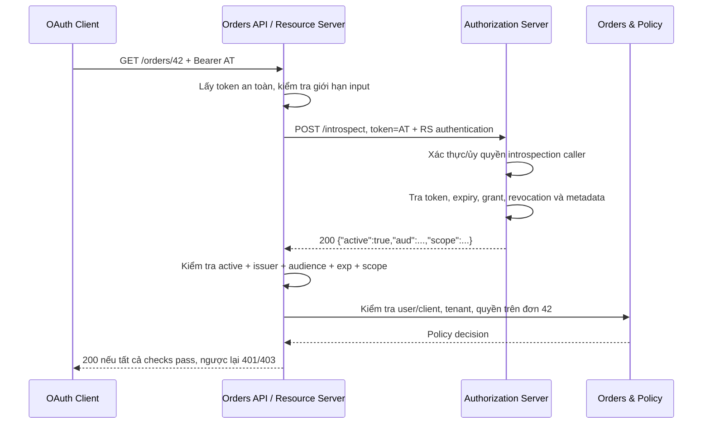
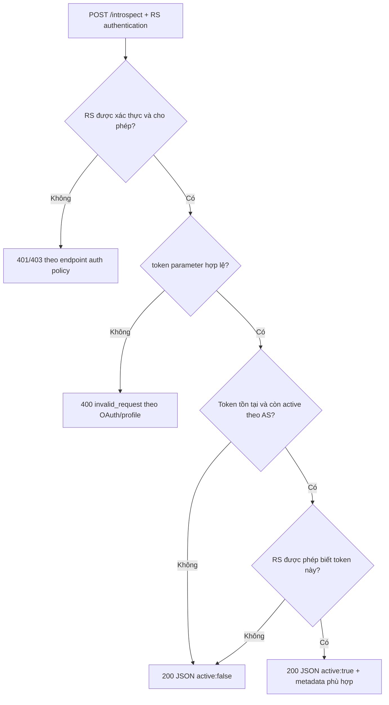
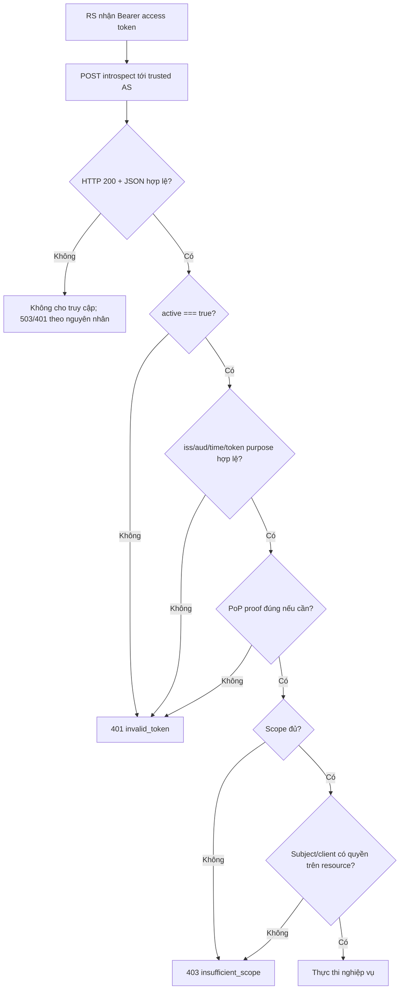

# Resource server gửi token để kiểm tra

## 1. Tình huống: API nhận một access token không tự đọc được

Một ứng dụng `orders-web` gọi Orders API để xem danh sách đơn hàng:

```http
GET /orders HTTP/1.1
Host: orders-api.example.com
Authorization: Bearer <opaque_access_token>
Accept: application/json
```

Access token do authorization server (AS) phát hành là một chuỗi **opaque** — Orders API không thể tự giải mã thành claims và cũng không biết token đã bị thu hồi hay chưa. Nếu API chỉ kiểm tra “header `Authorization` có giá trị” rồi trả dữ liệu, bất kỳ chuỗi nào cũng có thể được chấp nhận.

**OAuth 2.0 Token Introspection (RFC 7662)** cung cấp một cơ chế chuẩn: **resource server (RS) gửi token tới một introspection endpoint đáng tin của authorization server**, tự xác thực/được cho phép sử dụng endpoint đó, rồi nhận JSON cho biết token có đang `active` và những metadata cần thiết để RS quyết định xử lý request.

Ví dụ:

```http
POST /introspect HTTP/1.1
Host: auth.example.com
Authorization: Basic <resource_server_client_authentication>
Content-Type: application/x-www-form-urlencoded
Accept: application/json

token=<opaque_access_token>&token_type_hint=access_token
```

AS có thể trả:

```http
HTTP/1.1 200 OK
Content-Type: application/json
Cache-Control: no-store

{
  "active": true,
  "iss": "https://auth.example.com",
  "sub": "user-123",
  "client_id": "orders-web",
  "aud": "https://orders-api.example.com",
  "scope": "orders:read",
  "token_type": "Bearer",
  "iat": 1900000000,
  "exp": 1900000600
}
```

**Lưu ý:** Đây là dữ liệu minh họa; timestamps, credential và URLs không phải giá trị production.

Orders API chỉ nên cho phép request sau khi **xác thực nguồn introspection response và kiểm tra thêm issuer, audience, expiration, scopes, subject/client, tenant và quyền trên từng đơn hàng** theo hợp đồng với AS.

> **Kết luận sớm:** `active: true` có nghĩa token được AS xem là **đang hoạt động trong ngữ cảnh mà AS cho phép introspection**, **không có nghĩa** “bất kỳ resource server nào cũng được nhận token” hoặc “người gọi có quyền đọc mọi đơn hàng”.

Bài **“Resource server gửi token để kiểm tra”** thuộc chương **Introspection** của module `SECURITY_TOKEN_SECURITY_FUNDAMENTALS`. Bài kết nối mô hình tin cậy token với JWT/opaque, access/refresh token, OAuth 2.0/OIDC, scope, audience, token issuance–validation–storage–revocation và phòng chống token theft/replay.

## 2. Mục tiêu học tập

Sau bài này, bạn có thể:

1. Mô tả khi nào RS sử dụng introspection thay vì xác minh JWT cục bộ.
2. Tạo đúng **HTTP POST form-encoded** tới introspection endpoint theo RFC 7662.
3. Phân biệt `token`, `token_type_hint` và **credential mà RS dùng để xác thực với AS**.
4. Hiểu `active: true`, `active: false` và lỗi `401` khi RS không được phép gọi introspection.
5. Kiểm tra metadata `iss`, `aud`, `exp`, `nbf`, `scope`, `sub`, `client_id` và token type đúng hợp đồng.
6. Thiết kế introspection **chỉ tiết lộ thông tin token cho RS được ủy quyền**.
7. Xử lý kết quả thiếu claims hoặc dữ liệu không đáng tin mà không cấp quyền mặc định.
8. Thiết kế **cache, fail closed, retries, latency budget và availability** với AS.
9. Phân biệt **đang active**, **đúng API**, **đúng quyền** và **bằng chứng bên trình token** trong DPoP/mTLS.
10. Tạo kiểm thử chống replay, cross-audience token use, token-type confusion, sự cố AS và rò rỉ token qua logs.

## 3. Các vai trò và ranh giới tin cậy

| Vai trò | Ví dụ | Trách nhiệm |
| --- | --- | --- |
| **Authorization server (AS)** | `https://auth.example.com` | Phát token, duy trì trạng thái/grant, cung cấp introspection endpoint |
| **OAuth client** | `orders-web` | Nhận access token theo grant, gọi Orders API |
| **Resource owner/subject** | `user-123` hoặc workload tùy grant | Chủ thể/quyền gắn với token theo chính sách |
| **Resource server (RS)** | `https://orders-api.example.com` | Xác minh token và phân quyền request đối với đơn hàng |
| **Introspection caller** | Orders API hoặc trusted gateway thay mặt Orders API | Xác thực với AS và yêu cầu metadata cho token cụ thể |

Tại đây có **hai kênh giao tiếp khác nhau**:

1. **Client → RS**: gửi access token vào request nghiệp vụ.
2. **RS → AS**: gửi chính token đó tới introspection endpoint, sử dụng **thông tin xác thực riêng của RS** nếu AS yêu cầu, để xác minh trạng thái và metadata.

Không nhầm:

- `access_token` của user/client **không phải credential xác thực RS với introspection endpoint**.
- `client_id` trong token mô tả OAuth client đã nhận token, **không phải** danh tính RS đang introspect.
- `sub` có thể là user hoặc workload theo grant/profile, **không** luôn là một người.
- AS có thể cung cấp nhiều token endpoints/introspection endpoints; RS phải dùng URL theo **issuer/configuration đáng tin**.

### 3.1. Vì sao không để browser gọi introspection trực tiếp?

Introspection được thiết kế cho **protected resource servers hoặc những bên được AS ủy quyền** cần biết trạng thái token. Nếu frontend JavaScript công khai có thể truy vấn bất kỳ token nào, endpoint dễ trở thành dịch vụ tiết lộ trạng thái/claims của người dùng.

RS thường thực hiện introspection ở **backend**, trong trust boundary có credential riêng và TLS. Browser chỉ gửi access token cho **đúng API**; không nên được cấp secret của RS để hỏi introspection.

## 4. Sơ đồ end-to-end của một API request



Đường đi có thể có API gateway ở giữa, nhưng gateway không tự biến response introspection thành quyền nghiệp vụ. Nếu gateway làm introspection thay RS, phải có **hợp đồng truyền verified identity/context** và ranh giới tin cậy để backend không bị caller giả mạo header.

### 4.1. Thời điểm nào RS gửi token?

Một số thiết kế:

- **Mỗi request**: RS introspect mỗi lần, giảm cửa sổ trạng thái cũ nhưng tăng latency/tải AS.
- **Cache theo token**: RS introspect khi cache miss, dùng metadata đã xác minh trong thời gian ngắn.
- **Hybrid**: RS xác minh JWT offline, còn introspection/lookup cho trường hợp cần trạng thái revocation mới hơn.
- **Gateway central validation**: một component tin cậy introspect, downstream dùng principal context đã được bảo vệ.

Không có lựa chọn nào đúng cho mọi hệ thống. Độ mới của quyền/thu hồi, bảo mật và SLO phụ thuộc kiến trúc.

## 5. Introspection endpoint không phải các endpoint OAuth khác

| Endpoint | Caller | Công dụng |
| --- | --- | --- |
| **Authorization endpoint** | Browser/user agent | Xác thực/consent người dùng và trả authorization response |
| **Token endpoint** | OAuth client | Đổi authorization code, refresh token hoặc xử lý grant để cấp token |
| **Introspection endpoint** | Authorized RS/other permitted party | Kiểm tra trạng thái và metadata **token đã có** |
| **Revocation endpoint** | Client/party được phép theo profile | Yêu cầu AS thu hồi token |
| **UserInfo endpoint** (OIDC) | OIDC client có access token phù hợp | Lấy user profile claims |
| **Resource endpoint** | OAuth client | Gọi API nghiệp vụ bằng access token |

**Introspection không phát access token mới.** Nó cũng không đăng nhập người dùng, không tự nâng scope, không đổi refresh token thành access token và không thay thế UserInfo.

### 5.1. Lấy endpoint từ metadata đáng tin

OAuth 2.0 Authorization Server Metadata (RFC 8414) có thể công bố:

```json
{
  "issuer": "https://auth.example.com",
  "token_endpoint": "https://auth.example.com/token",
  "introspection_endpoint": "https://auth.example.com/introspect",
  "introspection_endpoint_auth_methods_supported": [
    "client_secret_basic"
  ]
}
```

Các fields và phương thức thực tế phụ thuộc AS/profile/registration; đừng tự suy đoán path từ hostname hay mù quáng tin endpoint do access token chưa xác minh chứa trong claim.

**Không nhận một URL `introspection_endpoint` từ HTTP request của client rồi tự gửi bearer token tới đó**: dễ dẫn tới SSRF và rò rỉ credential ra nơi attacker kiểm soát.

## 6. HTTP introspection request chuẩn (RFC 7662 §2.1)

Introspection request dùng **HTTP POST** đến endpoint AS đã cấu hình. Tham số ở **`application/x-www-form-urlencoded` body**.

```http
POST /introspect HTTP/1.1
Host: auth.example.com
Authorization: Basic <base64_of_registered_RS_credentials>
Content-Type: application/x-www-form-urlencoded
Accept: application/json

token=<access_token>&token_type_hint=access_token
```

### 6.1. Tham số `token` — bắt buộc

Theo RFC 7662, `token` là **REQUIRED**: chuỗi token mà bên gọi muốn tra.

Điều quan trọng:

- Có thể là **opaque access token** hoặc loại token khác được AS hỗ trợ tra cứu.
- Request này cần bảo vệ tương đương credential; một bearer token bị lộ vẫn có thể dùng tại RS.
- RS phải gửi **đúng token nhận được** mà không tự decode/cắt bớt/thay prefix.
- Không đặt token trong query string, URL logs, metric labels hoặc exception messages.
- Không gửi cả header `Authorization: Bearer AT` của client như cơ chế xác thực introspection khi hợp đồng yêu cầu credential riêng của RS.

### 6.2. Tham số `token_type_hint` — tùy chọn

`token_type_hint` gợi ý cho AS loại token nhằm tối ưu tra cứu. Giá trị gợi ý thường là:

```text
access_token
refresh_token
```

Đây là **hint, không phải bằng chứng**. AS **có thể bỏ qua hint** và vẫn phải tra token theo policy. Nếu hint sai, RS không được tự kết luận “token đã được chứng minh là access token” chỉ vì request ghi `token_type_hint=access_token`.

**RS chỉ nên chấp nhận access token tại API**, không chấp nhận refresh token hoặc ID token vì chúng có thể cũng được AS nhận diện là đang active trong ngữ cảnh của riêng chúng.

### 6.3. Form encoding

Ví dụ JavaScript minh họa cách tạo body:

```javascript
// Chỉ minh họa mã hóa form parameters, không chứa credential thật.
const form = new URLSearchParams();
form.set("token", accessToken);
form.set("token_type_hint", "access_token");
const body = form.toString();
```

Nếu token chứa các ký tự như `+`, `/`, `=` hoặc `%`, form encoder xử lý đúng. Không gửi body bằng chuỗi nối thủ công chưa encode khiến AS đọc sai token.

### 6.4. Không gửi HTTP GET có token

Sai:

```http
GET /introspect?token=<secret_access_token> HTTP/1.1
Host: auth.example.com
```

Sai vì query dễ được ghi vào proxy/server logs và không đúng request chuẩn RFC 7662. AS phải áp input limits và chính sách xử lý methods sai.

## 7. RS phải **xác thực** trước khi hỏi introspection

Introspection response có thể tiết lộ metadata nhạy cảm:

- User subject identifier.
- Client ID, audience/resource.
- Scope/quyền được cấp.
- Username và thông tin về grant.
- Thời gian phát hành/hết hạn, trạng thái revocation.

Do đó RFC 7662 yêu cầu introspection endpoint **được bảo vệ bằng authorization**, và AS phải quyết định bên gọi có được phép introspect **token cụ thể** hay không.

### 7.1. Một số phương thức bảo vệ endpoint

| Cơ chế | Ý nghĩa | Lưu ý |
| --- | --- | --- |
| **HTTP Basic với RS credential** | RS chứng minh một shared secret mà AS đã đăng ký | Secret phải giữ tại backend; Basic Base64 không phải mã hóa |
| **mTLS client authentication** | RS chứng minh certificate/private key theo registration | Cần tin TLS terminator và ràng buộc certificate identity |
| **Bearer token riêng cấp để gọi introspection** | RS có token với quyền sử dụng introspection endpoint | Không nhầm với token đang được introspect |
| **Private-key JWT/client assertion** | RS chứng minh private key của identity đã đăng ký | Kiểm tra assertion signature/audience/expiry/replay |
| **Cơ chế nội bộ được AS tin cậy** | Service mesh/gateway auth trong hệ thống | Phải có identity, authorization, TLS/transport protection rõ ràng |

Không phải mọi AS hỗ trợ tất cả. RS cần dùng **phương thức đã cấu hình và được AS cho phép**, không thử gửi secret tùy tiện vào query.

### 7.2. Hai credential trong một request

```text
A. Bearer AT của client:
   token=<AT> trong form body
   -> thứ AS cần kiểm tra

B. Introspection credential của RS:
   Authorization: Basic <RS_ID:RS_SECRET>
   -> AS dùng để xác thực/ủy quyền bên hỏi

Hai credential có mục đích hoàn toàn khác.
```

Nếu vô tình gửi:

```http
Authorization: Bearer <same_client_access_token_being_introspected>
```

thì chỉ phù hợp khi **AS có hợp đồng rõ** cho phép token đó là caller credential — vốn hiếm khi là mô hình RS chuẩn. Không mặc định bearer token của client đủ quyền hỏi introspection.

### 7.3. Phạm vi thông tin được tiết lộ

Ngay cả RS đã xác thực, AS phải xét **nó có quyền biết gì về token đó**.

Ví dụ:

```text
Token X:
  aud = https://payments-api.example.com
  sub = user-123
  scope = payments:refund

Orders API introspects Token X.
```

Một chính sách an toàn có thể trả `active: false` cho Orders API hoặc không tiết lộ metadata của token không dành cho Orders, tùy hợp đồng AS; dù response báo active true, Orders API **vẫn phải từ chối vì audience không khớp**.

Không cấu hình “mọi RS dùng chung secret introspection admin có thể đọc mọi token của mọi user/tenant”. Hãy **giới hạn quyền và thông tin** theo RS/resource/tenant khi có thể.

### 7.4. Lỗi xác thực của RS khác token inactive

Nếu RS gửi sai introspection credential, AS có thể trả **HTTP 401 Unauthorized** theo cơ chế xác thực endpoint, không phải:

```json
{"active":false}
```

Việc AS từ chối **bên hỏi** không chứng minh token client đã hết hạn. RS không nên đánh đồng và trả “user token invalid” nếu nguyên nhân là secret RS bị sai/AS auth config lỗi. Đây thường là **sự cố phụ thuộc hạ tầng** cần fail closed và điều tra.

## 8. AS làm gì khi nhận token?

Một AS có thể xử lý nội bộ như sau:

1. Xác thực introspection caller qua TLS + registered credential.
2. Kiểm tra caller có quyền introspect loại token/resource/tenant tương ứng.
3. Parse form request, giới hạn kích thước, tránh duplicate/ambiguous params.
4. Tra token bằng cơ chế AS quản lý (token store, index, JWT validation/state, revocation table).
5. Kiểm tra token có thật, được cấp hợp lệ, chưa hết hạn/không trước `nbf`, chưa bị thu hồi hoặc không còn hiệu lực vì grant/client/subject policy khi áp dụng.
6. Áp kiểm tra phạm vi **caller được biết metadata nào**.
7. Trả response **`active: true` hoặc `active: false`** theo RFC và hợp đồng.
8. Hạn chế dữ liệu trong response; ghi audit metadata mà không log token.
9. Áp rate limits và bảo vệ endpoint khỏi token guessing/DoS.



Sơ đồ là **mô hình chính sách minh họa**. Trong triển khai thực tế, thứ tự quyền tra cứu, quyết định trả inactive cho token không được biết và status khi caller không được cấp quyền phụ thuộc AS. Không được trả metadata của người khác cho caller chưa được cấp phép.

### 8.1. “Active” là khái niệm AS quyết định

RFC 7662 §2.2 mô tả `active` phản ánh trạng thái token tại AS, theo những điều kiện như đã phát hành, chưa bị thu hồi và còn trong cửa sổ thời gian hợp lệ, cùng các kiểm tra khác mà AS áp dụng.

Một token có `exp` chưa đến vẫn có thể `active:false` nếu token/grant bị revoke. Ngược lại, `active:true` **không chứng minh** request nghiệp vụ đang được RS cho phép.

## 9. Introspection response: `active:true`

Ví dụ response cho một access token hợp lệ đối với Orders API:

```http
HTTP/1.1 200 OK
Content-Type: application/json
Cache-Control: no-store

{
  "active": true,
  "scope": "orders:read orders:export",
  "client_id": "orders-web",
  "username": "user123",
  "token_type": "Bearer",
  "exp": 1900000600,
  "iat": 1900000000,
  "nbf": 1900000000,
  "sub": "user-123",
  "aud": "https://orders-api.example.com",
  "iss": "https://auth.example.com",
  "jti": "at-opaque-metadata-42"
}
```

Các fields ngoài `active` **không tự động có mặt trong mọi triển khai**. RFC 7662 định nghĩa nhiều tên metadata phổ biến, nhưng AS có thể trả subset tùy loại token/profile và quyền caller.

### 9.1. Các trường metadata

| Trường | Ý nghĩa | Bên RS cần làm gì? |
| --- | --- | --- |
| **`active`** | Boolean: token đang active theo AS | Bắt buộc true mới tiếp tục |
| `scope` | Danh sách scopes được cấp, thường là space-delimited string | Kiểm tra scope cần cho API/action |
| `client_id` | OAuth client được cấp token | Có thể ràng buộc workload/client policy |
| `username` | Username của resource owner, nếu AS cung cấp | Không dùng làm identity key bất biến |
| `token_type` | Loại presentation scheme, ví dụ Bearer | Không suy ra token purpose chỉ từ tên |
| `exp` | Unix NumericDate, token expiration | Không chấp nhận token hết hạn; giới hạn cache |
| `iat` | Token issued-at | Kiểm tra kiểu/giá trị khi profile cần |
| `nbf` | Token not-before | Không chấp nhận trước thời điểm này |
| `sub` | Subject của token | Hiểu theo issuer/grant, tránh nhầm user với workload |
| `aud` | Audience/RS dự kiến | Phải phù hợp resource server hiện tại theo policy |
| `iss` | Token issuer | Khớp AS/issuer đã tin cậy |
| `jti` | Token identifier | Audit/revocation/dedupe theo policy; không tự coi là bí mật |

Một số AS còn trả extensions như `cnf` cho proof-of-possession, tenant, `token_usage` hay permission metadata. **Không có extension nào tự trở thành chuẩn phổ quát** nếu AS/RS chưa có hợp đồng rõ.

### 9.2. Các giá trị như `exp` có thể thiếu

RFC 7662 không bắt buộc `exp` trong mọi active response. Nếu RS cần biết token còn hạn bao lâu để cache an toàn và AS không trả `exp`, phải có **chính sách TTL rất ngắn, response contract khác, hoặc từ chối nếu không đủ bằng chứng bắt buộc cho resource**.

Không mặc định một token `active:true` không có `exp` là hợp lệ vĩnh viễn. Cũng không dùng `Cache-Control` từ HTTP như một bảo đảm rằng grant/ACL sẽ không thay đổi.

### 9.3. Kiểu dữ liệu

Ví dụ đúng:

```json
{
  "active": true,
  "scope": "orders:read",
  "exp": 1900000600,
  "aud": ["https://orders-api.example.com"]
}
```

Ví dụ sai cần được RS từ chối theo parser/policy:

```json
{
  "active": "true",
  "exp": "1900000600",
  "aud": 123
}
```

Không dùng truthiness của ngôn ngữ để biến string `"false"` thành boolean true. Scope phải được parse thành các token **phân tách bằng ASCII spaces** theo OAuth scope syntax; không substring-match `read` với `orders:readwrite`.

## 10. Introspection response: `active:false`

Khi token không active, AS trả một response thành công về mặt giao thức introspection nhưng kết luận token không có hiệu lực:

```http
HTTP/1.1 200 OK
Content-Type: application/json
Cache-Control: no-store

{
  "active": false
}
```

Các nguyên nhân **có thể** gồm:

- Token không tồn tại.
- Token đã hết hạn.
- Token bị thu hồi.
- Token bị vô hiệu vì grant/AS policy.
- Caller không có quyền introspect token đó và AS chọn ẩn trạng thái.
- Token không thuộc hệ thống/loại token mà AS nhận diện.

**Không nên suy ra lý do chính xác từ `active:false`**. Theo RFC 7662, response cho token inactive không nên tiết lộ thêm metadata, nhằm giảm token enumeration và rò rỉ thông tin.

### 10.1. Vì sao là HTTP 200, không phải 401?

HTTP 200 cho biết **introspection request của RS đã được xử lý thành công**. Field `active:false` cho biết **token được hỏi không active**.

Hai lớp khác nhau:

```text
HTTP 200 + {"active": false}
  -> RS được AS trả lời hợp lệ.
  -> Token không được RS dùng để xác thực request.

HTTP 401 từ /introspect
  -> Caller RS chưa được xác thực/ủy quyền hợp lệ.
  -> KHÔNG suy luận tự động token client đã invalid.
```

RS thường trả `401 Unauthorized` cho **request nghiệp vụ** nếu token `active:false`, nhưng **không được lấy HTTP 200 của introspection làm lý do trả 200 cho API**.

### 10.2. Không làm lộ lý do inactive cho client bên ngoài

Response với user:

```http
HTTP/1.1 401 Unauthorized
WWW-Authenticate: Bearer error="invalid_token"
```

không nhất thiết phải cho biết “token bị thu hồi bởi admin”, “user đã nghỉ việc”, “đây là token từ tenant khác” hay “client ID không tồn tại”. Những thông tin đó có thể hỗ trợ enumeration hoặc tấn công có chủ đích.

## 11. Khi AS trả lỗi thay vì kết quả introspection

| Kết quả từ AS | Ý nghĩa phổ biến | RS nên làm gì? |
| --- | --- | --- |
| `200` + `active:true` | AS công nhận token đang active | Tiếp tục validation và authorization |
| `200` + `active:false` | Token inactive/không được tiết lộ theo policy | Từ chối token trong API request |
| `400 invalid_request` | RS gửi introspection request sai format/thiếu `token` | Sửa integration, không cho qua |
| `401 invalid_client` hoặc HTTP auth failure | Introspection caller credential sai/thiếu | Xử lý sự cố auth giữa RS–AS |
| `403` | RS không được phép truy vấn endpoint/token theo AS policy | Từ chối, rà soát quyền caller |
| `429` | Rate limiting nếu AS dùng | Backoff, tránh tăng tải |
| `5xx` | AS lỗi hạ tầng | Fail closed; retry có giới hạn |
| Timeout/TLS failure | Không có câu trả lời tin cậy | Fail closed, cảnh báo |
| Response JSON sai schema | Không thể xác thực kết quả | Fail closed, ghi audit an toàn |

HTTP statuses cụ thể phụ thuộc AS/protocol extension; **đừng nhầm lỗi của endpoint introspection với lỗi Bearer tại resource server**.

### 11.1. Vì sao “fail closed” rất quan trọng?

Nếu AS không trả lời, RS **không biết token hiện có hợp lệ hay đã bị thu hồi**. Không nên:

```text
if introspectionEndpointUnavailable:
    allowRequestBecauseAuthenticationServerMayBeDown()
```

Đây là **fail open**, có thể tạo cửa sổ bỏ toàn bộ token validation đúng lúc attacker gây DoS trên AS.

Chiến lược phù hợp:

- Nếu có cache **còn hạn theo policy**, có thể dùng metadata đáng tin đã cache nếu rủi ro và SLO cho phép.
- Nếu không có bằng chứng token còn hợp lệ, **không cấp quyền**.
- Phản hồi 503 Service Unavailable hoặc lỗi phụ thuộc phù hợp khi backend validation đang lỗi, thay vì lừa client rằng token chắc chắn invalid.
- Không tự động chuyển sang một endpoint không tin cậy hoặc bỏ scope/audience check.

## 12. RS kiểm tra gì sau khi nhận `active:true`?

Tối thiểu theo hợp đồng cho Orders API:

1. **Nguồn response**: introspection response đến từ AS endpoint đã cấu hình, qua TLS, với RS authentication và response validation.
2. **`active`**: giá trị Boolean đúng `true`.
3. **Issuer**: `iss` đúng issuer đã tin; nếu không có claim, RS phải có bảo đảm tương đương từ AS endpoint/profile và fail nếu policy yêu cầu field.
4. **Audience**: `aud` dành cho Orders API, hoặc AS có contract kiểm tra resource binding đối với introspection caller. Nếu không có đủ thông tin/bảo đảm, **từ chối**.
5. **Time**: `exp`/`nbf` khi có và các điều kiện expiry contract. Không cache sau `exp`.
6. **Scope/permission**: token có đủ scope chính xác cho route.
7. **Principal type**: `sub`, `client_id` và grant context được hiểu đúng theo user/workload/token profile.
8. **Tenant/resource rights**: server-side policy cho người dùng/client trên đơn hàng cụ thể.
9. **Sender proof**: DPoP/mTLS proof nếu access token bị ràng buộc khóa/certificate.
10. **Current state**: user/client/tenant/ACL có còn cho phép theo yêu cầu nghiệp vụ không.



**Các mã 401/403 trong sơ đồ là ví dụ mapping thông thường**, không thay thế yêu cầu cụ thể của Bearer/DPoP/API profile.

### 12.1. Introspection là authentication input, không phải authorization engine hoàn chỉnh

Nếu RS thấy:

```json
{
  "active": true,
  "scope": "orders:read",
  "sub": "user-123",
  "aud": "https://orders-api.example.com"
}
```

nó vẫn phải hỏi: “user-123 có được xem **đơn 42 thuộc tenant Alpha** không?”

Scope là giới hạn chung của grant, không phải ACL trên từng bản ghi. User/client có thể bị disable hoặc chuyển tenant sau thời điểm token được phát hành. Khi cần, phải kiểm tra trạng thái hiện hành.

## 13. Audience validation và token redirect

Giả sử access token dành cho Payments API:

```json
{
  "active": true,
  "iss": "https://auth.example.com",
  "aud": "https://payments-api.example.com",
  "scope": "payments:refund",
  "sub": "user-123"
}
```

Orders API phải từ chối token này dù `active:true` và user có vẻ hợp lệ. Nếu không, một token bị lộ ở API ít tin cậy có thể được dùng lại ở API khác (**cross-resource token replay / confused deputy**).

### 13.1. Audience có thể là string hoặc array

Theo ngữ nghĩa JWT/OAuth profile, `aud` có thể là string hoặc một tập audiences tùy format/hợp đồng introspection:

```json
{
  "active": true,
  "aud": [
    "https://orders-api.example.com",
    "https://inventory-api.example.com"
  ]
}
```

RS phải kiểm tra mình có nằm trong audiences được cấp và policy cho phép multi-audience hay không. Không substring-match `orders` trong `https://orders-api.example.com.evil.invalid`.

### 13.2. Nếu response không có `aud`?

RFC 7662 định nghĩa `aud` là field có thể có, không bắt buộc trên mọi response.

Hai lựa chọn an toàn:

1. AS/RS có **contract xác minh audience ở phía AS** dựa trên identity introspection caller và chỉ trả `active:true` cho token hợp lệ với resource này; RS có thể dựa trên bảo đảm được thiết kế/kiểm thử đó.
2. RS **yêu cầu `aud` trong response** và từ chối khi thiếu/sai.

Không chọn lựa chọn thứ ba “không có aud tức là token dùng cho mọi API”.

### 13.3. Resource Indicators

OAuth 2.0 Resource Indicators (RFC 8707) cho phép client yêu cầu token nhắm tới resource cụ thể, nếu AS hỗ trợ. Introspection giúp RS kiểm tra **token đã được cấp cho resource nào**; không biến `resource` ở request của client thành quyền tự động.

## 14. Scope validation: không dùng substring

RFC 7662 `scope` thường là một chuỗi scopes cách nhau bởi dấu cách:

```json
{"active":true,"scope":"orders:read orders:export"}
```

Một RS route cần `orders:read` có thể kiểm tra:

```text
grantedScopes = split scope according to OAuth scope-token rules
require exact "orders:read" in grantedScopes
```

Sai:

```java
// SAI: substring có thể match scope khác.
if (scopeString.contains("orders:read")) {
    allow();
}
```

Token chỉ có `orders:readall` có thể vượt qua điều kiện substring dù không được cấp `orders:read`.

Cần bảo đảm:

- Scope parser nhất quán với RFC 6749 và AS contract.
- Không dùng case-insensitive comparison nếu scope identifiers được định nghĩa case-sensitive.
- Không tự “phân quyền mọi việc” khi scope vắng mặt.
- Không chỉ vì scope `admin` có mặt mà bỏ tenant ACL.
- Kiểm tra scope trên **mỗi route/action**, không chỉ ở lần authentication đầu tiên.

## 15. Subject, client_id, token purpose và grant

### 15.1. `sub` không luôn là người dùng

Trong token được cấp cho user-delegated authorization:

```json
{
  "sub": "user-123",
  "client_id": "orders-web"
}
```

Trong token cấp qua client credentials:

```json
{
  "sub": "inventory-sync-prod",
  "client_id": "inventory-sync-prod"
}
```

Ngữ nghĩa `sub` tùy issuer/profile/grant. RS không được thấy `sub` rồi mặc định có end-user tương ứng. Workload tokens cần principal type/authorization model riêng.

### 15.2. `client_id` không phải bằng chứng bên gửi giữ secret

`client_id` trong introspection response mô tả **client mà token được cấp**. Khi bearer AT bị đánh cắp, attacker trình chuỗi token có thể khiến RS nhìn thấy cùng `client_id`.

Do đó:

- `client_id` hữu ích cho policy “chỉ cho clients đã đăng ký X/Y”.
- Nó **không chứng minh** caller hiện tại sở hữu client secret, private key hoặc mTLS certificate.
- Để chống token replay, cần sender-constrained token và proof validation theo profile.

### 15.3. Access token và refresh token khác mục đích

AS có thể hỗ trợ introspection **refresh token**, nhưng Orders API không được nhận refresh token làm access token dù AS nói `active:true` trong ngữ cảnh RT.

`token_type_hint=access_token` không tự chứng minh token purpose. Cần **hợp đồng introspection và policy/type validation** để RS chỉ chấp nhận access token.

Nếu AS có extension như `token_usage="access_token"`, RS phải hiểu đó là **trường theo profile**, không phải claim bắt buộc RFC 7662.

### 15.4. ID token OIDC cũng không được dùng thay AT

ID token được phát cho **OIDC client**; audience thường là client ID. Resource server muốn phục vụ API phải kiểm tra **access token đúng resource audience**, không chấp nhận ID token chỉ vì cùng issuer hoặc JWT signature hợp lệ.

**Introspection không biến ID token thành access token**, và nó không thay thế ID-token validation ở OIDC Relying Party.

## 16. JWT access token và opaque access token: chọn introspection thế nào?

| Tiêu chí | Opaque access token | JWT access token |
| --- | --- | --- |
| Khả năng RS tự giải mã claims | Không có nghĩa chuẩn để tự đọc | Có thể đọc payload JWS nhưng phải verify |
| Cách kiểm tra trạng thái phổ biến | Introspection hoặc lookup qua AS | Verify offline; có thể introspect để biết revocation |
| Độ mới của revocation | Có thể gần real-time nếu không cache, phụ thuộc AS | Offline JWT thường có thể dùng tới `exp` nếu không thêm state check |
| Phụ thuộc mạng | Introspection cần gọi AS/cache | Offline verify cần JWKS cache/rotation |
| Thông tin token có thể lộ ở client | Opaque không tự chứa claims đọc được | JWS payload thường đọc được |
| Chi phí mỗi request | Có thể tăng RTT/tải AS | Thường thấp nếu verify local |
| Phù hợp | Theo khả năng AS/RS, TTL và revocation SLO | Theo profile và threat model |

### 16.1. Opaque không tự có nghĩa “phải introspect”

Một opaque token có thể được RS xác minh bằng cơ sở dữ liệu chia sẻ/lookup nội bộ theo hợp đồng. RFC 7662 là **một giao thức chuẩn hóa**, hữu ích khi RS và AS cần tương tác độc lập; không phải cách duy nhất có thể xác thực opaque token.

### 16.2. JWT introspection vẫn có ích

Ngay cả JWT đã verify chữ ký, `exp`, `iss` và `aud` cục bộ, RS có thể cần biết:

- Token đã bị revoke chưa?
- Grant/client/subject có còn active không?
- Có policy version hoặc token family bị chặn không?
- Quyền bị thu hồi trước `exp` có được phản ánh tại AS không?

Một triển khai có thể introspect JWT để lấy trạng thái mới hơn. **Không phải mọi AS đều hỗ trợ introspection cho JWT**, và cách active được tính/response fields cần hợp đồng cụ thể.

### 16.3. Không coi introspection là “decode JWT”

Introspection là **hỏi AS về trạng thái và metadata**. Decode JWT chỉ biến Base64url thành JSON, còn verify JWS kiểm tra signature theo khóa/issuer tin cậy. Đó là ba hoạt động khác nhau.

```text
decode JWT:
  nhìn thấy claims (chưa tin)

verify signed JWT:
  xác minh tính toàn vẹn, issuer, audience/time/profile

introspect token:
  hỏi AS đang nhận diện token ra sao tại thời điểm query

resource authorization:
  quyết định principal có được làm action trên resource không
```

## 17. Sender-constrained token: introspection không chứng minh proof

Giả sử token được cấp theo DPoP hoặc mTLS certificate binding. Introspection có thể cung cấp `cnf` metadata theo AS/profile, chẳng hạn:

```json
{
  "active": true,
  "scope": "orders:read",
  "aud": "https://orders-api.example.com",
  "cnf": {
    "jkt": "<base64url_jwk_thumbprint>"
  }
}
```

hoặc:

```json
{
  "active": true,
  "aud": "https://orders-api.example.com",
  "cnf": {
    "x5t#S256": "<base64url_certificate_thumbprint>"
  }
}
```

**Đây là metadata minh họa**, không bắt buộc trong mọi RFC 7662 response. Với token sender-constrained, RS phải có cách lấy và xác minh binding theo profile.

### 17.1. DPoP

DPoP (RFC 9449) yêu cầu RS kiểm tra proof JWS hợp lệ, có thể gồm:

- Chữ ký từ keypair đúng.
- `htm` đúng HTTP method.
- `htu` đúng HTTP target URI theo normalization/profile.
- `ath` đúng hash của access token khi gửi tới protected resource.
- `iat`/nonce/freshness, `jti` chống replay theo profile.
- Khóa của proof khớp binding `cnf.jkt` của token.

**`active:true` không có nghĩa proof DPoP hiện tại đúng.** AS không thể tự chứng minh requester ở RS đang sở hữu khóa cho request HTTP cụ thể chỉ bằng một introspection response không chứa proof của request.

### 17.2. mTLS certificate-bound tokens

Nếu AT được ràng buộc với certificate, RS phải kiểm tra certificate thực tế của TLS client **khớp** binding, ví dụ `cnf["x5t#S256"]` theo RFC 8705.

Nếu TLS kết thúc tại API gateway, backend phải nhận certificate identity từ **kênh nội bộ đáng tin**, không tin một header `X-Client-Cert` do caller Internet tự đặt.

### 17.3. Caller auth tại /introspect khác PoP của client tại RS

mTLS giữa **RS và AS** giúp AS xác thực **introspection caller**. Nó **không phải** bằng chứng client gọi Orders API sở hữu khóa gắn access token.

Đây là hai TLS/request contexts khác nhau:

```text
Client -> Orders API:
  access token + DPoP/mTLS proof (nếu token-bound)

Orders API -> AS introspection:
  token string + credential riêng của Orders API

Không được nhầm hai loại proof.
```

## 18. Token introspection caching: đánh đổi độ mới và hiệu năng

Gọi AS ở mọi API request có thể tốn chi phí lớn. Cache introspection response thường được cân nhắc nhưng kéo theo **stale active status**.

### 18.1. Positive cache

Ví dụ:

```text
t=0:
  RS introspects AT0
  AS: active=true, exp=t+300, scope=orders:read
  RS stores validated metadata for at most 20s

t=5:
  Client asks again
  RS uses positive cache entry if still within TTL

t=8:
  Admin revokes AT0 at AS

t=10:
  RS cache still says active=true
  Request might pass until cache expires, unless separate invalidation exists
```

**Vì vậy “AS đã revoke ngay” không đồng nghĩa RS biết ngay khi đang cache positive response.** Phải chọn TTL và cơ chế invalidation theo security SLO.

### 18.2. Cache key phải giữ ranh giới

Một cache key logic có thể gồm:

```text
issuer / introspection endpoint identity
hash-of-access-token (không giữ token raw làm label)
introspection caller identity / resource policy context
client or token-type profile if relevant
tenant/policy partition when decision is context-specific
```

Không dùng:

```text
cacheKey = token.substring(0, 6)
cacheKey = client_id
cacheKey = user_id
```

Vì collisions có thể khiến token khác nhau chia sẻ kết quả. Một triển khai có thể dùng **HMAC của token** với key nội bộ để index cache/logs mà không để raw bearer token lộ qua key; vẫn phải bảo vệ cache values.

### 18.3. TTL phải bị chặn bởi `exp`

Một chính sách minh họa:

```text
ttl = min(
    local_positive_cache_max_age,
    max(0, token_exp - current_time - clock_skew_margin)
)
```

Nếu introspection response không có `exp`, chỉ dùng bounded TTL cực ngắn theo hợp đồng hoặc không cache khi không đủ bằng chứng. Không cache qua expiry.

Ngoài `exp`, cần cân nhắc:

- Authorization grant bị revoke bất ngờ.
- Client/user bị disable.
- Tenant ACL thay đổi.
- Sender proof/nonce **không được cache như đã chứng minh cho các request khác**.
- High-risk operations có thể yêu cầu introspection mới hoặc policy lookup ngay.
- Độ trễ/invalidation giữa nhiều AS nodes.

### 18.4. Negative cache

`active:false` có thể được cache ngắn để giảm token-guessing DoS. Nhưng:

- Không cache mãi mãi vì một token có thể trở nên active sau các thao tác khác trong một số AS lifecycle/mô hình token; chính sách phải hiểu AS contract.
- Cache key phải dựa đúng token/context, không trộn user/tenants.
- Một negative cache dài có thể gây trải nghiệm lỗi khi hệ thống đang chuyển trạng thái bất thường.
- Rate limit ở RS/AS vẫn quan trọng.

### 18.5. Cache API authorization hay cache token state?

Đừng đồng nhất:

```text
Cache introspection:
  AT active, iss, aud, scope, exp...

Cache authorization:
  user/client có quyền xem order 42 tại tenant Alpha
```

Cache token state có thể an toàn trong một TTL nhất định nhưng **không tự làm quyền bản ghi luôn đúng**. Nếu cache authorization decisions, cần key theo subject/client/tenant/resource/action/policy version và invalidation phù hợp.

## 19. Revocation: từ AS đến RS mất bao lâu?

Giả sử token được cấp với `exp=t+10 phút`. Người dùng logout hoặc admin revoke grant tại t+1 phút.

### 19.1. Không cache

Nếu mỗi request RS hỏi AS và AS có trạng thái revoke nhất quán, lần gọi kế tiếp có thể nhận:

```json
{"active":false}
```

Điều này tạo khả năng ngắt nhanh nhưng tăng phụ thuộc availability/latency và yêu cầu AS duy trì trạng thái.

### 19.2. Cache 60 giây

Nếu RS cache `active:true` 60 giây, token có thể tiếp tục được chấp nhận tới khi cache hết, trừ khi có **push invalidation/denylist/policy lookup bổ sung**.

### 19.3. JWT offline

Nếu RS chỉ verify chữ ký/`exp` cục bộ, việc revoke grant tại AS **không tự thay đổi token đã ký**. RS cần TTL ngắn hoặc một cơ chế kiểm tra trạng thái bổ sung nếu mục tiêu là thu hồi sớm.

### 19.4. Định nghĩa SLO thu hồi

Ví dụ mô tả:

```text
Security requirement:
  "Khi admin revoke token, Orders API không được tiếp tục chấp nhận
   token sau tối đa 30 giây trong điều kiện hệ thống đáp ứng SLO."

Design consequences:
  - positive introspection cache <= 30 giây (còn trừ propagation delay)
  - AS revocation state consistency phù hợp
  - monitor end-to-end revoke-to-deny latency
  - high-risk operations có thể bypass cache
```

**30 giây chỉ là ví dụ**, không phải yêu cầu của RFC 7662. TTL cache phải được chọn dựa trên rủi ro, tính sẵn sàng và cam kết nghiệp vụ.

## 20. Availability: làm thế nào khi introspection endpoint chậm hoặc down?

### 20.1. Rủi ro “thác nước” khi AS gặp sự cố

Nếu mỗi request tới 20 APIs đều introspect qua một AS chung, outage của AS có thể khiến cả hệ sinh thái API bị timeout. Thiết kế cần:

- HTTP client connection pooling.
- Timeouts ngắn và rõ cho connect/read/overall.
- Retry **chỉ khi có lý do**, với exponential backoff + jitter.
- Circuit breaker và giới hạn đồng thời.
- Positive cache ngắn phù hợp rủi ro, hoặc state service phân tán.
- AS replication và định tuyến vùng/region an toàn.
- Rate limits, quotas và monitoring.

**Đừng dùng “AS down thì bỏ auth cho tạm”**. Lỗi phụ thuộc hạ tầng phải **fail closed**, dù API có thể báo 503 tới client.

### 20.2. Retry không chuyển token sang host lạ

Nếu introspection endpoint trả `302 Location: https://unexpected.example/introspect`, HTTP client không nên tự gửi token/RS credential tới domain mới. Hãy cấu hình **không follow redirect** hoặc chỉ theo logic cực kỳ hạn chế với endpoint trust config.

Không bỏ TLS certificate validation khi gặp lỗi CA. Cần sửa trust store/PKI và certificate lifecycle.

### 20.3. 401 hay 503 khi AS không phản hồi?

Hướng phân biệt:

- **Token được AS xác định `active:false`** → RS có thể trả `401 invalid_token`.
- **Token hợp lệ nhưng không đủ scope** → RS có thể trả `403 insufficient_scope`.
- **AS timeout/5xx/mất TLS trust** → RS **không có kết quả validation tin cậy**; thường nên trả 503 hoặc lỗi service dependency phù hợp, không giả định token chắc chắn sai.
- **RS không được AS cho phép introspect (401/403 từ AS)** → cấu hình/credential endpoint lỗi; không coi là token client invalid nếu không có bằng chứng.

Mọi nhánh **đều không cấp quyền** khi không có quyết định xác thực đủ tin cậy.

## 21. Bảo mật token khi RS gửi tới AS

### 21.1. TLS bắt buộc trong thực tế

Introspection request có **raw token** trong body và thường kèm **RS credential**. Dùng HTTPS/TLS, xác minh server certificate và hostname theo issuer đã cấu hình.

Không gửi token qua HTTP plaintext hoặc qua debug proxy không được bảo vệ. Nội bộ VPC/service mesh không loại bỏ nhu cầu bảo vệ transport/trust.

### 21.2. Tránh rò token qua các điểm quan sát

Những nơi thường nguy hiểm:

- HTTP request/response logging của gateway, proxy, AS, RS.
- Distributed tracing instrumentation ghi form body hoặc Authorization header.
- APM/sentry/crash dumps.
- Debug screenshots, HAR files hoặc developer chat.
- Metrics labels dùng token string làm identifier.
- Cache keys ở Redis có thể quan sát bởi người vận hành.
- Retry middleware in toàn bộ request khi lỗi.

Chính sách:

- Mask `token` và credential trong form/header.
- Log issuer/caller/resource/decision/error code và correlation ID.
- Không log raw `access_token`, `refresh_token` hay client secret.
- Nếu cần correlation token cho điều tra, cân nhắc **HMAC digest** với key riêng, kiểm soát retention và quyền truy cập.
- Tránh gửi nguyên introspection response có PII vào logs.

### 21.3. AS trả metadata tối thiểu

Chỉ trả claims cần cho RS:

```json
{
  "active": true,
  "sub": "user-123",
  "aud": "https://orders-api.example.com",
  "scope": "orders:read",
  "exp": 1900000600,
  "iss": "https://auth.example.com"
}
```

Nếu Orders API không cần email/home address hoặc toàn bộ group memberships, AS không nên trả chúng chỉ vì có trong token store. Nguyên tắc **data minimization** giảm footprint PII và rủi ro khi RS bị compromise.

## 22. Ví dụ Java 17: RS gọi introspection bằng HTTP Client

Ví dụ minh họa sử dụng Java 17 `java.net.http.HttpClient` và Jackson Databind để gọi AS. Nó giả định:

- RS có credential riêng được cấp quyền introspect.
- AS dùng HTTP Basic theo một registration cụ thể.
- URL introspection **được cấu hình tin cậy**, không lấy từ client request.
- Token response phải có `active` Boolean, `iss`, `aud`, `exp` và `scope` theo **hợp đồng riêng của Orders API**.
- Đây là **mã giáo dục**, không thay thế OAuth/JWT security middleware đã được kiểm chứng.

### 22.1. Gọi HTTP introspection và parse response

```java
import com.fasterxml.jackson.databind.JsonNode;
import com.fasterxml.jackson.databind.ObjectMapper;

import java.net.URI;
import java.net.URLEncoder;
import java.net.http.HttpClient;
import java.net.http.HttpRequest;
import java.net.http.HttpResponse;
import java.nio.charset.StandardCharsets;
import java.time.Duration;
import java.time.Instant;
import java.util.Base64;
import java.util.HashSet;
import java.util.Set;

public final class OrdersTokenIntrospector {
    private static final URI INTROSPECTION_ENDPOINT =
            URI.create("https://auth.example.com/introspect");

    private static final String EXPECTED_ISSUER =
            "https://auth.example.com";
    private static final String EXPECTED_AUDIENCE =
            "https://orders-api.example.com";

    private final ObjectMapper mapper = new ObjectMapper();
    private final HttpClient http;
    private final String introspectionClientId;
    private final String introspectionClientSecret;

    public OrdersTokenIntrospector(
            String introspectionClientId,
            String introspectionClientSecret) {

        this.introspectionClientId = introspectionClientId;
        this.introspectionClientSecret = introspectionClientSecret;
        this.http = HttpClient.newBuilder()
                .connectTimeout(Duration.ofSeconds(3))
                .followRedirects(HttpClient.Redirect.NEVER)
                .build();
    }

    private static String form(String value) {
        return URLEncoder.encode(value, StandardCharsets.UTF_8);
    }

    private String basicAuthentication() {
        // RFC 6749 client password auth encoding, khi AS dùng phương thức này.
        String credentials = form(introspectionClientId)
                + ":" + form(introspectionClientSecret);

        String encoded = Base64.getEncoder().encodeToString(
                credentials.getBytes(StandardCharsets.UTF_8));

        return "Basic " + encoded;
    }

    public VerifiedPrincipal introspect(String rawAccessToken)
            throws Exception {
        if (rawAccessToken == null || rawAccessToken.isBlank()
                || rawAccessToken.length() > 8192) {
            throw new SecurityException("Invalid token input");
        }

        String body = "token=" + form(rawAccessToken)
                + "&token_type_hint=access_token";

        HttpRequest request = HttpRequest.newBuilder(INTROSPECTION_ENDPOINT)
                .timeout(Duration.ofSeconds(5))
                .header("Content-Type", "application/x-www-form-urlencoded")
                .header("Accept", "application/json")
                .header("Authorization", basicAuthentication())
                .POST(HttpRequest.BodyPublishers.ofString(
                        body, StandardCharsets.UTF_8))
                .build();

        HttpResponse<String> response = http.send(
                request, HttpResponse.BodyHandlers.ofString(
                        StandardCharsets.UTF_8));

        if (response.statusCode() != 200) {
            // Không coi 401 của AS là token inactive.
            // Dịch sang exception/service dependency handling thích hợp.
            throw new IllegalStateException(
                    "Trusted introspection unavailable; HTTP status="
                    + response.statusCode());
        }

        JsonNode json = mapper.readTree(response.body());

        // Boolean strict, không ép String "true" thành boolean.
        JsonNode active = json.get("active");
        if (active == null || !active.isBoolean()) {
            throw new SecurityException("Invalid introspection schema");
        }
        if (!active.booleanValue()) {
            throw new SecurityException("Access token inactive");
        }

        if (!EXPECTED_ISSUER.equals(json.path("iss").asText())) {
            throw new SecurityException("Wrong token issuer");
        }

        if (!containsExactAudience(json.get("aud"), EXPECTED_AUDIENCE)) {
            throw new SecurityException("Wrong token audience");
        }

        JsonNode exp = json.get("exp");
        if (exp == null || !exp.isIntegralNumber()) {
            throw new SecurityException("Missing numeric expiration");
        }
        if (exp.longValue() <= Instant.now().getEpochSecond()) {
            throw new SecurityException("Access token expired");
        }

        String scope = json.path("scope").asText("");
        Set<String> scopes = parseScopes(scope);
        if (!scopes.contains("orders:read")) {
            throw new SecurityException("Insufficient scope");
        }

        String subject = json.path("sub").asText("");
        if (subject.isBlank()) {
            throw new SecurityException("Missing required subject");
        }

        String oauthClientId = json.path("client_id").asText("");
        if (oauthClientId.isBlank()) {
            throw new SecurityException("Missing token client_id");
        }

        // Chỉ đưa context đã verify vào authorization layer.
        // Chưa kiểm tra quyền trên từng order/tenant hoặc PoP proof.
        return new VerifiedPrincipal(
                EXPECTED_ISSUER, subject, oauthClientId, Set.copyOf(scopes));
    }

    private static boolean containsExactAudience(
            JsonNode aud, String expected) {
        if (aud == null) {
            return false;
        }
        if (aud.isTextual()) {
            return expected.equals(aud.textValue());
        }
        if (aud.isArray()) {
            for (JsonNode value : aud) {
                if (value.isTextual() && expected.equals(value.textValue())) {
                    return true;
                }
            }
        }
        return false;
    }

    private static Set<String> parseScopes(String scopeString) {
        Set<String> parsed = new HashSet<>();
        for (String scope : scopeString.split(" ")) {
            if (!scope.isEmpty()) {
                parsed.add(scope);
            }
        }
        return parsed;
    }

    public record VerifiedPrincipal(
            String issuer,
            String subject,
            String clientId,
            Set<String> scopes) {}
}
```

### 22.2. Cách gọi trong resource server

```java
OrdersTokenIntrospector validator = new OrdersTokenIntrospector(
        System.getenv("INTROSPECTION_CLIENT_ID"),
        System.getenv("INTROSPECTION_CLIENT_SECRET"));

// rawToken = bearer value được security middleware extract an toàn.
OrdersTokenIntrospector.VerifiedPrincipal principal =
        validator.introspect(rawToken);

// Sau đó, controller/service tiếp tục:
boolean canRead = orderAuthorizationPolicy.canRead(
        principal.issuer(), principal.subject(), principal.clientId(),
        "tenant-alpha", "order-42");

if (!canRead) {
    throw new SecurityException("Not allowed for this order");
}
```

Đoạn trên cũng chỉ minh họa luồng gọi, không phải đoạn Java file độc lập chạy ở top level. `orderAuthorizationPolicy` phải được thiết kế/triển khai riêng theo dữ liệu tin cậy.

### 22.3. Giới hạn quan trọng của ví dụ

1. **Chưa xử lý DPoP/mTLS sender proof**; token sender-constrained cần middleware phù hợp kiểm tra proof trên từng API request.
2. **Chưa xác minh token purpose** từ một profile/extension rõ; RS phải bảo đảm introspection endpoint dành cho access tokens và không nhận RT/ID token như AT.
3. Ví dụ **yêu cầu `iss`, `aud`, `exp`, `sub`, `client_id` theo contract nội bộ**. RFC 7662 không buộc AS trả tất cả fields; nếu AS không hỗ trợ thì phải thiết kế lại hợp đồng, không nới validation bừa.
4. Ví dụ chưa giới hạn response body size/JSON nesting, chưa kiểm tra duplicate fields, Content-Type strict hoặc format validation đầy đủ.
5. Không kiểm tra `nbf`, skew, token issuance policy, token type hoặc issuer-specific custom fields; production cần đầy đủ.
6. Chưa có cache, circuit breaker, retry/backoff, metrics và async cancellation.
7. Secret trong `String`/env vars là minh họa; production nên dùng secret manager/workload identity, tránh memory dumps/logs.
8. HTTP Basic chỉ là **một** introspection authentication method; mTLS/private_key_jwt/Bearer riêng phải dùng client policy và code khác.
9. Token size limit 8192, timeouts 3/5 giây là **ví dụ cấu hình**, không phải yêu cầu RFC.
10. `System.getenv` có thể trả null; production phải fail startup nếu thiếu credential, không gửi "null" qua Basic.
11. Parser scope `split(" ")` chỉ là minh họa; library production phải áp RFC scope syntax, limits và xử lý Unicode/control chars/duplicate scopes.
12. Exceptions ở đây không phân biệt inactive/insufficient scope/service outage ở HTTP API mapping; ứng dụng phải map 401/403/503 phù hợp thay vì phơi nội dung exception cho caller.
13. Vì đây là opaque-token introspection, RS **không tự xác minh chữ ký JSON response**; độ tin cậy dựa trên TLS endpoint/caller auth/hợp đồng. Với signed introspection response extension, phải verify JOSE theo profile.
14. Không tự lưu raw token vào exceptions, logs hoặc cache key có thể truy cập công khai.

**Ưu tiên framework OAuth 2.0 Resource Server có hỗ trợ opaque token introspection**, được kiểm tra cấu hình issuer/audience/authorities phù hợp, thay vì tự viết toàn bộ validator production.

## 23. Pseudocode thiết kế middleware và cache

Để tránh nhầm giữa protocol validation và business authorization:

```text
function authenticateApiRequest(request):
    rawToken = extractExactlyOneBearerToken(request)
    if rawToken missing or malformed or tooLarge:
        return 401 invalid_token

    cacheKey = HMAC(secretCacheKey,
                    trustedIssuer + "|" + resourcePolicy + "|" + rawToken)
    cached = secureTokenStateCache.get(cacheKey)

    if cached exists and cached.notExpiredByLocalPolicy:
        metadata = cached
    else:
        try:
            response = POST configuredIntrospectionEndpoint(
                token = rawToken,
                token_type_hint = "access_token",
                authenticatedAs = thisResourceServer
            )
        catch timeout/TLS/serviceError:
            return 503 dependency_unavailable  # fail closed

        if response is not valid JSON/introspection schema:
            return 503 dependency_unavailable

        if response.active !== true:
            boundedNegativeCache(cacheKey)
            return 401 invalid_token

        metadata = validateIntrospectionMetadata(
            response,
            requiredIssuer = trustedIssuer,
            requiredAudience = thisResourceServerAudience,
            requiredTokenPurpose = access_token,
            expirationAndNotBeforePolicy = policy
        )

        if metadata invalid:
            return 401 invalid_token

        secureShortPositiveCache(
            cacheKey, metadata,
            ttl = boundedByExpRevocationSLOAndPolicy
        )

    if metadata is senderConstrained:
        requireValidProofForThisExactHttpRequest(metadata, request)
        # KHÔNG cache PoP decision như thuộc tính của token.

    action = mapEndpointToAction(request.path, request.method)
    if !metadata.scopes containsExact requiredScope(action):
        return 403 insufficient_scope

    principal = mapVerifiedClaimsToUserOrWorkload(metadata)
    if !currentResourcePolicy.allows(
          principal, action, request.tenant, request.resourceId):
        return 403 forbidden

    return nextMiddlewareWithVerifiedPrincipal(principal)
```

**Đây là giả mã**, không phải mã triển khai sẵn. `extractExactlyOneBearerToken` phải tuân Bearer scheme, xử lý headers trùng, giới hạn token length và không chấp nhận token trong query/body nếu policy không cho phép.

### 23.1. Cache introspection result không có nghĩa cache PoP

Nếu token DPoP đã active và metadata được cache, mỗi request HTTP vẫn phải kiểm tra **DPoP proof mới** với method, URI, hash token và replay/nonce. Không đánh dấu “key đã được chứng minh một lần, bỏ qua các request sau”.

### 23.2. Xác thực nội bộ qua gateway

Nếu gateway introspect và chuyển thông tin cho backend, nên:

- Bảo đảm request Internet không thể giả mạo header `X-User-Id`, `X-Scope`, `X-Client-Id`.
- Gateway xóa/ghi đè identity headers từ caller trước khi forward.
- Có mTLS/signature/trust boundary phù hợp giữa gateway và backend.
- Backend hiểu chính sách nào đã được gateway xác minh, policy nào vẫn phải kiểm tra.
- Tránh chuyển raw bearer token sang quá nhiều microservices khi không cần.
- Ràng buộc audience/downstream token exchange nếu chuyển giữa nhiều RS.

## 24. Multi-tenant và các APIs dùng chung authorization server

Một AS phát token cho:

```text
Tenant Alpha -> Orders API
Tenant Beta  -> Orders API
Tenant Gamma -> Payments API
```

Token `active:true` và `scope=orders:read` không tự chứng minh user-123 được đọc tenant Beta.

### 24.1. Kiểm tra tenant ngoài introspection

Một policy:

```text
verified identity = (iss, sub)
verified client_id = orders-web
verified scope = orders:read
requested tenant = tenant-beta
requested order = order-42

ALLOW iff:
  token active, correct audience/issuer
  scope allows read
  current identity/client belongs to tenant-beta
  order-42 belongs to tenant-beta
  resource ACL permits read
```

Không dùng header `X-Tenant-ID` do caller khai như chứng cứ quyền.

### 24.2. Introspection caller có thể bị giới hạn theo tenant

Trong nhiều hệ thống, AS có thể chỉ cho RS thấy metadata token thuộc tenant/resource của RS. Không sử dụng một credential admin introspection chung cho các ứng dụng nhiều tenants mà không có authorization boundary.

Cần audit:

- RS nào đã hỏi token?
- Resource/tenant nào được yêu cầu?
- AS có chặn introspection của tokens ngoài phạm vi không?
- Logs có lộ danh tính hoặc quyền của tenant khác không?

## 25. Các anti-pattern thường gặp

| Sai lầm | Hậu quả | Cách đúng |
| --- | --- | --- |
| Chỉ cần header `Authorization` có chuỗi | Chấp nhận token giả | Introspect/verify token |
| Chỉ kiểm tra HTTP `200` từ AS | Token inactive vẫn được nhận | Parse `active` Boolean strict |
| Coi `active:"false"` là true | Authentication bypass trong runtime truthiness | Kiểm tra JSON type |
| Coi `active:true` nghĩa quyền mọi API | Cross-audience access | Kiểm tra `aud` |
| Coi `active:true` nghĩa mọi resource ACL hợp lệ | Broken object-level authorization | Policy trên từng bản ghi |
| Dùng `scope.contains("read")` | Match nhầm `bread` hoặc scope rộng | Exact scope token matching |
| Dùng token_type_hint như bằng chứng access token | Có thể nhận refresh/ID token | Token purpose/profile binding |
| RS gửi client token làm credential introspection | Mở nhầm quyền/credential boundary | RS authentication riêng |
| Introspection endpoint không cần caller auth | Token enumeration, privacy leak | Require authorization for introspection |
| Mọi RS dùng shared master introspection secret | Blast radius lớn | Credential riêng và hạn quyền |
| Lưu `token=<raw AT>` vào log | Bearer token theft | Redaction / HMAC correlation |
| Dùng GET query chứa access token | Lộ token qua logs/URL | POST form body |
| Follow redirect sang URL lạ | Token/RS secret exfiltration | Trusted fixed endpoint, no auto redirect |
| Lấy endpoint từ untrusted `iss` string | SSRF/key substitution | Issuer config/discovery trusted |
| Đổi sang HTTP khi HTTPS fail | MITM | Fail closed, sửa TLS trust |
| AS timeout thì cho request qua | Auth bypass khi AS down | Fail closed |
| AS 401 caller bị hiểu là AT inactive | Chẩn đoán sai, user login loops | Phân biệt dependency auth failure |
| Cache active mãi đến hết ngày | Revoked token vẫn dùng dài | Cache TTL bound và invalidation |
| Cache token theo prefix | Cache collision/token confusion | HMAC/token exact key |
| Cache positive result qua `exp` | Dùng token hết hạn | TTL <= exp và policy |
| Cache proof DPoP như token active | Bỏ PoP per-request | Verify proof từng request |
| Opaque token được coi là JWT | Parse sai/không verify | Dùng đúng format/profile |
| JWT signature đúng nên bỏ revocation khi cần | Stale grant/permissions | Introspection/state check theo SLO |
| RS tin `sub` là user trong client_credentials token | Nhầm principal | Kiểm tra grant/profile |
| RS chấp nhận ID token thay AT | Cross-token confusion | Audience/type checks |
| RS chấp nhận RT vì introspection active true | Credential misuse | Token purpose policy |
| Không giới hạn response body/JSON nesting | DoS/parser attack | Size/type/dup limits |
| Introspection trả email, phone, groups không cần | PII exposure | Minimal metadata |
| Gateway truyền `X-User-Id` không được bảo vệ | Header spoofing | Trusted gateway boundary |
| Token revoke ở AS nhưng cache không có SLO | Ngắt quyền chậm không kiểm soát | Define/test revocation latency |

## 26. Ma trận kiểm thử introspection

Giả định:

- AS tin cậy: `https://auth.example.com`.
- Introspection endpoint: `https://auth.example.com/introspect`.
- RS: Orders API với audience `https://orders-api.example.com`.
- Caller credential `orders-rs` được AS cho introspect access tokens của Orders.
- Orders route `GET /orders/42` cần scope `orders:read` và ACL tenant.
- AS hỗ trợ opaque tokens; JWT introspection chỉ dùng khi profile cho phép.

| # | Ca kiểm thử | Kết quả kỳ vọng |
| --- | --- | --- |
| 1 | RS POST introspection hợp lệ, token active | HTTP 200 + metadata hợp lệ |
| 2 | Token không tồn tại | HTTP 200 + `active:false` |
| 3 | Token hết hạn | HTTP 200 + `active:false` |
| 4 | Token bị revoke | HTTP 200 + `active:false` |
| 5 | Token thuộc grant bị vô hiệu | Inactive theo AS policy |
| 6 | Token không được RS introspect theo policy | Không lộ metadata; inactive/từ chối theo AS policy |
| 7 | RS không gửi caller credential | AS từ chối endpoint access |
| 8 | RS gửi caller secret sai | HTTP auth failure, không giả định AT invalid |
| 9 | Caller RS có quyền tenant khác | Không rò thông tin token ngoài phạm vi |
| 10 | RS credential bị revoke | AS không trả metadata cho caller đó |
| 11 | Introspection request thiếu `token` | Invalid request |
| 12 | `token` là chuỗi rỗng/quá lớn | Từ chối theo parser/limits |
| 13 | `token_type_hint=access_token` đúng | AS xử lý hint nếu hỗ trợ |
| 14 | `token_type_hint` sai | AS vẫn quyết định dựa token thật, không tin hint |
| 15 | RS dùng HTTP GET có token trong query | Không chấp nhận như request chuẩn, phát hiện log risk |
| 16 | Duplicate `token` form params | Từ chối ambiguous request |
| 17 | Form body chứa `+/%` được encode đúng | AS nhận đúng raw token value |
| 18 | RS gửi token và Basic credential trong đúng vị trí | AS nhận diện hai credential khác nhau |
| 19 | HTTP 200 + `active:false` | Orders API từ chối AT |
| 20 | HTTP 200 + `active:"false"` | RS từ chối schema |
| 21 | HTTP 200 không có `active` | RS từ chối schema |
| 22 | HTTP 200 + `active:null` | RS từ chối schema |
| 23 | `active:true` + đúng issuer/audience/scope | Tiếp tục resource authorization |
| 24 | `active:true` + `iss` sai | RS từ chối |
| 25 | `active:true` + `aud=Payments API` | Orders API từ chối |
| 26 | `active:true` + aud array có Orders | Check theo exact audience/policy |
| 27 | `aud` chứa host suffix giống Orders | Không substring-match |
| 28 | `aud` thiếu trong profile yêu cầu | RS từ chối hoặc dựa explicit AS audience contract |
| 29 | `exp` đã qua nhưng `active:true` do AS bug | RS từ chối theo local time check |
| 30 | `exp` dạng string thay vì NumericDate | RS từ chối strict type |
| 31 | `nbf` ở tương lai | RS từ chối trước thời điểm hợp lệ |
| 32 | `scope="orders:read"` | Scope check đạt |
| 33 | `scope="orders:readall"` | Không được quyền `orders:read` |
| 34 | `scope` trống/thiếu khi route yêu cầu | RS từ chối |
| 35 | Scope có ký tự control bất thường | Parser/policy từ chối |
| 36 | Client_credentials token nhưng RS giả định `sub` là user | Security test phát hiện principal confusion |
| 37 | Token active là refresh token, gửi Orders API | RS từ chối token purpose |
| 38 | ID token OIDC được trình làm Bearer Orders | RS từ chối type/audience |
| 39 | Signed JWT valid nhưng AS trả active:false do revoke | RS từ chối nếu theo contract introspection |
| 40 | Opaque AT introspection active:true đúng | RS cho sau business policy |
| 41 | User-123 không có quyền trên order-42 | RS từ chối dù token active |
| 42 | User được đọc tenant A nhưng request tenant B | RS từ chối |
| 43 | DPoP-bound AT, thiếu DPoP proof | RS từ chối |
| 44 | DPoP proof sai `htm`/`htu`/`ath` | RS từ chối |
| 45 | DPoP proof replay `jti` | RS từ chối theo replay policy |
| 46 | mTLS-bound AT dùng chứng chỉ sai | RS từ chối |
| 47 | mTLS RS→AS đúng nhưng client→RS không có PoP | Không nhầm RS auth với sender-binding |
| 48 | AS timeout khi RS không có cache | Fail closed; dependency error |
| 49 | AS HTTP 500 | Fail closed; retry giới hạn |
| 50 | AS HTTP 401 do RS secret sai | Fail closed; cảnh báo cấu hình |
| 51 | AS trả 302 tới domain ngoài | RS không gửi token tới redirect |
| 52 | TLS server cert sai | RS từ chối kết nối |
| 53 | Client cố điều khiển introspection endpoint URL | RS không làm SSRF |
| 54 | AS trả JSON lỗi cấu trúc/duplicate fields | RS từ chối |
| 55 | AS trả response body cực lớn | RS giới hạn parse/size |
| 56 | Positive cache entry chưa hết nhưng token bị revoke | Kiểm tra cửa sổ stale và revocation SLO |
| 57 | Cache positive sau `exp` | Không được chấp nhận |
| 58 | Cache keys của hai tokens có prefix giống | Không collision |
| 59 | Shared cache chứa data token tenant khác | Từ chối/trust partition đúng |
| 60 | Cached DPoP status nhưng proof mới sai | RS vẫn từ chối |
| 61 | 1.000 requests đồng thời cùng token | Không stampede AS; single-flight/rate limit |
| 62 | AS rate limit 429 | RS backoff, không retry bão |
| 63 | AS down nhưng cache đã hết TTL | Fail closed |
| 64 | Token trong access logs, traces hoặc metric labels | Security test thất bại |
| 65 | Introspection trả PII ngoài nhu cầu Orders | Privacy review phát hiện |
| 66 | Gateway nhận forged `X-User-Id` header | Không chuyển thành verified principal |
| 67 | Client credentials token gửi sang wrong RS | Audience check từ chối |
| 68 | Token `active:true` nhưng client bị disable theo RS policy | RS từ chối nếu policy yêu cầu |
| 69 | AS revocation thay đổi sau caching | Kiểm tra invalidation/TTL thực tế |
| 70 | OIDC UserInfo token dùng làm Orders API token | Từ chối type/audience contract |
| 71 | Introspection authentication method không như registration | AS từ chối |
| 72 | Key/secret rotation của introspection caller | Hệ thống chuyển đổi an toàn, old credential bị revoke |
| 73 | AS trả `active:false` với PII bổ sung | Privacy test phát hiện disclosure |
| 74 | Token unknown nhưng response leak username/tenant | Test thất bại |
| 75 | RS status mapping 401 vs 403 vs 503 | Đúng nguyên nhân, không fail open |

### 26.1. Kiểm thử tích hợp qua toàn bộ đường đi

```text
OAuth client xin access token tại AS
  -> AS phát AT theo audience/scope
  -> Client gửi AT tới Orders API
  -> RS trích Bearer token, kiểm tra input
  -> RS xác thực mình tại /introspect
  -> AS trả active + metadata phù hợp
  -> RS kiểm tra issuer/audience/time/purpose/scope
  -> RS xác minh PoP nếu token-bound
  -> RS kiểm tra resource/tenant ACL
  -> Response + audit
  -> Revoke/grant change
  -> Kiểm tra thời gian từ revoke đến RS từ chối token
```

Đây mới là test bảo mật end-to-end; chỉ test controller `/introspect` trả `200` không chứng minh API đủ an toàn.

## 27. Case study A: opaque token bị thu hồi giữa phiên

**Bối cảnh:** User đang dùng Orders API với opaque access token. Token còn 10 phút nữa mới hết hạn; admin phát hiện tài khoản bị compromise và revoke grant ngay.

### 27.1. Thiết kế cũ

RS cache:

```text
token -> active=true
ttl = 10 minutes (bằng exp)
```

Dù AS trả `active:false` ngay sau revoke, RS không hỏi lại cho tới khi cache hết. Attacker có thể tiếp tục dùng bearer token trong một cửa sổ dài.

### 27.2. Thiết kế cải tiến

1. Xác định yêu cầu ngắt quyền tối đa cho Orders API.
2. Cache `active:true` trong thời gian ngắn hơn, có safety margin và bị chặn bởi `exp`.
3. Với endpoint rất nhạy cảm, yêu cầu fresh introspection hoặc lookup trạng thái.
4. Nếu AS hỗ trợ, dùng event-driven invalidation/denylist để giảm độ trễ revoke.
5. Đo **revoke-to-deny latency** ở nhiều regions/pods.
6. Giữ audience/scope/resource ACL checks ở từng request, kể cả khi cache hit.

**Bài học:** Introspection cung cấp đường kiểm tra trạng thái, nhưng **cache policy quyết định độ mới thực tế**.

## 28. Case study B: AS báo active nhưng audience sai

**Bối cảnh:** Công ty dùng chung một authorization server cho Orders API và Payments API. Một access token có audience Payments bị lộ. Kẻ tấn công gửi nó tới Orders API.

```json
{
  "active": true,
  "iss": "https://auth.example.com",
  "aud": "https://payments-api.example.com",
  "scope": "payments:read",
  "sub": "user-123"
}
```

### 28.1. Validator sai

```text
if response.active:
    user = response.sub
    allow()
```

Nếu Orders API chỉ kiểm tra `active`, token dành cho Payments được dùng tại Orders — sai ranh giới tài nguyên.

### 28.2. Validator đúng

```text
require active == true
require issuer == trusted issuer
require audience includes Orders API
require scope includes route permission
require token is OAuth access token
require time valid
require current user/client/tenant/order rights
```

Orders API trả `401 invalid_token` hoặc lỗi profile thích hợp vì token không dành cho resource đó. Không cần tiết lộ chi tiết “token này thuộc Payments API” cho caller.

**Bài học:** Token **active** chưa chắc token **đúng đối tượng nhận**.

## 29. Case study C: introspection endpoint bị lạm dụng để dò token

**Bối cảnh:** AS triển khai `/introspect` công khai và trả:

```json
{
  "active": false,
  "username": "alice",
  "client_id": "finance-app",
  "reason": "user_disabled"
}
```

cho bất kỳ token string nào attacker đưa vào.

### 29.1. Rủi ro

- Attacker dùng endpoint để dò các tài khoản/token/grants.
- Lộ tên người dùng, client, tenant và trạng thái tài khoản.
- Attacker có thể tăng tải AS bằng hàng triệu token guesses.
- Credential thật có thể bị lộ qua logs của endpoint.

### 29.2. Sửa thiết kế

1. **Yêu cầu xác thực/ủy quyền introspection caller**.
2. Giới hạn token types/resources mà mỗi RS được hỏi.
3. Với inactive/unknown token, trả tối thiểu `{"active":false}`.
4. Rate limit, quotas, anomaly detection và logging an toàn.
5. Không trả raw token, secrets hoặc PII không cần.
6. Kiểm thử từ **unauthorized RS identity** và từ Internet public.

**Bài học:** Introspection endpoint bản thân là **một security-sensitive API**, không phải dịch vụ “JWT decoder công cộng”.

## 30. Checklist triển khai production

1. **Issuer:** RS có dùng đúng AS/issuer và introspection endpoint tin cậy không?
2. **Transport:** HTTPS/TLS, hostname/certificate validation, no untrusted redirects?
3. **Caller auth:** AS yêu cầu và kiểm tra credential riêng của RS không?
4. **Caller authorization:** RS chỉ được introspect token/resource/tenant thuộc quyền không?
5. **Request:** POST form-encoded với `token` bắt buộc, `token_type_hint` tùy chọn?
6. **No leaks:** Không đặt raw token trong URL/query/log/metrics/trace?
7. **Schema:** Bắt buộc `active` Boolean; xử lý response fields đúng kiểu?
8. **Inactive:** `active:false` không tiết lộ metadata, RS từ chối token?
9. **HTTP errors:** RS phân biệt AS 401/5xx/timeout với token inactive?
10. **Audience:** `aud` đúng RS, hoặc có AS-side audience contract đáng tin?
11. **Issuer:** `iss` đúng issuer nếu field được dùng/required profile?
12. **Time:** `exp`/`nbf`/`iat` và clock skew/TTL được kiểm tra theo contract?
13. **Token purpose:** Chỉ chấp nhận OAuth access token, không nhận RT/ID token?
14. **Scopes:** Parse exact scope tokens, route-level scope policy?
15. **Subjects:** Phân biệt user vs workload/`client_id`, không giả định `sub` là email?
16. **Resource rights:** Tenant/row-level ACL và trạng thái hiện hành được kiểm tra?
17. **PoP:** DPoP/mTLS-bound token phải có proof verification trên **mỗi request**?
18. **Cache:** Positive TTL bị chặn bởi exp/revocation SLO; negative TTL ngắn?
19. **Cache key:** Bảo vệ token raw; tách issuer/resource/caller context khi cần?
20. **Outages:** AS timeout/5xx xử lý fail closed, backoff/circuit breaker?
21. **Performance:** Có connection pooling, single-flight, rate limiting và đo latency?
22. **Rotation:** RS introspection credentials có secret/cert/key rotation/revocation?
23. **Gateway:** Header identity nội bộ chống spoofing; backend biết policy nào đã verify?
24. **PII:** AS chỉ trả metadata cần thiết cho RS, không xuất profile dư thừa?
25. **Revocation:** Có đo revoke-to-deny latency trên nhiều nodes/regions?
26. **Tests:** Có test active/inactive/error/status, audience, scope, type, PoP, cache, AS outage và token leakage?
27. **Monitoring:** Audit bao gồm caller/resource/decision/request ID nhưng không có raw credential?
28. **Ownership:** AS team và RS team thống nhất introspection contract, metadata bắt buộc và SLO?

## 31. Tổng kết

**Resource server gửi token để kiểm tra** là mô hình trọng tâm của OAuth 2.0 Token Introspection (RFC 7662). Client trình access token tới API; **API gửi chính token đó** tới introspection endpoint của authorization server qua **HTTP POST form-encoded**, đồng thời chứng minh danh tính/quyền sử dụng endpoint bằng **credential riêng của RS**. AS trả JSON `active` và metadata phù hợp với quyền caller.

Các phân biệt không thể bỏ qua:

- **`active:false` + HTTP 200**: token không được chấp nhận; khác với **HTTP 401 từ AS** do caller RS không có quyền.
- **`active:true`**: AS xem token đang hoạt động, **chưa chứng minh audience, scope, quyền tài nguyên hay sender proof**.
- **Opaque và JWT**: cả hai có thể dùng introspection theo AS profile; JWT offline validation không tự đồng bộ revocation.
- **`token_type_hint`**: chỉ gợi ý tra cứu, **không xác nhận token purpose**.
- **PoP và caller authentication**: RS xác thực với AS không thay thế DPoP/mTLS proof của client tại API.
- **Caching**: giảm latency/tải AS nhưng tạo cửa sổ stale status khi revoke; phải có TTL, SLO và fail-closed behavior rõ.

Một hệ thống đáng tin kết hợp **introspection caller authorization, issuer/audience/time/token-type validation, exact scope matching, current resource authorization, safe caching, revocation và chống token theft/replay**. Điều này giữ cho một kết quả `active:true` không bị diễn giải sai thành “được làm bất cứ điều gì”.

## Tài liệu chuẩn để tìm hiểu thêm

- **RFC 7662 — OAuth 2.0 Token Introspection:** introspection request, response, `active`, caller authorization và security considerations.
- **RFC 6749 — The OAuth 2.0 Authorization Framework:** OAuth roles, client authentication, access/refresh tokens và scopes.
- **RFC 6750 — OAuth 2.0 Bearer Token Usage:** trình token vào resource server, `WWW-Authenticate`, `invalid_token` và `insufficient_scope`.
- **RFC 7009 — OAuth 2.0 Token Revocation:** cơ chế thu hồi token/authorization grant.
- **RFC 8414 — OAuth 2.0 Authorization Server Metadata:** issuer và `introspection_endpoint` discovery.
- **RFC 8707 — Resource Indicators for OAuth 2.0:** resource-targeted tokens và audience limitation.
- **RFC 9068 — JWT Profile for OAuth 2.0 Access Tokens:** JWT access token claims/profile và RS validation.
- **RFC 7519 — JSON Web Token (JWT):** issuer, subject, audience, NumericDate và token metadata.
- **RFC 8725 — JSON Web Token Best Current Practices:** tránh algorithm confusion và cross-token substitution.
- **RFC 9700 — Best Current Practice for OAuth 2.0 Security:** token misuse, least privilege, credential replay và refresh-token protection.
- **RFC 9449 — OAuth 2.0 Demonstrating Proof of Possession (DPoP):** sender-constrained tokens, proof validation và chống replay.
- **RFC 8705 — OAuth 2.0 Mutual-TLS Client Authentication and Certificate-Bound Access Tokens:** certificate binding và mTLS.
- **OpenID Connect Core:** ID token/UserInfo là identity artifacts riêng, không thay thế access-token introspection.
- **OWASP OAuth2 Cheat Sheet / API Security Top 10:** bảo vệ OAuth tokens, API authorization và tránh broken object-level authorization.
