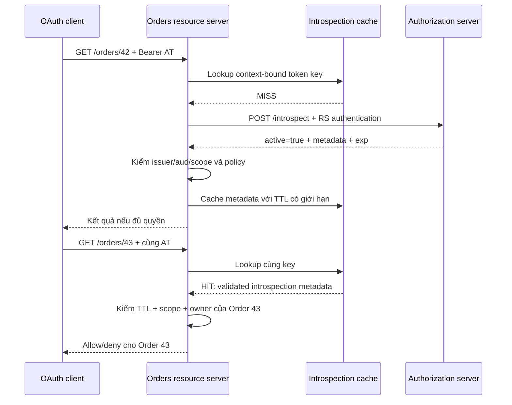
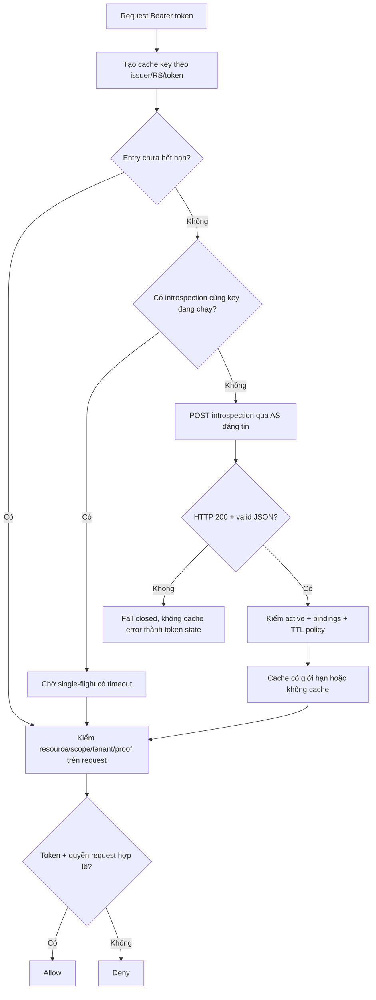
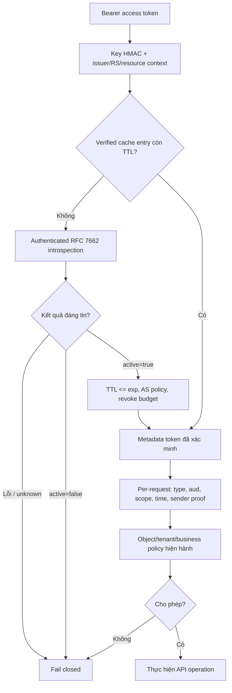

# Caching introspection result

Hãy xét một Orders API nhận hàng nghìn request mỗi giây. Mỗi request mang **opaque access token** và API gọi **OAuth 2.0 Token Introspection Endpoint** của authorization server (AS) để kiểm token còn hoạt động hay không. Nếu thực hiện một cuộc gọi mạng cho từng request, độ trễ tăng, AS chịu tải lớn và một sự cố AS có thể ảnh hưởng đồng loạt tới các API. Để giảm chi phí, nhóm phát triển cache kết quả introspection trong 30 phút.

Vấn đề: người dùng bị khóa tài khoản hoặc token bị thu hồi **ngay sau lần introspection đầu tiên**, nhưng Orders API vẫn đọc cache `active=true` suốt 30 phút. Mọi request mang bản sao token bị đánh cắp có thể tiếp tục được xử lý trong khoảng trễ đó. **Caching introspection result là quyết định về độ trễ thu hồi và mô hình tin cậy, không chỉ là tối ưu hiệu năng.**

Bài này thuộc chương **Introspection**, module **SECURITY_TOKEN_SECURITY_FUNDAMENTALS**. Phạm vi module bao gồm mô hình tin cậy và vòng đời JWT/opaque token, access/refresh token, OAuth 2.0/OIDC, claims, scopes, audience, lưu trữ, thu hồi và phòng chống token theft/replay. Trọng tâm cụ thể là **cách cache kết quả introspection an toàn tại resource server hoặc gateway**: cache cái gì, key/TTL ra sao, lúc nào phải kiểm lại, tác động của revocation, lỗi mạng và quyền thay đổi. Không có cấu hình cache duy nhất phù hợp mọi hệ thống.

Sau bài học, bạn có thể:

- Diễn giải response của **RFC 7662** và phân biệt `active=true` với **quyết định authorization cuối cùng**.
- Thiết kế cache key bảo vệ bí mật token, cách ly issuer, resource/audience và ngữ cảnh introspection.
- Chọn TTL từ **token `exp`, chính sách AS, mức rủi ro và revocation-latency budget**; không dùng cache vô hạn.
- Phân biệt caching kết quả dương tính, `active=false`, transport error và HTTP lỗi của introspection.
- Thiết kế **fail-closed**, bounded cache, single-flight, cache stampede control và invalidation.
- Tránh dùng kết quả introspection cũ để bỏ qua **scope, audience, tenant/object policy, DPoP/mTLS proof** trên từng request.
- Viết Java-style pseudocode, metrics, test cases và quy trình xử lý sự cố khi AS bị chậm, token bị lộ hoặc grant bị thu hồi.

## 1. Introspection là gì trong kiến trúc OAuth 2.0?

Theo **RFC 7662 — OAuth 2.0 Token Introspection**, một **protected resource** như Orders API có thể hỏi AS về trạng thái và metadata của một token. Endpoint được AS bảo vệ, RS gửi token cần kiểm qua một kênh đáng tin và nhận JSON response. Đối với opaque token, đây là cách phổ biến để RS xác định token có hiệu lực, thuộc ai, scopes và những điều kiện liên quan.

| Thành phần | Nhiệm vụ | Ví dụ |
| --- | --- | --- |
| OAuth client | Nhận access token và gọi resource API | Web BFF, mobile, worker |
| Authorization server (AS) | Phát token, lưu trạng thái grant/revocation, cung cấp introspection | `https://login.example.com` |
| Resource server (RS) | Xác thực token và quyết định quyền trên tài nguyên | `https://api.example.com/orders` |
| Cache của RS/gateway | Lưu **metadata đã được introspect** trong thời gian có giới hạn | In-memory cache hoặc shared cache bảo vệ |
| Business policy/entitlement | Quyết định chủ thể được thao tác trên order/tenant nào | Owner/tenant policy, trạng thái đơn |

**Phân biệt OAuth client authentication với RS authentication:** client đã đăng nhập hoặc giữ access token không đồng nghĩa có quyền gọi introspection endpoint. RS thường phải **tự xác thực với AS** qua credential/kênh được đăng ký. Client bên ngoài không nên được phép introspect tùy ý để liệt kê trạng thái token của người khác.

### 1.1. Giao dịch introspection bình thường

```http
POST /oauth2/introspect HTTP/1.1
Host: login.example.com
Authorization: Basic <resource-server-client-authentication>
Content-Type: application/x-www-form-urlencoded
Accept: application/json

token=<opaque-access-token>&token_type_hint=access_token
```

`token_type_hint` là **gợi ý tùy chọn**, không phải điều kiện đủ để AS tin đó là access token. AS phải tự kiểm loại token/độ hiệu lực. HTTP Basic ở đây chỉ là ví dụ một phương thức xác thực resource server; có thể dùng mTLS, private-key JWT hoặc giải pháp AS hỗ trợ. Không đưa token vào URL/query hay log request body.

Response minh họa:

```http
HTTP/1.1 200 OK
Content-Type: application/json

{
  "active": true,
  "iss": "https://login.example.com",
  "sub": "user-42",
  "client_id": "orders-web",
  "aud": "https://api.example.com/orders",
  "scope": "orders.read",
  "token_type": "Bearer",
  "iat": 1795000000,
  "nbf": 1795000000,
  "exp": 1795000600
}
```

Response này là **ví dụ có những trường tùy chọn**, không phải schema bắt buộc của mọi AS. Theo RFC 7662, `active` là trường phản hồi cốt lõi; `scope`, `client_id`, `sub`, `aud`, `iss`, `exp` và các trường khác xuất hiện khi AS có và cho phép tiết lộ theo policy. `exp` là **NumericDate theo giây**, không phải thời gian sống tính từ lúc cache.

### 1.2. `active=true` không tương đương “cho phép xem Order 42”

Ngay cả khi AS trả `active=true`, RS còn phải kiểm:

1. Response đến từ **AS tin cậy**, qua đúng kênh introspection đã cấu hình.
2. Token đúng **loại access token và profile** cho RS; không coi refresh token/ID token là access token.
3. **Audience/resource binding**: token dành cho Orders API, không phải Billing.
4. **Scope** có `orders.read` cho endpoint đang gọi.
5. **Time/state**: token chưa hết hạn, chưa trước `nbf` và còn hợp lệ theo policy.
6. **Quyền nghiệp vụ hiện hành**: user/tenant có được đọc Order 42 không?
7. **Sender constraint** nếu token là DPoP/mTLS-bound: proof/certificate của request này còn hợp lệ không?

**Cache introspection không phải cache câu trả lời “allow” cho mọi URL.** Response có thể giúp RS xác thực credential, nhưng **authorization decision** phải xét thêm request hiện hành.

## 2. Vì sao phải cache introspection result?

Một hệ thống không cache có thể cần **một round trip tới AS cho mỗi request API**. Khi request rate lớn, số kết nối, TLS overhead, queueing và độ trễ mạng trở thành nút thắt.



Lợi ích:

- Giảm tải lên AS/introspection endpoint.
- Giảm network latency ở các API requests lặp với cùng access token.
- Giảm áp lực tại AS khi một workload có burst traffic.
- Tăng khả năng vận hành khi AS tạm chậm, **trong thời hạn mà cache được phép coi là đủ mới**.

Đổi lại, cache khiến quyết định “token còn active” **không còn luôn mới**. Token có thể bị revoke sau khi cache entry được lưu; quyền hoặc tenant có thể thay đổi. Vì vậy lợi ích hiệu năng cần được lượng hóa cùng **revocation latency**.

### 2.1. Thời gian tiết kiệm không phải miễn phí

Ví dụ để hiểu quy mô, **không phải benchmark thực tế**:

- Orders API có 8.000 requests/giây.
- Introspection qua mạng trung bình 20 ms/request khi không có cache.
- 80% request sử dụng lại token đã được introspect gần đây.

Nếu cache hit 80%, số lần gọi AS có thể giảm mạnh, nhưng **không được chọn TTL dài chỉ vì muốn hit rate cao**. Đối với endpoint hoàn tiền hay cấp quyền quản trị, thời gian chấp nhận token vừa bị revoke quan trọng hơn 20 ms.

## 3. Introspection response có thể được cache không?

**RFC 7662 có thảo luận về caching introspection responses**: resource server có thể cache để cải thiện performance, nhưng phải cân bằng với **rủi ro thông tin trở nên lỗi thời**. Một token đã bị thu hồi có thể vẫn có response `active=true` trong cache cho đến lúc entry hết hạn/được invalidated.

Thiết kế cần xét đồng thời:

- **Hợp đồng/cache directives của AS**: AS có cho phép giữ kết quả không; có `Cache-Control: no-store` hoặc chính sách tương đương không?
- **`exp` của token** khi được cung cấp: không cache vượt thời điểm token hết hạn.
- **Mục tiêu độ trễ thu hồi** của endpoint, dữ liệu và tổ chức.
- **Khả năng invalidation** chủ động khi AS revoke/disable user/client/grant.
- **Sự mới của claims/permissions**: scope, audience, tenant entitlements có thể thay đổi sau khi issuance.
- **Độ tin cậy của cache**: bảo vệ khỏi sửa metadata, lộ PII và kết quả lẫn giữa issuers/tenants.

**Không có quy tắc RFC 7662 rằng mọi response bắt buộc cache 5 phút hoặc 1 giờ.** TTL phải do hệ thống quyết định theo threat model và ràng buộc của AS.

### 3.1. Quy tắc an toàn dễ nhớ

1. **Không cache nếu AS/policy cấm** hoặc không thể xác định được độ mới an toàn.
2. **Không cache quá `exp`** hoặc quá thời hạn cho phép bởi AS.
3. **Không cache vô hạn khi thiếu `exp`**; dùng TTL thấp do chính sách cho phép hoặc không cache.
4. **Không dùng entry `active=true` đã hết TTL** khi introspection endpoint bị lỗi, trừ một cơ chế có risk acceptance rất tường minh và không vượt giới hạn quyền được phép.
5. **Không cache quyết định business authorization** như “đọc mọi orders được phép” chỉ dựa vào trạng thái token.

## 4. Các trạng thái phải phân biệt trước khi cache

| Tình huống | HTTP/response | Ý nghĩa | Quy tắc cache đề xuất |
| --- | --- | --- | --- |
| Token active, response hợp lệ | HTTP 200 + `active: true` | AS xác nhận token active trong ngữ cảnh đã hỏi | Có thể cache **ngắn và có ràng buộc** |
| Token inactive | HTTP 200 + `active: false` | Không coi token active trong ngữ cảnh introspection | Có thể **không cache** hoặc cache âm tính rất ngắn |
| RS không xác thực được với AS | HTTP 401/403 | **Introspection caller** không hợp lệ/không có quyền | **Không** cache thành token inactive |
| AS rate limit | HTTP 429 | Dịch vụ đang hạn chế request | Không cache thành `active=false`; backoff/circuit breaker |
| AS lỗi | HTTP 5xx | Không biết trạng thái token | Không cache thành allow/deny giả |
| Timeout/DNS/TLS error | Không có response đáng tin | Không biết trạng thái token | **Không** tạo entry `active=false` |
| HTTP 200 nhưng JSON sai/missing `active` | Invalid introspection response | Không có bằng chứng token hợp lệ | Không cache; fail closed |
| Response đúng nhưng sai resource audience | HTTP 200 + active=true, `aud` khác | Token không dành cho RS này | Không allow; không chia sẻ cache làm token hợp lệ ở RS khác |

### 4.1. `active=false` khác lỗi hệ thống

AS có thể trả:

```http
HTTP/1.1 200 OK
Content-Type: application/json

{"active": false}
```

Đây là **kết quả introspection hợp lệ** cho token không active hoặc AS không cung cấp thông tin trong ngữ cảnh này. Theo RFC 7662, một response inactive thường chỉ cần `active=false`; không yêu cầu AS giải thích “token hết hạn hay bị thu hồi”, tránh lộ thông tin.

Ngược lại, timeout hay HTTP 503 **không phải** `active=false`. Nếu cache lỗi mạng thành “token không hợp lệ” trong nhiều phút, hệ thống có thể gây **đăng xuất hàng loạt hoặc denial of service do negative caching sai**.

### 4.2. Token vừa phát nhưng AS replication chưa đồng bộ

Một token mới phát có thể tạm trả `active=false` trên một AS replica do độ trễ nhất quán trong hệ thống cụ thể. Negative caching dài có thể khiến token hợp lệ tiếp tục bị từ chối sau khi replica cập nhật. Bởi vậy **không cache âm tính hoặc dùng TTL rất ngắn** nếu threat model cho phép; cùng lúc không giả định token sẽ sớm valid để cấp quyền trước khi AS xác nhận.

## 5. Caching positive và negative results

**Positive cache** lưu thông tin đáng tin đã xác minh cho `active=true`. Nó giúp hiệu năng nhưng mang **staleness/revocation risk**.

**Negative cache** lưu kết luận `active=false` để giảm brute force hoặc token probing gây tải AS. Nó có thể hữu ích nhưng gây **false-negative kéo dài** khi AS replication trễ hoặc token state thay đổi; lại có thể bị dùng để gây cache flooding bằng hàng triệu token giả.

| Loại entry | Lợi ích | Nguy cơ | Cách tiếp cận |
| --- | --- | --- | --- |
| Positive `active=true` | Giảm request với token hợp lệ dùng lặp | Revoked token vẫn dùng được trong TTL | Bound theo exp, AS policy, revocation budget |
| Negative `active=false` | Giảm lặp lại request token không hợp lệ | DoS/collision/cache flood, state có thể thay đổi | **Không cache** hoặc TTL rất ngắn, giới hạn bộ nhớ |
| Error/unknown | Không có lợi ích authorization đáng tin | Cache lỗi thành allow/deny | **Không lưu thành quyết định token** |

### 5.1. Cách cache negative không tạo kênh tấn công mới

Nếu quyết định dùng negative cache:

- Bảo đảm là **HTTP 200 + `active=false` thật từ AS tin cậy**.
- TTL ngắn hơn positive TTL nếu hợp lý và có policy cụ thể.
- Cache key vẫn bao gồm issuer/RS authorization context.
- Giới hạn size/eviction theo client/IP/rate control để attacker không lấp đầy cache.
- Không để negative entry của một ngữ cảnh được dùng trong ngữ cảnh khác, khi introspection policy phụ thuộc caller.
- Không biến lỗi AS/HTTP 401 của RS thành `active=false`.

**Negative cache không thay rate limiting tại API/AS** và không phải biện pháp phòng brute force duy nhất.

## 6. TTL: giới hạn bởi `exp` và revocation budget

Đây là quyết định bảo mật quan trọng nhất. Với response `active=true` có `exp`, thời gian còn lại của token:

```text
remaining_token_lifetime = exp_epoch_seconds - trusted_current_epoch_seconds
```

Một chính sách conservative:

```text
positive_cache_ttl =
    max(0, min(
        configured_max_cache_ttl,
        token_exp - now - clock_skew_margin,
        AS_permitted_cache_ttl,
        revocation_latency_budget
    ))
```

Công thức **minh họa policy**, không phải công thức bắt buộc trong RFC. Từng giới hạn phải tồn tại thực tế; nếu một điều kiện thiết yếu không xác định, chọn TTL ngắn an toàn hoặc **không cache**. `AS_permitted_cache_ttl` có thể đến từ cache headers/contract hoặc policy do tổ chức thiết lập, không tự bịa một số mặc định.

### 6.1. Các ví dụ TTL

| Bối cảnh | `exp` còn lại | Max TTL cấu hình | Revocation budget | TTL positive tối đa theo ví dụ |
| --- | --- | --- | --- | --- |
| API đọc dữ liệu phổ thông | 10 phút | 60 giây | 60 giây | ≤60 giây, trừ clock skew/AS policy |
| API hoàn tiền nhạy cảm | 10 phút | 30 giây | 5 giây | ≤5 giây; có thể cần introspection mỗi request |
| Token sắp hết hạn | 3 giây | 60 giây | 60 giây | ≤3 giây, thường trừ safety margin |
| Token đã hết hạn | 0 | 60 giây | 60 giây | **0: không cache positive/không allow** |
| Response không có `exp` | Không xác định | 60 giây | 10 giây | Chỉ cache nếu policy có TTL an toàn; mặc định thận trọng là **không cache** |

Các thời gian **chỉ là ví dụ quyết định kiến trúc**, không đại diện cấu hình bắt buộc của RFC 7662 hoặc lời khuyên tuyệt đối. Một yêu cầu thu hồi “ngay” không thể chỉ dựa vào cache TTL khác 0.

### 6.2. Đừng hiểu sai `exp`

`exp` thường là **Unix timestamp theo giây**, không phải “giây kể từ response”. Ví dụ `exp=1795000600` là timestamp, không phải cache 1.795 tỷ giây.

```text
SAI:
    ttl = exp

SAI:
    ttl = token.expires_in đã lấy từ authorization request cũ

ĐÚNG VỀ NGUYÊN TẮC:
    remaining = exp_epoch_seconds - now_epoch_seconds
    ttl = min(remaining - margin, cache_policy_limit, revocation_limit)
```

RS phải xử lý clock skew có giới hạn và dùng **monotonic timer/expiry deadline** để quản lý thời gian sống của entry sau khi tính TTL, tránh NTP/time jump làm kéo dài cache.

### 6.3. Cache TTL không phải access-token TTL

Access token có thể sống 15 phút nhưng introspection cache chỉ được phép sống 10 giây. Hết TTL **không làm token hết hạn**; nó chỉ buộc RS **hỏi lại AS**. Ngược lại, token hết `exp` phải bị từ chối dù cache entry còn tồn tại do bug.

### 6.4. Thực thi revocation SLA cần xem cả propagation delay

Nếu tổ chức muốn token bị thu hồi không còn dùng được sau **tối đa 10 giây**, thì TTL 10 giây **chưa chắc đủ** khi AS mất vài giây để cập nhật trạng thái across replicas. Cần tính:

```text
worst_case_revocation_delay
  ≈ AS_replication_or_event_delay
  + cache_staleness_window
  + request/in-flight_processing_allowance
```

Đây là **ước lượng mô hình**, không phải công thức thời gian chính xác cho mọi hệ thống. Đảm bảo SLA thực tế bằng failure tests và quan sát end-to-end; với tác vụ tài chính rất nhạy cảm, có thể cần **denylist/state check độc lập trên từng giao dịch**.

## 7. Cache key phải phản ánh ranh giới tin cậy

**Không dùng một token string làm key rồi tái sử dụng response trên mọi API/issuer** nếu introspection policy phụ thuộc caller. Cùng một token có thể được AS xử lý khác nhau tùy **resource server credentials, tenant, token family/profile hoặc context introspection**.

Một cache key nội bộ có thể gồm:

```text
CacheKey = (
    trusted_issuer_id,
    introspection_policy_version,
    authenticated_resource_server_identity,
    expected_resource_identifier,
    token_type_context,
    HMAC(cache_key_secret, raw_access_token)
)
```

Đây là **thiết kế đề xuất**, không phải một yêu cầu về key format từ RFC 7662. Nếu AS bảo đảm kết quả introspection hoàn toàn độc lập RS caller, một số chiều có thể tối ưu theo contract; ngược lại **không bỏ chiều bảo mật chỉ để tăng hit ratio**.

### 7.1. Vì sao không dùng raw token làm cache key?

- Debuggers/cache diagnostics có thể hiển thị danh sách keys.
- Shared cache snapshot/eviction logs/metrics có thể vô tình lộ bearer token.
- Token bị sao chép từ cache key có thể được trình trực tiếp tới API.

Nếu cần lookup theo token, dùng **HMAC với secret được quản lý** làm key/fingerprint nội bộ, kết hợp domain separation bằng issuer/RS context. Không dùng fingerprint để **in công khai trong log**; một hash cũng có thể trở thành tracking identifier.

### 7.2. HMAC key và rotation

Secret dùng cho cache key HMAC phải được bảo vệ khác với client secrets/tokens và có chính sách rotation. Khi xoay key, cache cũ có thể tự miss và được xóa dần; đừng cố chuyển dữ liệu bằng cách ghi raw token để “tính lại hash”.

### 7.3. Chống key collision và cache poisoning

Không rút token thành vài ký tự đầu/cuối hoặc dùng `client_id` làm cache key. Hai bearer tokens của cùng client có thể có **scope/audience/expiry/subject khác nhau**. Tránh băm không có namespace hoặc truncate digest quá ngắn dễ collision.

**Cache poisoning** xảy ra khi attacker điều khiển key hoặc metadata để một kết quả `active=true` của token A được dùng cho token B/context B. Cache phải nhận metadata **chỉ từ introspection response đã xác minh**, không lấy `active=true`/`scope` từ HTTP headers mà client bên ngoài tự khai.

## 8. Context binding: issuer, audience, scope và tenant

Ví dụ cùng hệ thống có:

| RS | Expected audience | Scope cần | Tenant policy |
| --- | --- | --- | --- |
| Orders | `https://api.example.com/orders` | `orders.read` | Order thuộc tenant được phép |
| Billing | `https://api.example.com/billing` | `billing.invoices.read` | Hóa đơn thuộc tenant được phép |
| Refunds | `https://api.example.com/refunds` | `refunds.create` | Quyền phê duyệt/hạn mức |

Một introspection response `active=true` từ Orders **không đủ để Billing cho phép**, ngay cả khi hai RS dùng chung AS và cùng access token string.

### 8.1. Audience có thể không có trong introspection response

RFC 7662 không yêu cầu mọi AS trả `aud`. Nếu metadata không có audience, RS phải có **hợp đồng đáng tin** bảo đảm token được ràng buộc đúng resource context. **`active=true` đơn lẻ không chứng minh token dành cho API này.**

Đừng sửa bằng cách lấy `aud` trong request do OAuth client tự khai rồi tin nó. Resource binding phải đến từ **AS/registration/token profile/policy đáng tin**.

### 8.2. Scope phải được kiểm trên từng endpoint

`active=true, scope=orders.read` có thể dùng để truy cập `GET /orders/42` nếu object policy cho phép, nhưng **không được** dùng cho `POST /orders/42/cancel` cần `orders.cancel`. Không lưu cache value thành `authorized=true` cho toàn bộ Orders API.

### 8.3. Tenant và object permission có thể đổi ngay

Token introspection cached cho `sub=user-42`, nhưng user bị loại khỏi tenant A giữa hai requests. Nếu RS chỉ dựa trên cached scopes thì sẽ cho truy cập quá quyền. Cần:

- Kiểm tenant/owner với policy hiện hành khi xử lý request.
- Nếu policy cũng được cache, phải có **lifecycle/TTL/invalidation riêng**, không gộp mù vào introspection TTL.
- Đối với tài nguyên nhạy cảm, xét policy tại thời điểm thao tác/transaction và audit.

**Authentication status và object-level authorization là hai lớp cache khác nhau.**

## 9. Cache cái gì: metadata tối thiểu, không phải mọi dữ liệu của AS

Một entry cache nên chứa **đủ metadata để RS ra quyết định xác thực token theo hợp đồng**, đồng thời hạn chế thu thập PII:

```text
CachedIntrospectionEntry {
    active: true,
    trusted_issuer: "https://login.example.com",
    token_profile: "oauth-access-token",
    audience_or_trusted_resource_binding: "https://api.example.com/orders",
    client_id: "orders-web",
    subject: "user-42",
    scopes: ["orders.read"],
    issued_at: ...,
    not_before: ...,
    token_expires_at: ...,
    validated_at: ...,
    cache_expires_at_monotonic: ...,
    policy_version: ...
}
```

Đây là **schema minh họa**. Không phải AS nào cũng cung cấp từng field, và **không được tự điền giá trị đáng tin nếu AS không xác nhận**. Cache có thể lưu structured data + validation metadata, không cần serialize toàn bộ JSON introspection response có claims không sử dụng.

### 9.1. Tránh cache quá nhiều PII

Nếu RS chỉ cần `sub`, `client_id`, `scope`, `aud` và thời hạn, không nên lưu `email`, địa chỉ, `name` hay những thông tin nhạy cảm khác chỉ vì response có. Cần retention policy, memory dumps, backup protection và access audit cho distributed cache.

### 9.2. Cache entry phải bất biến trong TTL

Một request không được tự sửa `scopes` trong shared cache; khi policy thay đổi cần **invalidate/revalidate** thay vì cho caller nâng quyền tại chỗ. Cân nhắc immutable records và tách kết quả introspection khỏi mutable authorization decision.

## 10. Cache placement: tại từng instance, gateway hay distributed cache?

| Vị trí | Lợi ích | Nhược điểm | Khi phù hợp |
| --- | --- | --- | --- |
| In-memory mỗi RS instance | Nhanh, không thêm hop, isolation tự nhiên | Nhiều cache copies, miss khi scale, revoke không đồng đều | API vừa/nhỏ, TTL rất ngắn |
| Gateway-level cache | Giảm introspection trước các services | Dễ nhầm context giữa APIs nếu key chung; gateway thành điểm tập trung | Gateway kiểm **token profile/audience** theo từng route |
| Distributed cache (Redis tương đương) | Shared hits, coordinated eviction | Cache chứa metadata nhạy cảm, network dependency, ACL, key rotation | Nhiều instances, có vận hành bảo mật trưởng thành |
| Hybrid local + distributed | Hit nhanh và chia sẻ | Hai tầng TTL/invalidation khó hơn, stale windows cộng dồn | Rất tải cao, có kiểm soát phức tạp |
| Không cache | Trạng thái token mới nhất theo thời điểm gọi AS | Tăng latency và AS dependency | Endpoint đặc biệt nhạy cảm hoặc yêu cầu revoke gần tức thì |

### 10.1. Hai tầng cache không được cộng TTL vô ý

Nếu distributed cache giữ 60 giây rồi local cache nhận response và **reset TTL về 60 giây**, token có thể được chấp nhận gần **120 giây** kể từ introspection thật. Cần **absolute/origin expiry deadline** được chuyển xuyên suốt:

```text
introspected_at = T0
absolute_cache_expiry = T0 + approved_TTL

Local cache nhận entry lúc T0 + 50s:
    local_remaining = absolute_cache_expiry - now
    KHÔNG reset TTL về approved_TTL
```

Khi serialized/distributed, lưu timestamp đã được chuẩn hóa cùng policy và clock-skew margin; dùng monotonic countdown tại local instance sau khi tính lại remaining lifetime. **Hạn sử dụng của entry không được tái tạo vô hạn mỗi hop.**

### 10.2. Gateway không thay business authorization

Gateway cache có thể đưa verified identity context đến backend qua kênh tin cậy. Backend vẫn kiểm object/tenant permissions. Không cho browser tự gửi `X-Verified-Subject` hoặc `X-Verified-Scope` được gateway tin. Nếu service có thể bị gọi trực tiếp bỏ qua gateway, nó cần tự verify credential/upstream identity hoặc có chặn mạng đáng tin.

## 11. Cache stampede, single-flight và bounded concurrency

Khi một access token phổ biến hết cache TTL, hàng nghìn requests có thể đồng thời miss và **dồn tải introspection AS** (cache stampede). Một mẫu giảm tải:

1. Lookup cache theo key đã được bound.
2. Nếu hit và **chưa hết hạn**, tiếp tục validation/request policy.
3. Nếu miss, **chỉ một worker** trong instance/group gọi AS cho key đó (**single-flight**).
4. Các request khác chờ kết quả trong timeout có giới hạn.
5. Khi response hợp lệ, lưu **một** entry với TTL đã tính; trả metadata giống nhau cho những request chờ.
6. Nếu AS lỗi, tất cả request được xử lý **fail closed** theo policy; không tạo một allow entry giả.



**Sơ đồ là mô hình luồng cơ bản**, các nhánh inactive/timeout phải được xử lý tường minh trong code. Shared single-flight không được để request của tenant/RS khác **đợi rồi dùng nhầm** response từ một introspection context khác.

### 11.1. Backpressure và AS rate limits

Ngoài single-flight, cần:

- Bounded thread pool, queue và concurrency semaphore.
- HTTP connection pool, request timeout, circuit breaker và bounded retry.
- Rate limit token-guessing/bot requests ở gateway, tránh attacker ép AS introspect token giả.
- Không retry đồng loạt khi AS 429/503; dùng backoff có giới hạn và jitter.
- Bảo vệ cache bằng max size, eviction policy và tenant/client quotas khi phù hợp.

### 11.2. Pre-warm/refresh-ahead có thể làm token sống lâu hơn?

Nếu mỗi lần “refresh cache” tự reset TTL mà không kiểm AS lại, token bị revoke có thể tiếp tục valid vô hạn. **Refresh-ahead phải gọi introspection thật**, nhận response mới và vẫn không được kéo dài qua token `exp`/policy.

Không để một background refresh chưa hoàn thành biến entry đã hết hạn thành “temporarily valid” trừ khi hệ thống có một cơ chế stale data được risk-accepted rất cụ thể.

## 12. AS outage: cache hit còn hạn và cache miss phải xử lý khác nhau

Khi AS không thể introspect:

| Tình huống | Có bằng chứng token active còn mới? | Quyết định an toàn |
| --- | --- | --- |
| Cache hit chưa hết TTL/policy | **Có**, trong cửa sổ stale được chấp nhận | Có thể xử lý tiếp, vẫn kiểm authorization per request |
| Cache miss | **Không** | Không allow; trả lỗi phù hợp, có thể 503/401 theo failure contract |
| Cache entry đã hết hạn | **Không còn** | Không sử dụng để allow |
| `active=false` còn trong negative cache được phép | Có bằng chứng token không active gần đây | Deny; không thử “allow vì AS down” |
| HTTP 401 introspection RS credentials sai | Không có token status đáng tin | Sửa RS authentication, không bỏ auth để fallback |

### 12.1. Fail closed nhưng phân biệt lỗi vận hành

**Fail closed** nghĩa là **không cấp quyền khi không đủ bằng chứng**, không nhất thiết trả 401 cho mọi sự cố. Nếu introspection endpoint down và RS không thể kiểm token, trả 503 có thể phản ánh đúng **unavailable dependency**, giúp client không tự xóa credentials như khi token thực sự bị từ chối.

API không được để `try/catch` biến mọi exception thành `active=true` hoặc bỏ qua authentication để giữ uptime.

### 12.2. Stale-while-revalidate có phù hợp không?

Trong HTTP caching nội dung tĩnh, stale-while-revalidate đôi khi hợp lý. Với **authentication status**, **dùng entry quá TTL để allow là quyết định an ninh** và có thể phá mục tiêu thu hồi. Mặc định **không cho phép**; nếu một hệ thống sẵn sàng chấp nhận cửa sổ stale bổ sung thì phải có:

- Scope/audience/endpoint cụ thể được phép.
- Giới hạn stale tuyệt đối có số đo, không vượt token `exp`.
- Approval/risk acceptance bằng văn bản.
- Metrics/alerts và thử nghiệm revocation outage.
- Không áp dụng cho thanh toán, thay đổi quyền, dữ liệu cực nhạy cảm hoặc endpoint yêu cầu revoke gấp.

**Không gọi một cơ chế dùng cache đã hết hạn là “fail closed”.**

## 13. Revocation và invalidation chủ động

RFC 7009 định nghĩa cách yêu cầu AS thu hồi token; nhưng **RS cache không tự nhận được event revoke** chỉ vì AS đã cập nhật trạng thái.

Các phương án:

1. **TTL ngắn:** đơn giản, đảm bảo thời gian tồn tại stale bị chặn bởi TTL, cộng propagation delays.
2. **Invalidation event từ AS:** pub/sub hoặc event bus được bảo vệ phát sự kiện token/grant revoked đến RS/cache.
3. **Version/epoch check:** AS hoặc hệ thống entitlement cung cấp phiên bản policy, cache key/value có version; version đổi gây miss.
4. **Denylist theo token ID/credential fingerprint:** RS kiểm state bổ sung cho token nhạy cảm.
5. **Không cache** cho endpoints mà thời gian chấp nhận token revoked phải gần bằng không.

### 13.1. Event-driven invalidation không phải bảo đảm tuyệt đối

Một event có thể bị:

- Trễ, mất, đến không đúng thứ tự.
- Chỉ tới một số RS instances.
- Xử lý sau khi request đã bắt đầu.
- Không tương ứng đủ cache keys vì token introspection response đã được share qua nhiều contexts.

Cần retry/delivery guarantees, idempotent handler, ordering/version semantics và **TTL fallback**. Không tuyên bố revoke “tức thì” nếu deployment thực tế không đo/đảm bảo được.

### 13.2. Tránh lưu raw bearer token trong revoke event

Event có thể mang **token identifier** hoặc HMAC fingerprint theo security contract, không cần broadcast bearer token plaintext cho mọi subscriber. Các cache instances cần cùng thuật toán/secret domain nếu muốn invalidation theo fingerprint; không nhầm digest với authorization credential.

### 13.3. Client secret rotation và token đã phát

Vô hiệu client secret có thể ngăn **phát token mới**, nhưng access token đã phát có thể tiếp tục `active=true` cho đến revoke/expiry theo policy. Cache ở RS càng làm kết quả còn tồn tại lâu hơn. Cần có plan **incident revocation + cache invalidation** khi credential bị lộ.

## 14. Cached introspection và JWT validation offline khác nhau ở đâu?

Đừng nhầm **cache introspection** với việc **cache JWKS** hoặc **cache JWT validation**.

| Cơ chế | RS làm gì? | Tính mới khi token bị revoke | Điều không được bỏ qua |
| --- | --- | --- | --- |
| Opaque token + introspection mỗi request | AS đánh giá `active` và metadata từng lần | Phụ thuộc cập nhật AS và network, có thể gần thời gian thực | Resource/scope/tenant policy |
| Opaque token + cached introspection | RS dùng metadata AS đã trả trước đó | **Trễ tới cache TTL/invalidation + AS propagation** | Kiểm expiry, audience, scope, quyền mỗi request |
| JWT access token offline | RS kiểm chữ ký/claims từ token | Có thể tiếp tục hợp lệ đến `exp` nếu không có state/denylist | JWT type/alg/issuer/audience/scope/tenant |
| JWT access token + introspection theo policy | RS vừa kiểm JWT vừa hỏi AS về state | Phụ thuộc caching và hợp đồng introspection | Đừng coi introspection thay chữ ký nếu profile yêu cầu |
| Cache JWKS | RS giữ **public signing keys** | Không nói token revoked hay không | JWT validity/time, key rotation, token type/audience |

Một cache JWKS sống 1 giờ **không có nghĩa** introspection cache cũng được sống 1 giờ. JWKS cache chỉ tiết kiệm việc tải khóa ký, không chứa `active` hay scopes của từng access token.

### 14.1. Mục tiêu revocation thay đổi lựa chọn kiến trúc

Nếu sản phẩm yêu cầu chặn token bị thu hồi trong vài giây, kiến trúc dựa **hoàn toàn trên JWT offline** hoặc **introspection cache TTL nhiều phút** có thể không đáp ứng. Có thể cần AS introspection mỗi request, denylist/event invalidation đáng tin hoặc credential/sender-binding/transaction authorization bổ sung.

Ngược lại, API chỉ đọc dữ liệu ít nhạy cảm với access token TTL cực ngắn có thể chấp nhận **một cache window ngắn** để giảm tải. Quyết định này phải được **security owner và team vận hành** phê duyệt dựa trên rủi ro, không chỉ dựa latency benchmark.

## 15. Proof-bound tokens: cache `active`, kiểm proof mỗi request

**DPoP-bound** (RFC 9449) và **mTLS certificate-bound** (RFC 8705) access tokens có thể được sử dụng để giảm replay bản sao bearer token.

Giả sử introspection response chứa metadata xác nhận token được ràng buộc với khóa/certificate, thường qua claim `cnf` theo profile. Cache có thể lưu **metadata đã xác minh** của token và `cnf` trong thời hạn hợp lệ; nhưng **không được cache kết quả “DPoP proof đã hợp lệ”** rồi áp dụng cho mọi request tiếp theo.

### 15.1. DPoP proof phải được xét trên từng HTTP request

Với DPoP, RS theo profile phải kiểm:

- `DPoP` proof JWT được ký bởi đúng khóa.
- Khóa trong proof khớp **`cnf.jkt`** của access token.
- `htm` là đúng HTTP method, `htu` là URI đích đã chuẩn hóa theo profile.
- `iat`/nonce/jti theo cửa sổ thời gian và chính sách chống replay.
- `ath` ràng buộc proof với **access token được gửi**.

**Không thể lưu cached `active=true` rồi bỏ toàn bộ proof checks.** Cùng access token có thể được dùng qua nhiều requests hợp lệ nhưng **mỗi request phải có proof thích hợp**. DPoP `jti` của proof cần replay control riêng theo chính sách; nó không phải `jti` của access token và không thay cache token state.

### 15.2. mTLS-bound token

RS hoặc trusted TLS terminator phải kiểm certificate binding của **kết nối/request hiện tại** so với `cnf.x5t#S256` hoặc metadata tương đương theo profile. Cached introspection metadata không chứng minh caller hôm nay còn dùng đúng certificate.

### 15.3. Cache key với sender binding

Cache key nên gắn context token/RS/issuer; cached value lưu sender constraint. **Không chỉ hash access token rồi đánh dấu “authenticated=true” cho mọi người mang token đó**. Việc chứng minh sở hữu sender key/certificate luôn là một điều kiện tại request.

## 16. HTTP caching headers và application cache không được đánh đồng

Một introspection endpoint có thể dùng các headers:

```http
HTTP/1.1 200 OK
Content-Type: application/json
Cache-Control: no-store

{"active": true, "scope": "orders.read", "exp": 1795000600}
```

`Cache-Control: no-store` thể hiện phản hồi **không được lưu trữ bởi HTTP caches theo ngữ nghĩa caching**. Nếu AS trả chỉ thị này hoặc hợp đồng của AS cấm retention, **không nên xây một application-level cache để lách chính sách**. Cần xác nhận khả năng caching với AS/security owner. RFC 7662 nói về khả năng resource server caching nhưng không có nghĩa phải bỏ qua HTTP cache directives và yêu cầu bảo mật của nhà cung cấp.

### 16.1. `max-age` chưa đủ cho token cache

Giả sử AS cho `Cache-Control: max-age=60`. RS vẫn phải chặn entry nếu:

- Token `exp` còn 5 giây.
- Chính sách revocation yêu cầu 2 giây.
- Metadata không khớp resource hoặc token type.
- User/tenant policy hiện tại từ chối.

TTL thực tế phải lấy **min** của tất cả giới hạn ràng buộc, không chỉ copy `max-age` vào cache.

### 16.2. Không cho CDN/shared proxy lưu raw introspection data

Endpoint chứa token và metadata nhạy cảm; không nên xuất nó qua edge CDN public cache hoặc proxy dùng chung không có authorization context. Với shared internal cache, cần authentication, TLS, ACL và mã hóa/retention thích hợp.

### 16.3. `Vary` không thay cache key bảo mật

Một HTTP proxy có thể áp `Vary` cho một số headers, nhưng application cache của RS phải tự đưa **introspection caller identity, issuer, audience, token fingerprint** vào key khi chúng ảnh hưởng tới response. Không dựa vào tên URL `/introspect` và `Vary` chung để tự bảo đảm data isolation.

## 17. Java-style pseudocode: dịch vụ introspection có cache bảo mật

Trong Java, nên dùng OAuth 2.0 Resource Server/Introspection SDK đáng tin, bổ sung caching qua interface đúng framework. Đoạn sau là **pseudocode Java-style** để làm rõ security requirements; các lớp như `TrustedIntrospectionClient`, `ExpiringCache` hoặc `BusinessPolicy` là **giả định**, không phải Java SE API.

```java
final class CachingAccessTokenIntrospector {
    private final TrustedIntrospectionClient asClient;
    private final ProtectedHmacKey cacheKeySecret;
    private final ExpiringCache<CacheKey, CachedEntry> cache;
    private final SingleFlight<CacheKey, IntrospectionResult> inFlight;
    private final Clock clock;
    private final SecurityPolicy policy;

    VerifiedTokenContext verifyForResource(
            String rawToken,
            TrustedIssuer issuer,
            ResourceContext resource
    ) {
        requireNonBlankBoundedToken(rawToken);
        CacheKey key = CacheKey.of(
            issuer.identifier(),
            resource.authenticatedIntrospectionClientId(),
            resource.expectedAudience(),
            policy.version(),
            cacheKeySecret.hmac(rawToken)
        );

        // Cache layer phải trả MISS khi entry hết hạn.
        CachedEntry cached = cache.getIfUnexpired(key);
        IntrospectionResult result;

        if (cached != null) {
            result = cached.verifiedResult();
        } else {
            result = inFlight.oneCallPerKey(key, () -> {
                // AS client tự xác thực, TLS và timeout.
                IntrospectionResult fresh =
                    asClient.introspect(rawToken, issuer, resource);
                requireTrustedSchemaAndActiveBoolean(fresh);

                // Chỉ cache theo AS directive/policy đã xác nhận.
                Duration ttl = policy.computeAllowedTtl(
                    fresh, clock.instant(), resource
                );
                if (!ttl.isZeroOrNegative()) {
                    cache.putWithBoundedTtl(
                        key,
                        CachedEntry.of(fresh, policy.version()),
                        ttl
                    );
                }
                return fresh;
            });
        }

        if (!result.isActive()) {
            throw new InvalidAccessToken();
        }

        // Các bước này KHÔNG được bỏ chỉ vì cache hit.
        requireAccessTokenType(result, resource);
        requireIssuerAndAudience(result, issuer, resource);
        requireNotExpiredOrPremature(result, clock.instant());
        return VerifiedTokenContext.fromTrustedResult(result);
    }
}
```

Trong application/request handler:

```java
HttpResponse getOrder(HttpRequest request, String orderId) {
    VerifiedTokenContext token = cachingIntrospector.verifyForResource(
        request.requireBearerToken(),
        configuredIssuer,
        ordersResourceContext
    );

    // Scope phải kiểm mỗi request (không cache "allow GET" theo token).
    if (!token.scopes().contains("orders.read")) {
        return forbiddenInsufficientScope("orders.read");
    }

    // Sender constraint của request hiện tại phải được kiểm.
    proofVerifier.verifyIfBound(
        token.senderBinding(),
        request
    );

    Order order = orders.find(orderId);
    if (order == null) return notFound();

    // Quyền dữ liệu hiện tại không đồng nhất với cached active=true.
    if (!businessPolicy.canRead(
            token.subject(), token.clientId(), order)) {
        return forbiddenOrNotFoundPerPolicy();
    }
    return ok(businessPolicy.allowedOrderFields(order, token));
}
```

**Điểm cố ý của mã giả:** cache chỉ trả một **verified introspection result có hạn dùng**. Nó **không trả “request authorized”**. Mọi request vẫn kiểm scope, object policy và proof/certificate nếu có.

### 17.1. Triển khai timeout/error handling

Hàm `asClient.introspect(...)` thực tế phải phân biệt:

- **HTTP 200 hợp lệ**: parse `active` boolean; chỉ cache theo policy.
- **HTTP 401/403**: lỗi RS introspection authentication/permission, không xem token inactive.
- **HTTP 429/5xx/transport timeout**: không có token status đáng tin; fail closed, bounded retries.
- **JSON lỗi hoặc response thiếu `active`**: fail closed, không tạo positive entry.

Đừng dùng `catch (Exception e) { return activeTrue; }`. Nếu lỗi infrastructure, resource server có thể trả **503** thay vì nói token chắc chắn invalid, giúp incident response phân loại đúng.

### 17.2. Scope/routing không được tin từ raw request

`resource.expectedAudience()` phải lấy từ **cấu hình route/RS đáng tin**, không phải header `X-Audience` do client bên ngoài đưa vào. `issuer` cũng phải được xác định từ cấu hình trust; không lấy URL bất kỳ trong token để tự chọn AS introspection endpoint.

### 17.3. Single-flight scope

Single-flight phải theo **toàn bộ cache key**, không chỉ bearer token fingerprint nếu cùng token có thể được introspect trong nhiều security contexts. Một call đang chạy có thể timeout/hủy; bảo đảm xóa in-flight entry trong mọi đường kết thúc để không làm những requests sau **kẹt chờ mãi**.

### 17.4. Đồng hồ và expiry

Khi tính TTL từ `exp`, dùng wall-clock được đồng bộ và **safety margin**. Khi đã chọn TTL, cache implementation nên đo thời hạn entry bằng monotonic time hoặc deadline ổn định; không dựa hoàn toàn vào đồng hồ có thể nhảy lùi.

## 18. Ví dụ policy pseudo-configuration cho hai APIs

Một tổ chức có thể đặt cache policy khác nhau theo resource/risk:

```yaml
# PSEUDOCONFIG minh họa, không phải cú pháp SDK/framework cụ thể.
introspection_cache_policies:
  orders_read_api:
    trusted_issuer: https://login.example.com
    expected_audience: https://api.example.com/orders
    token_type: oauth_access_token
    positive_max_ttl_seconds: 15
    negative_max_ttl_seconds: 1
    require_exp_for_positive_cache: true
    reject_stale_on_as_error: true
    max_entries_per_instance: 10000
    enforce_object_authorization_per_request: true
  refunds_api:
    trusted_issuer: https://login.example.com
    expected_audience: https://api.example.com/refunds
    token_type: oauth_access_token
    positive_max_ttl_seconds: 0
    negative_max_ttl_seconds: 0
    reject_stale_on_as_error: true
    enforce_object_authorization_per_request: true
    require_transaction_risk_checks: true
```

**Các con số chỉ để minh họa việc phân loại rủi ro**, không phải khuyến nghị TTL chung. AS policy và `exp` có thể rút ngắn TTL hơn nữa; `positive_max_ttl_seconds=0` có nghĩa **không lưu positive result**, không có nghĩa token bị từ chối nếu introspection trả active hợp lệ.

### 18.1. Không cấu hình cache bằng “tất cả token = 300s”

Một cấu hình duy nhất cho Orders, Refunds, Admin và UserInfo thường bỏ qua độ nhạy dữ liệu và yêu cầu revocation khác nhau. Nên có **policy owner** và test cho từng lớp endpoint/resource.

### 18.2. Khi dùng framework có built-in caching

Không mặc định một framework đã cache introspection hoặc đã xử lý revocation SLA. Kiểm contract của OAuth2 resource-server library:

- Introspection HTTP client nào được gọi?
- Kết quả được cache ở tầng nào, TTL tính ra sao?
- HTTP cache headers của AS được xử lý không?
- Scope/audience/type của token có được validate trong cache hits?
- Thay key/token để mô phỏng revoke, có fail closed khi AS outage không?

**Tích hợp framework là vị trí chèn kiểm soát**, không phải bằng chứng rằng chính sách đã được thực thi đúng.

## 19. Cache security: secret, PII, isolation và quyền truy cập

Introspection cache chứa dữ liệu có thể hữu ích cho attacker:

- Validity state của access token.
- Subject/client/tenant identifiers.
- Scopes và resource identifiers.
- Claims định danh có thể nhạy cảm.
- Metadata phục vụ inference về phiên đăng nhập hoặc hành vi.

### 19.1. Threats trong distributed cache

| Mối đe dọa | Hậu quả | Kiểm soát |
| --- | --- | --- |
| Cache dump/log chứa raw tokens | Bearer token theft | HMAC key; không lưu raw token trong key/value |
| Cache value bị sửa thành `active=true` | Authentication bypass | ACL, encrypted transport, trusted writers, integrity controls |
| Entry của RS A bị dùng ở RS B | Audience/caller confusion | Key namespace theo RS/issuer/resource |
| Cache backup quá lâu | PII và token-metadata retention | TTL/retention, encryption, xóa backup theo policy |
| Cache network exposed | Credential enumeration, cache manipulation | Private network + auth/TLS/ACL |
| Redis/shared store bị lỗi | Stale/inconsistent results | Fail closed, retry bounded, health/incident plan |
| Admin/debug tool liệt kê keys | Token correlation, session tracking | Restricted diagnostics, redaction |
| Cache không giới hạn | Memory exhaustion/DoS | Max size, eviction, quotas, rate limiting |

### 19.2. Điều kiện để cache entry có thể dùng lại

Không chỉ `key found`. RS phải xác nhận:

- Entry được tạo bởi **trusted introspection path**.
- Entry **chưa hết TTL và token `exp`**.
- Cùng **issuer, RS identity, resource audience, token context**.
- Cùng **policy/cache schema version** hoặc tương thích an toàn.
- Value có đầy đủ metadata cần thiết cho token type, issuer, audience, scope checks.

Nếu thiếu một trường cần thiết theo contract, **fail closed/reintrospect**, không giả định allow.

## 20. Monitoring: tối ưu hit rate nhưng không tối ưu sai mục tiêu

Nên đo performance và security chung một dashboard:

| Metric | Ý nghĩa | Cảnh báo |
| --- | --- | --- |
| `introspection_requests_total` | Tổng số lần RS gọi AS | Tăng đột biến/bot traffic |
| `introspection_cache_hit_ratio` | Tỷ lệ hit; phân theo RS/policy | Hit tăng vì TTL bị kéo dài sai |
| `introspection_cache_ttl_seconds` | Phân bố TTL thực được chọn | Entry sống vượt policy/`exp` |
| `introspection_active_false_total` | Số response inactive | Token probing, revoke patterns |
| `introspection_http_error_total` | 401/403/429/5xx từ AS | RS auth lỗi, AS outage |
| `introspection_timeout_total` | Timeout network | Dependency degradation |
| `single_flight_waiters` | Requests chờ chung introspection | Stampede, thắt cổ chai |
| `cache_eviction_total` | Entries bị đẩy khỏi cache | Cache size quá nhỏ/flooding |
| `stale_entry_rejected_total` | Đã từ chối sử dụng entry hết hạn | Bảo đảm fail closed |
| `revocation_propagation_seconds` | Độ trễ từ revoke đến API deny | Vi phạm revocation SLA |
| `authz_denials_by_reason` | Sai audience/scope/object vs inactive | Không trộn mọi deny thành “invalid token” |

**Không đưa raw token hoặc toàn bộ introspection JSON vào metric labels**: tạo cardinality không kiểm soát, lộ credential và PII. Dùng issuer/route/policy/error category đã cho phép và correlation ID an toàn.

### 20.1. Phân biệt cache hit với authorization allow

Một cache hit có thể dẫn tới **403** nếu thiếu scope hoặc quyền trên dữ liệu. Metrics nên tách:

```text
cache outcome: HIT | MISS | EXPIRED | EVICTED
introspection outcome: ACTIVE | INACTIVE | ERROR
resource decision: ALLOW | DENY_SCOPE | DENY_OBJECT | DENY_AUDIENCE
```

Nếu dashboard chỉ đếm `cache_hit = success`, nhóm vận hành có thể không phát hiện API đã cache nhầm **allow decision**.

### 20.2. Test đo revocation latency end-to-end

Một probe có kiểm soát:

1. AS phát token test ngắn hạn cho tài nguyên test.
2. RS introspect và tạo positive cache entry.
3. AS revoke token tại thời điểm T.
4. Gửi các requests test theo tần suất hợp lý.
5. Đo thời điểm RS bắt đầu **từ chối** token.
6. So với SLA, TTL, AS propagation và event invalidation dự kiến.

Không dùng tokens của user thật hoặc làm dồn tải hệ thống production không được phép. Với dữ liệu nhạy cảm, dùng môi trường staging và bài test không thể phát hành quyền thật.

## 21. Case study A — Orders API chấp nhận token đã revoke vì TTL dài

**Bối cảnh:** Orders API cache `active=true` trong 15 phút. User đăng xuất và access token bị revoke tại AS ở phút thứ nhất. Một attacker đã sao chép bearer token trước đó.

**Vấn đề:** Orders API vẫn lấy cached result, scope `orders.read` không thay đổi; token có thể được chấp nhận đến khi TTL hết, dù AS đã trả `active=false` nếu được hỏi lại.

**Khắc phục:**

1. Chọn TTL theo revocation budget và `exp`; ví dụ policy giới hạn 10 giây thay vì 15 phút nếu cần.
2. Đánh giá AS event invalidation hoặc denylist cho incident quan trọng.
3. RS vẫn kiểm owner/tenant policy hiện hành, không dựa vào cached allow.
4. Đặt alert cho revocation propagation vượt yêu cầu.
5. Không hứa “logout thu hồi ngay” nếu RS cache còn chấp nhận token.

**Bài học:** Cache `active=true` tạo **cửa sổ quyền truy cập** kể cả sau revoke. Cần công khai/kiểm thử giới hạn cửa sổ đó.

## 22. Case study B — Introspection AS bị 503, API chuyển sang fail-open

**Bối cảnh:** AS bị quá tải. Resource server không có cache hit nhưng trả HTTP 200 cho tất cả requests vì lập trình viên viết:

```java
try {
    return introspect(token);
} catch (Exception ignored) {
    return TokenMetadata.activeWithAllScopes(); // SAI, fail open
}
```

Hậu quả: một bearer token ngẫu nhiên hoặc đã revoke có thể gọi API khi AS outage; kẻ tấn công có thể gây AS outage rồi khai thác.

**Thiết kế đúng:**

- Phân biệt active=false với timeout/503.
- Cache hit còn hạn có thể được sử dụng **chỉ trong TTL policy đã duyệt**.
- Cache miss/expired entry khi AS lỗi ⇒ **không allow**, có thể trả 503 và retry bounded.
- Giảm AS load bằng single-flight, rate limits, backoff, circuit breaker.
- Test outage có kiểm soát trước production.

**Bài học:** Availability optimization **không được đảo ngược quyết định authentication**.

## 23. Case study C — Gateway dùng cache chung cho Orders và Billing

**Bối cảnh:** API gateway lưu cache key là `SHA256(access_token)`, value là `active=true`. Gateway dùng cùng value cho mọi service. Một token được cấp cho Orders có scope `orders.read`, nhưng Billing cũng thấy cache hit và không kiểm `aud`.

**Vấn đề:** **Token substitution và cross-resource authorization bug**, đặc biệt khi scopes tên ngắn như `read` được dùng chung ở nhiều APIs.

**Thiết kế đúng:**

1. Key namespace theo trusted issuer và authenticated RS/resource context.
2. Value chứa `aud`/resource binding và `scope` đã xác minh theo policy.
3. Mỗi route bắt buộc **audience và scope của chính nó**.
4. Backend áp tenant/object policy.
5. Negative test dùng Orders token gọi Billing phải bị từ chối, kể cả khi cache vừa hit ở Orders.

**Bài học:** Cache hit không chứng minh token có thể sử dụng **ở mọi nơi**.

## 24. Case study D — Two-level cache vô tình kéo dài TTL gấp đôi

**Bối cảnh:** Distributed cache lưu result 60 giây kể từ T0. Local cache của instance B đọc entry tại T0+55 giây rồi tự lưu nó thêm **60 giây** nữa, không giữ origin expiry.

**Vấn đề:** Instance B có thể dùng kết quả đã cũ tới T0+115 giây. Event revoke có thể tới Redis nhưng local vẫn giữ entry.

**Thiết kế đúng:**

- Lưu `introspected_at` và **origin_absolute_cache_expiry** cùng metadata đáng tin.
- Local cache TTL chỉ bằng **phần thời gian còn lại**, không reset.
- Có cơ chế invalidation tới **mọi tầng cache**, hoặc local TTL ngắn hơn và chủ động polling.
- Thử nghiệm thời điểm sát expiry với simulated clocks.

**Bài học:** TTL của nhiều tầng không được **tái sinh theo thời điểm fetch từ cache khác**.

## 25. Case study E — DPoP-bound token có cached `active=true`

**Bối cảnh:** RS introspect DPoP-bound access token và cache `active=true`. Developer thấy token active, bỏ kiểm proof với những requests kế tiếp để tăng performance.

**Vấn đề:** Attacker đánh cắp token nhưng không sở hữu private key có thể thử trình token nếu RS không buộc DPoP proof/cnf binding trên từng request.

**Thiết kế đúng:**

- Cache metadata introspection, bao gồm `cnf` đã xác minh theo profile.
- Kiểm **DPoP proof trên mỗi HTTP request**: key binding, method/URI, access-token hash, thời gian và replay policy.
- Không cache “proof valid” để miễn chứng minh cho các requests sau.
- Test missing proof, wrong `ath`, key mismatch, replay `jti` đều bị từ chối.

**Bài học:** Cache token state **không được triệt tiêu sender-constrained authentication**.

## 26. Case study F — Quyền tenant đổi trong lúc token cache còn hạn

**Bối cảnh:** User 42 từng được đọc Orders của tenant A. RS cache introspection response `active=true, scope=orders.read` 30 giây. Ở giây thứ 5, admin gỡ quyền của user khỏi tenant A.

**Vấn đề:** API dùng cached `active=true` như `allowReadAnyOrder` nên tiếp tục trả orders tenant A. Đây là lỗi **broken object-level authorization**, dù cache token về mặt kỹ thuật vẫn còn hạn.

**Thiết kế đúng:**

- Cache introspection chỉ thể hiện token status/metadata.
- RS kiểm policy/entitlements hiện tại cho **Order 42** và tenant A trước khi trả dữ liệu.
- Nếu entitlement được cache ở tầng riêng, cần TTL/invalidation đáp ứng yêu cầu cập nhật quyền.
- Test thay đổi tenant giữa hai API requests phải cho kết quả đúng theo authorization policy.

**Bài học:** Scope `orders.read` là điều kiện cấp phép ở mức hành động; **quyền trên dữ liệu cụ thể có thể thay đổi nhanh hơn token/cache lifetime**.

## 27. Anti-patterns: lỗi cache introspection điển hình

| Anti-pattern | Rủi ro | Cách sửa |
| --- | --- | --- |
| Cache `active=true` 24 giờ bất kể `exp` | Token hết hạn/revoked vẫn được dùng | Bound TTL bởi exp + revocation policy |
| Cache active chỉ theo `client_id` | Trộn tokens của các subjects/scopes khác nhau | Key theo token HMAC + context |
| Dùng raw token làm Redis key/log label | Lộ bearer credential | HMAC fingerprint nội bộ, không log raw token |
| Hash token không namespace theo issuer/RS | Cache cross-issuer/resource confusion | Namespace và context binding |
| `active=true` đồng nghĩa allow mọi endpoint | Scope/tenant bypass | Mỗi request kiểm audience/scope/object |
| Cache HTTP 503 thành `active=false` | DoS/negative cache poisoning | Phân biệt transport error với inactive |
| Cache HTTP 503 thành `active=true` | Fail-open authentication | Fail closed |
| Cache `active=false` nhiều giờ | Token mới phát bị từ chối lâu nếu replication trễ | Không cache hoặc negative TTL rất ngắn |
| Cache không giới hạn entries | Cache flooding/memory exhaustion | Quotas, eviction, rate limit |
| Bỏ `exp` khi cached hit | Expired token accepted | Check exp trên mọi request |
| Recompute TTL ở mỗi access/cache hop | Token có thể sống vô hạn trong cache | Origin expiry, monotonic countdown |
| Sử dụng một cached response cho tất cả RS | Sai audience/authorization context | Per-RS key, audience validation |
| Bỏ qua `Cache-Control: no-store` từ AS | Vi phạm cache contract | Honor no-store/AS policy |
| Cho browser trực tiếp introspect token tùy ý | Token status enumeration và metadata leakage | Authenticated RS-to-AS introspection |
| Cache raw full introspection JSON nhiều PII | Privacy/backup leakage | Cache tối thiểu fields, TTL/ACL |
| Gateway tin `X-Scopes` do client gửi | Spoofed authorizations | Verify token, strip forged identity headers |
| Cache DPoP proof valid cho mọi request | Replay/binding bypass | Proof check per request |
| Chấp nhận JWT/ID token vì introspection `active=true` | Token type confusion | RS enforce access token profile |
| Revoke AS là đủ, không nghĩ đến cache | Revocation latency không kiểm soát | TTL/invalidation tests và SLA |
| AS outage dùng stale cache vô thời hạn | Token bị thu hồi vẫn được allow | No stale allow by default |
| Lưu token trong metrics/tracing | Credential theft | Redact, domain-separated internal IDs |

## 28. Ma trận 48 tình huống kiểm thử

| # | Tình huống | Kết quả mong đợi |
| --- | --- | --- |
| 1 | Opaque access token active, đúng RS/scope | Introspect thành công, token được xét theo policy |
| 2 | Request thứ hai cùng token/context khi cache còn hạn | Cache hit, vẫn kiểm quyền từng request |
| 3 | Cache hit với token đã qua `exp` | Không allow; entry expired/evict |
| 4 | `exp` còn 2 giây, max TTL 60 giây | TTL cache ≤2 giây trừ margin |
| 5 | `exp` thiếu, policy yêu cầu exp để cache | Không cache positive result |
| 6 | Token active nhưng `aud` của Billing được gửi Orders | Orders từ chối |
| 7 | Token active không có resource binding đáng tin | RS không tự allow |
| 8 | Token `scope=orders.read` gọi cancel endpoint | RS từ chối insufficient scope |
| 9 | Scope tên `orders.read.all` | Không nhầm là `orders.read` qua substring |
| 10 | Token scope đúng nhưng order thuộc tenant khác | Object authorization từ chối |
| 11 | Tenant entitlement bị gỡ trong TTL introspection | RS xét policy hiện hành, không cho truy cập trái quyền |
| 12 | HTTP 200 introspection `active=false` | RS từ chối |
| 13 | `active=false` được cache theo policy ngắn hạn | Entry hết hạn đúng lúc, không kéo dài tùy tiện |
| 14 | `active=false` ở replica chậm rồi token thành active | Negative cache không chặn quá budget |
| 15 | HTTP 200 JSON thiếu `active` | Fail closed, không cache |
| 16 | JSON `active="true"` kiểu string | Không chấp nhận như boolean true |
| 17 | HTTP 401 từ introspection: RS credentials sai | Không đổi thành token inactive/active, alert config |
| 18 | HTTP 403 AS từ chối RS introspection | Không cache/allow, sửa RS policy |
| 19 | HTTP 429 AS rate limit | Backoff, không lưu thành token state |
| 20 | HTTP 503 AS outage | Fail closed ở cache miss/expired |
| 21 | TLS certificate verification tới AS thất bại | Không tin response/không cache |
| 22 | AS introspection response từ issuer khác | Từ chối theo trust config |
| 23 | Cache key chỉ theo client ID (được cố tình thử) | Test phát hiện collision/cross-subject |
| 24 | Hai RS dùng một bearer token nhưng audience khác | Không dùng cache cross-RS để allow |
| 25 | Token string trùng ở hai issuer namespaces | Cache isolation theo issuer |
| 26 | Cache key chứa raw token trong log | Security test báo rò credential |
| 27 | HMAC cache-key secret được rotate | Cache miss/invalidation an toàn, không lộ raw token |
| 28 | Cache entry bị sửa thành active=true | Cache integrity/ACL từ chối/threat detection |
| 29 | Shared cache bị mất kết nối | Không fail-open; xử lý retry/AS fallback theo policy |
| 30 | Redis entry sống 60 giây, local fetch ở giây 55 | Local chỉ sống phần TTL còn lại |
| 31 | System clock bị chỉnh lùi | Không kéo dài entry quá TTL dự kiến |
| 32 | Policy version thay đổi | Entry cũ miss/invalidate theo policy |
| 33 | Người dùng revoke access token sau cache hit | RS deny trong revocation latency budget |
| 34 | Revoke event mất trên một instance | TTL fallback vẫn giới hạn stale window |
| 35 | Revoke event đến lặp/lệch thứ tự | Handler idempotent, không phục hồi entry cũ |
| 36 | AS phát JWT AT, RS chỉ cache JWKS | Vẫn thực thi token lifetime/revocation policy riêng |
| 37 | RS nhận OIDC ID token thay access token | Từ chối sai token type, dù AS có thể biết nó active |
| 38 | RS nhận refresh token làm Bearer | Từ chối sai token type/profile |
| 39 | Token DPoP-bound nhưng request thiếu proof | Từ chối dù cached active=true |
| 40 | DPoP proof có `ath` hoặc `htu` sai | Từ chối |
| 41 | DPoP proof bị replay (`jti` đã dùng) | Từ chối theo replay policy |
| 42 | mTLS-bound token dùng certificate khác | Từ chối, không tái dùng cached binding |
| 43 | 500 requests đồng thời cùng token ở cache miss | Single-flight/AS concurrency bounded |
| 44 | Một triệu token giả không trùng | Rate limit/quotas/eviction chống cache flood |
| 45 | Background refresh thất bại và entry hết hạn | Không allow stale mặc định |
| 46 | Introspection response có `Cache-Control: no-store` | Không cache theo hợp đồng |
| 47 | API đổi scope policy sau khi cache response | Scope/object checks theo policy hiện hành |
| 48 | Cache metrics chứa raw token hoặc PII | Test telemetry redaction phát hiện/chặn |

**Nên kiểm thử theo tầng:**

- **Unit tests:** TTL min, NumericDate/clock skew, cache key HMAC, negative-cache TTL, parser `active`.
- **Integration tests:** RS/AS introspection auth, issuer/audience/scope, HTTP errors, cache headers.
- **Concurrency tests:** single-flight, cancellation, cache stampede, concurrent revoke/invalidation.
- **Failure injection:** network timeout, AS 429/503, cache outage, clock drift, lost events.
- **Security tests:** cross-issuer/resource cache pollution, token replay, wrong token type, DPoP/mTLS binding, BOLA.

Không chạy token guessing, DoS hoặc revoke probes trên hệ thống thứ ba hoặc production không được phép.

## 29. Checklist trước khi bật introspection caching production

1. **RS và AS nào được tin?** Issuer/introspection endpoint đến từ cấu hình đáng tin; HTTPS và RS authentication đúng?
2. **Introspection response hợp lệ?** Kiểm HTTP 200, schema, `active` boolean, claims và token profile?
3. **AS có cho cache?** Đã xem `Cache-Control` và policy/contract của AS?
4. **Positive TTL có bound `exp`?** Không vượt token expiry và có clock-skew margin?
5. **Có revocation latency target?** TTL/invalidation đáp ứng target đo được, không chỉ giá trị trên giấy?
6. **Missing `exp` xử lý thế nào?** Không cache vô hạn; TTL thấp theo policy hoặc cache disabled?
7. **Negative caching có giới hạn?** `active=false` và HTTP error không trộn lẫn; size/rate control?
8. **Cache key đúng ngữ cảnh?** HMAC token + issuer + RS auth identity + resource + policy version khi cần?
9. **Cache có lộ token không?** Raw token không nằm trong keys, logs, tracing, backups?
10. **Cached metadata tối thiểu?** Không giữ PII không cần; ACL/TLS/encryption/retention rõ?
11. **Audience/resource validation luôn bật?** `active=true` không được đủ để allow API khác?
12. **Scope và object policy per request?** Tenant/owner/business checks không bị cache token result thay thế?
13. **DPoP/mTLS proof được kiểm mỗi request?** Cached `cnf` không thay proof/cert binding?
14. **Hai tầng cache giữ origin expiry?** Không reset TTL khi local fetch từ distributed cache?
15. **Single-flight và backpressure?** Introspection không bị stampede, token guessing không làm cạn AS?
16. **AS outage có fail closed?** Cache miss/expired không được allow; phản hồi lỗi phù hợp?
17. **Invalidation có tin cậy?** Revoke events/versions/denylist đã được kiểm thử; TTL fallback còn hiệu lực?
18. **Metrics an toàn?** Hit/miss/errors, stale rejection, revocation propagation, không có raw bearer token?
19. **Tests âm tính đã chạy?** Inactive/timeout/wrong audience/tenant/proof/revocation/clock/skew?
20. **Chủ sở hữu policy rõ?** Team security, AS owners và API owners thống nhất TTL/risk acceptance?

## 30. Câu hỏi thường gặp

**Q1. RFC 7662 có bắt buộc resource server cache kết quả introspection không?**  
Không. Caching là một **lựa chọn tối ưu**. Nếu latency/rủi ro không cho phép, RS có thể introspect mỗi request hoặc dùng một kiến trúc token/policy khác.

**Q2. Cache `active=true` trong 5 phút có an toàn không?**  
Không thể khẳng định nếu thiếu `exp`, AS cache policy, revocation budget và độ nhạy API. Nếu token bị revoke ngay sau cache hit, RS có thể tiếp tục chấp nhận nó trong phần lớn TTL. **Mốc 5 phút không phải mặc định bảo mật**.

**Q3. Token sống 1 giờ, tại sao không cache 1 giờ?**  
`exp` là **giới hạn trên** về token validity, không phải khuyến nghị cache TTL. Quyền có thể bị thu hồi **trước `exp`**, do đó positive cache thường cần ngắn hơn nhiều.

**Q4. Có cần cache `active=false` không?**  
Không bắt buộc. Nếu cần giảm token probing, có thể cache âm tính rất ngắn và giới hạn size/rate. **Không biến HTTP 401/503/timeout của AS thành `active=false`**.

**Q5. `active=true` có đủ cho API chưa?**  
Chưa. RS cần đúng **token type, issuer, audience/resource binding, scope, thời gian và owner/tenant/object policy**, cùng sender proof nếu có.

**Q6. Khi AS outage, dùng cache entry đã hết hạn có phải fail closed không?**  
Không. Đó là **stale allow** và có thể chấp nhận token đã revoke. Mặc định không dùng entry quá TTL để cấp quyền; nếu có ngoại lệ phải risk-accept giới hạn cụ thể.

**Q7. Một Redis cache có giúp mọi microservice dùng chung introspection result không?**  
Chỉ khi key và metadata **cách ly đúng issuer/RS/audience/authorization context**. Không cho Billing dùng kết quả Orders chỉ vì bearer token trùng chuỗi.

**Q8. Thay introspection bằng việc decode JWT được không?**  
Chỉ khi AS thực sự phát **signed JWT access token** với profile/issuer/audience hợp lệ và RS có verifier đúng. Opaque token không thể tự giải mã; kiểm JWT offline cũng có đặc tính revocation khác introspection.

**Q9. Nếu token DPoP-bound đã active, có cần kiểm DPoP proof nữa không?**  
Có. Introspection cache cung cấp metadata, còn **DPoP proof/certificate binding thuộc request hiện tại**.

**Q10. Cache một kết quả `allow` của endpoint có hiệu quả hơn không?**  
Có thể nhanh hơn nhưng dễ **sai quyền khi order/tenant/role thay đổi**. Nếu cache authorization decisions theo policy engine, đó là một bài toán khác, đòi hỏi key/TTL/invalidation theo user, resource, action và policy version — không được lấy introspection cache thay thế.

## 31. Kết luận: caching introspection là giới hạn rủi ro có chủ đích



**Caching introspection result** cho phép resource server giảm số lần hỏi AS, nhưng **mỗi giây cache `active=true` là một cửa sổ có thể tiếp tục chấp nhận token đã revoke**. Cache đúng phải **giới hạn TTL theo `exp`, chính sách AS và mục tiêu revocation**, cách ly bằng key/context đáng tin, phân biệt `active=false` với lỗi hạ tầng và **fail closed** khi không còn bằng chứng token active hợp lệ.

Ngay cả với cache hit, resource server vẫn kiểm **access token type, issuer, audience, scopes, thời hạn, sender-binding proof và quyền nghiệp vụ theo request**. Invalidation events, distributed caches, JWT offline và token format đều có trade-offs riêng. Thiết kế thành công không phải hệ thống đạt hit ratio cao nhất, mà là **hệ thống đáp ứng hiệu năng trong một revocation-latency budget đã được chấp nhận, đo lường và kiểm thử**.

## Tài liệu tham khảo

- [RFC 7662 — OAuth 2.0 Token Introspection](https://www.rfc-editor.org/rfc/rfc7662): introspection endpoint/response, `active`, protected resource authorization, `exp`, privacy và caching considerations.
- [RFC 6749 — The OAuth 2.0 Authorization Framework](https://www.rfc-editor.org/rfc/rfc6749): roles, access/refresh tokens, token endpoints, scope và client authorization.
- [RFC 6750 — OAuth 2.0 Bearer Token Usage](https://www.rfc-editor.org/rfc/rfc6750): truyền bearer access token và `invalid_token`/`insufficient_scope` responses.
- [RFC 7009 — OAuth 2.0 Token Revocation](https://www.rfc-editor.org/rfc/rfc7009): token/grant revocation và yêu cầu vận hành.
- [RFC 9700 — Best Current Practice for OAuth 2.0 Security](https://www.rfc-editor.org/rfc/rfc9700): audience restriction, bearer token theft, refresh token protection và OAuth security controls.
- [RFC 8707 — Resource Indicators for OAuth 2.0](https://www.rfc-editor.org/rfc/rfc8707): audience/resource binding.
- [RFC 7519 — JSON Web Token (JWT)](https://www.rfc-editor.org/rfc/rfc7519): `exp`, `nbf`, `iat`, `aud` và NumericDate semantics.
- [RFC 9068 — JWT Profile for OAuth 2.0 Access Tokens](https://www.rfc-editor.org/rfc/rfc9068): access token JWT validation/profile, audience và scope.
- [RFC 8725 — JSON Web Token Best Current Practices](https://www.rfc-editor.org/rfc/rfc8725): token type separation, algorithm/issuer/audience validation và cross-JWT confusion.
- [RFC 9449 — OAuth 2.0 Demonstrating Proof of Possession (DPoP)](https://www.rfc-editor.org/rfc/rfc9449): token-bound proof, `ath`, method/URI, `jti` replay prevention.
- [RFC 8705 — OAuth 2.0 Mutual-TLS Client Authentication and Certificate-Bound Access Tokens](https://www.rfc-editor.org/rfc/rfc8705): mTLS token sender-binding/certificate verification.
- [RFC 8414 — OAuth 2.0 Authorization Server Metadata](https://www.rfc-editor.org/rfc/rfc8414): issuer/introspection endpoint metadata và trusted discovery.
- [RFC 9111 — HTTP Caching](https://www.rfc-editor.org/rfc/rfc9111): HTTP cache directives, `no-store` và `max-age`.
- [OWASP API Security Top 10 — Broken Object Level Authorization](https://owasp.org/API-Security/editions/2023/en/0xa1-broken-object-level-authorization/): owner/tenant/object authorization.
- [OWASP OAuth 2.0 Cheat Sheet](https://cheatsheetseries.owasp.org/cheatsheets/OAuth2_Cheat_Sheet.html): bảo vệ OAuth tokens, client/server trust boundaries.
- [OWASP REST Security Cheat Sheet](https://cheatsheetseries.owasp.org/cheatsheets/REST_Security_Cheat_Sheet.html): API credential handling, TLS, authentication/authorization và lỗi HTTP.

