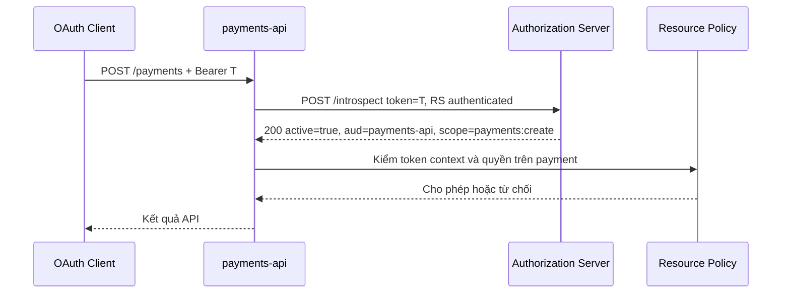
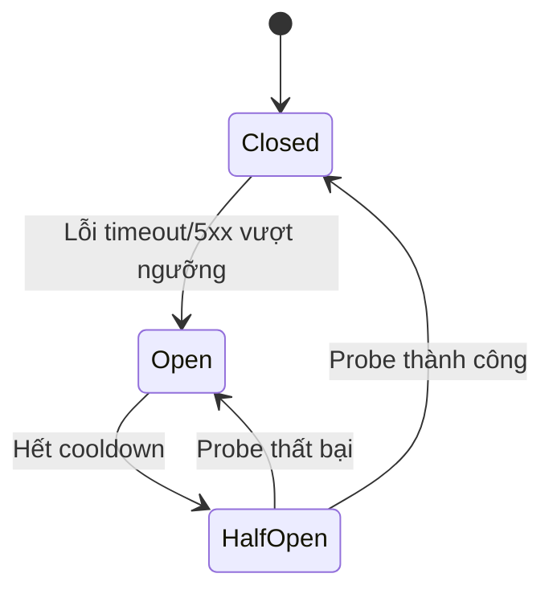
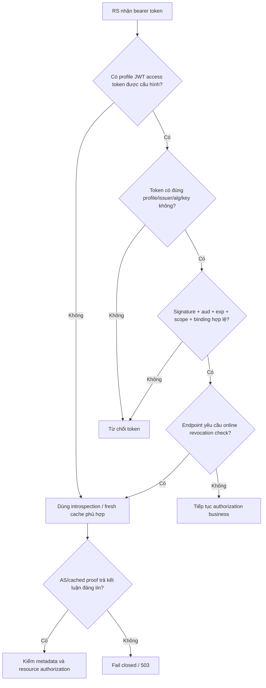
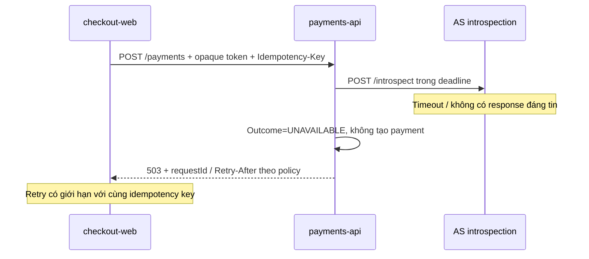

# Timeout và fallback trong OAuth 2.0 Token Introspection

Một API thanh toán nhận `Authorization: Bearer <access-token>` từ client. API dùng **OAuth 2.0 Token Introspection (RFC 7662)** để hỏi authorization server (AS) liệu access token còn hiệu lực hay không, được cấp cho audience nào và có scope gì. Bình thường, câu trả lời đến nhanh. Nhưng nếu đường mạng tới AS chậm, TLS handshake bị treo hoặc introspection service quá tải, resource server (RS) phải quyết định thế nào khi người dùng đang chờ tạo đơn thanh toán?

Hai cách xử lý tưởng tiện lợi nhưng nguy hiểm:

- «AS timeout thì cho qua cho đỡ gián đoạn»: token đã hết hạn hoặc bị thu hồi có thể tiếp tục được dùng.
- «AS timeout tức là token sai»: RS đánh đồng **không kiểm chứng được** với **đã biết là không hợp lệ**, khiến client lặp refresh/login không cần thiết và che giấu sự cố hạ tầng.

**Timeout và fallback** là bài toán giới hạn thời gian dành cho introspection và chọn hành vi khi không nhận được kết luận đáng tin. Fallback không có nghĩa bỏ kiểm tra; nó phải là **phương thức xác minh thay thế đã được thiết kế, giới hạn và chấp thuận** hoặc **giảm chức năng an toàn**.

Bài học thuộc chương **Introspection** của module **SECURITY_TOKEN_SECURITY_FUNDAMENTALS**. Các kiến thức liên quan gồm trust boundary AS–RS–client, JWT/opaque token, access token và refresh token, OAuth 2.0/OIDC, issuer, audience, scope, phát hành, kiểm tra, lưu trữ, thu hồi và phòng chống token bị đánh cắp/phát lại.

> **Nguyên tắc:** khi introspection **không trả kết quả đáng tin**, RS chưa biết token active hay inactive. Mặc định với endpoint cần authorization là **fail closed** — không thực thi hành động cần quyền đó. Chỉ fallback khi có bằng chứng thay thế **đáp ứng đầy đủ policy**, không bao giờ biến timeout thành `active=true`.

## 1. Ôn lại: Token Introspection có nhiệm vụ gì?

Theo **RFC 7662**, một bên được AS cho phép có thể hỏi introspection endpoint về trạng thái hiện tại và metadata của token. Trong mô hình phổ biến:

1. OAuth client nhận access token sau một grant hợp lệ.
2. Client trình access token tới RS.
3. RS xác thực với introspection endpoint qua HTTPS, gửi token cần kiểm.
4. AS trả JSON có `active` bắt buộc cùng metadata tùy chọn.
5. RS kiểm tiếp audience, scope, token type, sender binding và authorization tài nguyên.



### 1.1. Ví dụ request

```http
POST /oauth2/introspect HTTP/1.1
Host: auth.example.test
Authorization: Basic <authenticated-resource-server-credential>
Content-Type: application/x-www-form-urlencoded

token=<opaque-access-token>&token_type_hint=access_token
```

Đây là request minh họa. Trong request thật, `token` phải được form-encode; `token_type_hint` là gợi ý tùy chọn, không chứng minh token thuộc kiểu đó. Credential xác thực RS–AS cũng phải theo phương thức đăng ký, ví dụ client secret, `private_key_jwt` hoặc mTLS tùy AS. Không gửi raw token qua URL/query hoặc log.

Response token active:

```http
HTTP/1.1 200 OK
Content-Type: application/json
Cache-Control: no-store
Pragma: no-cache

{
  "active": true,
  "iss": "https://auth.example.test",
  "sub": "user-123",
  "client_id": "checkout-web",
  "aud": "payments-api",
  "scope": "payments:create",
  "token_type": "Bearer",
  "exp": 1893456600,
  "iat": 1893456000
}
```

Response token không active:

```http
HTTP/1.1 200 OK
Content-Type: application/json
Cache-Control: no-store
Pragma: no-cache

{"active":false}
```

**Cả hai có thể mang HTTP 200.** Không được viết `if (httpStatus == 200) allow()`. Trường `active` trong response đáng tin quyết định trạng thái token theo AS; RS vẫn phải kiểm **đủ thuộc tính được policy yêu cầu**.

### 1.2. `active=true` khác «được phép»

Một token active vẫn có thể bị RS từ chối vì:

| Kiểm tra | Câu hỏi | Ví dụ lỗi |
| --- | --- | --- |
| `iss` | AS nào phát token? | Issuer lạ |
| `aud` | Token dành cho RS nào? | `aud=orders-api` đem tới `payments-api` |
| `scope` | Có quyền cho thao tác này không? | Thiếu `payments:create` |
| `exp`/`nbf` | Token đúng thời gian hiệu lực? | Đã hết hạn |
| Token type/profile | Đây có phải access token được RS chấp nhận? | Dùng OIDC ID token hoặc refresh token thay bearer API |
| Sender binding | Người gửi sở hữu khóa/cert gắn token? | DPoP proof hoặc mTLS certificate sai |
| Resource authorization | Subject/tenant có quyền trên object? | Đơn hàng thuộc người khác |

Các trường ngoài `active` có thể **không được AS trả** theo RFC 7662. Nếu policy bắt buộc audience mà response không có `aud`, RS phải có **ràng buộc tương đương được AS bảo đảm cho đúng RS identity** hoặc **fail closed**, không suy token dùng được ở mọi API.

## 2. Ba kết quả cần phân biệt, không chỉ một boolean

```text
IntrospectionOutcome =
    ACTIVE(verifiedMetadata)
  | INACTIVE
  | UNAVAILABLE(reason)
```

| Outcome | Bằng chứng | Quyết định bảo mật |
| --- | --- | --- |
| **ACTIVE** | AS trả `active=true` qua kênh đáng tin, metadata được kiểm đủ | Có thể tiếp tục scope/authorization, chưa tự động allow |
| **INACTIVE** | AS trả `active=false` đáng tin | Không chấp nhận token |
| **UNAVAILABLE** | Timeout, AS lỗi, kết nối/TLS/JSON bất thường, RS thiếu quyền introspect | Không có kết luận; fail closed hoặc fallback theo policy đã thiết kế |

Không biến `UNAVAILABLE` thành `INACTIVE` trong cache, cũng không coi `ACTIVE` là kết quả của một HTTP connection thành công nếu JSON sai cấu trúc.

### 2.1. Tại sao `active=false` không nói rõ nguyên nhân?

Theo RFC 7662, AS có thể trả `active=false` cho token không tồn tại, đã hết hạn, đã bị thu hồi, không thuộc quyền được hỏi của bên introspect hoặc theo chính sách không tiết lộ. RS không cần và có thể không được biết chính xác lý do.

**Không trả thông tin «token của user X đã bị thu hồi lúc Y»** chỉ dựa vào response `active=false`; tránh tạo oracle tiết lộ trạng thái token. Audit nội bộ có thể có dữ liệu sâu hơn theo quyền truy cập.

### 2.2. Timeout không chứng minh token revoked

```text
10:00  Người dùng rút quyền thanh toán
10:01  payments-api gọi introspection với Token T
10:01  AS không phản hồi

Không thể kết luận chắc:
    T còn active
    hoặc T đã inactive

Chỉ biết:
    Không có đủ bằng chứng xác minh tại thời điểm quyết định
```

Hành động chuẩn cho một thao tác thanh toán là **không tạo payment**. Một kết quả từ cache còn fresh theo security policy có thể là bằng chứng đã kiểm trước đó, nhưng phải hiểu cửa sổ stale sau revocation.

## 3. Timeout có nhiều tầng

```text
HTTP client
  |
  +-- Chờ connection pool
  +-- DNS lookup
  +-- TCP connect
  +-- TLS handshake
  +-- Write request
  +-- Chờ response headers
  +-- Đọc response body/parse JSON
  |
  +-- Per-attempt deadline
  +-- Overall introspection budget
  +-- Caller/API request deadline
```

| Loại timeout | Điều đang chờ | Nếu không giới hạn |
| --- | --- | --- |
| Pool acquisition | Connection HTTP có sẵn | Request/worker bị kẹt trong hàng đợi |
| DNS | Tìm địa chỉ endpoint AS | Lookup chậm, lỗi hoặc mất route |
| Connect | Kết nối TCP | Gặp AS node chết gây treo |
| TLS handshake | Thỏa thuận TLS và xác minh peer | Kẹt trước khi request được gửi |
| Write | Gửi form body/token | I/O bị tắc |
| Read | AS xử lý và gửi response | Database grant chậm, response không về |
| Per-attempt | Một HTTP call | Thư viện tự kéo dài quá SLO |
| **Overall budget** | Tất cả lần thử và backoff | Retry vượt deadline API |

**Trust failure không phải timeout bình thường.** TLS certificate sai, hostname mismatch hoặc endpoint bị redirect sang host lạ phải được coi là **sự cố an toàn kênh**, không chữa bằng cách tắt TLS validation hoặc fallback sang HTTP.

### 3.1. Chọn thời hạn theo API SLO

Ví dụ minh họa cho một API có response deadline **500 ms**:

```text
Total API deadline:             500 ms
Introspection overall budget:   250 ms
  Pool wait:                     20 ms
  Connect / TLS:                 80 ms
  Response / parse:             150 ms
Business + response reserve:    250 ms
```

Đây **không phải con số quy định bởi RFC**. Tùy thực tế mạng, p95/p99 introspection, kết nối TLS reuse và số lượng AS replicas, cấu hình khác nhau. Nhưng **connect timeout 2 giây** sẽ không giúp đạt API SLO 500 ms.

### 3.2. Per-attempt timeout khác overall deadline

Giả sử có budget 250 ms; attempt đầu mất 220 ms. Một retry khác mất 150 ms sẽ vượt budget. Quy tắc:

```text
remainingBudget = min(
    requestDeadline - now,
    configuredIntrospectionBudget - elapsed
)

if remainingBudget <= minimumUsefulAttemptBudget:
    return UNAVAILABLE
```

Chỉ retry khi **còn thời gian** và lỗi có khả năng tạm thời. Không đặt `maxRetries=3` nhưng cho mỗi retry bắt đầu lại 250 ms, khiến một lần xác minh kéo dài 1 giây.

### 3.3. Hủy I/O khi request hết hạn

Khi client hủy hoặc deadline đã qua:

- Không bắt đầu introspection/retry mới.
- Cancel HTTP call còn chạy; giải phóng connection và concurrency slot.
- Response đến muộn không được làm request đã kết thúc tự được chấp thuận.
- Không tạo background queue âm thầm để «cập nhật authorization sau».
- Ghi metric timeout theo tầng, **không log bearer token**.

Chỉ gọi `Future.get(timeout)` mà không hủy tác vụ HTTP bên dưới có thể tiếp tục giữ socket/thread sau khi API đã trả `503`.

## 4. Fail closed và HTTP response phù hợp

**Fail closed** nghĩa là **không thực hiện hành động cần quyền khi chưa có đủ bằng chứng**. Nó **không có nghĩa luôn trả `401 invalid_token`** cho mọi sự cố AS.

| Tình huống | Mã response API điển hình | Giải thích |
| --- | --- | --- |
| Thiếu bearer token bắt buộc | `401 Unauthorized` với Bearer challenge | Không có credential |
| Introspection trả `active=false` | `401`, `invalid_token` khi phù hợp RFC 6750 | Token không được tiếp nhận |
| Token active nhưng sai audience/type | `401`/`invalid_token` khi phù hợp | Token không hợp lệ tại RS này |
| Token active đúng RS nhưng thiếu scope | `403`/`insufficient_scope` | Token hợp lệ nhưng không đủ quyền |
| Token active, scope đủ nhưng sai owner/tenant | `403` hoặc `404` theo policy | Authorization nghiệp vụ từ chối |
| **AS timeout/5xx, không có bằng chứng fresh** | **`503 Service Unavailable`** hoặc dependency error thích hợp | Không thể xác minh hiện tại; không được thực thi |
| RS credential để gọi AS bị sai | `503`/internal dependency error đối với API caller | Cần alert vận hành; không kết luận token user sai |

Một response minh họa:

```http
HTTP/1.1 503 Service Unavailable
Content-Type: application/problem+json
Cache-Control: no-store
Retry-After: 3

{
  "type": "https://api.example.test/problems/auth-dependency-unavailable",
  "title": "Authorization verification temporarily unavailable",
  "status": 503,
  "requestId": "req-a91f"
}
```

`Retry-After: 3` chỉ là ví dụ theo chính sách. Không tiết lộ nội bộ AS, raw token, grant/consent của user hoặc secret trong body.

### 4.1. Vì sao không trả `invalid_token` khi chưa biết?

Client có thể diễn giải 401/`invalid_token` là phải refresh, đăng nhập lại hoặc xóa session. Nếu AS đang chết, lượng refresh/login phát sinh có thể làm lỗi nặng hơn. **503** nói đúng là dependency đang gián đoạn; client nên backoff thay vì tự suy token bị thu hồi.

### 4.2. Bảo đảm không có side effect

Nếu endpoint là `POST /payments`, authentication và authorization phải được đánh giá **trước khi tạo payment**. Nếu request nhận 503, không được tồn tại một payment mới do code chạy trước filter authorization. Hệ thống cũng cần **idempotency key** và trạng thái giao dịch cho client retry an toàn khi mạng lỗi.

### 4.3. Ví dụ fail-open nguy hiểm

```java
// SAI: timeout khiến mọi bearer token đều được nhận.
try {
    return introspection.isActive(token);
} catch (Exception ex) {
    return true;
}
```

Một token hết hạn, giả mạo, sai audience hoặc đã revoke sẽ được sử dụng chỉ vì AS không trả lời. **Đây là bypass authorization**, không phải resilience.

## 5. Từ HTTP/transport tới outcome

| AS/transport trả về | Ý nghĩa | Retry? |
| --- | --- | --- |
| HTTPS 200, JSON `{"active":true,...}` | Response introspection hợp lệ, cần kiểm metadata | Không |
| HTTPS 200, JSON `{"active":false}` | Token inactive/không tiết lộ trạng thái | **Không** |
| HTTPS 200, JSON không có `active` | Response malformed hoặc vi phạm contract | Không coi active |
| HTTPS 200, `"active":"true"` | Sai kiểu boolean chuẩn | Không ép truthy |
| HTTP `401`/`403` từ introspection endpoint | RS client authentication/authorization có vấn đề | Không retry cùng credential vô hạn |
| HTTP `400`/`invalid_request` | Body/method/contract sai | Sửa cấu hình, không retry nguyên xi |
| HTTP `429`/`Retry-After` | AS rate limit | Có thể retry rất hạn chế khi còn budget |
| HTTP `500`/`502`/`503`/`504` | Lỗi AS/gateway tạm thời | Có thể retry ngắn, có circuit |
| DNS/TCP/connect/read timeout | Không có conclusion đáng tin | Bounded retry hoặc unavailable |
| TLS cert/hostname invalid | Đích không được tin | Không hạ cấp HTTP/tắt TLS |
| JSON quá lớn hoặc sai cấu trúc | Không parse hợp đồng | Fail closed, cảnh báo |
| Caller/API deadline hết | Request kết thúc | Cancel HTTP, không retry |

**Không đồng nhất HTTP 401 ở introspection endpoint với HTTP 401 của RS gửi OAuth client.** Một trường hợp là RS không xác thực được với AS; trường hợp kia có thể là access token của client không hợp lệ tại RS.

## 6. Fallback: phân loại theo nguồn bằng chứng

| Phương án | Mức có thể dùng | Ràng buộc bắt buộc |
| --- | --- | --- |
| **Fail closed, không fallback** | Mặc định cho endpoint bảo vệ, nhất là rủi ro cao | Không thực thi, trả lỗi dependency |
| **Cache introspection vẫn fresh** | Khi policy chấp nhận độ trễ revoke trong TTL | Từng entry verified, đúng issuer/RS/token, TTL không vượt `exp` |
| **Introspection node dự phòng** | Khi cùng AS/trust domain và trạng thái grant đồng bộ phù hợp | HTTPS/auth, endpoint pin, replication/revoke freshness |
| **JWT local verification** | Chỉ khi RS đã được thiết kế tin **JWT access token profile** từ đầu | Kiểm crypto/`iss`/`aud`/`typ`/`exp`/scope/binding, hiểu revocation gap |
| **Degrade chức năng không cần quyền** | Khi có phần dữ liệu public độc lập | Không trả dữ liệu private, không side effect |
| **Stale-grace có giới hạn** | Ngoại lệ đã risk-approve cho chức năng ít nhạy cảm | TTL tuyệt đối rất ngắn, cấm high-risk, không vượt `exp`, audit |
| **Allow-all/accept token string** | **Không chấp nhận** | Bypass authentication |

### 6.1. Thứ tự quyết định có thể triển khai

```text
Endpoint có thật sự public? -> Có thể phục vụ public độc lập
Nếu cần token:
    Có cache entry fresh từ lần kiểm đáng tin?
        -> kiểm tiếp audience/scope/binding/business policy
    Có local JWT access-token validator được thiết kế theo profile?
        -> verify đầy đủ, chỉ dùng nếu revocation policy cho phép
    Token cần introspection?
        -> gọi AS trong deadline, circuit + concurrency limit
    AS trả active=true?
        -> verify metadata, rồi kiểm business authorization
    AS trả active=false?
        -> từ chối token
    AS unavailable?
        -> fail closed / 503 / degrade public
        -> stale-grace chỉ nếu có policy exception minh bạch
```

**Không phải mọi RS đều có bước JWT offline**, đặc biệt khi chỉ dùng opaque token hoặc endpoint yêu cầu revocation gần thời gian thực. Không được «fallback decode JWT» chỉ vì token chứa dấu chấm.

### 6.2. Khi nào stale-grace có thể được cân nhắc?

Ví dụ tổ chức chấp nhận một khoảng quyền có thể đã revoke với endpoint đọc dữ liệu ít nhạy cảm, nhưng chỉ khi:

1. Trước đó đã có response `active=true` **được xác thực và đầy đủ metadata**.
2. Token vẫn **chưa quá `exp`**, đúng issuer, audience, scope và sender constraint.
3. Cửa sổ grace được **đo và chặn tuyệt đối**, không tăng tiếp mỗi lần outage.
4. Quyết định đã có **risk owner/phê duyệt**, metric, audit, emergency disable và danh sách endpoint cho phép.
5. Không bao gồm payment, admin, thay đổi quyền, export nhạy cảm hoặc hành động business có tác động cao.

**Mặc định không dùng stale-grace.** Một positive cache **đã hết TTL** không còn bằng chứng đủ mới theo policy; chỉ có yêu cầu availability không biến nó thành «fresh». Ưu tiên HA introspection và tối ưu cache trong TTL hợp lệ.

## 7. Cache introspection: hiệu năng và revocation freshness

### 7.1. Positive cache

```text
t=00:00  RS introspect Token T: active=true, exp=00:10
t=00:01  User revoke T ở AS
t=00:02  RS dùng cache T đang trong TTL 120s
```

RS có thể **chưa biết** token bị revoke. Positive cache giúp giảm latency nhưng tạo cửa sổ stale; đó là trade-off phải được mô tả và kiểm thử. Với một API rủi ro cao, AS/RS có thể yêu cầu **online check mọi request** hoặc sự kiện thu hồi đủ tin cậy thay vì cache dài.

### 7.2. TTL chặn bởi expiry và policy

```text
positiveCacheTtl = min(
    policyMaxTtl,
    max(0, tokenExp - now - clockSkewMargin),
    additionalGrantFreshnessLimitIfDefined
)

if no trustworthy token expiry / no bounded contract:
    avoid positive caching (hoặc TTL cực ngắn theo policy)
```

Không cache `active=true` vượt `exp` hay expiry/trạng thái grant đã biết. `expires_in` của **device code** hoặc **refresh token** không phải lifetime dùng để xác định TTL cache access token.

RFC 7662 đề xuất xử lý thông tin introspection nhạy cảm, thường có `Cache-Control: no-store` cho HTTP. Một **application-level security cache** nếu được thiết kế vẫn cần chính sách riêng, giới hạn TTL và bảo vệ storage; không được hiểu HTTP cache header là lời mời lưu response ở bất kỳ nơi nào.

### 7.3. Negative cache

Cache `active=false` ngắn có thể giảm flood token rác, nhưng:

- **Không cache timeout/5xx/malformed như `active=false`**.
- Giới hạn capacity để attacker không tạo một cache entry cho mỗi chuỗi token ngẫu nhiên.
- Không để cache lộ token enumeration hoặc identifier người dùng.
- Cẩn trọng trạng thái AS replication: false-negative tạm thời khi token vừa phát hoặc thay đổi trạng thái.
- Giới hạn TTL và không coi kết luận inactive bất biến khi contract không bảo đảm.

### 7.4. Cache key phải có trust context

**Sai:**

```text
cache[rawToken] = {active:true, scope:"admin:write"}
```

Nếu RS phục vụ nhiều issuer, tenant hoặc resource, một cache key chỉ theo token string có thể gây **cross-issuer/RS pollution**. Khóa logic phù hợp hơn:

```text
cacheKey = HMAC(cacheKeySecret,
  encodeUnambiguously(
    expectedIssuerId,
    resourceServerIdentity,
    introspectionConfigVersion,
    tokenTypeProfile,
    rawTokenBytes
  )
)
```

HMAC keyed fingerprint giúp tránh để raw token làm cache key hoặc log identifier có thể bị correlate không kiểm soát. Phải bảo vệ key và cache metadata. Cache content cần phân quyền, TTL, eviction và không lộ bearer credential qua telemetry.

Nếu introspection response phụ thuộc RS/caller identity hoặc AS chỉ tiết lộ metadata theo quyền của caller, **cache phải phân biệt caller/RS đó**. Với DPoP/mTLS, **sender proof phải được kiểm lại từng request**, không dùng cache proof cũ làm quyền mới.

### 7.5. Cache metadata không phải cache quyền với mọi object

`active=true, aud=payments-api, scope=payments:create` **chưa** cho phép tạo mọi payment:

- Đơn hàng thuộc user/tenant nào?
- Số tiền vượt hạn mức không?
- Order đã paid/cancelled chưa?
- Payment intent có idempotency key hợp lệ?
- User có bị khóa hoặc vai trò vừa bị rút không?

**Không cache kết luận ALLOW chung theo token cho mọi endpoint và object.** Metadata token và authorization nghiệp vụ là hai lớp khác nhau.

## 8. Retry, circuit breaker, bulkhead và single-flight

### 8.1. Retry có giới hạn

Chỉ cân nhắc retry với lỗi có thể tạm thời như timeout, `502`/`503`, `429` (nếu còn budget và policy cho phép). Không retry:

- `active=false`.
- Introspection `401`/`403` với cùng RS credential sai.
- `invalid_request` do request form/contract sai.
- TLS hostname/certificate verification failure.
- Caller đã hủy hoặc overall deadline hết.

Ví dụ minh họa:

```text
Introspection overall budget: 250ms
Max attempts: 2
Attempt 1: <=150ms
Nếu response transient và còn budget:
    jitter nhỏ + attempt 2 <= remaining budget
Ngược lại:
    UNAVAILABLE
```

**Không có con số retries/timeout bắt buộc từ RFC 7662.** Hệ thống có SLO rất ngắn có thể cần **không retry trong critical path**, thay bằng cache fresh và HA AS.

### 8.2. Circuit breaker



Khi circuit **Open**, RS nhanh chóng báo dependency unavailable thay vì gửi hàng nghìn requests vào AS đang chết. Half-open giới hạn số probes; tránh thundering herd khi nhiều RS replicas cùng phục hồi.

**Không mở circuit chỉ vì `active=false` tăng**: attacker gửi token rác có thể làm AS trả inactive đúng chuẩn, không phải AS hỏng. Circuit dựa trên lỗi dependency thực, không dựa trên token validation failure.

### 8.3. Bulkhead / concurrency limit

Giới hạn số introspection requests in-flight, thời gian chờ connection pool và độ dài queue. Nếu limiter đã đầy, không xếp vô hạn. **UNAVAILABLE/fail closed** giúp RS không tự chết vì cạn thread/socket khi AS bị chậm.

### 8.4. Single-flight

Nếu 100 requests cùng mang Token T và cache miss, có thể hợp nhất thành **một introspection call đang chạy** theo token/trust context, các request còn lại đợi trong budget. Phải:

- Key theo issuer, RS identity và profile, không chỉ raw token.
- Giới hạn waiters và timeout; không giữ shared result vô hạn.
- Không để một waiter cancel cả shared call khi còn waiter hợp lệ.
- Với mỗi request, **vẫn kiểm owner/tenant/business authorization riêng**.

## 9. Java pseudocode: ba outcome tại phía RS

Các class sau là **abstraction minh họa**, không phải Spring Security API có sẵn. Mục tiêu là tránh hàm `boolean isValid()` che mất sự khác nhau giữa inactive và unavailable.

```java
sealed interface IntrospectionOutcome {
    record Active(VerifiedTokenMetadata token)
        implements IntrospectionOutcome {}
    record Inactive() implements IntrospectionOutcome {}
    record Unavailable(String safeReason)
        implements IntrospectionOutcome {}
}

IntrospectionOutcome evaluateToken(
    String rawToken,
    TrustedResourceContext context,
    Deadline requestDeadline
) {
    TrustedIntrospectionConfig cfg = registry.requireFor(
        context.expectedIssuer(), context.resourceServerId()
    );

    // Cache phải được tạo từ AS response đã verify.
    Optional<VerifiedTokenMetadata> cached =
        cache.getFreshPositive(cfg.id(), context, rawToken);
    if (cached.isPresent()) {
        return new IntrospectionOutcome.Active(cached.get());
    }
    if (cache.hasFreshNegative(cfg.id(), context, rawToken)) {
        return new IntrospectionOutcome.Inactive();
    }

    Duration budget = requestDeadline.remaining()
        .min(cfg.maxIntrospectionBudget());
    if (budget.compareTo(cfg.minimumUsefulBudget()) < 0) {
        return new IntrospectionOutcome.Unavailable("deadline");
    }
    if (!circuitBreaker.allowCall(cfg.id())
            || !bulkhead.tryAcquire(cfg.id())) {
        return new IntrospectionOutcome.Unavailable("dependency_busy");
    }

    try {
        // Post qua fixed HTTPS endpoint, RS client auth,
        // timeout toàn bộ, body-size limit, không log raw token.
        IntrospectionResponse response = introspectionClient.call(
            cfg, rawToken, budget
        );
        if (response.explicitlyInactive()) {
            circuitBreaker.recordSuccess(cfg.id());
            cache.putShortNegativeIfAllowed(cfg, context, rawToken);
            return new IntrospectionOutcome.Inactive();
        }

        VerifiedTokenMetadata verified = tokenPolicy.verifyMetadata(
            cfg, context, response
        );
        circuitBreaker.recordSuccess(cfg.id());
        cache.putPositiveWithinExpiry(cfg, context, rawToken, verified);
        return new IntrospectionOutcome.Active(verified);
    } catch (IntrospectionTimeout | TemporaryDependencyFailure ex) {
        circuitBreaker.recordFailure(cfg.id());
        return new IntrospectionOutcome.Unavailable("dependency_timeout");
    } catch (MalformedResponse | UntrustedTlsPeer ex) {
        alerts.raise(cfg.id(), ex.getClass().getSimpleName());
        return new IntrospectionOutcome.Unavailable("untrusted_response");
    } finally {
        bulkhead.release(cfg.id());
    }
}
```

**Mã trên là pseudocode có chủ đích**, không triển khai full HTTP client, negative cache invalidation, client authentication, retry, single-flight, lock/atomics và metrics. Trong production phải phân biệt **metadata invalid vì token sai** với **response malformed/trust failure**, không để một exception chung làm token trở thành active.

### 9.1. Resource server dùng outcome để quyết định

```java
ApiResponse createPayment(
    String rawToken,
    PaymentRequest payment,
    TrustedResourceContext context,
    Deadline deadline
) {
    IntrospectionOutcome result =
        evaluator.evaluateToken(rawToken, context, deadline);

    if (result instanceof IntrospectionOutcome.Inactive) {
        return unauthorizedBearer("invalid_token");
    }
    if (result instanceof IntrospectionOutcome.Unavailable) {
        // Không side effect khi chưa xác minh được.
        return serviceUnavailable("Authorization temporarily unavailable");
    }

    VerifiedTokenMetadata token =
        ((IntrospectionOutcome.Active) result).token();

    if (!token.audiences().contains("payments-api")) {
        return unauthorizedBearer("invalid_token");
    }
    if (!token.scopes().contains("payments:create")) {
        return forbiddenBearer("insufficient_scope");
    }
    senderProofVerifier.requireValidForRequest(token);
    if (!paymentPolicy.canCreate(
            token.subject(), token.tenant(), payment)) {
        return forbidden("payment_not_authorized");
    }

    return paymentService.createIdempotently(payment, token.subject());
}
```

Trong thiết kế thực, authorization middleware/filter nên kiểm token/proof **trước khi gọi business handler**, để không có đường code khác bỏ qua kiểm tra. `senderProofVerifier` có thể cần HTTP request method, URI, DPoP proof hoặc certificate của kết nối, không thể chỉ dựa vào metadata từ cache.

## 10. Java pseudocode: HTTP client có overall deadline

```java
IntrospectionResponse introspectWithBudget(
    String rawToken,
    TrustedIntrospectionConfig cfg,
    Deadline overallDeadline
) {
    RetryBudget retry = RetryBudget.atMost(2);

    while (retry.hasAttempt()) {
        Duration remaining = overallDeadline.remaining();
        if (remaining.isZero() || remaining.isNegative()) {
            throw new IntrospectionTimeout();
        }

        try {
            HttpResponse http = secureHttp.postForm(
                cfg.fixedHttpsEndpoint(),
                formFields("token", rawToken, "token_type_hint", "access_token"),
                cfg.resourceServerClientAuthentication(),
                cfg.trustedTlsConfiguration(),
                cfg.connectTimeout().min(remaining),
                cfg.readTimeout().min(remaining),
                remaining
            );
            if (http.status() == 200) {
                return parser.parseStrictly(
                    http.body(), cfg.maxResponseBytes()
                );
            }
            if (http.status() == 401 || http.status() == 403) {
                throw new IntrospectionClientAuthFailure();
            }
            if (http.status() == 400) {
                throw new IntrospectionRequestContractFailure();
            }
            if (http.status() == 429 || http.status() >= 500) {
                if (!retry.canWaitAndRetry(
                        overallDeadline, http.retryAfter())) {
                    throw new TemporaryDependencyFailure();
                }
                retry.waitWithJitterWithinDeadline(http.retryAfter());
                continue;
            }
            throw new UnexpectedIntrospectionStatus(http.status());
        } catch (ConnectTimeout | ReadTimeout timeout) {
            if (!retry.canWaitAndRetry(overallDeadline, null)) {
                throw new IntrospectionTimeout();
            }
            retry.waitWithJitterWithinDeadline(null);
        }
    }
    throw new TemporaryDependencyFailure();
}
```

**Những điều pseudocode chưa tự bảo đảm:**

1. HTTPS endpoint **phải cố định từ AS/issuer đã tin**, không lấy từ JWT `iss` chưa verify hoặc user query (SSRF, token exfiltration).
2. RS phải xác thực theo AS contract; không gửi credential sang host khác khi nhận HTTP 302.
3. TLS certificate, hostname, trust chain phải được xác minh; **không hạ cấp HTTP** khi TLS lỗi.
4. Overall deadline bao phủ pool acquisition, connect, TLS, read, retry và jitter; không được đặt lại từ đầu mỗi lần retry.
5. HTTP client phải hủy I/O khi caller cancel, không tạo request treo phía sau.
6. Parser kiểm content/JSON size và `active` boolean, không ép chuỗi thành truthy.
7. `Retry-After` nếu có chỉ được dùng theo chính sách, không vượt deadline.
8. Không retry lỗi client auth `401`/`403`, request `400` hoặc response `active=false` như lỗi mạng.
9. Không log `Authorization` header, raw bearer token, form body hoặc response nhạy cảm.

## 11. JWT access token: fallback local verification có thật sự an toàn?

Một **JWT access token** có thể được RS xác minh offline nếu AS và RS đã thiết kế mô hình tin cậy này. Đó là một verifier **khác introspection**, không phải quyền đặc biệt xuất hiện khi AS timeout.

### 11.1. Các điều kiện bắt buộc

RS cần biết trước:

- **Issuer được tin:** `iss` phải khớp chính xác issuer trong cấu hình đáng tin.
- **Khóa ký được tin:** JWKS/keys đến từ issuer registration được xác minh, không từ URI tùy ý trong token.
- **Thuật toán được phép:** JOSE `alg` nằm trong allowlist, chữ ký hợp lệ, không algorithm confusion.
- **Token type/profile:** JWT là access token theo profile RS chấp nhận (ví dụ RFC 9068), không phải OIDC ID token, client assertion hay DPoP proof.
- **Audience và scope:** `aud` chứa logical resource của RS và `scope` cho phép hành động cụ thể.
- **Lifetime:** `exp` chưa qua; `nbf`/`iat`/clock skew áp dụng đúng chính sách.
- **Sender constraint:** `cnf`, DPoP hoặc mTLS được thực thi nếu token bound với sender.
- **Revocation policy:** business chấp nhận độ trễ revoke của JWT offline hoặc có check trạng thái bổ sung.

**Không phải JWT nào cũng dùng `typ=at+jwt`** nếu tổ chức còn hỗ trợ profile legacy; khi đó phải có **validator và policy rõ cho từng profile**, không đơn giản tắt hết type checking để «hỗ trợ JWT».

### 11.2. Sơ đồ lựa chọn



### 11.3. Điều không được làm

```java
// SAI: thấy 3 segment thì coi như JWT hợp lệ.
if (introspectionTimeout) {
    return rawToken.split("\\.").length == 3;
}
```

**Decode Base64URL không kiểm chữ ký.** Một JWT giả có thể chứa `{"scope":"admin:*","aud":"payments-api"}` trong payload; bất kỳ ai cũng tự tạo chuỗi này nếu validator chỉ parse JSON.

Một lỗi khác:

```java
// SAI: tin jku do attacker gửi để chọn key.
URL keyUrl = jwt.header().getJku();
PublicKey key = downloadFromArbitraryUrl(keyUrl);
return verifySignature(jwt, key);
```

Làm vậy có thể tạo SSRF hoặc để attacker đưa public key của chính mình rồi ký token giả. **Key resolver** phải giới hạn issuer/JWKS và `kid` vào tập khóa đã đăng ký/trusted; `kid` chỉ là gợi ý chọn key.

### 11.4. Java pseudocode xác minh offline

```java
VerifiedAccessToken verifyConfiguredJwtAccessToken(
    String rawToken,
    TrustedJwtAccessTokenProfile profile
) {
    SignedJwt jwt = strictJoseParser.requireSignedJwt(rawToken);

    josePolicy.requireAllowedAlgorithm(
        jwt.header(), profile.allowedAlgorithms()
    );
    josePolicy.requireAcceptedTokenType(
        jwt.header(), profile.accessTokenTypes()
    );
    PublicKey key = keyRegistry.forTrustedIssuerAndKid(
        profile.issuer(), jwt.header().keyId()
    );
    signatureVerifier.requireValid(jwt, key);

    VerifiedClaims claims = accessClaimsValidator.requireValid(
        jwt.claims(),
        profile.issuer(),
        profile.resourceServerAudience(),
        clock.instant()
    );
    return new VerifiedAccessToken(claims);
}
```

Đây là **pseudocode**, chưa có đầy đủ skew, `cnf` và claims validation theo profile. Nếu sender-bound, RS phải xác minh DPoP/mTLS request proof riêng. Đặc biệt, kết quả `verifyConfiguredJwtAccessToken` là **valid theo những gì có thể xác minh offline**, không tự chứng minh **AS hiện chưa revoke grant**.

### 11.5. Revocation gap của JWT offline

```text
09:00  AS phát JWT T, exp=09:15
09:05  Admin revoke grant
09:06  Introspection endpoint timeout
09:07  RS chỉ verify JWT signature/exp
```

Nếu RS cho phép JWT offline và không có denylist/online revocation, T **có thể tiếp tục được nhận đến `exp`**. Nếu policy của API thanh toán yêu cầu revoke gần tức thì thì signature/expiry đúng **vẫn không đủ**, và RS phải **fail closed** khi không lấy được trạng thái online.

Không gọi đây là «fallback đã xác nhận `active=true`»: đó là **một mức bằng chứng khác** và cần chấp nhận rủi ro riêng.

## 12. Opaque token: không có cách tự decode để thoát timeout

Opaque token có thể là chuỗi ngẫu nhiên chỉ AS hiểu:

```text
access_token = "Yq5u-...opaque...F9"
```

RS **không thể** biết subject, audience, scope, expiry hoặc revocation bằng cách:

- Parse prefix, regex hoặc Base64.
- Kiểm độ dài hoặc entropy của chuỗi.
- So sánh với format của JWT.
- Tin header `X-User-ID` hay `X-Scope` do client tự gửi.
- Gọi introspection endpoint của một issuer đoán từ text token.

Nếu RS cần online introspection mà không có cache fresh/trusted backup, **timeout phải dẫn đến fail closed**.

### 12.1. Một service nội bộ có thể xác minh opaque token từ replica DB?

Có thể nếu đó là **một verifier được thiết kế chính thức**, có quyền truy cập state và quy tắc tương đương AS. Cần kiểm:

- Token handle có được lưu dưới dạng HMAC/hash hoặc reference an toàn?
- Replica có đủ current status, scope, issuer, client, resource binding và expiry?
- Revocation và consent changes được đồng bộ trong SLA?
- Có kiểm caller/RS identity trước khi trả metadata?
- Bảo vệ DB snapshot/cache khỏi đọc chéo tenant?

**Không đọc một bảng bất kỳ rồi suy active từ việc «có hàng tồn tại».** Row có thể là grant bị revoke, token đã tiêu thụ, refresh token chứ không phải access token, hoặc chỉ là audit history.

### 12.2. Dự phòng introspection trong cùng AS

Sơ đồ minh họa:

```text
payments-api
  |
  +-- Introspection AS region-A
  |
  +-- Khi region-A unavailable:
        Introspection AS region-B
        (fixed endpoint, same AS issuer, same policy,
         trusted RS client authentication, bounded revoke lag)
```

Failover có thể giảm downtime nếu:

1. Endpoint B được **cấu hình trước**, không do raw token hay HTTP redirect tự đề xuất.
2. B thuộc **trust domain được AS cho phép**, xác thực RS đúng.
3. Cùng token/grant state hoặc replication consistency đủ mới.
4. Tổng thời gian failover **không vượt deadline**.
5. RS có circuit breaker/rate limit, tránh đẩy toàn bộ tải từ vùng A sang B đến mức B cũng chết.

**Nếu B chậm đồng bộ revoke 30 giây**, một token vừa bị thu hồi có thể vẫn được đánh giá active ở B. Đây là vấn đề security SLA, không thể chỉ nhìn `HTTP 200`.

### 12.3. Không thử nhiều issuer cho tới khi được active

Một RS hỗ trợ AS-A và AS-B **không được gửi raw bearer token tới tất cả introspection endpoints** chỉ để tìm nơi trả `active=true`. Việc đó có thể làm lộ token của user/client cho provider không liên quan.

Chọn AS theo **route, tenant, client registration hoặc issuer binding đã được tin**, không dựa vào `iss` decoded chưa verify hoặc một query do caller nhập. Nếu không xác định được AS đáng tin, **không introspect ở nơi tùy ý**.

## 13. Sender-constrained token vẫn cần proof ở mỗi request

Introspection trả `active=true` không biến token thành an toàn trước replay. Với bearer token thuần, người nắm được chuỗi token có thể thử trình nó tại đúng audience trong thời gian token còn hiệu lực.

### 13.1. DPoP

**DPoP (RFC 9449)** ràng buộc access token với public key của sender và yêu cầu proof JWT theo method/URI, thời gian, `jti`, `ath` và nonce khi áp dụng.

Nếu introspection trả dữ liệu confirmation `cnf`/`jkt` theo profile, RS vẫn phải:

1. Kiểm chữ ký DPoP proof bằng public key của caller.
2. Kiểm `htm` và `htu` đúng HTTP request hiện tại.
3. Kiểm `iat`, nonce, `jti` chống replay.
4. Kiểm `ath`/hash token theo profile khi có.
5. So khớp thumbprint/binding với token.

**Không cache «DPoP proof đã đúng lần trước» rồi coi mọi request tiếp theo đều được phép.** Cache token metadata chỉ tiết kiệm lời gọi AS; proof mỗi request là một phần khác của trust model.

### 13.2. mTLS-bound access token

Với **RFC 8705**, token có thể gắn với certificate. RS phải xác minh connection/key possession tại TLS boundary và so token `cnf` với certificate được kiểm.

Khi gateway terminate TLS, một header `X-Client-Cert` do Internet client tự khai **không là bằng chứng**. Gateway phải xác minh certificate và truyền context qua kênh nội bộ có chứng thực, không cho backend bị gọi trực tiếp bằng header giả.

### 13.3. Timeout không được loại bỏ sender constraint

Ví dụ token đã được cache fresh nhưng DPoP proof lần này thiếu: RS vẫn từ chối. **Đang outage AS không phải lý do bỏ DPoP/mTLS**, tương tự không phải lý do bỏ kiểm scope hay tenant.

## 14. Introspection endpoint và OAuth token endpoint là hai dependency khác nhau

AS thường vận hành:

| Endpoint | Công dụng | Không nên suy |
| --- | --- | --- |
| `/authorize` | Login/consent, authorization response | Không chứng minh /introspect đang khỏe |
| `/token` | Cấp/refresh/trao đổi token | Không đồng nghĩa introspection sẵn sàng |
| `/introspect` | Trạng thái token và metadata cho authorized caller | Không phát token mới |
| `/revoke` | Yêu cầu thu hồi credential/token/grant theo policy | Không bảo đảm JWT offline ngừng ngay |
| `/.well-known/...` | Metadata/discovery của OP/AS | Không là kênh introspection status |

**Không tự dùng refresh token grant để «kiểm token hiện tại».** Refresh token grant tạo một giao dịch token issuance khác, có client binding và quyền riêng. Khi introspection timeout, client gửi request refresh hàng loạt có thể làm token endpoint quá tải, chưa kể refresh token rotation/reuse detection có thể khiến retry không đúng phá token family.

### 14.1. OAuth/OIDC và ID token không thay introspection access token

Trong OIDC:

- **ID token** chứng minh Authentication Event cho RP, `aud` thường là `client_id`.
- **Access token** dành cho RS/API, có audience/scope phù hợp.
- **Refresh token** dùng tại AS/token endpoint để xin token mới theo grant.

**Không fallback từ opaque access token introspection timeout bằng cách xác minh một ID token cùng user**. ID token hợp lệ không chứng minh client có scope gọi `payments-api` hay grant chưa bị revoke. Tương tự, refresh token chưa hết hạn không làm access token cũ tự active.

## 15. Vòng đời token và sự thay đổi trạng thái khi outage

| Sự kiện | AS biết gì? | RS biết gì nếu introspection unavailable? |
| --- | --- | --- |
| Access token vừa được phát | Issuer/grant, audience, scope, expiry | Chỉ biết nếu có response/cache/JWT verification phù hợp |
| Access token hết `exp` | Token đã hết hiệu lực theo thời gian | Nếu metadata fresh/JWT đủ tin, có thể tự reject |
| User revoke grant | Grant/token family không còn hiệu lực theo policy | Có thể **không biết** nếu chỉ cache hoặc JWT offline |
| Refresh token bị rotate | Token cũ đã tiêu thụ, có thể dùng phát hiện replay | Không tự nói access token hiện tại còn hay đã revoke |
| Consent bị rút | AS phải ngừng grant mới và áp dụng revocation policy | Cache có thể stale, phụ thuộc propagation |
| Client bị disabled | AS có thể ngừng cấp token mới / đánh dấu inactive theo policy | Không nên suy tác động lên mọi token đã phát nếu thiếu contract |
| Sender key bị compromise | Credential sender có nguy cơ dùng trái phép | Need sender proof, revoke/denylist/policy phù hợp |

**Không có quy tắc chung «revoke client secret tức thì revoke tất cả JWT đã phát».** Việc khóa OAuth client authentication có thể chặn việc xin token mới, nhưng JWT access token đã phát vẫn có `exp` và behavior RS riêng.

### 15.1. Cache freshness là một phần của yêu cầu thu hồi

Giả sử yêu cầu business là «sau khi admin revoke, tối đa 5 giây sau RS phải chặn quyền». Khi đó:

- Positive cache TTL 60 giây **không thể** tự đáp ứng SLA 5 giây nếu không có invalidation đủ tin.
- Secondary AS replication lag 20 giây cũng có thể làm SLA không đạt.
- JWT offline TTL 15 phút không có denylist/online check không đáp ứng near-real-time revocation.
- Có thể cần push revoke event, online authorization/introspection, TTL rất ngắn hoặc thiết kế khác.

**SLA revocation phải được đo**, không chỉ ghi chú «token có hỗ trợ revoke».

## 16. Bảo vệ tính sẵn sàng của hệ thống

### 16.1. Health checks và readiness

Nếu mỗi RS health probe đều gọi introspection thì khi AS chập chờn, cả cụm RS có thể bị load balancer đánh dấu unhealthy cùng lúc, dù phần business/public vẫn hoạt động. Cần phân biệt:

- **Liveness:** process RS còn hoạt động; không phụ thuộc mọi lần introspection.
- **Readiness:** các endpoint được đưa vào phục vụ có còn đáp ứng cam kết hay không, theo thiết kế dependency.
- **Dependency health:** AS introspection latency/error/circuit state đo riêng.
- **Synthetic test:** có thể dùng test token và đường kiểm an toàn, **không log raw credential**, không tạo tải lớn.

Không khởi động lại mọi pod RS chỉ vì AS outage. Restart có thể xóa cache fresh, đóng connections đang khỏe và tạo thundering herd.

### 16.2. Đừng mở circuit vì token invalid nhiều

`active=false` tăng mạnh có thể do attacker gửi token rác, chứ **không phải AS lỗi**. Mở circuit khi active=false tăng khiến token hợp lệ cũng không còn được kiểm — một dạng denial-of-service do người ngoài kích hoạt.

Phân biệt:

```text
Dependency failure signals:
  AS 5xx/429 theo policy, timeout, TLS/connect errors, malformed response

Token invalid signals:
  AS trả đúng 200 {"active":false}
  RS kiểm issuer/audience/scope/expiry và từ chối
```

### 16.3. Đừng để API tự queue vô hạn

Khi introspection chậm 2 giây, 500 concurrent requests có thể chiếm toàn bộ HTTP worker pool. Bulkhead, short overall deadline, circuit breaker, load shedding và fresh cache policy bảo vệ RS khỏi cạn tài nguyên. Một `503` nhanh có thể an toàn hơn việc giữ tất cả requests cho đến khi process chết.

## 17. Observability, tracing và bảo vệ dữ liệu

| Metric/log | Câu hỏi cần trả lời |
| --- | --- |
| `introspection_requests_total{result}` | ACTIVE/INACTIVE/UNAVAILABLE chiếm tỷ lệ bao nhiêu? |
| `introspection_latency_ms` hoặc histogram | p50/p95/p99, timeout budget hợp lý chưa? |
| `introspection_timeout_total{stage}` | Pool/DNS/connect/TLS/read/overall đang lỗi? |
| `introspection_http_errors{status}` | 401/403 config hay AS 5xx/429? |
| `introspection_cache_hit_total{type}` | Fresh positive/negative hit, miss và stale rejection? |
| `introspection_cache_age_seconds` | Độ mới response và rủi ro stale? |
| `introspection_circuit_state` | Circuit CLOSED/OPEN/HALF_OPEN ở issuer nào? |
| `introspection_bulkhead_reject_total` | Concurrency budget đã bão hòa? |
| `introspection_retry_total` | Retry amplification khi AS lỗi? |
| `protected_api_auth_dependency_503_total` | Business impact trực tiếp của outage? |
| `token_revoke_propagation_lag_seconds` | Từ revoke tới RS bắt đầu từ chối là bao lâu? |
| `sender_proof_replay_rejected_total` | DPoP/mTLS/replay protections có vấn đề? |

**Không log:** raw access token, refresh token, ID token, client secret, `Authorization` Basic, introspection body hoặc response có thông tin user nhạy cảm. Nếu cần correlation, dùng request ID và token fingerprint HMAC trong log phân quyền/retention phù hợp.

### 17.1. Tách latency RS và AS

```text
API response latency
  = connection/pool wait
  + cache lookup
  + introspection HTTP/AS computation
  + sender proof validation
  + business authorization
  + resource DB/downstream
  + serialization
```

Nếu p99 API tăng do pool acquisition, chỉ scale AS chưa chắc giải quyết. Nếu AS xử lý chậm vì DB grant lock, tăng timeout có thể che triệu chứng nhưng làm request pool ở RS cạn.

## 18. Chính sách fallback khác nhau theo độ nhạy cảm

| Nhóm API | Ví dụ | Khi không xác minh được token |
| --- | --- | --- |
| Public | Public docs, health status công khai | Có thể phục vụ **không dựa vào token** |
| Đọc thông tin cá nhân | Xem lịch riêng | Mặc định fail closed; fresh cache ngắn theo policy |
| Xuất dữ liệu nhạy cảm | Export hồ sơ hoặc dữ liệu tài chính | Fail closed, revocation freshness chặt |
| Thay đổi business state | Tạo đơn, sửa thông tin liên hệ | Fail closed; idempotency và owner checks |
| Thanh toán/hoàn tiền | `POST /payments`, refund | Fail closed, không stale-grace mặc định |
| Quản trị phân quyền | Tạo API key, đổi role | Fail closed, thường cần live authorization |

**Không đồng nhất GET với ít rủi ro**: một GET xuất toàn bộ dữ liệu user có thể nhạy cảm hơn POST cập nhật preference. Phân loại theo confidentiality, integrity và tác động thu hồi, không chỉ HTTP method.

### 18.1. Degrade chức năng đúng cách

Một dashboard có thành phần public và private. Khi không thể xác minh token:

- Phần public có thể vẫn hiển thị nếu không mang user context.
- Phần private phải ẩn **ở tầng backend**, không chỉ ẩn nút frontend trong khi JSON vẫn có dữ liệu.
- Không trả private cache của user khác vì «mất AS nên dùng dữ liệu lần trước».
- Client nhận thông báo tính năng riêng tư tạm không sẵn sàng.

Đây là **fallback giảm chức năng**, không phải **fallback bỏ kiểm token**.

## 19. Case study: checkout dùng opaque access token

Hệ thống minh họa:

```text
AS issuer:            https://auth.example.test
RS:                   payments-api
OAuth client:         checkout-web
Access token format:  opaque
Audience:             payments-api
Scope:                payments:create
Introspection budget: 250 ms (ví dụ)
Positive cache TTL:   15 giây (ví dụ)
API:                  POST /payments
```

### 19.1. Bình thường

`checkout-web` nhận access token do AS phát, rồi gọi `POST /payments`. RS introspect và nhận `active=true`, `aud=payments-api`, `scope=payments:create`. RS kiểm thêm subject/tenant/đơn hàng/hạn mức và idempotency key rồi mới tạo payment.

Cache metadata 15 giây chỉ hợp lệ **nếu business/security policy cho phép**; nếu cần revocation online từng lần thanh toán thì phải thay chính sách, không cache chỉ vì performance.

### 19.2. Token inactive

AS trả `{"active":false}`. RS không tạo payment, trả `401 invalid_token` theo hợp đồng bearer. Không retry introspection 10 lần để hy vọng biến inactive thành active.

### 19.3. Introspection timeout và không có fresh cache



Client không nên refresh/login lại vô hạn chỉ vì 503. Nó có thể hiển thị «Thanh toán tạm gián đoạn» và retry theo policy. RS phải bảo đảm **không side effect** khi chưa xác minh.

### 19.4. Cache vừa active trước outage

Nếu RS introspect token T thành công lúc 10:01:55, cache TTL 15 giây và AS lỗi lúc 10:02:02, entry còn fresh đến 10:02:10. Theo policy cho phép cache đó, RS **có thể** sử dụng metadata đã xác minh và tiếp tục authorization. Nhưng nếu policy yêu cầu online revocation cho thanh toán giá trị cao, cache đó **không đủ** và vẫn trả 503.

### 19.5. User revoke đúng lúc outage

User revoke T lúc 10:02:00, trong khi cache còn hạn đến 10:02:10. Theo thiết kế TTL 15 giây, RS có thể chưa biết trạng thái mới. Cửa sổ stale này phải được **định lượng và phê duyệt**, không giấu dưới nhãn «cache giúp uptime».

Nếu cần revoke trong 2 giây, cache TTL 15 giây không đạt SLA nếu thiếu invalidation đáng tin.

### 19.6. Failover qua AS region B

AS region A chết, RS failover tới region B đã cấu hình. Nếu B chậm đồng bộ grant/revoke, có thể trả `active=true` cho token đã thu hồi. Cần kiểm **replication freshness**, endpoint identity, client auth, budget và circuit policy; không nhận B chỉ vì trả HTTP 200.

## 20. Ma trận kiểm thử timeout và fallback

| Ca | Input/sự kiện | Kết quả mong đợi |
| --- | --- | --- |
| Active hợp lệ | `active=true`, issuer/aud/scope đúng | Tiếp tục business auth |
| Inactive hợp lệ | `active=false` | Từ chối token, không retry |
| HTTP 200 nhưng thiếu `active` | JSON không hợp đồng | Fail closed, không coi true |
| `active` là string | `"active":"true"` | Strict parser từ chối |
| Active sai audience | `aud=orders-api` vào payments | Từ chối token |
| Active thiếu scope | Không có `payments:create` | Từ chối scope |
| Active nhưng expired | `now >= exp` | Từ chối |
| Active nhưng sai owner | Payment của user khác | Từ chối business authorization |
| Introspection `401` | RS client secret sai | Không kết luận user token inactive; alert |
| Introspection `403` | RS không có quyền introspect | Fail closed và xử lý policy |
| Introspection `400` | Form/method sai | Không retry y hệt |
| Introspection `429` | AS rate limiting | Backoff bounded, hết budget thì 503 |
| AS `502/503/504` | Dependency outage | Circuit/retry giới hạn; fail closed |
| TCP connect timeout | Không kết nối AS | Không allow token |
| Response read timeout | Không nhận đầy đủ JSON | UNAVAILABLE |
| DNS timeout | Không resolve AS | UNAVAILABLE |
| Connection pool exhausted | Không có slot | Bounded wait, fail closed |
| TLS hostname mismatch | AS URL hoặc cert sai | Không disable TLS |
| API deadline trước AS | Caller cancel | Hủy HTTP call, không chạy tiếp |
| Retry không còn budget | Attempt 1 tốn gần hết thời gian | Không attempt 2 |
| Malformed JSON | Response sai format/size | Fail closed |
| Redirect sang host ngoài | Introspection response 302 | Không forward token/secret |
| Issuer từ unverified JWT | Token khai host attacker | Không gọi tùy ý |
| Opaque token | Raw string không thể parse JWT | Không fallback decode |
| JWT access token trusted profile | Signature/issuer/aud/type/expiry đúng | Offline verify theo revocation policy |
| JWT chữ ký giả | Payload bị sửa | Từ chối |
| JWT sai `typ` | ID token hoặc client assertion | Từ chối token confusion |
| JWT issuer khác | Token từ AS lạ | Từ chối |
| JWT sai audience | Dùng token RS khác | Từ chối |
| JWT bị revoke nhưng chưa hết hạn | Local validator offline | Không tuyên bố biết current revoke; kiểm policy |
| Positive cache fresh | Entry còn TTL và token chưa `exp` | Có thể dùng theo policy |
| Positive cache stale | AS outage sau TTL | Không mặc định nhận |
| Cache vượt `exp` | Config TTL quá dài | Chặn bởi exp |
| AS không trả expiry | `active=true` thiếu `exp` | Không cache dài vô căn cứ |
| Negative cache active=false | Token rác lặp | Cache ngắn/có capacity |
| Cache timeout thành inactive | AS đang outage | Không tạo negative entry từ timeout |
| Cache key chỉ theo token string | Multi-tenant/issuer/RS | Test phát hiện cross-context reuse |
| Scope cache nhầm resource | Token calendar vào payments | Từ chối |
| DPoP replay | `jti` proof dùng lại | Từ chối dù token cache fresh |
| mTLS sender mismatch | Certificate khác `cnf` | Từ chối |
| Circuit OPEN | AS outage | Không flood AS; fail closed nhanh |
| HalfOpen | AS phục hồi | Giới hạn probes, jitter |
| Bulkhead hết slot | Nhiều calls đồng thời | Không queue vô hạn |
| 100 calls cùng token | Cache miss đồng thời | Single-flight trong trust context |
| Circuit bị inactive token spam | Attacker gửi token rác | Không mở circuit vì active=false |
| Revoke trong positive TTL | Token vừa bị thu hồi | Đo stale window, kiểm SLA |
| Replica AS trễ revoke | Secondary active trái trạng thái mới | Failover policy không hứa freshness sai |
| User logout RP | Chỉ session logout | Không tự coi mọi access token revoked |
| Refresh token bị revoke | Access token cũ | Hành vi theo AS grant policy, không suy tùy ý |
| Public endpoint | AS unavailable | Phần public không phụ thuộc token vẫn hoạt động |
| Private GET | Không kiểm được token | Fail closed theo policy |
| Payment POST | AS timeout | 503, không tạo giao dịch |
| Client retry payment | Dùng idempotency key | Không double-charge |
| Raw token trong log | Bật HTTP debug | Redaction test phải phát hiện |

**Cách kiểm thử:** dùng fault injection ở kết nối/TLS/read, mock AS `429`/`5xx`/malformed JSON, test cache TTL và revoke lag bằng đồng hồ giả, integration test multi-region và DPoP/mTLS proofs thật. Unit test chỉ mock `active=false` không chứng minh hệ thống fail closed khi AS chết.

## 21. Anti-pattern cần tránh

| Anti-pattern | Hậu quả | Thay thế an toàn |
| --- | --- | --- |
| `catch timeout -> true` | Fail-open authentication | Outcome UNAVAILABLE, fail closed |
| Timeout thành `active=false` | Sai chẩn đoán, login/refresh storm | Tách INACTIVE và UNAVAILABLE |
| HTTP 200 = active | Bỏ qua `active=false` | Parse JSON boolean và metadata |
| `active=true` = authorized | Sai audience/scope/object | RS authorization riêng |
| JWT 3 segments = valid | Nhận token giả/ID token | Validator crypto/profile đầy đủ |
| Opaque token decode bằng regex | Không có bằng chứng | Introspection/fresh cache/trusted verifier |
| Introspection URL từ `iss` chưa verify | SSRF, token exfiltration | Pin issuer/endpoint đáng tin |
| Retry vô hạn khi AS lỗi | Retry storm, DoS | Overall deadline, jitter, circuit |
| No pool timeout | Cạn worker/connection | Bulkhead và bounded pool wait |
| Timeout Future mà không cancel HTTP | Tài nguyên background bị giữ | Cancel I/O và cleanup |
| Retry `active=false` nhiều lần | Tăng tải vô ích | Inactive là kết quả hợp lệ |
| Cache positive vượt `exp` | Nhận token hết hạn | TTL bounded by exp |
| Cache timeout như negative | Pollution lúc outage | Không cache unknown như inactive |
| Cache token string duy nhất | Cross-AS/RS confusion | Key kèm trust context |
| Stale-grace không giới hạn | Revoked token dùng mãi | Cấm mặc định, exception bounded |
| Mở circuit vì inactive nhiều | Attacker tạo DoS | Circuit theo dependency errors |
| Fallback AS có revoke lag không đo | Sai freshness | Replication SLA |
| AS 401 rồi trả user 401 invalid_token | Đổ lỗi client không đúng | 503/dependency alert khi cần |
| Bỏ DPoP/mTLS khi cache hit | Bearer replay | Proof mỗi request |
| Dùng ID token làm access token | Token purpose/aud sai | Access token RS validate |
| Public cache chứa dữ liệu private | Rò thông tin | Degrade riêng phần public |
| Token active bỏ owner/tenant check | BOLA/IDOR | Dynamic business authorization |
| Log raw token để debug latency | Lộ credential | Redaction/fingerprint hạn quyền |

## 22. Checklist production

1. **Trust bootstrap:** RS biết đúng issuer/introspection endpoint từ config đáng tin, không dùng raw bearer token để chọn arbitrary host?
2. **RS authentication:** introspection request dùng HTTPS, TLS hostname/cert đúng, client authentication/authorization hợp lệ và không forward secret qua redirect?
3. **Outcome rõ ràng:** phân biệt ACTIVE, INACTIVE và UNAVAILABLE, không chuyển timeout thành true/false?
4. **Validation:** `active=true` vẫn kiểm audience, scope, token type, expiry, sender proof và business owner/tenant?
5. **Timeout budget:** DNS/pool/connect/TLS/read/overall request đều có giới hạn, không vượt API SLO?
6. **Cancel I/O:** caller cancel hoặc deadline hết thì dừng retry và giải phóng socket/worker?
7. **Retry policy:** chỉ transient errors, bounded attempts, jitter, tôn trọng Retry-After và không retry inactive/auth/TLS trust failures?
8. **Circuit/bulkhead:** giới hạn concurrency, half-open probes, không dùng inactive token count như health failure?
9. **Positive cache:** chỉ từ active đã verify, TTL <= exp và policy freshness, có audit/monitor revocation lag?
10. **Negative cache:** chỉ từ active=false đáng tin, TTL ngắn, giới hạn memory/entry count?
11. **Cache isolation:** key gồm issuer/RS identity/config/token fingerprint; không share across tenant/AS hoặc cache business decision?
12. **Stale fallback:** mặc định cấm; nếu ngoại lệ, có risk owner, thời hạn tuyệt đối, cấm high-risk và emergency switch?
13. **JWT fallback:** chỉ profile access token đã pin, kiểm crypto/iss/aud/typ/exp/scope/cnf và revocation tradeoff? Opaque không decode?
14. **HA AS:** secondary thuộc cùng trust domain, authenticated, revoke replication đáp ứng SLA, failover trong deadline?
15. **Status mapping:** inactive -> 401/invalid_token khi phù hợp; thiếu scope -> 403; unavailable -> dependency error/503, không tạo side effect?
16. **Access vs refresh/ID:** không dùng refresh token hoặc OIDC ID token thay introspection access token; lifecycle revoke/rotation riêng?
17. **Sender security:** DPoP/mTLS được kiểm per-request, không bỏ vì cache/fallback hoặc gateway header chưa xác thực?
18. **Metrics và logs:** p95/p99 timeout stages, cache age, circuit, retry, 503, revoke lag; không log token/secret?
19. **Tests:** đã inject network/AS/TLS failure, stale cache, JWT confusion, wrong audience, user revoke, sender replay và multi-instance race?

## Tổng kết

**Timeout trong token introspection không chứng minh token đã chết hay còn sống**; nó có nghĩa RS **không nhận được bằng chứng mới đáng tin**. Trong RFC 7662, `active=false` là một kết luận introspection hợp lệ, còn timeout, AS `5xx`, TLS lỗi hoặc JSON sai là **trạng thái không xác định**. Với API được bảo vệ, mặc định **fail closed**, trả lỗi dependency thích hợp và không thực hiện hành động cần quyền đó.

Fallback an toàn phải giữ nguyên **trust boundary**: fresh introspection cache trong TTL và độ trễ thu hồi được chấp nhận, introspection node dự phòng cùng AS với trạng thái đủ mới, hoặc local JWT access token validation **chỉ khi profile/issuer/keys/audience/type/expiry/sender binding đã được tin trước và policy chấp nhận revocation gap**. Không có fallback hợp lệ bằng cách decode opaque token, chấp nhận mọi bearer, bỏ kiểm scope/tenant hoặc lấy AS URL từ token chưa xác minh.

**Timeout budget, bounded retry, jitter, circuit breaker, bulkhead, single-flight, cache isolation và observability** giúp giảm phụ thuộc hạ tầng mà không hạ cấp quyết định authorization. Sự khác nhau giữa **token active**, **token được phép thực hiện thao tác**, và **RS chưa thể kiểm chứng** phải được giữ rõ ràng trong code, HTTP response, logs và kiểm thử.

**Tài liệu tham khảo:** RFC 7662 (OAuth 2.0 Token Introspection); RFC 6750 (OAuth 2.0 Bearer Token Usage); RFC 6749 (OAuth 2.0 Authorization Framework); RFC 7009 (OAuth 2.0 Token Revocation); RFC 7519 (JSON Web Token); RFC 8725 (JSON Web Token Best Current Practices); RFC 9068 (JWT Profile for OAuth 2.0 Access Tokens); RFC 8705 (OAuth 2.0 Mutual-TLS Client Authentication and Certificate-Bound Access Tokens); RFC 9449 (DPoP); RFC 9700 (Best Current Practice for OAuth 2.0 Security); OpenID Connect Core 1.0.

