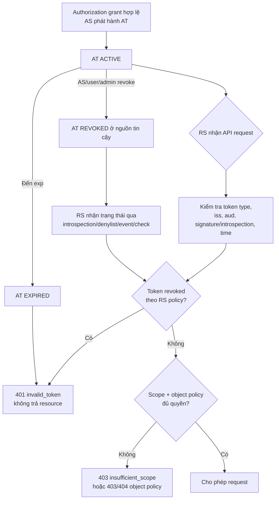
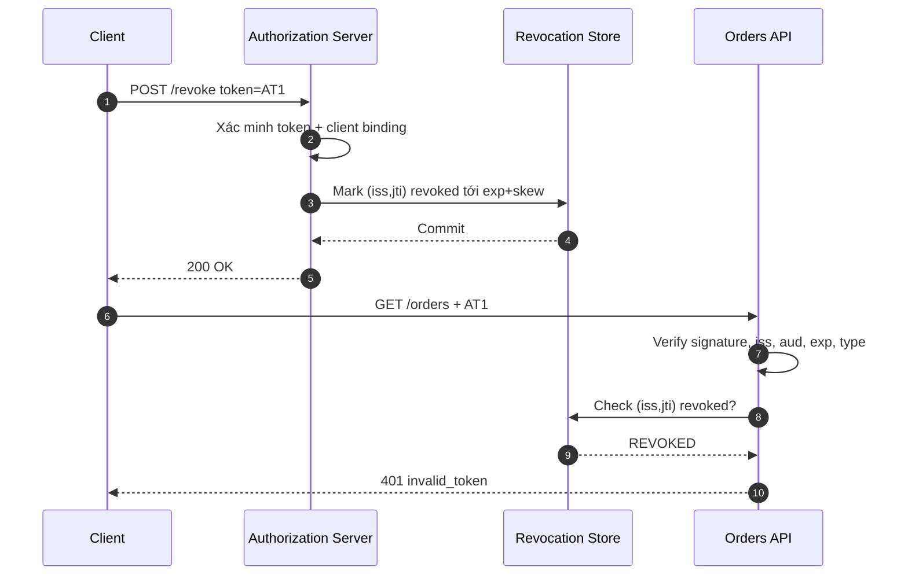
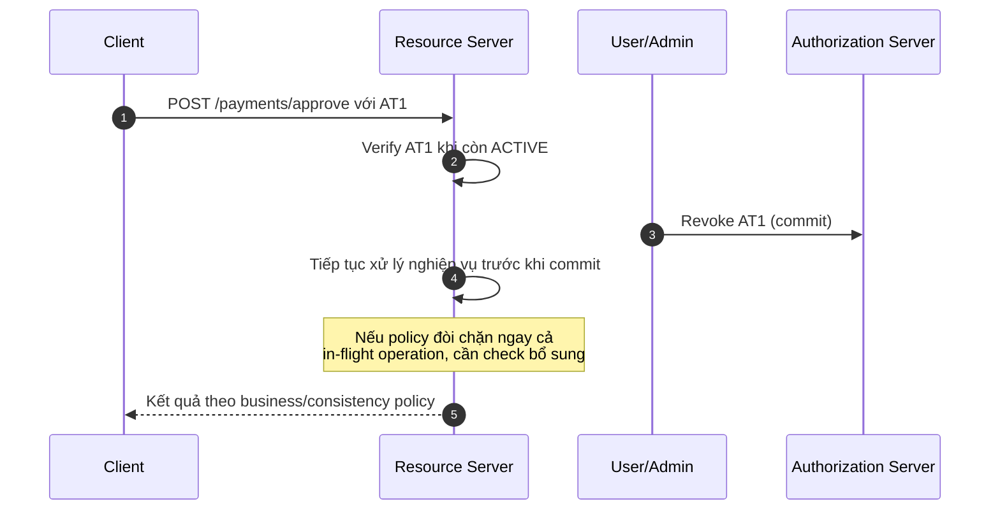
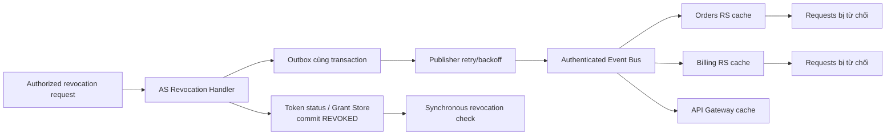
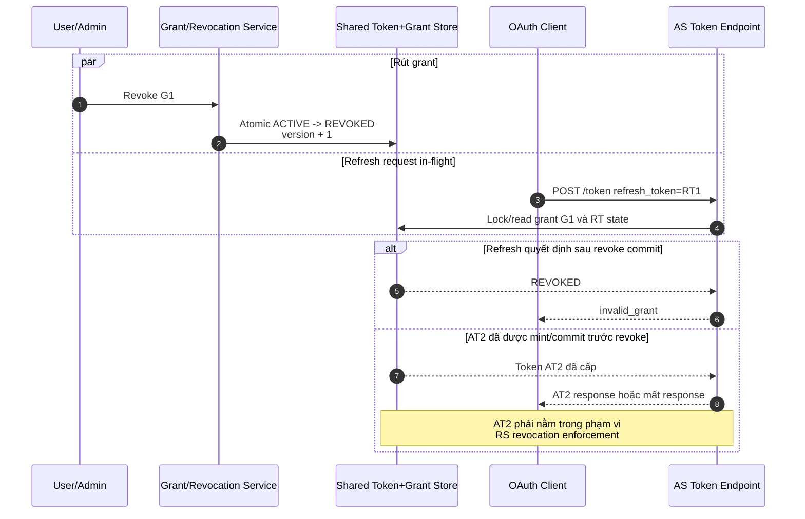

# Thu hồi access token

## Mục tiêu học tập

Module **SECURITY_TOKEN_SECURITY_FUNDAMENTALS** nghiên cứu mô hình tin cậy và vòng đời token bảo mật, phân biệt **JWT/opaque token**, **access token/refresh token** trong xác thực và phân quyền OAuth 2.0/OIDC; kiểm tra claims, scope, audience, phát hành, lưu trữ, thu hồi và chống token bị đánh cắp hoặc phát lại. Trong chương **Revocation**, bài **“Thu hồi access token”** đi sâu vào một quyết định vận hành quan trọng: **làm thế nào khiến Resource Server (RS) ngừng chấp nhận một access token trước khi thời gian hết hạn tự nhiên của nó tới?**

Sau bài này, bạn có thể:

- Phân biệt **access token revocation**, expiration, refresh token revocation, thu hồi consent/grant, logout và thay đổi quyền ở API.
- Giải thích vì sao **thu hồi ở Authorization Server (AS)** chưa đủ nếu **Resource Server** vẫn chấp nhận token theo đường kiểm chứng cũ.
- Dùng đúng **RFC 7009 Token Revocation Endpoint**: POST `token`, `token_type_hint=access_token`, client authentication/binding, phản hồi `200 OK` cả khi token không nhận biết, xử lý lỗi đúng.
- Thiết kế revocation cho **opaque access token với introspection** (RFC 7662) và **JWT access token được RS verify offline**, hiểu các phương án: denylist theo token ID, grant version/check, cutoff timestamp, introspection/check đồng bộ, event propagation hoặc AT TTL ngắn.
- Đánh giá **cửa sổ token còn dùng được** khi có cache, clock skew, event lag, nhiều RS, network partition và các API requests đang xử lý dở.
- Hiểu vì sao thu hồi một AT **không tự** thu hồi refresh token hoặc toàn bộ grant; phân biệt **một token**, **một phiên**, **toàn bộ client grant** và **tài khoản bị compromise**.
- Viết Java/Spring-style pseudocode cho endpoint revoke, token validator của RS, revocation store, audit và kiểm thử race/fail-closed.
- Xây dựng chính sách thông báo người dùng, quan sát trạng thái, phòng chống replay, quản lý quyền và giảm rò rỉ token trong log.

> **Nguyên tắc quan trọng:** **Token chỉ thực sự bị thu hồi đối với một API khi API đó biết và áp dụng trạng thái thu hồi.** AS có thể đánh dấu `REVOKED`, nhưng một RS chỉ verify chữ ký JWT, `iss`, `aud` và `exp` mà không kiểm tra revocation state vẫn có thể chấp nhận token **đến khi hết hạn**.

## 1. Access token là gì và vì sao cần thu hồi sớm?

Một OAuth **access token (AT)** là credential client trình đến **Resource Server** để truy cập tài nguyên được bảo vệ. AS phát hành AT theo grant và policy; AT được ràng buộc với resource/audience, scope, chủ thể hoặc client, hạn dùng và các điều kiện khác. RS kiểm tra token rồi áp thêm authorization trên từng thao tác/đối tượng.

### Hai định dạng phổ biến

| Đặc điểm | Opaque access token | JWT access token |
| --- | --- | --- |
| Hình thức | Chuỗi tham chiếu không có claims tự giải mã hữu ích cho client/RS. | Token có cấu trúc, thường là JWS chứa các claims như `iss`, `aud`, `exp`, `scope`. |
| Cách xác minh | RS thường gọi AS introspection (RFC 7662) hoặc truy vấn token state đáng tin. | RS có thể verify chữ ký/claims offline bằng khóa của issuer. |
| Thu hồi sớm | AS thay token state thành inactive; RS cần nhận trạng thái mới, có xét cache. | Chữ ký JWT **không đổi** sau revoke; cần thêm trạng thái denylist/grant version/introspection, hoặc chờ `exp`. |
| Điểm mạnh | Có thể kiểm soát trạng thái trung tâm sát thời gian thực. | RS xác minh nhanh, ít phụ thuộc AS khi gọi API. |
| Đánh đổi | Introspection có latency/availability/cache. | Thu hồi riêng từng token trước expiry cần thiết kế ngoài việc verify JWS. |

**JWT không mặc định “không thể thu hồi”.** Nó **khó thu hồi tức thời khi chỉ được verify offline**. Một hệ thống JWT vẫn có thể áp trạng thái revoke có hiệu lực tại RS nếu bổ sung protocol/cache/storage phù hợp.

### Những lý do cần revoke access token

1. **Phát hiện token bị lộ:** access token xuất hiện trong log, browser storage, ticket hoặc bị gửi sai đối tượng.
2. **User hoặc admin ngắt phiên/thiết bị:** policy yêu cầu token của session đó không được dùng tiếp.
3. **Client bị compromise:** khóa/secret/runtime bị chiếm quyền, cần chặn token đã phát hành.
4. **Thu hồi consent hoặc authorization grant:** user rút quyền app truy cập API; AT cũ cần được xử lý.
5. **Thay đổi quyền, tenant, vai trò hoặc tình trạng tài khoản:** các claims/quyền đã nhúng trong AT không còn phản ánh policy.
6. **Phát hiện hoạt động bất thường:** token reuse, đánh cắp bearer token, vi phạm sender constraint hoặc nghi ngờ replay.

**Thu hồi access token không xóa được dữ liệu đã trả cho client trước đó.** Nó nhằm chặn các **yêu cầu tiếp theo**, có thể còn giới hạn đối với request đã được API chấp nhận trước thời điểm revoke.

## 2. Thu hồi khác gì hết hạn, logout và thu hồi grant?

| Khái niệm | Hành động chính | Điều không tự đảm bảo |
| --- | --- | --- |
| **AT hết hạn tự nhiên** | RS từ chối từ thời điểm `exp` theo validator/clock policy. | RT, user session hay consent cùng hết hiệu lực. |
| **Revoke một AT** | Token cụ thể không còn được RS chấp nhận theo cơ chế revocation. | Client không thể dùng một RT hợp lệ để xin **AT mới**. |
| **Revoke refresh token/family** | AS chặn cấp AT mới qua RT/family. | AT đã phát hành trước đó bị mọi RS từ chối ngay. |
| **Revoke authorization grant/consent** | AS rút cơ sở ủy quyền, không cấp token mới dựa trên grant. | AT đã cấp hết hiệu lực tức thì nếu RS chỉ tin JWT offline. |
| **RP/app logout** | Kết thúc phiên ứng dụng, cookie/token local theo policy. | AS grant, RT của thiết bị khác hoặc OP SSO session bị revoke. |
| **OP/SSO logout (OIDC)** | Kết thúc login session ở OP theo logout profile. | Mọi AT đã phát hành bị invalid ngay tại API. |
| **Đổi scope/role/ACL** | Business authorization policy thay đổi. | Scope cũ trong JWT tự được cập nhật. |
| **Đổi khóa ký** | Thay trust material dùng xác minh JWT. | Chỉ một token mục tiêu bị vô hiệu mà không ảnh hưởng token khác. |

### Ví dụ: revoke AT nhưng RT vẫn còn

```text
User: user-42
Client: sales-portal
Access token AT1: exp 10:15
Refresh token RT1: có quyền refresh theo grant G1

10:02  AS/RS đánh dấu AT1 revoked
10:03  Client gửi AT1 tới Orders -> RS revocation-aware từ chối
10:04  Client gửi RT1 tới AS /token
10:04  Nếu G1/RT1 vẫn active, AS có thể cấp AT2.
```

**Kết luận:** muốn **ngắt hoàn toàn quyền truy cập của client**, chỉ revoke AT1 có thể **không đủ**. Cần chọn đúng phạm vi: revoke AT cụ thể, toàn bộ AT của phiên, refresh family, grant hoặc tất cả grants thuộc client/user theo policy. Ngược lại, nếu mục tiêu là loại bỏ một AT bị lộ mà không phá phiên hợp lệ khác, **không nên revoke quá rộng** khi không cần.

### Revocation decision matrix

| Tình huống | Phạm vi cần cân nhắc | Vì sao? |
| --- | --- | --- |
| AT1 vô tình lộ trong một đường truyền/log, RT được giữ kín. | Revoke AT1 ngay; đánh giá rotate RT hoặc revoke family tùy mức compromise. | Chặn bearer credential bị lộ mà hạn chế gián đoạn. |
| RT bị lộ hoặc bị sử dụng lại sau rotation. | Revoke family/grant theo chính sách, xử lý mọi AT liên quan. | Attacker có thể mint AT mới nếu RT còn hợp lệ. |
| User chọn “Ngắt kết nối ứng dụng X”. | Revoke grant/consent và RT families của app X; invalid AT liên quan. | Đảm bảo X không chỉ xin lại AT mới. |
| Đổi quyền admin → read. | Chặn AT chứa quyền cũ hoặc kiểm tra grant version/ACL động. | Claims JWT cũ không tự mất quyền. |
| Một session trên thiết bị bị chiếm quyền. | Revoke AT/RT family của session; cân nhắc khóa session khác theo mức rủi ro. | Cách ly thiết bị bị compromise, tránh broad logout nếu không cần. |
| Key riêng của issuer bị lộ. | Xử lý sự cố trust/key rotation, đánh giá tất cả token ký bởi key. | Không phải token-level revoke thông thường, có blast radius lớn. |

## 3. Vòng đời access token và vị trí revocation



**Thu hồi theo trạng thái có thể là bất đồng bộ.** Nếu AS đã chuyển AT sang REVOKED nhưng RS chưa nhận cập nhật (hoặc đang dùng cache `active=true`), RS có thể vẫn đi nhánh ACTIVE. Đây là **cửa sổ trễ thu hồi** cần được định lượng và kiểm soát.

### Những bất biến phải có

- Token bị đánh dấu revoked **không được tự trở lại ACTIVE** do retry hoặc event đến sai thứ tự.
- RS phải kiểm tra **revocation state trước khi cho phép thao tác** theo contract của API, không chỉ tin `exp`.
- Một thông báo revoke tới AS **không được coi là bằng chứng** RS đã cập nhật trạng thái nếu không có cơ chế ack/consistency.
- **Không đánh đồng unknown/unavailable với active** trong kiến trúc yêu cầu kiểm tra revocation nghiêm ngặt.
- Nếu revoke toàn grant, AS cũng phải chặn **việc phát hành token mới** theo grant ấy; điều đó khác với chỉ revoke một AT.
- Revoke AT không tự làm dữ liệu đã tải xuống biến mất hoặc rollback mọi request đang xử lý.

## 4. RFC 7009 — OAuth 2.0 Token Revocation Endpoint

**RFC 7009** chuẩn hóa endpoint để OAuth client thông báo cho AS rằng một token đã phát hành không còn được dùng nữa. Từ góc độ bài này, quan tâm nhất là **revocation request chứa access token** và hiệu quả lan truyền của nó.

### 4.1. HTTP request thu hồi access token

Ví dụ confidential client dùng client authentication `client_secret_basic` theo đăng ký với AS:

```http
POST /oauth2/revoke HTTP/1.1
Host: identity.example.com
Authorization: Basic <registered-client-credentials>
Content-Type: application/x-www-form-urlencoded

token=<access-token-to-revoke>&token_type_hint=access_token
```

Giải thích:

- **`token`** là token cần thu hồi; phải dùng **POST body**, không đưa raw token vào URL query.
- **`token_type_hint=access_token`** là gợi ý tối ưu tra cứu. **Nó không xác minh token type** và AS không được tin một loại token khác chỉ vì client khai như vậy.
- Client phải sử dụng endpoint **HTTPS của AS tin cậy**. Không gửi token tới URL do resource, callback, email hoặc request parameter chưa verify tự chọn.
- **Confidential client** phải thực hiện client authentication theo đăng ký. **Public client** không có shared secret giấu được trong SPA/mobile; AS dùng quy tắc xác định/binding client phù hợp.
- AS phải xác định token có thuộc client được phép yêu cầu revoke theo tiêu chuẩn/policy; không cho client A có khả năng revoke token của client B bằng ID đoán được.
- **Không đưa raw token, client secret, `Authorization` header, token response hay cookie** vào logs/APM/tickets.

**Endpoint `/oauth2/revoke` chỉ là ví dụ**; path thực tế tùy AS. Với OAuth metadata/discovery, client phải dùng endpoint cấu hình đáng tin do issuer cung cấp.

### 4.2. Response `200 OK` không chứng minh token đã từng tồn tại

Khi xử lý thành công, AS trả:

```http
HTTP/1.1 200 OK
Cache-Control: no-store
```

Theo RFC 7009, AS cũng trả **`200 OK` với body rỗng cho token không hợp lệ hoặc không nhận biết**, để tránh endpoint trở thành **oracle xác nhận token có tồn tại hay không**.

Điều này có hai hệ quả:

1. **Client không được dùng response 200 để kết luận** token thực sự từng active hay thuộc user nào.
2. **Không được dùng 200 để tuyên bố mọi RS đã chặn token ngay**. Việc AS tiếp nhận revoke khác việc mỗi API đã cập nhật cache/trạng thái.

### 4.3. AS có bắt buộc hỗ trợ revoke access token không?

RFC 7009 đặt yêu cầu:

- AS **MUST support revocation of refresh tokens**.
- AS **SHOULD support revocation of access tokens**.

Vì vậy client cần kiểm tra **khả năng và hợp đồng AS** thay vì suy mọi server luôn có thể revoke AT. Nếu AS không hỗ trợ loại token đó, RFC 7009 định nghĩa lỗi `unsupported_token_type`:

```http
HTTP/1.1 400 Bad Request
Content-Type: application/json

{"error":"unsupported_token_type"}
```

Nếu nhận lỗi này, client không được “giả vờ đã chặn AT”; cần xử lý theo lựa chọn kiểm soát khác: revoke grant/RT khi phù hợp, chờ AT TTL ngắn hoặc cấu hình RS revocation-aware.

### 4.4. Revoke AT có làm RT bị revoke theo không?

**Không có quy tắc mặc định rằng revoke AT = revoke toàn grant**. RFC 7009 cho phép AS ảnh hưởng các token và grant liên quan theo policy; khi access token được revoke, AS **MAY** cũng revoke refresh token liên quan. Khi RT được revoke, AS nên vô hiệu AT gắn với cùng grant nếu AS hỗ trợ AT revocation theo RFC.

Do đó cần phân biệt:

```text
Revoke AT1:
  AT1 -> revoked
  RT1 -> có thể vẫn active tùy AS policy
  AT2 -> có thể vẫn active

Revoke RT1:
  RT1 -> revoked
  AT1/AT2 -> phụ thuộc AS policy/khả năng AT revocation

Revoke Grant G1:
  AS ngừng issuance từ G1
  RT families của G1 -> revoked theo policy
  AT thuộc G1 -> xử lý theo contract RS revocation
```

**Đừng xây chức năng “ngắt kết nối app hoàn toàn” bằng một lệnh revoke AT duy nhất** nếu AS vẫn có RT hoặc grant cho phép cấp token mới.

### 4.5. Lỗi vận hành và khả năng retry

| Kết quả | Ý nghĩa | Client nên làm |
| --- | --- | --- |
| `200 OK`, body rỗng. | AS xử lý revocation request theo RFC, không tiết lộ token existence. | Cập nhật trạng thái local phù hợp; theo dõi propagation nếu cần. |
| `unsupported_token_type`. | AS không hỗ trợ revoke loại token được trình. | Không báo thu hồi tức thời, dùng kiểm soát khác theo policy. |
| `invalid_client` hoặc lỗi client authentication. | Client chưa được xác thực đúng. | Không retry bằng cách bỏ client auth; sửa đăng ký/credential. |
| HTTP `503`/mất mạng. | Không chắc AS có xử lý request hay chưa. | Retry có backoff/idempotency, không tuyên bố chắc chắn đã revoke. |
| Token đã bị revoke trước đó. | Gửi lại token không tạo trạng thái ACTIVE. | Xử lý idempotent, không tự cấp token mới. |

Lỗi ở **Token Revocation Endpoint** khác với `invalid_token` tại RS hoặc `invalid_grant` tại AS token endpoint. Không trả raw token, claims cá nhân hoặc chi tiết issuer/private key trong error message.

## 5. Thu hồi opaque access token bằng trạng thái trung tâm

Với **opaque access token**, client và RS không thể suy trực tiếp claims từ chuỗi token. Một cách phổ biến là RS gửi token tới **RFC 7662 Token Introspection Endpoint** của AS để biết token còn active hay không và lấy metadata cần thiết.

### 5.1. Introspection trước khi revoke

```http
POST /oauth2/introspect HTTP/1.1
Host: identity.example.com
Authorization: Basic <trusted-resource-server-credentials>
Content-Type: application/x-www-form-urlencoded

token=<opaque-access-token>&token_type_hint=access_token
```

Response hợp lệ ví dụ:

```json
{
  "active": true,
  "iss": "https://identity.example.com",
  "sub": "user-42",
  "client_id": "sales-portal",
  "aud": "api://orders",
  "scope": "orders:read",
  "exp": 1800000900
}
```

**`active=true` không có nghĩa user được phép thao tác trên mọi order.** RS vẫn phải kiểm tra audience dành cho API của mình, scope/hành động, subject/client/tenant và quyền đối tượng, đồng thời xác thực response của AS qua kênh được tin cậy. Một token dành cho Billing API không được chấp nhận ở Orders API chỉ vì introspection nói active.

### 5.2. Sau khi revoke

AS cập nhật token state từ `ACTIVE` sang `REVOKED` trong kho đáng tin, hoặc đánh dấu grant/token liên quan hết hiệu lực:

```json
{
  "active": false
}
```

Theo RFC 7662, token không active hoặc không thể được tiết lộ cho RS nhận introspection có thể được phản hồi `active=false` mà không cần công bố lý do. **Không trả claims chi tiết cho token không active** chỉ để “giúp debug”, vì có thể làm lộ subject, client, scopes hoặc nguồn revoke.

Một AS có thể sử dụng **token reference hash/HMAC** để tra cứu thay vì lưu raw bearer token trong database hoặc audit. Hệ thống lưu trạng thái phải hỗ trợ TTL/expiry và các thay đổi revoke theo đúng issuer/client binding.

### 5.3. Cache `active=true` tạo “độ trễ thu hồi”

Giả sử:

```text
10:00:00  RS introspect AT1 -> active=true
10:00:00  RS cache kết quả trong 300 giây
10:01:00  AS revoke AT1
10:02:00  Client gửi lại AT1
10:02:00  RS dùng cache active=true -> có thể vẫn cho qua
10:05:00  Cache hết hạn; RS introspect lại -> active=false
```

Nếu sản phẩm yêu cầu thu hồi **gần thời gian thực**, cache 300 giây là cửa sổ quá lớn trừ khi có **invalidation event** hoặc API chính sách đặc biệt. Chọn TTL introspection dựa vào **SLA revocation**, không chỉ nhằm giảm tải AS.

### 5.4. Những biến thể xác minh opaque token

| Cách kiểm tra | Lợi ích | Rủi ro/điều kiện |
| --- | --- | --- |
| RS introspect **mỗi request**. | Trạng thái thường sát AS hơn. | Thêm latency, tải và phụ thuộc AS availability; cần timeout, rate limit. |
| RS introspect với **cache ngắn**. | Giảm tải, vẫn giới hạn cửa sổ cũ. | Độ trễ tối đa phụ thuộc TTL và consistency. |
| AS phát **revocation event** để RS xóa cache. | Có thể thu hẹp cửa sổ trễ. | Event lag/loss, consumer offline; vẫn cần TTL/reconciliation. |
| RS dùng **shared token status store**. | Có thể kiểm tra trực tiếp theo ref. | Cần trust boundary, phân quyền, version và HA. |
| Gateway introspect thay RS. | Tập trung policy kiểm tra. | API phải tin gateway có bảo vệ chống bypass; object-level auth vẫn tại RS. |

**Introspection không phải public token-debug endpoint.** AS phải xác thực/ủy quyền RS introspecting party, áp hạn chế tiết lộ metadata, tránh SSRF và chống trở thành oracle cho bearer token bất kỳ.

## 6. Thu hồi JWT access token trước `exp`

JWT access token thường là JWS có chữ ký được RS verify offline. Nếu AS revoke ở cơ sở dữ liệu nhưng RS không hỏi trạng thái, chữ ký token vẫn đúng. Đó là tính chất của **xác minh dựa trên chữ ký**, không phải lỗi hash/signature.

Ví dụ payload **minh họa** theo profile API nội bộ:

```json
{
  "iss": "https://identity.example.com",
  "sub": "user-42",
  "aud": "api://orders",
  "client_id": "sales-portal",
  "scope": "orders:read orders:write",
  "jti": "at-7db2d28c",
  "iat": 1800000000,
  "nbf": 1800000000,
  "exp": 1800000900,
  "grant_ref": "grant-5a31",
  "grant_version": 3
}
```

`grant_ref` và `grant_version` là **claims mở rộng do tổ chức định nghĩa**, không bắt buộc theo JWT RFC 7519 hoặc JWT Access Token Profile RFC 9068. `jti` có thể được dùng làm token identifier **khi token profile của AS thực sự phát hành nó**; phải kiểm soát tính duy nhất và namespace.

### 6.1. Denylist theo `jti` hoặc token reference

Ý tưởng:

1. AS/Revocation Service xác minh caller có quyền revoke AT.
2. Từ một token được nhận biết, lấy **token ID/ref an toàn** và thời điểm `exp` đáng tin từ token state/claims đã verify.
3. Ghi denylist entry kiểu `(issuer, token_id) → REVOKED`, có TTL đủ bao phủ token còn hạn và clock skew.
4. RS sau khi verify JWT chuẩn phải **tra cứu denylist** trước khi cho phép API.
5. Không cho entry “REVOKED” bị xóa sớm do eviction ngoài policy hoặc ghi đè ACTIVE bởi stale event.



**Vấn đề thiết kế:**

- `jti` phải **khó trùng/định danh duy nhất trong phạm vi issuer**, và RS phải tra cứu bằng **issuer + token ID**, không chỉ `jti` có thể bị trùng giữa nhiều AS.
- Token phải được verify trước khi tin claim `jti` dùng tra cứu, không nhận ID token arbitrary từ client để ghi denylist.
- Denylist entry cần tồn tại **ít nhất qua toàn bộ khoảng AT còn có thể được chấp nhận**, tính clock skew và RS caching; sau đó có thể cleanup.
- Nếu AT không có `jti`, có thể thiết kế **fingerprint của token** hoặc token reference đáng tin. HMAC trên raw token với khóa quản lý phù hợp có thể tránh lưu raw bearer token; phải thống nhất cách tính ở AS/RS và quản lý rotation keys.
- Denylist có thể thành **điểm nóng/điểm lỗi chung** khi traffic lớn; cần caching, HA, latency budget và fail-closed policy.

**Không nên dùng hash `sub` đơn lẻ** để thu hồi một token cụ thể vì có thể vô tình chặn toàn bộ user. Nếu cần revoke toàn bộ user/session, đó là **một loại policy rộng hơn** phải được đặt tên đúng.

### 6.2. Revoke theo grant ID/version

Nếu AT thuộc grant G1, RS có thể kiểm tra grant còn ACTIVE và version trong token còn phù hợp:

```text
Token AT1:
  grant_ref = G1
  grant_version = 3

AS:
  Grant G1 = REVOKED, version = 4

RS:
  verify AT1 signature/aud/exp PASS
  check G1 status/version FAIL
  -> reject AT1
```

**Ưu điểm:** có thể vô hiệu nhiều AT cùng một grant mà không phải liệt kê từng `jti`. **Nhược điểm:** không dùng để revoke **một AT đơn lẻ** mà giữ các AT khác nếu RS chỉ biết grant state; cần transaction consistency, versioning và policy propagation.

Nếu user chỉ rút scope `orders:write` nhưng muốn giữ quyền đọc, tăng `grant_version` và phát token mới `orders:read` theo grant đã được đánh giá lại có thể là một phương án; AT cũ chứa `orders:write` phải bị RS từ chối theo version.

### 6.3. Cutoff timestamp / “tokens issued before”

Một số hệ thống lưu `not_valid_before` hoặc `tokens_valid_after` theo subject, client, session hoặc grant:

```text
revoke_all_tokens_for_session_at = 10:03:00 UTC

Token:
  iat = 09:59:00 -> reject nếu trước cutoff
  iat = 10:04:00 -> có thể tiếp tục nếu grant/policy khác PASS
```

Đây là cơ chế **broad revocation**, không phải revoke một token. Hạn chế:

- `iat` có độ phân giải giây và có thể bằng cutoff; cần quy tắc biên rõ, tránh cho token cũ lọt qua hoặc chặn nhầm token mới.
- RS phải nhận/cập nhật cutoff; **clock skew** và issuance race cần được xử lý.
- Dựa vào `iat` từ JWT **chưa verify** là sai trust boundary.
- Nếu client còn RT/grant hợp lệ, nó có thể mint AT mới sau cutoff; muốn ngăn phải xử lý grant/RT.
- Một cutoff theo user có thể làm ngắt mọi client của user, rộng hơn yêu cầu revoke một AT.

### 6.4. JWT access token TTL ngắn

Một chiến lược khác là **không kiểm tra revocation động** mà chỉ phát AT rất ngắn hạn và quản lý RT chặt:

```text
AT issued 10:00, exp 10:05
AT revoked in AS at 10:01
RS offline JWT validator vẫn có thể nhận AT tới 10:05
Maximum remaining exposure ≈ dưới 4 phút + sai lệch/độ trễ liên quan.
```

Ưu điểm: đơn giản, hiệu năng cao, RS hoạt động khi AS offline. Nhược điểm: **không có instant per-token revocation**. Đây chỉ là lựa chọn hợp lệ nếu business/security chấp nhận rõ **bounded exposure**; các thao tác tài chính, dữ liệu cực nhạy cảm hoặc tài khoản bị compromise có thể đòi chặn nhanh hơn.

### 6.5. Vì sao không “thu hồi JWT bằng cách xóa khóa ký”?

Nếu một key ký được dùng cho hàng triệu JWT, xóa key khỏi JWKS hoặc ngừng trust key đó có thể khiến **hàng triệu token không còn verify**, không chỉ một token bị lộ. Key rotation phục vụ quản trị khóa và ứng cứu compromise **ở cấp trust material**; nó không phải công cụ thuận tiện cho per-token revoke.

Đổi key cũng phải tính **JWKS cache** tại RS, token `kid`, rollover và thời gian ứng dụng khóa mới; không nên lạm dụng như cách chắc chắn đạt immediate revocation.

## 7. Chọn kiến trúc revocation dựa trên SLA

Không có một chiến lược phù hợp cho mọi ứng dụng. Nên định nghĩa **Revocation Service Level Objective (SLO)** theo mức rủi ro và khả năng vận hành trước khi chọn cache/token format.

| Kiến trúc | Khả năng chặn AT đã cấp | Độ trễ/phụ thuộc | Phù hợp |
| --- | --- | --- | --- |
| **JWT offline + TTL ngắn** | Sau `exp`; không chặn ngay do revoke event đơn thuần. | RS độc lập, latency thấp. | API chấp nhận cửa sổ tồn tại ngắn. |
| **JWT + denylist per-token** | Có thể chặn nhanh khi denylist được RS nhìn thấy. | Lookup/cache/event; cần HA. | Muốn revoke riêng token bị lộ. |
| **JWT + grant-version check** | Chặn nhiều AT thuộc grant/phiên đã revoke. | Lookup/version propagation. | Logout thiết bị, revoke client grant, role change. |
| **Opaque + introspection mỗi request** | Gần trạng thái AS nhất khi không có cache stale. | Thêm request và phụ thuộc AS/RS connectivity. | API yêu cầu kiểm soát động. |
| **Opaque + introspection cache ngắn** | Chặn sau tối đa khoảng cache TTL/event lag đã định nghĩa. | Tối ưu hiệu năng nhưng có stale window. | Cân bằng rủi ro và throughput. |
| **Event invalidation + periodic reconciliation** | Có thể rút ngắn độ trễ, không tự thành strong consistency. | Bus, consumer lag, duplicate/out-of-order. | Kiến trúc phân tán nhiều RS. |
| **Hybrid: denylist/grant state + AT TTL ngắn** | Nhiều lớp phòng vệ, giảm tác động mất sự kiện. | Phức tạp vận hành và kiểm thử. | Rủi ro cao/có yêu cầu SLA rõ. |

### Ví dụ lựa chọn theo mức rủi ro

- **Dashboard nội bộ ít nhạy cảm:** AT 5 phút, RT rotation và quy định revocation có thể trễ tối đa phần TTL còn lại; công bố rõ giới hạn.
- **API chỉnh sửa dữ liệu khách hàng:** JWT + grant revocation check, caching rất ngắn, kết hợp object policy và log có kiểm soát.
- **API phê duyệt giao dịch tài chính:** introspection/grant check nghiêm ngặt hoặc cơ chế bất biến quyền ngay trước commit nghiệp vụ; chặn khi không kiểm tra được.
- **Public SPA:** AT ngắn, chống XSS, RT replay protection; không coi việc xóa `localStorage` là AS-side revoke.

**Các khoảng thời gian nêu trên là ví dụ kiến trúc**, không phải mức TTL/SLA bắt buộc trong OAuth RFC.

## 8. Thời điểm thu hồi có hiệu lực: commit, cache và request đang chạy

Mọi hệ thống nên nêu rõ ba thời điểm:

1. **`revocation_requested_at`:** client/user/admin gửi yêu cầu.
2. **`revocation_committed_at`:** AS/token state store ghi nhận REVOKED bền vững.
3. **`revocation_enforced_at(resource_server)`:** RS áp trạng thái đó, kể cả cache/in-flight requests.

**Ba mốc có thể khác nhau**. Không nên dùng timestamp của nút bấm UI làm chứng cứ RS đã từ chối mọi request.

### 8.1. “Immediate” phải được định nghĩa có điều kiện

Giả sử revocation được commit lúc 10:00:00:

```text
Orders API (strict, synchronous check)
  10:00:01 -> thấy revoked -> từ chối AT

Reports API (cache active=true 30 giây)
  10:00:10 -> có thể chấp nhận AT theo cache cũ
  10:00:31 -> cache hết hoặc invalidated -> từ chối

Offline worker (JWT local only)
  -> có thể chấp nhận AT tới exp nếu không có state check
```

Vì vậy “thu hồi ngay” chỉ đúng nếu **tất cả điểm xác minh liên quan** có cơ chế và thời gian đảm bảo tương ứng. Nếu chấp nhận **bounded staleness**, nên có một giới hạn được định nghĩa/test và đo lường thực tế.

### 8.2. Request đã được cho phép trước khi revoke

Một request có thể bắt đầu xử lý trước khi AS commit revoke:



**Revocation không tự rollback nghiệp vụ đã bắt đầu.** Với thao tác nhạy cảm, cân nhắc **revalidate authorization gần điểm commit** hoặc điều phối giao dịch/ủy quyền mạnh hơn, đồng thời chấp nhận rằng trong hệ phân tán có thể không đạt tuyệt đối “không request nào đang chạy có thể hoàn thành” nếu không có consistency contract.

### 8.3. Clock skew, token expiry và tombstone TTL

Với JWT, RS thường cho phép một độ lệch đồng hồ nhỏ khi xét `exp`/`nbf`. Nếu denylist entry bị xóa ngay đúng `exp` theo AS clock, nhưng RS còn chấp nhận token thêm một khoảng skew, token có thể **hồi sinh trong cửa sổ đó**.

**Thiết kế:** giữ revoked marker tới `exp + allowed_clock_skew + propagation_margin` theo policy, sau đó cleanup an toàn. Với opaque token, state/expiry và cache cleanup cũng cần tương tự. Không giữ raw token vô hạn chỉ để đảm bảo có thể tra cứu revocation.

### 8.4. Hai API có mức rủi ro khác nhau

Một access token có `aud` chứa nhiều resource (nếu hệ thống cho phép) có thể được RS A và RS B chấp nhận. Nếu chỉ A áp denylist còn B không biết, **token chưa được thu hồi trên toàn bộ phạm vi sử dụng của nó**.

**Ưu tiên AT có audience/resource giới hạn**, scopes tối thiểu và RS validators thống nhất theo khả năng revoke của AS. Khi cấp token cho nhiều API, phải xác định **mọi Resource Server bị ảnh hưởng** thay vì chỉ cập nhật gateway ở một route.

## 9. Xây dựng Revocation Store và API kiểm tra token

Một implementation thường gồm ít nhất ba phần:

1. **Authorization Server/Revocation Service** nhận yêu cầu revoke có xác thực và cập nhật trạng thái bền vững.
2. **Revocation Store** lưu token identifier, grant state hoặc cutoff phù hợp.
3. **Resource Servers** dùng cơ chế xác minh được quy định để biết token đã revoke.

### 9.1. Schema minh họa cho per-token revocation

```json
{
  "issuer": "https://identity.example.com",
  "token_ref": "hmac-ref-95fe02",
  "token_type": "access_token",
  "jti": "at-7db2d28c",
  "client_ref": "sales-portal",
  "grant_ref": "grant-5a31",
  "revoked_at": "2027-02-10T10:00:00Z",
  "token_expires_at": "2027-02-10T10:15:00Z",
  "retain_until": "2027-02-10T10:16:00Z",
  "reason_code": "TOKEN_EXPOSED",
  "state": "REVOKED"
}
```

Schema chỉ để minh họa **mô hình**, không phải chuẩn OAuth. Dữ liệu thực tế có thể lưu in-memory + distributed DB, Redis/kvstore với persistence hoặc bảng token status; phụ thuộc SLO, availability và threat model.

**Lưu ý:**

- Dùng token **reference đáng tin** (ví dụ `iss` + `jti` với JWT đã verify, hoặc HMAC từ opaque token) thay vì raw bearer token.
- Không lấy `jti`/`exp` từ JWT chưa xác minh rồi tin chúng như metadata AS.
- `reason_code` và actor có thể là thông tin nhạy cảm; cần audit riêng và quyền truy cập.
- TTL bản ghi phải đủ bao phủ thời gian token còn có thể được RS chấp nhận, gồm clock skew.
- Revocation marker chỉ có trạng thái **tiến về phía invalid**, tránh cạnh tranh khiến REVOKED trở lại ACTIVE.
- Revoke per-token khác với revoke grant: schema cần giữ **phạm vi rõ ràng** để không chặn nhầm.

### 9.2. Key namespace và issuer isolation

Hai AS có thể đều phát JWT `jti=abc123`. Nếu RS dùng denylist chỉ theo `jti`, AS A revoke token có thể khiến JWT của AS B bị từ chối hoặc ngược lại. Key nên chứa **issuer đã verify**, và khi cần token type, client hoặc profile:

```text
Revocation key = HMAC(secret, canonical_trusted_issuer || token_kind || token_id)

Không dùng:
  revocation_key = jti_without_verified_issuer
```

Trong ví dụ, cơ chế canonical issuer phải giữ **đúng issuer identifier đã cấu hình**, không tự chuẩn hóa URL tùy tiện làm nhập nhằng. HMAC key lifecycle/rotation và lựa chọn token reference phải được threat-model; raw token là bearer credential nên không đặt làm DB key được log rộng rãi.

### 9.3. TTL storage và garbage collection

Giả sử một AT có `exp=10:15:00Z`, RS cho clock skew tối đa 60 giây. Nếu AS lưu revoke marker chỉ đến 10:15:00Z, trong khoảng **10:15:00–10:16:00** RS vẫn có thể chấp nhận token theo skew nhưng revocation check đã mất marker.

Thiết kế cần:

```text
revokeMarkerTTL >= max(token_exp - now, 0)
                   + clock_skew_budget
                   + cache/propagation safety margin
```

Đây là **công thức chính sách minh họa**, phải tính từ timestamp thực và tránh overflow/TTL âm. Đồng thời, tại RS, **`exp` vẫn là bắt buộc**: marker absent không làm token hết hạn trở nên hợp lệ.

### 9.4. Khi đã revoke, token phải bị chặn ở mọi route

Một microservice có thể dùng gateway chung kiểm tra AT, nhưng những đường nội bộ như gRPC, message consumers, scheduled jobs hoặc route admin có thể **bypass gateway**. Chỉ nói “gateway đã check revocation” là chưa đủ nếu client hoặc service khác gọi trực tiếp RS.

Hãy thống nhất **security boundary**: gateway xác thực token có thể giúp giảm duplicate work, nhưng Resource Server phải bảo đảm không bị gọi ngoài kênh đã xác thực, và vẫn thực thi **object-level authorization**. Token bị revoke cũng cần được xử lý khi background job đã lưu AT để gọi một API khác.

## 10. Đồng bộ trạng thái thu hồi trong hệ phân tán

Tại một hệ thống có nhiều RS, AS cần đưa revocation state tới điểm thực thi quyền. Có thể dùng **synchronous check**, **event-driven invalidation** hoặc kết hợp.

### 10.1. Transactional outbox cho sự kiện



Nếu AS commit revoked trong DB nhưng process chết trước khi gửi event, **outbox** giúp publisher khôi phục thông báo. Nếu chỉ gọi event bus kiểu fire-and-forget sau commit, sự cố có thể khiến RS tiếp tục tin cache ACTIVE đến khi TTL hết.

### 10.2. Event payload an toàn

```json
{
  "event_type": "ACCESS_TOKEN_REVOKED",
  "event_id": "evt-9e172",
  "issuer": "https://identity.example.com",
  "token_ref": "hmac-ref-95fe02",
  "grant_ref": "grant-5a31",
  "revocation_version": 6,
  "revoked_at": "2027-02-10T10:00:00Z",
  "expires_at": "2027-02-10T10:15:00Z"
}
```

Các field là **schema minh họa riêng của hệ thống**, không có nghĩa RFC 7009 tự phát sự kiện. Event bus phải áp xác thực publisher/consumer, phân quyền đọc, integrity, encryption/transport protection và retention phù hợp. **Không phát raw access token hoặc refresh token lên message queue** chỉ để làm cache invalidation.

### 10.3. Out-of-order, duplicates và revocation tombstones

Giả sử:

```text
Event 20: Token AT1 REVOKED, version 6
Event 19: Token AT1 ACTIVE,  version 5 (đến trễ)
```

RS phải giữ trạng thái REVOKED version 6; không cho event ACTIVE cũ ghi đè. Một rule dễ hiểu:

```text
Apply event iff:
  issuer/token_ref thuộc namespace tin cậy
  event.authentic == true
  event.version > local.version

Nếu event mới là REVOKED:
  ghi revocation marker/tombstone
  không chấp nhận event ACTIVE đến sau ở version thấp hơn.
```

**Thực tế không nên có sự kiện “unrevoke token”**: token đã bị revoke chỉ có thể được thay bằng token mới qua issuance/authorization hợp lệ, không làm token cũ ACTIVE trở lại.

### 10.4. Bảo vệ trước mất thông báo

- **Retry** có backoff, dead-letter queue và cảnh báo khi consumer lag lớn.
- **Periodic reconciliation** giữa RS cache và AS token/grant state khi event có thể bị mất.
- **Cache TTL giới hạn** như lớp phòng vệ thứ hai: một event bị mất không khiến trạng thái ACTIVE tồn tại vô hạn.
- **Outbox retention** đủ để consumer offline có thể bắt kịp; sau đó dùng snapshot/rebuild.
- **Monitoring** khoảng thời gian từ revoke commit đến RS enforcement, số request bị chấp nhận trong cửa sổ đã định nghĩa và lỗi introspection.
- **Security tests** kiểm tra duplicate/out-of-order, retry, network partition và khả năng fail-closed.

Event propagation **không biến một hệ thống eventually consistent thành strict instant revocation**. Với API yêu cầu hiệu lực mạnh, vẫn cần check đồng bộ ở nguồn đáng tin hoặc cơ chế consistency khác.

## 11. Race condition: revoke, refresh và issuance

Đối với một access token riêng lẻ, cần phân biệt **token issuance trước/sau revoke** và **mục tiêu revoke**:

### 11.1. Chỉ revoke AT1

```text
T0: RT1/grant G1 vẫn ACTIVE
T1: AT1 bị REVOKED
T2: Token endpoint nhận RT1 và cấp AT2 mới

=> Có thể đúng nếu policy chỉ thu hồi AT1.
=> Không đúng nếu user tưởng mình đã ngắt hoàn toàn client/grant.
```

**Vấn đề không nhất thiết là race**: nó có thể là **scope thiết kế sai**. Cần xác định **AT-only** hay **grant-level** revocation trước khi xây API/UI.

### 11.2. Revoke một grant và refresh song song



**Bất biến grant-level:** sau điểm commit/tuyến tính hóa REVOKED, AS **không phát hành AT mới từ grant đó**. Một handler refresh đọc ACTIVE từ cache cũ rồi commit AT sau revoke là lỗi cần giải quyết bằng transaction isolation, locking hoặc optimistic compare-and-swap/version checks.

### 11.3. Các request API song song

Một AT bị revoke trong khi API request đang được xử lý:

- RS đã reject trước khi vào business logic: không thực hiện thao tác.
- RS cho phép trước khi revoke: request có thể đang chạy; tùy yêu cầu consistency cần recheck trước thao tác nhạy cảm/commit.
- Nếu RS có cache ACTIVE stale: request có thể tiếp tục được chấp nhận tới khi cache invalidated, trong giới hạn SLA.
- Nếu RS offline JWT validator: không có revoke check, AT có thể dùng đến `exp` dù AS đã đánh dấu REVOKED.

**Đừng trả lời “revoke thành công” rồi giả định mọi transaction đang chạy đã bị rollback**. Muốn khả năng đó cần business process cancellation/transaction policy riêng, không nằm trong RFC 7009.

## 12. Khi Resource Server không thể xác minh trạng thái

Trong kiến trúc **revocation-aware**, RS có thể không gọi được AS, datastore hay introspection endpoint. Phải phân biệt:

```text
ACTIVE  = Có bằng chứng token đang có hiệu lực.
REVOKED = Có bằng chứng token đã bị vô hiệu.
UNKNOWN = Không kiểm tra được, chẳng hạn timeout/cache quá hạn.

UNKNOWN không đồng nghĩa ACTIVE.
```

### 12.1. Fail-closed theo mức rủi ro

| Policy | Khi AS/introspection/revocation store unavailable | Đánh đổi |
| --- | --- | --- |
| **Strict validation** | Từ chối request/`503` phù hợp khi không đủ bằng chứng trạng thái. | An toàn hơn với revoke, giảm availability khi hạ tầng sự cố. |
| **Bounded cache fallback đã thiết kế trước** | Có thể dùng bằng chứng còn trong TTL chặt theo policy, nếu business chấp nhận stale window. | Cần định nghĩa max staleness và cảnh báo; không được kéo dài vô hạn. |
| **Offline JWT by design** | Xác minh chữ ký/`exp` và claims không cần kết nối AS. | Availability cao; **không cung cấp AT revocation tức thời**. |

**Không viết một try/catch ad hoc** để “nếu introspection lỗi thì coi token hợp lệ” khi security policy yêu cầu revocation check. Đây là **fail-open**, có thể biến một outage AS thành cửa sổ tấn công bằng AT đã bị revoke.

### 12.2. Lỗi hạ tầng khác token không hợp lệ

Nếu có bằng chứng token đã revoked/expired, RS trả authentication failure theo profile (thường `401 invalid_token`). Nếu RS **không thể xác minh** vì backend lỗi, trả lỗi hạ tầng phù hợp (thường `503 Service Unavailable`), không nhất thiết báo client “access token sai” và không bật refresh loop vô hạn.

Trong một hệ thống nhiều lớp:

- **Gateway** có thể trả 503 vì introspection service down.
- **API** có thể trả 401 khi nhận token đã verify là revoked.
- **Client** phải phân biệt retry có backoff cho 503 với xử lý 401 invalid_token/reauthorization theo policy.

**Không retry trên mọi 401 bằng cách refresh RT vô hạn.** Nếu grant đã revoked, refresh thất bại và client phải dừng/đưa user qua authorization mới khi phù hợp.

## 13. HTTP response ở Resource Server sau khi revoke

Revocation endpoint **RFC 7009** khác hẳn HTTP API mà client dùng access token. Khi RS phát hiện AT không còn hợp lệ, nó thường phản hồi theo **RFC 6750 Bearer Token Usage**.

### 13.1. `401 invalid_token` cho AT đã revoke

```http
GET /orders HTTP/1.1
Host: api.example.com
Authorization: Bearer <revoked-access-token>
```

```http
HTTP/1.1 401 Unauthorized
WWW-Authenticate: Bearer realm="orders", error="invalid_token"
Cache-Control: no-store
Content-Type: application/json

{"error":"invalid_token"}
```

Đây là response **minh họa** của một API sử dụng Bearer. Nội dung lỗi nên trung tính: không tiết lộ user ID, client, lý do nội bộ đã revoke hoặc token reference cho một caller không còn xác thực hợp lệ. `WWW-Authenticate` phải theo cú pháp/chính sách hỗ trợ của RS; việc trả thêm JSON body không thay thế header Bearer challenge cần thiết.

### 13.2. `403 insufficient_scope` không phải revoke

Nếu token vẫn **ACTIVE** nhưng không có scope cho thao tác:

```http
HTTP/1.1 403 Forbidden
WWW-Authenticate: Bearer realm="orders", error="insufficient_scope"
Content-Type: application/json

{"error":"insufficient_scope"}
```

`insufficient_scope` là **authorization failure**, còn `invalid_token` là **credential validation failure**. Một user có thể đăng nhập đúng OIDC và AT đúng chữ ký nhưng không có `orders:write`. Đừng giải quyết 403 bằng cách tự thêm scope vào JWT payload hoặc “bỏ qua” revocation check.

### 13.3. `403`/`404` cho quyền trên đối tượng

Nếu AT hợp lệ và có scope đọc, nhưng user A cố xem order của tenant B, API phải áp owner/tenant/ACL/ABAC policy riêng:

```text
AT ACTIVE       = PASS
iss/aud/exp      = PASS
scope orders:read= PASS
order.tenant     = tenant-B
user.tenant      = tenant-A
object authorization = DENY (403/404 theo anti-enumeration policy)
```

**Revocation không thay thế object-level authorization.** Một AT không bị revoke cũng không có quyền truy cập mọi object phù hợp tên scope.

### 13.4. Backend revocation check unavailable

Khi RS không thể xác minh trạng thái token vì introspection bị timeout, không có bằng chứng `active=false` cũng không có bằng chứng `active=true` hiện hành. Với strict policy, **fail closed** và trả lỗi hạ tầng phù hợp, thường:

```http
HTTP/1.1 503 Service Unavailable
Cache-Control: no-store
Content-Type: application/json

{"error":"temporarily_unavailable"}
```

Đừng giả mạo `401 invalid_token` nếu thực chất hệ thống xác minh lỗi và muốn client liên tục xin token mới; đồng thời đừng cấp dữ liệu khi không xác minh được. Hạn chế thông tin nội bộ/stack trace trong public response, để correlation ID cho log vận hành.

### 13.5. Phía client sau khi nhận 401

- Nếu AT expired, client có thể dùng **RT hợp lệ** tại AS theo policy để nhận AT mới.
- Nếu AT bị revoke riêng và RT/grant vẫn active, AS **có thể** cho refresh; điều này phải nằm trong mục tiêu revoke ban đầu.
- Nếu grant hoặc RT đã revoked, refresh thường bị từ chối `invalid_grant`; client nên dừng loop, xóa credential local và yêu cầu authorization mới **nếu user chủ động và policy cho phép**.
- Nếu 403 `insufficient_scope`, refresh AT với cùng grant **không tự mang scope mới**; cần flow xin quyền theo AS policy hoặc từ chối thao tác.
- Nếu 503 do backend RS lỗi, retry có backoff theo chính sách; không dùng raw AT trong URL, analytics hoặc support ticket.

## 14. Java pseudocode: thực thi revoke và xác minh ở API

Các ví dụ Java dưới đây mô tả **logic security boundary**; tên interface/exception và transaction method là **pseudocode**, không phải API hoàn chỉnh của Spring Authorization Server hay Spring Security. Trong production cần dùng framework chuẩn, kiểm thử end-to-end, transaction isolation và cấu hình trust rõ ràng.

### 14.1. AS revocation handler

```java
RevocationResult revokeAccessToken(
        RevokeRequest request, AuthenticatedOAuthClient client) {
    requireTrustedRevocationEndpointRequest(request);
    requireClientAuthenticatedAsRegisteredIfApplicable(client);
    requireBoundedFormSizeAndTokenSyntax(request);

    // Không dùng token_type_hint như bằng chứng token type.
    TokenReference ref = tokenReferenceService.referenceOf(request.token());

    return transaction.execute(() -> {
        Optional<AccessTokenRecord> maybeToken =
            issuedAccessTokens.lockAndFindByReference(ref);

        if (maybeToken.isEmpty()) {
            // RFC 7009: token không nhận biết -> 200, body rỗng.
            return RevocationResult.successNoBody();
        }

        AccessTokenRecord token = maybeToken.get();
        if (!clientCanRevokeThisToken(client, token)) {
            // Không tiết lộ token tồn tại hay thuộc client nào.
            return safeResponseForUnauthorizedToken(client, token);
        }

        if (token.status() != REVOKED) {
            issuedAccessTokens.markRevoked(
                token.id(), trustedClock.instant());
            revocationOutbox.insertTokenRevoked(
                token.safeReference(), token.issuer(),
                token.expiresAt(), token.revocationVersion() + 1);
            audit.recordSafeTokenRevoked(
                token.safeReference(), client.safeReference());
        }

        // Không phát token mới; không trả token state/subject cho caller.
        return RevocationResult.successNoBody();
    });
}
```

**Giới hạn/nhận xét:**

- `AuthenticatedOAuthClient` có thể là confidential client đã xác thực hoặc public client được nhận diện/binding theo registration; public client **không chứng minh bí mật** chỉ bằng `client_id`.
- AS phải kiểm tra token thực sự đã được **phát hành từ issuer và client registration phù hợp**. Không nhận một JWT trông hợp lệ nhưng ký bởi issuer khác để ghi revocation arbitrary.
- `safeResponseForUnauthorizedToken` phải tuân theo RFC 7009/client authorization policy và **không tạo token-existence oracle**.
- Với JWT token không lưu từng record, AS có thể verify token theo issuer/key/claims, xác định reference rồi ghi denylist; cần kiểm tra đúng trust và anti-DoS.
- Nếu client cần **rút consent/grant**, nó phải gọi API quản lý grant có thẩm quyền khác, hoặc AS policy quy định revoke token liên quan; **không mặc định** lệnh này chặn RT.
- Revocation marker và outbox event phải commit **cùng transaction** hoặc có phương án đảm bảo không “200 OK” khi trạng thái chưa ghi bền vững.

### 14.2. JWT Resource Server validator

```java
AuthorizationDecision authenticateAndAuthorize(
        HttpRequest request, Order order) {

    String rawToken = bearerTokenResolver.requireSingleToken(request);

    VerifiedAccessToken token = trustedJwtVerifier.verify(
        rawToken,
        allowedIssuers,
        allowedJwsAlgorithms,
        configuredJwksAndKeyPolicy
    );

    requireAudience(token, "api://orders");
    requireAccessTokenPurpose(token);
    requireTimeWindowValid(token);  // exp, nbf, iat nếu profile yêu cầu
    requireScope(token, operationRequiredScope(request));

    // Key chỉ được tạo từ verified issuer/token identity.
    RevocationDecision status = revocationChecker.check(
        token.issuer(), token.trustedTokenReference(),
        token.grantReferenceIfSupported()
    );

    if (status == RevocationDecision.REVOKED) {
        throw new InvalidTokenException();
    }
    if (status == RevocationDecision.UNKNOWN) {
        throw new VerificationBackendUnavailableException();
    }

    // Authentication + revocation PASS vẫn chưa đủ để xem một order cụ thể.
    requireTenantAndOwnerPermission(token.subject(), order, request);
    return AuthorizationDecision.allow();
}
```

**Thứ tự an toàn:** verify chữ ký, issuer, audience, time, token kind **trước khi tin claims** và tra cứu revocation theo namespace của issuer. Nếu token sai chữ ký hoặc `aud`, từ chối ngay mà không cần gọi revocation store. Nếu RS không có trường `grant_ref` đáng tin, **không được** đọc grant ID do client gửi riêng để thay thế.

### 14.3. Opaque Resource Server validator

```java
AuthorizationDecision authorizeOpaqueToken(
        String opaqueToken, HttpRequest request) {

    // Chỉ kết nối tới trusted issuer introspection endpoint.
    IntrospectionResult result =
        trustedIntrospectionClient.introspect(opaqueToken);

    if (!result.active()) {
        throw new InvalidTokenException();
    }

    // Introspection active không thay audience, scope hay object policy.
    requireTrustedIssuer(result.issuer());
    requireAudience(result.audiences(), "api://orders");
    requireTimeWindowValid(result);
    requireScope(result.scopes(), operationRequiredScope(request));
    requireObjectPermission(result.subject(), request.resourceId());
    return AuthorizationDecision.allow();
}
```

**Quan trọng:** nếu introspection timeout/thất bại, SDK phải báo trạng thái **UNAVAILABLE/UNKNOWN**, không trả `active=true` giả. Nếu RS cache introspection, cache lifetime phải phù hợp SLO thu hồi và có invalidation/reconciliation cần thiết.

### 14.4. Gợi ý tích hợp Spring Security

Trong Spring Security Resource Server, hướng triển khai thường là:

- Dùng **JWT decoder** hoặc **opaque token introspector** chuẩn, cấu hình trusted issuer/JWKS/introspection endpoint.
- Với JWT, thêm **custom `OAuth2TokenValidator<Jwt>`** hoặc lớp policy kiểm tra revocation sau signature/claims validation; không bỏ validator mặc định `iss`/`exp`.
- Với opaque token, dùng introspector tin cậy, xử lý `active=false` và lỗi AS connectivity riêng.
- Dùng **BearerTokenAuthenticationEntryPoint** và **BearerTokenAccessDeniedHandler** hoặc cơ chế tương đương để trả 401/403 đúng RFC 6750.
- Vẫn áp **method security** và tenant/owner authorization ở controller/service; token active không đồng nghĩa được truy cập mọi dữ liệu.

Ví dụ tích hợp ở mức cấu hình giả lập:

```java
// Pseudocode, KHÔNG phải cấu hình Spring Security copy-paste production.
JwtDecoder decoder = standardJwtDecoder(trustedIssuer, trustedJwks);
decoder.addValidators(
    standardIssuerAudienceExpiryValidator(),
    customRevocationValidator(revocationChecker)
);

http.oauth2ResourceServer(oauth2 -> oauth2.jwt(jwt -> jwt.decoder(decoder)));

// Controller/business service:
@PreAuthorize("hasAuthority('SCOPE_orders:write')")
void updateOrder(String orderId, UpdateOrderRequest body) {
    requireOrderBelongsToAuthenticatedTenant(orderId);
    // Sau khi token validity đã PASS, tiếp tục object-level policy.
}
```

Đoạn trên sử dụng helper `addValidators` **tượng trưng**, không phải khẳng định có method đó trên mọi `JwtDecoder`. Trong mã thực, cần cấu hình validator qua API chính xác của phiên bản Spring Security đang dùng và kiểm thử thứ tự/semantics của các validator.

### 14.5. Lỗi code dễ gặp: “chữ ký đúng thì cho qua”

```java
// PHẢN VÍ DỤ — KHÔNG AN TOÀN khi yêu cầu revocation-aware validation.
Claims claims = verifyJwtSignatureAndExpiration(accessToken);
if (claims.audience().contains("api://orders")) {
    return allowRequest(); // BỎ QUA trạng thái REVOKED và object policy.
}
```

Sửa bằng cách xác minh token kind, scope, revocation policy và quyền object/tenant trước khi allow. **Không tự viết trình xác minh cryptography** nếu framework có validator được kiểm chứng.

## 15. Token bị đánh cắp: DPoP và mTLS giúp gì?

Bearer access token có tính chất: **ai cầm chuỗi token có thể thử trình nó** tới API nếu không có bảo vệ bổ sung. Sender-constrained token giảm nguy cơ từ việc chỉ **đánh cắp bản sao chuỗi token**.

### 15.1. DPoP (RFC 9449)

DPoP có thể ràng buộc AT với public key (ví dụ `cnf.jkt` theo profile). Client gọi RS phải gửi DPoP proof hợp lệ cho request và token tương ứng. Một attacker chỉ có token string nhưng **không có private key/proof hợp lệ** sẽ khó phát lại token tại RS.

**Nhưng:** DPoP **không tự revoke token**. Nếu chủ sở hữu khóa (hoặc attacker chiếm runtime/khóa) vẫn có thể tạo proof, token còn được sử dụng cho tới khi RS biết trạng thái revoked hoặc hết `exp`. Khi AS revoke, RS vẫn cần **denylist/introspection/grant check** theo hợp đồng.

### 15.2. Mutual TLS (RFC 8705)

Với mTLS sender-constrained AT, RS xác minh chứng chỉ client phù hợp token binding. Nó cũng giảm rủi ro sao chép bearer token độc lập, nhưng **không thay revocation**: token có thể bị vô hiệu vì policy/user revoke dù chứng chỉ client còn hợp lệ.

### 15.3. Chống lẫn token type/purpose

| Credential | Nơi được dùng | Khi cần revoke |
| --- | --- | --- |
| OAuth access token (Bearer/DPoP/mTLS-bound) | Resource Server đúng audience/profile. | AS/RS phối hợp xử lý token validity. |
| OAuth refresh token | AS token endpoint, refresh grant. | AS ngăn issuance mới; rotation/reuse detection. |
| OIDC ID Token | OIDC client/Relying Party xác minh user authentication. | Không dùng như access token; session/logout policy riêng. |
| Authorization code | AS token endpoint, đổi một lần. | Code TTL ngắn, consume một lần, client/redirect/PKCE binding. |
| Client assertion (ví dụ `private_key_jwt`) | AS client authentication endpoint theo profile. | Khóa/credential/client registration lifecycle riêng. |

**Không dùng một cơ chế revoke access token duy nhất để tuyên bố mọi loại credential trên bị thu hồi.** Mỗi loại có mục đích, audience, nơi lưu và chính sách lifecycle riêng.

## 16. Security logging, audit và quyền riêng tư

Revocation là sự kiện bảo mật quan trọng, nhưng quy trình điều tra **không nên đòi log raw access token**. Token bị revoke vẫn có thể đang còn hạn ở RS hoặc trong cache; việc ghi nó vào log tạo thêm bản sao credential dễ bị đánh cắp.

### 16.1. Audit event an toàn

```json
{
  "event_type": "ACCESS_TOKEN_REVOKED",
  "event_id": "evt-a91b",
  "correlation_id": "req-d102",
  "issuer": "https://identity.example.com",
  "token_ref": "hmac-ref-95fe02",
  "client_ref": "sales-portal",
  "revocation_scope": "SINGLE_ACCESS_TOKEN",
  "reason_code": "TOKEN_EXPOSED",
  "committed_at": "2027-02-10T10:00:00Z",
  "rs_propagation_policy": "BOUNDED_CACHE",
  "outbox_event_version": 6
}
```

Đây là **schema nội bộ minh họa**, không phải một OAuth/RFC audit schema. `token_ref` phải là **tham chiếu không dùng làm bearer credential**; nếu nó cho phép tra cứu dữ liệu cá nhân, tiếp tục kiểm soát phân quyền/retention. `reason_code` và thông tin actor chỉ nên hiển thị cho người có quyền.

### 16.2. Dữ liệu không được đưa vào log rộng quyền

| Dữ liệu | Lý do hạn chế | Thay bằng |
| --- | --- | --- |
| Raw JWT/opaque access token | Là bearer credential hoặc credential sender-constrained có giá trị trong ngữ cảnh khác. | Token reference/HMAC hoặc `jti` đã verify với namespace, đã giới hạn quyền. |
| Refresh token/family secret | Có thể mint access token mới khi còn active. | Family reference và outcome. |
| Raw authorization code/`code_verifier` | Có thể hỗ trợ attacker đổi code khi chưa consumed. | Transaction/correlation ID. |
| Client secret, private key, DPoP signing material | Có thể giả client hoặc tạo proof. | Client auth method và success/failure category. |
| `Authorization`/`Cookie` headers | Chứa credential/session. | Allowed route template và request ID. |
| Query URL chứa token hoặc callback code | Dễ bị đưa vào gateway/browser analytics. | Log route path đã redacted, bỏ query khi không cần. |
| Email/full user claims/PII ngoài mục đích | Gây lộ thông tin riêng tư và tăng blast radius. | Subject/tenant reference có kiểm soát, retention ngắn thích hợp. |

**Cần redaction tại nhiều tầng:** reverse proxy/gateway, framework HTTP filter, tracing/APM, error reporting, job logs, event bus, support tools và metrics labels. Một handler không gọi `logger.info(rawToken)` vẫn chưa an toàn nếu proxy có request-body capture.

### 16.3. Metrics nên quan sát

- **Revocation commits:** số AT revoke thành công theo client/issuer/resource class, không dùng raw token làm metric label.
- **Propagation lag:** từ AS commit đến từng RS cache/enforcer nhận/áp trạng thái, đo p50/p95/p99 nếu có telemetry.
- **Stale authorization acceptance:** số request bị cho phép sau revoke commit trong điều kiện có thể quan sát; cần rõ giới hạn instrumentation.
- **Introspection cache age/hit/miss:** giúp xác định thời gian RS tiếp tục tin `active=true` cũ.
- **Denylist store availability/latency:** nếu chậm/không khả dụng, độ trễ API hoặc 503 có thể tăng.
- **Revocation endpoint outcomes:** `200`, `unsupported_token_type`, client auth failures và backend errors, không phân biệt token existence trong public channel.
- **Refresh after revoke:** nếu revoke grant, số refresh bị từ chối và đặc biệt **số AT phát hành sau grant revoke commit** (mục tiêu bằng 0).
- **Event backlog/reconciliation:** RS nào không nhận thông báo, consumer lag, out-of-order events.

### 16.4. Client public và revocation endpoint

Một SPA/native app có thể muốn tự revoke AT lúc logout. Tuy nhiên:

- Không đặt `client_secret` vào JavaScript/mobile bundle và coi nó bí mật.
- CORS/endpoint accessibility, client identification và token binding phụ thuộc AS policy; không giả định mọi revocation endpoint chấp nhận request trực tiếp từ browser.
- Với **BFF**, backend confidential có thể revoke token server-to-server, xóa token vault và kết thúc session cookie.
- Xóa AT khỏi browser storage **chỉ là local cleanup**, không thay AS-side revoke nếu AT đã bị đánh cắp.

## 17. Tình huống thực tế

### 17.1. Bearer access token lộ qua access log

**Sự kiện:** reverse proxy vô tình ghi `Authorization: Bearer AT1`. AT1 dành cho Orders API, `exp` còn 12 phút.

**Phương án:**

1. Khoanh vùng token, issuer/audience/client/subject theo thông tin AS đáng tin; **không copy token vào ticket/chat**.
2. AS revoke AT1, ghi token reference vào denylist hoặc cập nhật opaque token state.
3. Đảm bảo Orders RS **nhìn thấy trạng thái**; nếu strict immediate cần check đồng bộ/ack, không chỉ ghi database AS.
4. Đánh giá xem RT/keys/session cũng có bị lộ không để quyết định revoke rộng hơn.
5. Sửa cấu hình log, xét retention/bản sao dữ liệu đã ghi, theo dõi request bất thường và thông báo theo policy.

**Giới hạn:** nếu Orders chỉ verify JWT offline, revoke ở AS không ngăn AT1 tiếp tục được dùng đến `exp`. Trong tình huống đó cần phương án emergency revocation-aware enforcement hoặc chấp nhận cửa sổ risk theo incident plan.

### 17.2. User logout khỏi một thiết bị

User sử dụng `sales-portal` trên laptop và điện thoại. Họ chọn **“Đăng xuất laptop”**:

- BFF/mobile session của laptop bị đóng.
- AT laptop cần bị revoke theo policy; RT family laptop nên bị vô hiệu nếu muốn **ngăn nhận AT mới**.
- AT/RT điện thoại vẫn có thể hoạt động, nếu user không chọn logout all và policy không yêu cầu rộng hơn.
- Nếu user chọn **“Ngắt quyền ứng dụng”**, phạm vi có thể là toàn bộ grant cho client thay vì chỉ một device session.

**Không đồng nhất** “logout local” với “revoke tất cả token đã từng cấp cho user”.

### 17.3. JWT có scope admin nhưng user bị hạ quyền

AT đã cấp:

```text
aud: api://orders
scope: orders:read orders:admin
exp: 10:30
```

10:05, admin đổi role user từ admin → read. Nếu RS chỉ kiểm tra JWT `scope` và `exp`, user vẫn có thể dùng quyền admin trong token đến 10:30.

**Giải pháp:** chặn AT cũ bằng denylist/grant version/cutoff hoặc RS **check business authorization policy động** cho admin operation. Cấp AT mới chỉ có `orders:read` nếu grant/user vẫn hợp lệ. Một thay đổi role không tự viết lại JWT đã ký.

### 17.4. Opaque introspection cache quá lâu

AS revoke AT lúc 14:00, nhưng RS cache `active=true` trong 15 phút. User vẫn gọi API lúc 14:03 thành công.

**Phân tích:** không phải vì AS từ chối revoke; RS vẫn tin cache trước revoke. Sửa bằng TTL ngắn phù hợp SLO, event invalidation/reconciliation hoặc introspection/check đồng bộ cho operation nhạy cảm. **Đừng chỉ tăng số request tới RFC 7009** vì nó không tự làm RS xóa cache.

### 17.5. API A gọi API B bằng token đã trao đổi

Client có AT1 cho API A. API A thực hiện **Token Exchange (RFC 8693)** qua AS để lấy AT2 cho API B theo policy. Nếu AT1 hoặc underlying grant bị revoke, cần xét:

- AT1 có bị từ chối ở API A?
- AS có ngừng cho exchange mới dựa trên grant/source token đó?
- AT2 đã cấp còn hạn có bị API B vô hiệu theo provenance/grant mapping không?
- API B có kiểm tra **audience của chính nó** và scope/delegation chain không?

Không giả định một lệnh RFC 7009 trên AT1 **tự động revoke mọi token đã exchange**. Phải có policy và cơ chế mapping/truyền trạng thái phù hợp.

### 17.6. User đã đăng nhập OIDC nhưng AT bị revoke

OIDC RP có ID Token hợp lệ `aud=portal-bff` và session user vẫn active. AS/RS vừa revoke access token Orders `aud=api://orders`:

- RP session **có thể vẫn active**, vì trạng thái authentication của user khác với quyền OAuth token.
- Orders RS phải từ chối AT bị revoke theo policy.
- Nếu grant/RT còn active, BFF có thể refresh một AT mới khi policy cho phép; nếu grant bị revoke, nó **không được tiếp tục** bằng RT cũ.
- Không trình **ID Token** tới Orders để vượt lỗi `invalid_token`.

### 17.7. Sender-constrained token bị lộ

AT có DPoP binding bị lộ nhưng private key không bị lộ. Attacker có thể không dùng được AT bằng bearer replay đơn thuần. Tuy vậy:

- Nếu threat model yêu cầu revoke, AS/RS vẫn phải áp trạng thái.
- Kiểm tra có lộ cả private key/proof hoặc chiếm runtime hay không.
- Không suy DPoP/mTLS **chứng minh token không cần bị thu hồi**; đó là một lớp giảm rủi ro bổ sung.

## 18. Ma trận kiểm thử access token revocation

Thiết lập hệ thống test:

```text
Issuer:           https://identity.example.com
Client A:         sales-portal
Client B:         billing-dashboard
Orders RS:        api://orders
Billing RS:       api://billing
AT1:              JWT access token của Client A, exp còn 10 phút
AT2:              JWT AT khác của Client A cùng grant
AT3:              Opaque AT của Client A
RT1:              Refresh token cùng grant với AT1
Revocation mode:   Per-token denylist cho JWT; introspection cho opaque
```

| Trường hợp | Kết quả mong đợi |
| --- | --- |
| RFC 7009 nhận `token=AT1` hợp lệ từ client được phép. | HTTP `200 OK` body rỗng; revocation state được ghi bền vững. |
| RFC 7009 nhận token không nhận biết. | HTTP `200 OK` body rỗng, không lộ token existence. |
| Client A cố revoke token của client B. | Không ảnh hưởng token/grant của B; phản hồi theo client authorization/security policy, không lộ metadata. |
| Confidential client gửi credential sai. | Revocation endpoint từ chối client authentication, không thực hiện revoke trái phép. |
| Public client chỉ trình `client_id` tự khai để revoke token bất kỳ. | AS kiểm tra token/client binding và policy, không trao quyền cross-client. |
| `token_type_hint=refresh_token` nhưng token thực là AT. | AS không dùng hint như bằng chứng token type; xử lý đúng RFC/policy. |
| AS không hỗ trợ revoke access token. | Trả `unsupported_token_type` theo RFC; client không báo hiệu lực thu hồi đã hoàn tất. |
| Token đã REVOKED được revoke lần nữa. | Không biến thành ACTIVE, xử lý idempotent theo contract. |
| JWT AT1 ký đúng, chưa `exp` nhưng denylist có `(iss,jti)`. | Orders RS từ chối `401 invalid_token`. |
| JWT AT2 không có trong denylist, grant vẫn ACTIVE. | Không bị chặn **chỉ vì AT1 bị revoke**, nếu scope per-token. |
| JWT AT thiếu `jti` khi hệ thống thiết kế dựa trên `jti`. | Fail closed hoặc dùng cơ chế token reference đã định nghĩa; không bỏ kiểm tra tùy tiện. |
| JWT `jti` trùng giữa hai issuers. | Revocation namespace gồm issuer; không cross-issuer collision. |
| Opaque AT3 trước revoke introspection `active=true`. | RS tiếp tục kiểm tra audience, scope, expiry và object policy. |
| Opaque AT3 sau revoke introspection `active=false`. | RS từ chối `401 invalid_token`. |
| RS cache `active=true` chưa hết TTL khi AS revoke AT3. | Xác định cửa sổ stale theo policy; invalidation hoặc TTL giới hạn có hiệu lực. |
| Event REVOKED bị mất, cache RS không nhận invalidation. | TTL/reconciliation đảm bảo không giữ ACTIVE vô hạn, có alert. |
| Event REVOKED version 6 đến trước ACTIVE version 5. | Consumer không downgrade trạng thái về ACTIVE. |
| Event REVOKED được gửi trùng. | Consumer idempotent, không xóa nhầm grant/token khác. |
| AS/RS revocation store unavailable trong strict mode. | Fail closed, lỗi hạ tầng phù hợp; không tự accept token. |
| Denylist entry bị xóa ở `exp` nhưng RS cho clock skew +60s. | Test phát hiện token có thể hồi sinh; giữ marker đến sau skew. |
| AT1 đã revoke nhưng RT1 vẫn active, client refresh. | Theo AT-only policy có thể cấp AT mới; test xác nhận phạm vi revoke là rõ ràng. |
| User revoke grant liên quan RT1/AT1/AT2. | RT1 không cấp AT mới; RS từ chối các AT liên quan theo grant revocation policy. |
| Refresh đọc ACTIVE trước revoke và cố issue sau revoke commit. | Transaction/version check phải ngăn issuance sau commit. |
| RS request được allow trước revoke, đang xử lý dở. | Xác minh policy recheck/cancellation nếu nghiệp vụ yêu cầu; không tự giả định rollback. |
| AT1 có `aud=api://orders` trình sang Billing API. | Billing từ chối sai audience dù token chưa revoke. |
| AT1 active, scope đọc nhưng update order cần scope ghi. | RS trả `403 insufficient_scope`, không nhầm revoke. |
| AT1 active và đủ scope, order thuộc tenant khác. | Từ chối object-level authorization (403/404 policy). |
| Client gửi ID Token thay AT. | RS từ chối sai token kind/audience. |
| Token có DPoP binding nhưng proof sai. | RS từ chối sender proof; không suy grant revoked chỉ từ proof lỗi. |
| Revocation endpoint/proxy log raw AT hoặc client secret. | Security test FAIL; phải redaction toàn tuyến. |
| UI báo “đã ngắt ngay” nhưng RS offline JWT vẫn accept AT1. | UX/contract test FAIL; phải sửa enforcement hoặc thông báo giới hạn. |

### 18.1. Kiểm thử đồng thời và cache

Nên tạo **controlled barrier** cho hai tuyến:

```text
Barrier A:
  RS1 đã cache AT1 = ACTIVE
  AS commit AT1 = REVOKED
  RS1 nhận request trước event propagation
Expected: theo strict/bounded-stale contract, không tuyên bố instant nếu còn accept.

Barrier B:
  Refresh handler đọc Grant G1 ACTIVE
  Revoke G1 commit REVOKED
  Refresh handler cố mint AT2
Expected: không commit issuance mới dựa trên stale ACTIVE.
```

Test phải có **nhiều AS/RS instances**, chứ không chỉ một process `synchronized`. Kiểm tra cả network partition, failover, revoke repeated, event lag, clock skew và cache eviction.

### 18.2. Pseudocode test

```java
// Test doubles minh họa, không phải JUnit fixture biên dịch độc lập.
@Test
void revokedJwtIsRejectedBeforeExp() {
    revocationService.revoke(accessTokenAt1, authorizedClientA);
    assertApiError(401, "invalid_token", () ->
        ordersApi.getOrders(accessTokenAt1));
}

@Test
void unknownTokenRevocationDoesNotBecomeExistenceOracle() {
    HttpResult result = revokeEndpoint.revoke("unknown-token", clientA);
    assertEquals(200, result.status());
    assertEquals("", result.body());
}

@Test
void singleTokenRevokeDoesNotImplicitlyDeleteAnotherGrant() {
    revocationService.revoke(accessTokenAt1, authorizedClientA);
    assertFalse(revocationStore.isRevoked(accessTokenAt2));
}

@Test
void strictRsFailsClosedOnRevocationBackendOutage() {
    revocationBackend.simulateUnavailable();
    assertApiError(503, "temporarily_unavailable", () ->
        ordersApi.getOrders(accessTokenAt1));
}

@Test
void grantRevokePreventsRefreshTokenIssuance() {
    grants.revoke(grantG1);
    assertOAuthError("invalid_grant", () ->
        tokenEndpoint.refresh(refreshTokenRt1, clientA));
}
```

**Giới hạn:** test đầu **giả định RS có denylist/revocation-aware validator**. Nếu RS chỉ verify JWT offline, expected result là **token có thể được chấp nhận đến `exp`**; bài test phải thể hiện đúng kiến trúc thay vì chỉ đúng trong mô hình lý tưởng. Test thứ ba chỉ kiểm tra per-token policy; nếu AS policy revoke kèm token family thì phạm vi test thay đổi theo hợp đồng.

## 19. Câu hỏi tự kiểm tra

1. Vì sao một JWT access token vẫn có thể được RS chấp nhận sau khi AS đánh dấu REVOKED?
2. RFC 7009 Token Revocation Endpoint dùng phương thức HTTP nào và đặt token ở đâu?
3. `token_type_hint=access_token` có phải bằng chứng chắc chắn rằng token được trình thuộc loại access token không?
4. Theo RFC 7009, AS **MUST** hỗ trợ revocation loại token nào và **SHOULD** hỗ trợ loại nào?
5. Vì sao endpoint revoke trả `200 OK` ngay cả với token không nhận biết?
6. Thu hồi AT1 có mặc định làm RT1 không dùng được nữa không? Khi nào cần revoke rộng hơn?
7. Với opaque token, `active=false` từ introspection có ý nghĩa gì? `active=true` có tự đủ để cho xem mọi order không?
8. Nếu RS cache introspection `active=true` trong 10 phút, tính tức thời của revocation bị ảnh hưởng như thế nào?
9. Khi dùng JWT denylist, tại sao nên key theo `issuer + token ID` thay vì chỉ `jti`?
10. Denylist entry có nên được xóa **ngay đúng thời điểm `exp`** nếu RS cho clock skew không?
11. Grant-version check khác denylist per-token ở mức ảnh hưởng tới các access tokens khác thế nào?
12. Cutoff timestamp theo subject có thể gây gián đoạn vượt quá một token mục tiêu ra sao?
13. DPoP hoặc mTLS có làm token tự hết hiệu lực khi user rút consent không?
14. Khi RS không thể liên lạc AS introspection trong strict mode, tại sao “không biết” không đồng nghĩa token đang active?
15. `401 invalid_token` khác `403 insufficient_scope` thế nào? Trường hợp nào trả lỗi hạ tầng?
16. Thu hồi một access token có xóa được dữ liệu mà client đã tải về trước đó không?
17. Tại sao transactional outbox và versioning quan trọng khi AS có nhiều RS?
18. Một API request đã qua authorization check trước revoke commit có chắc chắn bị hủy không?
19. Nếu một refresh handler đọc grant ACTIVE trước commit revoke rồi mint AT sau commit, đó là lỗi gì?
20. Tại sao không nên dùng key rotation hàng loạt để thu hồi một access token riêng lẻ?

**Gợi ý trả lời:**

1. Vì chữ ký/claims JWT không thay đổi sau khi AS revoke; RS offline không biết trạng thái thu hồi nếu không có check động.
2. `POST` đến revocation endpoint tin cậy, token ở `application/x-www-form-urlencoded` **request body**.
3. Không. Đó là **hint**, AS phải xác minh thực sự.
4. **Refresh token: MUST**; **access token: SHOULD**.
5. Chống token-existence oracle; 200 không tự chứng minh RS đã cập nhật.
6. Không. AS có thể để RT/grant active; muốn ngắt client hoàn toàn cần scope grant/RT families và AT liên quan.
7. Inactive nghĩa token không được xem là active cho introspecting RS; active vẫn phải kiểm tra issuer, audience, scope, time và object policy.
8. RS có thể dùng cache cũ trong khoảng TTL còn lại nếu không có invalidation, nên không đạt immediate revoke.
9. `jti` có thể trùng giữa issuers; namespace phải dựa vào **issuer đã verify**.
10. Không. Giữ marker đủ lâu để bao phủ cả clock skew và propagation margin đã định nghĩa.
11. Denylist theo token chặn được **AT cụ thể**; grant-version thường chặn **nhiều AT cùng grant**.
12. Cutoff theo subject có thể chặn token của nhiều client/session, rộng hơn yêu cầu một AT.
13. Không. Sender constraint giảm replay khi chỉ mất chuỗi token, nhưng vẫn cần revocation enforcement.
14. Unknown status thiếu bằng chứng hợp lệ; strict policy phải fail closed, thường lỗi hạ tầng.
15. `401` khi AT invalid/revoked, `403` khi AT hợp lệ nhưng thiếu scope; `503` khi verification backend unavailable theo policy.
16. Không. Revocation ngăn request tương lai, không tự xóa dữ liệu đã lưu tại client.
17. Outbox giảm nguy cơ mất event sau commit; version ngăn event ACTIVE cũ ghi đè trạng thái REVOKED mới.
18. Không. Request in-flight cần business recheck/cancellation policy nếu phải ngăn hoàn tất sau revoke.
19. Race/stale-read issuance; cần transaction/locking/CAS/version check tại commit.
20. Key dùng chung cho nhiều JWT; loại bỏ key có thể invalid hàng loạt token khác và RS vẫn cache JWKS.

## 20. Checklist triển khai thu hồi access token

### 20.1. Định nghĩa phạm vi

- [ ] Phân biệt rõ **revoke một AT**, revoke một phiên, revoke RT/family, revoke grant/consent và logout.
- [ ] Xác định **ai được phép yêu cầu revoke**: client sở hữu token, Resource Owner, admin hoặc security response service theo policy.
- [ ] Xác định **mọi RS có thể chấp nhận AT** qua `aud`/resource và nơi trust token/issuer.
- [ ] Đặt **revocation SLO**: immediate/strict, bounded staleness hay until-expiry; ghi rõ giới hạn UX.
- [ ] Với rủi ro credential bị lộ, đánh giá có cần revoke **RT/family, grant, session hoặc client credentials** ngoài AT hay không.

### 20.2. Authorization Server / RFC 7009

- [ ] Revocation endpoint dùng **HTTPS POST**, `token` ở form body, `token_type_hint` chỉ là hint.
- [ ] AS hỗ trợ **refresh token revocation**, và hỗ trợ AT revocation khi policy/profile cho phép; không quảng cáo unsupported capability.
- [ ] Client authentication/binding đúng registration, public client không giả confidential bằng secret hard-coded.
- [ ] Không cho client A revoke token của client B hoặc token không thuộc trust boundary bằng ID tự khai.
- [ ] Tuân thủ RFC 7009 `200 OK` body rỗng với token không hợp lệ/không nhận biết; tránh existence oracle.
- [ ] Xử lý `unsupported_token_type`, client auth failures, network/timeouts; không báo thành công khi backend chưa commit.
- [ ] Revocation operation **idempotent**, không làm token đã REVOKED trở lại ACTIVE.
- [ ] Nếu revoke grant, chặn refresh/new token issuance sau commit; dùng transaction/lock/CAS để chống race.

### 20.3. JWT và opaque access token

- [ ] Với opaque token, RS dùng **trusted introspection** và kiểm tra `active` cùng `aud`, `iss`, scope, time/object policy.
- [ ] Cache introspection `active=true` có TTL phù hợp SLO và invalidation/reconciliation, không giữ vô hạn.
- [ ] Với JWT, RS verify chữ ký/`alg`, issuer, audience, `exp`/`nbf`, token kind và scope trước khi dùng claims.
- [ ] Nếu cần revoke JWT trước `exp`, triển khai **denylist/token ref**, grant version/cutoff hoặc state check theo phạm vi.
- [ ] Key denylist gồm issuer namespace và identifier **đã verify**, tránh cross-issuer collision.
- [ ] Revocation marker tồn tại đủ qua token expiry cộng clock skew/cache safety margin, không làm AT “hồi sinh”.
- [ ] Không dùng key rotation hàng loạt để giải quyết per-token revocation trừ khi xử lý compromise trust material.
- [ ] DPoP/mTLS token vẫn cần trạng thái revoke khi policy yêu cầu; sender constraint không thay AT revocation.

### 20.4. Resource Server và consistency

- [ ] RS kiểm tra token revocation **ở tất cả đường truy cập** theo security boundary, gồm gateway bypass/internal APIs nếu có.
- [ ] Event-driven invalidation phải có outbox, retry, idempotency, ordering/version và periodic reconciliation.
- [ ] Đo **revocation commit-to-enforcement lag**, cache staleness và lỗi backend bằng telemetry không chứa raw token.
- [ ] Strict mode: `UNKNOWN` trạng thái revocation **không được coi ACTIVE**; fail closed với lỗi hạ tầng phù hợp.
- [ ] Phân biệt `401 invalid_token`, `403 insufficient_scope` và `503` verification unavailable; không gây client retry/refresh vô hạn.
- [ ] API vẫn áp **owner/tenant/object authorization** sau khi token được xác minh.
- [ ] Thao tác nhạy cảm cần chính sách với **in-flight requests** và recheck trước commit nếu business yêu cầu.
- [ ] Với token exchange/delegation, xác định AT phát sinh và các RS liên quan phải được xử lý khi nguồn grant/token bị revoke.

### 20.5. Token storage, audit và vận hành

- [ ] Không log raw AT/RT, authorization code, `code_verifier`, cookie hoặc client secret trong gateway/APM/errors.
- [ ] Dùng token/grant references có quyền truy cập, TTL, retention và correlation ID an toàn.
- [ ] Nút “Đăng xuất” hay “Ngắt kết nối” diễn đạt **đúng phạm vi** đã xử lý; không hứa instant nếu AT JWT offline còn hạn.
- [ ] Nếu client browser/BFF xóa credential local, vẫn đánh giá cần **AS-side revoke** và revocation propagation.
- [ ] Khi nghi ngờ token bị đánh cắp, có incident runbook: revoke, xác minh RS enforcement, xử lý credential leak, điều tra và thông báo.
- [ ] Test đầy đủ token unknown, client binding, per-token scope, denylist `jti`, opaque introspection, stale cache và clock skew.
- [ ] Test failure modes: AS unavailable, duplicate/out-of-order events, concurrent refresh/revoke, AT còn hạn tại RS offline, two-RS consistency và role change.
- [ ] Định kỳ kiểm tra SLO và giới hạn revocation đã công bố phù hợp thực tế triển khai.

## Tài liệu nền tảng

- **RFC 7009 — OAuth 2.0 Token Revocation:** endpoint, `token_type_hint`, client authentication, phản hồi 200 cho token không hợp lệ/không nhận biết, hỗ trợ access/refresh token revocation.
- **RFC 7662 — OAuth 2.0 Token Introspection:** `active` và metadata cho RS; bảo mật introspection và caching ảnh hưởng thu hồi.
- **RFC 6749 — OAuth 2.0 Authorization Framework:** OAuth client, AS, RS, access/refresh token, grant và token endpoint.
- **RFC 6750 — OAuth 2.0 Bearer Token Usage:** gửi AT trong `Authorization` header, `WWW-Authenticate`, `401 invalid_token`, `403 insufficient_scope`.
- **RFC 9700 — Best Current Practice for OAuth 2.0 Security:** bảo vệ refresh token, sender-constraining/replay protection, client/grant trust model.
- **RFC 7519 — JSON Web Token (JWT):** `iss`, `sub`, `aud`, `exp`, `nbf`, `iat`, `jti` và JWT security considerations.
- **RFC 9068 — JWT Profile for OAuth 2.0 Access Tokens:** access token JWT profile và phân biệt purpose với OIDC ID Token.
- **RFC 8707 — Resource Indicators for OAuth 2.0:** resource-bound/audience-restricted access token khi AS hỗ trợ.
- **RFC 8693 — OAuth 2.0 Token Exchange:** access token delegation/exchange khi AS hỗ trợ và vấn đề provenance/revoke liên quan.
- **RFC 9449 — OAuth 2.0 Demonstrating Proof of Possession (DPoP):** sender-constraining, proof checks và giới hạn trước revocation.
- **RFC 8705 — OAuth 2.0 Mutual-TLS Client Authentication and Certificate-Bound Access Tokens:** mTLS access token binding.
- **OpenID Connect Core 1.0:** ID Token/OIDC user authentication; phân biệt RP session, OP session và OAuth access token.
- **OWASP OAuth 2.0 Cheat Sheet / OWASP API Security Top 10:** token transport/storage, CSRF, BOLA/IDOR, secret redaction và defense in depth.

**Ghi nhớ:** **Thu hồi access token** đòi hai điều kiện: **AS xác nhận trạng thái revoked đúng phạm vi** và **Resource Server thực sự thực thi trạng thái ấy**. Với opaque token, introspection `active=false` cần được RS nhìn thấy không quá trễ; với JWT verify offline, chữ ký không thay đổi sau revoke, nên phải bổ sung **denylist, grant/version check, revocation-aware validation** hoặc công khai cửa sổ chờ `exp`. **RFC 7009 không tự thu hồi refresh token, consent, session và mọi access token khác khi chỉ revoke một AT**; hành vi mở rộng phụ thuộc policy. Thiết kế an toàn cần **issuer/audience/scope, TTL, cache, clock skew, propagation, fail-closed, audit/redaction và quyền trên từng tài nguyên**, cùng phạm vi revoke rõ ràng cho người dùng.
