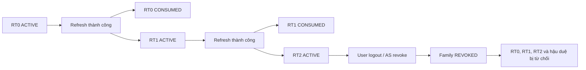
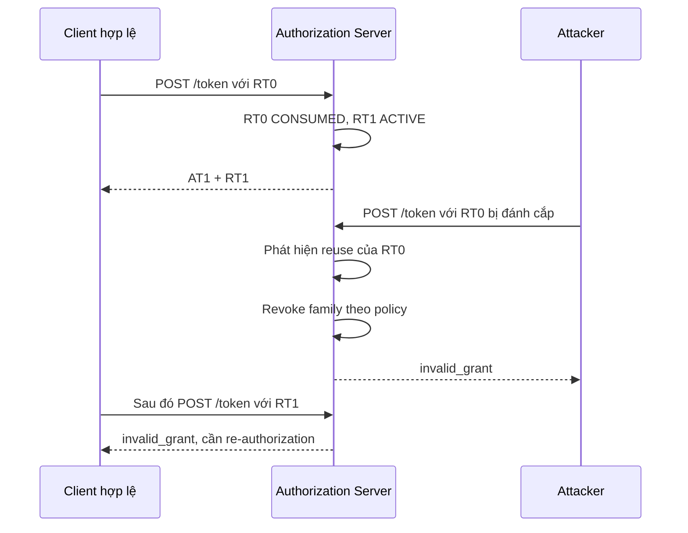
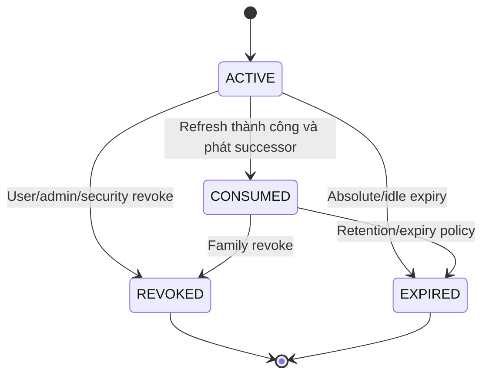
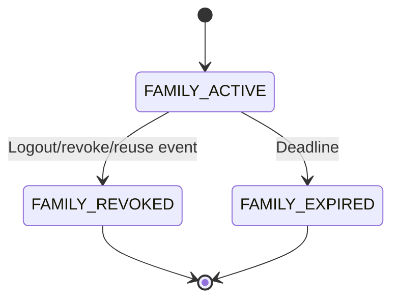

# Thu hồi refresh token

## 1. Tình huống mở đầu: người dùng bấm “Đăng xuất” nhưng token vẫn còn hiệu lực?

Một nhân viên đăng nhập ứng dụng quản lý đơn hàng bằng **OpenID Connect (OIDC) Authorization Code + PKCE**. Sau khi xác thực, ứng dụng nhận:

- **Access token (AT)** dùng gọi Orders API, hiệu lực 10 phút.
- **Refresh token (RT)** dùng tại authorization server (AS) để xin access token mới khi AT hết hạn, có thể tồn tại lâu hơn.

Sau một tuần, nhân viên phát hiện máy tính bị mất. Họ mở trang quản lý thiết bị từ điện thoại và chọn **“Thu hồi quyền truy cập của máy bị mất”**. Nếu hệ thống chỉ xóa RT trong bộ nhớ của browser đang mở mà **không thông báo cho AS**, kẻ đang giữ bản sao RT trên máy bị mất có thể tiếp tục xin AT mới.

Ngược lại, nếu AS chỉ chặn một RT cũ nhưng client đã **refresh token rotation** sang RT mới, việc thu hồi nhầm token không còn active có thể **không** ngắt được cả chuỗi RT đang sử dụng. Và ngay cả khi RT đã bị thu hồi, một AT dạng JWT đã phát trước đó có thể vẫn được API chấp nhận đến `exp` nếu RS chỉ xác minh chữ ký offline.

Do đó, “thu hồi refresh token” không đơn giản là xóa một dòng dữ liệu. Cần xác định:

1. **Token nào** được yêu cầu thu hồi?
2. **Client/phiên/grant nào** là chủ sở hữu của token?
3. **Phạm vi thu hồi** là một RT, RT family, authorization grant, một thiết bị hay mọi thiết bị?
4. **Access tokens đã phát trước đó** có bị vô hiệu ngay không, bằng cơ chế nào?
5. Khi client đang refresh **đồng thời** với việc revoke, kết quả nào được bảo đảm?
6. Làm thế nào để không lộ RT, trạng thái token hoặc chi tiết tài khoản qua endpoint/log?

> **Nguyên tắc chính:** Refresh token là một credential nhạy cảm có thể kéo dài quyền truy cập. Thu hồi RT phải được thực hiện tại **authorization server**, gắn đúng **client/grant/family**, chống việc cấp RT kế nhiệm sau khi đã revoke và có hợp đồng rõ về tác động tới access token. Xóa token ở client là cần thiết nhưng **không thay thế server-side revocation**.

Bài **“Thu hồi refresh token”** thuộc chương **Revocation**, module `SECURITY_TOKEN_SECURITY_FUNDAMENTALS`. Nội dung liên hệ mô hình tin cậy và vòng đời security token, JWT/opaque token, access/refresh token, OAuth 2.0/OIDC, claims, scope, audience, lưu trữ, thu hồi và phòng chống đánh cắp/phát lại token.

## 2. Mục tiêu học tập

Sau bài, bạn có thể:

1. Giải thích **refresh token revocation** khác **refresh token expiration**, **rotation** và **token reuse detection** như thế nào.
2. Tạo revocation request theo **RFC 7009** với HTTP POST form-encoded, `token` và `token_type_hint`.
3. Xác thực đúng OAuth client đang gọi revocation endpoint, không cho client A thu hồi/tra cứu token của client B.
4. Hiểu vì sao revocation thành công/unknown token đều có thể trả **HTTP 200** để tránh token status oracle.
5. Thiết kế phạm vi thu hồi theo **phiên/thiết bị, token family, authorization grant và toàn tài khoản** mà không tự xóa mọi quyền.
6. Phân tích mối quan hệ giữa **RT bị thu hồi**, AT đã phát, JWT validation offline, introspection và cache của resource server.
7. Xử lý an toàn **races** giữa refresh, revoke, rotation, nhiều nodes và retries.
8. Phân biệt token theft, refresh-token reuse, client authentication, sender-constrained RT và session termination.
9. Thiết kế client-side secure deletion, logout, revoke thiết bị khác, revoke khi sự cố và retry an toàn.
10. Viết ví dụ Java 17 minh họa revocation client và xây test matrix cho token lifecycle.

## 3. Nắm bốn thuật ngữ trước khi đi sâu

| Khái niệm | Hành động hoặc điều kiện | Hậu quả chính |
| --- | --- | --- |
| **Expiration** | RT tự hết hạn vì absolute lifetime/inactivity/policy | AS từ chối refresh sau hạn |
| **Revocation** | Một bên có thẩm quyền yêu cầu AS vô hiệu RT/grant, hoặc AS thu hồi do policy | RT không thể dùng để xin token mới |
| **Refresh token rotation** | Sau refresh thành công, RT hiện tại được thay bằng RT kế nhiệm; RT cũ bị consumed | Giảm khả năng sử dụng lâu dài một RT bị lộ; tạo tín hiệu reuse |
| **Reuse detection** | RT đã consumed được trình lại, theo cơ chế rotation của AS | Có thể chỉ ra token leak hoặc race; AS phản ứng bằng revoke family theo policy |

Các khái niệm có thể xảy ra đồng thời:

```text
RT0 issued
  -> client refresh thành công: RT0 CONSUMED, RT1 ACTIVE
  -> user bấm logout: RT1 REVOKED, family REVOKED
  -> attacker thử RT0: bị từ chối; ghi nhận reuse theo chính sách
  -> attacker thử RT1: bị từ chối vì family revoked
```

**Không nói “RT0 consumed nghĩa là toàn bộ grant đã bị thu hồi”**: trong rotation bình thường, RT0 không dùng lại được nhưng RT1 vẫn hoạt động.

### 3.1. Access token và refresh token khác nơi sử dụng

| Token | Bên nhận thông thường | Mục đích | Sau khi revoke RT |
| --- | --- | --- | --- |
| **Access token** | Resource server đúng audience | Truy cập API theo scope và quyền | Có thể cần cơ chế riêng để vô hiệu AT đã phát |
| **Refresh token** | AS token endpoint | Đổi thành AT mới (và RT mới nếu rotation) | Phải bị từ chối khi refresh |
| **ID token OIDC** | Relying Party/OIDC client | Xác nhận sự kiện đăng nhập | Không tự trở thành AT hay cơ chế revoke RT |
| **Authorization code** | AS token endpoint | Đổi code + PKCE verifier thành token | Không dùng làm RT |

RT phải được xem là **credential có thể cấp lại quyền**, thường nhạy cảm hơn một access token ngắn hạn. **Không gửi RT tới resource server** và không đặt RT trong URL/query string.

## 4. Sơ đồ tổng quan: thu hồi ở đâu trong OAuth 2.0?

```mermaid
sequenceDiagram
    actor U as Người dùng
    participant C as OAuth Client / BFF
    participant AS as Authorization Server
    participant RS as Orders API

    U->>C: Đăng nhập/ủy quyền
    C->>AS: Authorization Code + PKCE
    AS-->>C: Access token AT0, Refresh token RT0
    C->>RS: API request với AT0
    RS-->>C: Dữ liệu nếu AT0 hợp lệ
    Note over C,AS: Sau thời gian, AT0 sắp hết hạn
    C->>AS: POST /token với RT0
    AS->>AS: Check client, grant, RT, rotation
    AS-->>C: AT1 + RT1; RT0 consumed

    U->>C: Đăng xuất / thu hồi thiết bị
    C->>AS: POST /revoke với RT1 + client authentication khi cần
    AS->>AS: Mark token family/grant revoked theo policy
    AS-->>C: HTTP 200, không tiết lộ token status
    C->>C: Xóa RT/AT và session local

    C->>AS: POST /token với RT1 (nếu bị trình lại)
    AS-->>C: OAuth error, thường invalid_grant
    Note over C,RS: AT1 cũ có thể còn hạn nếu RS không kiểm tra trạng thái revoke
```

**Ranh giới:**

- **Client → AS revocation endpoint**: yêu cầu ngừng quyền xin token mới.
- **Client → AS token endpoint**: xin token mới; AS phải từ chối RT đã revoked/consumed.
- **Client → RS**: trình AT, RS xác minh issuer/audience/scope/expiration và trạng thái nếu policy yêu cầu.
- **User session tại client**: xóa phiên riêng, không tự suy ra RT/grant đã bị revoke.

## 5. Khi nào nên thu hồi refresh token?

Các sự kiện phổ biến:

1. **Người dùng logout khỏi một thiết bị** và ứng dụng muốn ngừng khả năng lấy AT mới từ thiết bị đó.
2. **User chọn “đăng xuất tất cả thiết bị”** hoặc quản trị viên thu hồi phiên diện rộng.
3. **Phát hiện RT bị lấy cắp/phát lại** qua refresh-token reuse detection.
4. **Thiết bị bị mất, bị bán hoặc bị chia sẻ trái phép**.
5. **OAuth client không còn được phép** truy cập tài nguyên, bị đình chỉ/thu hồi credential.
6. **Người dùng rút consent hoặc xóa kết nối ứng dụng** bên thứ ba.
7. **Thay đổi chính sách an ninh** như nhân viên nghỉ việc, tài khoản bị khóa, risk score tăng.
8. **Grant/tenant bị ngắt** hoặc quyền ứng dụng được giảm và AS yêu cầu re-authorization.
9. **Hết hạn tuyệt đối/inactivity** theo policy, dẫn tới AS không cấp token mới.
10. **Phát hiện compromise client secret/private key hoặc token store**.

Không phải sự kiện nào cũng phải xóa **mọi RT của user**. Ví dụ user logout TV phòng khách không nên mặc định làm máy tính công việc mất phiên, trừ khi hành động được thiết kế là global logout.

### 5.1. Thu hồi theo “ý định người dùng”

Một lựa chọn giao diện:

```text
[Đăng xuất thiết bị này]
  -> Thu hồi phiên/token family của riêng thiết bị hiện tại.

[Ngắt kết nối ứng dụng đối tác]
  -> Thu hồi authorization grant/client integration tương ứng.

[Đăng xuất mọi thiết bị]
  -> Thu hồi tất cả sessions/grants thuộc phạm vi người dùng theo policy.
```

AS cần **session/grant/device identifiers** đáng tin để ánh xạ hành động tới đúng token families. Không tin một query parameter `user_id=someone_else` từ trình duyệt để thu hồi tài khoản bất kỳ.

## 6. RFC 7009: Token Revocation Endpoint

**RFC 7009 — OAuth 2.0 Token Revocation** định nghĩa một endpoint cho phép client thông báo cho authorization server rằng một token không còn cần thiết.

### 6.1. Quy tắc chuẩn quan trọng

Theo RFC 7009:

- AS **MUST hỗ trợ thu hồi refresh tokens**.
- AS **SHOULD hỗ trợ thu hồi access tokens**.
- Client gửi request bằng **HTTP POST** với `Content-Type: application/x-www-form-urlencoded`.
- `token` là tham số **bắt buộc**.
- `token_type_hint` là tham số **tùy chọn**; nó giúp AS tra cứu nhanh hơn, không quyết định tính hợp lệ.
- Client gửi thông tin xác thực nếu AS/profile yêu cầu, theo registration.
- Với request hợp lệ, AS trả **HTTP 200** kể cả token đã bị vô hiệu/không tồn tại, để tránh tiết lộ trạng thái token.
- AS có thể vô hiệu các token liên quan/authorization grant theo chính sách.

**Không dùng response HTTP 200 làm bằng chứng rằng token được gửi từng tồn tại hoặc đã có đúng một bản ghi bị xóa.**

### 6.2. Revocation endpoint không phải introspection endpoint

| Endpoint | Dùng để làm gì? | Phản hồi mong đợi |
| --- | --- | --- |
| **`/revoke`** | Yêu cầu vô hiệu hóa token | Thường HTTP 200, body rỗng; tránh status oracle |
| **`/introspect`** | RS được ủy quyền hỏi token còn active không | JSON `{"active":true/false}` |
| **`/token`** | Client dùng RT hoặc grant khác để xin token | Token response hoặc OAuth error |
| **`/authorize`** | Browser đưa user tới login/consent | Authorization response |

Một client không nên **introspect** RT để “kiểm tra đã revoke chưa” nếu không có quyền và profile cho phép. Mục tiêu revocation là **yêu cầu thu hồi**, không phải truy vấn trạng thái của token bí mật.

### 6.3. Lấy endpoint đáng tin

AS có thể công bố `revocation_endpoint` qua OAuth 2.0 Authorization Server Metadata (RFC 8414) hoặc cấu hình cố định:

```json
{
  "issuer": "https://auth.example.com",
  "token_endpoint": "https://auth.example.com/token",
  "revocation_endpoint": "https://auth.example.com/revoke",
  "revocation_endpoint_auth_methods_supported": [
    "client_secret_basic",
    "private_key_jwt"
  ]
}
```

Đây là metadata minh họa, không phải mọi AS hỗ trợ cả hai methods. Client phải dùng **URL cấu hình/metadata của issuer đã tin cậy**, không lấy revocation URL từ token thô hoặc một tham số tùy ý do caller gửi.

## 7. Request thu hồi refresh token đúng giao thức

Ví dụ confidential web/BFF client có `client_id=orders-bff`:

```http
POST /revoke HTTP/1.1
Host: auth.example.com
Authorization: Basic <base64_of_form_encoded_client_id_colon_secret>
Content-Type: application/x-www-form-urlencoded
Accept: application/json

token=<refresh_token_value>&token_type_hint=refresh_token
```

Giải thích:

- `token`: **raw RT** mà client muốn AS thu hồi; bắt buộc.
- `token_type_hint=refresh_token`: chỉ là **gợi ý loại token**, tùy chọn.
- `Authorization: Basic ...`: **credential của client** để AS biết và xác thực caller, **khác** RT ở form body.
- HTTPS/TLS: bảo vệ cả RT lẫn client credential.
- Body: HTTP form-encoded, không tùy ý chuyển sang JSON nếu AS không công bố extension riêng.

### 7.1. Một số tham số không có vai trò ở revocation request

Revocation chuẩn RFC 7009 không yêu cầu:

```text
grant_type=refresh_token
scope=orders:read
redirect_uri=...
code_verifier=...
client_assertion=... (trừ khi dùng làm client authentication theo profile)
```

`grant_type=refresh_token` thuộc **token request để refresh**, không phải yêu cầu revoke. `code_verifier` dành cho PKCE trong Authorization Code exchange; nó không phải chứng cứ thu hồi token.

### 7.2. Form encoding đúng

Nếu RT chứa ký tự đặc biệt:

```text
raw RT example: a+b/c=d
encoded token parameter: a%2Bb%2Fc%3Dd
```

Dùng form encoder của HTTP library. Không ghép body bằng cách nối raw token với `&` hay `=` khiến AS parse sai. **Không đặt token trong query string**, vì URL bị log/cached/ghi trong traces dễ hơn.

### 7.3. Không gửi RT qua resource server

Sai:

```http
POST /logout HTTP/1.1
Host: orders-api.example.com
Authorization: Bearer <refresh_token>
```

Đúng kiến trúc thường là:

- Client/BFF gửi RT **tới AS revocation endpoint**, được bảo vệ theo registration.
- Resource server chỉ nhận **access token**, không chấp nhận RT như bearer AT.
- Backend ứng dụng có thể có logout endpoint riêng để xóa session cookie và **ủy nhiệm** revoke RT tại AS nếu thiết kế BFF, không lộ raw RT ra browser.

## 8. Client authentication và quyền thu hồi token

**Chỉ việc biết một chuỗi token không mặc nhiên cho phép bất kỳ OAuth client nào thu hồi token của client khác.** AS phải xác minh caller và ràng buộc của token theo chuẩn/profile.

### 8.1. Confidential client

Một backend/BFF có thể xác thực tại `/revoke` qua:

| Phương thức | Bằng chứng | Lưu ý |
| --- | --- | --- |
| `client_secret_basic` | Shared secret đã đăng ký | Bảo vệ secret, TLS, không log Basic |
| `private_key_jwt` | Client assertion JWT ký bởi key đăng ký | Kiểm tra `iss`, `sub`, `aud`, `exp`, signature và replay theo profile |
| mTLS client authentication | Client certificate/private key | Ràng buộc đúng client registration và PKI |
| Phương thức khác được AS công bố | Theo AS profile | Không tự thử mọi phương thức khi một phương thức fail |

RFC 6749 §2.3.1 yêu cầu **form-encode riêng** `client_id` và `client_secret` trước khi nối bằng `:` và Base64 cho HTTP Basic. **Base64 không phải mã hóa bí mật**.

### 8.2. Public client

SPA, native app và nhiều TV apps không thể coi client secret đóng trong mã/binary là bí mật đáng tin.

AS có thể cho public client gọi revocation endpoint mà không có secret cố định, nhưng phải áp dụng **client binding, token/grant policy và các kiểm soát** theo registration. Việc public client gửi `client_id` **không chứng minh** người gọi chính là instance gốc.

Không giải quyết bằng cách phát client secret sản phẩm cho tất cả browser để gọi `/revoke`.

### 8.3. Không cho client A kiểm tra/thu hồi token của client B

Ví dụ:

```text
Client A = orders-web
Client B = partner-dashboard

RT_B thuộc grant của Client B.
Client A gửi RT_B tới /revoke.
```

AS phải kiểm soát quyền và **không cho A can thiệp grant B trái policy**. Trong các trường hợp token không được caller biết hoặc không tồn tại, response có thể được thiết kế tránh lộ token existence, nhưng không được tiết lộ `sub`, owner, client B hay quyền của grant.

Một endpoint trả:

```text
"Token thuộc client partner-dashboard, subject alice@example.com"
```

cho Client A là một **token-oracle/privacy bug**.

### 8.4. Revocation theo user/admin khác revocation bởi OAuth client

Khi user bấm **“revoke all sessions”** trên account-security page, AS thường thao tác bằng **authenticated end-user/admin session** và quyền server-side, không yêu cầu user gửi raw RT của từng thiết bị.

Đây là chức năng quản lý **grants/sessions** có thể triển khai nội bộ; RFC 7009 là giao thức chuẩn để **OAuth client trình một token để yêu cầu revoke**. Không nhầm hai giao diện thành cùng authorization model.

## 9. Phản hồi RFC 7009: 200 không có nghĩa “token từng tồn tại”

Với revocation request được xử lý hợp lệ, AS thường trả:

```http
HTTP/1.1 200 OK
Cache-Control: no-store
Content-Length: 0
```

Ngay cả khi:

- RT đã bị revoke trước đó.
- RT đã hết hạn.
- Token không tồn tại hoặc là token giả.
- RT đã consumed theo rotation.
- Giá trị `token_type_hint` không giúp AS tìm token và AS áp policy tìm kiếm thích hợp.

**Ý nghĩa của HTTP 200:** Yêu cầu revocation đã được AS xử lý theo contract bảo mật, **không phải xác nhận có một token active đã được tìm thấy/thu hồi**.

### 9.1. Vì sao trả 200 cho token không tồn tại?

Nếu AS trả:

```text
200 => token có thật
404 => token không tồn tại
```

kẻ tấn công có thể gửi hàng loạt token guesses và dùng endpoint để **dò trạng thái**. Từ đó suy ra thông tin về tài khoản/token/grants.

Cách hành xử idempotent và không tiết lộ trạng thái giúp giảm token enumeration. Nhưng AS vẫn phải **xác thực/giới hạn quyền caller**, vì 200 đồng nhất không đủ chặn DoS.

### 9.2. Một số lỗi hợp lệ của revocation endpoint

| Tình huống | Phản hồi điển hình | Cách hiểu |
| --- | --- | --- |
| Token tồn tại và được revoke | HTTP 200 | Không xác nhận existence |
| Token không tồn tại/đã revoke | HTTP 200 | Idempotent, tránh oracle |
| Request thiếu `token` hoặc sai form | `invalid_request` theo OAuth handling | Client request lỗi |
| Client credential sai | `invalid_client` hoặc HTTP auth failure theo method/profile | Không phải bằng chứng RT inactive |
| Token type AS không hỗ trợ revoke | `unsupported_token_type` (RFC 7009) | Client/profile không tương thích |
| AS tạm thời không sẵn sàng | HTTP 5xx/503 hoặc network failure | **Chưa thể kết luận revoke đã xảy ra** |
| Bị rate limit | HTTP 429 nếu AS triển khai | Retry theo policy, không spam |

Lỗi `unsupported_token_type` là extension error code được RFC 7009 định nghĩa. Nhưng AS **MUST** hỗ trợ revocation của refresh tokens theo chuẩn, do đó RT thuộc profile AS không nên bị từ chối chỉ vì “revocation không hỗ trợ RT”.

### 9.3. Bên client xử lý ra sao?

- **HTTP 200**: chuyển sang trạng thái local logged out/revoked theo user intention, xóa RT đã quản lý và token cache; không yêu cầu AS chứng minh token từng active.
- **HTTP 401 do client auth lỗi**: cảnh báo cấu hình/credential, không coi như revoke đã hoàn tất phía AS.
- **HTTP 503/timeout**: trạng thái revoke phía AS **chưa rõ**; không nói “server-side revoke thành công” nếu chưa có chứng cứ.
- Với retry, phải chú ý raw RT có thể bị xóa local trước khi retry; thiết kế BFF có thể đặt outbox/revocation job an toàn với giới hạn lưu credential, hoặc xử lý sự cố theo risk policy.

**Khi user logout, ứng dụng vẫn nên xóa local session/RT** dù AS đang không sẵn sàng; nhưng phải minh bạch rằng **server-side revocation chưa được xác nhận**, nếu điều đó ảnh hưởng mục tiêu bảo mật.

## 10. Phạm vi thu hồi: một token hay cả authorization grant?

Một authorization grant có thể liên quan nhiều token:

```text
Authorization grant G1
  Client: orders-web
  User:   user-123
  Scope:  orders:read
  Device/session: laptop-7

  Refresh-token family F1:
      RT0 -> RT1 -> RT2 (RT2 active)

  Issued access tokens:
      AT0 (may be expired)
      AT1 (possibly still active)
      AT2 (possibly still active)
```

Khi thu hồi RT2, AS có những chính sách có thể khác nhau:

1. **Chỉ RT2** và không có RT successor nào được phát sau đó.
2. **Cả family F1**, chặn RT0/RT1/RT2 và mọi hậu duệ.
3. **Authorization grant G1**, bao gồm cả family và tokens liên quan thuộc phạm vi grant.
4. **Các AT đã phát dựa trên G1**, nếu AS/RS hỗ trợ trạng thái revoke.
5. **Mọi phiên của user/client** nếu đây là global revocation được user/admin yêu cầu.

**Phạm vi phải được định nghĩa rõ trong thiết kế**, không chỉ dựa vào tên nút “logout”.

### 10.1. RFC 7009 nói gì về token liên quan?

RFC 7009 mô tả revocation có thể ảnh hưởng **token khác và authorization grant liên quan** theo chính sách AS.

Đặc biệt, khi RT được thu hồi **và AS hỗ trợ thu hồi access tokens**, RFC 7009 **SHOULD** vô hiệu hóa các access tokens cùng authorization grant. Tuy nhiên cách hiệu lực đến RS và những kiến trúc JWT offline cần xử lý riêng.

Nếu token được revoke là **access token**, AS **MAY** thu hồi refresh token tương ứng. Không tự nói revoke AT luôn tự hủy RT hay ngược lại có hiệu lực tức thì ở mọi RS.

### 10.2. Tách “một thiết bị” và “mọi thiết bị”

Ví dụ:

```text
User 123:
  Laptop A: grant G_A, RT family F_A
  Phone B:  grant G_B, RT family F_B
  TV C:     grant G_C, RT family F_C
```

Yêu cầu “Đăng xuất Laptop A” nên ngắt F_A/G_A theo chính sách, **không mặc định** phá F_B/F_C. Ngược lại, yêu cầu “Đăng xuất mọi thiết bị” cần tìm/đánh dấu **tất cả grants** thuộc phạm vi user/account và issuer.

**Một `sub` có nhiều clients/tenants/issuers**; phải tránh revoke nhầm grants của người khác chỉ vì user ID/username giống.

### 10.3. Thu hồi grant không luôn đồng nghĩa xóa toàn bộ dữ liệu

Grant revocation và **xóa dữ liệu cá nhân** là hai công việc khác nhau. Revocation có thể ngừng khả năng xin token mới, còn ứng dụng phải tuân retention/privacy policy đối với dữ liệu đã đồng bộ trước đó.

## 11. Refresh token family khi sử dụng rotation

Refresh token rotation thường được mô hình hóa dưới dạng một **token family** gồm các RT phát sinh kế tiếp nhau từ cùng phiên/grant.



AS phải duy trì những bất biến:

- Mỗi RT thuộc **đúng family/grant/client context**.
- Mỗi family active có **tối đa một RT current** trong mô hình rotation tuần tự thông dụng.
- RT consumed không thể refresh thêm.
- Khi family revoked, **không RT successor nào được phát hợp lệ**.
- Refresh và revoke phải được **sắp xếp nguyên tử** theo family/grant, kể cả nhiều AS nodes.
- Nếu yêu cầu chỉ revoke device A, family/grant của device B không bị tác động ngoài ý định.

### 11.1. Vì sao revoke “raw token hiện tại” thôi có thể chưa đủ?

Giả sử AS chỉ update đúng row có digest của RT1:

```text
t0  Client có RT1
t1  Token refresh transaction phát RT2, RT1 consumed
t2  Logout request đến, vẫn mang RT1
t3  AS đánh dấu RT1 revoked
t4  RT2 vẫn active vì revoke không gắn family
```

Đây là một kiểu **revocation bypass do race hoặc stale token reference**.

Giải pháp: tìm **family/grant** qua RT đã được biết, kể cả RT consumed trong retention window, và thực thi chính sách revoke family. Nếu AS không thể truy ra family từ token cũ, cần một cơ chế quản trị session/grant riêng với quyền phù hợp.

Không cho phép client gửi `family_id` tùy ý rồi AS tin đó là family cần revoke. Family/owner phải được AS xác định từ bản ghi trusted.

### 11.2. Family không nhất thiết đồng nghĩa account

Nếu user đăng nhập 3 thiết bị, mỗi thiết bị có một family riêng. Reuse detection của F_A có thể revoke **F_A**, nhưng không nhất thiết revoke F_B/F_C; phạm vi phản ứng dựa theo risk policy.

Ngược lại, sự cố lộ client secret ở backend dùng chung nhiều users có thể yêu cầu **revoke rộng hơn một family**.

## 12. Reuse detection và revoke khi refresh token bị trình lại

Nếu AS dùng rotation, mỗi lần refresh hợp lệ tiêu thụ RT hiện hành. Khi RT đã consumed được trình lại, đó là tín hiệu **reuse**.



### 12.1. RT bị đánh cắp trước hay sau khi client refresh?

**Attacker dùng sau client:**

- Client tiêu thụ RT0 trước, nhận RT1.
- Attacker trình RT0 → AS phát hiện reuse.
- AS có thể revoke toàn family để chặn attacker/client nếu không phân biệt được ai giữ RT thật.

**Attacker dùng trước client:**

- Attacker tiêu thụ RT0 trước, nhận RT1.
- Client sau đó trình RT0 → cũng là reuse.
- AS không thể chỉ dựa vào thứ tự để kết luận **bên nào là attacker**.

Vì thế khi reuse nghiêm trọng, thu hồi family là phản ứng bảo thủ. Có thể cần re-authenticate user và điều tra môi trường client.

### 12.2. Rotation khác revocation chủ động

- **Rotation** là quy trình thông thường khi refresh thành công.
- **Reuse detection** là tín hiệu có thể do token leak hoặc client concurrency/retry sai.
- **Revocation** là kết quả vô hiệu token/family/grant theo quyết định bảo mật.

Không được coi mọi retry lỗi mạng là bằng chứng chắc chắn có attacker. Tuy nhiên, không nới “grace window” một cách tùy tiện để một RT consumed có thể tiếp tục cấp token, vì nó làm giảm khả năng phát hiện lạm dụng.

### 12.3. OAuth Security BCP và public clients

RFC 9700 (OAuth 2.0 Security Best Current Practice) yêu cầu refresh tokens được cấp cho **public clients** được bảo vệ khỏi replay bằng **refresh token rotation hoặc sender-constraining** phù hợp. Nếu AS chọn rotation, việc phát hiện reuse và thu hồi token chain/family là trọng tâm.

Đây không phải lý do bỏ bảo vệ cho confidential clients; cả public/confidential clients vẫn cần secret storage, grant binding, scopes, TTL và monitoring phù hợp.

## 13. State machine cho refresh token và family

Một thiết kế có thể tách **token state** và **family state**:

```text
Individual RT:
  ACTIVE
  CONSUMED        (đã dùng trong rotation)
  REVOKED         (bị thu hồi theo policy)
  EXPIRED         (hết thời hạn)

Family:
  ACTIVE
  REVOKED
  EXPIRED
  COMPROMISED     (có thể là lý do revocation hoặc status riêng)
```



Family state độc lập:



### 13.1. Những bất biến cần giữ

1. Một RT đã **REVOKED** không thể trở về ACTIVE.
2. Family **REVOKED** không được phát RT successor.
3. Token endpoint kiểm tra **cả RT state và family/grant state**.
4. Revocation event phải có hiệu lực với token issuance sau thời điểm commit theo consistency contract.
5. Không sử dụng `exp` cũ trong JWT RT để bỏ qua record trạng thái của family.
6. Token ownership/tenant/client binding phải được kiểm tra trước khi revoke family.
7. Việc giữ metadata của token consumed phải đủ để phát hiện reuse và ánh xạ family trong thời gian rủi ro.

## 14. Race condition: refresh và revoke xảy ra đồng thời

Hệ thống phân tán thường chạy nhiều AS nodes, nhiều workers và nhiều tabs. Hai request có thể chồng nhau:

```text
Request A: POST /token với RT5 (refresh)
Request B: POST /revoke với RT5 (logout)
```

Nếu xử lý không nguyên tử:

```text
A reads RT5 ACTIVE, family ACTIVE
B reads RT5 ACTIVE, family ACTIVE
B marks RT5 REVOKED, returns 200
A issues RT6 ACTIVE based on stale read
=> Token mới xuất hiện SAU khi revoke đã được xác nhận
```

Đây là **revocation race** nghiêm trọng.

### 14.1. Chốt hiệu lực với transaction/lock/CAS

Thiết kế có thể dùng:

- Database transaction với row lock trên **family/grant**.
- Compare-and-swap (CAS) với version.
- Atomic conditional update và unique constraint trên active successor.
- Per-family serialization ở service layer kết hợp durable DB coordination.

Pseudo-code:

```text
function refresh(rt, client, senderProof):
    begin transaction
        family = lockFamily(findFamilyByDigest(rt))
        assert family.state == ACTIVE
        token  = loadTokenForUpdate(hash(rt))
        assert token.state == ACTIVE
        assert token.client == client
        assert senderBindingMatches(token, senderProof)
        assert notExpired(token, family)
        token.state = CONSUMED
        successor = generateNewHighEntropyRT()
        save successor ACTIVE, bound to same family/client/grant
        issue/update access-token metadata per policy
    commit
    return AT + successor

function revoke(rt, client):
    begin transaction
        token = lookupKnownTokenByDigest(rt)
        if token exists and authorizedForClient(token, client):
            family = lockFamily(token.familyId)
            family.state = REVOKED
            family.revokedAt = now()
            mark current refresh token revoked
            enqueue access-token invalidation event per policy
    commit
    return HTTP 200 without token-existence disclosure
```

Nếu refresh transaction lock trước, nó có thể cấp RT6 rồi revocation transaction chặn **family chứa RT6**. Nếu revocation transaction commit trước, refresh transaction sau phải **thấy family REVOKED và từ chối**.

### 14.2. Commit trước khi trả success

Không:

```text
return 200 /revoke
  -> enqueue async DB write
  -> nếu worker queue fail, RT vẫn active vô hạn
```

Nếu API trả thành công với cam kết revocation, **thay đổi quyết định cấp token mới cần được ghi/đồng bộ đáng tin trước**. Propagation đến RS của các AT cũ có thể theo eventual consistency và SLO riêng.

### 14.3. Concurrent tabs và refresh retries

Hai tabs của một SPA/BFF cùng dùng RT5:

- Tab A refresh thành công RT5→RT6.
- Tab B vẫn giữ RT5 và refresh → AS thấy reuse.
- AS có thể revoke family dù cả hai tabs đều thuộc người dùng hợp lệ.

Client cần **single-flight refresh**, đồng bộ token state giữa tabs/pods theo cơ chế an toàn, và xử lý token-response-lost sau commit. Không “sửa” bằng cách cho phép RT đã consumed tùy ý đổi lại AT/RT.

Khi user logout, client cần **ngừng các refresh jobs đang chờ**, xóa cache và bảo đảm late response từ request refresh không khôi phục session đã logout.

## 15. Storage: lưu RT sao cho có thể revoke nhưng không lộ raw token?

AS thường phát **opaque refresh token có entropy cao**:

```text
RT = CSPRNG 256-bit random -> Base64url, no padding
```

Một RT opaque là bearer secret; bất kỳ ai lấy được raw value có thể thử dùng nếu không có sender binding/client authentication đủ mạnh.

### 15.1. Không lưu raw RT plaintext nếu không cần

Một mô hình tra cứu:

```text
raw RT (client only)
   -> digest = HMAC-SHA-256(server-side lookup secret, raw RT)
   -> database lookup digest
   -> token metadata + family_id + grant_id + status
```

HMAC key phải được bảo vệ/rotation theo chính sách. Một **token ngẫu nhiên đủ entropy** cũng có thể được hash bằng cryptographic digest phù hợp; dùng HMAC hỗ trợ giảm khả năng offline token correlation nếu DB lộ mà key không lộ.

**Không dùng hash RT để cho caller introspect/revoke bất kỳ token nào không thuộc client**. Digest chỉ là storage/indexing, authorization cần kiểm tra riêng.

### 15.2. Schema khái niệm

```sql
-- Schema minh họa; không phụ thuộc hệ quản trị DB cụ thể.
CREATE TABLE authorization_grants (
    grant_id         VARCHAR(128) PRIMARY KEY,
    issuer_id        VARCHAR(255) NOT NULL,
    client_id        VARCHAR(128) NOT NULL,
    subject_id       VARCHAR(128),
    tenant_id        VARCHAR(128),
    state            VARCHAR(24) NOT NULL,
    created_at       TIMESTAMP NOT NULL,
    revoked_at       TIMESTAMP
);

CREATE TABLE refresh_token_families (
    family_id        VARCHAR(128) PRIMARY KEY,
    grant_id         VARCHAR(128) NOT NULL,
    device_session   VARCHAR(128),
    state            VARCHAR(24) NOT NULL,
    current_rt_id    VARCHAR(128),
    version          BIGINT NOT NULL,
    absolute_expires TIMESTAMP NOT NULL,
    idle_expires     TIMESTAMP,
    revoked_at       TIMESTAMP
);

CREATE TABLE refresh_tokens (
    rt_id            VARCHAR(128) PRIMARY KEY,
    family_id        VARCHAR(128) NOT NULL,
    token_digest     VARBINARY(32) NOT NULL UNIQUE,
    state            VARCHAR(24) NOT NULL,
    issued_at        TIMESTAMP NOT NULL,
    expires_at       TIMESTAMP NOT NULL,
    consumed_at      TIMESTAMP,
    revoked_at       TIMESTAMP
);
```

Các foreign keys/indexes/constraints/retention/partitions và transactional guarantees phải được hoàn thiện theo hệ quản trị DB. Đây **không phải schema production copy-paste**.

### 15.3. Vì sao cần giữ token consumed metadata?

Nếu xóa sạch RT0 ngay khi RT1 được phát, AS khó phát hiện:

- RT0 bị attacker trình lại.
- RT0 của family nào để revoke.
- Cửa sổ nghi ngờ token leak.
- Sự kiện reuse nối với client/issuer/tenant nào.

Có thể lưu **digest + trạng thái + family ID** trong retention phù hợp mà không giữ raw RT. Không giữ vô hạn mọi metadata nếu không cần: áp privacy/retention, TTL và threat model.

### 15.4. JWT refresh token thì sao?

Một AS có thể chọn RT dạng JWT/signed token, nhưng **chữ ký hợp lệ không chứng minh RT chưa bị revoke/consumed**. Nếu muốn rotation/reuse detection/revocation tức thì, AS vẫn cần trạng thái server-side hoặc cơ chế đáng tin tương đương.

Không chỉ làm:

```text
if verifyJwtSignature(rt) && rt.exp > now:
    issueNewAccessToken()
```

mà bỏ kiểm tra RT family/grant state và client binding.

## 16. Thời hạn tuyệt đối, inactivity và revocation

AS nên có policy rõ:

- **Absolute expiration**: Family/grant không sống quá một mốc tối đa.
- **Idle expiration**: Nếu RT không được sử dụng một thời gian, family hết hiệu lực.
- **Client credentials compromise**: Client bị revoke không còn được refresh.
- **User logout/account disable**: Các families được chọn bị revoke ngay tại AS.
- **Rotation**: Mỗi RT kế nhiệm không được kéo dài vô hạn **absolute lifetime** của family nếu chính sách quy định cố định từ lần phát đầu.
- **Grace/response-lost handling**: Nếu AS áp cơ chế giảm false-positive, phải chứng minh nó không tạo replay loophole.

Ví dụ:

```text
Family created: 2026-01-01 10:00Z
Absolute lifetime: 30 ngày
Idle timeout: 7 ngày
RT rotation: mỗi refresh phát RT mới

2026-01-31 10:00Z:
  Family hết absolute lifetime dù RT cuối mới phát 5 phút trước.
```

**Thời gian trên chỉ minh họa**, không phải TTL bắt buộc của OAuth. Một app ngân hàng có thể chọn TTL ngắn hơn, TV cá nhân có thể có policy khác với TV khách sạn.

### 16.1. Expiration không thay nhu cầu revoke theo sự kiện

Nếu RT có `expires_at` còn 20 ngày và thiết bị vừa bị mất, chờ expiration có thể quá rủi ro. Revocation cho phép ngắt quyền **trước expiry**.

Ngược lại, chỉ vì RT đã hết hạn không có nghĩa AS phải giữ mọi record tới vô thời hạn; metadata retention và chống reuse có SLO riêng.

## 17. Access token đã phát sẽ ra sao?

Đây là câu hỏi quan trọng nhất sau “RT bị revoke thành công”.

### 17.1. AT không tự biến mất khỏi client

Khi AS revoke RT1:

```text
RT1:
  Cannot obtain AT2 after revocation.

AT1 already issued:
  May still be accepted until exp, unless RS consults revocation state.
```

Client thường xóa AT1 local khi logout, nhưng kẻ tấn công giữ bản sao AT1 có thể tiếp tục trình token.

### 17.2. JWT access token kiểm tra offline

Nếu Orders API chỉ kiểm tra:

- JWT signature.
- `iss`, `aud`.
- `exp`, `nbf`.
- `scope`, resource policy.

nó **không tự biết** AS đã revoke RT/grant. JWT vẫn có chữ ký đúng và còn `exp`. Cần:

- AT TTL ngắn.
- `jti` denylist hoặc grant/session version lookup.
- Introspection hoặc revocation-status service đáng tin.
- Event-driven invalidation đủ tin cậy.
- Policy lookup cho user/client đã disable.
- Kết hợp theo rủi ro/SLO.

### 17.3. Opaque AT và introspection

RS có thể hỏi AS theo **RFC 7662**:

```http
POST /introspect HTTP/1.1
Host: auth.example.com
Authorization: Basic <trusted_resource_server_auth>
Content-Type: application/x-www-form-urlencoded

token=<access_token>&token_type_hint=access_token
```

AS trả:

```json
{"active":false}
```

nếu AT đã bị vô hiệu theo AS policy. Nhưng **introspection cache** tại RS có thể tiếp tục giữ `active:true` một thời gian; mục tiêu thu hồi phải tính cả cache TTL, propagation delay và region.

### 17.4. Thời gian ngắt quyền cần SLO

Ví dụ một tổ chức yêu cầu:

```text
Khi user "Revoke this device" được xác nhận:
  - không cho phép RT family cấp AT mới sau revocation commit;
  - AT đã phát không được API chấp nhận quá 60 giây;
  - không còn client session cookie local ở thiết bị thực hiện logout.
```

**60 giây chỉ minh họa**. Thiết kế cần TTL/cache/revocation propagation đáp ứng SLO. Không quảng cáo “revoke RT tức thì vô hiệu mọi API access” nếu RS vẫn chấp nhận AT JWT offline cho đến `exp`.

## 18. Logout trong OIDC không đồng nghĩa RFC 7009 revocation

**OIDC logout**, **xóa session ứng dụng**, và **OAuth refresh-token revocation** là ba hoạt động khác nhau.

| Tác vụ | Đối tượng | Điều gì chưa được đảm bảo? |
| --- | --- | --- |
| Xóa application session cookie | Phiên browser ↔ ứng dụng | RT bị đánh cắp ở nơi khác chưa chắc bị revoke |
| RP-initiated logout tại OP | Phiên SSO của user tại OP theo profile | RT/grants của từng client/thiết bị chưa chắc đều bị revoke |
| Back-channel/front-channel logout | Thông báo end-session giữa OP/RPs theo profile | Không mặc định vô hiệu mọi AT ở RS |
| RFC 7009 revoke RT | RT/grant theo chính sách AS | AT cũ ở RS có thể còn hợp lệ |
| Account security “revoke all devices” | Nhiều grants/session families | Cần AS/OP và các RPs thực thi policy, không chỉ một RT |

### 18.1. Đăng xuất nên phối hợp các lớp

Một BFF có thể:

1. Chặn các request mới ở session hiện tại.
2. Hủy hoặc khóa refresh operations đang chạy.
3. Yêu cầu AS revoke RT/family theo policy.
4. Xóa local AT/RT, server-side session và cookie.
5. Tùy sản phẩm, chuyển browser tới OP logout endpoint đúng profile.
6. Ghi audit không có raw token.
7. Nếu AS revoke chưa xác nhận, giữ trạng thái/biện pháp xử lý sự cố theo risk policy.

Nếu user bấm “logout” trong một SPA public client, không được giả định việc `localStorage.removeItem("refresh_token")` đã chặn RT nếu bản sao bị attacker lấy trước đó.

## 19. Client gọi revocation endpoint bằng Java 17

Ví dụ dưới đây minh họa **confidential backend/BFF client** gửi RFC 7009 revocation request qua Java `java.net.http.HttpClient`, xác thực theo `client_secret_basic`.

Giả định:

- AS đã công bố/trusted configuration `https://auth.example.com/revoke`.
- OAuth client được đăng ký là `orders-bff` với `client_secret_basic`.
- RT đang thuộc client/grant đó và được giữ server-side.
- Client muốn revoke RT trong logout flow.
- Đây là **ví dụ giáo dục**, chưa thay thế OAuth client library/framework production.

### 19.1. Mã gửi revocation request

```java
import java.net.URI;
import java.net.URLEncoder;
import java.net.http.HttpClient;
import java.net.http.HttpRequest;
import java.net.http.HttpResponse;
import java.nio.charset.StandardCharsets;
import java.time.Duration;
import java.util.Base64;

public final class RefreshTokenRevoker {

    private static final URI REVOCATION_ENDPOINT =
            URI.create("https://auth.example.com/revoke");

    private final HttpClient httpClient;

    public RefreshTokenRevoker() {
        this.httpClient = HttpClient.newBuilder()
                .connectTimeout(Duration.ofSeconds(5))
                // Không tự chuyển token và Basic credential sang host khác.
                .followRedirects(HttpClient.Redirect.NEVER)
                .build();
    }

    private static String form(String value) {
        return URLEncoder.encode(value, StandardCharsets.UTF_8);
    }

    private static String clientSecretBasic(
            String clientId, String clientSecret) {
        // RFC 6749 §2.3.1: form-encode từng thành phần trước Base64.
        String pair = form(clientId) + ":" + form(clientSecret);
        return "Basic " + Base64.getEncoder().encodeToString(
                pair.getBytes(StandardCharsets.UTF_8));
    }

    /**
     * Trả về true khi AS xử lý request RFC 7009 thành công (HTTP 200).
     * Không xác nhận token từng tồn tại.
     */
    public boolean revoke(
            String refreshToken,
            String clientId,
            String clientSecret) throws Exception {

        if (refreshToken == null || refreshToken.isBlank()) {
            throw new IllegalArgumentException("Missing refresh token");
        }
        if (clientId == null || clientId.isBlank()
                || clientSecret == null || clientSecret.isBlank()) {
            throw new IllegalStateException("Client credential not configured");
        }

        String body = "token=" + form(refreshToken)
                + "&token_type_hint=refresh_token";

        HttpRequest request = HttpRequest.newBuilder(REVOCATION_ENDPOINT)
                .timeout(Duration.ofSeconds(10))
                .header("Content-Type", "application/x-www-form-urlencoded")
                .header("Accept", "application/json")
                .header("Authorization",
                        clientSecretBasic(clientId, clientSecret))
                .POST(HttpRequest.BodyPublishers.ofString(
                        body, StandardCharsets.UTF_8))
                .build();

        HttpResponse<String> response = httpClient.send(
                request,
                HttpResponse.BodyHandlers.ofString(StandardCharsets.UTF_8));

        int status = response.statusCode();

        if (status == 200) {
            // 200 = request xử lý thành công kể cả RT đã không tồn tại.
            // Không cố parse JSON {"revoked":true}; RFC7009 không yêu cầu.
            return true;
        }

        if (status == 401 || status == 403) {
            // Đây là lỗi credential/authorization của revocation caller,
            // không phải bằng chứng refresh token đã bị thu hồi.
            throw new SecurityException(
                    "Revocation client authentication/authorization failed");
        }

        if (status == 503 || status >= 500) {
            throw new IllegalStateException(
                    "Revocation AS temporarily unavailable; status=" + status);
        }

        throw new IllegalStateException(
                "Revocation request was not accepted; status=" + status);
    }
}
```

Cách sử dụng minh họa:

```java
String clientId = System.getenv("OAUTH_CLIENT_ID");
String clientSecret = System.getenv("OAUTH_CLIENT_SECRET");
String currentRefreshToken = refreshTokenFromProtectedServerSession;

// Gọi trong một service method; không đặt top level của Java source.
RefreshTokenRevoker revoker = new RefreshTokenRevoker();
boolean processed = revoker.revoke(
        currentRefreshToken, clientId, clientSecret);

if (processed) {
    // Sau đó hoàn tất xóa token/session/cookie theo logout policy.
    // Không ghi ra log raw refresh token.
    sessionStore.invalidateCurrentSession();
}
```

### 19.2. Giới hạn của ví dụ Java

1. Chỉ hỗ trợ `client_secret_basic`. Với public client, `private_key_jwt` hoặc mTLS, cần implementation/profile riêng.
2. Cấu hình endpoint tĩnh; production có thể lấy từ **issuer metadata đáng tin** và phải kiểm tra đúng AS.
3. `Boolean true` chỉ cho biết HTTP 200, **không thể chứng minh token có thật**.
4. Ví dụ chưa parse lỗi `unsupported_token_type`/`invalid_request` trong JSON; production cần error contract của AS với **response-size limit**.
5. Chưa giới hạn độ dài RT, chưa áp retries/backoff/circuit breaker.
6. Java `String` giữ secret trong memory; không bảo đảm xóa ngay và có thể bị dump, nên quản trị process/memory/telemetry là bắt buộc.
7. Biến môi trường tiện để minh họa nhưng không phải secret-management strategy đầy đủ. Có thể dùng vault, workload identity hoặc KMS.
8. Không tự follow HTTP redirects; nếu AS trả 3xx, xử lý như lỗi cấu hình/triển khai cần kiểm tra.
9. Không tự tắt TLS certificate/hostname verification để “cho chạy được”.
10. Ví dụ gọi revocation đồng bộ trước khi xóa session; một hệ thống cần **local logout ngay cả khi AS down** nên thiết kế transaction/outbox và UX riêng.
11. Nếu RT vừa bị rotate tại thread khác, cần lấy đúng **family/session context**, stop refreshing và tránh revoke stale RT mà không chặn successor.
12. Lỗi HTTP không nói chắc AS chưa commit revocation. Network response có thể mất **sau khi server đã commit**; retry phải idempotent theo contract.
13. Chưa tích hợp Session/CSRF protections, account-level logout, logging và cleanup hoàn chỉnh.
14. Không dùng ví dụ như thư viện OAuth production; ưu tiên SDK/framework đã hỗ trợ RFC 7009.

### 19.3. Đừng dùng token response để dò trạng thái

Một anti-pattern:

```java
if (response.statusCode() == 200) {
    System.out.println("Refresh token was confirmed active and revoked.");
}
```

Chính xác hơn:

```text
AS đã xử lý yêu cầu thu hồi theo RFC7009.
Trạng thái/identity của RT trước request không được tiết lộ.
```

Nếu chức năng quản trị muốn liệt kê các sessions/grants đã thu hồi, dùng **authenticated account-security API** của AS, không dựa vào endpoint RFC 7009 để dò raw token.

## 20. Thiết kế server-side revocation endpoint

Một authorization server phải bảo đảm cả **giao thức** lẫn **atomicity của trạng thái token**.

### 20.1. Pseudocode endpoint

```text
function handleRevocationRequest(httpRequest):
    require HTTPS and POST
    parsed = strictlyParseForm(httpRequest, inputLimits)
    if duplicateOrAmbiguous(parsed.token):
        return oauthError("invalid_request")
    if missing(parsed.token):
        return oauthError("invalid_request")

    caller = authenticateClientByRegisteredMethod(httpRequest)
    if caller invalid:
        return invalidClientResponse()  # Không tiết lộ token owner

    if unsupportedTokenTypeHintAndPolicyRejects(parsed.token_type_hint):
        # Không bác chỉ vì hint sai khi AS có thể xử lý token.
        # unsupported_token_type chỉ khi loại token không được hỗ trợ.
        handlePerRFC7009Policy()

    digest = HMAC(serverLookupKey, parsed.token)
    token = lookupKnownRefreshTokenOrSupportedToken(digest)

    if token not found:
        return 200 emptyBody  # Không token enumeration

    if !callerCanRevoke(caller, token):
        # Không cho caller mở rộng quyền ra token/grant khác.
        # Không tiết lộ owner/grant metadata.
        return nonDisclosingOutcomePerASPolicy()

    begin durable transaction:
        family = lockRelatedFamily(token.familyId)
        grant = loadAndLockGrantIfPolicyRequires(token.grantId)

        if family.state != REVOKED:
            family.state = REVOKED
            family.revokedAt = trustedNow()
            family.version += 1
        revokeCurrentRTAndSuccessors(family)
        recordRevocationAuditMetadataWithoutToken()
        persistAccessTokenInvalidationMarkerOrOutboxPerPolicy()
    commit

    return 200 emptyBody
```

Mã giả này không được dùng trực tiếp. Chính sách cụ thể có thể revoke RT-family, grant hoặc chỉ một RT, và AS có thể hỗ trợ introspection/revocation tokens khác. Logic **bảo vệ tenant/client/grant** và token-type discrimination bắt buộc được thiết kế rõ.

### 20.2. Đừng trả lỗi chi tiết “token không thuộc client của bạn”

Nếu caller có client credential đúng nhưng đưa RT của client khác, AS **không được cho caller quyền revoke đối tượng bên ngoài registration**. Tùy policy, server có thể có response bảo vệ không tiết lộ existence và không phân biệt với token không tồn tại.

Trả response như:

```json
{
  "error": "token_belongs_to_client_b",
  "subject_email": "alice@example.com"
}
```

là sai về privacy/security. Đừng dùng revocation endpoint làm **token owner lookup API**.

### 20.3. Commit và outbox

Nếu invalidating related access tokens cần gửi sự kiện tới nhiều resource servers:

```text
Transaction:
  family.state := REVOKED
  grant.version := version + 1
  INSERT durable_outbox(revocation_event)
  COMMIT

Background event delivery:
  publish revocation event to RS caches/denylist

RS:
  reject AT according to version/denylist/introspection and SLO
```

**Commit family revoked trước khi trả 200** sẽ chặn RT xin token mới. Outbox bảo đảm có thể retry delivery tới RS khi message broker tạm thời down.

Tuy vậy, điều này **không biến remote RS cache thành synchronous immediately revoked**. Cần nêu rõ hai SLO: **ngắt cấp RT mới** và **ngắt các AT đã phát**.

### 20.4. Idempotency ở AS

Repeated revocation request với cùng token có thể nhận 200. Nhưng AS cần chống:

- Repeating audit events quá nhiều làm đầy storage.
- Token guessing flood.
- Revocation request gây write amplification.
- Quá nhiều lock trên token family.
- Client khác lợi dụng endpoint để DoS một grant không thuộc họ.

Có thể kết hợp no-op khi family đã revoked, rate limits theo caller, audit aggregation và transaction isolation. **Idempotent response không miễn trừ authorization**.

## 21. Client-side logout và local token cleanup

### 21.1. BFF/server-side confidential client

Một thiết kế có thể quản lý:

```text
Browser:
  HttpOnly Secure SameSite session cookie

BFF session store:
  session ID -> encrypted/token-vault reference
  client/issuer/grant/family
  access token / refresh token securely held server-side

AS:
  token/grant family state
```

Khi logout:

1. Xác minh request/user session và chống CSRF cho logout endpoint theo threat model.
2. Đánh dấu session local **LOGGING_OUT** hoặc tương đương để chặn refresh/new API requests.
3. Ngắt in-flight refresh hoặc bảo đảm late responses không khôi phục token cache.
4. Gọi RFC 7009 revocation với RT đang sở hữu; hoặc AS session/grant revoke API nếu yêu cầu phạm vi rộng hơn.
5. Xóa token cache và session store; expire cookie.
6. Cập nhật audit; xử lý AS timeout theo chính sách, không báo ngầm “global revoke thành công”.
7. Tùy ý dùng OIDC logout flow nếu muốn kết thúc phiên SSO tại OP.

**Nếu AS down**, có thể xóa local session ngay nhưng server-side revoke chưa xác nhận. Hệ thống cần chính sách giữ một reference/task để retry an toàn (bằng cách bảo vệ RT tương ứng), hoặc cảnh báo user/admin thực hiện revoke qua account-security channel khác.

### 21.2. SPA chạy trong browser

SPA là public client và không thể bảo vệ secret nhúng JavaScript. Với browser OAuth:

- Nếu thiết kế dùng BFF, **BFF** giữ RT và gọi revoke.
- Nếu SPA giữ RT, phải áp security BCP, storage threat model, rotation hoặc sender-constraining phù hợp.
- Việc gọi `/revoke` cross-origin cần AS hỗ trợ CORS nếu kiến trúc yêu cầu; RFC 7009 cho phép AS hỗ trợ CORS nhưng không bắt buộc.
- CORS không xác thực OAuth client, không bảo vệ token khỏi XSS.
- Không đưa RT vào URL hoặc front-channel redirect.
- Hủy single-flight refresh và xóa tokens ở tất cả tabs cùng origin theo cơ chế an toàn.
- Không đưa RT vào Service Worker messages hoặc local storage công khai nếu không có thiết kế bảo vệ tương ứng.

**Một script độc hại chạy trong origin của SPA có thể truy cập hoặc lạm dụng token/ứng dụng theo quyền nó được cấp**. Rotation giúp phát hiện reuse, nhưng không ngăn mọi hành động của attacker đang thực thi trong browser.

### 21.3. Native/mobile app

Native app có thể sử dụng platform keystore/secure enclave/keychain để bảo vệ RT hoặc khóa sender-constraining khi hỗ trợ.

Khi user logout:

- Xóa RT, AT và account-specific cached data.
- Thông báo AS revoke theo cơ chế phù hợp.
- Dừng background refresh services.
- Không sử dụng secret cố định đóng gói app như confidential client secret.
- Khi thiết bị bị mất, cho user **revoke từ thiết bị khác** qua account portal.
- Kiểm thử app reinstall, OS backup/restore và multiple user profiles.

**Xóa local keystore entry** không bảo đảm AS đã revoke bản RT được sao chép trước đó.

### 21.4. Thiết bị công cộng/TV

Một TV khách sạn có thể giữ RT dài hạn. Nên có:

- Guest mode hoặc session TTL ngắn theo policy.
- Logout/clear credentials dễ tìm.
- Remote revoke từng thiết bị.
- Bảo vệ storage và account-specific data.
- Không hiển thị RT trong QR/login code/diagnostics.
- Không tự login lại ngay sau khi session bị người dùng revoke.

Với Device Authorization Grant (RFC 8628), user có thể phê duyệt từ điện thoại, nhưng **token vẫn được cấp cho TV**. Thu hồi grant/device token sau khi rời khách sạn cần xử lý riêng.

## 22. Sender-constrained refresh tokens: DPoP và mTLS

Refresh token rotation là một cách chống reuse; một lựa chọn khác là **ràng buộc token với sender**.

### 22.1. DPoP-bound RT

OAuth DPoP (RFC 9449) cho phép AS ràng buộc tokens với khóa. Khi client gửi token request sử dụng RT được sender-constrained, nó phải cung cấp **proof sở hữu private key** theo giao thức.

Điểm cần kiểm tra theo profile:

- AS xác minh proof JWS và public key/binding.
- `htm` và `htu` phù hợp request tới token endpoint.
- `iat`/nonce/replay policy, `jti` độc nhất theo freshness window.
- Key thumbprint khớp binding của RT.
- RT phải đúng client/grant, còn hạn/chưa bị revoked.
- Có bảo vệ server-side để không cấp token sau family/grant revoke.

**DPoP proof hợp lệ không thay quyền revoke**. Một attacker chiếm chính workload có quyền sử dụng khóa vẫn có thể lạm dụng RT trong khi phiên còn hợp lệ.

### 22.2. mTLS-bound RT

Trong deployment hỗ trợ mTLS client authentication và certificate-bound tokens, AS có thể ràng buộc RT với certificate/private key của client. Việc sử dụng RT sau đó phải đáp ứng **certificate-binding contract**.

Chú ý:

- Xác thực client bằng mTLS tại `/token` và ràng buộc RT với certificate là hai việc có thể liên quan nhưng **không nên tự mặc định luôn đồng nghĩa**.
- Token binding phải được enforce khi refresh.
- Certificate rotation, mất khóa và revoke grant cần được xử lý đồng bộ theo policy.
- TLS termination tại gateway phải có trust boundary, không tin `X-Client-Cert` giả mạo.

### 22.3. Revoke vẫn cần thiết dù có PoP

Proof-of-possession giảm nguy cơ **bản sao RT đơn lẻ** bị dùng trên máy khác, nhưng không giải quyết:

- Workload bị chiếm và key có thể bị yêu cầu ký.
- User chủ động logout/thu hồi quyền của client.
- Client hoặc device bị decommission.
- Consent/grant bị rút.
- Key/credential compromise.
- Yêu cầu legal/privacy/account security.

Do đó, **sender-constrained RT vẫn phải hỗ trợ revocation** theo AS policy và RFC 7009.

## 23. Thu hồi khi client credentials hoặc workload identity bị lộ

Một confidential backend có thể dùng client secret, `private_key_jwt` hoặc mTLS để xác thực với AS. Nếu credential client bị lộ:

1. Kẻ tấn công có thể giả client để thực hiện token operations nếu các điều kiện khác cho phép.
2. Việc revoke **một RT** có thể không giải quyết toàn bộ risk nếu attacker còn credential của client.
3. Cần **rotate/disable client credential**, xác định grants/families bị ảnh hưởng và revoke theo phạm vi incident.
4. Theo dõi token issuance, refresh/revoke calls, suspicious audiences/scopes và API access.
5. Kiểm tra các AT đã cấp và khả năng denylist/introspection.
6. Không lập tức xoay key rồi giả định tất cả AT cũ đã vô hiệu.

Đối với client credentials grant, AS thường **không cấp refresh token** theo RFC 6749 (response `SHOULD NOT` chứa RT). Ở đó, incident chính có thể là **client credential compromise và access-token issuance**; không bịa ra RT để revoke.

## 24. OAuth errors sau khi RT đã bị revoke

Client cố đổi một RT đã revoked:

```http
POST /token HTTP/1.1
Host: auth.example.com
Content-Type: application/x-www-form-urlencoded
Authorization: Basic <client_authentication>

grant_type=refresh_token&refresh_token=<revoked_rt>
```

AS thường phản hồi lỗi OAuth:

```http
HTTP/1.1 400 Bad Request
Content-Type: application/json
Cache-Control: no-store

{
  "error": "invalid_grant"
}
```

`invalid_grant` có thể bao gồm RT hết hạn, bị revoke, không hợp lệ, không khớp client hoặc các điều kiện khác theo RFC 6749/profile. **Không dùng nó như API công khai để xác nhận “RT bị đánh cắp”**.

### 24.1. Phân biệt lỗi

| Vị trí | Lỗi | Ý nghĩa | Cách xử lý |
| --- | --- | --- | --- |
| `/revoke` | HTTP 200 | Revocation request đã được xử lý | Xóa local token/session; không đọc existence |
| `/revoke` | HTTP 401/`invalid_client` | Caller auth lỗi | Cảnh báo cấu hình/credential |
| `/revoke` | HTTP 503/timeout | Chưa rõ AS đã commit chưa | Retry/backoff có kiểm soát hoặc incident flow |
| `/token` | `invalid_grant` | Refresh request không hợp lệ/được phép | Xóa RT local, yêu cầu re-authorization |
| `/token` | `invalid_client` | OAuth client authentication không hợp lệ | Sửa credential/configuration |
| Orders API | `401 invalid_token` | Access token bị RS từ chối | Không tự giả định RT vẫn active |
| Orders API | `403 insufficient_scope` | AT không đủ quyền của route | Không xin scope rộng hơn tự động |

Không chuyển một lỗi AS 503 thành “user nhập sai mật khẩu” và lặp login vô hạn. Không thử mọi RT cũ trong local history để tìm một token còn hoạt động — điều này có thể kích hoạt reuse detection và làm tăng tổn thất.

### 24.2. Retry sau timeout ở revocation endpoint

Request revoke thường có semantics idempotent, nên retry **cùng RT** có thể phù hợp nếu response mất:

```text
Client sends RT1 to /revoke.
AS commits family REVOKED.
Network response is lost.
Client retries RT1.
AS returns HTTP 200 even though RT1 already revoked.
```

Đây là tính chất có ích. Nhưng:

- Không retry vô hạn.
- Không log RT trong retry task.
- Không gửi RT sang endpoint khác theo redirect.
- Không cho RT bị xóa local trước khi có kế hoạch xử lý retry nếu contract yêu cầu xác nhận remote.
- Không cho client có quyền revoke RT của người khác chỉ vì có RT value.

### 24.3. Retry refresh khác retry revoke

**Refresh với rotation** có thể tiêu thụ RT một lần. Nếu response bị mất, trình lại RT cũ có thể bị xem là reuse. **Revocation request** hướng tới vô hiệu hóa và nên idempotent.

Không dùng cùng retry helper một cách vô điều kiện cho `POST /token grant_type=refresh_token` và `POST /revoke`.

## 25. Revocation và caching ở nhiều lớp

Hệ thống production có thể có:

```text
AS primary token store
  |
  +-- AS replicas / regional caches
  +-- message bus / revocation events
  +-- RS introspection response cache
  +-- JWT validation local cache
  +-- BFF access token cache
  +-- Browser session + HTTP cookies
```

### 25.1. Tách ít nhất ba đồng hồ

| Mốc thời gian | Hệ thống | Ý nghĩa |
| --- | --- | --- |
| **Revocation commit time** | AS token/grant store | RT không được phát successor sau mốc này |
| **AT invalidation visibility** | RS/introspection/cache | AT đã phát bắt đầu bị các APIs từ chối |
| **Client session cleanup** | BFF/browser/native device | Thiết bị không còn giữ/dùng token local |

Nếu chỉ đo mốc cuối cùng, hệ thống có thể nhầm “logout UI đã xong” là mọi quyền đã bị ngắt. Nếu chỉ đo AS commit, có thể bỏ qua JWT offline vẫn hoạt động.

### 25.2. Race giữa revoke và access-token response

Hai sự kiện đồng thời:

```text
Client tab A: /token refresh đang xử lý
Client tab B: /logout /revoke bắt đầu

Nếu tab A nhận response sau khi UI logout:
  tab A không được ghi RT mới và khôi phục session.
```

Một giải pháp client-side là session **generation/epoch**:

```text
logout:
  localSessionEpoch += 1
  markLoggedOut = true
  revoke current family
  clear tokens and cookie

refresh promise:
  capture epoch before request
  on response:
      if currentEpoch != capturedEpoch or markLoggedOut:
          discard response; do not restore session
      else:
          update token cache using compare-and-swap
```

AS vẫn cần server-side atomicity. Epoch là **biện pháp tránh client tự hồi sinh session**, không thay thế revocation tại AS.

### 25.3. Clock skew và thời gian bị lệch

AS token store dùng trusted wall-clock time với consistency policy. Client có thể dùng monotonic clock để tính token refresh scheduling. RS kiểm tra AT expiration với tolerance nhỏ có giới hạn.

**Không trừ/thêm clock skew tùy tiện để tiếp tục dùng RT đã revoked**. Revocation là trạng thái quyền, không chỉ timestamp `exp`.

## 26. Giám sát, audit và bảo vệ thông tin token

### 26.1. Sự kiện cần audit

Ví dụ:

```json
{
  "event": "refresh_token_family_revoked",
  "issuer": "https://auth.example.com",
  "client_id": "orders-bff",
  "grant_ref": "grant-7f90",
  "family_ref": "family-4bc1",
  "reason": "user_logout_device",
  "scope": "one_device",
  "requested_by": "authenticated_user_action",
  "result": "committed",
  "request_id": "req-4831",
  "occurred_at": "2026-11-23T04:00:00Z"
}
```

Đây là **metadata minh họa**; không ghi:

- Raw refresh/access tokens.
- Token `Authorization`/Basic client credentials.
- Private-key JWT assertions, DPoP proof/keys.
- User passwords, OTP, cookies.
- Full request body/URI có chứa credential.
- Email/phone/PII không cần để điều tra.
- Token digests ra công khai nếu chúng có thể bị dùng để correlating users.

### 26.2. Các chỉ số vận hành

- Số revocation requests theo client/issuer và kết quả HTTP.
- Số families/grants được revoke theo **reason code**.
- Số `invalid_grant` sau logout/rotation/reuse detection.
- Số reuse detection events theo client/app version/region.
- Latency revocation commit.
- **Revoke-to-deny latency** trên resource servers.
- Số RT bị phát sau mốc revoke (phải bằng **0** theo consistency contract).
- Tỷ lệ logout mà AS revocation call timeout.
- Số stale client refresh responses bị discard.
- Số complaints do concurrent tabs gây family revoke ngoài ý muốn.
- Tỷ lệ key/secret rotation thành công, client bị disabled.
- Các grant/revocation actions bất thường theo account security risk.

Metric labels nên có cardinality hữu hạn; **không dùng raw token, user_code hoặc per-token identifiers làm labels**.

### 26.3. Incident response khi nghi RT lộ

Một playbook:

1. Đánh giá dấu hiệu compromise (RT reuse, IP/device anomalies, token extraction).
2. Revoke **affected family/grant** ngay; cân nhắc global revoke khi blast radius không rõ.
3. Disable/rotate client credential hoặc keys nếu nghi chúng bị lộ.
4. Ngắt AT cũ theo security SLO, kiểm tra RS caches và JWT offline validation.
5. Thu thập audit có giới hạn, không đưa raw credential vào ticket.
6. Yêu cầu user đăng nhập lại từ thiết bị đáng tin.
7. Xử lý nguyên nhân gốc: XSS, malware, insecure storage, logs, leaking crash dumps, credential sharing.
8. Theo dõi retry/reuse events sau revoke và thông báo/điều tra theo policy.

**Revoke family xử lý hậu quả, không tự loại bỏ malware/XSS đang đọc token mới**. Cần sửa nguồn lộ và cân nhắc step-up/device hardening.

## 27. Threat model: các lỗi thường gặp

| Anti-pattern | Hậu quả | Biện pháp |
| --- | --- | --- |
| Chỉ xóa RT ở localStorage khi logout | Token bản sao vẫn refresh được ở AS | Server-side RFC 7009 revocation |
| Chỉ revoke RT0 đã consumed nhưng RT1 còn active | Không ngắt được family | Revoke family/grant theo policy |
| Revocation không bind client/token owner | Client A tác động grant B | Registered client authentication/authorization |
| Trả 404 nếu token không tồn tại | Token status oracle | HTTP 200 cho unknown/invalid token |
| HTTP 200 đồng nghĩa RT từng active | Sai semantics; leak status nếu suy luận | Chỉ hiểu request processed |
| Dùng GET query với `token` | RT lộ trong URL/logs | POST form body |
| Gửi RT đến resource server | Credential long-lived bị chuyển sai | Chỉ gửi RT tới AS token/revoke endpoint |
| Dùng `token_type_hint` như token type proof | ID/AT/RT confusion | Validate token purpose tại AS |
| Revoke không commit trước success response | Có thể cấp RT mới sau “revoke” | Durable transaction |
| Refresh và revoke không khóa cùng family | Race phát successor sau revoke | Row lock/CAS/serializable family state |
| Không giữ consumed RT metadata | Không phát hiện reuse hoặc tìm family | Digest + retention phù hợp |
| Cho RT consumed refresh lại không giới hạn | Replay window dễ bị lạm dụng | Strict rotation, idempotency risk analysis |
| Không giới hạn RT lifetime | Credential tồn tại lâu | Absolute/idle expiry |
| Refresh token JWT chỉ kiểm tra signature/exp | Bỏ revocation/rotation state | AS state check |
| Mọi phiên của user dùng chung một family | Revoke từng thiết bị khó | Family theo session/grant |
| Global logout chỉ revoke current browser RT | Các thiết bị khác vẫn active | AS account/grant management |
| RT revoke mặc định AT đã chết ngay | JWT offline vẫn pass | AT revocation/SLO/cache policy |
| Resource server coi ID token là AT | Token-type confusion | Audience/type validation |
| Token endpoint không bind client/grant | Cross-client refresh | Client/grant binding |
| Client secret của BFF nằm trong browser | Public credential leak | Server-side secret management |
| DPoP binding tồn tại nhưng AS không verify proof | Token theft replay | Verify sender proof khi refresh |
| mTLS client auth tự đồng nghĩa AT/RT PoP | False security assumption | Explicit token binding contract |
| Race tabs khiến RT consumed reuse | Tự revoke family của user hợp lệ | Single-flight / cross-tab coordination |
| Late refresh response sau logout tạo session mới | Logout bypass UX | Session generation/epoch |
| Retry `invalid_grant` bằng mọi RT cũ | Reuse storms, security risk | Re-authorization flow |
| Revocation endpoint tự follow redirect ngoài | RT/client credential exfiltration | Trusted endpoint, no redirects |
| AS timeout thì hiển thị “revoke thành công toàn cầu” | Tuyên bố sai | Phân biệt local logout/remote outcome |
| Revocation logs chứa RT hoặc Basic | Token/secret theft | Redact fields / HMAC correlation |
| Shared credential cho mọi OAuth clients | Blast radius lớn | Isolate clients, least privilege |
| Client disable nhưng RT grants vẫn refresh do cache | Bypass AS policy | Grant/client status check |
| Xóa mọi RT vì một logout nhỏ | UX/availability impact | Define scoped revocation |
| Admin revoke dựa vào user_id từ request không auth | Unauthorized account disruption | Verify administrator/user rights |
| Cache AT đến `exp` bất chấp revoke SLO | Access kéo dài sau incident | Invalidation/introspection/denylist |
| Bỏ policy rights sau khi revoke RT | AT cũ dùng vượt quyền | RS current authorization |

## 28. Ma trận kiểm thử thu hồi refresh token

Giả định hệ thống:

- Issuer `https://auth.example.com`.
- Confidential client `orders-bff`, client authentication `client_secret_basic`.
- Client dùng Authorization Code + PKCE và được cấp AT + RT theo policy.
- AS hỗ trợ RFC 7009 `/revoke` và RFC 7662 `/introspect`.
- RT opaque 256-bit, rotation, family theo thiết bị/session, token digest ở AS.
- Orders API xác minh audience/scope/expiry và state theo security SLO.

### 28.1. Các ca giao thức RFC 7009

| # | Ca kiểm thử | Kết quả mong đợi |
| --- | --- | --- |
| 1 | POST /revoke với RT active và client auth hợp lệ | HTTP 200; RT/family bị revoke theo policy |
| 2 | POST lại cùng RT đã revoked | HTTP 200; không lộ existence |
| 3 | POST với RT không tồn tại | HTTP 200; không lộ token status |
| 4 | POST với RT hết hạn | HTTP 200 theo RFC 7009 success semantics |
| 5 | POST với RT consumed đã biết family | Revoke family theo policy, tránh RT successor sống sót |
| 6 | Không gửi `token` | `invalid_request`/lỗi chuẩn |
| 7 | `token` rỗng hoặc malformed | Từ chối input hoặc xử lý unknown an toàn theo contract |
| 8 | Gửi HTTP GET token trong query | Không xử lý như RFC7009 POST hợp lệ |
| 9 | Body JSON không được AS hỗ trợ | Từ chối/sai content-type đúng policy |
| 10 | Form token có ký tự `+/%=&` encode đúng | AS nhận nguyên RT value |
| 11 | Hai tham số `token` trùng | Từ chối ambiguous parsing |
| 12 | `token_type_hint=refresh_token` | AS tra RT, không coi hint là proof |
| 13 | Hint không khớp actual token type | AS xử lý theo policy, không tiết lộ token owner |
| 14 | Hint không hỗ trợ/revocation type không hỗ trợ | `unsupported_token_type` khi điều kiện RFC áp dụng |
| 15 | Response thành công chứa body token metadata | Test thất bại: không lộ trạng thái |
| 16 | Revocation endpoint gặp rate limit | Client backoff; không flood |
| 17 | AS trả redirect tới host khác | HTTP client không chuyển RT/Basic sang host lạ |
| 18 | TLS certificate/hostname sai | Client fail closed, không gửi credential |
| 19 | Client credential đúng | AS xác thực client theo registration |
| 20 | Client secret sai | AS từ chối, không giả định RT revoked |

### 28.2. Quyền của client và phạm vi grant

| # | Ca kiểm thử | Kết quả mong đợi |
| --- | --- | --- |
| 21 | Client A trình RT của client B | Không revoke grant B trái quyền, không leak owner |
| 22 | Client A biết `client_id` của B nhưng không có credential | Không được giả B |
| 23 | Public client tự gửi secret hardcoded trong SPA | Không được coi là confidential proof |
| 24 | Client disabled nhưng cố refresh RT trước đây | AS từ chối theo policy |
| 25 | User logout thiết bị A | Family A revoked, thiết bị B/C theo scoped policy không bị vô tình chặn |
| 26 | User chọn global logout | Tất cả grants/sessions trong phạm vi xác định bị revoke |
| 27 | User A cố revoke phiên user B qua API quản trị | Authorization thất bại |
| 28 | Admin có quyền revoke theo tenant A, chọn tenant B | Từ chối thao tác ngoài phạm vi |
| 29 | Consent của ứng dụng bên thứ ba bị rút | Grant ứng dụng tương ứng không thể refresh |
| 30 | Client có nhiều scopes, revoke một RT family | Không cấp successor có scopes cũ sau commit |
| 31 | RT family của cùng user ở issuer khác | Không tự revoke issuer khác nếu không có cross-issuer contract |
| 32 | RT hết hạn inactivity dù `exp` individual RT còn hạn | AS chặn theo family/grant policy |
| 33 | RT đã hết absolute lifetime | AS không tự kéo dài family qua rotation |
| 34 | Revoke AT riêng khi AS policy không revoke RT | Kiểm tra phân biệt phạm vi; RT có thể vẫn active theo contract |
| 35 | Revoke RT khi AS hỗ trợ related AT revocation | Kiểm tra xử lý AT cùng grant theo RFC/policy |

### 28.3. Rotation, reuse và race conditions

| # | Ca kiểm thử | Kết quả mong đợi |
| --- | --- | --- |
| 36 | RT0 refresh thành công | RT0 CONSUMED, RT1 ACTIVE, đúng family |
| 37 | RT0 bị trình lại sau refresh | Từ chối; reuse event và family response theo policy |
| 38 | Attacker dùng RT0 trước client hợp lệ | AS phát hiện reuse sau đó; không tin “người dùng trước” |
| 39 | RT1 còn active nhưng user revoke RT0 consumed | Family được revoke nếu token/ownership mapping cho phép |
| 40 | Revoke trước khi refresh transaction bắt đầu | Không phát RT successor |
| 41 | Refresh transaction commit trước revoke | Revoke chặn family bao gồm successor vừa cấp |
| 42 | Revoke commit trước refresh transaction | Refresh sau phải từ chối family revoked |
| 43 | Hai AS nodes refresh cùng một RT | Tối đa một successor hợp lệ; atomic consume |
| 44 | Hai AS nodes revoke cùng family | Idempotent, không tạo trạng thái đảo ngược |
| 45 | Refresh success response mất trên mạng | Client xử lý an toàn; không retry RT0 vô hạn |
| 46 | Revocation success response mất trên mạng | Retry cùng RT an toàn, nhận HTTP 200 |
| 47 | Tab A refresh, Tab B logout | Late refresh response không hồi sinh session |
| 48 | Hai tabs refresh RT0 cùng lúc | Client single-flight hoặc AS reuse detection theo policy |
| 49 | Family revoked nhưng token row còn ACTIVE do replica stale | Token endpoint vẫn từ chối theo authoritative family state |
| 50 | Reuse event sau family revoked | Không cấp token, audit/rate-limit phù hợp |
| 51 | RT digest bị collision hoặc token guessed | Không chấp nhận token khác; entropy/lookup kiểm tra |
| 52 | RT0 consumed metadata bị xóa quá sớm | Test phát hiện không map được family/reuse |
| 53 | Rotation kéo dài absolute expiration vô hạn | Test thất bại nếu family policy cố định deadline |
| 54 | Lock/transaction fail trước commit | Không trả success sai; không phát RT successor trái trạng thái |
| 55 | Outbox/event broker outage sau commit | Family vẫn revoked; event retry bền vững |

### 28.4. Access token, RS và OIDC logout

| # | Ca kiểm thử | Kết quả mong đợi |
| --- | --- | --- |
| 56 | Revoke RT, sau đó trình RT cho /token | `invalid_grant` hoặc lỗi tương ứng |
| 57 | RT revoked nhưng AT JWT cũ còn `exp` | Kiểm tra rõ policy/SLO, không giả định tức thì inactive |
| 58 | AS revokes related AT, RS introspects | `active:false` khi trạng thái đã propagate |
| 59 | RS cache active:true sau AS revoke | Độ trễ revoke-to-deny trong SLO |
| 60 | AT JWT hợp lệ signature nhưng grant revoked | RS từ chối khi contract yêu cầu state check |
| 61 | AT audience Payments gửi Orders API | RS từ chối |
| 62 | AT scope đúng nhưng user không có quyền order 42 | RS từ chối ACL |
| 63 | ID token OIDC gửi Orders API | RS từ chối token type/audience |
| 64 | RT gửi Orders API như bearer | RS từ chối |
| 65 | RP logout cookie nhưng RT server-side chưa revoke | Test nhận diện còn đường refresh/replay |
| 66 | RP-initiated logout OP không có RT revoke | Không coi RT chắc chắn đã revoked |
| 67 | User revoke một thiết bị từ account-security portal | Device family bị ngắt trên AS |
| 68 | User revoke toàn bộ ứng dụng đối tác | Đúng grant/client scope; token cache invalidation |
| 69 | RS nhận DPoP-bound AT mà thiếu proof | Từ chối từng request |
| 70 | RT sender-constrained bị replay từ khóa khác | AS từ chối refresh |

### 28.5. Bảo mật, vận hành và kiểm toán

| # | Ca kiểm thử | Kết quả mong đợi |
| --- | --- | --- |
| 71 | RT trong /revoke form bị log nguyên | Test thất bại |
| 72 | Client Basic Authorization bị ghi trace | Test thất bại |
| 73 | Revocation status khác nhau cho known/unknown token | Test phát hiện oracle |
| 74 | Client A hỏi RT của B, response leak email/owner | Test thất bại |
| 75 | AS revocation endpoint bị flood guesses | Rate limit/quota/anomaly controls |
| 76 | Revoke mất nhiều thời gian do DB lock | Timeout/metrics và không commit sai |
| 77 | AS lỗi HTTP 503, client logout local | Local session xóa; remote outcome chưa được khẳng định |
| 78 | AS HTTP 401 do client secret sai | Alert/incident, không retry vô hạn |
| 79 | Revocation endpoint được cấu hình bởi untrusted query | Không gửi token; chống SSRF |
| 80 | Event revoke outbox được xử lý trùng | Consumers idempotent; cache không hồi sinh |
| 81 | Dev/staging client dùng credential với prod AS | Từ chối theo issuer/registration |
| 82 | Client secret rotate giữa logout | Revocation auth theo key/version hợp lệ, không lộ secret |
| 83 | Token store bị lộ digest nhưng không có HMAC key | Không suy ra raw high-entropy RT thực tế dễ dàng |
| 84 | HMAC lookup key bị rotate | Hệ thống hỗ trợ migration/versioning mà không bỏ revoke state |
| 85 | RT bị đánh cắp trước logout | Revoke family chặn refresh; AT cũ theo AT policy |
| 86 | User logout TV khách sạn | Credential xóa và grant revoke theo policy |
| 87 | Mobile OS backup khôi phục RT cũ | RT expired/revoked/rotation checks vẫn chặn |
| 88 | Grant revoke do user bị disable | Token endpoint kiểm tra user/client state theo policy |
| 89 | AS replicas có dữ liệu revoke không nhất quán | Không node nào phát RT mới sau commit theo consistency contract |
| 90 | Audit event chứa raw token hoặc email không cần | Privacy/security test thất bại |

### 28.6. Kiểm thử end-to-end theo mốc thời gian

Một bài integration test nên bao gồm:

```text
T0: Authorization Code + PKCE login
T1: AS issues AT0/RT0
T2: Refresh RT0 -> AT1/RT1; RT0 consumed
T3: Client logout / calls POST /revoke RT1
T4: AS commits family REVOKED
T5: Attempt refresh RT1 -> invalid_grant
T6: Attempt reuse RT0 -> rejected; no successor
T7: Orders API receives AT1:
    -> result according to active AT revocation SLO/cache
T8: User re-authenticates -> new grant/family, not reuse old RT
```

Cần kiểm thử ở **nhiều AS nodes, nhiều client tabs/pods và nhiều RS regions**. Một test chỉ nhìn HTTP 200 của /revoke chưa chứng minh successor và AT liên quan đã thực sự bị chặn.

## 29. Case study A: người dùng mất điện thoại nhưng laptop vẫn cần hoạt động

**Bối cảnh:** User có laptop, điện thoại và TV. Điện thoại bị mất và có dấu hiệu RT bị trích xuất.

**Thiết kế lỗi:** Nút “Thu hồi điện thoại” chỉ xóa RT trong giao diện quản trị mà không đổi AS family state, hoặc revoke bằng `sub` chung khiến laptop và TV đều bị out ngoài ý định.

**Thiết kế phù hợp:**

1. Account-security page xác thực user/step-up theo risk policy.
2. Liệt kê phiên/thiết bị từ **trusted session/grant records**; không tự tin tên device do client cung cấp.
3. User chọn device session điện thoại, AS revoke **family/grant tương ứng**.
4. Token endpoint từ chối mọi RT trong family đó, kể cả RT successor được cấp trước khi revoke.
5. AT cũ bị chặn theo revocation propagation SLO.
6. Laptop/TV vẫn hoạt động nếu policy giới hạn “one device”.
7. Điều tra token theft và cho phép global revoke nếu phạm vi compromise không rõ.

**Bài học:** Revocation cần **phạm vi có kiểm soát** và **liên kết server-side với session**, không chỉ một raw token.

## 30. Case study B: client logout đúng lúc refresh đang chạy

**Bối cảnh:** Hai request đến gần nhau:

```text
Request A: POST /token với RT4
Request B: POST /revoke với RT4
```

**Lỗi hệ thống:** AS xử lý read-check-write ở các nodes khác nhau, B ghi REVOKED nhưng A vẫn phát RT5 active từ dữ liệu đã đọc trước đó. Client nhận RT5 sau logout và khôi phục session.

**Cách sửa:**

1. **Lock/compare-and-swap theo family**, không chỉ token row.
2. Trong refresh transaction, kiểm tra lại family state trước khi phát RT successor/commit.
3. Trong revoke transaction, đánh dấu family REVOKED bền vững và ảnh hưởng RT successor.
4. Client đánh dấu logout epoch, không chấp nhận late refresh response.
5. Test cả hai thứ tự commit, DB replication delay và response-loss.
6. Audit kết quả “RT successor issued after revoke commit” như **critical invariant violation**.

**Bài học:** “Revoke đã trả 200” nhưng vẫn phát RT mới là lỗi consistency, không phải hành vi có thể bỏ qua vì asynchronous system.

## 31. Case study C: thu hồi RT nhưng access token JWT vẫn được chấp nhận

**Bối cảnh:** Ngân hàng thu hồi RT sau phát hiện tài khoản bất thường. Orders API kiểm tra JWT AT cục bộ và không nhận revocation events.

**Diễn biến:**

- T0: AS revoke family, ngừng refresh.
- T0 + 1 phút: Attacker vẫn có AT JWT còn hạn 30 phút.
- API kiểm tra signature/`exp` hợp lệ, trả dữ liệu.
- User hiểu sai thông báo “Tài khoản đã đăng xuất tất cả thiết bị”.

**Giải pháp:**

1. Định nghĩa rõ mốc **ngắt RT issuance** và **ngắt AT presentation**.
2. Rút ngắn AT lifetime cho endpoints nhạy cảm.
3. Dùng introspection, denylist, grant version/state lookup hoặc event invalidation.
4. Thiết lập cache TTL nhỏ hơn security SLO.
5. Đo revoke-to-deny latency với AT bị lộ ở nhiều RS.
6. Không bỏ qua audience/scope/resource ACL dù đã có state validation.
7. Viết UX rõ ràng về quá trình thu hồi quyền nếu có độ trễ được thiết kế.

**Bài học:** RT revocation dừng khả năng **xin token mới**, còn AT revocation ở resource servers cần cơ chế bổ sung nếu mục tiêu là chặn ngay.

## 32. Câu hỏi tự kiểm tra

### Câu 1: RT đã hết hạn, gọi `/revoke` có phải trả lỗi không?

**Trả lời:** Với request RFC 7009 được xử lý hợp lệ, AS trả HTTP 200 ngay cả khi token invalid/unknown. Điều này tránh token status oracle. Không dùng response để chứng minh RT đã active.

### Câu 2: Có cần gửi `grant_type=refresh_token` khi revoke không?

**Trả lời:** Không. `grant_type=refresh_token` dùng ở token endpoint để xin token mới. Revocation request gửi `token` bắt buộc và `token_type_hint` tùy chọn, kèm client authentication khi cần.

### Câu 3: User bấm logout, có thể chỉ xóa local token không?

**Trả lời:** Không đủ nếu mục tiêu là ngăn bản RT đã bị sao chép tiếp tục được sử dụng. Cần AS revocation hoặc family/grant revoke theo policy; local cleanup vẫn cần để chặn thiết bị hiện tại.

### Câu 4: Revoke RT có làm AT JWT đã ký lập tức vô hiệu không?

**Trả lời:** Không thể mặc định. RS phải có revocation state/introspection/denylist hoặc AT TTL/cache policy thích hợp. RFC 7009 khuyến nghị AS vô hiệu related AT khi hỗ trợ, nhưng khả năng enforcement tại RS còn phụ thuộc kiến trúc.

### Câu 5: Nếu AS trả 503 sau `/revoke`, có thể nói thành công không?

**Trả lời:** Không. Có thể server đã commit nhưng response bị mất, hoặc request chưa được xử lý. Client có thể xóa local session ngay để logout local, nhưng trạng thái server-side phải được báo chưa xác nhận và retry/incident handling theo policy.

### Câu 6: RT0 đã consumed, tại sao cần lưu metadata?

**Trả lời:** Để phát hiện reuse, truy ra family và revoke toàn family khi cần. Không phải giữ plaintext RT0; digest + state + family mapping với retention phù hợp là đủ cho nhiều thiết kế.

### Câu 7: Tại sao public client cần rotation hoặc sender-constraining?

**Trả lời:** Public client không có client secret dài hạn đáng tin như confidential backend. RFC 9700 yêu cầu bảo vệ refresh tokens phát cho public clients khỏi replay bằng rotation hoặc sender-constraining phù hợp.

### Câu 8: Có thể revoke token của Client B nếu Client A đoán được RT không?

**Trả lời:** Không nên cho Client A có quyền thao túng grant B. AS phải xác thực/ủy quyền caller theo client/grant binding và tránh lộ token existence/owner qua endpoint.

### Câu 9: DPoP có thay RFC 7009 không?

**Trả lời:** Không. DPoP chứng minh sender key khi sử dụng token theo profile, giảm một số replay threats; revocation vẫn cần khi user logout, grant bị rút hoặc credential bị compromise.

### Câu 10: “Đăng xuất mọi thiết bị” có thực hiện bằng một RT revoke không?

**Trả lời:** Không thể mặc định. Một user có thể có nhiều grants/families/clients/issuers. Global logout cần thao tác có thẩm quyền trên tập sessions/grants thuộc phạm vi chính sách, và xử lý OIDC session/token lifecycle riêng.

## 33. Checklist trước khi đưa vào production

1. **Endpoint:** Client dùng revocation endpoint lấy từ trusted issuer metadata/config, không từ input tùy ý?
2. **Transport:** HTTPS/TLS, certificate validation và no untrusted redirects?
3. **Request:** HTTP POST form-encoded, `token` bắt buộc, `token_type_hint` tùy chọn?
4. **Client auth:** Phương thức authentication đúng registration, không nhúng secret trong SPA/mobile binary?
5. **Owner binding:** AS biết token thuộc client/grant/tenant nào; caller không can thiệp trái quyền?
6. **Oracle protection:** Unknown/expired/revoked RT được xử lý theo RFC7009 200 semantics, không leak owner?
7. **Errors:** Phân biệt `invalid_client`, `unsupported_token_type`, 503/timeout và 200?
8. **Family policy:** “Revoke this device”, “disconnect app”, “global logout” có phạm vi chính xác?
9. **Token family:** Consumed RT còn metadata tra family trong retention phù hợp?
10. **Rotation:** Mỗi RT current chỉ refresh thành công tối đa một lần theo design?
11. **Reuse:** AS phát hiện consumed-token replay và phản ứng hợp lý?
12. **Atomicity:** Refresh/revoke dùng transaction/lock/CAS theo family trên mọi AS nodes?
13. **Commit:** Không phát RT successor sau mốc revocation commit?
14. **Grant status:** Token endpoint kiểm tra RT, family, grant, client, expiry và sender binding trước issuance?
15. **TTL:** Absolute/idle lifetime cho RT family được kiểm soát?
16. **Token storage:** AS lưu RT digest/HMAC, không plaintext nếu không cần?
17. **PoP:** DPoP/mTLS sender-bound RT được verify proof đúng profile?
18. **Logout race:** Client không cho late refresh response hồi sinh session?
19. **Single-flight:** SPA/BFF/tabs/pods tránh duplicate refresh dùng RT cũ?
20. **Local cleanup:** AT/RT/session/cookies được xóa hoặc invalidate đúng cách?
21. **AS outage:** Local logout vẫn có thể hoàn thành, remote outcome báo chính xác/retry theo policy?
22. **AT propagation:** Có SLO từ RT/grant revoke đến RS từ chối AT đã phát?
23. **JWT offline:** RS có introspection/denylist/version/state check nếu cần immediate revoke?
24. **Cache:** Introspection/JWT authorization caches không vượt revocation SLO/AT `exp`?
25. **Audience:** RS từ chối AT dành cho resource khác và ID token/RT?
26. **Authorization:** Scope/tenant/ACL hiện hành vẫn được kiểm tra sau AT validation?
27. **Sessions:** OIDC OP logout, RP session logout và OAuth revoke được phối hợp đúng?
28. **Global scope:** User/admin revoke chỉ tác động grants trong quyền và phạm vi xác định?
29. **Audit:** Không log raw RT/AT/Basic/header/PII; có correlation ID và reason code?
30. **Monitoring:** Có alert cho RT reuse, revocation races, stale AT và failed revocation attempts?
31. **Rotation/incident:** Có quy trình client secret/key rotation và grant revoke khi compromise?
32. **Testing:** Ma trận RFC7009, concurrency, token family, logout, JWT/opaque, RS propagation đã chạy trong staging?

## 34. Tổng kết

**Thu hồi refresh token** là cách **authorization server chấm dứt khả năng sử dụng một RT hoặc grant để xin token mới** trước thời điểm hết hạn tự nhiên. RFC 7009 định nghĩa **HTTP POST** tới revocation endpoint với `token` bắt buộc, `token_type_hint` tùy chọn và client authentication theo registration. Với request hợp lệ, AS trả **HTTP 200** kể cả token không tồn tại/đã hết hạn; endpoint **không phải oracle để hỏi token có thật không**.

Trong hệ thống hiện đại có **refresh token rotation**, việc thu hồi cần xét **token family, grant, client và device/session scope**. RT cũ consumed có thể vẫn cần metadata để tìm family; AS phải xử lý **refresh-vs-revoke race bằng cơ chế nguyên tử**, tránh phát RT successor sau revocation commit. Với public clients, rotation hoặc sender-constraining bảo vệ RT trước replay; khi phát hiện reuse, AS có thể revoke family và yêu cầu user re-authorization.

**Thu hồi RT không mặc nhiên vô hiệu ngay mọi access token đã phát**, nhất là JWT mà resource server xác minh offline. Muốn ngắt quyền nhanh, cần revocation/introspection/denylist/cache policy và SLO thực tế. Đồng thời phải phân biệt **OAuth RT revoke**, **OIDC logout**, **RP/local session logout** và **global device management**. Chỉ khi kết hợp đúng các lớp này, nút “Đăng xuất/Thu hồi thiết bị” mới mang ý nghĩa an toàn trong hệ thống thật.

## Tài liệu chuẩn để tìm hiểu thêm

- **RFC 7009 — OAuth 2.0 Token Revocation:** giao thức revocation, POST `token`/`token_type_hint`, HTTP 200 cho token invalid, lỗi `unsupported_token_type` và related-token considerations.
- **RFC 6749 — The OAuth 2.0 Authorization Framework:** OAuth roles, client authentication, Authorization Code Grant, refresh token grant và `invalid_grant`.
- **RFC 9700 — Best Current Practice for OAuth 2.0 Security:** bảo vệ refresh tokens trước replay, rotation, sender-constraining, giới hạn grant và token lifecycle.
- **RFC 7662 — OAuth 2.0 Token Introspection:** trạng thái `active` và metadata để RS đánh giá token đã revoke.
- **RFC 6750 — OAuth 2.0 Bearer Token Usage:** rủi ro bearer token theft/replay, RS errors `invalid_token`/`insufficient_scope`.
- **RFC 8414 — OAuth 2.0 Authorization Server Metadata:** discovery `revocation_endpoint`, token endpoint và supported authentication methods.
- **RFC 8707 — Resource Indicators for OAuth 2.0:** giảm quyền bằng resource/audience limitation.
- **RFC 9068 — JWT Profile for OAuth 2.0 Access Tokens:** JWT AT `iss`/`aud`/`exp`/`scope` và RS validation.
- **RFC 9449 — OAuth 2.0 Demonstrating Proof of Possession (DPoP):** sender-constrained tokens, proof validation và replay defense.
- **RFC 8705 — OAuth 2.0 Mutual-TLS Client Authentication and Certificate-Bound Access Tokens:** xác thực client bằng mTLS và certificate-bound tokens.
- **RFC 8725 — JSON Web Token Best Current Practices:** JWT validation, token type separation và algorithm confusion.
- **RFC 8628 — OAuth 2.0 Device Authorization Grant:** token lifecycle và device-specific grant revocation implications.
- **OpenID Connect Core / RP-Initiated Logout / Back-Channel Logout:** phân biệt OP/RP sessions, ID token và OAuth grant/token revocation.
- **OWASP OAuth2 Cheat Sheet / Session Management Cheat Sheet / Secrets Management Cheat Sheet:** revocation/lifecycle, bảo vệ session/token và bí mật client.
