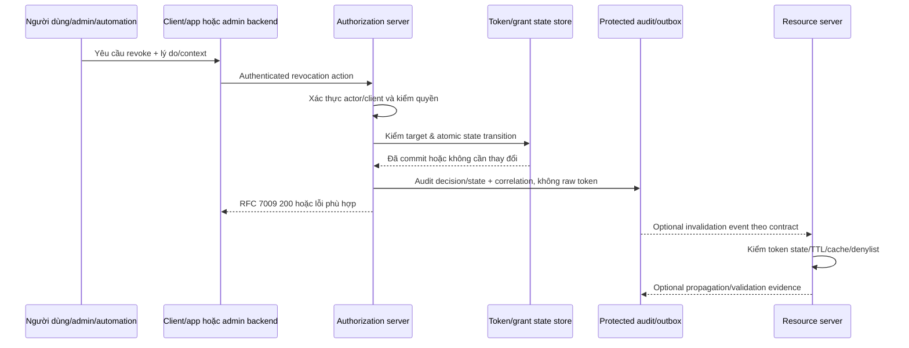
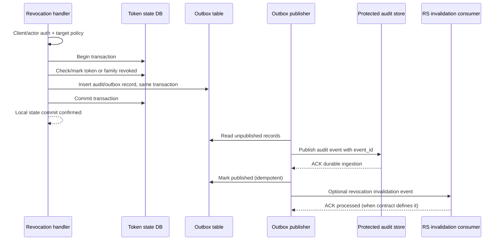
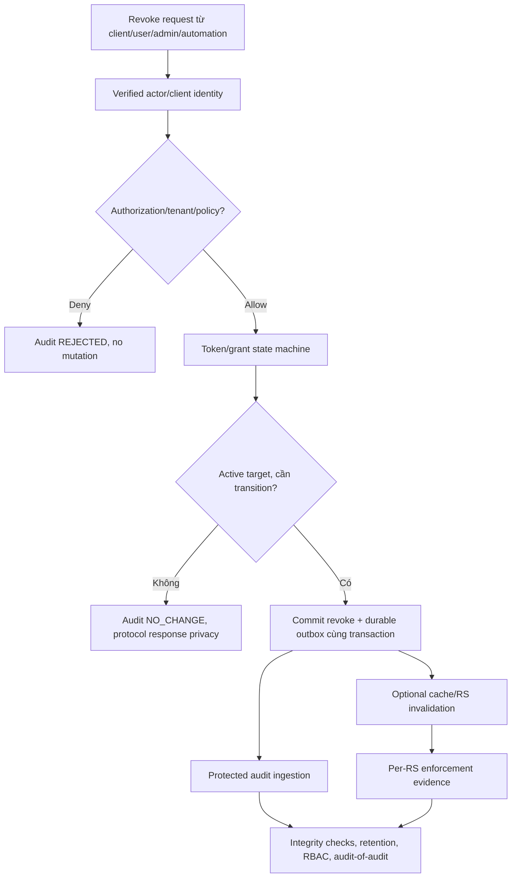

# Audit revoke action

Một người dùng phát hiện điện thoại bị mất và nhấn **“Đăng xuất thiết bị này”** trong trang quản lý phiên. Ứng dụng gọi authorization server (AS) để thu hồi refresh token; giao diện hiện **“Đã đăng xuất”**. Mười phút sau, hệ thống phát hiện một request gửi tới Orders API bằng access token được cấp trước khi thu hồi. Nhóm bảo mật muốn trả lời: **Ai yêu cầu thu hồi? Token/grant nào bị tác động? AS đã áp dụng thay đổi vào lúc nào? Access token liên quan có còn được resource server (RS) chấp nhận không? Ai đã kiểm tra và xử lý sự cố?**

Nếu hệ thống chỉ có một dòng log `POST /revoke 200 OK`, các câu hỏi trên hầu như không thể trả lời chính xác. Theo **RFC 7009**, revocation endpoint trả thành công cho cả token đã bị thu hồi, token không được tìm thấy và token được xử lý hợp lệ, nhằm **không tiết lộ sự tồn tại của token cho client**. Hơn nữa, **thu hồi tại AS không tự đồng nghĩa mọi bản sao access token lập tức bị RS từ chối**: JWT xác minh offline, cache introspection, propagation và phiên ứng dụng đều có vòng đời riêng.

**Audit revoke action** là thiết kế vết kiểm toán đáng tin cậy, có cấu trúc và bảo vệ bí mật cho **yêu cầu**, **quyết định**, **thay đổi trạng thái**, **phạm vi tác động** và **kết quả lan truyền** của hành động thu hồi. Vết kiểm toán này cần giúp điều tra và đáp ứng chính sách, nhưng **không được trở thành nơi rò access token/refresh token** hoặc lộ thông tin người dùng.

Bài thuộc chương **Revocation** của module **SECURITY_TOKEN_SECURITY_FUNDAMENTALS**. Bối cảnh module là mô hình tin cậy và vòng đời JWT/opaque token, access/refresh token, OAuth 2.0/OIDC, issuer, scope, audience, lưu trữ, thu hồi và chống token theft/replay. Trọng tâm bài là **kiểm toán hành động revoke**, không chỉ là cách gọi revocation endpoint. Không có ghi chú phạm vi bổ sung.

**Mục tiêu học tập**

- Phân biệt **revoke request**, **authorization/decision**, **state change**, **revocation propagation** và **resource-server enforcement**.
- Hiểu HTTP và privacy semantics của **OAuth 2.0 Token Revocation (RFC 7009)**, đặc biệt trường hợp trả 200 mà không xác nhận token từng tồn tại.
- Thiết kế **audit event schema** đủ actor, target, action, outcome, timestamp, reason, correlation và policy context nhưng **không chứa raw tokens**.
- Kiểm quyền của người dùng, OAuth client, service hoặc quản trị viên trước khi cho phép thu hồi phiên/token.
- Dùng **transactional outbox**, idempotency, correlation và kiểm soát race để bảo toàn audit liên quan đến thay đổi trạng thái.
- Kiểm toán ảnh hưởng đến **refresh-token family**, opaque token introspection, JWT access token offline và cache của RS.
- Xây dựng pipeline audit có access control, chống sửa/xóa trái phép, retention và dữ liệu tối thiểu.
- Lập negative tests cho hành động thu hồi giả mạo, thất bại, retry, concurrent requests, token theft/replay và audit-loss.

## 1. Phân biệt “thu hồi token” với “kiểm toán thu hồi”

**Revocation** làm một token hoặc grant không còn được AS xem là hợp lệ theo chính sách. **Audit** ghi lại một chuỗi sự kiện có ý nghĩa để kiểm chứng ai đã yêu cầu, điều kiện nào được kiểm, hệ thống đã làm gì và kết quả nào được xác nhận.

| Góc nhìn | Revocation (hành động) | Audit revoke action (bằng chứng) |
| --- | --- | --- |
| Câu hỏi chính | Token/grant còn được chấp nhận/cấp tiếp không? | Ai yêu cầu, vì sao, quyết định nào và có hiệu lực đến đâu? |
| Thành phần xử lý | AS, token store, revocation service | AS audit producer, outbox/event bus, audit store, monitoring |
| Dữ liệu nhạy cảm | Token raw, grant state, refresh-token family | **Metadata tối thiểu**, định danh target không dùng để redeem |
| Tính thời gian | Thay đổi trạng thái tại một thời điểm | Timeline: attempted → accepted/rejected → committed → propagated |
| Tiêu chí thành công | Chính sách thu hồi được thực thi | Bằng chứng **không sửa trái phép, truy vết được, không lộ secret** |
| Rủi ro nổi bật | Token cũ vẫn được RS chấp nhận | Log ghi “success” sai nghĩa, event mất, PII/token lộ |

**Không ghi `revocation_succeeded=true` chỉ vì HTTP 200**. Phải biết “succeeded” đang nói về **HTTP contract**, **AS state transition**, hay **RS rejection**, vì ba điều này không đồng nhất.

### 1.1. Câu hỏi mà một vết audit tốt phải trả lời

1. **Who:** actor nào đã được xác thực? Là người dùng, quản trị viên, OAuth client hay tác vụ tự động?
2. **What:** tác động tới loại token/grant nào, client nào, subject/tenant nào, phạm vi thiết bị/phiên/family nào?
3. **When:** thời điểm request, quyết định, commit trạng thái và các xác nhận downstream?
4. **Why:** lý do chuẩn hóa: user logout, device lost, suspicious reuse, admin disable hay incident response?
5. **How:** qua RFC 7009, admin console, automated risk policy hay user self-service?
6. **Decision:** đủ quyền không, chính sách nào áp dụng, yêu cầu được chấp nhận hay từ chối?
7. **Effect:** đã đánh dấu inactive/revoked tại nguồn nào, có cascade không, còn token khác bị ảnh hưởng không?
8. **Evidence:** event có correlation ID, transaction ID, integrity/retention và ai đã đọc nó?

**Audit không thay cho enforcement**: có thể có event đẹp nhưng RS vẫn cho dùng token đã bị thu hồi. Ngược lại, thu hồi đúng mà không có audit sẽ khó chứng minh khi điều tra.

## 2. Bốn lớp trạng thái cần ghi tách biệt

Một lỗi điển hình là dùng một boolean `revoked=true` ở tất cả tầng hệ thống. Trên thực tế, cần phân biệt:

| Lớp | Tình trạng minh họa | Diễn giải audit chính xác |
| --- | --- | --- |
| **1. Request** | Revocation endpoint nhận HTTP POST | `REQUEST_RECEIVED`, chưa chứng minh actor có quyền |
| **2. Decision** | Policy xác minh client/actor và target | `AUTHORIZED` hoặc `REJECTED`; có thể không cho biết target tồn tại |
| **3. AS state** | Token/grant record được đánh dấu inactive/revoked | `STATE_CHANGED` hoặc `ALREADY_INACTIVE` nếu được biết nội bộ |
| **4. Propagation/enforcement** | Introspection/RS/cache bắt đầu từ chối | `PROPAGATION_CONFIRMED` theo một hoặc nhiều RS, không tự suy từ state change |

Ví dụ timeline:

```text
T0   HTTP revoke request received
T1   Client authentication + ownership/policy validated
T2   AS token/grant state committed as revoked
T3   Outbox event published to audit/invalidation bus
T4   RS A invalidates cached introspection (if supported)
T5   RS B still accepts an offline JWT until expiry/policy check
T6   Measured endpoint probe confirms RS B rejects token
```

Các mốc T0–T6 là **ví dụ**, không phải sự bảo đảm rằng mọi hệ thống luôn có sự kiện T4/T6. Với JWT offline, RS B có thể chỉ từ chối tại `exp` nếu không có denylist/lookup state. Audit nên mô tả **điều đã quan sát/đảm bảo**, không tự điền `all_services_revoked=true`.

### 2.1. “Request accepted” không phải “revocation globally effective”

Một HTTP 200 tại AS có thể biểu thị **endpoint đã xử lý yêu cầu theo quy tắc bảo vệ thông tin**, trong khi:

- Raw token vốn không tồn tại hoặc đã hết hạn từ trước.
- Một refresh token bị thu hồi, nhưng access token đang sống vẫn có thể dùng đến `exp`.
- AS đã đánh dấu opaque access token inactive, nhưng RS đang giữ cache `active=true`.
- Một JWT access token tự chứa vẫn được API kiểm chữ ký offline.
- Invalidation event chưa tới tất cả gateway/RS instances.

Audit cần **làm rõ sự khác biệt về nguồn sự thật** giữa các trạng thái.

## 3. RFC 7009: giao thức revoke và bề mặt audit

**RFC 7009 — OAuth 2.0 Token Revocation** định nghĩa revocation endpoint cho OAuth tokens, thường được client gọi để hủy quyền truy cập tiếp theo. Endpoint phải sử dụng TLS, nhận HTTP `POST` với body `application/x-www-form-urlencoded` chứa `token` và tùy chọn `token_type_hint`.

Ví dụ revocation request **của confidential client**:

```http
POST /oauth2/revoke HTTP/1.1
Host: login.example.com
Authorization: Basic <encoded-client-credentials>
Content-Type: application/x-www-form-urlencoded
Accept: application/json

token=<refresh-token-secret>&token_type_hint=refresh_token
```

**`token` là bí mật thực** trong HTTP request nhưng **không được sao chép vào audit event, access logs, tracing hoặc error report**. `token_type_hint` chỉ là gợi ý để AS tìm nhanh hơn; AS không được quyết định quyền chỉ từ hint do client tự khai.

### 3.1. HTTP 200 không phải oracle xác nhận token

Response thành công theo RFC 7009:

```http
HTTP/1.1 200 OK
Cache-Control: no-store
```

Theo RFC 7009, AS trả **HTTP 200** khi token đã được thu hồi thành công **và cả khi client đưa token không hợp lệ**. Đây là cách tránh việc revocation endpoint trở thành công cụ kiểm tra sự tồn tại/hợp lệ của token.

Vì vậy:

- **HTTP contract:** 200 là response hợp lệ cho caller theo revocation semantics.
- **AS internal audit:** có thể phân biệt target tìm thấy, đã revoked hay không tồn tại **trong hệ thống audit bị hạn chế truy cập**, tùy thiết kế quyền riêng tư.
- **Client:** **không được** coi 200 là bằng chứng AS từng biết token, hay mọi access token liên quan đã hết hiệu lực.

### 3.2. Khi nào trả lỗi?

| Trường hợp | Behavior theo chuẩn/chính sách | Audit riêng |
| --- | --- | --- |
| Token hợp lệ, thuộc client được phép revoke | HTTP 200 | Ghi state transition và scope ảnh hưởng |
| Token không tồn tại/đã không còn hợp lệ | HTTP 200 | Ghi outcome nội bộ phù hợp không lộ tồn tại |
| Client authentication sai (confidential) | HTTP lỗi OAuth phù hợp, thường 401 | Ghi attempted/rejected, không log credential |
| Body thiếu `token` hoặc sai định dạng | HTTP lỗi request theo OAuth/AS | Ghi validation failure có giới hạn |
| `token_type_hint` không được hỗ trợ | Có thể trả `unsupported_token_type` theo RFC 7009 | Ghi policy/compatibility error |
| Caller tìm cách revoke token của client khác | AS phải bảo vệ binding/ownership; không lộ thông tin target | Ghi unauthorized attempt trong kênh audit hạn chế |

**Không tự thiết kế API trả 404/“token belongs to user X” cho người gọi RFC 7009** nếu điều đó tiết lộ thông tin ngoài contract. Endpoint quản trị nội bộ có thể có semantics khác RFC 7009, nhưng phải nêu rõ ở tài liệu và kiểm soát quyền truy cập.

### 3.3. Revocation endpoint là security-sensitive operation

Một attacker có thể cố thu hồi token của người khác để gây gián đoạn. Vì vậy endpoint cần kiểm:

- Client authentication và binding token↔client theo RFC 7009 và registration.
- Authorization đối với self-service/admin/automation actions ở gateway và business layer.
- CSRF protection nếu UI dùng browser session/cookie để gọi endpoint quản trị; rate limiting/abuse controls.
- TLS, request size limit và input handling chống flooding.
- Quyền xem event audit khác quyền thực thi revocation.

**Một log nói “đã gọi /revoke” không chứng minh yêu cầu được ủy quyền đúng.**

## 4. OAuth/OIDC roles và quyền được revoke

Đừng trộn **người dùng cuối**, **OAuth client**, **AS**, **RS** và **admin** thành một actor tên chung `system`.



Sơ đồ là **mô hình khái niệm**. Để đảm bảo event không mất giữa DB commit và publish, triển khai thực tế nên **ghi audit/outbox trong cùng giao dịch trạng thái** rồi publish bất đồng bộ. Không hiểu mũi tên audit trong sơ đồ là mạng luôn truyền thành công.

### 4.1. Các actor thường gặp

| Actor | Hành động được phép thường thấy | Kiểm soát bắt buộc |
| --- | --- | --- |
| OIDC/OAuth client đã đăng ký | Revoke token do chính nó được cấp theo contract | Client authentication/binding và tenant policy |
| Người dùng tự quản lý phiên | Unlink thiết bị/phiên của chính mình | Session auth, CSRF, device ownership |
| Quản trị viên tổ chức | Thu hồi phiên của user trong tenant được quản lý | RBAC/ABAC, audit admin, reason, optional step-up |
| Security automation | Revoke grant khi nghi token theft | Workload identity, scoped privilege, change policy |
| AS internal job | Cleanup expired/grants hoặc react to reuse detection | Service identity, policy version, correlation |
| Resource server | Thường xác minh token; có thể báo rủi ro theo hợp đồng | Không được tùy ý revoke token của mọi client |

**Không tin `actor_id` trong request JSON là nguồn danh tính**. Actor phải được suy ra từ **verified session, client authentication, service identity hoặc delegated context**.

## 5. Audit phải ghi cả hành động bị từ chối, không chỉ lần thành công

Một hệ thống chỉ ghi sự kiện sau khi `update revoked = true` sẽ bỏ lỡ:

- Attacker gửi hàng nghìn token strings để probing.
- Client bị thu hồi credential vẫn cố revoke hoặc refresh.
- Người dùng tenant A thử thu hồi phiên của tenant B.
- Admin không đủ quyền hoặc hết thời hạn step-up authentication.
- Request bị rate limit/CSRF và không chạm token store.

Với request bất hợp lệ hoặc unauthorized, audit nên ghi **một sự kiện từ chối có giới hạn thông tin**:

```json
{
  "event_type": "TOKEN_REVOCATION_REQUEST_REJECTED",
  "request_id": "req-7d0c",
  "actor_kind": "oauth_client",
  "authenticated_client_id": "orders-web",
  "action": "revoke",
  "decision": "deny",
  "reason_code": "CLIENT_NOT_AUTHORIZED",
  "occurred_at": "2026-11-23T02:45:00Z",
  "target_reference": null
}
```

Các giá trị **là ví dụ**, không ghi PII/target token raw. Khi actor không xác định, ghi `actor_kind=unauthenticated` cùng request metadata đã lọc, **không gán nhầm** user/client identity từ input chưa xác thực.

### 5.1. Ghi outcome có giới hạn nội bộ

Một request cố tình gửi token ngẫu nhiên nên không thể đọc từ response “token này có thật không”. Audit nội bộ vẫn có thể ghi một mã như `UNKNOWN_OR_INACTIVE` **để phân tích abuse**, nhưng:

- Không mở endpoint tra cứu công khai theo request ID để lộ status.
- Không đưa raw token, full HTTP body hoặc message chi tiết vào event.
- Giới hạn quyền đọc và thời gian retention.
- Rate limit audit volume để attacker không tạo chi phí/log flooding vô hạn.

### 5.2. Authentication log khác revocation event

**Client authentication failure** có thể được ghi trong security/authentication log; **revocation authorization denial** nên được gắn correlation để điều tra. Đừng ghi hai loại như hai “revoke success” và đừng tự coi “failed auth” là thay đổi token state.

## 6. Mô hình event chuẩn hóa cho revoke action

Nên xác định một **audit taxonomy** để các team không tự viết chuỗi log mơ hồ:

| Event type (ví dụ) | Khi nào ghi? | Ý nghĩa |
| --- | --- | --- |
| `REVOCATION_REQUESTED` | Đã nhận request hợp lệ tối thiểu từ kênh đã xác định | Có attempt, chưa khẳng định được phép |
| `REVOCATION_REJECTED` | Authentication/authorization/policy từ chối | Không chủ động thay đổi target state |
| `REVOCATION_ACCEPTED` | Actor đủ quyền và action được chấp thuận | Quyết định hợp lệ, **chưa chắc commit xong** |
| `REVOCATION_COMMITTED` | Token/grant state transition được commit | AS internal source-of-truth đã thay đổi |
| `REVOCATION_NO_CHANGE` | Được xử lý nhưng target đã inactive/không tìm thấy theo policy | Không tạo trạng thái mới; không lộ cho client |
| `REVOCATION_FAILED` | Lỗi internal trước/đang state transition | Không được báo đã commit nếu chưa chắc |
| `REVOCATION_INVALIDATION_QUEUED` | Event invalidation được ghi/outbox | **Chưa chứng minh** RS đã áp dụng |
| `REVOCATION_INVALIDATION_DELIVERED` | Subscriber/gateway nhận message | Delivery ≠ enforcement |
| `REVOCATION_ENFORCEMENT_CONFIRMED` | Có bằng chứng từ kiểm tra RS cụ thể | RS/route không còn chấp nhận target theo contract |
| `REVOCATION_MANUAL_OVERRIDE` | Admin can thiệp theo quy trình được phê duyệt | Có approval, actor, scope và lý do riêng |

Tên các event trên là **taxonomy nội bộ minh họa**, không phải event codes được RFC 7009 chuẩn hóa. Không phải workflow nào cũng cần ghi mọi event; hãy bảo đảm **các điểm có ý nghĩa pháp lý/an ninh** được ghi nhất quán.

### 6.1. Đừng kết thúc audit ở “HTTP 200”

```text
HTTP 200:
    endpoint contract outcome

REVOCATION_COMMITTED:
    AS state transitioned and persisted

REVOCATION_ENFORCEMENT_CONFIRMED:
    evidence that a specified RS/route denied the credential
```

Đây là ba loại bằng chứng khác nhau. `REVOCATION_ENFORCEMENT_CONFIRMED` chỉ được phát khi thực sự có observation/probe/acknowledgment đáp ứng tiêu chí đã định nghĩa.

### 6.2. Event schema có version

Audit là một hợp đồng dữ liệu dài hạn. Nên có `schema_version`, `event_type` và validation cho:

- Required vs optional fields.
- Kiểu dữ liệu timestamp, IDs, enums.
- Chính sách xử lý unknown fields/versions.
- Trạng thái outcome không mâu thuẫn, chẳng hạn `COMMITTED` nhưng `persisted=false`.
- Serialization ổn định nếu cần hash chain/signature.

Khi thay đổi schema, đừng khiến hệ thống cũ **âm thầm bỏ qua các sự kiện revoke mới**.

## 7. Những trường nên có trong audit record

Một event mô hình cho lần thu hồi refresh-token family:

```json
{
  "schema_version": "1.0",
  "event_id": "evt-8f1b",
  "event_type": "REVOCATION_COMMITTED",
  "occurred_at": "2026-11-23T02:46:03.123Z",
  "recorded_at": "2026-11-23T02:46:03.140Z",
  "request_id": "req-7d0c",
  "correlation_id": "corr-device-unlink-91",
  "actor": {
    "kind": "end_user",
    "subject_ref": "u-ref-42",
    "authenticated_via": "verified_application_session"
  },
  "target": {
    "kind": "refresh_token_family",
    "family_ref": "fam-ref-39",
    "subject_ref": "u-ref-42",
    "client_id": "mobile-client",
    "tenant_ref": "tenant-a"
  },
  "action": "revoke",
  "reason_code": "DEVICE_LOST",
  "authorization_policy_version": "revocation-policy-v5",
  "decision": "allow",
  "state_change": "ACTIVE_TO_REVOKED",
  "affected_reference_count": 3,
  "propagation_status": "NOT_YET_CONFIRMED",
  "initiator_channel": "user_self_service"
}
```

Các IDs là **tham chiếu nội bộ không thể dùng để redeem token**; số lượng affected chỉ là ví dụ. Nếu một `token_id` thực tế có thể được dùng như credential hoặc lộ PII, hãy chuyển thành reference/alias được bảo vệ.

### 7.1. Bảng trường và lý do

| Nhóm | Trường đề xuất | Lý do |
| --- | --- | --- |
| Event identity | `event_id`, `schema_version`, `event_type` | Deduplication, đọc đúng schema |
| Timeline | `occurred_at`, `recorded_at`, optional `committed_at` | Phân biệt lúc phát sinh với lúc được ghi |
| Request trace | `request_id`, `correlation_id` | Liên kết HTTP, policy decision, state mutation, outbox |
| Actor | `kind`, verified `subject_ref`/`client_id`, auth method | Truy rõ ai hoặc workload nào đã làm |
| Target | Token/grant/family reference, token class, client, tenant | Biết phạm vi tác động mà không cần raw token |
| Reason | `reason_code` (enum), optional sanitized case ID | Thống kê user logout vs incident |
| Authorization | `decision`, policy version, optional approval ref | Chứng minh action đã được cho phép |
| Effect | `state_change`, affected classes/counts | Không trộn “accepted” với “committed” |
| Propagation | Version/outbox event ID, downstream status | Theo dõi đến RS nếu có |
| Security context | Risk level, verified channel, optional trusted network class | Điều tra risk mà không lưu quá nhiều PII |

### 7.2. Tuyệt đối không có trong audit log

- **Access token**, **refresh token**, authorization code, device code, DPoP private key, client secret.
- Full `Authorization` header, Basic credentials, form body `token=...`, cookies/session ID.
- Mật khẩu, OTP, recovery codes, raw ID token hoặc private signing keys.
- Raw personal data không phục vụ audit, ví dụ toàn bộ email/address/profile.
- HTTP request/response body thô chỉ để “dễ debug” khi chứa secret.

Một vết kiểm toán tốt **giữ bằng chứng**, không giữ credential có thể bị sử dụng lại.

## 8. Định danh target an toàn: opaque token, JWT, refresh family

Không phải token nào cũng có cùng metadata:

- **Opaque access token:** AS có token/grant record nội bộ, RS không tự decode.
- **JWT access token:** có thể có `jti` và claims, nhưng `jti` không tự là khóa revocation hay bằng chứng token đã inactive.
- **Refresh token:** có thể được lưu dưới dạng hash, gắn với một grant/session và **rotation family**.

**Không dùng raw token làm audit primary key**.

### 8.1. Ưu tiên internal stable reference

AS có thể gán:

```text
token_record_ref     = "tokref-..."
grant_ref            = "grant-..."
refresh_family_ref   = "family-..."
device_session_ref   = "device-..."
```

Đây là IDs ngẫu nhiên hoặc reference không mang khả năng truy cập tài nguyên. Khi cần điều tra, hệ thống chỉ tra lookup qua API/admin console được ủy quyền. Audit store không cần decrypt/reconstruct token raw.

### 8.2. Khi chỉ có raw token tại điểm tiếp nhận

Để liên hệ các revocation attempts mà không ghi raw token, có thể tính:

```text
token_fingerprint =
    HMAC-SHA256(audit_fingerprint_key, issuer_namespace || token_bytes)
```

Đây là **mẫu thiết kế**, không phải thuật toán RFC 7009 bắt buộc. Dùng secret riêng để HMAC và domain separation cho issuer; bảo vệ key trong secret manager/HSM phù hợp. Tránh lưu một plain SHA-256 của token có entropy thấp hoặc thiết kế fingerprint có thể bị đoán.

**Không đưa fingerprint vào analytics công cộng**: dù không phải bearer token, nó có thể liên kết hoạt động của cùng credential qua nhiều sự kiện.

### 8.3. `jti` không phải phép màu chống replay

`jti` trong JWT là identifier do issuer phát, không chứng minh token đã bị revoke, và **không tự làm token hết hiệu lực**. Nếu dùng `jti` trong denylist/audit, phải xác minh issuer và chữ ký/profile phù hợp, kiểm collision/namespace và lifetime.

### 8.4. Grouping theo grant/family

Khi revoke **một refresh-token family**, audit có thể ghi **family reference** và scope tác động thay vì tạo một event chứa hàng nghìn raw tokens. Nếu policy muốn chứng minh từng record đã đổi trạng thái, có thể có **child events** hoặc bảng chi tiết hạn chế truy cập liên kết qua `correlation_id`.

## 9. Actor authorization: ai có quyền yêu cầu revoke?

Một user session được xác thực **không tự có quyền thu hồi token của người khác**. Việc kiểm quyền phải dựa vào **actor identity đã xác minh** và **target ownership/tenant**.

### 9.1. Self-service revoke của người dùng

Ví dụ user quản lý phiên:

```http
POST /account/sessions/device-17/revoke HTTP/1.1
Host: shop.example.com
Cookie: <secure-application-session>
X-CSRF-Token: <session-bound-csrf-token>
Content-Type: application/json

{"reason":"LOST_DEVICE"}
```

Đây là **endpoint ứng dụng minh họa**, **không phải RFC 7009 endpoint**. Backend:

1. Xác thực session và chống CSRF theo thiết kế.
2. Lookup device/session 17 và kiểm **belongs to current user/tenant**.
3. Tạo request nội bộ hoặc gọi AS theo trusted authorization.
4. Ghi **decision + state-change events** với đúng actor và target.
5. Trả UX phù hợp mà không lộ token/refresh family identifiers.

Không cho client tự gửi `user_id=other-user` rồi suy rằng đã được quyền revoke.

### 9.2. Admin revoke có thể yêu cầu quyền mạnh hơn

Một admin revoke phiên của user khác cần RBAC/ABAC, tenant ownership và lý do chuẩn hóa. Với action tác động lớn (revoke tất cả tokens của một tenant), nên cân nhắc **step-up authentication, dual approval hoặc break-glass workflow** tùy tổ chức.

Audit cần lưu **approval reference** và actor thật, không ghi `actor=admin` không có định danh cụ thể. Một admin view cũng phải có **quyền đọc audit** riêng biệt.

### 9.3. Security automation

Một detector thấy refresh-token reuse, phát action revoke. Audit:

```text
actor.kind          = security_automation
actor.service_id    = risk-engine-prod
reason_code         = REFRESH_TOKEN_REUSE_DETECTED
policy_version      = risk-revoke-v4
incident_ref        = restricted-incident-id
human_approved      = false / true / not_required
```

Không giả mạo `actor=end_user` chỉ vì grant liên quan một người dùng. **Subject chịu ảnh hưởng** và **actor thực thi** là hai thực thể khác nhau.

## 10. Access token và refresh token: phạm vi thu hồi phải rõ

| Target revoke | Hệ quả trực tiếp | Có thể tác động dây chuyền? | Điều audit cần thể hiện |
| --- | --- | --- | --- |
| **Refresh token** | Không dùng chính RT đó để xin token mới | AS có thể thu hồi access tokens liên quan theo policy | RT reference/family, AS cascade policy, token classes ảnh hưởng |
| **Access token** | Token đó bị AS xem là revoked/inactive nếu cơ chế hỗ trợ | AS có thể thu hồi refresh token liên quan theo policy | AT reference, access TTL, linked grant action |
| **Grant/consent** | Không tiếp tục cấp quyền theo grant bị hủy | Có thể revoke nhiều token/session | Grant ref, subject/client/resource/scopes, affected count |
| **Device session** | Ngắt liên kết phiên thiết bị theo policy | Có thể hủy RT family và các AT liên quan | Device ref, actor/owner, scope thực thi |
| **Client credential** | Client không còn xác thực để xin token mới bằng credential đó | Không tự làm AT đã phát hết hạn | Credential reference, client ID, riêng action disable/revoke |

### 10.1. RFC 7009 không mặc định mọi token liên quan chết tức thì

RFC 7009 hỗ trợ thu hồi token và cho phép các cách xử lý linked tokens theo loại target và policy AS. **Đừng viết audit “all tokens revoked” nếu chỉ revoke một refresh token và AS không thực thi điều đó**. Bảo đảm ghi tên loại token/target, family/grant và các state transitions đã commit thực tế.

### 10.2. Refresh-token rotation và family

Khi AS dùng refresh-token rotation:

```text
RT-1 (used) -> RT-2 (used) -> RT-3 (active)
                |
           reuse of RT-1 detected
                |
           revoke family per AS policy
```

Audit cần thể hiện:

- Family reference, token reuse attempt, loại detector/actor.
- Thời điểm phát hiện, reason, policy version.
- Family state trước/sau, current valid RT bị vô hiệu theo policy.
- Những AT liên quan có bị revoke hay chỉ chờ hết hạn.
- Thông báo người dùng/incident response nếu có.

**Không lưu RT-1/RT-2/RT-3 dưới dạng plaintext** trong event. Các nhãn trên chỉ minh họa chuỗi token rotation.

## 11. Phân biệt AS state, JWT offline và opaque introspection

Hành động revoke diễn ra ở AS, nhưng **RS là nơi access token được sử dụng**. Audit phải mô tả được liệu token cũ còn có thể được chấp nhận tại API.

| Loại token / cách kiểm | AS sau revoke | RS sẽ biết khi nào? | Điều có thể audit |
| --- | --- | --- | --- |
| Opaque AT, introspect mỗi request | `active=false` theo state policy | Lần introspection tiếp theo sau khi AS/replica đồng bộ | AS commit time, introspection state, sample RS denial |
| Opaque AT, cache introspection | AS đã inactive | Khi cache `active=true` hết TTL hoặc được invalidated | Cache max TTL, event delivery, RS observed deny |
| JWT AT kiểm chữ ký offline | AS có thể ghi denylist/state thay đổi | Nếu RS có state/denylist lookup, hoặc tại `exp` | JWT expiry, denylist version, route coverage |
| JWT AT với revocation check mỗi request | AS state đổi | Khi RS check tới nguồn trạng thái mới | State check latency, cache/invalidation |
| DPoP/mTLS-bound AT | AS state thay đổi | RS vẫn phải kiểm proof/binding mỗi request | Proof failures riêng với revocation decision |

**JWT có chữ ký hợp lệ không thể bị “xóa chữ ký” sau khi phát hành**. Việc rotate signing key để revoke một token có thể vô hiệu hóa **nhiều token khác** và tạo sự cố vận hành; đó không phải phương án thu hồi từng token thông thường. Dùng TTL, denylist/`jti`, introspection/state lookup hoặc AS/RS integration theo yêu cầu.

### 11.1. Không ghi claims từ JWT chưa xác minh làm bằng chứng

Nếu audit cần `client_id`, `sub`, `jti` hoặc `aud` của access token JWT, AS có thể lấy từ **token record nội bộ**. Khi chỉ có JWT ở một entrypoint, phải xác minh signature, issuer, token type, audience và claims theo profile trước khi coi chúng là thông tin đáng tin.

**Không parse payload Base64URL rồi gắn `actor=user-42` trong audit** chỉ vì chuỗi JSON chứa `sub=user-42`. Payload có thể do attacker tự tạo hoặc được phát cho mục đích khác.

### 11.2. Tài nguyên có “revocation latency budget”

Ví dụ:

| Resource | Mục tiêu nghiệp vụ minh họa | Yêu cầu chứng cứ |
| --- | --- | --- |
| Public catalog read | Chấp nhận trễ thu hồi ngắn theo policy | Cache TTL, exp và periodic probe |
| Orders view | Phải ngừng truy cập trong cửa sổ đã cam kết | AS state + RS deny sau cửa sổ |
| Refund approval | Có thể cần kiểm state/step-up từng giao dịch | Decision audit và transaction-time checks |
| Account privilege change | Cần thu hồi phiên/quyền cũ nhanh | Entitlement policy version, session/grant invalidation |

Các mốc cụ thể phải do tổ chức xác định; **không có “revoke ngay tức thì” mặc định chỉ nhờ RFC 7009**.

## 12. Introspection caching: một sự kiện revoke chưa đóng hết cửa

Giả sử một RS đã introspect opaque token vào T0:

```text
T0  RS: active=true; cache valid for 60 seconds
T1  AS: token revoked (commit succeeded)
T2  RS: receives request, cache active=true still valid
T3  RS: eventually expires/invalidate cached result
T4  RS: asks AS again, active=false
```

Nếu AS vừa revoke nhưng RS không có invalidation event, RS có thể **tiếp tục tin cached `active=true` từ T1 đến gần T3**. Vì vậy audit từ AS:

```text
REVOCATION_COMMITTED:
    committed_at = T1
    effect_scope = AS_TOKEN_STATE
    propagation_guarantee = NONE_OR_CONFIGURED
```

Không được tự gán:

```text
REVOCATION_ENFORCEMENT_CONFIRMED at T1  # Không có bằng chứng
```

### 12.1. Mục tiêu độ trễ gồm nhiều thành phần

Một ước lượng thiết kế:

```text
possible_effective_delay
  ≈ AS_state_replication_delay
  + RS_introspection_cache_staleness
  + invalidation_delivery_or_polling_delay
  + in_flight_request_window
```

Không cộng cơ học nếu một số thành phần song song; đây là **mô hình để phân tích**. Kiểm chứng bằng probe/revocation tests trên môi trường được phép.

### 12.2. Audit invalidation theo từng tầng

Khi gateway và backend có **nhiều tầng cache**, một event `CACHE_INVALIDATED_BY_GATEWAY` không chứng minh backend local caches đã được xóa. Nếu SLA yêu cầu, cần:

- Danh sách expected consumers/RS groups.
- Event version hoặc revocation epoch.
- ACK/idempotent processing có ràng buộc identity.
- Thời điểm observed deny tại các điểm trọng yếu.
- Alert nếu thiếu ACK vượt thời hạn.

**ACK là bằng chứng component nhận/xử lý event theo contract**, không tự chứng minh tất cả request đang chạy đã ngừng.

## 13. Logout, unlink, disable client và revoke không phải một từ

Một người dùng có thể nhấn “Đăng xuất” trong SPA, xóa local cache nhưng không gọi AS revoke. Một admin có thể disable client, ngăn phát token mới nhưng access token đã cấp vẫn còn hạn. Một “đăng xuất toàn bộ thiết bị” có thể liên quan nhiều grants/refresh-token families.

| UX/action | Thay đổi thực tế có thể có | Audit nên ghi |
| --- | --- | --- |
| Browser local logout | Xóa application session/cookie | `APPLICATION_SESSION_ENDED`; revoke AS riêng nếu thực thi |
| Revoke một refresh token | Invalidate RT hoặc family theo policy | Token/family target, cascade thực tế |
| “Đăng xuất thiết bị này” | Remove/unlink device + revoke liên quan | Device/session ref, user ownership, AS state |
| “Đăng xuất tất cả” | Revoke nhiều grants/session families | Bulk operation ID, counts, failures/partial results |
| Admin disable OAuth client | Chặn client authentication/cấp mới | `CLIENT_DISABLED`; linked access-token effect phải kiểm |
| User permission downgrade | Thay đổi entitlement/policy | Policy version + sessions/tokens bị tác động nếu có |
| Password change | Có thể vô hiệu sessions/RT theo policy | Không mặc định mọi AT đã bị revoke |
| OIDC end-session | Logout tại OP/RP theo profile | Không trộn với RFC 7009 revoke mọi API token |

### 13.1. Đừng đánh tráo “canceled UI” thành “server revoked”

Nếu client chỉ xóa refresh token khỏi localStorage/Keychain, attacker có bản sao token cũ **có thể vẫn dùng được** cho đến khi AS đánh dấu revoked/expired. Một audit event `LOCAL_CREDENTIAL_REMOVED` không được dán nhãn `REVOCATION_COMMITTED`.

### 13.2. Application session và OAuth grant có liên hệ nhưng khác lifecycle

Một BFF có cookie phiên ứng dụng và access/refresh tokens server-side. Đăng xuất cần:

1. Kết thúc cookie/session.
2. Gỡ token khỏi server-side session store.
3. Revoke RT/AT/grant nếu AS hỗ trợ và chính sách yêu cầu.
4. Audit mỗi hành động theo loại và target.
5. Giải thích TTL/caching ảnh hưởng tới khả năng dùng token đã phát.

**Một HTTP 200 từ logout endpoint không xác minh tự động rằng tất cả RS đã chặn bearer tokens**.

## 14. Idempotency: nhiều request revoke, một kết quả trạng thái

Các lý do revocation bị gọi lặp:

- Mạng timeout sau khi AS đã commit.
- Frontend double-click nút “Logout device”.
- Gateway retry POST do mất response.
- Security automation gửi lại event.
- User đồng thời bấm revoke từ hai thiết bị.

Với RFC 7009, cùng một token có thể được trình để revoke nhiều lần; endpoint vẫn nên **không tiết lộ token từng tồn tại hay đã revoked**. Nhưng audit phải phân biệt:

- **Multiple attempts**: có nhiều HTTP requests.
- **One state transition**: token/grant từ active → revoked đúng một lần theo logic.
- **Multiple response deliveries**: HTTP 200 có thể trả cho nhiều lần gọi.
- **At-least-once event delivery**: cùng audit/outbox event có thể được consumer nhận nhiều lần.

### 14.1. Request ID, idempotency key và event ID

```text
request_id       = unique per HTTP attempt
operation_id     = stable per business revoke command (if supplied/trusted)
event_id         = unique per emitted audit event
target_ref       = stable internal token/grant/family reference
correlation_id   = shared across command, state mutation, outbox, RS notices
```

Không dùng `request_id` làm khóa duy nhất để “revoke only once” cho mọi lần retry, vì request ID thường khác ở mỗi lần gửi. Nếu dùng `Idempotency-Key` cho private admin endpoints, phải **scope theo actor/tenant/action/target và hạn dùng**, kiểm input binding, không cho attacker dùng key của người khác.

### 14.2. Audit retry mà không làm bùng nổ sự kiện commit giả

Ví dụ:

```text
req-01  REVOCATION_REQUESTED
req-01  REVOCATION_COMMITTED  event_id=evt-11

req-02  REVOCATION_REQUESTED  (same token, retried)
req-02  REVOCATION_NO_CHANGE  (already revoked)
```

Không ghi hai `REVOCATION_COMMITTED` tương đương cho cùng transition nếu state không thay đổi. Có thể thêm `retry_of_operation_id` khi đáng tin để điều tra.

## 15. Race conditions và thứ tự audit

Races đáng quan tâm:

1. **Revoke vs refresh:** request làm mới token chạy gần đồng thời với revoke family.
2. **Revoke vs API request:** access token được RS chấp nhận trước/sau propagation.
3. **Concurrent revokes:** hai admin/process cùng thu hồi một grant.
4. **Revoke vs issue:** AS đang phát access token mới dựa trên grant sắp bị hủy.
5. **Retry vs HTTP response lost:** AS đã commit nhưng caller tưởng thất bại.

### 15.1. Linearization point

AS phải có một điểm **thay đổi trạng thái nhất quán** trong store của token/grant. Nếu yêu cầu đã được xác thực và authorized, hoạt động revoke/refresh cần giải quyết cạnh tranh bằng:

- Transaction isolation/row lock phù hợp.
- Optimistic concurrency control (CAS/version).
- Generation/epoch number cho refresh-token family.
- Idempotent state machine.
- Outbox trong cùng transaction commit.

Một audit event `COMMITTED` nên đi kèm **state version/transaction reference**, để chứng minh nó tương ứng với một transition đã commit.

### 15.2. Ghi thời gian nào?

Với hệ thống phân tán:

- `received_at` khi AS tiếp nhận request.
- `decision_at` khi policy kiểm xong.
- `committed_at` khi thay đổi state đã commit.
- `recorded_at` khi event được lưu durable.
- `published_at` khi outbox được publish.
- `consumed_at`/`applied_at` do consumer quan sát.

Không tin thứ tự tuyệt đối chỉ từ wall-clock của các machines khác nhau; **event version/sequence, correlation và source identifiers** giúp xử lý trễ/lệch clock. Clock UTC synchronized vẫn cần monitoring.

## 16. Transactional outbox: giữ audit gắn với state transition

Anti-pattern:

```text
UPDATE refresh_token SET revoked = true;
COMMIT;
publishAuditEvent(...);     # Nếu process crash ở đây, mất audit
```

Anti-pattern ngược:

```text
publishAuditEvent("REVOKED");
UPDATE token_state ...;     # Nếu DB fail, audit nói revoked nhưng state không đổi
```

**Transactional outbox pattern** ghi state mutation và một **bản ghi event/outbox** trong cùng transaction local để tránh trạng thái “revoke commit nhưng event không có nguồn durable” hoặc “event commit mà state không đổi”.



Ở đây outbox có thể thuộc **cùng database/transactional boundary** với state mutation; nếu state ở nhiều stores, cần thiết kế saga/eventual consistency và ghi **per-target outcomes**. Không thể chỉ đặt các câu lệnh trong cùng method rồi giả định atomic.

### 16.1. Khi outbox publisher bị lỗi

- **State đã commit:** token/grant vẫn bị revoke theo source-of-truth.
- **Outbox event còn pending:** retry không tạo state mutation mới.
- **Consumer có thể nhận trùng:** dùng `event_id`/version để dedupe.
- **Audit sink chậm:** có backlog metric, alert, retention và recovery plan.
- **Không được trả “propagated”** khi chưa có evidence.

### 16.2. Audit sink mất kết nối có cho phép revoke không?

Đây là **quyết định security/availability policy**. Nếu transaction local có durable outbox, có thể chấp nhận **state commit và event publish sau**. Nếu hệ thống không thể ghi bất kỳ bằng chứng durable nào mà vẫn commit state, nó có thể vi phạm yêu cầu compliance; phải có rõ **fail-closed for audit** hoặc emergency fallback được phê duyệt.

Không nên cố “giữ an toàn” bằng cách **không revoke một credential đang bị compromise** chỉ vì external log aggregator đang outage, trừ khi đã có chính sách hợp lý cho tình huống đó. Một durable local outbox thường giúp cân bằng hai mục tiêu.

### 16.3. Event deduplication

Đảm bảo:

```text
event_id: stable across retry of same outbox record
state_version: monotonic where supported
consumer_dedupe_key: (producer_id, event_id)
consumer_effect: idempotent
```

Đừng dùng raw token làm dedupe key trong bus.

## 17. Java-style pseudocode: revoke + audit trong một transaction

Các class và APIs trong ví dụ là **giả định**, nhằm chỉ ra sequence/security invariants, không phải code có thể copy chạy ngay với Java SE hoặc Spring.

```java
// PSEUDOCODE: tokenStore, auditOutbox, policyEngine là abstractions giả định.
final class RevocationService {
    private final TokenStore tokenStore;
    private final AuditOutbox auditOutbox;
    private final RevocationPolicy policyEngine;
    private final EventIdGenerator eventIds;

    @Transactional
    InternalRevokeResult revoke(
            VerifiedActor actor,
            RevocationCommand command,
            RequestContext context
    ) {
        // KHÔNG bao giờ tin actorId/tenantId tự khai từ request.
        policyEngine.requireAuthenticatedActor(actor);

        // Lookup theo protected token reference/digest, không log raw token.
        TokenRecord target = tokenStore.findForUpdateByProtectedLookup(
            command.protectedTokenLookup()
        );

        // Đối với token chưa biết, response RFC 7009 vẫn không
        // tiết lộ existence. Đừng để actor không hợp lệ bypass auth.
        if (target == null) {
            auditOutbox.add(RevokeAudit.noChange(
                eventIds.next(), context.requestId(),
                actor.safeReference(), "UNKNOWN_OR_INACTIVE"
            ));
            return InternalRevokeResult.noChange();
        }

        if (!policyEngine.canRevoke(actor, target, context)) {
            auditOutbox.add(RevokeAudit.rejected(
                eventIds.next(), context.requestId(),
                actor.safeReference(), "NOT_AUTHORIZED_FOR_TARGET"
            ));
            // RFC 7009 adapter trả kết quả không làm lộ target
            // của OAuth client khác. Admin API có contract riêng.
            return InternalRevokeResult.noChangeForPrivacy();
        }

        if (target.isAlreadyInactive()) {
            auditOutbox.add(RevokeAudit.noChange(
                eventIds.next(), context.requestId(),
                actor.safeReference(), target.safeReference()
            ));
            return InternalRevokeResult.noChange();
        }

        // Tùy AS policy, có thể revoke cả grant/refresh family.
        RevocationEffect effect = tokenStore.transitionToRevoked(
            target, command.reasonCode(), policyEngine.cascadePolicy()
        );

        // GHI CÙNG TRANSACTION, không publish remote trực tiếp ở đây.
        auditOutbox.add(RevokeAudit.committed(
            eventIds.next(),
            context.correlationId(),
            actor.safeReference(),
            effect.targetReferencesOnly(),
            command.reasonCode(),
            policyEngine.version(),
            effect.stateVersion(),
            effect.affectedCounts()
        ));
        return InternalRevokeResult.committed(effect.safeSummary());
    }
}
```

**Lưu ý quan trọng:** trong hệ thống thật, **authorization phải được kiểm đúng thứ tự với thông tin có sẵn**. Mẫu trên minh họa lookup/owner check và cách AS xử lý token thuộc client khác mà **không tiết lộ sự tồn tại trong response RFC 7009**; internal audit được bảo vệ có thể ghi rejection. Với **admin/private API** cần trả 403 theo contract, handler phải phân biệt outcome nội bộ trong một ranh giới tin cậy thay vì áp dụng mù response RFC 7009. Đầu vào không tồn tại không được trở thành cách bypass hoặc suy đoán ownership; rate limit và giảm khác biệt timing cũng cần được đánh giá.

### 17.1. Adapter RFC 7009 trả response thế nào?

```java
// PSEUDOCODE: ví dụ tách HTTP contract khỏi internal audit.
HttpResponse revokeHttp(RevocationHttpRequest request) {
    VerifiedClient client = oauthClientAuthenticator.authenticate(request);
    requireSupportedMethodAndForm(request);
    requireTokenPresentWithValidSyntax(request);

    // Internal result không chứa raw token ở response/log.
    InternalRevokeResult result = revocationService.revoke(
        client.asVerifiedActor(),
        toCommandWithoutRawLoggableToken(request),
        RequestContext.current()
    );

    // RFC 7009: thành công hoặc token unknown/inactive cùng HTTP 200.
    // Các trường hợp policy/auth/request lỗi dùng response OAuth tương ứng.
    return HttpResponse.okWithoutTokenDetails();
}
```

Trong framework thực tế, **token của client khác** không được vô tình làm response RFC 7009 khác response cho token không tồn tại và trở thành oracle tiết lộ target. AS phải áp **policy + response normalization** nhất quán; admin endpoint có authorization/error contract riêng và không thể tự nâng quyền. Xem các trường hợp test phần sau.

### 17.2. Mã giả event publishing

```java
final class AuditOutboxPublisher {
    void publishBatch() {
        for (OutboxRecord row : repository.claimPendingWithLease(100)) {
            try {
                auditSink.publish(
                    row.eventId(), row.serializedSafeAuditPayload()
                );
                // Consumer phải idempotent; ACK có thể bị mất.
                repository.markPublished(row.eventId());
            } catch (TemporaryPublishFailure error) {
                repository.scheduleRetryWithBackoff(row.eventId());
            }
        }
    }
}
```

**Không đưa protected token raw vào `serializedSafeAuditPayload()`**. Một event bus có encryption không miễn nghĩa vụ data minimization.

### 17.3. Đường audit denial

Không có state transition khi request unauthorized, nhưng **security audit attempt** vẫn cần tồn tại. Nó có thể được ghi trước/ngoài transaction mutation qua một **durable security event channel**; failure policy và rate limit phải được xác định. Đừng phát `COMMITTED` cho denial hay fail trước DB commit.

## 18. Audit integrity, chống xóa/sửa và quyền truy cập

Một audit log để “có dấu vết” nhưng cho admin ứng dụng tự sửa/xóa là nguồn bằng chứng yếu. Thiết kế tốt có các lớp:

| Lớp | Kiểm soát | Giới hạn cần hiểu |
| --- | --- | --- |
| **Append-only/WORM** | Giảm khả năng sửa/xóa event đã ghi | Không ngăn producer gửi event sai ngay từ đầu |
| **RBAC/ABAC** | Phân quyền đọc, xuất, quản trị và xóa theo role | Admin đặc quyền vẫn là insider risk |
| **Encryption at rest/in transit** | Bảo vệ dữ liệu khi truyền/lưu | Không tự chứng minh event không bị sửa bởi key holder |
| **HMAC/signature/hash chain** | Có thể phát hiện sửa nội dung/chuỗi event | Cần key management, checkpoint/rotation và nguồn tin cậy |
| **Clock synchronization** | Giảm chênh thời gian giữa systems | Vẫn cần sequence/version để xử lý out-of-order |
| **Retention/archival** | Phục vụ điều tra/compliance | Quá lâu tăng privacy exposure |
| **Audit-of-audit** | Ghi ai đọc/export/thay policy audit | Không để người truy cập có thể tự xóa dấu vết của mình |

### 18.1. Tamper-evident không phải tamper-proof tuyệt đối

Hash chain có thể triển khai:

```text
event_hash[n] =
    HMAC(audit_integrity_key,
         canonical_event[n] || event_hash[n-1])
```

Đây là **ví dụ minh họa**. Tính toàn vẹn còn cần:

- Chuẩn hóa serialization; tránh JSON field-order bất ổn.
- Bảo vệ integrity key và rotation procedure.
- Checkpoint/chữ ký được lưu ở nơi độc lập để phát hiện việc viết lại toàn chuỗi.
- Quy trình kiểm tra, báo động và khôi phục khi phát hiện mismatch.
- Tách quyền quản trị token store và audit storage khi có thể.

Không nhầm `event_hash` với fingerprint của bearer token: hai mục đích và keys khác nhau.

### 18.2. Ai được tra cứu audit revoke?

Một API `GET /audit/revocations` nên kiểm:

- Security/admin role hợp lệ, tenant scoping, purpose of access.
- Field-level redaction: user IDs, IPs, client IDs theo vai trò.
- Time-range, pagination, rate limit và export control.
- Audit chính hành động **đọc/xuất audit log**.
- Không có tham số tra cứu bằng raw access token hoặc refresh token.

Các endpoint audit phải tránh trở thành **token existence oracle** cho user hoặc client không được ủy quyền.

### 18.3. Không dùng operational logs làm bằng chứng duy nhất

Access logs dễ xoay/xóa, không có schema ổn định, có thể redacted không nhất quán và thường không ghi state transitions. Operational logs hỗ trợ debug, nhưng **domain audit events** cần được phát từ điểm nghiệp vụ nơi quyết định và commit được thực hiện.

## 19. Data minimization, retention và quyền riêng tư

Audit revocation có thể liên kết người dùng, thiết bị, IP, account và lý do an ninh. Hãy đặt câu hỏi **trường nào thật sự cần** để chứng minh hành động, phục vụ điều tra và chính sách retention.

### 19.1. Dữ liệu thường nên ưu tiên

- Internal subject/tenant references thay vì đầy đủ email/tên/địa chỉ.
- Client ID theo scope cho phép, không client secret.
- Device/session reference thay vì raw device fingerprint nếu không cần.
- Reason code chuẩn hóa, không free-text copy từ ticket chứa PII.
- Correlation/event ID, policy version và outcome.

### 19.2. IP và user agent chỉ khi có mục đích

IP hoặc User-Agent đôi khi giúp forensic điều tra abuse. Nhưng:

- Chúng có thể là personal data.
- Header như `X-Forwarded-For` có thể bị spoof nếu không ở trusted proxy.
- Retention nên phù hợp mục tiêu và nghĩa vụ cụ thể.
- Có thể cần giữ ở một **security log hạn chế** thay vì mọi audit event phổ thông.

Không tự giữ “mọi request header mãi mãi” để dễ điều tra.

### 19.3. Retention và xóa dữ liệu

Không có một thời hạn retention phổ quát do OAuth/RFC 7009 ấn định. Tổ chức phải xác định theo pháp luật áp dụng, policy và nhu cầu điều tra:

- Audit records được giữ trong bao lâu?
- Event nào thuộc incident/legal hold?
- Cách giảm PII trong archive/backup?
- Ai được xóa dữ liệu khi hết retention, thao tác xóa có được ghi không?
- Cách kiểm integrity sau export/archive?

**Bảo toàn vết audit không có nghĩa lưu dữ liệu nhạy cảm vô hạn**.

## 20. Multi-region, eventual consistency và bằng chứng lan truyền

Một AS triển khai nhiều khu vực có thể gặp trễ replication:

```text
Region A: revoke committed at T0
Region B: token store replica updated at T0 + delta1
Gateway C: cached active=true expires at T0 + delta2
RS D: offline JWT remains accepted until exp/policy
```

Đối với audit:

1. Phân biệt **producer region** và event/transaction version.
2. Ghi **AS committed at source-of-truth**.
3. Theo dõi replication/invalidation của các thành phần thực sự tham gia.
4. Không để event đến trễ ghi đè trạng thái mới bằng trạng thái cũ.
5. Tính revocation latency end-to-end trên **đường request thực tế**.

### 20.1. Dữ liệu audit đến trễ không có nghĩa revoke xảy ra trễ

Nếu commit ở T0 nhưng event chỉ được upload tại T0+30s, nên giữ:

```text
occurred_at / committed_at = T0
recorded_at / published_at = T0 + 30s
```

Không overwrite `committed_at` bằng lúc broker nhận. Cũng không được suy rằng timestamp do producer tự khai luôn chính xác; cần trusted clocks, event signatures/IDs và cross-check commit metadata.

### 20.2. Bulk revocation cần outcomes theo từng target

Với “revoke all sessions”:

- Operation có thể được queue và xử lý theo batches.
- Một số families thành công, một số failed/retry.
- Response “job accepted” không được ghi thành `ALL_SESSIONS_REVOKED`.
- Audit parent operation `operation_id` + child target outcomes/counts.
- Có completion event khi đạt điều kiện, và sự kiện partial failure/retry.

Với dữ liệu lớn, audit không nhất thiết ghi hàng trăm nghìn child rows trong payload duy nhất; có thể lưu bảng chi tiết được bảo vệ và reference.

## 21. Metrics, alerts và dashboard cho revoke audit

Đo các **trạng thái quan sát được**, không chỉ đếm endpoint HTTP 200.

| Metric/event counter | Ý nghĩa | Tín hiệu nguy cơ |
| --- | --- | --- |
| `revocation_requests_total` | Số requests đến các action revoke | Spike do bot, incident hoặc login/logout loop |
| `revocation_authorization_denied_total` | Actor/client không đủ quyền | Cross-tenant probing, policy lỗi |
| `revocation_committed_total` | State transitions thành công tại AS | Tăng sau breach/forced logout |
| `revocation_no_change_total` | Được xử lý nhưng không tạo state change | Repeated requests, token guessing; không lộ từng token |
| `revocation_internal_error_total` | Lỗi trước/đang commit | Revoke không được thực thi |
| `revocation_outbox_pending_age_seconds` | Tuổi event chưa publish | Event audit hoặc invalidation bị trì hoãn |
| `audit_ingestion_failure_total` | Lỗi audit sink | Mất/đọng audit evidence |
| `revocation_invalidation_lag_seconds` | Độ trễ phát event→RS xử lý | Cache stale, event bus outage |
| `revocation_effective_latency_seconds` | Độ trễ AS commit→RS deny trong phép đo | Vi phạm revocation budget |
| `revoke_without_audit_record_total` | Phát hiện state transition thiếu outbox/evidence | **Sự cố toàn vẹn nghiêm trọng** |
| `refresh_token_reuse_detected_total` | Rotation reuse/risk event | Token theft hoặc client race |
| `audit_integrity_check_failures_total` | HMAC/signature/hash chain mismatch | Tampering, corruption hoặc key issues |
| `audit_export_total` | Số lần trích xuất bằng chứng | Insider/privacy risk |

### 21.1. Không đưa token fingerprint vào metric labels

Labels high-cardinality như raw token, refresh-family ID, email hay request ID có thể làm metrics system quá tải và lộ dữ liệu. Dùng các chiều **issuer đã trust, action kind, resource class, risk class, normalized reason, outcome** được phê duyệt.

Chi tiết theo từng event thuộc **audit storage có ACL**, không thuộc dashboard công khai.

### 21.2. Cảnh báo dựa trên ngữ cảnh

- Nhiều `REJECTED` từ cùng **client/account/verified actor** bất thường.
- Access token vẫn được RS chấp nhận quá revocation latency budget.
- Outbox tồn đọng vượt SLA hoặc consumer thiếu ACK ở vùng quan trọng.
- Bulk revoke trên nhiều tenants bởi một admin hiếm khi thực hiện thao tác này.
- Multiple audit integrity mismatches hoặc thay đổi retention policy bất ngờ.
- Sau revoke family vẫn có refresh thành công ngoài policy.

**Alert không tự là bằng chứng lỗi**: có thể do load test/maintenance/clock skew; cần đối chiếu event IDs và state.

## 22. Incident response: dùng audit để điều tra token bị đánh cắp

Một runbook tham khảo:

1. **Xác định sự kiện khởi phát:** người dùng báo mất máy, security detector thấy refresh reuse hay admin yêu cầu khẩn.
2. **Xác minh actor và phạm vi quyền:** người thực hiện revoke có quyền với target/tenant không?
3. **Xác định affected grants/families:** dùng protected references, không lấy raw token từ logs.
4. **Kiểm `REVOCATION_COMMITTED`:** AS đã commit những target nào và vào lúc nào?
5. **Kiểm outbox/invalidation:** các resource servers/gateways quan trọng đã nhận state update chưa?
6. **Kiểm RS enforcement:** token có còn được chấp nhận qua probe an toàn/RS decision logs không, trên những endpoints nào?
7. **Hạn chế đường tái cấp token:** credential của client, refresh family, issuer session và policy theo threat model.
8. **Thu thập bằng chứng có kiểm soát:** export audit chain/incident metadata theo ACL và retention.
9. **Khắc phục:** bổ sung denylist/TTL/propagation, sửa cache, key rotation khi cần, không indiscriminately revoke tất cả users.
10. **Post-incident review:** đo thời gian từ phát hiện → AS commit → RS deny; kiểm thất bại/thiếu event và cải tiến.

### 22.1. Không chỉ “rotate signing key” sau một bearer-token leak

Một bearer access token bị lộ **khác** một private signing key bị lộ. Với access token leak đơn lẻ, xoay global signing key có thể ảnh hưởng hàng triệu tokens và API instances. Cần xác định đúng loại compromise, target scope và kiểm các cơ chế revoke/denylist/TTL hiện có.

### 22.2. Việc cung cấp bằng chứng cho khách hàng

Một audit report dành cho tenant/customer chỉ nên chứa:

- Hành động đã được thực hiện theo thời điểm UTC.
- Mức độ xác nhận: AS commit hay cả RS enforcement đã được kiểm chứng.
- Target mô tả ở mức **device/session/client**, không có secret.
- Các giới hạn/chậm trễ đã biết, corrective action và support reference.

**Không cung cấp raw audit payload** chứa identifiers của người khác, token fingerprints hoặc thông tin forensic vượt quyền.

## 23. Case study 1 — RFC 7009 trả 200 cho token không tồn tại

**Bối cảnh:** Một web client gửi `POST /revoke` với một chuỗi refresh token ngẫu nhiên, không tồn tại trong AS. AS trả 200 theo RFC 7009. Nhóm vận hành viết event `TOKEN_REVOKED_SUCCESSFULLY` cho mọi response 200.

**Lỗi:** Dashboard báo hàng nghìn successful token revocations, dù chẳng có state transition nào. Attacker có thể gây nhiễu audit, đội security báo cáo sai số lượng token bị vô hiệu.

**Thiết kế đúng:**

1. Public response vẫn theo semantics RFC 7009, không lộ existence.
2. Internal audit ghi **request received** và outcome phù hợp như `NO_CHANGE` khi policy cho phép biết nội bộ.
3. Chỉ ghi `COMMITTED` khi có target state transition thật đã commit.
4. Rate limit input và quản lý retention cho unknown-token attempts.
5. Không có API tra cứu công khai `NO_CHANGE` theo request ID để suy token existence.

**Bài học:** **Response của protocol và bằng chứng mutation là hai thứ khác nhau**.

## 24. Case study 2 — Refresh-token family reuse dẫn tới thu hồi dây chuyền

**Bối cảnh:** Mobile app dùng refresh-token rotation. Một refresh token cũ bị dùng lại từ mạng khác, AS đánh dấu nghi ngờ theft và revoke family theo policy.

**Lỗi thường gặp:** Audit chỉ ghi `revoke access_token` mà không có family ID, lý do, detector hay các token liên quan. Đội hỗ trợ không giải thích được vì sao người dùng bị yêu cầu đăng nhập lại.

**Thiết kế đúng:**

- `actor.kind=security_automation`, không gán actor thành user.
- `reason_code=REFRESH_REUSE_DETECTED`, detector/policy version và incident reference hạn chế.
- Family ID/reference, old/current state, affected token classes/counts.
- AS commit time, outbox publication, AS/RS propagation nếu có.
- Ghi các refresh requests bị từ chối sau revoke để điều tra không lộ token.

**Bài học:** **Audit phải thể hiện phạm vi cascade và nguồn quyết định**, không chỉ một token đơn lẻ.

## 25. Case study 3 — AS đã revoke nhưng cached `active=true` vẫn cho API truy cập

**Bối cảnh:** Security admin revoke opaque access token ở T0. Gateway introspection cache có TTL 10 phút, không nhận invalidation event. Đến T0+5 phút, người đã lấy cắp token vẫn đọc được API.

**Lỗi:** Incident report nói “revoke hoàn tất tại T0, mọi truy cập sau đó đều không hợp lệ” mà không xem RS logs và cache policy.

**Thiết kế đúng:**

1. Audit `REVOCATION_COMMITTED` tại T0.
2. Xác định TTL/invalidation window của gateway; ghi expected propagation.
3. Kiểm event/ACK nếu hệ thống có cơ chế invalidation.
4. Chạy probe hợp lệ hoặc phân tích RS decision events để biết T_effective.
5. Ghi outcome `REVOCATION_ENFORCEMENT_CONFIRMED` **chỉ khi có bằng chứng**.
6. Thu hẹp TTL hoặc thêm lookup/denylist cho endpoints có SLA nghiêm ngặt.

**Bài học:** **AS revoke success không đồng nghĩa hiệu lực ở mọi RS ngay lập tức**.

## 26. Case study 4 — Admin tenant A cố revoke phiên tenant B

**Bối cảnh:** Admin tenant A có quyền “quản lý phiên tổ chức”, nhưng gửi ID thiết bị của user thuộc tenant B.

**Nguy cơ:** Nếu backend tin `tenantId=A` trong JSON và lookup theo device ID toàn cục mà không kiểm ownership, admin A có thể gây mất phiên cho user khác.

**Thiết kế đúng:**

- Xác thực admin và tenant membership từ verified context.
- Lookup target theo **tenant-authorized scope**, không chỉ một global ID.
- Deny action khi không có quyền; audit `REJECTED` với actor thật và reason.
- Không tiết lộ subject của tenant B cho admin A trong response.
- Thêm tests cho IDOR/BOLA trong admin revocation endpoints.

**Bài học:** Revoke là **một hành động có quyền**, không phải “đã là admin thì revoke được mọi target”.

## 27. Case study 5 — Revocation commit nhưng audit event mất

**Bối cảnh:** AS commit `revoked=true` vào database, sau đó gọi audit service qua HTTP. Audit service tạm 503. AS vẫn trả 200 cho client, không có record durable nào chứng minh thời điểm revoke.

**Nguy cơ:** Khi xảy ra điều tra, không có correlation hoặc thời điểm commit tin cậy; security team không thể phân biệt token chưa bị revoke hay audit đã mất.

**Thiết kế đúng:**

1. Ghi state transition và **outbox audit event cùng transaction**.
2. Publisher retry có backoff, event ID ổn định, consumer idempotent.
3. Alert backlog/unpublished age, bảo vệ outbox khỏi eviction trước khi publish.
4. Audit sink ghi nhận event và lưu integration receipts theo contract.
5. Đối chiếu state transitions với outbox records định kỳ.

**Bài học:** Audit phải được bảo đảm **tại điểm mutation**, không chỉ dựa vào network call sau commit.

## 28. Case study 6 — Concurrent revoke và refresh làm sai số liệu

**Bối cảnh:** Cùng một refresh-token family có hai request gần đồng thời: device xin RT mới và admin ra lệnh revoke tất cả phiên.

**Lỗi:** Revocation code đọc family `active` rồi delay; refresh cấp token mới; revoke đánh dấu token cũ inactive nhưng không chặn token vừa phát. Audit lại ghi `ALL_SESSIONS_REVOKED`.

**Thiết kế đúng:**

- Family/grant state version và concurrency control.
- Refresh issuance và revoke đều kiểm generation/current family state theo nhất quán được thiết kế.
- Audit `COMMITTED` lưu state version và affected counts.
- Khi bulk revoke có partial failures, emit `PARTIAL` hoặc child outcomes; không giả thành công tuyệt đối.
- Test concurrency bằng barriers/fault injection.

**Bài học:** Audit chính xác đòi hỏi **state machine nhất quán**, không chỉ log nhiều thông tin.

## 29. Case study 7 — Người dùng logout local nhưng không revoke grant

**Bối cảnh:** SPA xóa access token khỏi memory khi user nhấn “Logout”, nhưng refresh token ở session khác hoặc bearer token đã bị sao chép vẫn hợp lệ tại AS.

**Lỗi:** Frontend gửi analytics event `TOKEN_REVOKED` khi chỉ xóa local storage. Customer support trả lời “token không thể dùng nữa” không có bằng chứng.

**Thiết kế đúng:**

1. Phân biệt `SESSION_CLEARED_LOCALLY` với `REVOCATION_REQUESTED` và `REVOCATION_COMMITTED`.
2. Nếu policy yêu cầu, server gọi AS revoke RT/grant, ghi outcome chính xác.
3. Theo dõi RS enforcement/TTL khi cần.
4. UX mô tả ngắn gọn rằng kết thúc phiên ứng dụng và quyền truy cập token có lifecycle riêng.

**Bài học:** **Không đổi tên hành động cleanup thành revocation**.

## 30. Case study 8 — Audit pipeline bị lộ refresh token

**Bối cảnh:** Một middleware ghi cả HTTP body của `POST /revoke` vào centralized logs: `token=<refresh-token>`. Dashboard security có nhiều người xem; attacker truy cập được log này.

**Nguy cơ:** Dù token vừa revoke, logs có thể chứa **những token còn hợp lệ từ các request khác** hoặc client credentials, tạo sự cố credential theft. Bản audit dùng để bảo vệ an ninh lại trở thành nguồn rò token.

**Thiết kế đúng:**

- Redact `token`, `Authorization` và cookies **trước khi đưa vào logging pipeline**.
- Dùng protected target reference hoặc HMAC fingerprint khi thật sự cần correlation.
- Giới hạn quyền truy cập/export log, rotation/retention và audit-of-audit.
- Khi phát hiện lộ secret, đánh giá phạm vi, revoke/rotate credentials bị ảnh hưởng và xử lý lưu trữ backup theo policy.
- Test tự động để bảo đảm không xuất raw tokens khi HTTP 200/400/500.

**Bài học:** **Audit evidence không bao giờ cần chứa một bearer credential có thể sử dụng lại**.

## 31. Các anti-pattern cần tránh

| Anti-pattern | Tác hại | Cách đúng |
| --- | --- | --- |
| Log `revoke success` chỉ vì HTTP 200 | Đếm sai tokens thực bị thu hồi | Tách protocol response và state transition |
| Trả 404 cho unknown token tại RFC 7009 endpoint | Token existence oracle | Theo RFC 7009, success 200 cho unknown/invalid token |
| Ghi full `token=...` trong access log | Refresh/access token theft | Redact trước logging, dùng protected target ref |
| Ghi Basic header/client secret | Compromise confidential client | Không log Authorization/cookie/secrets |
| Lấy actor ID từ user-submitted JSON | Giả mạo audit actor | Verified session/client/service identity |
| Admin tenant A revoke target tenant B | Cross-tenant denial of service | Tenant-scoped authorization |
| Ghi `all_tokens_revoked` khi mới hủy RT | Báo cáo cascade sai | Ghi affected token classes/state thật |
| JWT access token chỉ bị AS ghi revoked nhưng RS kiểm offline | Token tiếp tục được chấp nhận | RS state/denylist/TTL strategy và audit coverage |
| Thấy `active=false` ở một RS, suy mọi RS đã deny | False propagation guarantee | Per-RS/path evidence theo contract |
| Quên introspection cache TTL | Revoke latency cao hơn báo cáo | Bound TTL/invalidate và đo SLA |
| Ghi audit event sau DB commit bằng best-effort HTTP | Mất vết khi audit sink down | Transactional outbox/durable evidence |
| Publish `COMMITTED` trước DB commit | Event nói đã revoke khi transaction rollback | Commit-coupled audit/outbox |
| Event ID mới trên mỗi publisher retry | Consumer đếm mutation trùng | Stable event ID, idempotent consumer |
| Request retry tạo commit event mới dù state đã revoked | Double counting | Attempt vs no-change vs state transition |
| Bulk action gộp thành một `success` | Che partial failures | Parent/child outcomes, operation ID |
| Xóa session local = thu hồi AS | Token bị trộm vẫn còn dùng | Separate logout/AS revoke event types |
| Refresh rotation reuse không ghi family reference | Không xác định incident scope | Family/grant ref, reason, policy version |
| Audit không có correlation IDs | Không nối request/DB/RS timeline | Request, operation, event, outbox IDs |
| Dùng wall-clock của một host làm thứ tự tuyệt đối | Sai timeline khi clock drift | Commit version/sequence + UTC timestamps |
| Chỉ lưu audit ở application stdout | Không có integrity/retention đáng tin | Protected durable audit store |
| Cho operator sửa/xóa audit như business data | Tamper risk | Append-only/WORM, RBAC, audit-of-audit |
| Tin hash chain là chắc chắn không thể sửa | Key holder có thể giả/viết lại chain | Key management, external checkpoints và checks |
| Giữ IP, email, user agent vĩnh viễn | Privacy/compliance risk | Data minimization + retention theo mục đích |
| Tạo metrics label bằng token fingerprint | Correlation leak/cardinality DoS | Aggregated labels, details trong protected audit |
| Lỗi revoke bị che bằng HTTP 200 như thành công thật | Sai operational state | Phân biệt token unknown hợp lệ với internal failure |
| Admin bulk-revoke không approval/step-up khi policy đòi hỏi | Misuse/insider risk | Scoped authorization, approvals và alerts |
| Không audit quyền đọc/xuất audit | Insider exfiltration khó phát hiện | Audit-of-audit và field-level filtering |

## 32. Ma trận 52 tình huống kiểm thử

Ma trận chia thành **protocol**, **authorization**, **state/audit consistency**, **propagation**, **privacy/integrity** và **operations**. Các kết quả là kỳ vọng thiết kế; chi tiết HTTP của admin endpoints có thể khác RFC 7009 và phải được tài liệu hóa.

| # | Tình huống | Kết quả mong đợi |
| --- | --- | --- |
| 1 | RFC 7009 revoke token hợp lệ đúng client | HTTP 200; AS commit transition nếu token active; audit đúng |
| 2 | RFC 7009 revoke token ngẫu nhiên không tồn tại | HTTP 200, không lộ existence; internal no-change/attempt nếu policy |
| 3 | Revoke token đã revoked trước đó | HTTP 200 theo contract; không đếm state commit lần hai |
| 4 | Request thiếu `token` | OAuth request error phù hợp; audit validation failure |
| 5 | Request `token_type_hint` sai/không hỗ trợ | AS xử lý theo RFC/provider; không dựa vào hint để cấp quyền |
| 6 | Confidential client authentication sai | Không revoke; audit authentication rejection an toàn |
| 7 | Public client giả client ID của client khác | AS client/token binding từ chối, không lộ target |
| 8 | Caller thử revoke token thuộc OAuth client khác | Không thực thi unauthorized mutation; không tạo token oracle |
| 9 | User tự revoke device/session của mình | Authorized, scope đúng target; audit verified actor |
| 10 | User A gửi session ID của user B | Deny; audit rejection; response không lộ session B |
| 11 | Tenant admin A revoke phiên tenant B | Deny cross-tenant; ghi policy reason |
| 12 | Admin quyền thấp gọi bulk revoke | Deny hoặc yêu cầu approval/step-up theo policy |
| 13 | Security automation hợp lệ revoke family | Actor là service đã xác thực, không giả làm user |
| 14 | Request chỉ khai `actor=admin` trong JSON | Không thay verified actor |
| 15 | Browser dùng cookie thiếu CSRF trong self-service revoke | CSRF controls chặn theo thiết kế |
| 16 | Rate-limit/abuse throttle cho token probing | Không tăng mutation; security audit được rate-controlled |
| 17 | Refresh-token family còn active bị revoke | Grant/family state và affected counts được commit/audit |
| 18 | Revoking RT không thu hồi AT theo AS policy | Audit **không** nói AT revoked nếu chưa có hiệu lực đó |
| 19 | Access token bị revoke nhưng linked RT còn hiệu lực theo policy | Audit phân biệt đúng token classes |
| 20 | Client credential bị vô hiệu, AT cũ chưa hết hạn | Không suy từ credential disable ra AT revoked |
| 21 | Hai requests revoke cùng token đồng thời | Một state transition/commit, attempts được truy vết |
| 22 | Revoke đồng thời với refresh grant | Transaction/epoch policy không cấp token ngoài grant state |
| 23 | Revoke toàn phiên với 100 targets, 3 thất bại | Parent operation = partial, child outcomes/counts đúng |
| 24 | HTTP response 200 bị mất sau AS commit | Retry không tạo duplicate commit; event ID/source-of-truth đúng |
| 25 | DB transaction rollback sau khi chuẩn bị audit | Không có `COMMITTED` durable cho transition chưa xảy ra |
| 26 | AS state committed, external audit sink 503 | Durable outbox giữ event để retry |
| 27 | Publisher retry cùng event sau lost ACK | Stable event ID; consumer dedupe |
| 28 | Event bus phát out-of-order messages | Consumer dùng state version/order và không undo revoke |
| 29 | Outbox backlog vượt SLA | Monitoring/alert; không lẳng lặng mất records |
| 30 | Audit sink bị outage kéo dài | Policy emergency/recovery rõ; không giả audit delivered |
| 31 | Audit event thiếu correlation/target ref | Schema validation/QA chặn |
| 32 | Event timestamp thứ tự lệch do NTP jump | Có commit sequence/recorded_at để đối chiếu |
| 33 | Opaque AT revoked tại AS, RS introspect fresh | RS nhận inactive và deny theo contract |
| 34 | Cached introspection active=true chưa hết TTL | Audit nhận diện stale window; test theo budget |
| 35 | Cache invalidation event bị mất ở một RS | TTL fallback/alert giữ latency trong policy |
| 36 | Gateway nhận event nhưng backend local cache còn active | Không ghi global enforcement confirmed |
| 37 | JWT offline vẫn hợp lệ sau AS state revoke | Audit phản ánh giới hạn until exp/denylist policy |
| 38 | JWT access token dùng `jti` nhưng không có denylist | Audit không tự coi `jti` là chống replay |
| 39 | RS nhận ID token như OAuth AT sau revoke flow | Resource-server profile validation từ chối |
| 40 | DPoP-bound token bị trộm nhưng thiếu proof | RS từ chối độc lập với AS revoke |
| 41 | mTLS-bound AT với certificate khác | RS từ chối; audit proof denial đúng nguyên nhân |
| 42 | RT reuse detection | Family revoke/audit reason/detector/affected references đúng |
| 43 | Audit event chứa raw `token` | Redaction/security test fail và ngăn publish |
| 44 | Audit event chứa `Authorization` hoặc cookie | Redaction fail, không lưu credential |
| 45 | HMAC target fingerprint có thể bị dùng giữa issuers | Namespace/domain separation được kiểm |
| 46 | Unauthorized actor đọc audit tenant khác | Deny; audit-of-audit ghi attempt |
| 47 | Admin xuất bulk audit | Approval/ACL/redaction/export audit phù hợp |
| 48 | Audit event bị sửa sau khi ghi | Integrity check/hash-chain/checkpoint phát hiện |
| 49 | Audit storage mất một event giữa chuỗi | Checkpoint/sequence gap alert |
| 50 | Metrics chứa raw token/fingerprint/PII | Telemetry tests phát hiện và chặn |
| 51 | Tenant/session policy đổi giữa request và revoke | Decision dựa state/policy version nhất quán |
| 52 | Security incident yêu cầu báo cáo revoke | Có timeline actor→commit→propagation với giới hạn được khai báo |

### 32.1. Kiểm thử tích hợp theo nhiều tầng

**Unit tests** nên bao gồm target references, verified actor, reason enum, schema validation, idempotency, outcome mappings. **Integration tests** dùng AS thật trong môi trường kiểm thử, client authentication, RFC 7009 response, token-store transaction và audit outbox. **Concurrency/failure injection** kiểm revoke vs refresh, DB rollback, lost HTTP response, audit sink outage và event replay. **E2E security tests** kiểm RS với opaque introspection/JWT offline/cache, refresh family reuse, sai audience và tenant. **Audit security tests** kiểm redaction, RBAC, retention và tamper detection.

Không chạy token guessing, mass revocation hoặc outage experiments lên AS production bên thứ ba không được phép. Dùng **test identities/tokens** và môi trường cô lập để bảo vệ người dùng thật.

### 32.2. Những assertion mạnh cần ghi rõ trong test

Không chỉ assert HTTP 200:

```text
assert revocation_http_contract_is_correct
assert actor_was_authenticated_and_authorized
assert source_of_truth_state_transition_was_correct
assert durable_audit_event_exists_for_state_transition
assert event_contains_no_redeemable_token_secret
assert retries_do_not_create_duplicate_state_mutations
assert target_family_effect_matches_policy
assert RS_enforcement_matches_documented_revocation_window
```

**Mỗi assertion bảo vệ một ranh giới khác nhau**. Một bài test “POST revoke trả 200” chỉ xác nhận một phần rất nhỏ.

## 33. Checklist production cho audit revoke action

1. **Định nghĩa outcome rõ chưa?** Request received, rejected, accepted, committed, no-change, failed và propagated không bị trộn?
2. **RFC 7009 được tuân thủ?** POST, form token, TLS, client auth/binding, 200 cho invalid token và lỗi OAuth theo profile?
3. **Không lộ token existence?** Public responses, timing và audit lookup permissions không làm oracle cho caller?
4. **Actor được xác minh?** End user, client, admin, automation identities đến từ nguồn tin cậy, không từ JSON tự khai?
5. **Target ownership/tenant được kiểm?** Không có IDOR/BOLA trên self-service hoặc admin revoke?
6. **Reason/authorization policy có version?** Action nhạy cảm có approval/step-up/break-glass khi policy yêu cầu?
7. **Audit không có secrets?** Raw AT/RT, client secret, cookies, authorization headers không nằm trong logs/events?
8. **Target reference an toàn?** Internal ID/HMAC fingerprint, namespace issuer và không thể dùng để redeem?
9. **Có phân biệt token classes?** AT, RT, grant, refresh family, device session và client credential không gộp làm một?
10. **Cascade được ghi đúng?** Không tuyên bố linked AT/RT revoked nếu chỉ đổi một token?
11. **State change gắn durable audit?** Transactional outbox hoặc cơ chế tương đương; không best-effort post-commit only?
12. **Idempotency đủ?** Retry/double-click/concurrent requests không tạo trạng thái/commit giả?
13. **Có event ID, operation ID, correlation ID?** Cross-service timeline có thể dựng được?
14. **Commit timestamp và event timestamp tách biệt?** Không lấy lúc broker publish làm thời điểm revoke?
15. **Event consumers idempotent/ordered?** Out-of-order event không phục hồi state cũ?
16. **Outbox backlog được giám sát?** Publish failure/ingest failure có alert và recovery runbook?
17. **RS enforcement được đánh giá?** Opaque introspection, JWT offline, caches, denylist và token `exp` có policy rõ?
18. **Revocation latency được đo?** Có budget, probes, AS replication và cache invalidation theo resource risk?
19. **Không ghi propagation đã xác nhận khi chưa có evidence?** Delivery ACK khác RS actual denial?
20. **Audit integrity được bảo vệ?** Append-only/WORM, access control, immutable checkpoints và key lifecycle?
21. **Audit access được kiểm toán?** Quyền đọc/export/retention change có audit-of-audit?
22. **Data minimization/retention rõ?** IP/UA/PII chỉ khi cần, backup/archive/xóa theo policy và quy định áp dụng?
23. **Bulk revoke có partial outcomes?** Parent/child events, retries, affected counts và failures đúng?
24. **Incident runbook sẵn sàng?** Có thể lần từ request đến AS commit và RS denial mà không cần raw bearer token?
25. **Negative tests đầy đủ?** Unknown token, token khác client, cross-tenant, CSRF, duplicate, lost ACK, AS outage, audit sink outage, cache stale, secrets redaction?

## 34. Câu hỏi thường gặp

**Q1. RFC 7009 trả 200, có chắc token từng tồn tại và bị revoke không?**  
**Không.** Đúng theo mục đích privacy của revocation endpoint, response 200 còn được dùng khi token không hợp lệ. Muốn biết AS state đã chuyển trạng thái, cần **bằng chứng nội bộ đáng tin** và quyền tra cứu phù hợp, không suy từ HTTP status.

**Q2. Nếu token chưa từng tồn tại, có cần audit không?**  
Có thể cần một **attempt/no-change event hạn chế** để phát hiện probing/abuse, nhưng không tạo `REVOCATION_COMMITTED` giả và không đưa trạng thái target vào phản hồi public.

**Q3. Vì sao không log raw refresh token để điều tra dễ hơn?**  
Vì refresh token là credential có thể được dùng để xin access token mới khi còn hợp lệ. Một audit store bị lộ có thể trở thành nguồn compromise. Dùng **internal reference/HMAC fingerprint** được bảo vệ.

**Q4. Revoke refresh token có thu hồi toàn bộ access tokens ngay không?**  
**Không thể mặc định.** Phụ thuộc AS và token profile/cascade policy, loại AT, RS state check và cache. Audit phải ghi phạm vi đã thực hiện và độ trễ hiệu lực thực tế.

**Q5. Revocation audit event được publish thì có nghĩa token đã không dùng được ở mọi API?**  
Không. Publish là **event delivery**, khác RS enforcement. JWT offline hoặc introspection cache có thể còn chấp nhận token cho đến expiry/invalidation/denylist policy.

**Q6. Tại sao cần transactional outbox?**  
Để **state mutation và bằng chứng cần publish** cùng được ghi durable, tránh crash giữa DB commit và call audit service khiến mất sự kiện. Consumer vẫn phải chịu được retry/duplicate.

**Q7. Có cần ghi audit cho request revoke bị từ chối không?**  
Có, ở mức phù hợp, vì unauthorized attempts có thể là dấu hiệu CSRF, IDOR, brute force hoặc credential compromise. Tuy nhiên phải **giới hạn thông tin và volume**, không tiết lộ target của người khác.

**Q8. Một người dùng logout có thể coi là revocation không?**  
Chỉ nếu hệ thống **thực sự gọi AS revoke hoặc thay đổi grant/token state** tương ứng. Xóa cookie/local cache chỉ chứng minh local session cleanup, cần event khác.

**Q9. Audit event có thể chứa IP address không?**  
Có thể khi cần cho mục đích security/forensic và đúng chính sách, nhưng IP có thể là dữ liệu cá nhân và proxy headers có thể không đáng tin. Cần minimization, ACL và retention phù hợp.

**Q10. Hash chain có bảo đảm audit không thể bị giả mạo?**  
Không tuyệt đối. Nó giúp **phát hiện thay đổi** khi có key/checkpoint đáng tin và quy trình kiểm tra. Nếu attacker kiểm soát producer, keys và toàn bộ checkpoint, họ có thể tạo vết giả; cần separation of duties và anchors độc lập.

**Q11. Admin cần xem toàn bộ audit token identifiers của mọi tenant?**  
Không. Audit access là một quyền nhạy cảm, nên **scope theo tenant/purpose, phân quyền theo field và ghi audit-of-audit**. Không mặc định admin business có quyền xem forensic data của tất cả người dùng.

**Q12. Khi audit service lỗi, có nên từ chối revoke token nguy hiểm?**  
Cần policy theo rủi ro/compliance. **Durable local outbox** thường cho phép commit revoke và publish event sau, trong khi vẫn không mất bằng chứng. Nếu không thể ghi bất kỳ evidence bền vững nào, phải áp dụng failure policy được quyết định trước, không ngầm khẳng định đã audit thành công.

## 35. Kết luận: vết kiểm toán chính xác hơn một dòng “revoke success”



**Audit revoke action** phải trả lời chính xác **ai làm, làm đối với target nào, vì sao, được phép thế nào, state nào thực sự thay đổi, và khả năng sử dụng token đã chấm dứt tới đâu**. Theo RFC 7009, HTTP 200 **không phải** bằng chứng token từng tồn tại hoặc toàn hệ thống đã revoke tức thì. Vết audit cần tách **attempt → authorization → AS commit → propagation → RS enforcement**, có **event IDs/correlation, target references an toàn, reason codes, policy version và state transition evidence**.

Khi thực thi, hãy dùng **transactional outbox/idempotency**, chống race revoke-vs-refresh, bảo vệ audit store bằng ACL/integrity/retention, không log raw access/refresh token và kiểm quyền tenant của actor. Với opaque introspection caching hoặc JWT offline, **cần ghi rõ và đo revocation latency** thay vì báo thành công tuyệt đối. Một báo cáo thu hồi đáng tin không phải báo cáo có nhiều sự kiện nhất, mà là báo cáo **có thể kiểm chứng, không phóng đại hiệu lực và không tự tạo thêm lỗ hổng bảo mật**.

## Tài liệu tham khảo

- [RFC 7009 — OAuth 2.0 Token Revocation](https://www.rfc-editor.org/rfc/rfc7009): revocation endpoint, token/token-type hint, HTTPS, client authentication, response 200 và privacy semantics.
- [RFC 6749 — The OAuth 2.0 Authorization Framework](https://www.rfc-editor.org/rfc/rfc6749): OAuth roles, client authentication, access/refresh token lifecycle, grant và scope.
- [RFC 7662 — OAuth 2.0 Token Introspection](https://www.rfc-editor.org/rfc/rfc7662): `active` metadata, protected resource authorization, introspection caching và trạng thái token.
- [RFC 9700 — Best Current Practice for OAuth 2.0 Security](https://www.rfc-editor.org/rfc/rfc9700): refresh-token rotation/reuse, bearer token theft, sender-constrained tokens và OAuth security model.
- [RFC 6750 — OAuth 2.0 Bearer Token Usage](https://www.rfc-editor.org/rfc/rfc6750): sử dụng bearer access tokens và bảo vệ token disclosure.
- [RFC 7519 — JSON Web Token (JWT)](https://www.rfc-editor.org/rfc/rfc7519): `iss`, `aud`, `jti`, `exp`, NumericDate.
- [RFC 8725 — JSON Web Token Best Current Practices](https://www.rfc-editor.org/rfc/rfc8725): issuer/audience/type/algorithm validation, cross-JWT confusion.
- [RFC 9068 — JWT Profile for OAuth 2.0 Access Tokens](https://www.rfc-editor.org/rfc/rfc9068): access token JWT profile/`typ`, subject/client identity và resource server validation.
- [RFC 8707 — Resource Indicators for OAuth 2.0](https://www.rfc-editor.org/rfc/rfc8707): resource/audience restriction.
- [RFC 9449 — OAuth 2.0 Demonstrating Proof of Possession (DPoP)](https://www.rfc-editor.org/rfc/rfc9449): sender-constrained tokens, DPoP proof validation và replay controls.
- [RFC 8705 — OAuth 2.0 Mutual-TLS Client Authentication and Certificate-Bound Access Tokens](https://www.rfc-editor.org/rfc/rfc8705): mTLS certificate binding và client authentication.
- [OpenID Connect Core 1.0](https://openid.net/specs/openid-connect-core-1_0.html): ID token, OIDC Relying Party và authentication event; phân biệt logout/identity với OAuth revocation.
- [OWASP Logging Cheat Sheet](https://cheatsheetseries.owasp.org/cheatsheets/Logging_Cheat_Sheet.html): security-event logging, data to exclude, integrity/availability và log access controls.
- [OWASP Session Management Cheat Sheet](https://cheatsheetseries.owasp.org/cheatsheets/Session_Management_Cheat_Sheet.html): session termination, logout, session security controls.
- [OWASP OAuth 2.0 Cheat Sheet](https://cheatsheetseries.owasp.org/cheatsheets/OAuth2_Cheat_Sheet.html): token management, threat modeling, refresh token protection.
- [OWASP API Security Top 10 — Broken Object Level Authorization](https://owasp.org/API-Security/editions/2023/en/0xa1-broken-object-level-authorization/): kiểm soát target/tenant ownership trong API.


