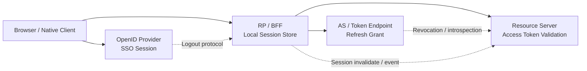
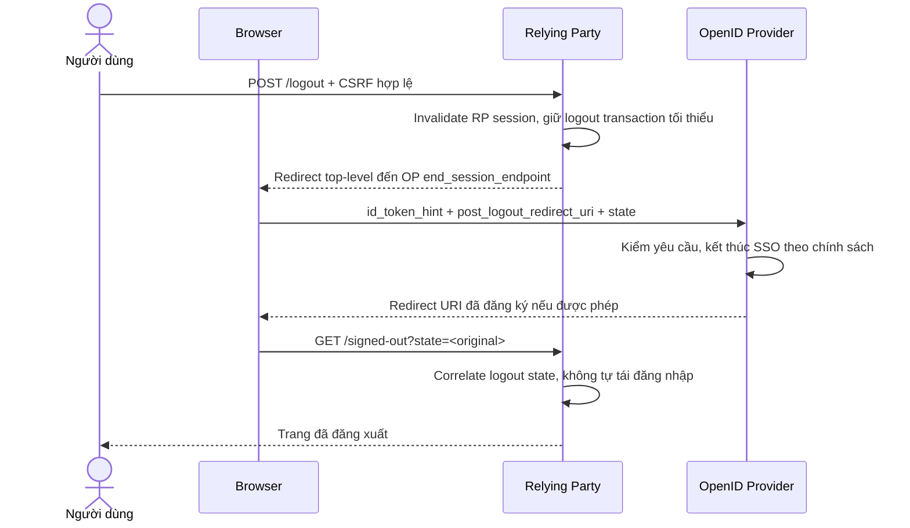
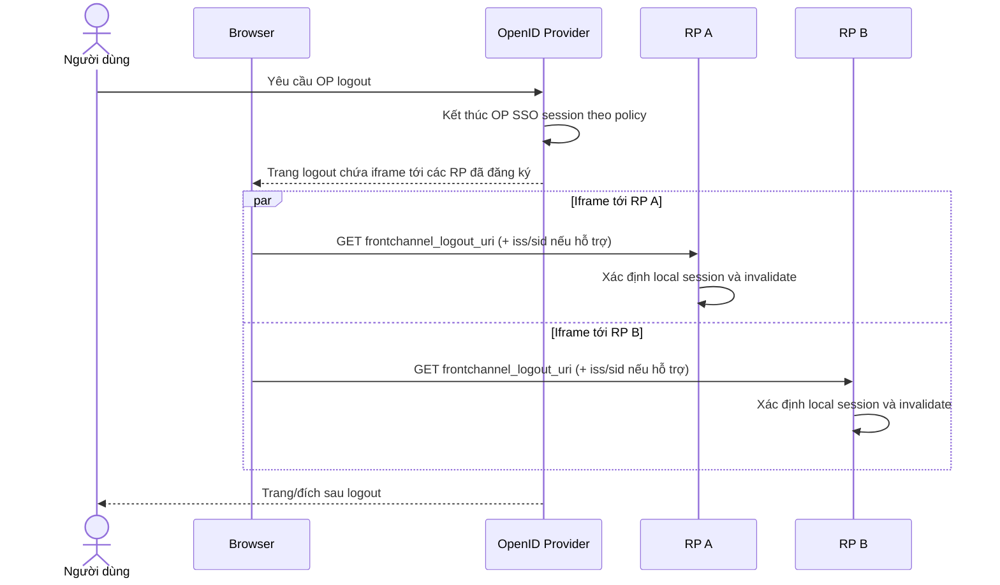
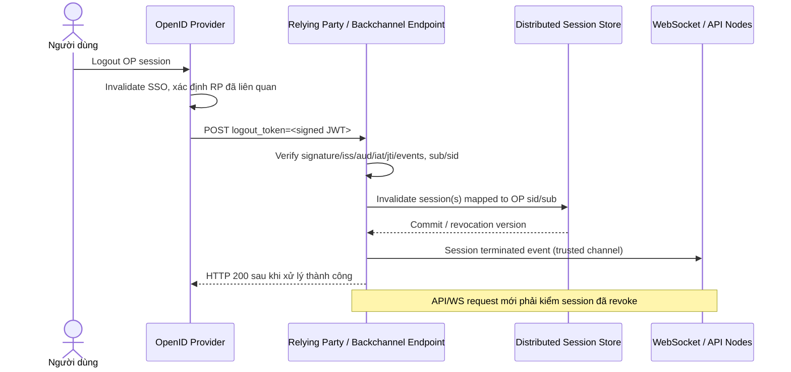
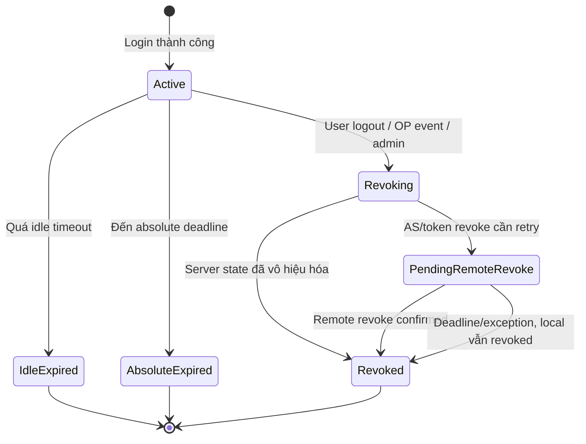
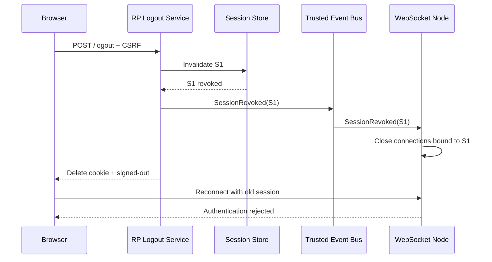

# Session termination: kết thúc phiên đăng nhập an toàn trong OAuth 2.0/OIDC

Một người dùng mở ứng dụng quản lý tài chính trên máy tính dùng chung, đăng nhập qua **OpenID Connect (OIDC)**, xem một số hóa đơn rồi chọn **«Đăng xuất»**. Trang web hiển thị «Đã đăng xuất», nhưng một tab cũ vẫn gọi API được, một kết nối WebSocket vẫn nhận dữ liệu và khi người dùng nhấn «Đăng nhập» lần nữa thì OpenID Provider (OP) đưa họ vào ứng dụng mà không cần nhập mật khẩu. Điều này có phải lỗi bảo mật?

Câu trả lời phụ thuộc chính xác **phiên nào đã kết thúc**. Một thao tác logout có thể chỉ xóa cookie của **Relying Party (RP)**, có thể yêu cầu OP kết thúc **phiên Single Sign-On (SSO)**, có thể phát thông báo tới các ứng dụng khác và có thể — hoặc không — **thu hồi refresh token, access token hay grant**. Nếu không định nghĩa rõ ranh giới đó, nút «Đăng xuất» dễ tạo một cảm giác an toàn sai.

**Session termination** là quá trình **ngừng chấp nhận một phiên xác thực hoặc phiên ứng dụng** và dọn dẹp trạng thái liên quan theo phạm vi đã xác định. Trong hệ thống OAuth 2.0/OIDC, nó đòi hỏi phối hợp giữa **browser, RP/BFF, OP/authorization server (AS), resource server (RS), token store và các phiên lâu dài**.

Bài thuộc chương **Logout** của module **SECURITY_TOKEN_SECURITY_FUNDAMENTALS**. Nội dung liên hệ trực tiếp với mô hình tin cậy, JWT và opaque token, access token và refresh token, OAuth 2.0/OIDC, kiểm tra `iss`/`aud`/`exp`/`scope`, lưu trữ, thu hồi, phòng chống token bị đánh cắp hoặc phát lại.

> **Nguyên tắc:** xóa giao diện hoặc cookie **không tự động** thu hồi mọi token. Logout khỏi RP **không đồng nghĩa** logout khỏi OP; logout khỏi OP **không tự bảo đảm** mọi RP đã nhận thông báo. Mỗi phạm vi phải có **cơ chế chấm dứt và bằng chứng kiểm tra riêng**.

## 1. Mô hình nhiều lớp: «session» nào đang tồn tại?

Trong một luồng OIDC Authorization Code + PKCE, có thể đồng thời tồn tại:

| Lớp | Ai giữ/trực tiếp kiểm? | Ví dụ | Khi logout cần làm gì? |
| --- | --- | --- | --- |
| **RP browser session** | RP/BFF và browser | Cookie `__Host-rp-session` chứa session ID | Invalidate server session, hết hạn cookie đúng thuộc tính |
| **OP SSO session** | OP và browser | Cookie OP ở `login.example.test` | Dùng giao thức OP logout nếu muốn kết thúc SSO |
| **Client-local UI state** | SPA/native app | User profile và in-memory auth state | Xóa dữ liệu nhạy cảm, dừng API calls, điều hướng UI |
| **Access token** | Client lưu, RS kiểm | JWT hoặc opaque token gọi `orders-api` | Hết hạn hoặc revoke/denylist/introspection theo policy |
| **Refresh token** | Client/BFF lưu, AS kiểm | Token family cấp access token mới | Revoke và xóa token storage theo scope logout |
| **OAuth grant/consent** | AS quản lý | Quyền client đọc lịch của user | Chỉ thu hồi nếu logout contract đòi hỏi; đây là quyết định riêng |
| **Long-lived connection** | RS/gateway/client | WebSocket, SSE, gRPC stream | Chấm dứt hoặc kiểm quyền lại khi session bị revoke |
| **Các RP khác dùng cùng OP** | Từng RP | Mail, Calendar, Admin Portal | Nhận front-/back-channel logout nếu triển khai, không tự xảy ra |

**Một session ID và một token không phải cùng một vật.** Session cookie của RP có thể chỉ là opaque handle; token JWT có claims và chữ ký, nhiều token không mang `sid`. Khi logout, phải biết bên nào đang dùng bằng chứng nào để cho phép truy cập.

### 1.1. Ba phạm vi thường bị nhầm

1. **Local logout:** kết thúc phiên của **một ứng dụng/RP**. OP SSO cookie có thể vẫn còn.
2. **Single Logout (SLO):** phối hợp kết thúc OP session và thông báo các RP liên quan, tùy giao thức/capability. Không phải mọi RP đều nhận hoặc xử lý được.
3. **Logout all devices / revoke sessions:** hủy nhiều phiên/token family của user theo tiêu chí đã định, kể cả trên các thiết bị khác nếu backend thực thi được.

**Logout all devices không được suy chỉ từ việc gọi OP `end_session_endpoint` một lần.** Nó cần quản trị state và token/session mapping theo user/issuer/client, có quyền thích hợp và thời gian propagation rõ ràng.

### 1.2. Minh họa trust boundary



Đường chấm biểu diễn **thông báo/tùy chọn phụ thuộc kiến trúc**, không có nghĩa một tác vụ logout tự truyền tới mọi nơi. RS không nên tin một header `X-Logged-Out: true` do Internet client tự gửi; nó cần session/token state và bằng chứng xác thực.

## 2. Session termination khác access-token/refresh-token revocation

### 2.1. RP session

Với một web app dùng server-side session, cookie có thể chứa giá trị opaque:

```http
Set-Cookie: __Host-rp-session=<opaque-session-id>; Path=/; Secure; HttpOnly; SameSite=Lax
```

RP tra session ID trong server/Redis/DB rồi biết subject đã xác thực. Để logout có hiệu lực **ở server**, cần đánh dấu session **invalid/revoked** hoặc xóa bản ghi sao cho mọi instance từ chối ID đó. Xóa cookie phía browser chỉ làm browser hiện tại ngừng gửi cookie; bản sao session ID bị đánh cắp trước đó có thể vẫn còn dùng được nếu server không invalidate.

### 2.2. Access token

Access token dùng tại **resource server**, không nhất thiết đi qua RP session store. Sau local logout:

- **JWT access token** có thể vẫn được RS xác minh offline tới `exp` nếu RS không có denylist/online session check.
- **Opaque access token** có thể được AS đánh dấu inactive; RS nhận biết qua introspection và độ mới cache.
- **Sender-constrained access token** (DPoP/mTLS) còn yêu cầu proof, nhưng có private key bị chiếm vẫn là rủi ro.
- Token bị lấy cắp trước logout không tự mất giá trị chỉ vì browser bị điều hướng về trang login.

**Không nói «đăng xuất đã thu hồi mọi access token» nếu RS chỉ kiểm JWT signature và `exp`.** Muốn thu hồi gần thời gian thực, cần cơ chế online state/denylist/session version hoặc TTL giới hạn phù hợp.

### 2.3. Refresh token

Refresh token dùng với AS để nhận access token mới trong phạm vi grant. Logout nên xác định:

- Có thu hồi **refresh token đang dùng** không?
- Có thu hồi **cả token family** liên quan rotation không?
- Có thu hồi **mọi token của client trên thiết bị này** hay **mọi thiết bị**?
- Nếu revoke không thành công do AS outage, server sẽ xử lý thế nào?
- Khi token bị replay, AS có cơ chế reuse detection và vô hiệu hóa family không?

**Xóa refresh token ở browser/BFF không thay thế revocation tại AS.** Nếu attacker đã có bản sao refresh token và AS vẫn nhận, attacker có thể xin thêm access token.

### 2.4. Consent/grant

User bấm «Đăng xuất» thông thường không nhất thiết muốn **thu hồi consent** đã cấp cho ứng dụng. Trong một số sản phẩm, «Ngắt kết nối ứng dụng», «Thu hồi quyền truy cập dữ liệu» và «Đăng xuất» là ba hành động riêng. Nếu sản phẩm muốn logout đồng thời revoke grant, phải diễn giải rõ, thực thi và kiểm tra; không xóa consent toàn cục một cách bất ngờ.

### 2.5. Bảng phân biệt

| Hành động | RP session | OP SSO | Access token đã cấp | Refresh token | Consent |
| --- | --- | --- | --- | --- | --- |
| Xóa UI state | Có thể trông như logout | Không đổi | Không đổi | Không đổi ở AS | Không đổi |
| Xóa RP cookie, chưa invalidate server | Browser ngừng gửi cookie | Không đổi | Không đổi | Không đổi ở AS | Không đổi |
| Invalidate RP session server-side | RP phải từ chối session đó | Không mặc định | Có thể vẫn hợp lệ | Tùy policy | Không mặc định |
| RP-Initiated Logout tới OP | RP cần tự invalidate; OP có thể logout SSO | Có nếu OP xử lý thành công | Không tự bảo đảm revoke | Không tự bảo đảm revoke | Không tự động |
| RFC 7009 token revocation | Không tự xóa RP session | Không tự xóa OP session | Theo loại token và AS/RS policy | Có thể ngăn refresh | Có thể không xóa grant |
| Revoke toàn bộ user sessions | Theo quản trị RP | Theo quyền của OP | Chỉ nếu token/RS policy có hỗ trợ | Theo family/grant scope | Tùy sản phẩm |

**Kết luận:** logout là **một workflow nhiều bước**, không phải một HTTP redirect duy nhất.

## 3. Local logout tại RP/BFF: trình tự an toàn

Với ứng dụng web server-side session, quy trình nên:

1. Nhận logout request từ **session đang đăng nhập**, kiểm CSRF/Origin theo framework.
2. Xác định chính xác **session cần hủy**, user, issuer, RP client ID, thiết bị và token handles liên quan.
3. Đánh dấu server session **revoked/invalid** bằng thao tác đủ nhất quán cho mọi instance; ngăn dùng session ID lại.
4. Xóa SecurityContext/request context, cache dữ liệu nhạy cảm và các token lưu theo **session scope**.
5. Thu hồi refresh token/token family ở AS theo chính sách; xử lý thất bại như **việc cần được theo dõi**, không tuyên bố thu hồi thành công khi chưa có kết quả.
6. Xóa cookie bằng `Set-Cookie` có **name, path, domain** phù hợp với cookie đã set; xóa CSRF/session state liên quan theo thiết kế.
7. Hủy kết nối dài hạn và phát sự kiện invalidation tới các service phụ thuộc nếu chúng dùng session state.
8. Trả trang logged-out không cache và, **nếu user yêu cầu SSO logout**, bắt đầu RP-Initiated Logout tới OP.

### 3.1. Logout nên dùng POST tại RP

Ví dụ request:

```http
POST /logout HTTP/1.1
Host: app.example.test
Cookie: __Host-rp-session=<opaque-session-id>
Content-Type: application/x-www-form-urlencoded
Origin: https://app.example.test

csrf_token=<session-bound-csrf-token>
```

Logout **thay đổi trạng thái** nên dùng POST + CSRF protection thay vì một GET tùy ý bị kích hoạt bởi ảnh, liên kết hoặc trang bên ngoài. CSRF logout không trực tiếp cấp quyền, nhưng có thể ép user bị logout, chuyển login flow, gây session confusion hoặc phá tác vụ đang làm. `SameSite` giúp giảm một số rủi ro nhưng **không thay** CSRF token/Origin validation.

**Phân biệt:** OIDC RP-Initiated Logout có thể dùng **top-level browser GET** tới OP logout endpoint theo giao thức. Việc OP hỗ trợ GET không có nghĩa **RP local `GET /logout`** cũng nên tự hủy session khi không có bảo vệ.

### 3.2. Invalidate server trước khi xóa cookie

```http
HTTP/1.1 303 See Other
Location: /signed-out
Set-Cookie: __Host-rp-session=; Path=/; Max-Age=0; Secure; HttpOnly; SameSite=Lax
Cache-Control: no-store
```

`__Host-` cookie yêu cầu `Secure`, `Path=/` và **không có `Domain`**. Nếu session cookie ban đầu có tên, `Path` hoặc `Domain` khác, phải xóa **chính xác cookie đó** (có thể cần nhiều đường cũ khi di trú cấu hình). `HttpOnly` không cản server gửi `Set-Cookie` để xóa.

**Không chỉ redirect `/login` rồi hy vọng session biến mất.** Nếu server session còn active, trình duyệt hoặc attacker có thể dùng lại session ID cũ. Đặt thời hạn cookie bằng 0 chỉ xóa một bản ở browser, không làm DB/Redis session tự bị vô hiệu hóa.

### 3.3. Cẩn trọng với cache và nút Back

Sau logout, browser có thể hiển thị HTML riêng tư từ **back-forward cache** hoặc HTTP cache trong một số tình huống, dù API request tiếp theo đã 401. Cần:

- `Cache-Control: no-store` cho trang/tài nguyên chứa dữ liệu nhạy cảm khi phù hợp.
- Không nhúng token nhạy cảm trong HTML, query, browser history hoặc third-party analytics.
- Trên `pageshow` nếu ứng dụng cần, kiểm lại session trước khi hiển thị dữ liệu riêng, đồng thời xử lý bfcache theo trình duyệt.
- Không dùng frontend hide element làm enforcement; backend phải từ chối session cũ.

Một trang được vẽ lại từ cache không đồng nghĩa token còn hợp lệ; nhưng **dữ liệu nhạy cảm đang được hiển thị** vẫn là vấn đề confidentiality cần kiểm soát.

## 4. Java pseudocode: invalidate session, xóa cookie và dọn token

Mã dưới là **pseudocode gần Java**, không phải một implementation Spring Security có thể copy chạy nguyên vẹn. Các class `SessionRepository`, `RefreshTokenManager`, `SessionEventBus` là abstraction của ứng dụng.

```java
LogoutResult logoutCurrentSession(
    AuthenticatedHttpRequest request,
    HttpServletResponse response
) {
    csrfPolicy.requireValidLogoutPost(request);
    BrowserSession current = sessions.requireCurrent(request);

    // 1. Chặn tái sử dụng session ID trên toàn cluster.
    sessions.invalidateAtomically(current.id(), clock.instant());

    // 2. Xóa context trong request và local server session.
    request.invalidateServletSessionIfPresent();
    SecurityContextHolder.clearContext();

    // 3. Không xóa token của account khác hoặc thiết bị khác.
    TokenHandles owned = tokenStore.takeByRpSessionId(current.id());
    refreshTokenManager.requestRevocation(
        current.issuer(), current.clientId(), owned.refreshTokenHandles()
    );

    // 4. Cập nhật hệ thống phụ thuộc (WebSocket, session cache).
    eventBus.publishSessionRevoked(current.id(), current.subject());

    // 5. Xóa cookie bằng chính tên/path/domain đã set.
    response.addHeader("Set-Cookie",
        "__Host-rp-session=; Path=/; Max-Age=0; Secure; HttpOnly; SameSite=Lax");
    response.setHeader("Cache-Control", "no-store");
    return LogoutResult.localCompleted();
}
```

**Điểm cần làm rõ trong production:**

- `invalidateAtomically` phải đảm bảo mọi request mới dùng session ID cũ bị từ chối. Nếu session store không hỗ trợ transaction, thiết kế trạng thái revoke/version và propagation thích hợp.
- `takeByRpSessionId` tránh xóa token của **user khác** hoặc token của cùng user trên **thiết bị khác**, trừ khi đó là «logout all devices» đã được authorize.
- `request.invalidateServletSessionIfPresent()` chỉ biểu diễn việc invalidate session container; tùy framework thực tế mà dùng API phù hợp.
- `SecurityContextHolder.clearContext()` chỉ xóa context thread đang xử lý, **không thay** invalidate server session/Redis hay revoke token.
- `refreshTokenManager.requestRevocation` có thể thất bại do AS outage; cần audit/retry an toàn và không tuyên bố remote revocation hoàn tất khi chưa có kết quả.
- Token/secret không được đưa vào event payload hoặc log; dùng session ID nội bộ/opaque reference và channel được bảo vệ.

### 4.1. Tạo session mới sau lần đăng nhập tiếp theo

Sau login thành công, RP nên **rotate session ID** hoặc tạo session mới để chống **session fixation**. Không tái sử dụng ID đã revoked dù user cùng account đăng nhập lại sau vài giây. Token mới, state/nonce/PKCE transaction mới và CSRF state mới phải ràng buộc với login session mới.

## 5. Vì sao local logout không đồng nghĩa OIDC SSO logout?

Giả sử:

```text
Browser:
  app.example.test       -> RP cookie A
  mail.example.test      -> RP cookie B
  login.example.test     -> OP SSO cookie S
```

User logout tại `app.example.test`:

- RP A invalidate session A.
- Browser xóa cookie A.
- RP B và OP có thể vẫn còn cookie B, S.
- User mở lại RP A và chọn login: OP thấy SSO cookie S nên **có thể xác thực lại ngay** bằng authorization code flow không cần nhập mật khẩu.

Đây có thể là hành vi hợp lệ của **local logout**, nhưng không phù hợp nếu nút trong sản phẩm hứa «đăng xuất khỏi tất cả ứng dụng». Cần làm rõ phạm vi UX và triển khai logout OP/RP khác đúng protocol.

### 5.1. Người dùng chọn thao tác nào?

| Tên hiển thị đề xuất | Phạm vi có thể cam kết | Phạm vi không được hứa nếu không hỗ trợ |
| --- | --- | --- |
| «Đăng xuất khỏi ứng dụng này» | Invalidate local RP session và dọn credentials thuộc session | OP SSO, RP khác và mọi access token |
| «Đăng xuất khỏi tài khoản SSO» | RP local logout + yêu cầu OP kết thúc SSO theo protocol | Đã logout mọi RP nếu chưa có SLO đầy đủ |
| «Đăng xuất khỏi mọi thiết bị» | Revoke tất cả session/token family trong phạm vi quản trị được xác định | Thiết bị offline/JWT RS không có revocation |
| «Ngắt kết nối ứng dụng» | Revoke delegated grant/refresh tokens theo policy | Xóa toàn bộ OP SSO hoặc session ứng dụng khác |

**Không gom cả bốn hành động thành một boolean `loggedOut=true`.** Với mỗi hành động, backend phải biết cần invalidate gì, thông báo ai, và điều gì có thể chỉ hoàn tất theo eventual consistency.

## 6. OIDC RP-Initiated Logout: RP yêu cầu OP kết thúc phiên

**OpenID Connect RP-Initiated Logout 1.0** cho phép RP hướng user agent tới **OP logout endpoint**, thường được công bố qua discovery bằng metadata `end_session_endpoint`.

### 6.1. Luồng tổng quát



### 6.2. Các tham số thường gặp

| Tham số | Ý nghĩa | Yêu cầu bảo mật |
| --- | --- | --- |
| `id_token_hint` | ID token đã được OP phát trước đó để gợi ý RP/user session cần logout | Dùng từ session đã xác minh; không cho attacker tự chọn token |
| `post_logout_redirect_uri` | URI browser có thể được OP điều hướng tới sau logout | **Phải được OP chấp nhận/đăng ký**, không là open redirect |
| `state` | Giá trị RP dùng để liên kết phản hồi logout với request đã khởi tạo | Random, ngắn hạn, one-time; không phải access token |
| `logout_hint` | Gợi ý user/session được OP hỗ trợ theo profile | Không là bằng chứng tự đủ để logout |
| `client_id` | Xác định RP khi cần, ví dụ khi không gửi ID token hint theo hợp đồng | Public identifier, không là secret |
| `ui_locales` | Ưu tiên ngôn ngữ giao diện OP | Không liên quan quyết định quyền |

**`id_token_hint` được khuyến nghị trong nhiều trường hợp nhưng không phải mọi OP đều yêu cầu cùng tập tham số.** OP có thể xác minh additional conditions hoặc hỏi xác nhận user; RP phải đọc hợp đồng/metadata và tránh hứa logout OP đã hoàn tất chỉ vì browser được redirect.

### 6.3. HTTP redirect minh họa

```http
HTTP/1.1 302 Found
Location: https://login.example.test/logout?id_token_hint=<prior-id-token>&post_logout_redirect_uri=https%3A%2F%2Fapp.example.test%2Fsigned-out&state=<random-logout-state>
Cache-Control: no-store
```

URL đã được rút gọn cho mục đích học tập. Trong triển khai thực, nếu gửi `id_token_hint` trên front-channel, phải cân nhắc nó có thể xuất hiện trong history/log/referrer và áp dụng chính sách giảm tiết lộ. OP logout endpoint phải đến từ **metadata/registration đáng tin**, không xây từ `iss` chưa xác minh hoặc query do browser cung cấp.

### 6.4. Không dùng `post_logout_redirect_uri` từ query tự do

**Sai:**

```java
// SAI: caller quyết định đích redirect sau logout.
String destination = request.query("next");
redirect(opLogout + "?post_logout_redirect_uri=" + destination);
```

Attackers có thể hướng user sang website phishing sau logout. Đúng hơn: RP dùng URI đã đăng ký/allowlist và OP kiểm URI theo registration/profile. Tại RP, sau callback cũng không được mở một redirect thứ hai tới URL không tin.

### 6.5. Browser top-level redirect là cần thiết khi OP dùng cookie

Một HTTP server-to-server request từ RP tới OP `end_session_endpoint` **không mang cookie OP của browser**; nó không tự logout SSO browser của user. Nếu sản phẩm cần kết thúc phiên OP qua browser, phải điều hướng user agent theo OP protocol. Ngay cả browser redirect cũng có thể không hoàn tất khi user đóng tab, chặn navigation hoặc OP cần xác nhận.

**Không ép OP cookie bị xóa bằng JavaScript của RP.** Cookie OP thuộc origin khác và không thể được RP tự xóa theo same-origin model.

## 7. Logout transaction phải tồn tại độc lập với RP session đã hủy

Một lỗi khó thấy: RP invalidate session rồi mới định kiểm `state` callback logout, nhưng **state được lưu chỉ trong session vừa bị xóa**.

Giải pháp:

1. Trước khi invalidate local session, tạo **logout transaction ngắn hạn** chứa RP/client, issuer, expected redirect và random state.
2. Lưu transaction ở server store tách khỏi session vừa bị hủy, có TTL và binding thích hợp; không lưu raw access token.
3. Invalidate local session.
4. Redirect browser tới OP logout endpoint với `state`.
5. Khi quay về `post_logout_redirect_uri`, kiểm state/transaction một lần, rồi hiển thị trang kết thúc.

`state` từ RP-Initiated Logout **không phải `state` của một OIDC Authentication Request mới**. Không dùng callback logout để tự tạo session đăng nhập.

### 7.1. Java pseudocode: chuẩn bị logout OP

```java
URI beginRpInitiatedLogout(
    AuthenticatedHttpRequest request,
    HttpServletResponse response
) {
    csrfPolicy.requireValidLogoutPost(request);
    BrowserSession session = rpSessions.requireCurrent(request);

    TrustedOidcProvider provider =
        providers.requireConfiguredIssuer(session.issuer());
    URI registeredReturnUri =
        registrations.requirePostLogoutRedirectUri(
            session.clientId(), "https://app.example.test/signed-out"
        );

    String state = secureRandom.urlSafeRandom(32);
    logoutTransactions.saveWithShortTtl(
        hash(state), session.issuer(), session.clientId(),
        registeredReturnUri, session.browserBinding()
    );
    Optional<String> idTokenHint =
        verifiedIdTokenStorage.takeHintIfAllowed(session.id());

    rpSessions.invalidateEverywhere(session.id());
    tokenCleanup.revokeOrSchedule(session.tokenHandles());
    response.addHeader("Set-Cookie",
        "__Host-rp-session=; Path=/; Max-Age=0; Secure; HttpOnly; SameSite=Lax");

    return oidcLogoutUrlBuilder.fromTrusted(
        provider.endSessionEndpoint()
    ).idTokenHint(idTokenHint)
     .postLogoutRedirectUri(registeredReturnUri)
     .state(state)
     .buildEncoded();
}
```

Mã giả không thay thư viện OIDC. Thực tế cần chọn chính sách **có/không gửi `id_token_hint`**, storage có bảo vệ, session cookie, ngữ nghĩa OP, xử lý OP timeout/cancel và bảo vệ URI khỏi log. **Không gửi refresh/access token làm `id_token_hint`**; nó có mục đích OIDC riêng.

### 7.2. Callback logout không làm login tự động

```java
LogoutPage postLogoutCallback(LogoutCallback callback) {
    logoutTransactions.requireAndConsumeOnce(
        hash(callback.requireSingle("state")),
        callback.browserBinding()
    );
    // Không tạo SecurityContext mới ở đây.
    return LogoutPage.signedOutWithNoStore();
}
```

Nếu OP không redirect về hoặc không gửi state theo profile, local logout đã có hiệu lực; UX phải có cách hiển thị trạng thái và retry logout OP **có kiểm soát**, không khôi phục session cũ.

## 8. Front-Channel Logout: OP thông báo qua browser

**OpenID Connect Front-Channel Logout 1.0** cho phép OP, khi user logout, yêu cầu browser tải các **front-channel logout URI** đã đăng ký tại những RP có liên quan — thông thường qua iframe trên trang OP logout.

### 8.1. Luồng cơ bản



Đây là **kênh trình duyệt**, không phải một lời gọi back-channel có chữ ký mà OP gửi trực tiếp. Một RP có thể nhận tín hiệu để xóa **session cookie tương ứng trong browser** và invalidate session nếu đủ context.

### 8.2. Front-channel params và session binding

Trong profile có session identifier, OP có thể gửi:

```http
GET /oidc/frontchannel-logout?iss=https%3A%2F%2Flogin.example.test&sid=op-session-7ce2 HTTP/1.1
Host: mail.example.test
```

`iss` ở đây xác định OP, `sid` là **OP session identifier**; nó không nhất thiết là local servlet session ID của RP. Khi request tới RP:

- Không tin `iss` tự khai như bằng chứng cryptographic OP đã gửi request.
- Đối chiếu issuer/`sid` với **context đã gắn session** và registered OP.
- Chỉ invalidate **session khớp** nếu có cách xác định an toàn; không cho URL tùy ý logout toàn bộ user sessions.
- Hạn chế thông tin chi tiết trả về cho browser; response nên không chứa private data.
- Không dùng front-channel GET làm API quản trị «revoke tất cả token của user» chỉ dựa trên một `sid` trong query.

### 8.3. Giới hạn về cookie và trình duyệt

Vì RP logout URI được tải trong iframe **cross-site**, cookie RP có `SameSite=Lax` thường **không được gửi** trong ngữ cảnh này. Trình duyệt còn có thể chặn third-party cookies, third-party storage hoặc iframe vì security headers/browser policy.

Hệ quả:

1. Front-channel iframe có thể không nhận cookie để biết RP session nào cần hủy.
2. Một iframe có thể không được tải hoặc bị browser/ad blocker chặn.
3. User đóng tab quá sớm khiến một số RP không nhận callback.
4. Đổi mọi session cookie sang `SameSite=None` để «sửa» logout có thể làm tăng CSRF/cross-site exposure; `SameSite=None` bắt buộc `Secure` và vẫn có thể bị browser chặn.

**Không coi front-channel là cam kết logout tất cả RP trong mọi browser**. Phải đo coverage và có kênh mạnh hơn nếu yêu cầu security cần guaranteed propagation.

### 8.4. Logout CSRF và fake front-channel request

Một attacker có thể cố mở `/oidc/frontchannel-logout` trên RP của nạn nhân để gây logout. Front-channel được thiết kế dựa trên browser và có giới hạn về nguồn tin; cần:

- Endpoint đã đăng ký rõ, không mở các tham số thay đổi account tùy ý.
- Giới hạn ảnh hưởng của request không chứng thực vào session browser hiện tại.
- Kiểm `iss`, `sid` và session mapping theo profile khi có.
- Không dùng GET này để xóa grant, refresh token mọi thiết bị hoặc các tài khoản khác chỉ vì caller khai `sub`.
- Cân nhắc back-channel signed logout token cho yêu cầu session invalidation có độ tin cậy cao.

**Logout CSRF không phải là tấn công chiếm quyền trực tiếp**, nhưng có thể làm gián đoạn sử dụng và tạo điều kiện session-swapping/phishing khi sản phẩm tự chuyển sang login flow. Không xem nhẹ chỉ vì người dùng «chỉ bị đăng xuất».

## 9. Back-Channel Logout: OP gửi Logout Token tới RP

**OpenID Connect Back-Channel Logout 1.0** cho phép OP **gửi trực tiếp** một **Logout Token** dạng JWT tới endpoint đã đăng ký của RP. Cách này không phụ thuộc browser có gửi third-party cookie trong iframe hay không.

### 9.1. Luồng back-channel



**Back-channel logout không phải OAuth token introspection**, cũng không phải request dùng refresh token. Payload là **một loại Security Event Token (JWT)** để thông báo logout, với validator riêng.

### 9.2. HTTP request ví dụ

```http
POST /oidc/backchannel-logout HTTP/1.1
Host: app.example.test
Content-Type: application/x-www-form-urlencoded

logout_token=<signed-logout-token-jwt>
```

**Không** nhận một logout event từ form `sub=user-123&sid=abc` chưa ký rồi xóa mọi session. OP cần gửi token theo profile, RP kiểm cryptographic signature/trust và claims trước khi thay đổi trạng thái.

### 9.3. Logout Token payload minh họa

```json
{
  "iss": "https://login.example.test",
  "aud": "app-web",
  "iat": 1893456000,
  "jti": "logout-3c973751-5198-4bbd-bc6a-605a0bb6474e",
  "sid": "op-session-7ce2",
  "sub": "user-123",
  "events": {
    "http://schemas.openid.net/event/backchannel-logout": {}
  }
}
```

Đây chỉ là payload chưa có chữ ký. Trong **Back-Channel Logout 1.0**:

| Claim | Mục đích | RS/RP cần chú ý |
| --- | --- | --- |
| `iss` | OP/issuer phát logout token | Khớp OP đã cấu hình cho RP |
| `aud` | RP client nhận logout token | Phải chứa `client_id` phù hợp |
| `iat` | Thời điểm phát sự kiện | Kiểm giới hạn tuổi/clock skew theo policy |
| `jti` | Identifier duy nhất cho logout event | Lưu ngăn replay trong khoảng thích hợp |
| `events` | Chỉ rõ event URI backchannel logout | Bắt buộc có event đúng, không coi JWT tùy ý là logout |
| `sub` | Subject tại OP | Có thể dùng để tìm session theo issuer+subject |
| `sid` | OP session identifier | Có thể tìm chính xác session đăng nhập liên quan |
| `nonce` | **Không được có** trong Logout Token theo profile | Không dùng ID token validator thông thường rồi chấp nhận `nonce` |

Logout Token phải có **`sub` hoặc `sid` hoặc cả hai**. `exp` có thể xuất hiện theo profile/issuer policy nhưng không thay việc kiểm `iat` và `jti` replay. Không tự yêu cầu một claim tùy chọn rồi bác mọi OP chuẩn, cũng không bỏ những trường bắt buộc.

### 9.4. Tách Logout Token khỏi ID token

| Đặc điểm | ID token | Logout Token |
| --- | --- | --- |
| Mục đích | RP biết OP đã xác thực End-User | OP thông báo chấm dứt phiên |
| `aud` | RP client ID | RP client ID |
| `events` backchannel logout | Không phải ID-token claim bắt buộc | **Phải có event đúng** |
| `nonce` | Có thể cần để liên kết Authentication Request | **Bị cấm** trong Logout Token |
| Cách dùng | Sau Authorization Code/OIDC validation | Server-to-server OP → RP logout endpoint |
| Hành động sau verify | Có thể lập phiên login theo flow | **Hủy phiên**, không tạo login |

Không lấy một ID token bình thường có `sub` rồi coi là lệnh logout. **Cross-JWT confusion** có thể khiến attacker dùng token đúng chữ ký nhưng **sai mục đích** để điều khiển session.

### 9.5. Kiểm replay trước khi invalidate

OP có thể retry gửi một Logout Token nếu mạng lỗi; RP cần xử lý **idempotent**. Điều đó khác việc chấp nhận token bị replay không giới hạn:

- Key `(issuer, audience/client_id, jti)` phải có **trạng thái đã nhận** và TTL đủ cho cửa sổ replay theo policy.
- Kiểm `iat` hợp lý, không chấp nhận event cũ vô hạn.
- Nếu token đã nhận và session đã revoked, có thể trả kết quả xử lý idempotent theo protocol mà **không lặp side effects**.
- Không ghi raw logout token vào log; lưu event ID, issuer, session mapping và thời gian.
- Nếu `jti` trùng nhưng payload khác, coi là bất thường và cảnh báo.

### 9.6. `sid` hay `sub`: phạm vi hủy rất khác nhau

| Token event có | Phạm vi hợp lý khi mapping đúng | Rủi ro nếu triển khai sai |
| --- | --- | --- |
| `sid` | Session RP đã được liên kết với **OP session ID đó** | Dùng `sid` như local session ID hoặc không kiểm issuer |
| `sub` không có `sid` | Các session của **subject đó tại RP** theo profile/contract | Không phân biệt issuer/tenant; xóa session account khác |
| Cả `sub` và `sid` | Xác minh cả subject/OP session binding và revoke đúng session | Không kiểm khớp khiến event của user A hủy user B |

Trong hệ thống có nhiều issuer, subject `user-123` tại OP-A **không giống** `user-123` tại OP-B. Luôn khóa identity tối thiểu theo **`(iss, sub)`**, và `sid` theo **`(iss, client_id, sid)`** khi ánh xạ.

## 10. Lưu ánh xạ OP session với local RP session

Để back-channel logout có thể hủy đúng session, RP nên ghi lại OP `sid` nếu được cấp trong ID token/session context theo profile.

Ví dụ schema logic:

```text
RpSession {
  rp_session_id,
  rp_client_id,
  issuer,
  subject,
  op_sid_if_available,
  device_id,
  created_at,
  last_activity_at,
  idle_expires_at,
  absolute_expires_at,
  revoked_at,
  session_version
}

TokenLink {
  rp_session_id,
  access_token_handle_or_jti,
  refresh_token_family_id,
  resource_audience,
  token_expires_at
}
```

Đây **không phải schema chuẩn OIDC**. Không cần lưu raw access/refresh token để tra cứu session; nếu phải giữ refresh token để sử dụng, lưu dưới mã hóa trong vault/DB phù hợp, tách khỏi audit/log.

### 10.1. Các khóa mapping an toàn

```text
By OP session:
  (issuer, client_id, sid) -> set of local rp_session_id

By subject:
  (issuer, client_id, sub) -> set of local rp_session_id

By local session:
  rp_session_id -> state, token handles, connection IDs
```

Khi back-channel Logout Token chỉ có `sub`, RP có thể phải revoke các session của subject tương ứng **theo policy và yêu cầu profile**. Khi có `sid`, RP nên nhắm tới session đã liên kết, không xóa session user trên thiết bị khác chỉ vì cùng `sub` nếu scope event là một OP session.

### 10.2. Multi-tenant và pairwise subject

OIDC có thể cấp **pairwise subject identifiers** khác nhau giữa các client/sectors. Không suy `sub` tại RP A tương đương `sub` tại RP B rồi tự phát sự kiện hủy qua tài khoản. Chỉ OP biết session map giữa các RP; mỗi RP xác minh logout event dành cho **client_id của mình**.

### 10.3. Concurrent login/logout

Hai login flows có thể hoàn tất gần đồng thời với logout OP:

```text
t0  RP bắt đầu login transaction A
t1  OP gửi backchannel logout sid=S1
t2  RP invalidate sessions sid=S1
t3  Callback login A tới RP, có ID token từ OP session S1
```

Nếu RP chỉ xóa session đang tồn tại ở `t2`, callback `t3` có thể **tạo lại phiên từ OP session vừa logout**.

Giải pháp có thể gồm:

- Lưu **session revocation tombstone/epoch** cho OP `sid` hoặc logout time.
- Khi hoàn tất login, đối chiếu session context với trạng thái OP/độ mới nếu security policy yêu cầu.
- Không tạo session từ authorization transaction đã expire/cancel/revoke hoặc ID token không đủ `iat`/`auth_time` và binding.
- Dùng generation/version và transactional commit để chống phiên mới ghi đè trạng thái logout.

**Không chỉ dùng local cache invalidation một lần** mà bỏ qua race với in-flight callbacks.

## 11. Java pseudocode: validate Back-Channel Logout Token

Mã dưới diễn giải thứ tự kiểm, **không phải implementation JOSE đầy đủ**. Dùng thư viện JWT/OIDC đã kiểm thử và cấu hình profile cho **Logout Token**, không dùng hàm decode không verify.

```java
BackChannelResult receiveLogoutToken(
    HttpFormRequest request,
    TrustedOidcClientRegistration registration
) {
    requestPolicy.requireFormPostAndBoundedBody(request);
    String rawJwt = request.requireSingle("logout_token");

    // Parser chỉ chấp nhận JWT dạng/alg đã đăng ký; không trust
    // jku/x5u URL do header gửi từ attacker.
    SignedJwt jwt = strictJoseParser.parseSignedJwt(rawJwt);
    josePolicy.requireAllowedAlgorithm(jwt, registration.opAlgorithms());
    PublicKey key = trustedOpJwks.resolve(
        registration.issuer(), jwt.header().keyId()
    );
    signatureVerifier.requireValid(jwt, key);

    LogoutClaims event = logoutTokenValidator.requireValid(
        jwt.claims(),
        registration.issuer(),   // iss
        registration.clientId(), // aud
        clock.instant()
    );
    // requireValid cũng phải kiểm:
    // iat, jti, events URI đúng, có sub hoặc sid,
    // KHÔNG có nonce, exp nếu hiện diện, clock skew.

    // Atomically record (issuer, client, jti) để chống replay.
    if (!logoutReplayStore.recordOnceWithTtl(
            event.issuer(), registration.clientId(), event.jti())) {
        return BackChannelResult.alreadyHandled();
    }

    List<RpSessionId> targets = sessionIndex.resolveTargets(
        event.issuer(),
        registration.clientId(),
        event.optionalSubject(),
        event.optionalSid()
    );

    sessionRepository.revokeAllAtomically(targets, event.issuedAt());
    connectionRegistry.disconnectForSessions(targets);
    audit.recordLogoutEvent(
        event.issuer(), registration.clientId(), event.jti(),
        targets.size()
    );
    return BackChannelResult.success();
}
```

**Điểm phải thực thi trong production:**

1. `issuer` và `aud` đúng OP/RP registration; **không lấy issuer từ JWT rồi tự chọn bất kỳ JWKS URL nào**.
2. **Chữ ký** hoặc cơ chế bảo vệ JWT theo profile được kiểm cryptographic; `alg` allowlist, `kid` không làm trust anchor.
3. `events` chứa đúng URI `http://schemas.openid.net/event/backchannel-logout` với object rỗng theo profile.
4. `iat` trong cửa sổ freshness cho phép; `jti` được chống replay; có `sub` hoặc `sid`; **không có `nonce`**.
5. Nếu có cả `sub` và `sid`, mapping phải kiểm **khớp cùng user/session**, không chọn một tùy ý khi cái kia mâu thuẫn.
6. `recordOnceWithTtl` và session revoke phải có thiết kế **idempotency/transaction**: không ghi «đã xử lý» rồi crash trước khi revoke khiến retry bị bỏ qua. Dùng transaction, trạng thái event processing hoặc durable inbox/outbox.
7. Không cho một token không hợp lệ gây logout; không trả chi tiết mapping user/session qua HTTP response.
8. Sự kiện logout do OP gửi là **lệnh chấm dứt session**, không tự có quyền revoke grant OAuth ở AS nếu không có policy.

### 11.1. Replay store dùng để chống double-effect

```text
LogoutEventRecord {
    issuer,
    client_id,
    jti,
    token_iat,
    received_at,
    processed_at,
    processing_state,
    failure_class,
    retry_count
}
```

Đặt uniqueness theo `(issuer, client_id, jti)`, có retention đủ cho thời hạn chấp nhận event. Nếu chưa xử lý xong, retry nên **tiếp tục** chứ không trả thành công giả. Không đưa raw Logout Token vào outbox/audit nếu không có lý do bảo mật và retention phù hợp.

## 12. OIDC Session Management và polling phiên OP

**OpenID Connect Session Management 1.0** mô tả cách RP có thể theo dõi thay đổi trạng thái OP session qua browser/iframe và một số tham số phiên. Đây là **một cơ chế khác** với:

- RP-Initiated Logout: RP yêu cầu OP logout.
- Front-Channel Logout: OP thông báo qua browser.
- Back-Channel Logout: OP gửi logout JWT trực tiếp RP server.

Session-management iframe/cookie phụ thuộc khả năng browser truy cập/truyền trạng thái OP từ cross-site context. Third-party-cookie restrictions, partitioned storage và chính sách browser hiện đại có thể khiến polling không đáng tin cho logout propagation.

**Không dựa duy nhất vào `check_session_iframe` để đảm bảo tất cả RP hết phiên trong một khoảng thời gian bảo mật nghiêm ngặt.** Hệ thống cần chọn cơ chế theo OP metadata hỗ trợ, browser thực tế, rủi ro và SLA.

### 12.1. Ma trận so sánh các cơ chế OIDC logout

| Cơ chế | Bên khởi phát/đường truyền | Ưu điểm | Hạn chế |
| --- | --- | --- | --- |
| Local RP logout | Browser → RP local POST | Kiểm session nội bộ trực tiếp | Không ảnh hưởng OP/các RP khác |
| RP-Initiated Logout | RP/browser → OP logout endpoint | User chủ động yêu cầu logout SSO | Phụ thuộc browser navigation và OP policy |
| Front-Channel Logout | OP → browser iframe → RP URI | Có thể tác động nhiều RP qua browser | Third-party cookie/iframe, unsigned GET, không chắc delivery |
| Back-Channel Logout | OP server → RP server, signed Logout Token | Không cần browser cookie, có signature/replay controls | Cần mạng/queue/durable processing, mapping `sid`/`sub` |
| OIDC Session Management | Browser iframe/polling session state | Phát hiện session change khi hoạt động | Browser privacy/cookie hạn chế |
| Token revocation RFC 7009 | Client/AS token lifecycle | Ngăn token tiếp tục dùng theo AS policy | Không tự logout mọi RP/browser session |

**Không có một cơ chế duy nhất bảo đảm mọi mục tiêu logout.** Đặc biệt, kể cả back-channel logout thành công tại RP thì một bearer access token gửi thẳng tới RS vẫn có thể còn hạn nếu RS không ràng buộc token với RP session/revocation state.

## 13. Refresh token rotation, family và logout

Trong ứng dụng backend/BFF, refresh token có thể tồn tại lâu hơn session cookie. Khi logout, nếu không dọn refresh token, backend có thể tiếp tục dùng grant để xin access token mới.

### 13.1. Scope của revoke

```text
Current-device logout:
    RP session S1 revoked
    Refresh family F1 liên kết S1 revoked (theo policy)
    Các sessions khác S2/F2 không nhất thiết bị thu hồi

Logout all devices:
    RP sessions S1,S2,S3 revoked
    Refresh families F1,F2,F3 revoked
    OP SSO sessions và client apps khác tùy quyền/hợp đồng
```

Trong mô hình refresh token rotation, AS có thể cấp `R2` khi client dùng `R1` và làm `R1` invalid. Logout phải tìm **active family/current token** theo AS policy; nếu chỉ revoke R1 đã tiêu thụ trong khi R2 còn dùng được, có thể không chấm dứt khả năng refresh.

### 13.2. RFC 7009 Token Revocation

Request minh họa:

```http
POST /oauth2/revoke HTTP/1.1
Host: login.example.test
Authorization: Basic <confidential-client-credentials>
Content-Type: application/x-www-form-urlencoded

token=<refresh-token-handle>&token_type_hint=refresh_token
```

Theo RFC 7009, token type hint là tùy chọn; endpoint revocation cần client authentication khi thích hợp, token endpoint policy và TLS. **Một response thành công với token không tồn tại hoặc đã invalid** có thể giống token được revoke để không tạo oracle; client không được suy quá mức về token family hoặc mọi access tokens dựa chỉ trên HTTP 200.

Nếu client **không được AS cho phép revoke một token thuộc client khác**, endpoint phải từ chối theo policy; logout không vượt phạm vi client/subject vì caller nói «all devices».

### 13.3. Revocation thất bại sau local logout

```text
Local RP session invalidated: SUCCESS
Browser cookie expired:      SENT
AS refresh revocation:       TIMEOUT
```

Không nên **khôi phục RP session** vì AS revocation timeout. Tuy nhiên, cũng không được báo «tất cả token đã thu hồi» khi mới hủy local session. Cách thiết kế:

- Giữ local session revoked.
- Ghi một **revoke job** durable có token reference được bảo vệ, thời hạn và retry/backoff/circuit.
- Tránh ghi raw refresh token trong log/job payload; quản lý encryption/access controls nếu cần giữ để gửi revoke.
- Cảnh báo nếu revoke vẫn không hoàn tất trong SLA; có phương án disable grant/family ở AS khi sự cố nghiêm trọng.
- Không retry refresh-token grant như một cách «kiểm tra token còn sống»; đó là thao tác có side effect rotation.

### 13.4. Tại sao local logout không tự revoke token toàn API?

OAuth 2.0 Token Revocation có thể ảnh hưởng tới token khác cùng authorization grant tùy implementation/AS policy. Nhưng một RS xác minh JWT **offline** chỉ dựa chữ ký/`aud`/`exp` chưa biết sự kiện revoke mới. Để có *immediate invalidation*, cần:

- RS introspection hoặc online grant/session check;
- denylist `jti` hoặc key/subject/session revocation version;
- access token TTL đủ ngắn, kết hợp enforcement policy;
- propagation sự kiện và cache invalidation kiểm thử được.

Chỉ đặt TTL nhỏ không biến revoke thành tức thì; nó chỉ **giới hạn thời gian tối đa token còn có thể được dùng** theo profile.

## 14. Session termination trong hệ thống nhiều instance và nhiều vùng

Một RP thường không chạy trên một Java process duy nhất. Nó có thể có 20 pod sau load balancer, Redis session store, nhiều API ở các vùng và worker giữ cache authorization riêng.

### 14.1. Xóa session trong một JVM là chưa đủ

```text
Browser cookie S
    |
Load Balancer
    |---------------------------|
    v                           v
RP Pod A                      RP Pod B
Local cache: S active         Local cache: S active
    |                           |
    +-----> Distributed Session Store <-----+
```

Nếu Pod A gọi `session.invalidate()` nhưng Pod B vẫn tin local cache `S active`, một request đến Pod B **có thể vẫn qua**. Cần:

- **Shared authoritative state**: session ID/epoch/revocation được kiểm tại nơi chung hoặc bằng token bảo đảm version.
- **Cache invalidation events**: Pod B nhận sự kiện khi S bị revoke, hoặc local TTL đủ ngắn theo SLA.
- **Race protection**: request đọc session rồi hành động sau khi revoke phải được xử lý theo yêu cầu nghiệp vụ.
- **Monotonic revoked state**: một bản snapshot session cũ không được ghi lại để hồi sinh session đã hủy.

Không cam kết «logout tức thì toàn cluster» nếu có 30 giây session cache TTL mà chưa có invalidation đáng tin.

### 14.2. State machine minh họa



Đây là mô hình giảng dạy: session **local** có thể đã revoked trong khi remote token revocation vẫn pending. Trạng thái `Revoked` ở đây có nghĩa **RP local session bị vô hiệu hóa**, không phải tất cả token trên toàn hệ thống chắc chắn inactive.

### 14.3. Quy tắc «revoked là trạng thái cuối»

Với mỗi RP session:

```text
ACTIVE -> REVOKED
ACTIVE -> EXPIRED
REVOKED -X-> ACTIVE
EXPIRED -X-> ACTIVE
```

Nếu user đăng nhập lại, tạo session ID mới. Không có bước `REVOKED -> ACTIVE` bằng cách reset một dòng DB session cũ; rollback như vậy có thể giúp attacker dùng lại session cookie đã đánh cắp.

### 14.4. Cache version và logout epoch

Một mô hình có thể dùng `session_version` hoặc `logout_epoch`:

```text
UserSession:
    user_id = U
    session_id = S1
    session_version = 4
    revoked_at = null

Logout:
    session_version -> 5
    revoked_at = now

Request mang session_version=4:
    reject
```

Đây là ví dụ; version/epoch phải từ **trusted server store**, không từ client tự khai. Nếu validator chỉ kiểm version được ký nhưng không đọc version mới từ store/event, token cũ vẫn có thể được chấp nhận; phải đánh đổi độ mới rõ ràng.

### 14.5. In-flight requests và side effects

```text
t0  Request A bắt đầu, session S1 active
t1  Người dùng logout, S1 revoked
t2  Request A tạo payment dù session đã revoke
```

Với thao tác rất nhạy cảm, policy có thể yêu cầu **re-check authorization ngay trước commit**, hoặc transaction-level session version check, lock/cancellation semantics. Không phải mọi request đã bắt đầu trước logout đều có thể rollback tức thì; phải nêu rõ consistency contract.

**Đặc biệt với payment:** idempotency key, distributed transaction và audit vẫn cần, không dùng logout làm cơ chế undo payment đã thực thi.

## 15. WebSocket, SSE, gRPC stream và tác vụ nền

Một ứng dụng có thể xác thực HTTP handshake ban đầu cho WebSocket, sau đó giữ connection hàng giờ. Nếu chỉ xóa cookie, socket đã mở **không tự đóng**.

### 15.1. Quy trình chấm dứt kết nối sống lâu

1. Mỗi connection gắn với **verified RP session ID hoặc subject/client/issuer context**, không chỉ tên user do frontend gửi.
2. Khi session bị revoked, event bus gửi thông báo tới node đang giữ connection.
3. Node đóng WebSocket/SSE/gRPC stream phù hợp hoặc thực thi kiểm session state ở các mốc rủi ro.
4. Trước khi gửi sự kiện riêng tư, stream handler có thể kiểm session version/entitlement freshness theo policy.
5. Khi connection ngắt và client reconnect bằng session ID cũ, handshake phải **từ chối**.



Không đưa access token hoặc refresh token nguyên văn vào event bus, log hoặc WebSocket close reason.

### 15.2. Background jobs có được phép tiếp tục sau logout?

Một user có thể khởi động xuất báo cáo rồi logout:

- **User-delegated job** đang dùng access/refresh token của phiên có thể cần bị cancel hoặc ngừng lấy token mới sau logout, theo product policy.
- **Service-owned job** chạy bằng client credentials của một backend có thể tiếp tục vì nó không còn thuộc user browser session.
- **Dữ liệu đã xuất** có retention/access policy riêng; logout không xóa file được tải hoặc event đã gửi.
- Nếu job cần quyền user tại thời điểm thực thi, kiểm grant/session/entitlement khi bắt đầu hoặc trước bước nhạy cảm theo yêu cầu.

**Không tự dùng client_credentials token đặc quyền để tiếp tục hành động thay user sau khi user logout**, trừ khi nghiệp vụ đã có delegated authorization/consent hợp lệ và giải thích rõ.

## 16. SPA, BFF, native mobile và thiết bị dùng chung

### 16.1. SPA thuần

SPA có thể giữ access token trong memory hoặc storage. Khi logout:

- Dừng API requests/retry, xóa token hiện có khỏi memory/storage theo thiết kế.
- Hủy timer refresh, logout UI state và mọi tab liên quan.
- Nếu có backend/session, gọi endpoint logout bảo vệ CSRF và invalidate server session.
- Nếu có refresh token trong browser, đánh giá OAuth public-client protections, rotation/sender binding và khả năng revoke; **không giả định xóa localStorage thu hồi bản sao attacker đang giữ**.
- Nếu cần OP SSO logout, mở RP-Initiated Logout bằng **top-level navigation**, không chỉ AJAX request tới OP.

**Lưu ý:** logout chỉ chạy trong tab hiện tại có thể để tab khác tiếp tục dùng token/cached state. `BroadcastChannel` hoặc storage events có thể giúp đồng bộ UI giữa các tab **cùng origin**, nhưng không là authority xác minh server session và không thay token revocation.

### 16.2. Backend-for-Frontend (BFF)

BFF có thể giữ OAuth access/refresh tokens **server-side**, browser chỉ giữ session cookie `HttpOnly; Secure`. Mô hình này giảm việc JavaScript đọc raw token, nhưng:

- XSS vẫn có thể gửi requests thay user nếu session còn active, cần CSRF/XSS protections.
- Logout phải invalidate BFF session **và** dọn token handles/refresh grant theo policy.
- Cookie `SameSite=Lax` có thể hỗ trợ callback OIDC GET nhưng cross-site `form_post` cần thiết kế correlation/CSRF riêng.
- Khi BFF gọi downstream API bằng access token, token đó vẫn có lifetime và revocation behavior của RS.

### 16.3. Native mobile

Ứng dụng native có thể dùng **system browser** cho OIDC authorization, còn local storage giữ refresh token trong keychain/keystore:

- Xóa local tokens, cache dữ liệu nhạy cảm và account binding.
- Revoke refresh grant qua AS khi được hỗ trợ.
- Nếu muốn kết thúc OP SSO session, thao tác phải hợp với system browser và OP logout protocol; cookie browser không do app muốn xóa là được.
- Không nhúng `client_secret` vào ứng dụng public.
- Device mất mạng khi logout: ghi trạng thái local session đã vô hiệu và retry remote revocation khi online **theo chính sách**, không tiếp tục dùng refresh token cũ.

### 16.4. Kiosk, smart TV và thiết bị dùng chung

Trên thiết bị dùng chung, logout đặc biệt quan trọng vì người kế tiếp có thể thao tác trên cùng phần cứng:

- Xóa profile, account selection, cached media/content được cá nhân hóa, local refresh token và màn hình chứa PII.
- Hủy session/token grants liên kết thiết bị theo mô hình AS.
- Kiểm ứng dụng không «tự đăng nhập lại» bằng một refresh token còn lưu.
- Nếu user dùng OAuth Device Authorization Grant, **device code/user code không phải session login lâu dài**; sau khi phát token, quản lý token lifecycle như các client khác.
- Nếu thiết bị offline, không hứa token đã revoke tại AS; cần thiết kế local disable và remote revoke khi kết nối lại.

### 16.5. Service-to-service dùng client credentials có logout không?

Trong `client_credentials` grant, service principal có thể không có user session để logout. Nhu cầu tương ứng là:

- **Đóng kết nối/session ứng dụng** nếu có.
- **Thu hồi client credential**, access tokens hoặc grant khi cần.
- Rotate `client_secret`/private key/mTLS cert theo vòng đời riêng.

Đừng áp OIDC user logout flow cho một batch service không có browser/End-User; cũng đừng dùng token của service để giả lập logout hay thu hồi user SSO session.

## 17. Session timeout, idle expiry và absolute expiry

Logout do user chủ động chỉ là một cách session kết thúc. Session cũng cần timeout độc lập:

| Kiểu hạn | Mục đích | Cần kiểm ở đâu? |
| --- | --- | --- |
| **Idle timeout** | Session không hoạt động một khoảng thời gian thì vô hiệu | Server-side session store hoặc verifier đáng tin |
| **Absolute session lifetime** | Session không tồn tại quá một ngưỡng dù vẫn hoạt động | Server-side state/expiration policy |
| **Access token `exp`** | Token API không dùng sau thời điểm hết hạn | RS validator/introspection |
| **Refresh token expiry** | Giới hạn khả năng xin token mới | AS refresh grant policy |
| **OP SSO session expiry** | Giới hạn phiên đăng nhập tại OP | OP, có thể khác session RP |
| **Step-up freshness `max_age`** | Yêu cầu user xác thực lại nếu authentication quá cũ | RP/OP với `auth_time` |

**Không dùng `exp` của ID token làm timeout duy nhất cho RP session.** ID token chứng minh sự kiện xác thực tại thời điểm phát; RP session có idle/absolute expiry riêng. Một RP có thể giữ session sau khi ID token hết hạn nếu policy cho phép và các ràng buộc khác còn đủ; cũng có thể hủy session trước khi access token hết hạn.

### 17.1. Ví dụ policy đa lớp

```text
RP idle timeout:          30 phút
RP absolute lifetime:      8 giờ
Access token TTL:         10 phút
Refresh token max age:     7 ngày
OP SSO idle timeout:       1 giờ
Sensitive action max_age:  5 phút
```

Các số này **chỉ minh họa**, không phải khuyến nghị mặc định hoặc giá trị chuẩn của OAuth/OIDC. Chính sách thực tế phụ thuộc rủi ro, loại thiết bị, khả năng revoke, yêu cầu tuân thủ và UX.

### 17.2. Expiry phải được enforcement server-side

**Sai:** JavaScript đếm 30 phút và ẩn UI, nhưng API vẫn chấp nhận session cookie S1. **Đúng:** server verifier từ chối session sau idle/absolute deadline; UI timer chỉ hỗ trợ trải nghiệm.

Khi user hoạt động lại, không kéo dài **absolute deadline** vô hạn bằng cách gia hạn idle expiry. Session đã expired phải tạo login session mới và kiểm lại authentication theo policy.

## 18. Những tình huống lỗi và rollback không được gây tái đăng nhập

Logout là thao tác bảo mật thường xảy ra đúng lúc mạng hoặc hệ thống đang không ổn định. Một thiết kế tốt phải mô tả **kết quả từng bước**, không chỉ có response `200` hoặc boolean `success`.

### 18.1. Các kết quả cần phân biệt

```text
LOCAL_SESSION_REVOKED
  |
  +-- RP cookie deletion sent
  +-- RP/BFF token handles removed from active use
  +-- Refresh token revocation: CONFIRMED | PENDING | FAILED
  +-- OP SSO logout: CONFIRMED | PENDING | UNKNOWN | NOT_REQUESTED
  +-- Other RP logout: ACKED | PARTIAL | UNKNOWN
  +-- RS token invalidation: PROPAGATED | BOUNDED_BY_TTL | UNKNOWN
```

Đây là **trạng thái logic của workflow**, không phải các tên status chuẩn OIDC/OAuth. Một ứng dụng có thể chỉ hỗ trợ local logout; khi đó đừng ghi `otherRpsLoggedOut=true`.

### 18.2. AS revocation timeout

**Tình huống:** RP invalidate local session, gửi RFC 7009 revoke refresh token nhưng AS `503`.

**Đúng:** local session tiếp tục **invalid**. Có durable retry/backoff và alert nếu token remote chưa bị revoke. Không mở lại local session để «cho người dùng thao tác tiếp». Nếu nghi token bị lộ, có escalation sang grant/family disable theo quyền admin.

**Sai:** RP trả local session vẫn active vì remote revoke timeout, hoặc báo «đã thu hồi tất cả quyền» dù AS chưa xác nhận.

### 18.3. OP logout browser bị hủy

**Tình huống:** user vừa logout RP, browser đang redirect tới OP nhưng đóng tab.

**Đúng:** RP session đã bị invalidate. Không hứa OP session đã đóng nếu OP chưa thực hiện. Lần đăng nhập kế tiếp có thể qua SSO nếu OP session còn active; UX phải rõ là local vs global logout.

**Sai:** giữ session RP cho tới khi OP redirect về rồi mới vô hiệu hóa; callback có thể không bao giờ tới.

### 18.4. Back-channel JWT có chữ ký sai

**Tình huống:** HTTP POST `logout_token` tới RP nhưng token dùng key từ issuer khác hoặc `aud` sai.

**Đúng:** không revoke session, trả lỗi phù hợp protocol, ghi security telemetry không chứa token.

**Sai:** chỉ decode JWT lấy `sub` rồi xóa mọi session của subject đó, cho phép attacker ép hàng loạt user logout.

### 18.5. Logout Token lặp lại

**Tình huống:** OP retry cùng `jti` sau timeout mạng.

**Đúng:** RP kiểm replay/inbox, hoàn tất trạng thái revoke **idempotent**, không phát hàng nghìn side effects; nếu chưa commit, retry xử lý tiếp.

**Sai:** từ chối mọi retry trước khi kiểm event đã commit, làm OP nghĩ RP chưa xử lý; hoặc chấp nhận event `iat` cũ nhiều tháng mà không có giới hạn freshness.

### 18.6. Một thiết bị offline

**Tình huống:** user chọn «đăng xuất tất cả thiết bị», điện thoại offline và giữ access token JWT chưa hết hạn.

**Đúng:** AS/RP đặt revocation state server-side để lần request online tiếp theo kiểm được trong SLA; token offline đang nằm trên máy không thể bị xóa từ xa nếu thiết bị chưa nhận event. Khi app kết nối lại, phải kiểm state và xóa token theo policy.

**Sai:** hứa remote wipe thành công ngay cả khi không có kênh quản trị thiết bị hoặc không có token revocation enforcement ở RS.

### 18.7. Refresh token rotation race

```text
t0  BFF bắt đầu POST /token để refresh R1
t1  User POST /logout, local session revoked
t2  AS phát R2 cho request refresh đã được gửi
t3  BFF nhận R2
```

Nếu `t3` BFF ghi R2 vào session đã logout hoặc kích hoạt lại timer refresh, logout có thể không còn hiệu lực. Cần:

- Gắn **session generation/version** vào token-refresh operation.
- Trước khi lưu R2 hoặc sử dụng token mới, **kiểm session còn active cùng generation**.
- Nếu session đã revoked, không lưu vào active token store; gửi revoke R2/family nếu policy cho phép.
- Dùng transaction/inbox/outbox để phối hợp side effects; không chỉ kiểm `isLoggedIn` ở thời điểm bắt đầu refresh.

### 18.8. Session vừa bị revoke vẫn có API call in-flight

Nếu business request đã qua auth ở `t0` và logout ở `t1`, việc có cancel in-flight request hay không là quyết định **consistency/risk**. Đối với tác vụ chuyển tiền/cấp quyền, có thể yêu cầu recheck session version tại commit hoặc step-up transaction binding. Với truy vấn đã hoàn tất trước logout, không thể «thu hồi» byte đã gửi qua mạng.

## 19. Case study: doanh nghiệp có ba ứng dụng OIDC

Giả sử người dùng đăng nhập trên cùng browser:

```text
OpenID Provider:
  https://login.company.example.test

Relying Parties:
  https://portal.company.example.test
  https://mail.company.example.test
  https://admin.company.example.test

Resource Server:
  https://api.company.example.test

Browser có:
  portal RP cookie P1
  mail RP cookie M1
  admin RP cookie A1
  OP SSO cookie O1
```

### 19.1. Trường hợp A: logout riêng Portal

User bấm «Đăng xuất khỏi Portal»:

1. Portal nhận `POST /logout` có CSRF hợp lệ.
2. Portal invalidate P1 trong session store, dọn credentials thuộc P1 và gửi cookie deletion.
3. Portal đóng WebSocket liên kết P1.
4. Nếu policy yêu cầu, Portal revoke refresh token family của P1 và audit kết quả.
5. Mail M1, Admin A1 và OP O1 vẫn có thể còn active.

**Kiểm thử:** P1 bị từ chối trên mọi Portal node; M1/A1 không bị xóa nhầm; nếu truy cập Portal login mới, OP có thể SSO và cấp phiên P2 mới.

### 19.2. Trường hợp B: logout khỏi SSO

User chọn «Đăng xuất khỏi tài khoản công ty»:

1. Portal local logout P1.
2. Browser được redirect tới OP `end_session_endpoint` bằng URI đã đăng ký, state độc lập với session vừa hủy.
3. OP kết thúc O1 theo chính sách và phát các tín hiệu logout tới các RP đã đăng ký.
4. Nếu Mail/Admin hỗ trợ **Back-Channel Logout**, OP gửi signed Logout Token tới endpoint của từng RP.
5. Mail/Admin validate `iss`, `aud`, `iat`, `jti`, `events`, `sid`/`sub` và invalidate M1/A1.
6. Nếu chỉ có Front-Channel Logout, việc xóa M1/A1 có thể phụ thuộc iframe/cookie/browser support.

**Kiểm thử:** yêu cầu với P1/M1/A1 đều bị chặn trong **phạm vi và SLA thực tế**; OP SSO không tự tái đăng nhập sau khi phiên O1 đã kết thúc; không giả định mọi access token API cũ đã inactive.

### 19.3. Trường hợp C: Admin bị logout qua Back-Channel

OP phát event:

```json
{
  "iss": "https://login.company.example.test",
  "aud": "admin-web",
  "iat": 1893456000,
  "jti": "logout-event-420d",
  "sub": "user-123",
  "sid": "op-sso-o1",
  "events": {
    "http://schemas.openid.net/event/backchannel-logout": {}
  }
}
```

Admin RP kiểm JWT cryptographically, tìm local session A1 đã gắn với `(iss, client_id=admin-web, sid=op-sso-o1)`, revoke A1, đóng admin WebSocket, cấm tạo API key bằng A1.

**Nếu event có `aud=mail-web`**, Admin RP không được chấp nhận. **Nếu chỉ có `sub`**, phải dùng policy nhận diện phạm vi session đã đăng nhập subject đó; không dùng chỉ tên/email người dùng để xóa account khác issuer.

### 19.4. Trường hợp D: bearer JWT cũ vẫn được trình tới API

Token API T được phát lúc 09:00, `exp=09:15`, user logout SSO lúc 09:05:

```text
09:05 OP SSO logout completed
09:05 RP sessions invalidated
09:06 API receives previously issued JWT T
```

Nếu API chỉ kiểm JWT signature, `iss`, `aud`, `exp` và `scope` **offline** thì T có thể vẫn được chấp nhận đến 09:15. Muốn API ngừng chấp nhận T sớm hơn, doanh nghiệp phải cấu hình **denylist/introspection/session version/revocation event** và thời gian cache phù hợp. Logout OP không truyền một lệnh có thể xóa JWT đã copy ở attacker.

### 19.5. Trường hợp E: «logout all devices» cho tài khoản bị nghi chiếm

Admin hoặc user qua xác thực đủ mạnh khởi tạo logout mọi thiết bị:

1. AS/RP liệt kê sessions và refresh families thuộc đúng issuer/subject/client/scope cho phép.
2. Server tăng revocation epoch hoặc đánh dấu tất cả session IDs liên quan revoked.
3. Revoke refresh families/grants phù hợp; không ảnh hưởng user khác có cùng email ở issuer khác.
4. Gửi back-channel/session events đến các RP liên quan nếu có contract.
5. RS dùng online status/denylist hoặc TTL chính sách để giới hạn token đã phát.
6. Cảnh báo token reuse, xác thực lại và kiểm hoạt động bất thường nếu nghi compromise.

**Không gọi đây là «chỉ xóa cookie ở tất cả thiết bị»**: hệ thống có thể không điều khiển được cookies trên máy offline, nhưng vẫn có thể chặn chúng **ở server** khi kết nối lại.

## 20. Ma trận kiểm thử Session termination

| Ca kiểm thử | Điều kiện | Kết quả kỳ vọng |
| --- | --- | --- |
| RP logout cơ bản | POST hợp lệ từ browser session P1 | Server invalidate P1, xóa cookie, trả trang không cache |
| CSRF logout | POST không token/Origin bất thường | Từ chối theo CSRF policy |
| GET local logout từ site ngoài | Link hoặc image cross-site | Không tự hủy session nếu route không cho phép |
| Logout lần hai | Session đã revoked | Idempotent/safe response, không khôi phục session |
| Cookie `__Host-` xóa sai Path | Cookie đã set `Path=/` | Test phát hiện cookie còn tồn tại |
| Cookie legacy Domain khác | Migration cookie | Xóa đúng từng legacy cookie theo policy |
| Session ID dùng lại | P1 cũ gửi API sau logout | RP từ chối |
| Session fixation | Đăng nhập lại sau logout | Tạo session ID mới P2 |
| Frontend chỉ ẩn UI | Server session vẫn active | Test phát hiện lỗ hổng; sửa invalidate server |
| Bfcache sau logout | Back button hiển thị private page | No-store/session recheck theo threat model |
| SSO cookie OP còn | Chỉ logout cục bộ tại RP | Có thể SSO lại; UX không hứa global logout |
| RP-Initiated Logout hợp lệ | `end_session_endpoint` trusted | Browser tới OP, OP xử lý theo profile |
| OP endpoint URL từ query | Attacker sửa host | RP không gọi OP không tin |
| Post-logout redirect ngoài registration | Host attacker | OP/RP từ chối |
| RP `state` logout mismatch | Callback không thuộc transaction | RP không xác nhận/khởi tạo login |
| State lưu trong RP session đã xóa | Callback không tra được | Thiết kế test chỉ ra cần store riêng |
| OP logout chưa hoàn tất | Browser đóng tab | RP session vẫn revoked, OP trạng thái unknown |
| OP logout có ID token hint | Hint từ session đã verified | OP xử lý theo policy, không dùng access token làm hint |
| Front-channel có đúng cookie | Browser hỗ trợ, RP map session | Session tương ứng bị invalidate |
| Front-channel không có cookie | SameSite/third-party blocked | Không tự tuyên bố RP đã logout |
| Front-channel `sid` giả | GET từ attacker | Không revoke mọi session theo giá trị tự khai |
| Back-channel signed Logout Token | Valid issuer/aud/claims | Revoke session(s) đúng mapping |
| Back-channel chữ ký sai | JWT forged | Từ chối, không side effect |
| Back-channel issuer lạ | `iss` không khớp configured OP | Từ chối |
| Back-channel audience khác | `aud=other-client` | RP từ chối |
| Back-channel thiếu `events` | JWT bình thường | Từ chối |
| Back-channel event URI sai | Mục đích khác | Từ chối |
| Back-channel có `nonce` | Logout Token sai profile | Từ chối |
| Back-channel thiếu cả `sid` và `sub` | Không xác định phạm vi session | Từ chối |
| Back-channel `iat` quá cũ | Replay event | Từ chối theo freshness policy |
| Back-channel `jti` replay | Same event gửi lần 2 | Không lặp side effects; xử lý idempotent |
| Back-channel replay store crash | Ghi processed trước revoke | Retry còn khả năng hoàn tất |
| Back-channel sid thuộc user khác | `sub`/`sid` không khớp | Không revoke sai session |
| Multi-issuer trùng `sub` | OP-A/OP-B đều user-123 | Chỉ logout đúng issuer |
| Pairwise subject | RP A/RP B có `sub` khác | Mỗi RP map theo OP mình, không đoán |
| Back-channel không có cookie | Server-to-server POST | Vẫn có thể invalidate qua signed token |
| Session store multi-node | P1 cached ở Pod B | Pod B từ chối trong SLA |
| Race login callback sau logout | OP sid vừa bị revoked | Không hồi sinh session cũ |
| Refresh response về sau logout | R2 được cấp sau revoke local | Không lưu R2 vào active session; xử lý revoke |
| Refresh token R1 đã rotate | R2 còn active ở AS | Logout family/active grant đúng policy |
| Revoke AS timeout | Local logout xong, AS 503 | Local vẫn invalid; retry/audit remote |
| JWT access token còn `exp` | RS verify offline | Ghi nhận revoke gap, không hứa tức thì |
| Opaque token revoke | AS introspection active=false | RS từ chối theo freshness policy |
| DPoP token bị đánh cắp không có key | Không có proof hợp lệ | RS từ chối |
| mTLS token sai cert | Token bound với C1, caller C2 | RS từ chối |
| WebSocket còn mở | Session S revoked | Connection bị đóng/kiểm session |
| Stream SSE/gRPC | Event logout propagation | Không tiếp tục gửi private data |
| Background user job | User logout giữa tác vụ | Dừng hoặc kiểm grant theo contract |
| Logout all devices | User đã re-auth và yêu cầu | Revoke đúng sessions/families, không user khác |
| Device offline | User revoke all, thiết bị ngắt mạng | Server từ chối khi kết nối lại; remote wipe không hứa |
| Consent vẫn tồn tại | Logout RP/OP | Không tự xóa grant nếu không yêu cầu |
| Revocation grant riêng | User chọn «Ngắt kết nối» | Dừng delegated access theo revoke policy |
| SPA nhiều tabs | Tab A logout, tab B vẫn mở | Tab B xóa state/refresh và API không được dùng session cũ |
| Malicious `X-Logged-Out` | Caller gửi header giả | Không tin như event auth |
| Token log debug | HTTP/Logout Token in logs | Redaction phát hiện và chặn |

**Kiểm thử end-to-end:** cần môi trường OP/RP/RS thật hoặc mô phỏng giao thức sát thực tế, khóa JWT test do OP ký, browser có/không third-party cookies, multi-pod session store, lỗi mạng và đồng hồ giả. Unit test chỉ xác minh `SecurityContextHolder.clearContext()` không chứng minh toàn hệ thống đã logout.

## 21. Anti-pattern trong thiết kế và triển khai

| Anti-pattern | Hậu quả | Phương án đúng |
| --- | --- | --- |
| Redirect về `/login` là đã logout | Server session còn active | Invalidate session server-side trước |
| Xóa cookie nhưng không revoke session ID | Cookie bị đánh cắp vẫn dùng được | Shared authoritative session state |
| Chỉ `SecurityContextHolder.clearContext()` | Chỉ xóa context một thread | Invalidate session store/Redis |
| Local logout = global SSO logout | OP/RP khác vẫn đăng nhập | Phân biệt scope, dùng OIDC logout protocol |
| Gọi OP logout bằng backend HTTP GET | Browser SSO cookie không đi kèm | User-agent top-level redirect theo profile |
| `post_logout_redirect_uri` lấy từ `next=` | Open redirect/phishing | Registered allowlist và OP validation |
| Logout GET tại RP không bảo vệ | Logout CSRF/session disruption | POST + CSRF/Origin protections |
| Logout callback tạo session mới | Session confusion/tái đăng nhập | Chỉ correlate logout state, không login |
| State logout nằm trong session đã xóa | Callback không kiểm được | Short-lived transaction độc lập |
| Front-channel iframe là guarantee | Browser chặn third-party cookies/iframe | Back-channel và đo delivery |
| Tin front-channel GET có `sid` bất kỳ | Attacker ép logout khác session | Context binding; không mass revoke |
| Decode Logout Token mà không verify | Forged logout events | Signature/issuer/audience/events validation |
| Dùng validator ID token cho Logout Token | Token confusion, kiểm sai nonce/events | Validator logout riêng |
| Bỏ `jti` replay detection | Replay event/side effect nhiều lần | Durable idempotent processing |
| Mapping session theo email | Cross-user/issuer confusion | `iss+sub` và `iss+client_id+sid` |
| Một `sid` = local session ID | Hủy nhầm hoặc không tìm thấy | Explicit OP sid ↔ RP session mapping |
| Crash sau ghi «event handled» | Retry bị bỏ qua, session chưa revoke | Inbox/transaction/recovery |
| Logout xong login callback cũ hồi sinh session | Race condition | Revocation epoch và transaction binding |
| Refresh R1 revoke, R2 vẫn active | Token mới tiếp tục được cấp | Revoke family/grant đúng policy |
| Local token delete = AS revoke | Attacker có bản sao token | RFC7009/revoke/denylist theo contract |
| OP logout = mọi JWT inactive | RS offline không biết revoke | Online check/denylist/TTL |
| Bỏ DPoP/mTLS vì user đã logout | Sender-bound controls bị hạ | Kiểm proof từng API request |
| Logout làm luôn revoke consent mọi ứng dụng | Phá UX và quyền ngoài phạm vi | Phân biệt logout vs disconnect |
| Các pod chỉ cache active session không invalidate | Session sống sót ở Pod B | Distributed revocation, bounded cache TTL |
| Chỉ xóa UI state ở SPA | Server/token còn valid | Server-side invalidate và revoke |
| WebSocket còn gửi dữ liệu sau logout | Private data leak | Session binding + disconnect event |
| Dùng cache page private sau logout | Rò dữ liệu qua Back/bfcache | No-store/session recheck theo risk |
| Logout all devices chỉ xóa cookie hiện tại | Device khác vẫn active | Enumerate/revoke server sessions/families |
| Log raw Logout Token/access/refresh token | Lộ credential/PII | Audit metadata và redaction |

## 22. Checklist production

1. **Định nghĩa phạm vi:** nút là local logout, OP SSO logout, revoke delegated grant hay all devices? UX có nói đúng điều có thể bảo đảm?
2. **Session store:** RP session ID được invalidate server-side trên mọi node; không chỉ xóa browser cookie hoặc SecurityContext?
3. **Cookie:** name/path/domain khớp lúc set; `Secure`, `HttpOnly`, `SameSite` phù hợp; `__Host-` không có Domain và `Path=/`?
4. **CSRF và HTTP:** local logout là state-changing POST được bảo vệ; front-channel endpoints không bị dùng để mass revoke từ request giả?
5. **Session fixation:** sau logout không reuse session ID; login sau đó tạo state/nonce/PKCE và session mới?
6. **OIDC RP-Initiated:** endpoint `end_session_endpoint` đến từ trusted metadata, `post_logout_redirect_uri` đã đăng ký, `state` one-time và hint phù hợp?
7. **Logout transaction:** state tồn tại đủ ngắn độc lập với session đã invalidate, callback logout không tạo session login?
8. **Front-channel:** có hiểu SameSite/iframe/third-party-cookie restrictions, không hứa 100% delivery hoặc tin `iss/sid` query như proof?
9. **Back-channel:** đã đăng ký URI, kiểm chữ ký/issuer/audience/`iat`/`jti`/`events`/`sub`/`sid`, cấm `nonce` và chống replay?
10. **Back-channel durability:** xử lý idempotent với durable inbox/transaction; retry sau crash không bị bỏ qua hoặc làm side effects vô hạn?
11. **Session mapping:** `(iss, sub)`, `(iss, client_id, sid)` và local sessions có mapping chính xác; không nhầm issuer/tenant/user/pairwise subject?
12. **Refresh token:** dọn BFF/client storage và revoke active token/family/grant theo policy, xử lý rotation race và AS outage?
13. **Access token:** không tuyên bố JWT/opaque access token hết hiệu lực ngay nếu RS không có revocation enforcement, TTL hoặc introspection SLA?
14. **Sender binding:** RS vẫn kiểm DPoP/mTLS proof; logout không thay token validation và audience/scope/object authorization?
15. **Multi-node:** Redis/cache invalidation/revocation epoch và session version có SLA; in-flight requests và stale login callbacks được xử lý?
16. **Long-lived connections:** WebSocket/SSE/gRPC bị close hoặc revalidate, background jobs ngừng dùng user grant trái policy?
17. **Client types:** SPA nhiều tabs, BFF server tokens, native keychain/keystore, kiosk và offline-device logout có hành vi rõ?
18. **Session expiry:** idle/absolute timeout khác token `exp`/OP SSO timeout/`auth_time`; server enforcement không chỉ UI timer?
19. **Failure reporting:** local revoked/OP logout/remote token revoke có status/audit riêng; không hứa thành công toàn hệ thống nếu có bước failed/pending?
20. **Observability:** logout started/completed, failed revocations, backchannel signature/replay rejection, propagation lag, session reuse attempts, không log raw credentials?
21. **Security tests:** kiểm CSRF, open redirect, JWT logout forgery, wrong audience/issuer/sid, race, cache, revoke gap và multi-device behavior?

## Tổng kết

**Session termination** không chỉ là «xóa cookie». Với OIDC/OAuth 2.0, cần phân biệt **local RP session**, **OP SSO session**, **session các RP khác**, **access token tại resource server**, **refresh token/grant tại authorization server** và các kết nối hoặc tác vụ còn sống. Chấm dứt một lớp **không mặc định** chấm dứt các lớp còn lại.

Quy trình an toàn bắt đầu từ **invalidate session server-side**, xóa cookie và UI state, dọn token handles, xử lý refresh token revocation theo policy, rồi phối hợp OP/RP nếu cần. **RP-Initiated Logout** đưa user agent tới OP; **Front-Channel Logout** phụ thuộc browser/iframe; **Back-Channel Logout** dùng **signed Logout Token** có issuer, audience, thời gian, event, session/subject và replay protection. Mọi cơ chế phải có mapping và trust boundary rõ ràng.

Access token JWT có thể vẫn được RS chấp nhận tới `exp` nếu không có online revocation hoặc denylist; opaque token phụ thuộc introspection/freshness. Logout cũng không thay kiểm `iss`, `aud`, `scope`, sender proof hoặc quyền object. Trong hệ thống đa node, **revocation consistency, race với refresh/login callback, WebSocket và thiết bị offline** quyết định logout có thật sự hữu hiệu khi có tấn công hoặc sự cố.

**Tài liệu tham khảo:** OpenID Connect RP-Initiated Logout 1.0; OpenID Connect Front-Channel Logout 1.0; OpenID Connect Back-Channel Logout 1.0; OpenID Connect Session Management 1.0; OpenID Connect Core 1.0; RFC 7009 (OAuth 2.0 Token Revocation); RFC 7662 (OAuth 2.0 Token Introspection); RFC 6749 (OAuth 2.0 Authorization Framework); RFC 6750 (Bearer Token Usage); RFC 9700 (Best Current Practice for OAuth 2.0 Security); RFC 8417 (Security Event Token); RFC 7519 (JWT); RFC 8725 (JWT Best Current Practices); RFC 9068 (JWT Access Token Profile); RFC 8705 (OAuth mTLS); RFC 9449 (DPoP); RFC 7636 (PKCE).


