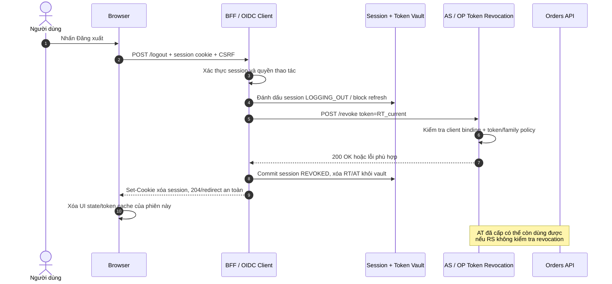
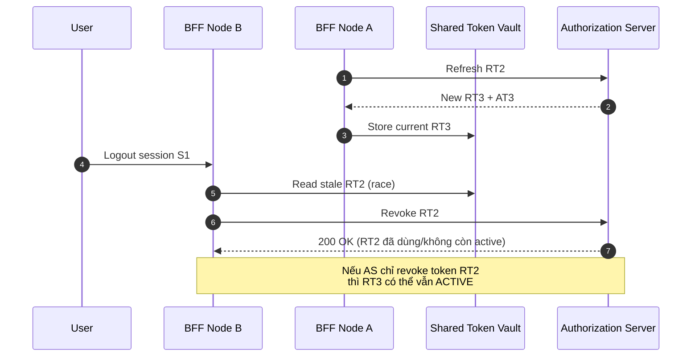
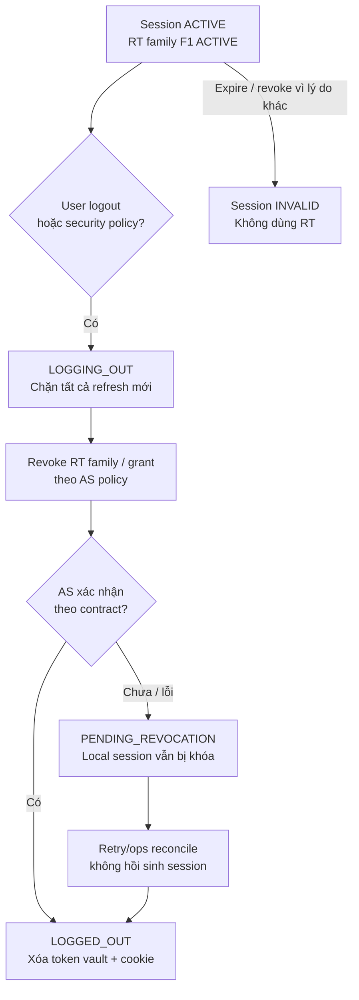
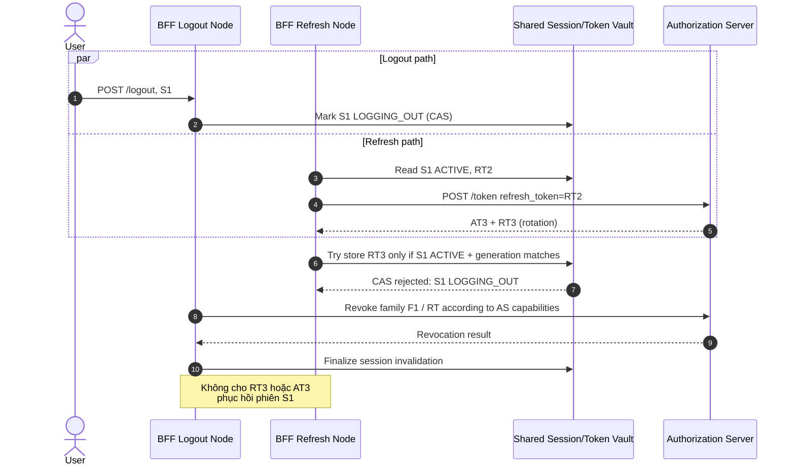
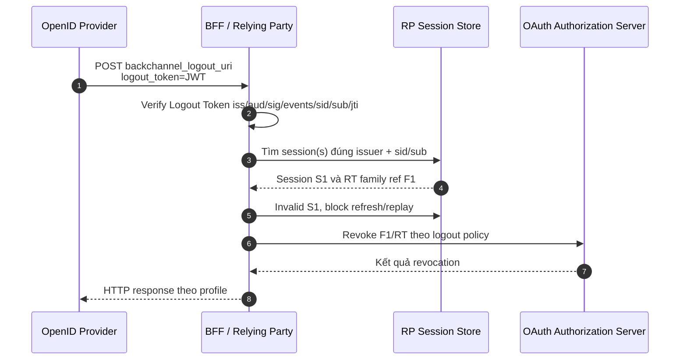
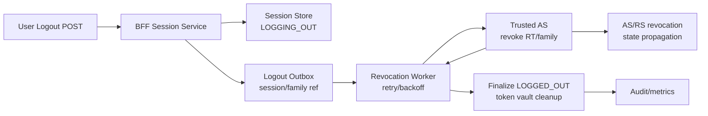

# Refresh token revoke khi logout

## Mục tiêu học tập

Trong module **SECURITY_TOKEN_SECURITY_FUNDAMENTALS**, người học xây dựng mô hình tin cậy và hiểu vòng đời token bảo mật: JWT và opaque token, access token và refresh token, OAuth 2.0/OIDC, phát hành và kiểm tra claims, scope, audience, lưu trữ, thu hồi, phòng chống token bị đánh cắp hoặc phát lại. Ở chương **Logout**, bài **“Refresh token revoke khi logout”** tập trung vào một yêu cầu thiết yếu: **khi người dùng đăng xuất, làm thế nào để refresh token không còn là con đường cấp access token mới cho phiên vừa kết thúc?**

Học xong, bạn có thể:

- Phân biệt **đóng session ứng dụng**, **thu hồi refresh token (RT)**, **thu hồi RT family**, **thu hồi authorization grant/consent**, **thu hồi access token (AT)** và **đăng xuất tại OpenID Provider (OP)**.
- Hiểu vì sao **xóa cookie/local storage không đủ** nếu AS vẫn chấp nhận RT đã cấp.
- Mô tả **OAuth 2.0 Token Revocation (RFC 7009)**: endpoint nhận `token` và `token_type_hint=refresh_token`, client authentication/binding, `200 OK` kể cả token không nhận biết, quan hệ giữa RT và AT.
- Thiết kế logout đúng **phạm vi**: thiết bị/phiên hiện tại, mọi phiên của user tại một client, một authorization grant, hoặc OP SSO session.
- Chặn refresh đồng thời với logout bằng **state machine, transaction/locking/CAS, grant/session binding** và chiến lược rotation/reuse detection.
- Phân tích sự khác nhau giữa **AT JWT verify offline** và **opaque AT introspection** sau khi RT bị revoke; không hứa AT hết hiệu lực tức thì nếu RS không có revocation check.
- Xử lý **mất response RFC 7009**, logout retry, stale RT sau rotation, mất mạng, race giữa nhiều thiết bị, logout CSRF và token/session theft.
- Đưa ra kiến trúc **BFF, confidential web app, SPA public client và native app**, có ví dụ HTTP/Java/Mermaid, kiểm thử và checklist vận hành an toàn.

> **Nguyên tắc:** **Logout của một phiên phải làm vô hiệu đường làm mới token của chính phiên ấy theo chính sách.** Với RT có rotation, thường phải xử lý **refresh token family/session** chứ không chỉ xóa chuỗi RT ở browser. **Thu hồi RT không tự bảo đảm mọi access token đã phát hành bị Resource Server từ chối ngay**; cần cơ chế revocation/expiry riêng cho AT.

## 1. Vấn đề thực tế: “Đăng xuất” nhưng refresh token vẫn hoạt động

Một ứng dụng web dùng OAuth Authorization Code + PKCE để đăng nhập, AS/OP trả:

```text
Resource Owner: user-42
OAuth Client:   portal-bff
Issuer/AS:      https://identity.example.com
Orders API:     aud = api://orders
Access Token:   AT1, hạn còn khoảng 10 phút
Refresh Token:  RT1, liên kết Grant G1 và phiên BFF S1
Browser cookie: __Host-portal-session = opaque session reference
```

Nếu user nhấn **“Đăng xuất”**, BFF chỉ xóa session cookie trong browser nhưng AS vẫn lưu `RT1=ACTIVE`, hệ thống có thể rơi vào trạng thái:

```text
User thấy UI: "Bạn đã đăng xuất".
Browser cookie: đã xóa.
Server-side token vault: vẫn còn RT1 hoặc một bản RT trong backup.
AS Token Endpoint: RT1 vẫn được chấp nhận nếu client/grant binding hợp lệ.

Kẻ có RT1 + khả năng client authentication/binding cần thiết
  -> có thể xin AT2 sau logout (tùy threat model).
```

**Đăng xuất giao diện không đồng nghĩa credential hết hiệu lực tại AS.** Logout đúng phải cân nhắc **đóng session**, **xóa token local**, **revoke RT/family** và **tác động đối với AT đang còn hạn**.

### 1.1. Mô hình vai trò

| Vai trò | Làm gì khi logout? |
| --- | --- |
| **Resource Owner** | Yêu cầu kết thúc phiên hoặc thu hồi ủy quyền; phải hiểu phạm vi hành động. |
| **OAuth Client/Relying Party (RP)** | Đóng phiên ứng dụng, xóa token vault/local token, gọi AS revocation endpoint nếu được phép, điều phối logout. |
| **Authorization Server (AS)** | Thu hồi RT hoặc family/grant theo policy, từ chối refresh tương lai, ghi audit và hỗ trợ revocation liên quan. |
| **OpenID Provider (OP)** | Quản lý phiên SSO/Login riêng khi dùng OIDC; có thể cung cấp OIDC logout protocols. |
| **Resource Server (RS)** | Kiểm tra AT và quyền API, biết trạng thái AT revoked nếu kiến trúc có cơ chế đó. |

**Client authentication khác user authentication.** Một confidential BFF xác thực bằng secret/key ở token/revocation endpoint; user xác thực với OP. Public SPA/mobile không thể bảo vệ một shared client secret chỉ nhờ giấu trong bundle.

## 2. Sáu trạng thái không được đánh đồng

| Trạng thái/hành động | Tác động trực tiếp | Điều chưa được bảo đảm |
| --- | --- | --- |
| **Local logout** | Cookie/session tại RP bị xóa hoặc hết hiệu lực, user không còn vào app qua session ấy. | RT đang có tại AS bị vô hiệu. |
| **Revoke một RT** | AS không tiếp tục chấp nhận token RT được chỉ định. | Mọi RT successor/family khác bị chặn nếu AS không liên kết chúng. |
| **Revoke RT family/session** | Không thể dùng RT của family/session ấy để tiếp tục lấy AT theo policy. | AT đã phát hành bị RS chặn tức thì. |
| **Revoke một AT** | AT cụ thể bị RS từ chối nếu có revocation-aware enforcement. | RT vẫn còn khả năng xin AT khác. |
| **Revoke consent/authorization grant** | AS rút cơ sở ủy quyền; cần ngăn issuance mới và xử lý các RT/AT liên quan. | Tất cả OP SSO sessions hoặc dữ liệu đã tải bị xóa. |
| **OIDC OP logout** | Kết thúc OP/SSO session theo profile, có thể gửi thông báo tới các RP. | OAuth grant và tất cả RT/AT tự bị revoke ở mọi AS/RS. |

Một người có thể đang đăng nhập trên **laptop** và **điện thoại**, cả hai qua cùng OP nhưng dùng các **RP sessions/RT families khác nhau**. Đăng xuất laptop không nhất thiết phải đăng xuất điện thoại nếu UI hứa **“Đăng xuất thiết bị này”**.

### 2.1. Các loại logout theo phạm vi

| Lựa chọn user | Phạm vi cần xử lý |
| --- | --- |
| **Đăng xuất trên thiết bị này** | RP session hiện tại, RT family/token vault gắn với session ấy, AT liên quan theo policy. |
| **Đăng xuất khỏi mọi thiết bị của ứng dụng** | Tất cả RP sessions/refresh families gắn user và client đó; không mặc định mọi client khác. |
| **Ngắt kết nối ứng dụng khỏi tài khoản** | Revoke OAuth grant/consent tương ứng, RT families và xử lý AT còn hạn theo AS/RS policy. |
| **Đăng xuất SSO/Identity Provider** | Kết thúc OP session và gửi logout tới RP theo OIDC profile khi hỗ trợ; OAuth token revocation là quyết định bổ sung, không mặc định. |
| **Xử lý tài khoản bị chiếm quyền** | Có thể rộng hơn: revoke mọi session/grant cần thiết, đổi credential, kiểm tra keys/AT/RT và thông báo theo incident policy. |

**Không biến một nút “Đăng xuất” thành “Revoke mọi grant của user”** nếu điều đó gây mất phiên ngoài ý muốn. Ngược lại, không quảng cáo “Đăng xuất tất cả” khi chỉ xóa cookie của một tab.

## 3. Luồng logout đúng: browser, BFF, AS và RS

Ví dụ **Backend for Frontend** giữ RT server-side và browser chỉ giữ session cookie:



Đây là **luồng lý tưởng hóa**. Trong thực tế, gọi AS qua mạng và ghi local DB không thể luôn nằm trong một transaction nguyên tử. BFF cần xử lý **mất kết nối và retry** mà không để phiên sống lại hoặc RT có thể được refresh trong lúc logout.

### 3.1. Điều gì xảy ra sau khi AS chấp nhận revoke?

Một refresh request với RT đã revoke thường nhận lỗi từ **token endpoint**:

```http
HTTP/1.1 400 Bad Request
Content-Type: application/json
Cache-Control: no-store
Pragma: no-cache

{"error":"invalid_grant"}
```

`invalid_grant` còn có thể do RT expired, rotated/reused, client binding sai hoặc grant không hợp lệ; **không suy chỉ từ lỗi này rằng user vừa logout**.

### 3.2. AT vẫn còn trước `exp`

Nếu AT1 là JWT và Orders API chỉ verify chữ ký, issuer, audience và `exp`, AT1 có thể còn được chấp nhận sau khi AS revoke RT. Nếu hệ thống yêu cầu **“đăng xuất là chặn API ngay”**, phải bổ sung:

- **AT denylist theo `jti`/token reference**.
- **RS kiểm tra session/grant version hoặc trạng thái session đã revoke**.
- **Opaque AT introspection `active=false`** qua RFC 7662.
- **Revocation event với cache invalidation**, kết hợp giới hạn thời gian stale state.
- Hoặc **TTL AT rất ngắn** nếu business chấp nhận không chặn tức thì.

Không coi việc BFF đã xóa cookie là chứng minh **bản sao AT bị lấy trước logout** không thể gọi trực tiếp RS.

## 4. RFC 7009: Thu hồi refresh token tại revocation endpoint

**RFC 7009 — OAuth 2.0 Token Revocation** định nghĩa endpoint để client yêu cầu AS làm mất hiệu lực token được trình. AS **MUST hỗ trợ refresh token revocation** và **SHOULD hỗ trợ access token revocation**.

### 4.1. HTTP request minh họa cho confidential BFF

```http
POST /oauth2/revoke HTTP/1.1
Host: identity.example.com
Authorization: Basic <registered-client-credentials>
Content-Type: application/x-www-form-urlencoded

token=<refresh-token-to-revoke>&token_type_hint=refresh_token
```

Các điều kiện:

1. Endpoint phải lấy từ **AS/issuer được cấu hình đáng tin**, qua HTTPS; không nhận URL revoke tùy ý từ callback/query, tránh token exfiltration/SSRF.
2. `token` là **credential nhạy cảm**, gửi ở **request body form**, không đặt trên query URL, telemetry hay support ticket.
3. `token_type_hint=refresh_token` chỉ là **gợi ý tra cứu**, không phải chứng cứ token thuộc đúng loại.
4. Confidential client xác thực theo registration (`client_secret_basic`, `private_key_jwt`, mTLS... khi được hỗ trợ). Public client được nhận diện/binding theo profile, không dùng secret cứng trong SPA/mobile.
5. AS phải đảm bảo client không thể dùng request này để tùy tiện revoke token/refresh family của client khác.
6. Nếu client muốn thu hồi **toàn bộ family/grant**, phải sử dụng khả năng AS **thực sự hỗ trợ** (policy, grant/session management endpoint, server-side mapping); **một request chứa RT cụ thể không tự quy định chuẩn phải thu hồi mọi family**.

### 4.2. Phản hồi thành công và token không nhận biết

```http
HTTP/1.1 200 OK
Cache-Control: no-store
```

Theo RFC 7009, AS trả **`200 OK` với body rỗng cả khi token không nhận biết/không hợp lệ**, hạn chế revocation endpoint biến thành *token-existence oracle*. Vì vậy:

- **200 không chứng minh** RT đó đã từng tồn tại, còn active, thuộc user nào hoặc đã được client dùng.
- **200 không chứng minh** các bản AT đã phát hành bị RS từ chối tức thì.
- **200 không bảo đảm** logout đã xóa toàn bộ phiên/RT families nếu AS và RP chỉ xử lý một token.

### 4.3. Liên hệ với access token

RFC 7009 mô tả AS có thể tác động các token liên quan của cùng authorization grant. Khi **revoke RT**, AS **SHOULD** đồng thời vô hiệu access tokens dựa trên cùng authorization grant nếu AS hỗ trợ AT revocation. Tuy nhiên **RS enforcement** còn phụ thuộc kiến trúc, đặc biệt khi JWT đã phát hành được xác minh offline hoặc cache introspection đang stale.

**Không hứa tác động AT tức thì chỉ vì RFC nói AS nên hỗ trợ việc đó.** Cần kiểm thử mỗi RS có nhận status revoked không.

### 4.4. Khi request revoke lỗi

| Kết quả tại revocation endpoint | Cách hiểu | BFF/client nên làm |
| --- | --- | --- |
| `200 OK` body rỗng. | Request đã được xử lý theo hợp đồng RFC 7009. | Hoàn tất local cleanup; xác minh policy family/AT nếu cần. |
| Timeout/mất kết nối. | **Không biết** AS đã xử lý chưa. | Local session fail-closed, giữ pending revoke reference an toàn và retry có backoff khi hợp lệ. |
| `invalid_client`/HTTP 401 theo client auth profile. | Client authentication không thành công. | Không bỏ client auth; đánh dấu vận hành cần can thiệp, không để RT dùng lại từ phiên đã logout. |
| `unsupported_token_type`. | AS không hỗ trợ loại token được trình theo profile. | Kiểm tra registration/capability; với RT phải điều tra không tương thích RFC 7009. |
| HTTP 503/5xx. | AS chưa xác nhận revoke đáng tin cậy. | Không báo mọi credential đã bị thu hồi; thực hiện retry/compensation phù hợp. |
| Token đã expired/rotated/không nhận biết. | Có thể vẫn nhận 200. | Không coi RT family chắc chắn đã bị vô hiệu nếu không có family/session state check. |

**Không hiển thị nguyên response lỗi nội bộ** chứa credential, client secret, token fingerprint hay claims nhạy cảm cho browser.

## 5. Refresh token rotation và vì sao phải xử lý cả family

Với RT rotation, mỗi refresh thành công biến RT hiện tại thành RT đã dùng và phát RT mới:

```text
Grant G1, BFF session S1, Refresh family F1
  RT0 (ROTATED) -> RT1 (ROTATED) -> RT2 (ACTIVE)

User logout khi server nhận request mang S1.

Mục tiêu:
  S1 = LOGGED_OUT
  F1 = REVOKED (theo session logout policy)
  RT0 / RT1 / RT2 / mọi successor của F1 = NOT ACCEPTED
  refresh(S1, RT2) -> invalid_grant
  AT cũ -> theo RS access-token revocation policy.
```

### 5.1. Revoke một RT cũ có đủ không?

Giả sử RT2 đã được rotation thành RT3 ngay trước khi user logout, nhưng token vault của node BFF xử lý logout vẫn chỉ nhìn thấy RT2 (cache cũ):



**Đây là lỗ hổng thường gặp:** `200 OK` cho RT2 không bảo đảm RT3 bị thu hồi. Mục tiêu session logout nên được biểu diễn bằng **server-side session/family/grant reference**:

- Session S1 được đánh dấu **LOGGING_OUT/REVOKED** để mọi BFF node không tiếp tục dùng RT của S1.
- AS có khả năng revoke **refresh family F1**, hoặc grant/session binding phù hợp, chứ không chỉ một RT stale.
- Nếu AS chỉ có revocation endpoint RFC 7009 với token cụ thể và không hỗ trợ revoke family, client phải xác định rõ giới hạn, đồng bộ token vault/giao dịch và/hoặc dùng cơ chế grant revoke có thẩm quyền khác.
- Token refresh response đến sau khi logout **không được ghi đè** state REVOKED của session hoặc phục hồi RT trong vault.

### 5.2. Khi AS không hỗ trợ refresh token rotation?

Một AS có thể sử dụng **sender-constrained refresh token** hoặc chính sách khác theo profile. Trong public clients, **RFC 9700** yêu cầu cơ chế replay detection cho RT như **rotation hoặc sender-constraining**. Nếu RT không rotate, logout vẫn phải revoke **RT hiện hành**; session/grant mapping vẫn cần để xác định đúng credential.

Không thiết kế “logout chỉ xóa RT local” chỉ vì RT đã bị ràng buộc DPoP/mTLS: client hợp lệ hoặc attacker chiếm runtime/khóa có thể còn dùng RT nếu AS chưa revoke.

### 5.3. Reuse detection không tự thay logout

AS phát hiện **RT cũ được dùng lại** sau rotation có thể revoke family để chặn replay. Đó là **tín hiệu nghi compromise**, không phải một sự kiện user logout. Ngược lại, user logout chủ động cần thu hồi session/family **ngay cả khi chưa có reuse detection**.

Audit nên phân biệt:

```text
USER_LOGOUT_REQUESTED
REFRESH_FAMILY_REVOKED
REFRESH_REUSE_DETECTED
GRANT_REVOKED_BY_USER
OP_SSO_LOGOUT_COMPLETED
```

Trộn tất cả thành một trạng thái `LOGOUT` có thể khiến điều tra sai nguyên nhân hoặc thực thi thu hồi quá rộng.

## 6. Trạng thái session và điểm quyết định an toàn

Một thiết kế BFF có thể dùng:



Đây là **state machine minh họa**, không phải OAuth RFC định nghĩa. Một app có thể dùng enum khác, nhưng nên đảm bảo:

- **Sau khi logout được ghi nhận local, không đường xử lý nào được refresh và thiết lập lại session ấy.**
- Logout retry/mất response không được chuyển `REVOKED` về `ACTIVE`.
- AS token state là nguồn quyết định RT có thể đổi token; BFF local state là nguồn quyết định session app có cho phép hoạt động hay không.
- Nếu revocation AS thất bại, **local session vẫn bị khóa**, và hệ thống phải có cơ chế **retry/reconciliation** đủ tin cậy, không tuyên bố AS đã revoke thành công.
- Token response đang trên đường về khi user logout không được dùng để tái tạo vault/phiên.
- Phạm vi family/thiết bị/user phải rõ trước khi đánh dấu các sessions khác.

### 6.1. “Logout thành công” là một hợp đồng UX

Nếu BFF đã đóng session nhưng AS tạm thời không truy cập được, UI có thể thông báo **“Bạn đã đăng xuất khỏi thiết bị này; quá trình vô hiệu token tại hệ thống xác thực đang được xử lý”** nếu đúng trạng thái và sản phẩm cho phép. Không được nói **“Mọi thiết bị và token đã vô hiệu ngay lập tức”** nếu server chưa xác nhận hoặc RS chỉ verify JWT offline.

Sự thật kỹ thuật phải được giữ trong audit và trạng thái backend; phản hồi trình duyệt không nên tiết lộ raw RT, family ID nhạy cảm hay chi tiết token store.

## 7. Race condition: refresh và logout xảy ra đồng thời

Đây là vấn đề trung tâm của việc **“revoke refresh token khi logout”** trong hệ thống có nhiều instance, retry và token rotation.

### 7.1. Race cơ bản giữa refresh và logout



**Bất biến phía BFF:** sau khi `S1=LOGGING_OUT` được commit, **không response refresh nào** được ghi trở lại token vault hoặc làm session ACTIVE. Điều này đòi so sánh **session state và generation/version** tại thời điểm lưu token, không chỉ kiểm tra session khi bắt đầu refresh.

**Bất biến phía AS khi logout yêu cầu revoke family/grant:** sau khi AS commit F1/G1 revoked, **không refresh nào theo family/grant ấy được mint AT/RT mới**. Nếu refresh đã commit trước revoke, AT có thể được tạo trước nhưng phải nằm trong phạm vi chính sách xử lý AT hiện hữu.

### 7.2. CAS và generation: ngăn “refresh response hồi sinh session”

```text
Shared session S1:
    state = ACTIVE
    version = 12
    current_refresh_ref = RT2

Refresh node đọc S1 version 12.
Logout node commit S1 state LOGGING_OUT, version 13.
Refresh node nhận RT3 và thử:
    UPDATE session SET RT=RT3, version=13
    WHERE id=S1 AND state=ACTIVE AND version=12

Result: 0 rows updated -> không đưa RT3 về session.
```

Từ chối lưu RT3 ở BFF **không tự revoke RT3 trên AS**. Nếu AS vừa cấp RT3, cần có **AS-side family revocation** hoặc compensation/reconciliation xử lý credential này. Đây là lý do chỉ khóa local session hoặc chỉ gọi revoke với **bản RT cũ** không hoàn chỉnh khi có rotation.

### 7.3. Refresh đã commit trên AS trước khi logout

```text
T0  Refresh RT2 -> RT3 + AT3 commit ở AS
T1  Logout local S1 -> LOGGING_OUT
T2  AS revoke F1 -> toàn bộ RT của F1 không còn refresh được
T3  AT3 còn hạn -> tùy RS revoke policy
```

AT3 có thể đã phát hành **đúng trước thời điểm revoke**, không phải AS “phát token sau logout” nếu hệ thống đặt ranh giới quyết định tại T2. Tuy vậy, nếu UX/security policy đòi ngắt truy cập ngay, RS vẫn phải chặn AT3 dựa trên session/grant revoke hoặc token denylist.

### 7.4. Refresh sau khi AS đã revoke

Nếu một refresh request ở node khác **đến AS sau khi family F1 bị revoke**, AS phải từ chối dù RT string vẫn đúng format/chữ ký và chưa tới `exp`:

```http
HTTP/1.1 400 Bad Request
Content-Type: application/json
Cache-Control: no-store

{"error":"invalid_grant"}
```

Không dùng chiến lược **“refresh token có `exp` chưa qua thì cho mint AT”** mà bỏ kiểm tra family/grant state. Với RT JWT có cấu trúc, chữ ký chỉ chứng minh nguồn phát hành và integrity, **không chứng minh nó chưa bị revoke**.

### 7.5. Mất response, retry và tính idempotent

Logout có thể rơi vào tình huống:

```text
BFF -> AS: revoke RT_current
AS: commit RT/Family REVOKED
Mạng: HTTP response bị mất
BFF: thấy timeout
```

BFF **không biết** AS đã commit chưa. Nên:

- Giữ local session **không thể dùng lại**.
- Lưu công việc retry/compensation với **reference bảo mật** và trạng thái `PENDING_REVOCATION` nếu cần. Nếu AS chỉ hỗ trợ token-based revoke, cần quản lý an toàn credential đủ để retry mà không làm lộ trong queue/log.
- Retry có backoff theo chính sách. RFC 7009 có response 200 cho token đã không hợp lệ, nên request lặp có thể xử lý không tạo tác động thêm; **không được kết luận family đã revoke** nếu chỉ gọi bằng RT stale.
- Có monitoring, dead-letter và reconciliation để tránh pending kéo dài âm thầm.
- Không tự phục hồi session `ACTIVE` sau timeout chỉ để user tiếp tục dùng app.

**Idempotent business operation** có thể dùng `logout_operation_id`/session ID nội bộ. **RFC 7009 không định nghĩa một chuẩn idempotency key riêng cho toàn bộ logout workflow**; transaction/outbox/retry là phần triển khai của ứng dụng.

## 8. Java pseudocode: Logout Service với session và RT family

Ví dụ sau minh họa kiến trúc **BFF + AS tích hợp** có khả năng revoke family qua một API **nội bộ có thẩm quyền**. API family **không phải endpoint RFC 7009 chuẩn**. Nếu chỉ có AS bên thứ ba hỗ trợ `/revoke` token đơn lẻ, cần dùng khả năng AS thực tế và chấp nhận/giải quyết giới hạn.

### 8.1. Yêu cầu phía business

```text
Session S1: ACTIVE
Family F1: ACTIVE, linked to Grant G1
User U42: verified owner of S1

POST /logout:
  validate session + CSRF/Origin
  lock local S1, state ACTIVE -> LOGGING_OUT (commit)
  revoke F1 at AS (trusted server-to-server call)
  commit S1 LOGGED_OUT, erase local AT/RT vault references
  expire browser cookie

If AS unavailable:
  S1 stays invalid locally
  schedule secure retry / reconcile
  do not claim AS revocation confirmed.
```

### 8.2. Pseudocode cho BFF logout

```java
LogoutOutcome logoutCurrentDevice(
        AuthenticatedBrowserSession browser,
        HttpRequest request) {

    requirePostWithCsrfOrEquivalentProtection(request);
    requireAuthenticatedSession(browser);

    // Transaction ngắn: khóa phiên tại BFF, không gọi AS remote bên trong.
    LogoutTicket ticket = localTransaction.execute(() -> {
        AppSession session = sessions.lockById(browser.sessionId());
        requireSameAuthenticatedOwner(browser, session);

        if (session.state() == LOGGED_OUT ||
            session.state() == PENDING_REVOCATION) {
            return existingOrIdempotentLogoutTicket(session);
        }

        session.markLoggingOutAndIncrementVersion();
        sessions.save(session);

        // Chỉ lưu reference bí mật trong vault phân quyền, không log RT raw.
        LogoutTicket created = logoutOutbox.create(
            session.id(),
            session.refreshFamilyRef(),
            session.issuer(),
            session.oauthClientRef()
        );
        return created;
    });

    // Sau commit LOGGING_OUT, mọi node BFF phải chặn refresh/session use.
    RevocationAttempt attempt = trustedRevocationDispatcher.tryRevoke(ticket);

    if (attempt.confirmedByAs()) {
        localTransaction.execute(() -> {
            sessions.markLoggedOut(ticket.sessionId());
            tokenVault.eraseForSession(ticket.sessionId());
            logoutOutbox.markCompleted(ticket.id());
            return null;
        });
        clearProtectedBrowserSessionCookie();
        return LogoutOutcome.localAndAsConfirmed();
    }

    localTransaction.execute(() -> {
        sessions.markPendingRevocation(ticket.sessionId());
        logoutOutbox.scheduleRetry(ticket.id(), attempt.safeFailureClass());
        return null;
    });
    clearProtectedBrowserSessionCookie();
    return LogoutOutcome.localClosedAsRevocationPending();
}
```

**Giới hạn minh họa:**

- `trustedRevocationDispatcher` có thể gọi RFC 7009 **với RT hiện hành** và/hoặc một **family/grant revocation operation** được AS hỗ trợ/ủy quyền. Phải xác định rõ liệu `attempt.confirmedByAs()` có xác nhận đúng **phạm vi cần revoke** hay chỉ xác nhận một token request.
- Nếu không có API family-level, **không được tự tạo claim** “đã revoke mọi RT successor”.
- Token vault có thể cần giữ **credential retry** trong vùng cách ly/TTL ngắn. Không xóa toàn bộ khả năng retry trước khi AS xác nhận, nhưng cũng **không cho session ACTIVE** sử dụng credential ấy nữa.
- `existingOrIdempotentLogoutTicket` phải xử lý cả `LOGGING_OUT`, `PENDING_REVOCATION` và `LOGGED_OUT` phù hợp, tránh tạo nhiều tác vụ gây race.
- Nếu chưa có một phiên hợp lệ (cookie hết hạn), vẫn có thể xóa cookie/đưa user về UI đăng nhập; không được tự revoke các session khác dựa vào `user_id` trong request.
- Không ghi raw bearer tokens/secret trong `safeFailureClass`, audit hay queue.

### 8.3. AS xử lý family revocation

Ví dụ **API quản trị nội bộ** được AS thiết kế riêng; không nhầm với RFC 7009:

```java
FamilyRevocationResult revokeRefreshFamily(
        AuthorizedRevocationActor actor,
        String trustedFamilyRef) {

    return asTransaction.execute(() -> {
        RefreshFamily family = families.lockByRef(trustedFamilyRef)
            .orElseThrow(NotAuthorizedOrNotFoundException::new);

        requireActorCanRevokeFamily(actor, family);
        requireIssuerClientAndGrantBinding(actor, family);

        if (family.state() == REVOKED) {
            return FamilyRevocationResult.alreadyRevoked();
        }

        family.markRevoked(trustedClock.instant());
        refreshTokens.revokeAllActiveForFamily(family.id());

        // AS policy: AT liên quan cần RS biết để áp revoke.
        revocationOutbox.recordFamilyRevoked(
            family.safeReference(),
            family.grantSafeReference(),
            family.revocationVersion()
        );

        audit.recordSafeFamilyLogout(
            actor.safeReference(), family.safeReference());
        return FamilyRevocationResult.revoked();
    });
}
```

**Quan trọng:** mọi handler `grant_type=refresh_token` tại AS phải kiểm tra **family/grant vẫn ACTIVE** trước issuance; API revoke family trên một node sẽ vô nghĩa nếu token endpoint node khác chỉ kiểm tra RT chữ ký.

### 8.4. AS token endpoint kiểm tra RT family khi refresh

```java
TokenResponse refresh(RefreshRequest request,
                      AuthenticatedOAuthClient client) {
    return asTransaction.execute(() -> {
        RefreshRecord rt = refreshStore.lockAndFind(request.refreshToken())
            .orElseThrow(InvalidGrantException::new);

        requireTokenBoundToClient(rt, client);
        requireNotExpiredAndNotReused(rt);

        RefreshFamily family = families.lockById(rt.familyId());
        if (family.state() != ACTIVE) {
            throw new InvalidGrantException(); // Logout/revoke chặn refresh.
        }

        Grant grant = grants.lockById(rt.grantId());
        requireGrantActiveAndCorrectVersion(grant, rt);
        requireClientScopeAndResourcePolicy(grant, client);

        RefreshRecord successor = refreshStore.rotateOnce(rt);
        TokenResponse tokens = issuer.issueOnlyAuthorizedTokens(
            grant, client, successor);
        audit.outboxRefreshIssued(rt.safeReference(), grant.safeReference());
        return tokens;
    });
}
```

**Các bước cần đảm bảo bằng transaction/lock/CAS** trên toàn AS cluster. Không dựa vào `synchronized` của một JVM. Với refresh token reuse detection cần tính đến tình huống `throw` làm rollback các thay đổi revoke family: nếu phát hiện reuse và cần commit revocation, phải dùng cấu trúc **return error result sau commit** hoặc transaction riêng/outbox bảo đảm sự kiện được lưu.

### 8.5. Race giữa logout outbox và refresh response

Nếu logout đã chuyển session S1 sang `LOGGING_OUT`, nhưng AS vừa mint RT3 và client refresh handler nhận response sau đó, **refresh handler phải kiểm tra S1 version trước khi lưu RT3**:

```java
boolean storeRefreshedTokensIfSessionActive(
        String sessionId,
        long versionAtRefreshStart,
        TokenResponse rotatedTokens) {
    return tokenVaultTransaction.execute(() -> {
        AppSession s = sessions.lockById(sessionId);
        if (s.state() != ACTIVE ||
            s.version() != versionAtRefreshStart) {
            return false; // Không làm session sống lại.
        }
        tokenVault.replaceTokens(sessionId, rotatedTokens);
        s.incrementVersion();
        return true;
    });
}
```

Nếu phương thức trả `false`, backend phải **dispose/compensate token response** theo threat model, bao gồm bảo đảm family revoke ở AS theo workflow; không chỉ bỏ AT/RT vào garbage collector rồi coi AS đã vô hiệu.

## 9. Kiến trúc client: BFF, SPA, mobile và server-to-server

| Client/kiến trúc | Nơi thường giữ RT | Logout và revoke cần lưu ý |
| --- | --- | --- |
| **Confidential server-side web/BFF** | Token vault server-side; browser giữ session cookie. | Khóa session, revoke RT/family server-to-server, xóa vault/cookie, bảo vệ CSRF, xử lý retry/AS outage. |
| **SPA browser-only (public)** | Nếu được AS cấp RT, token có thể nằm trong JS runtime/storage. | Gọi revocation endpoint nếu AS hỗ trợ CORS/client profile, xóa local token, RT rotation/sender constraint, chống XSS. |
| **Native/mobile public client** | Secure storage của nền tảng (keystore/keychain khi phù hợp). | Revoke RT qua AS khi online, xóa secure storage, xử lý offline/pending revoke, không nhúng shared secret. |
| **Desktop/CLI public client** | OS credential manager/keychain hoặc vùng lưu bảo mật. | Revoke token theo profile, xóa local credentials/config, chống log token và tránh phục hồi từ cache. |
| **Confidential background service** | Secret manager/token vault server-side. | Không dùng “user logout” cho client_credentials grant; revoke credential/grant theo admin/service policy. |

### 9.1. Vì sao BFF giảm rủi ro?

BFF giữ refresh token **ngoài browser JavaScript**, giảm khả năng XSS chỉ đọc một chuỗi RT từ `localStorage`. Browser gửi session cookie `HttpOnly`, `Secure`, `SameSite` phù hợp:

```http
Set-Cookie: __Host-portal-session=<opaque-session-id>; Path=/; Secure; HttpOnly; SameSite=Lax
```

Khi logout:

```http
Set-Cookie: __Host-portal-session=; Path=/; Max-Age=0; Secure; HttpOnly; SameSite=Lax
```

Cookie `__Host-` phải tuân thủ `Secure`, `Path=/` và không có `Domain`. **Xóa cookie trong response không đủ**: server-side session ID phải bị invalidated trước, nhất là khi cookie/session reference đã bị đánh cắp. XSS vẫn có thể gửi request qua session còn active trước logout, nên phải chống XSS/CSRF và phân quyền API.

### 9.2. Browser SPA và token storage

SPA có thể làm Code + PKCE nhưng **không trở thành confidential client** vì chứa `client_secret` trong JavaScript minified bundle. Nếu AS cấp RT cho SPA:

- Bảo vệ token khỏi XSS bằng CSP/Trusted Types, giảm dependencies, chính sách token storage và thời hạn ngắn phù hợp.
- AS cần RT rotation hoặc sender-constraining chống replay cho public clients (RFC 9700).
- Khi logout, **revoke ở AS** nếu endpoint/profile hỗ trợ rồi xóa local tokens, không chỉ xóa `localStorage`.
- Khi revocation request thất bại, xóa local session vẫn không chứng minh bản RT đã bị bên khác lấy không còn dùng được.
- **CORS support là lựa chọn của AS**, không giả định mọi revocation endpoint cho phép browser gọi trực tiếp. Nếu không hỗ trợ, cần kiến trúc/proxy/flow được đăng ký phù hợp, không gửi RT tới backend tùy ý.

### 9.3. Mobile app offline logout

Người dùng nhấn logout khi điện thoại không có mạng. Ứng dụng có thể xóa credential local và đóng session ngay, nhưng **AS chưa nhận yêu cầu revoke**:

- Ghi nhận **pending revocation** an toàn nếu sản phẩm có cách retry, bảo vệ secret/reference trong secure storage; không để nền tảng backup tự phục hồi token đang pending.
- Nếu không thể giữ token để retry mà đã xóa mọi bản sao, cần nói rõ giới hạn remote revoke và cân nhắc cơ chế AS-side session/grant management khác.
- Khi device online trở lại, retry/reconcile nếu có thể theo profile; không tự đăng nhập lại chỉ vì auth SDK thấy RT từ backup.
- Nếu user nghi ngờ thiết bị bị mất/đánh cắp, cung cấp **remote session revoke** từ thiết bị khác, ưu tiên revoke family/session tại AS.

### 9.4. Client Credentials và “logout”

Grant `client_credentials` không biểu thị một user login session để logout như OIDC. Nếu workload/service cần ngừng quyền truy cập, đó là **revoke access token/client credential/service grant theo admin policy**, không phải “logout user” hoặc token family của người dùng.

## 10. Logout và OpenID Connect (OIDC)

**OAuth RT revocation** và **OIDC OP session logout** là hai chiều độc lập. OIDC cung cấp ID Token để RP xác minh user authentication, nhưng ID Token **không phải access token để gọi RS**, và không có quy tắc chung “đóng OP session là revoke mọi OAuth RT”.

### 10.1. RP-Initiated Logout

Một RP có thể dùng **OpenID Connect RP-Initiated Logout 1.0** nếu OP hỗ trợ, với `end_session_endpoint` từ OP metadata đáng tin. Tham số có thể gồm `id_token_hint`, `post_logout_redirect_uri`, `state` và `client_id` theo profile:

```text
1. RP đóng local session và phối hợp revoke RT theo policy.
2. RP điều hướng browser tới OP end_session_endpoint
   qua URL đã cấu hình từ trusted issuer metadata.
3. OP xử lý kết thúc session SSO theo profile/chính sách.
4. OP chuyển user về post_logout_redirect_uri đã được đăng ký.
5. RP đối chiếu logout state, không coi redirect là bằng chứng RT revoked.
```

**Không đưa refresh token vào OP logout URL.** `id_token_hint` nếu dùng là ID Token được sử dụng theo profile như gợi ý session/user cho OP, **không phải refresh token**. Do `id_token_hint` có thể xuất hiện trên front-channel, cần bảo vệ browser history/log/referrer và tuân thủ profile OP.

### 10.2. Front-Channel Logout

**OIDC Front-Channel Logout** có thể dùng browser iframe/navigation để thông báo các RP kết thúc session. Nó phụ thuộc browser/cookie/privacy policy và có thể không được tải đầy đủ hoặc mất cookie trong iframe.

Vì vậy **không chỉ trông chờ front-channel signal để revoke RT an toàn**. RP vẫn cần server-side mapping phiên→RT family và có cơ chế revoke/reconciliation độc lập nếu yêu cầu bảo mật.

### 10.3. Back-Channel Logout

Trong **OIDC Back-Channel Logout**, OP gửi **Logout Token** đến RP qua kênh server-to-server. RP phải xác minh JWT Logout Token theo profile: issuer, audience, chữ ký/thuật toán, `iat`, `jti`/replay, `events` chứa sự kiện logout tương ứng, `sid` hoặc `sub` theo quy tắc; claim `nonce` không được có trong Logout Token theo spec.



**Bảo vệ đặc biệt:** không tin raw `sid`/`sub` từ request form của bên lạ, không revoke phiên của issuer/client khác vì trùng ID, và không dùng Logout Token như access token. Nếu back-channel signal đến lặp, thao tác logout phải idempotent. **OP gửi Logout Token không tự có nghĩa RT đã được AS revoke**; RP/AS phải phối hợp theo policy.

### 10.4. OP logout có phải “logout mọi ứng dụng”?

Không mặc định. OP có thể thông báo nhiều RP, nhưng mỗi RP áp profile/cơ chế bảo vệ phiên khác nhau; RT/AT đang lưu ở một client hoặc AS khác không tự bị revoke. Đừng tuyên bố **global logout** nếu không kiểm thử **tất cả** relying parties, ASs và Resource Servers liên quan.

### 10.5. User logout RP nhưng vẫn đăng nhập OP SSO

RP đã revoke RT và xóa local session. User mở lại app, OP vẫn có SSO session nên OIDC Authorization Code + PKCE có thể cấp code/ID Token mới **không cần nhập password lại** (tùy policy). Đây là **phiên/authorization transaction mới**, không phải RT cũ được hồi sinh. Nếu sản phẩm muốn buộc user nhập credential lại, cần dùng policy reauthentication (ví dụ `prompt=login`/`max_age` theo OIDC) và verify `auth_time`/assurance, không dựa vào việc đã xóa RT.

## 11. Access token sau logout: lựa chọn enforcement ở Resource Server

Revoke refresh token nhằm ngăn **cấp access token mới**. Một AT đã được cấp trước logout vẫn có thể nằm trên thiết bị, trong BFF, cache, log bị lộ hoặc trong hệ thống delegated token exchange.

### 11.1. JWT access token với offline validation

Payload AT minh họa:

```json
{
  "iss": "https://identity.example.com",
  "sub": "user-42",
  "aud": "api://orders",
  "client_id": "portal-bff",
  "scope": "orders:read",
  "iat": 1800000000,
  "exp": 1800000900,
  "jti": "at-8182",
  "sid": "rp-session-reference",
  "grant_ref": "grant-7c42"
}
```

`sid` và `grant_ref` trong ví dụ là **claims mở rộng theo profile nội bộ**, không phải mọi OAuth access token đều có. **Không đồng nhất OIDC ID Token `sid` với JWT AT session reference** nếu chưa định nghĩa quan hệ tin cậy rõ ràng.

Một RS chỉ kiểm tra `iss`, `aud`, `exp`, chữ ký/alg và scope **không biết** phiên BFF đã logout. AT có thể còn được API chấp nhận đến `exp` (và trong phạm vi clock skew hợp lệ) dù AS đã revoke RT.

### 11.2. Opaque AT và introspection (RFC 7662)

RS có thể gửi opaque access token tới **trusted introspection endpoint** của AS:

```http
POST /oauth2/introspect HTTP/1.1
Host: identity.example.com
Authorization: Basic <registered-resource-server-credentials>
Content-Type: application/x-www-form-urlencoded

token=<opaque-access-token>&token_type_hint=access_token
```

Trước logout:

```json
{
  "active": true,
  "client_id": "portal-bff",
  "aud": "api://orders",
  "scope": "orders:read",
  "exp": 1800000900
}
```

Sau khi AS revoke RT/AT cùng grant theo policy, AS có thể trả:

```json
{"active":false}
```

**RS phải nhận được response mới**: nếu cache `active=true` từ trước logout trong 5 phút, nó có thể vẫn chấp nhận AT trong cửa sổ cache đó. Introspection `active=false` cũng không thay thế kiểm tra business permission, còn `active=true` không có nghĩa được truy cập mọi order.

### 11.3. Chiến lược xử lý AT đã cấp

| Phương án | Hiệu quả sau logout | Đánh đổi |
| --- | --- | --- |
| **JWT AT TTL ngắn** | AT tự hết hạn nhanh; không chặn ngay. | Đơn giản, dễ scale; cửa sổ rủi ro tới `exp` còn lại. |
| **Denylist AT `jti`/ref** | RS từ chối AT cụ thể khi thấy revoked marker. | Cần shared store/cache, TTL marker qua expiry+clock skew. |
| **Session/grant version check** | RS từ chối các AT thuộc session/grant đã bị revoke. | Cần AT mang metadata đáng tin và RS lấy current state. |
| **Opaque introspection `active=false`** | AS kiểm soát token active; RS hỏi trạng thái. | Latency/availability và cache staleness. |
| **Revocation event + RS invalidation** | Thu hẹp độ trễ nếu event đến đúng lúc. | Event loss, out-of-order, offline consumers; cần reconciliation. |
| **Sender-constrained AT (DPoP/mTLS)** | Giảm replay chỉ với bản sao token, không thu hồi credential khi user logout. | Vẫn cần status revocation/expiry. |

**Tùy mức độ nhạy cảm**, hệ thống có thể kết hợp TTL ngắn, session/grant revocation và kiểm tra động ở RS. Nếu app là ngân hàng hoặc xử lý quyền admin, việc chấp nhận AT cũ sau logout trong nhiều phút có thể không phù hợp threat model.

### 11.4. HTTP lỗi sau khi token bị vô hiệu

RS phát hiện AT expired/revoked/invalid thường phản hồi theo **RFC 6750**:

```http
HTTP/1.1 401 Unauthorized
WWW-Authenticate: Bearer realm="orders", error="invalid_token"
Cache-Control: no-store
```

Token hợp lệ nhưng thiếu scope lại có thể nhận:

```http
HTTP/1.1 403 Forbidden
WWW-Authenticate: Bearer realm="orders", error="insufficient_scope"
```

Nếu RS **không xác minh được trạng thái revoke** do introspection backend lỗi và chính sách yêu cầu strict validation, **fail closed** với lỗi hạ tầng thích hợp (ví dụ `503`), không tự cho phép request. **Đăng xuất không thay thế object authorization**: dù AT còn active, Orders API vẫn phải xét `aud`, `scope`, tenant, owner/ACL và policy trên từng đơn.

### 11.5. Những requests đã được cho phép trước logout

```text
10:00:00  Orders API nhận PATCH /orders/101 + AT1
10:00:01  RS verify AT1, cho phép xử lý
10:00:02  User logout, AS revoke RT/AT theo policy
10:00:03  API đang commit thay đổi order
```

**Thu hồi không tự rollback operation đã được API cho phép trước đó.** Với thao tác rất nhạy cảm, business service có thể cần **revalidate quyền gần thời điểm commit** hoặc cơ chế transactional authorization. Đây là lựa chọn consistency ở API, không phải RFC 7009 tự giải quyết.

## 12. Logout endpoint: CSRF, cookie và session fixation

Logout là **thao tác thay đổi trạng thái bảo mật**: nó có thể khóa phiên, làm mất công việc chưa lưu hoặc khiến user phải xác thực lại. Vì vậy không nên xem logout request từ browser là vô hại.

### 12.1. Dùng POST và bảo vệ CSRF

Ví dụ:

```http
POST /logout HTTP/1.1
Host: portal.example.com
Cookie: __Host-portal-session=<opaque-session-id>
Content-Type: application/x-www-form-urlencoded
X-CSRF-Token: <protected-csrf-token>

logout_scope=current_device
```

Điều kiện:

- **Xác thực session** và ràng buộc thao tác với user/thiết bị thật; không tin `user_id` hay `session_id` từ form như chứng cứ.
- **CSRF token, Origin/Referer validation** và cookie `SameSite` phù hợp; không dùng `GET /logout` không bảo vệ như API gây side effect trong chính ứng dụng.
- **CSRF protection** vẫn cần cho logout vì attacker có thể kích user đăng xuất liên tục, thậm chí kích hoạt revoke nhiều phiên nếu scope bị lợi dụng.
- **No open redirect** sau logout. Giá trị `returnUrl` chỉ được chọn từ allowlist nội bộ hoặc `post_logout_redirect_uri` đăng ký với OP.
- Không dùng logout chỉ bằng client-side `localStorage.clear()` khi server session/RT vẫn sống.
- Dù request đã gửi, **browser không nên giữ một local session usable** sau khi server xác định logout.

### 12.2. Session fixation, hijacking và cookie deletion

- **Đăng nhập** nên rotate session ID, đặc biệt sau step-up/nâng quyền, để chống session fixation.
- **Đăng xuất** phải invalid session ID ở **server-side store**, không chỉ gửi `Set-Cookie Max-Age=0`.
- Cookie dùng `Secure`/`HttpOnly`/`SameSite` và scope `Path`/`Domain` nhất quán khi xóa; `__Host-` cookie không có `Domain`.
- Nếu session cookie bị attacker sao chép trước logout, server-side invalidation khiến cookie bản sao không còn xác thực.
- Nếu vẫn có API dùng AT độc lập với cookie, cần revocation/expiry ở RS để tránh request ngoài RP.

### 12.3. Browser history, cache và nút Back

Sau logout, browser có thể hiển thị lại giao diện trước đó từ **back/forward cache** hoặc HTTP cache, nhưng không được có khả năng gọi API có xác thực bằng session đã hủy. Các endpoint chứa dữ liệu nhạy cảm cần chính sách cache phù hợp, session validity check tại server và xử lý UI state khi người dùng bấm Back.

**Không dùng việc trang login được hiển thị lại làm bằng chứng credential thật sự đã bị revoke**: cần kiểm tra AS/RS riêng.

### 12.4. Logout trong môi trường multi-tab

Nếu hai tab cùng dùng một BFF session:

```text
Tab A: POST /logout
BFF: S1 -> LOGGING_OUT -> LOGGED_OUT
Tab B: còn UI cũ / còn in-memory API request
Tab B: gửi request với cookie S1 -> server từ chối
Tab B: phải xóa UI/cache trạng thái user
```

Broadcast/logout event trên browser có thể giúp UX cập nhật nhanh giữa các tab, **nhưng server-side session invalidation là nguồn quyết định bảo mật**. Không cho tab B tự refresh RT và hồi sinh session chỉ vì chưa nhận event từ tab A.

## 13. Threat model: RT bị đánh cắp hoặc phát lại sau logout

### 13.1. Bearer refresh token bị lộ

RT là credential có thể cấp access tokens mới nếu AS cho phép. Khi RT bị lộ:

- **Chỉ xóa local token** không làm bản sao attacker giữ mất hiệu lực.
- Revoke RT/family tại AS và đảm bảo token endpoint **kiểm tra state** trước issuance.
- Đánh giá attacker đã có AT hoặc access vào session/key/client authentication hay chưa.
- Cân nhắc revoke **AT hiện hữu** theo mức rủi ro, không chỉ RT.
- Kiểm tra credential leak trong logs/APM/backups, không yêu cầu user gửi token qua chat/email để “kiểm thử”.

### 13.2. RT rotation replay

```text
Client hợp lệ:  RT1 -> refresh -> RT2
Attacker:       gửi lại RT1
AS:             phát hiện RT1 đã dùng, có thể revoke family F1
```

Nếu logout xảy ra cùng lúc, AS vẫn phải xử lý **family state** một cách nguyên tử và audit phân biệt `USER_LOGOUT` với `REUSE_DETECTED`. BFF không được suy một lỗi `invalid_grant` luôn nghĩa là logout hoàn tất: nó có thể do rotation/reuse/expiry/client binding.

### 13.3. Sender-constrained RT: DPoP và mTLS

RFC 9700 yêu cầu bảo vệ chống replay cho RT của **public clients** qua **rotation hoặc sender-constraining**. DPoP (RFC 9449) và mTLS (RFC 8705) có thể hạn chế attacker chỉ giữ chuỗi RT mà không có khóa/chứng chỉ phù hợp, tùy AS hỗ trợ.

**Không có chuyện “RT đã DPoP-bound thì logout khỏi AS không cần revoke”.** Client nắm private key (hoặc attacker chiếm runtime) có thể vẫn refresh nếu family/grant còn ACTIVE. Sender-constraining không thay đổi quyết định user kết thúc phiên.

### 13.4. Cross-device và session ID confusion

Một subject có thể có nhiều phiên/clients và issuers:

```text
Issuer A, Client portal-bff
  Session Laptop S1 -> RT family F1
  Session Mobile S2 -> RT family F2

Issuer A, Client reporting-app
  Grant G3 -> RT family F3

Issuer B, Client portal-bff
  Session S4 -> RT family F4
```

Nếu user logout **Laptop S1**, không nên gửi lệnh revoke `F2/F3/F4` nếu UI không yêu cầu. Server phải dùng **trusted issuer + verified subject + registered client + session/family ref**, không chỉ một chuỗi `sid` có thể trùng giữa providers.

Ngược lại, khi user chọn **“Đăng xuất mọi thiết bị của portal-bff”**, chỉ revoke F1 sẽ bỏ sót F2. Hãy định nghĩa scope đúng với hợp đồng UI.

### 13.5. Logout CSRF và DoS

Kẻ tấn công có thể tạo trang web khiến browser đang có session gửi request logout. Nếu server không kiểm tra CSRF/Origin/intent:

- User bị đăng xuất bất ngờ hoặc mất công việc.
- Một “global logout” không được bảo vệ có thể revoke token trên nhiều thiết bị.
- Hệ thống có thể bị spam revocation endpoint để gây tải và mất availability.

Biện pháp: CSRF, chỉ cho method phù hợp, session binding, rate limits, step-up cho thao tác phạm vi lớn và tránh dùng một hyperlink GET gây side effect.

### 13.6. Token-existence oracle

RFC 7009 trả `200 OK` với token không nhận biết để không cho client suy token tồn tại. Nếu ứng dụng bọc `/revoke` bằng API riêng rồi trả:

```json
{"user":"user@example.com","refresh_token_exists":true}
```

thì nó đã **tái tạo oracle và lộ PII**. API quản lý session có thể trả trạng thái chi tiết **cho subject/admin có quyền**, nhưng phải kiểm tra object authorization và không cho caller trái quyền tra token của người khác.

### 13.7. Một bản sao AT cũ vẫn còn

Sau khi RT bị revoke, attacker có thể vẫn cầm **access token đã cấp trước logout**. Với JWT verify offline, nó còn hiệu lực tới `exp` nếu không có cơ chế check trạng thái. Một thiết kế an toàn cần đặt **access token revocation SLO** và diễn giải với người dùng/đội vận hành, nhất là sự cố lộ credential.

## 14. Resilience: AS không khả dụng, retry và queue an toàn

### 14.1. Logout không phải distributed transaction miễn phí

Trong hệ thống BFF + AS bên thứ ba:

```text
1. BFF commit session LOGGING_OUT
2. BFF gửi revoke RT qua mạng
3. AS commit RT REVOKED
4. BFF nhận response, xóa vault, commit LOGGED_OUT
```

Các bước không nằm trong **một transaction ACID chung**. Nếu sự cố ở bước 2–4, cần **state machine và reconciliation** thay vì giả định tất cả hoặc không gì xảy ra.

### 14.2. Transactional outbox và retry



Outbox phải **không chứa raw RT trong message queue rộng quyền**. Nếu RFC 7009 cần token string để retry, dispatcher có thể lấy credential từ vault **được mã hóa và hạn chế quyền**, chỉ dùng tại revocation operation; sau khi confirmed/cancelled theo policy thì xóa. Nếu AS cung cấp API revoke family theo **server-side reference có ủy quyền**, ưu tiên cơ chế đó cho session logout phức tạp.

### 14.3. Retry có điều kiện, không vô hạn

| Nguyên nhân | Cách xử lý |
| --- | --- |
| Timeout/mất mạng tạm thời. | Retry có exponential backoff/jitter, giữ session local bị khóa, audit pending. |
| AS trả 200. | Đánh dấu xác nhận **đúng phạm vi request**; kiểm tra family semantics, cleanup local. |
| Client auth fail. | Đưa vào vận hành/security remediation; không thử bỏ auth hay gửi RT sang endpoint lạ. |
| Family reference không còn khả dụng do rotation. | Reconciliation qua AS grant/session management nếu hỗ trợ; không kết luận stale RT revoke đủ. |
| Outbox event mất, worker chết. | Outbox retry/dead-letter, health alerts, periodic reconciliation. |
| AS revocation đã hoàn tất nhưng BFF chưa commit final. | Retry idempotent, không đảo trạng thái hoặc dùng lại RT. |

Với yêu cầu compliance/security cao, đặt **SLO cho thời gian RT revoke sau logout** và cảnh báo công việc pending vượt hạn; không giữ secret vô hạn trong retry vault.

### 14.4. Cache/session invalidation nhiều node BFF

Nếu node A logout nhưng node B dùng local cache `S1=ACTIVE` trong 5 phút, node B có thể tiếp tục thực hiện API/refresh. Cần:

- Session state **nguồn sự thật chung** hoặc cache invalidation/TTL phù hợp SLO.
- Không cho token refresh handler chấp nhận stale ACTIVE khi lưu RT mới.
- Event phiên logout có version/sequence; consumer không được ghi đè state REVOKED bằng ACTIVE cũ.
- Cấm replay session ID đã logout; rotate session ID khi login mới.

Không thể đạt bảo đảm immediate logout nếu ứng dụng cho phép **session cache offline/không có invalidation** tiếp tục hoạt động lâu. Thiết kế phải diễn đạt rủi ro này.

## 15. Audit và kiểm soát thông tin nhạy cảm khi logout

Khi cần điều tra “vì sao user đã logout mà app vẫn lấy được AT?”, hệ thống phải nối được **session, RT family, grant và revocation attempt**, nhưng không nên ghi raw credential.

### 15.1. Mẫu sự kiện kiểm toán

```json
{
  "event_type": "REFRESH_FAMILY_REVOKED_ON_LOGOUT",
  "event_id": "evt-b9a1",
  "correlation_id": "logout-req-f21d",
  "issuer": "https://identity.example.com",
  "oauth_client_ref": "portal-bff",
  "session_ref": "session-hmac-04c7",
  "refresh_family_ref": "family-hmac-a5e1",
  "logout_scope": "CURRENT_DEVICE",
  "reason_code": "USER_REQUESTED",
  "as_revoke_outcome": "CONFIRMED",
  "access_token_effect": "BOUNDED_STALENESS",
  "occurred_at": "2027-02-10T10:00:00Z"
}
```

Đây là **schema minh họa**; OAuth RFC không bắt buộc tên events/field này. `session_ref`/`family_ref` chỉ là tham chiếu không dùng như bearer credential và cần kiểm soát quyền truy cập, retention, namespace theo issuer.

### 15.2. Không log những dữ liệu nào?

| Dữ liệu | Rủi ro nếu ghi log | Thay bằng |
| --- | --- | --- |
| Raw refresh token/current RT successor | Có thể dùng để xin AT khi còn active. | Family/token reference HMAC, generation/version, outcome. |
| Access token JWT/opaque | Có thể gọi API đến `exp` hoặc trước revoke enforcement. | `jti` đã verify/opaque reference có phân quyền. |
| Client secret/private key/DPoP signing key | Có thể giả confidential client hoặc tạo proof. | Authentication method và success/failure category. |
| `Authorization`, `Cookie`, `Set-Cookie` đầy đủ | Chứa bearer/session credentials. | Route template, correlation ID, boolean token-present. |
| Authorization code, PKCE verifier | Có thể bị lợi dụng trước khi code consumed. | Transaction reference đã bảo vệ. |
| OIDC Logout Token/ID Token nguyên vẹn | Chứa claims về user/session, có thể dùng để nhầm lẫn token purpose. | Verified issuer, trusted session ref, event ID. |
| Email, account number, tenant PII không cần thiết | Rò thông tin user khi log/metric được chia sẻ rộng. | Pseudonymous subject/tenant refs có quyền truy cập. |

Redaction phải áp tại **gateway, reverse proxy, token/revocation client middleware, Java filters, APM/tracing, exception handling, message queue và support tooling**. Không chỉ cấm `logger.info(refreshToken)` ở một method.

### 15.3. Chỉ số vận hành

- **Logout session invalidation latency:** từ user POST đến session không còn usable tại mọi BFF node.
- **AS RT revocation latency:** từ local logout state đến AS xác nhận family/token bị revoke.
- **Pending revocation queue age:** các lệnh revoke chưa hoàn tất/đang retry.
- **Refresh attempts after logout:** phải bị từ chối; ghi client/session reference và failure class, không raw RT.
- **RT family active after logout:** invariant cần theo dõi khi AS hỗ trợ family status.
- **AT accepted after logout:** đo theo RS policy và SLO đã công bố, không gọi “vi phạm” nếu hệ thống chấp nhận until-expiry có chủ đích.
- **Outbox/consumer lag, duplicate events, network errors:** giúp phát hiện revocation propagation chậm.
- **Repeated logout/CSRF failure signals:** phân biệt UX bấm lặp với request giả mạo hoặc DoS.

### 15.4. Không tin nguyên nhân từ bên ngoài

`reason_code=USER_REQUESTED` chỉ hợp lệ khi user session/CSRF/intent đã được xác minh. Nếu một admin hoặc security service revoke RT vì compromise, log `ADMIN_POLICY` hoặc `SECURITY_REPLAY_DETECTED` theo policy, không gán nhầm cho user logout.

## 16. Những anti-pattern cần tránh

| Anti-pattern | Hậu quả | Thiết kế đúng |
| --- | --- | --- |
| **Logout = xóa cookie trong trình duyệt**. | BFF session/RT ở AS có thể vẫn hoạt động. | Server-side session invalidation + RT revoke. |
| Xóa RT trong `localStorage` mà không revoke AS. | Bản sao RT bị lấy trước logout vẫn refresh được. | AS-side revocation theo client profile + local cleanup. |
| Revoke RT0 đã rotated nhưng RT2 successor còn ACTIVE. | Logout bị bypass vì family chưa bị thu hồi. | Revoke family/grant/session theo AS capability, kiểm tra race. |
| Nhận 200 từ RFC 7009 rồi suy **mọi RT trong family đã chết**. | Token không nhận biết vẫn 200; successor có thể còn hoạt động. | Xác minh hợp đồng AS family behavior hoặc dùng family API. |
| Đánh dấu session ACTIVE lại sau revocation timeout. | Credential bị hồi sinh/tiếp tục dùng trong lúc pending. | Local session fail-closed, outbox/retry. |
| RT refresh đang chạy ghi RT successor vào vault sau logout. | Lệnh logout mất tác dụng, BFF tự phục hồi session. | CAS session state/version khi lưu response. |
| AS check chữ ký/`exp` RT JWT nhưng không kiểm tra revoked family. | RT cũ còn mint AT sau logout. | State check trong token endpoint. |
| User chọn logout laptop nhưng AS revoke tất cả grants mọi client. | Gián đoạn lớn, trái phạm vi user chọn. | Session/client/family scoping rõ ràng. |
| “Đăng xuất mọi thiết bị” nhưng chỉ revoke RT của một tab. | Thiết bị khác tiếp tục refresh. | Enumerate/revoke đủ family/sessions theo scope. |
| OP SSO logout được xem là RT revoke tự động. | RP/AT/RT có thể còn ACTIVE tùy provider. | Điều phối OIDC logout và OAuth revocation riêng. |
| Revoke RT đồng nghĩa JWT AT ở RS ngừng ngay. | Bản AT đã phát hành vẫn có thể dùng tới `exp`. | Revocation-aware RS hoặc thông báo bounded TTL. |
| Thêm RT hoặc bearer AT vào logout URL/query. | Credential rò qua browser history, logs, redirect. | Token trong request body chỉ tới AS trusted endpoint. |
| SPA dùng client secret nhúng sẵn để gọi revoke. | Secret có thể bị trích xuất, giả client. | Public client registration hoặc confidential BFF. |
| Logout bằng GET không CSRF trên web app. | Logout CSRF, DoS hoặc revoke nhiều phiên ngoài ý muốn. | POST + CSRF/Origin/session validation. |
| Dùng `user_id` từ request để revoke family không kiểm tra owner. | IDOR/BOLA: user A revoke token của user B. | Verified subject, tenant/client/family authorization. |
| Đặt `state`/`sid` từ OP chưa verify làm session lookup toàn cục. | Logout Token giả gây logout người khác. | Verify Logout Token issuer/aud/sig/sid/sub/jti/events và replay. |
| Khi AS unreachable, RS tin mọi AT là active. | Fail-open với token đáng lẽ đã bị revoke. | Strict fail-closed nếu policy yêu cầu. |
| Log raw RT trong retry queue. | Tạo vùng chứa bearer credential rộng quyền. | Vault reference bảo mật, TTL/restriction và redaction. |
| Cứ nhận `invalid_grant` thì thử nhiều RT cũ. | Replay/reuse detection kích hoạt, tăng tấn công và tải. | Stop refresh flow, xử lý session/logout policy. |
| Không test multi-node hoặc mất response. | Race chỉ xuất hiện ở production, session hồi sinh. | Integration/concurrency tests với shared storage. |

## 17. Tình huống thực tế: chọn đúng phạm vi thu hồi

### 17.1. Một laptop đăng xuất, điện thoại vẫn đăng nhập

```text
User-42 / portal-bff
Laptop S1 -> Refresh Family F1
Mobile S2 -> Refresh Family F2
Grant G1  -> Ủy quyền cho portal-bff theo policy
```

User chọn **“Đăng xuất khỏi laptop này”**:

1. RP invalid session S1, vô hiệu mọi cookie/session reference của S1.
2. AS revoke F1/RT hiện hành của S1 theo contract.
3. AT đã cấp cho S1 bị xử lý theo policy RS (denylist/session state/introspection hoặc TTL).
4. F2/S2 có thể tiếp tục nếu policy cho phép và user không chọn all devices.

Không revoke F2 chỉ vì nó có cùng subject/client, trừ khi security response hoặc UI yêu cầu.

### 17.2. Người dùng chọn “Đăng xuất mọi thiết bị”

UI phải xác nhận phạm vi. AS/RP cần xác định **toàn bộ sessions và refresh families thuộc user/client đã được xác minh**. Khi revoke:

- Không chỉ gửi `/revoke` với RT đang nằm trong browser/session hiện tại.
- Có thể dùng admin/session-management API được AS hỗ trợ hoặc revoke grant khi semantics trùng với mong muốn; chú ý revoke grant có thể ảnh hưởng consent và yêu cầu re-consent sau này.
- Xử lý AT của mỗi session theo chính sách RS và kiểm tra mọi node BFF.
- Audit danh sách **tham chiếu an toàn** và số sessions bị ảnh hưởng, không raw RT.

### 17.3. Người dùng mất thiết bị đang offline

Không thể dựa vào app trên thiết bị mất để gửi revoke. User cần **remote revoke** từ một phiên khác hoặc trang quản lý account:

1. Xác thực owner (và step-up nếu risk cao).
2. Tìm đúng session/client/family của thiết bị mất.
3. AS revoke family, RP invalid session reference, RS xử lý AT còn hạn.
4. Điều tra nếu có dấu hiệu token/khóa đã bị lộ; thu hồi rộng hơn theo incident policy.

**Không tin device name do attacker tự khai** làm chứng cứ identity; cần metadata thiết bị được hệ thống quản lý và quyền người dùng đã verify.

### 17.4. BFF revoke RT thành công nhưng user vẫn thấy logged in ở ứng dụng khác

OP session hoặc RP khác vẫn hoạt động. Đây có thể là **hành vi đúng** nếu phạm vi chỉ logout một RP session. Hỏi sản phẩm cần:

- Local RP logout?
- OP/SSO logout?
- Back-Channel Logout tới các RP?
- Revoke delegated OAuth grants trên nhiều apps?

Không tự mở rộng phạm vi vì một ứng dụng khác còn hiển thị user.

### 17.5. AT còn hạn sau logout bị thử sử dụng

Attacker giữ AT copy trước logout. Sau khi RT family bị revoke, nó vẫn thử gọi Orders:

- Nếu RS introspection nhận `active=false` hoặc denylist/grant state updated, trả `401 invalid_token`.
- Nếu RS JWT offline chỉ verify signature/aud/exp, AT có thể được chấp nhận đến `exp`.
- DPoP/mTLS có thể giảm replay nếu attacker không có bound key/cert, nhưng không thay RS revocation.
- Incident review phải xét **những API calls đã được chấp nhận trước và sau thời điểm revoke** trong giới hạn log/retention.

### 17.6. Logout và re-login ngay sau đó

User logout S1 rồi login thành công S2:

```text
S1 LOGGED_OUT, F1 REVOKED
S2 ACTIVE,     F2 ACTIVE, grant/session theo authorization mới

Old RT F1 -> không thể refresh.
New RT F2 -> chỉ hoạt động theo grant/policy mới.
```

Không phục hồi S1 hoặc F1 vì cùng user/client vừa đăng nhập lại. Session IDs và token family references phải tách biệt; outbox revoke F1 đến trễ không được làm mất F2 nếu nó chỉ có phạm vi F1.

### 17.7. BFF đã xóa RT trước khi gửi revoke

Vấn đề:

```text
1. logout handler xóa RT trong vault
2. cố gọi AS /revoke với RT đã xóa
3. không còn credential/handle để xác định family cần revoke
```

Hướng sửa: **khóa session trước**, giữ **tham chiếu được bảo vệ** đủ cho việc revoke/retry theo capability AS, rồi mới cleanup vault hoàn toàn sau khi xác nhận hoặc theo policy giám sát. Không giữ token mãi mãi trong queue chỉ vì muốn retry, và không cho RT pending được bất kỳ phiên nào sử dụng.

### 17.8. Consent bị thu hồi nhưng OP session còn

User chọn **“Ngắt kết nối portal-bff”**, AS revoke grant và RT families. SSO session tại OP vẫn có thể còn. Nếu portal cố khởi tạo OIDC request mới, AS phải đánh giá **authorization/consent** như một giao dịch mới theo policy, không tự tái sử dụng RT của grant cũ.

**OIDC login thành công không tự cấp quyền API**. Token mới phải đúng issuer, audience, scope và business authorization ở RS.

## 18. Ma trận kiểm thử logout và refresh token revocation

Môi trường thử nghiệm mẫu:

```text
Issuer / AS:        https://identity.example.com
OIDC Client:        portal-bff (confidential)
User:              user-42
Orders API:        aud = api://orders
Session Laptop:    S1 (ACTIVE)
Refresh Family:    F1, RT0 -> RT1 -> RT2 (current)
Session Mobile:    S2, Family F2 (ACTIVE)
AT1:               còn hạn 10 phút
Logout policy:     CURRENT_DEVICE; revoke F1 và session S1
```

Các giá trị trên **chỉ là fixture giả lập**. Không ghi raw token hoặc credentials production vào test report.

| Tình huống | Kết quả mong đợi |
| --- | --- |
| Browser S1 gửi POST logout với CSRF/session hợp lệ. | BFF khóa S1, thực hiện revoke F1/RT theo AS capability, xóa token vault/cookie và ghi audit. |
| Browser chưa có session gửi POST logout. | Không revoke RT của người khác; có thể xóa cookie không hợp lệ và trả trạng thái an toàn. |
| Logout request là GET thiếu CSRF/session intent theo app policy. | Không gây revoke/đăng xuất bất ngờ. |
| User A cố revoke S2/F2 của user B qua tham số body. | Từ chối object authorization/tenant binding; không làm thay đổi phiên B. |
| User S1 logout, S2/F2 cùng client còn active. | F1 bị revoke; F2 không bị ảnh hưởng nếu policy chỉ current device. |
| User chọn “đăng xuất mọi thiết bị” đã xác thực quyền. | Tất cả sessions/families thuộc user/client được revoke đúng phạm vi; các client khác theo policy. |
| User logout trong lúc RT2 đang refresh tại AS. | AS/BFF ngăn RT successor sống lại session; family revoke nhất quán và cleanup token response. |
| Refresh RT2 đã phát RT3, logout node cầm RT2 stale. | Không tuyên bố F1 đã revoke chỉ vì RFC 7009 trả 200 cho RT2; kiểm tra family semantics. |
| Refresh response AT3/RT3 đến sau `S1=LOGGING_OUT`. | CAS/session version không cho lưu RT3 hoặc chuyển S1 ACTIVE. |
| AS token endpoint nhận RT của F1 sau commit F1 REVOKED. | Từ chối `invalid_grant`, không cấp AT/RT. |
| AS token endpoint chỉ verify RT JWT signature/`exp` mà bỏ family state. | **Security test FAIL**: phải kiểm tra revoke/grant ở token endpoint. |
| RFC 7009 được gọi với RT đang active và client hợp lệ. | `200 OK` body rỗng; RT bị revoke đúng contract, audit an toàn. |
| RFC 7009 được gọi với RT expired/unknown/rotated. | `200 OK` theo RFC, **không** tự chứng minh successor family đã revoked. |
| Client A cố revoke RT thuộc client B. | AS bảo vệ client binding; không cho cross-client revoke, response không lộ owner. |
| Confidential client authentication bị lỗi tại revocation endpoint. | Không bỏ auth, không coi revoke thành công; session local vẫn bị khóa và báo lỗi vận hành. |
| Revocation endpoint trả timeout sau khi AS đã commit. | Retry/idempotency an toàn, session không hồi sinh, state xác nhận qua contract/reconciliation. |
| Revocation endpoint trả 503 và AS chưa commit. | BFF giữ local session invalid, pending outbox/retry và không nói AS revoke đã confirmed. |
| Logout outbox bị gửi lại hai lần. | Idempotent, không tự tạo session/token mới, không revoke nhầm F2. |
| Logout event version mới đến rồi stale ACTIVE event đến trễ. | Consumer không ghi đè REVOKED/LOGGED_OUT bằng ACTIVE. |
| BFF node A logout, node B đang giữ local session cache S1 ACTIVE. | Cache invalidation hoặc strict store check chặn node B; không cho refresh. |
| Tab B chưa biết tab A logout, gửi API request qua cookie cũ. | Server-side session invalidation từ chối request; UI đồng bộ về logout. |
| Session cookie đã xóa trong browser nhưng server-side S1 ACTIVE. | **Security test FAIL**: session store phải invalid. |
| Browser Back hiển thị giao diện cũ từ cache. | Không thể gọi API authenticated với S1; dữ liệu nhạy cảm có cache policy phù hợp. |
| AT1 JWT còn hạn, Orders chỉ verify offline. | Có thể tiếp tục được chấp nhận tới `exp`; không quảng cáo instant AT revoke. |
| AT1 bị denylist và RS check đúng issuer/`jti`. | Orders trả `401 invalid_token` dù JWT còn hạn. |
| Opaque AT introspection sau logout trả `active=false`. | RS từ chối `401 invalid_token`. |
| Introspection cache vẫn giữ `active=true` sau logout. | Test đo stale window, invalidation hoặc TTL giới hạn đúng SLO. |
| Revocation backend unavailable trong strict RS policy. | Fail-closed/lỗi hạ tầng phù hợp, không cho request qua mặc định. |
| AT còn active nhưng không có `orders:write`. | Orders từ chối `403 insufficient_scope`, không nhầm với revoked AT. |
| AT còn active, đủ scope nhưng order thuộc tenant khác. | RS từ chối theo object-level policy, không dựa riêng OAuth login. |
| OP SSO logout nhưng RT family chưa được AS revoke. | Test làm rõ đây là hai bước độc lập; policy phải phối hợp nếu cần. |
| Back-Channel Logout Token chữ ký sai/issuer lạ. | RP từ chối, không revoke session của người khác. |
| Back-Channel Logout Token hợp lệ nhưng bị gửi lại cùng `jti`. | RP xử lý idempotent/replay-safe, không làm phiên mới bị revoke. |
| Logout Token có `sid` từ issuer khác trùng session ID local. | Session lookup namespace theo expected issuer/client, không cross-issuer. |
| Front-channel OP logout iframe không tải vì browser cookie policy. | Có reconciliation/back-channel hoặc cơ chế phù hợp; không phụ thuộc duy nhất iframe. |
| SPA hard-code `client_secret` để gọi token revocation. | Test kiến trúc FAIL; public client profile hoặc BFF. |
| Mobile logout offline, xóa local token nhưng AS chưa nhận revoke. | Local session đóng, remote state pending được ghi nhận, có recovery/remote revoke theo policy. |
| User re-login S2 ngay sau logout S1, outbox F1 tới trễ. | F1 revoke không làm mất session/family S2 do khác reference/version. |
| RT/AT xuất hiện trong gateway log, audit event hoặc queue. | Security test FAIL; redaction và vault reference. |
| Logout pending quá lâu nhưng UI luôn nói “mọi token đã ngắt ngay”. | Product/security contract FAIL; cần thông báo thực tế và alert pending. |

### 18.1. Test concurrency bằng controlled barriers

```text
Setup:
  Shared session store: S1 ACTIVE, version=12, RT2 current
  AS refresh family F1 ACTIVE

Thread A (refresh):
  read S1 ACTIVE version 12
  send RT2 to AS; block before saving RT3

Thread B (logout):
  commit S1 LOGGING_OUT version 13
  revoke F1 at AS; commit F1 REVOKED

Release A:
  tries CAS save RT3 with expected version 12

Expected:
  CAS fails, session remains invalid
  RT3 cannot be used at AS after family revoke
  no AT minted after AS revoke commit
```

Thực hiện test với **nhiều BFF instances/AS nodes** và transaction store chung. Không chỉ dùng `synchronized` trong một JVM để kết luận race đã được loại bỏ.

### 18.2. Java test pseudocode

```java
// Test doubles để minh họa, không biên dịch độc lập.
@Test
void logoutMakesCurrentRefreshFamilyUnusable() {
    logoutService.logoutCurrentDevice(browserS1, validCsrfRequest);
    assertEquals(LOGGED_OUT, sessions.get(S1).state());
    assertFamilyRevoked(F1);

    assertOAuthError("invalid_grant", () ->
        tokenEndpoint.refresh(RT2, portalBffClient));
}

@Test
void concurrentRefreshCannotRestoreLoggedOutSession() {
    RefreshAttempt attempt = refreshService.start(S1, RT2, 12L);
    logoutService.logoutCurrentDevice(browserS1, validCsrfRequest);

    assertFalse(refreshService.tryStore(
        attempt, successorRt3, newAccessToken));
    assertNotEquals(ACTIVE, sessions.get(S1).state());
}

@Test
void logoutOneDeviceDoesNotRevokeOtherDeviceByDefault() {
    logoutService.logoutCurrentDevice(browserS1, validCsrfRequest);
    assertFamilyRevoked(F1);
    assertFamilyActive(F2);
}

@Test
void revocationTimeoutDoesNotReactivateLocalSession() {
    asRevocation.simulateTimeout();
    LogoutOutcome outcome =
        logoutService.logoutCurrentDevice(browserS1, validCsrfRequest);

    assertFalse(sessions.get(S1).canAuthenticate());
    assertEquals(PENDING_REVOCATION, outcome.asRevocationState());
    assertTrue(logoutOutbox.hasRetryFor(S1));
}

@Test
void staleRefreshTokenRevocationDoesNotProveFamilyRevoked() {
    asRefresh.rotate(RT2, RT3);
    assertEquals(200, asRevocation.revokeToken(RT2).httpStatus());
    assertFamilyMayRemainActiveUntilExplicitlyRevoked(F1);
}

@Test
void oldJwtMaySurviveWithoutRsRevocationChecks() {
    logoutService.revokeRefreshFamily(F1);
    assertExpectedJwtExpiryWindowWhenRsIsOfflineValidator(AT1);
}
```

Test cuối là **nhận diện giới hạn**, không phải khuyến khích cho AT còn được dùng ngoài policy. Nếu business yêu cầu immediate AT revocation, test cần cấu hình RS denylist/introspection/grant check và xác nhận `401 invalid_token`.

### 18.3. Test lỗi OIDC logout

```text
1. Logout Token của issuer không tin -> reject, không revoke S1.
2. Logout Token có aud không chứa RP client_id -> reject.
3. Logout Token events sai / thiếu sid-sub theo profile -> reject.
4. Logout Token nonce xuất hiện khi profile cấm -> reject.
5. Logout Token jti cũ/replay -> idempotent/deny theo profile.
6. OP logout thành công nhưng AS RT revoke lỗi -> RP local vẫn invalid,
   ghi pending và không tuyên bố mọi token đã revoke.
```

## 19. Câu hỏi tự kiểm tra

1. Vì sao xóa session cookie trong browser chưa đủ để ngăn refresh token bị đánh cắp hoạt động?
2. RFC 7009 nhận RT ở đâu và `token_type_hint` có phải bằng chứng token type không?
3. Vì sao RFC 7009 trả `200 OK` cho token không nhận biết?
4. Revoke RT có tự làm mọi JWT AT đã cấp hết hiệu lực tại RS ngay không?
5. Khi user muốn “Đăng xuất thiết bị này”, phải phân biệt RT family F1 với F2 ở thiết bị khác thế nào?
6. Nếu user muốn “Ngắt kết nối ứng dụng”, chỉ revoke RT hiện hành có đủ không?
7. Rotation RT0 → RT1 → RT2: tại sao revoke RT0 không nhất thiết làm RT2 bị chặn?
8. Nếu refresh request trả RT3 sau khi BFF session đã `LOGGING_OUT`, có được lưu RT3 vào vault không?
9. AS phải kiểm tra điều gì khi nhận RT mới sau logout?
10. `invalid_grant` từ refresh token có chắc chắn nghĩa user vừa logout không?
11. Khi AS revocation endpoint timeout, có được coi là revoke thất bại hoàn toàn hoặc thành công chắc chắn không?
12. Một local session đã khóa nhưng AS revoke đang pending, client nên truyền đạt trạng thái thế nào?
13. Logout BFF và RP-Initiated Logout OIDC có giống nhau không?
14. OP Back-Channel Logout Token có tự revoke mọi OAuth RT của RP không?
15. Tại sao back-channel logout cần verify issuer, audience, chữ ký, `events`, `sid`/`sub` và `jti`?
16. Khi mobile offline logout, một RT đã lộ trước đó có thể còn hoạt động ở AS không?
17. Tại sao logout endpoint browser cần CSRF protection?
18. DPoP/mTLS có thay AS-side RT revoke không?
19. Với AT còn hạn, khi nào RS trả `401 invalid_token` và khi nào `403 insufficient_scope`?
20. Đăng xuất mọi thiết bị có tự xóa dữ liệu user mà bên thứ ba đã tải xuống trước đây không?

**Gợi ý trả lời:**

1. RT là credential ở AS/token vault; bản sao có thể còn dùng nếu AS chưa revoke.
2. RT trong `POST` form body tới trusted revocation endpoint; hint chỉ hỗ trợ lookup.
3. Tránh token-existence oracle, không chứng minh family đã revoked.
4. Không. JWT offline vẫn có thể được RS chấp nhận đến `exp` nếu không có revocation-aware check.
5. Session/family phải gắn issuer, client, subject và thiết bị; current-device logout chỉ xử lý F1.
6. Không nhất thiết. Cần revoke grant/consent và các RT families/AT liên quan theo policy.
7. RT0 có thể đã rotated, AS trả 200 cho token cũ mà successor RT2 vẫn active nếu không có family policy.
8. Không. CAS phải kiểm tra state/version và không hồi sinh local session.
9. Token/client binding, RT expiry/rotation/reuse, family/grant ACTIVE và policy trước khi mint AT.
10. Không. Có thể do expired, rotated, wrong binding, revoked family hoặc grant.
11. Không. Kết quả **không chắc chắn**, cần local fail-closed và retry/reconciliation.
12. Nói rõ đã đóng phiên local nhưng AS revocation đang xử lý nếu đó là thực tế, không hứa “tất cả token đã chết”.
13. Không. Local RP session/logout và OP SSO session là hai lớp riêng, có thể được phối hợp.
14. Không tự động. RP/AS phải map session và RT family, chủ động revoke theo policy.
15. Chống giả mạo logout, cross-issuer/session confusion và replay.
16. Có. Xóa local RT không tác động AS ngay khi offline, nên cần remote revoke/retry theo policy.
17. Để chống logout CSRF/DoS hoặc revoke phạm vi lớn ngoài ý muốn.
18. Không. Sender constraint giảm replay chỉ bằng token string nhưng client hợp lệ vẫn refresh nếu RT/family ACTIVE.
19. AT invalid/revoked/expired → `401 invalid_token`; AT hợp lệ nhưng thiếu scope → `403 insufficient_scope`.
20. Không. OAuth logout/revocation ngăn truy cập tương lai, không tự xóa bản sao dữ liệu đã có.

## 20. Checklist triển khai: Refresh token revoke khi logout

### 20.1. Xác định ngữ nghĩa logout

- [ ] Tách **đăng xuất phiên hiện tại**, **đăng xuất mọi thiết bị của client**, **ngắt kết nối grant/consent** và **đăng xuất OP/SSO**.
- [ ] UI thông báo **phạm vi** thực sự, không gọi một thao tác xóa cookie là “revoke mọi token”.
- [ ] Map session ↔ verified issuer ↔ client registration ↔ subject ↔ grant ↔ RT family một cách đáng tin.
- [ ] Với Client Credentials grant, dùng service credential/grant revocation phù hợp, không gán thao tác user logout.
- [ ] Nếu hỗ trợ remote device logout, subject/admin phải được xác thực và kiểm tra object/tenant authorization trước khi revoke family.

### 20.2. BFF/RP và browser session

- [ ] Browser logout dùng **POST**, có CSRF/Origin/session validation và không open redirect.
- [ ] BFF invalid **server-side session**; gửi cookie expiry chỉ là một phần cleanup.
- [ ] Session state `ACTIVE → LOGGING_OUT/PENDING_REVOCATION → LOGGED_OUT` hoặc tương đương phải đơn điệu; không hồi sinh sau timeout.
- [ ] Shared session/token store có CAS/version hoặc transaction để chặn RT successor ghi về sau logout.
- [ ] Token vault không tiếp tục phục vụ RT cho session đang logout hoặc đã logged out.
- [ ] Outbox/retry lưu **reference an toàn**; raw RT nếu tạm cần để gửi RFC 7009 phải ở kho bảo mật/retention ngắn, không trong queue/log.
- [ ] Cleanup AT/RT local và cookie/session references theo policy sau khi bảo đảm có khả năng revoke/retry cần thiết.
- [ ] Browser multiple tabs/Back cache không được gọi API bằng session đã hủy; không coi UI là security source of truth.

### 20.3. Authorization Server và RFC 7009

- [ ] Có trusted HTTPS revocation endpoint; gửi RT bằng `POST` form body với `token_type_hint=refresh_token` chỉ là hint.
- [ ] Confidential client authentication theo registration; public client không nhúng shared client secret.
- [ ] AS kiểm tra token/client binding, issuer, grant và thẩm quyền revoke; không lộ token existence.
- [ ] Tuân thủ `200 OK` cho token unknown/invalid theo RFC 7009, nhưng **không suy family revoke đã hoàn tất**.
- [ ] Xác minh khả năng AS **revoke RT family/grant**; nếu chỉ hỗ trợ RT đơn lẻ, ghi rõ giới hạn khi có rotation.
- [ ] Mọi token endpoint refresh phải kiểm tra **family/grant ACTIVE**, token generation, rotation/replay state trước issuance.
- [ ] Revoke family/refresh đồng thời có transaction/locking/CAS xuyên nhiều AS nodes.
- [ ] Trong xử lý RT reuse, audit/revocation phải **commit thật** trước khi trả lỗi, tránh rollback ngầm vì exception.
- [ ] Khi AS outage, local session vẫn invalid, pending revoke được retry/reconcile và quan sát vận hành.
- [ ] Revoke một phiên không tùy tiện làm mất sessions/grants khác nếu user không chọn.

### 20.4. Resource Server và AT đang còn hạn

- [ ] Xác định rõ AT sau logout **until-expiry**, **bounded-staleness** hay **near-immediate revocation**.
- [ ] Với JWT, RS verify `iss`, `aud`, chữ ký/alg, token type, `exp`/`nbf`, scope và policy; thêm denylist/session/grant state nếu cần chặn sớm.
- [ ] Với opaque AT, dùng trusted introspection `active` và cache/invalidation đáp ứng revocation SLO.
- [ ] Nếu dùng event, có outbox, retry, idempotency, version ordering, TTL/reconciliation, không tin stale ACTIVE sau REVOKED.
- [ ] Strict RS validation **không coi UNKNOWN là ACTIVE**; xử lý backend outage bằng fail-closed/lỗi hạ tầng phù hợp.
- [ ] API trả `401 invalid_token` cho credential bị revoke; `403 insufficient_scope` cho thiếu scope, tiếp tục xét owner/tenant/object policy.
- [ ] Định nghĩa xử lý **in-flight sensitive operations** và có thể recheck authorization trước commit nếu cần.
- [ ] Không dùng ID Token, refresh token, authorization code hoặc client assertion thay access token tại RS.

### 20.5. OIDC logout và public clients

- [ ] RP-Initiated Logout dùng OP metadata đáng tin, `post_logout_redirect_uri` đã đăng ký và `state` phù hợp, không đưa RT vào URL.
- [ ] Front-Channel Logout không được coi là signal duy nhất đáng tin để revoke family nếu browser iframe/cookie có thể bị chặn.
- [ ] Back-Channel Logout Token phải verify issuer, audience, signature, `events`, `sid`/`sub`, `jti`/replay, `iat` và quy tắc không có `nonce`.
- [ ] Mapping OP `sid` → đúng RP session/RT family được namespace theo issuer/client, chống cross-user logout.
- [ ] OP SSO logout không mặc nhiên RT revoke; phải có bước theo policy nếu cần.
- [ ] SPA/native dùng public client profile, RT rotation hoặc sender-constraining chống replay, secure storage/chống XSS theo nền tảng.
- [ ] Mobile offline logout có chiến lược local invalidation, remote revoke/retry hoặc khả năng quản lý phiên từ thiết bị khác.

### 20.6. Security QA, vận hành và audit

- [ ] Không log raw RT/AT, secret, DPoP key, `Authorization`/`Cookie` headers, code verifier, ID Token/Logout Token nguyên vẹn.
- [ ] Audit có actor verified, issuer/client/session/family references, outcome, logout scope, timestamp và reason code, retention phù hợp.
- [ ] Test stale RT sau rotation, hai BFF nodes, refresh response về muộn, replay/duplicate logout và CAS.
- [ ] Test AS revocation timeout/503, mất response sau commit, outbox retry, token vault cleanup và session fail-closed.
- [ ] Test logout S1 không revoke nhầm S2; global logout thực sự revoke toàn bộ session/family đã chọn.
- [ ] Test JWT AT còn hạn với RS offline và RS revocation-aware; không tuyên bố instant nếu architecture không bảo đảm.
- [ ] Test CSRF, IDOR/BOLA trên session/family refs, malicious OIDC Logout Token và cross-issuer `sid` confusion.
- [ ] Đặt và đo **RT revoke SLO**, session invalidation lag, AT revocation lag và công việc pending quá hạn.
- [ ] Có incident runbook cho RT bị lộ hoặc thiết bị bị đánh cắp: revoke, điều tra AT hiện hữu, kiểm tra cache/keys và thông báo phù hợp.

## Tài liệu nền tảng

- **RFC 7009 — OAuth 2.0 Token Revocation:** revocation endpoint, `token`/`token_type_hint`, client authentication, `200 OK` với token không nhận biết, quan hệ giữa revoke RT và AT.
- **RFC 6749 — The OAuth 2.0 Authorization Framework:** AS/client/RS, authorization grant, access/refresh token, `invalid_grant` và token endpoint.
- **RFC 9700 — Best Current Practice for OAuth 2.0 Security:** refresh token rotation/sender-constraining ở public clients, replay defense và những kiểm soát OAuth hiện đại.
- **RFC 7662 — OAuth 2.0 Token Introspection:** `active`, metadata token và hệ quả của introspection cache khi revoke.
- **RFC 6750 — OAuth 2.0 Bearer Token Usage:** `Authorization: Bearer`, `WWW-Authenticate`, `401 invalid_token`/`403 insufficient_scope`.
- **RFC 7519 / RFC 9068:** JWT claims và JWT Profile for OAuth 2.0 Access Tokens, issuer, audience, expiry, token type và giới hạn JWT offline validation.
- **RFC 7636 — Proof Key for Code Exchange (PKCE):** bảo vệ Authorization Code khi đăng nhập/làm mới session mới theo OAuth/OIDC.
- **RFC 9449 / RFC 8705:** DPoP và mTLS sender-constrained tokens, giảm replay nhưng không thay token revocation.
- **RFC 8707 — Resource Indicators for OAuth 2.0:** giới hạn audience/resource khi AS hỗ trợ.
- **OpenID Connect Core 1.0:** OP/RP, ID Token, authentication session, `prompt`, `max_age` và `auth_time`.
- **OpenID Connect RP-Initiated Logout 1.0:** kết thúc OP SSO session qua `end_session_endpoint` và post-logout redirect.
- **OpenID Connect Front-Channel Logout 1.0:** thông báo browser-mediated giữa OP và RP, lưu ý browser cookie/iframe limitations.
- **OpenID Connect Back-Channel Logout 1.0:** Logout Token validation và thông báo server-to-server đến RP.
- **OWASP OAuth 2.0 Cheat Sheet / OWASP Session Management Cheat Sheet:** token storage, logout session invalidation, CSRF, cookie attributes, least privilege và chống lộ credential.

**Ghi nhớ:** **Refresh token revoke khi logout** không chỉ là xóa RT ở browser hay xóa cookie. Cần xác định đúng **phiên và phạm vi logout**, khóa session ở client/BFF, **thu hồi RT hiện hành hoặc RT family/grant tại Authorization Server theo capability thực tế**, và ngăn **refresh đồng thời/lost response** làm session sống lại. **RFC 7009 trả `200 OK` cả cho token không nhận biết**, vì thế revoke RT stale không tự bảo đảm successor đã chết. Đồng thời, **access token đã phát hành có vòng đời riêng**, nhất là JWT RS verify offline; nếu logout phải chặn API ngay thì cần **revocation-aware Resource Server**. OIDC OP logout, consent/grant revoke, AT revoke và session cleanup là các phần **riêng nhưng có thể phối hợp** trong một quy trình có kiểm thử, audit, CSRF, versioning, retry và fail-closed phù hợp.
