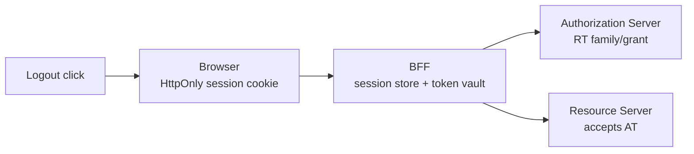

# Logout một thiết bị hay mọi thiết bị

## 1. Tình huống mở đầu: đăng xuất laptop hay ngắt quyền toàn bộ tài khoản?

Một nhân viên đăng nhập ứng dụng `orders-web` trên ba thiết bị:

- **Laptop công ty** — đang làm việc, có phiên ứng dụng và refresh token riêng.
- **Điện thoại** — dùng ứng dụng native, còn phiên hoạt động.
- **Máy tính công cộng** — đã đăng nhập trước đó để xử lý việc gấp.

Người dùng bấm **“Đăng xuất thiết bị này”** trên máy tính công cộng. Họ kỳ vọng máy đó không thể tiếp tục truy cập đơn hàng, nhưng **laptop và điện thoại vẫn hoạt động**.

Sau đó nhân viên phát hiện tài khoản có dấu hiệu bị xâm nhập. Họ chọn **“Đăng xuất mọi thiết bị”** trong trang bảo mật tài khoản. Lúc này mong đợi khác: tất cả phiên ứng dụng thuộc phạm vi đó phải bị ngắt, các refresh tokens liên quan phải không còn xin được access tokens mới và những access tokens đã phát cần bị vô hiệu theo chính sách an ninh.

Có bốn lỗi thiết kế dễ mắc:

1. Chỉ xóa cookie trên browser đang mở nhưng **không thu hồi refresh token ở authorization server**.
2. Revoke nhầm một refresh token rồi xem như **mọi thiết bị đã được ngắt**.
3. Thu hồi toàn bộ tài khoản khi user chỉ muốn logout **một phiên**, làm gián đoạn các thiết bị khác.
4. Báo “đã đăng xuất mọi thiết bị” ngay lập tức trong khi **JWT access token cũ vẫn được resource server chấp nhận** đến hết hạn.

Vì vậy, một hệ thống có logout an toàn cần trả lời chính xác: **đối tượng nào bị ngắt, ai có quyền ngắt, trạng thái nào được cập nhật, và mất bao lâu trước khi từng dịch vụ ngừng chấp nhận quyền truy cập?**

> **Nguyên tắc:** “Logout” là hành động có **phạm vi và nhiều lớp trạng thái**. Xóa local session, kết thúc phiên SSO tại OpenID Provider, thu hồi OAuth grant/refresh-token family và vô hiệu access token tại API là các thao tác liên quan nhưng **không đồng nhất**. “Một thiết bị” phải có cách nhận diện phiên riêng; “mọi thiết bị” phải có tập phiên/grant và giới hạn tổ chức rõ ràng.

Bài **“Logout một thiết bị hay mọi thiết bị”** thuộc chương **Logout**, module `SECURITY_TOKEN_SECURITY_FUNDAMENTALS`. Nội dung sử dụng mô hình tin cậy và vòng đời security token để nối OAuth 2.0/OpenID Connect với JWT/opaque access tokens, refresh token rotation, scope, audience, lưu trữ, thu hồi và chống token theft/replay.

## 2. Mục tiêu học tập

Sau khi học, bạn có thể:

1. Phân biệt **local logout**, **single-device logout**, **single-app global logout**, **OP SSO logout** và **cross-application/global account termination**.
2. Giải thích sự khác nhau giữa **RP session**, **OP session**, **OAuth authorization grant**, **refresh-token family** và **access token**.
3. Xác định cách ánh xạ một nút “Đăng xuất thiết bị này” tới **đúng session/grant/family**, không nhầm vật lý thiết bị với browser session.
4. Thiết kế “Đăng xuất mọi thiết bị” theo phạm vi được định nghĩa trước, dựa trên subject đã xác minh và quyền của caller.
5. Phối hợp **RFC 7009 Token Revocation**, OIDC RP-Initiated Logout, Front-Channel/Back-Channel Logout khi được hỗ trợ.
6. Giải thích tại sao thu hồi refresh token **không tự làm JWT access token đã cấp mất hiệu lực tại mọi resource server**.
7. Thiết kế refresh-vs-logout race handling, multi-tab/pod coordination, session generation và durable revocation events.
8. Xử lý các trường hợp mất mạng, AS tạm không sẵn sàng và remote logout propagation có độ trễ.
9. Thiết kế UX minh bạch cho trang quản lý thiết bị, khóa tài khoản, step-up, CSRF, chống session fixation và token theft.
10. Viết kiểm thử đủ cho one-device/global logout, mixed OIDC/OAuth sessions, multi-issuer/tenant, shared devices và audit.

## 3. Thuật ngữ: chính xác thứ gì đang được “đăng xuất”?

| Đối tượng | Nơi quản lý | Chức năng | Có bị xóa khi browser xóa cookie không? |
| --- | --- | --- | --- |
| **Application session** | Relying Party (RP)/ứng dụng | Gắn browser/app client với user đã xác thực | Chỉ cookie bên client; session server-side cần invalidation |
| **OP/SSO session** | OpenID Provider (OP) | Ghi nhận user đã đăng nhập tại IdP | **Không nhất thiết** |
| **OAuth authorization grant** | Authorization Server (AS) | Quyền client được cấp để xin/sử dụng tokens | **Không nhất thiết** |
| **Refresh token (RT)** | AS + client storage | Xin access token mới, có thể rotation | **Không nhất thiết** |
| **Refresh-token family** | AS theo thiết kế | Chuỗi RT kế nhiệm liên quan cùng grant/session | **Không nhất thiết** |
| **Access token (AT)** | AS phát hành, resource server (RS) kiểm tra | Truy cập protected APIs | **Không nhất thiết** |
| **OIDC ID token** | OP phát hành cho RP | Assertion về authentication | Không phải API credential; tự hết hạn theo `exp` |
| **Device/session registry entry** | App/AS/account security service | Cho phép liệt kê/thu hồi phiên hoặc kết nối | Cần cập nhật từ nguồn có thẩm quyền |

### 3.1. Ví dụ một người có nhiều lớp phiên

```text
Identity: (issuer=https://login.example.com, sub=user-123)

OP SSO session: OP-S1
  |
  +-- RP orders-web
  |     +-- Browser laptop: RP-S1 -> OAuth grant G1 -> RT family F1
  |     +-- Browser desktop: RP-S2 -> OAuth grant G2 -> RT family F2
  |
  +-- RP reporting-web
  |     +-- Browser laptop: RP-S3 -> OAuth grant G3 -> RT family F3
  |
  +-- Native mobile app
        +-- App session N-S1 -> OAuth grant G4 -> RT family F4
```

User click “Đăng xuất desktop khỏi orders-web” có thể chỉ đụng tới **RP-S2/G2/F2**. User click “Đăng xuất mọi phiên orders-web” có thể đụng **RP-S1/RP-S2/G1/G2/F1/F2** nhưng không tự động phá Reporting hoặc Native. “Đăng xuất mọi ứng dụng tại OP” là phạm vi khác và có thể cần nhiều giao thức, phối hợp, và giới hạn độ phủ.

**Sơ đồ là mô hình minh họa**: không phải mọi ứng dụng tạo một OAuth grant riêng cho từng session hoặc luôn được cấp refresh token. Thiết kế phải ghi nhận thực tế của AS/RP.

### 3.2. Định danh user không phải email

Nếu có nhiều issuers, **`sub=user-123` ở Issuer A không mặc định cùng người với `sub=user-123` ở Issuer B**. Ánh xạ danh tính nên dùng cặp **`(iss, sub)`** hoặc internal user ID đã được liên kết an toàn.

Không tự làm:

```text
DELETE sessions WHERE email = request.email
```

với email do client gửi. Nó có thể gây unauthorized global logout hoặc ảnh hưởng nhầm người, nhất là email thay đổi hoặc nhiều IdPs.

## 4. Một thiết bị hay mọi thiết bị: định nghĩa đúng phạm vi

| Hành động người dùng | Phạm vi cụ thể nên mô tả | Những điều không tự xảy ra |
| --- | --- | --- |
| **Đăng xuất ở tab hiện tại** | Phiên local/tab theo cách app quản lý | Không chắc ngắt browser tabs khác hoặc AS grant |
| **Đăng xuất thiết bị này** | Session/client installation hoặc device session được xác thực | Không mặc nhiên logout các devices khác |
| **Đăng xuất một thiết bị từ xa** | Session/grant/family của thiết bị được chọn trong registry | Không tự xóa token đang nằm trên thiết bị offline |
| **Đăng xuất mọi thiết bị của ứng dụng** | Toàn bộ sessions/grants thuộc RP/app và user được chọn | Không mặc nhiên logout ứng dụng khác hay OP SSO |
| **Đăng xuất tài khoản ở nhà cung cấp đăng nhập** | OP SSO session(s) theo hợp đồng OP | Không đảm bảo mọi RPs nhận thông báo hoặc AT bị revoke |
| **Thu hồi kết nối ứng dụng bên thứ ba** | OAuth grant(s) cho client integration | Không luôn xóa cookie app hoặc local copied data |
| **Đăng xuất mọi nơi sau sự cố** | Các sessions/grants/token families trong phạm vi issuer/tenant/account đã định | Không tự vượt sang AS/IdP khác nếu không có federation contract |

**Người dùng phải biết “mọi” là mọi cái gì.** Nhãn UI nên nói cụ thể “Đăng xuất tất cả thiết bị khỏi ứng dụng Quản lý đơn hàng” hay “Đăng xuất khỏi toàn bộ ứng dụng dùng tài khoản công ty” nếu hệ thống thực sự thực thi được phạm vi đó.

### 4.1. “Thiết bị” là khái niệm logic, không phải ID phần cứng tuyệt đối

Một laptop có thể có:

- Hai browsers với cookies khác nhau.
- Browser profile thường và profile ẩn danh.
- Native desktop app.
- Nhiều user OS accounts.
- Phiên đăng nhập ở các RP/OP khác nhau.

Hệ thống thường quản lý **session ID, installation ID, OAuth grant ID hoặc token family ID**, không thể dùng tên thiết bị “MacBook của An” như bằng chứng chính xác rằng chỉ có một phiên trên vật lý đó.

**Device fingerprint** dựa trên IP/User-Agent không phải danh tính đáng tin: nó thay đổi, có thể bị giả mạo và tạo rủi ro theo dõi người dùng. Hãy dùng **server-issued opaque session identifiers**, metadata thiết bị được trình bày như tín hiệu UX, và ranh giới thu hồi rõ.

### 4.2. Một refresh-token family cho một phiên: lựa chọn thường hữu ích

Nếu AS tạo **một family per session/device**, việc revoke một phiên trở nên rõ:

```text
Session A -> Family A: RT-A0 -> RT-A1 -> RT-A2
Session B -> Family B: RT-B0 -> RT-B1
Session C -> Family C: RT-C0

Revoke Session B:
  Family B = REVOKED
  Families A, C remain ACTIVE (trừ khi global/security policy rộng hơn)
```

Nếu mọi sessions cùng chia một refresh token family, khó hỗ trợ “chỉ logout một thiết bị” mà không ảnh hưởng cả tập. Thiết kế registration/grant model cần lựa chọn từ trước.

## 5. Sơ đồ: logout một thiết bị

```mermaid
sequenceDiagram
    actor U as Người dùng trên Laptop A
    participant RP as Orders Web/BFF
    participant AS as Authorization Server
    participant RS as Orders API
    participant P as Phiên Phone B

    U->>RP: POST /logout-this-session (session cookie + CSRF)
    RP->>RP: Verify session; mark Session A REVOKING
    RP->>AS: POST /revoke RT-family A, auth as client
    AS->>AS: Revoke family/grant A, prevent future refresh
    AS-->>RP: HTTP 200 theo RFC 7009
    RP->>RP: Invalidate Session A, clear AT/RT cache, expire cookie
    RP-->>U: Logged out on this session
    P->>RS: API request với token phiên B
    RS-->>P: Vẫn hợp lệ nếu phạm vi B không bị revoke
    Note over RP,AS: AT A đã cấp có thể còn hiệu lực đến exp nếu RS không kiểm tra revocation
```

Hành động **đăng xuất thiết bị hiện tại** không nên xóa sessions của người khác chỉ vì chúng dùng chung `sub`. AS phải ràng buộc revoke request với token thuộc client/grant đúng, không cho client tự khai `family_id` rồi revoke tùy tiện.

### 5.1. “Logout một tab” không luôn tương đương “một thiết bị”

Nếu các tabs chia chung **cookie/session của cùng origin**, server-side invalidate session làm **tất cả các tabs dùng session đó** bị logout. Điều này phù hợp với “đăng xuất phiên hiện tại”; không nên hứa “chỉ tab này” nếu kiến trúc không tách tab state thực sự.

### 5.2. Khi máy đã bị đánh cắp

User không thể xóa cookie/RT từ xa bằng JavaScript trên máy bị mất. **Remote logout phải ngắt quyền ở backend/AS/RS**, không dựa vào việc thiết bị bị mất đang online và nhận thông báo “hãy xóa token”.

Thiết bị offline có thể tiếp tục giữ **byte của RT/AT** trên ổ đĩa, nhưng AS/RS phải từ chối chúng theo revocation/status contract khi nó kết nối trở lại.

## 6. Sơ đồ: logout mọi thiết bị trong phạm vi một ứng dụng

```mermaid
sequenceDiagram
    actor U as Người dùng
    participant PORTAL as Trang bảo mật tài khoản
    participant STORE as Session/Grant Registry
    participant AS as Authorization Server
    participant RP as Orders Web Instances
    participant RS as Orders API

    U->>PORTAL: POST /sessions/revoke-all (đã xác thực + step-up)
    PORTAL->>PORTAL: Verify subject, tenant, CSRF, permission
    PORTAL->>STORE: Find all sessions/grants of subject for Orders
    STORE-->>PORTAL: Session IDs + grant/family IDs
    PORTAL->>STORE: Mark sessions REVOKED, advance logout epoch
    PORTAL->>AS: Revoke corresponding grants/families (authorized admin API)
    AS->>AS: Block refresh; persist revocation state
    AS-->>PORTAL: Outcome/acknowledgments by grant
    PORTAL->>RP: Durable invalidation events for session caches
    PORTAL->>RS: AT invalidation via introspection/denylist/policy as designed
    PORTAL-->>U: Report scope, completion/pending by system
```

Đây là **một kiến trúc minh họa**, không phải RFC chuẩn có một endpoint HTTP `/sessions/revoke-all` phổ quát. Endpoint quản trị phải được bảo vệ và ràng buộc quyền. RFC 7009 thu hồi token do client trình, nhưng **“revoke all sessions của user” thường cần AS/admin session management API riêng** hoặc logic server-side có thẩm quyền.

### 6.1. Không revoke theo `email` do client truyền

Sai:

```http
POST /revoke-all HTTP/1.1
Content-Type: application/json

{"email":"other-person@example.com"}
```

rồi backend xóa tất cả phiên cho email đó.

Đúng hơn:

1. Xác thực người dùng bằng session/identity token hợp lệ tại **trusted authorization layer**.
2. Resolve internal user theo `(iss, sub)` đã được xác minh.
3. Kiểm tra quyền user/admin, tenant, phạm vi được phép.
4. Với remote/global actions nhạy cảm, yêu cầu **re-auth/step-up** theo risk policy.
5. Xác định sessions/grants từ backend registry, không từ danh sách tùy ý client gửi.
6. Ghi trạng thái thu hồi bền vững và phản ánh tới AS/RS.

### 6.2. “Mọi thiết bị” của ứng dụng ≠ mọi ứng dụng trong SSO

Logout mọi phiên Orders không nhất thiết logout Reporting hay Chat nội bộ. Ngay cả khi cùng OP, việc revoke authorization grants của Orders **không đồng nghĩa** OP SSO cookies hoặc grants của các RPs khác đã bị vô hiệu.

Nếu cần doanh nghiệp-wide sign-out, phải có **phạm vi SSO logout, token revocation và fan-out giữa RPs**, thỏa thuận và khả năng của từng thành phần.

## 7. Năm lớp trạng thái phải phân biệt

Một logout workflow có thể tác động những trạng thái:

```text
A. Local presentation state
   - UI, in-memory AT, storage, tab state

B. Application/RP session state
   - session cookie handle, session store, CSRF state

C. OP/SSO session state
   - IdP login session, OP sid, SSO cookie

D. OAuth grant/token state at AS
   - RT family, grant status, consent, client authorization

E. Resource server acceptance state
   - AT (JWT/opaque), introspection cache, denylist/version, policy
```

### 7.1. Bảng hiệu lực

| Hành động | A | B | C | D | E |
| --- | --- | --- | --- | --- | --- |
| Xóa UI/localStorage | Có thể | Không tự đảm bảo | Không | Không | Không |
| Invalidate server-side RP session | Có với phiên hiện tại khi client cập nhật | Có | Không | Không mặc định | AT cũ vẫn có thể dùng |
| RP-initiated logout tại OP | UI redirect/logout | RP tùy flow | Có theo OP policy | Không mặc định | Không mặc định |
| RFC 7009 revoke RT | Client cleanup riêng | Không tự động | Không | Có theo AS policy | AT cũ cần state/TTL |
| Admin revoke all grants | UI/clients eventual | Phụ thuộc registry/invalidation | Không luôn | Có trong phạm vi quản trị | Phụ thuộc AT invalidation |
| Resource server denylist AT | Không trực tiếp | Không | Không | Không nhất thiết | Có tại RS áp dụng |

**Không có một lời gọi “logout()” thần kỳ** làm tất cả lớp đồng bộ lập tức trên mọi hệ thống.

### 7.2. “Đã logout” cần định nghĩa điều kiện hoàn tất

Ví dụ SLO nội bộ:

```text
Single-session logout:
  - RP session invalidated before UI confirms success
  - AS family cannot mint new AT after revocation commit
  - ATs from session rejected within configured security window

Global app logout:
  - all RP sessions of subject invalidated
  - all corresponding grants/families denied renewal
  - all application APIs reject affected ATs within SLO
```

Các mức thời gian không có một giá trị chuẩn toàn cầu. Sản phẩm nên mô tả khi **remote revocation còn đang pending** thay vì khẳng định hoàn tất mọi lớp.

## 8. OAuth 2.0 RFC 7009: thu hồi refresh token

Một **confidential client** như BFF có thể gọi token revocation endpoint:

```http
POST /revoke HTTP/1.1
Host: auth.example.com
Authorization: Basic <registered_client_authentication>
Content-Type: application/x-www-form-urlencoded
Accept: application/json

token=<refresh_token>&token_type_hint=refresh_token
```

Theo RFC 7009:

- Dùng **POST** và form body.
- `token` là **bắt buộc**; `token_type_hint` chỉ là gợi ý.
- AS **MUST** hỗ trợ revocation của refresh tokens và **SHOULD** hỗ trợ access-token revocation.
- Client auth và kiểm tra client/grant binding phải thực hiện theo registration/profile.
- Với request được xử lý hợp lệ, AS trả **HTTP 200** kể cả token không tồn tại/đã bị revoke, tránh token status oracle.
- Revoke RT có thể ảnh hưởng AT liên quan. Khi AS hỗ trợ access-token revocation, RFC 7009 **SHOULD** vô hiệu hóa AT thuộc cùng authorization grant; việc RS thực sự từ chối AT vẫn phụ thuộc kiến trúc.

### 8.1. HTTP 200 không chứng minh mọi phiên bị thu hồi

```http
HTTP/1.1 200 OK
Content-Length: 0
Cache-Control: no-store
```

Điều này chỉ cho biết **request revoke token được xử lý theo contract**. Nó không cho biết token từng tồn tại và **không chứng minh** mọi grants khác của user hoặc OP SSO session đều bị kết thúc.

### 8.2. Refresh token rotation và family scope

```text
Session A:
  RT0 -> RT1 -> RT2 (active)

Session B:
  RB0 -> RB1 (active)
```

Khi logout Session A:

- AS phải xác định **family/grant của Session A**.
- RT0/RT1 consumed không còn dùng để refresh.
- RT2 active và successor (nếu có) phải bị chặn.
- Family của Session B chỉ bị ảnh hưởng nếu đây là “logout all” hoặc security policy khác.
- Nếu logout request mang RT1 đã consumed do client stale, AS không được chỉ đánh dấu RT1 rồi để RT2 tiếp tục sống nếu sản phẩm cam kết revoke family.

**Đừng dùng raw RT như identifier duy nhất trong bảng sessions** mà không lưu mapping RT→family/grant đủ để xử lý rotation và remote logout.

### 8.3. Client credentials khác user sessions

Với `client_credentials`, AS thường **không cấp refresh token** (RFC 6749: response **SHOULD NOT** có RT). Nút “logout user” không áp dụng trực tiếp cho service workload grant. Nếu cần khóa workload, hãy xử lý client credential, issued AT, grant/policy và workload identity theo phạm vi phù hợp.

## 9. OIDC: OP session và RP session là hai thực thể

**OpenID Connect** thêm một lớp **authentication** trên OAuth 2.0. RP nhận **ID token** để xác minh user được OP xác thực. Sau đó RP thường tạo **application session riêng**.

Ví dụ:

```text
User enters orders-web
  -> redirect to OpenID Provider
  -> OP authenticates user (creates OP SSO session)
  -> RP verifies ID token iss/sub/aud/exp/nonce...
  -> RP creates RP app session cookie
```

Khi user logout khỏi Orders:

- RP có thể xóa session cookie và server-side session.
- OP SSO session vẫn còn nếu không thực hiện OP logout.
- Lần tiếp theo user truy cập Orders, RP redirect tới OP và có thể nhận **SSO login nhanh** mà không nhập mật khẩu lại.

Điều này không nhất thiết là “logout thất bại” nếu UX đúng nghĩa **logout khỏi ứng dụng**, nhưng phải rõ với user.

### 9.1. Ba cơ chế OIDC logout thường gặp

| Cơ chế | Bên khởi tạo / kênh | Tác dụng |
| --- | --- | --- |
| **RP-Initiated Logout** | RP yêu cầu OP kết thúc session thông qua browser | OP thực hiện logout theo chính sách, có thể trả về RP |
| **Front-Channel Logout** | OP thông báo logout tới RP bằng user-agent/browser | RP dọn session nếu nhận/kiểm tra được thông báo |
| **Back-Channel Logout** | OP gọi endpoint server-side của RP với **Logout Token** | RP xác định và kết thúc session phù hợp, không phụ thuộc tab hiện diện |

Chúng là **OIDC logout profiles/extensions**, không phải cùng một request RFC 7009 revoke RT. Không tự giả định OP/RP nào cũng hỗ trợ đủ cả ba.

### 9.2. RP-Initiated Logout

Một RP đã xác minh ID token và muốn user logout OP có thể điều hướng tới `end_session_endpoint` **được OP công bố**. Tham số có thể gồm:

```text
id_token_hint = ID token liên quan phiên trước đó
post_logout_redirect_uri = URI đã đăng ký để quay về RP
state = giá trị để RP khớp logout response/return
client_id = theo profile và điều kiện áp dụng
logout_hint = thông tin gợi ý khi profile cho phép
```

Một URL minh họa (đã giản lược/percent-encoded ở nơi thích hợp):

```http
GET /logout?id_token_hint=<encoded_id_token_hint>&post_logout_redirect_uri=https%3A%2F%2Forders.example.com%2Flogged-out&state=<random_state> HTTP/1.1
Host: login.example.com
```

**Lưu ý bảo mật:**

- Chỉ dùng **OP end-session endpoint trusted**, không lấy URL từ untrusted token claim/redirect parameter.
- `post_logout_redirect_uri` phải được OP xác minh theo registration; không biến nó thành **open redirect**.
- `state` nếu dùng phải được RP kiểm tra; không thay thế CSRF/session protections ở app.
- `id_token_hint` có thể là JWT chứa claims nhạy cảm; không để redirect/proxy/analytics log tùy tiện.
- Logout OP không tự chứng minh **mọi RT và AT của mọi clients** đã bị revoke.
- RP vẫn cần kết thúc **session của chính RP**.

### 9.3. Front-Channel Logout

OP có thể dùng browser để gọi `frontchannel_logout_uri` của các RPs. Tuy nhiên browser có thể:

- Chặn third-party cookies.
- Hạn chế iframes/storage partitioning.
- Không mở tab của một RP.
- Bị mất mạng trước khi request tới RP.
- Không giữ đúng session context khi cookie bị hạn chế.

Vì vậy, **không được cam kết global logout có hiệu lực tức thì chỉ nhờ front-channel notifications**. Cần kiểm thử theo browser/profile và có server-side session revocation khi yêu cầu an ninh cao.

### 9.4. Back-Channel Logout

Khi RP/OP hỗ trợ **OpenID Connect Back-Channel Logout**, OP gửi một **Logout Token** tới back-channel endpoint của RP. Logout Token là một JWT với **mục đích riêng**, có các claims và validation riêng.

Ví dụ payload minh họa:

```json
{
  "iss": "https://login.example.com",
  "aud": "orders-web",
  "iat": 1900000000,
  "jti": "logout-event-unique-id",
  "sub": "user-123",
  "sid": "op-session-abc",
  "events": {
    "http://schemas.openid.net/event/backchannel-logout": {}
  }
}
```

Một validator phải kiểm tra theo profile, bao gồm:

- Chữ ký/JWKS và issuer trusted, thuật toán cho phép.
- Audience chứa **đúng RP client ID**.
- `iat`, `jti` và chính sách thời gian/replay.
- `events` có đúng member logout event, không chứa message trái contract.
- Có ít nhất `sub` hoặc `sid` theo profile.
- **Logout Token không được chứa `nonce`** theo Back-Channel Logout specification.
- Tìm đúng RP session(s) gắn với OP `sid`/`sub` và client/issuer.

**Không nhận một Logout Token như ID token đăng nhập**, không nhận email/client ID tự khai như lệnh “xóa mọi phiên” và không dùng JWT decode không verify.

### 9.5. `sid` của OP khác ID local session

Một OP có thể phát `sid` trong ID token theo OIDC session/logout profile. RP có thể ánh xạ:

```text
(issuer, client_id, OP sid) -> RP local session IDs
```

- `sid` OP không phải HTTP cookie session ID của RP.
- Không suy ra `sid` luôn có trong mọi ID token; tùy OP/profile và registration.
- Nếu Logout Token chỉ có `sub`, policy có thể yêu cầu logout nhiều sessions của RP thuộc subject đó.
- Nếu có `sid`, nên nhắm đúng session context khi profile cho phép.
- Không dùng `sid` từ unverified token/caller để xóa session.

## 10. Back-channel single session vs all sessions

Hai Logout Tokens theo profile có thể mang ý nghĩa khác nhau:

```json
{
  "iss": "https://login.example.com",
  "aud": "orders-web",
  "iat": 1900000000,
  "jti": "evt-1",
  "sid": "op-session-A",
  "events": {
    "http://schemas.openid.net/event/backchannel-logout": {}
  }
}
```

Khi RP có mapping đúng, nó có thể kết thúc sessions **liên kết OP session A**.

Một Logout Token có `sub` mà không có `sid` có thể yêu cầu RP xử lý **tất cả sessions của subject** theo Back-Channel Logout specification và RP policy:

```json
{
  "iss": "https://login.example.com",
  "aud": "orders-web",
  "iat": 1900000010,
  "jti": "evt-2",
  "sub": "user-123",
  "events": {
    "http://schemas.openid.net/event/backchannel-logout": {}
  }
}
```

**Không tùy tiện nâng phạm vi**: khi Logout Token có `sid` và `sub`, RP phải tuân semantics profile, không xem một event targeted `sid` như lệnh toàn cục nếu policy không yêu cầu. Ngược lại, không chỉ xóa “tab hiện tại” nếu OP yêu cầu kết thúc subject sessions theo profile.

### 10.1. Back-channel chỉ giải quyết các RPs được đăng ký và reachable

Nếu Reporting RP chưa đăng ký back-channel logout hoặc endpoint bị lỗi, OP không thể tự biến session reporting của RP thành invalid. Các hệ thống cần **retry/event delivery và fail-safe local session controls** theo hợp đồng, hoặc chia sẻ central session validity service với SLO rõ ràng.

### 10.2. Browser logout và back-channel có thể đến không theo thứ tự

Ví dụ:

```text
T0: RP local user clicks logout
T1: RP invalidates session
T2: OP sends back-channel logout event later
T3: RP receives event again due to retry
```

Handler phải **idempotent**: tìm session đã hết hạn/đã revoke thì xử lý như no-op, không tạo session mới, không trả dữ liệu user nhạy cảm.

## 11. Access token đã phát: vấn đề khó nhất của global logout

AT được gửi tới **resource server** và có thể tiếp tục hoạt động độc lập với RP/OP cookie.

### 11.1. JWT access token kiểm tra offline

Giả sử:

```json
{
  "iss": "https://auth.example.com",
  "sub": "user-123",
  "aud": "https://orders-api.example.com",
  "scope": "orders:read",
  "iat": 1900000000,
  "exp": 1900003600
}
```

AT trên chỉ là **payload minh họa**, không có chữ ký thật. Nếu RS chỉ xác minh JWT chữ ký, issuer, audience, scope và thời gian, nó có thể **tiếp tục chấp nhận token đến hết `exp`** dù mọi RT đã bị revoke.

Cách giảm khoảng trống:

1. **AT TTL ngắn** theo risk/SLO.
2. Introspection hoặc state lookup tại RS khi cần trạng thái mới hơn.
3. Denylist theo `jti` hoặc **grant/session version**.
4. Event-driven invalidation, caches có bounded TTL.
5. Current user/client/tenant policy check cho nghiệp vụ nhạy cảm.
6. Sender-constrained tokens như DPoP/mTLS khi phù hợp để giảm replay của AT bị sao chép.

### 11.2. Opaque access token và introspection

RS có thể dùng **RFC 7662 introspection**:

```http
POST /introspect HTTP/1.1
Host: auth.example.com
Authorization: Basic <resource_server_auth>
Content-Type: application/x-www-form-urlencoded

token=<access_token>&token_type_hint=access_token
```

Sau logout/revocation, AS có thể trả:

```json
{"active":false}
```

nhưng nếu RS cache `active:true` trong 60 giây, user có thể vẫn dùng API trong khoảng đó. **Revocation SLO phải tính cả cache và replication**, không chỉ DB flag ở AS.

### 11.3. Ba mức thời gian logout

| Mốc | Ý nghĩa | Định lượng thế nào? |
| --- | --- | --- |
| **T1: RP session invalidated** | Browser/session không được RP nhận nữa | Session store/epoch check |
| **T2: refresh denied** | AS không cấp AT/RT mới từ grants bị revoke | Durable AS grant/family state |
| **T3: AT rejected by RS** | Protected APIs không chấp nhận AT trước đó | JWT/opaque validation + state propagation |

Nếu T1 và T2 đã xong nhưng T3 chưa, hệ thống **chưa thể nói “mọi access đã bị ngắt tức thì”**. Nên tách cam kết UI với security SLO backend.

### 11.4. Cache TTL và thời gian thu hồi

Một chính sách minh họa:

```text
Security target:
  revoke-to-deny <= 30 seconds for high-risk API

RS positive introspection cache:
  TTL <= 15 seconds

AS/RS propagation:
  measured p99 <= 10 seconds

Clock skew/network/retries:
  additional bounded allowance
```

Các giá trị chỉ là ví dụ; không có “30 giây bắt buộc” trong OAuth/OIDC. **Không thiết kế positive cache 5 phút nếu sản phẩm hứa global logout hiệu lực sau 30 giây**, trừ khi có push invalidation đáng tin.

## 12. Data model: quản lý những session/grant nào?

Một **session registry** nên cung cấp định danh ổn định cho những phiên có thể revoke:

```text
Account identity:
  issuer = https://login.example.com
  subject = user-123
  tenant  = tenant-alpha

RP client:
  client_id = orders-web

Session record:
  session_id = random opaque internal ID
  op_sid = optional, from verified OIDC context
  device_installation_id = optional, server-registered handle
  device_label = optional untrusted display data
  grant_id = AS-managed reference (if supported)
  refresh_family_id = AS-managed reference (if supported)
  issued_at / last_seen_at / expires_at
  revoked_at / revocation_reason
  session_generation / user_logout_epoch
```

**Không phải mọi RP được AS tiết lộ grant/family IDs**. Nếu AS giữ mapping riêng, RP có thể giữ **opaque token reference/session ID** rồi gọi AS thông qua API quản trị có quyền, thay vì tự lấy `family_id` từ JWT payload chưa được xác minh.

### 12.1. Database schema minh họa

```sql
CREATE TABLE rp_sessions (
    session_id       VARCHAR(128) PRIMARY KEY,
    issuer_id        VARCHAR(255) NOT NULL,
    subject_id       VARCHAR(128) NOT NULL,
    client_id        VARCHAR(128) NOT NULL,
    tenant_id        VARCHAR(128),
    op_sid           VARCHAR(128),
    device_label     VARCHAR(255),
    token_vault_ref  VARCHAR(128),
    grant_ref        VARCHAR(128),
    family_ref       VARCHAR(128),
    generation       BIGINT NOT NULL DEFAULT 1,
    state            VARCHAR(24) NOT NULL,
    created_at       TIMESTAMP NOT NULL,
    last_seen_at     TIMESTAMP,
    expires_at       TIMESTAMP NOT NULL,
    revoked_at       TIMESTAMP
);

CREATE TABLE account_logout_epochs (
    issuer_id        VARCHAR(255) NOT NULL,
    subject_id       VARCHAR(128) NOT NULL,
    client_id        VARCHAR(128) NOT NULL,
    tenant_id        VARCHAR(128),
    logout_epoch     BIGINT NOT NULL,
    updated_at       TIMESTAMP NOT NULL,
    PRIMARY KEY (issuer_id, subject_id, client_id)
);
```

**Đây là schema khái niệm, không dùng trực tiếp cho production.** Nếu có tenants, khóa duy nhất/index/nullable tenant phải được thiết kế để **tránh cross-tenant collisions**; schema ví dụ chưa giải quyết đầy đủ điều đó. Bổ sung foreign keys, unique indexes, TTL/retention, session ID hash, row-level access controls, encryption và transaction isolation theo DB thực tế.

### 12.2. Một phiên có thể cần nhiều token references

BFF có thể có AT/RT cho nhiều resource audiences và client registrations. Một `session_id` có thể dẫn tới **nhiều grants**:

```text
RP session S1
  -> grant G_orders / family F_orders
  -> grant G_calendar / family F_calendar
```

Nếu logout yêu cầu ngắt **mọi resource access** của S1, workflow phải revoke **tất cả grants thuộc S1** trong phạm vi đã thông báo. Không tự suy ra chỉ có một RT.

### 12.3. Không dùng device_label làm security key

Tên thiết bị thường hiển thị để user nhận diện:

```text
"Chrome trên Windows"
"iPhone của tôi"
"TV phòng khách"
```

Tên có thể do user agent/client tự khai, IP/geo có sai số và có thể bị giả mạo. Dùng **opaque session ID** làm key, có thể bổ sung key-bound device identity khi sản phẩm hỗ trợ và thật sự cần assurance cao.

## 13. Giao diện “Quản lý phiên/thiết bị”

Một trang account security nên giúp user lựa chọn:

```text
Các phiên đăng nhập của ứng dụng Quản lý đơn hàng

[Đây là thiết bị hiện tại] Chrome · Windows
  Hoạt động gần đây: Hôm nay
  [Đăng xuất phiên này]

Safari · iPhone
  Hoạt động gần đây: Hôm qua
  [Đăng xuất phiên này]

TV phòng khách
  Hoạt động gần đây: 3 ngày trước
  [Đăng xuất phiên này]

[Đăng xuất tất cả phiên của ứng dụng]
```

### 13.1. Thông tin có thể hiển thị

- Ứng dụng/client và môi trường/issuer.
- Loại browser/OS nếu thu thập theo privacy policy.
- Thời điểm đăng nhập, hoạt động gần đây.
- Chỉ báo phiên **hiện tại**.
- Vị trí xấp xỉ nếu người dùng chấp thuận và tín hiệu đủ tin cậy; **không coi IP geo là bằng chứng**.
- Trạng thái “đã thu hồi”, “đang chờ đồng bộ”, “đã hết hạn”.
- Nút thu hồi từng phiên và toàn bộ phạm vi.

### 13.2. Tránh lộ dữ liệu nhạy cảm trong danh sách phiên

Không hiển thị/lưu:

- Raw session cookie.
- Refresh/access tokens.
- Client secrets, private key.
- Device fingerprint quá chi tiết không cần thiết.
- Exact IP history cho những users không có quyền truy cập.
- Full browser headers/PII không phục vụ bảo mật.

Trang quản lý phiên cần **authentication và authorization**, chống CSRF, chống XSS, audit actions và cân nhắc step-up khi revoke trên phạm vi lớn.

## 14. Single-device logout từ xa: session target và quyền

Một API minh họa của RP:

```http
POST /account/sessions/sess-opaque-42/revoke HTTP/1.1
Host: orders.example.com
Cookie: rp_session=<current_session_cookie>
X-CSRF-Token: <csrf_value>
Content-Type: application/json

{"reason":"user_selected_device"}
```

Backend phải:

1. Xác thực caller session/identity.
2. Xác định **owner/tenant** của session target server-side.
3. Kiểm tra caller có quyền revoke target, kể cả quyền admin/step-up nếu cần.
4. Không cho caller kiểm soát arbitrary `subject_id`/`grant_id` ngoài quyền.
5. Chuyển target session sang `REVOKED/REVOKING` bền vững.
6. Revoke RT/family/grants liên quan theo AS policy.
7. Phát invalidation events cho các ứng dụng/nodes liên quan.
8. Trả response **không leak** thông tin về sessions của người khác.

### 14.1. BOLA/IDOR trên revoke endpoint

Sai:

```java
// Anti-pattern: không kiểm tra session này thuộc user nào.
sessionRepository.deleteById(requestedSessionId);
```

Attacker có thể thử session ID của người khác và gây **forced logout** (availability attack) hoặc dò phiên.

Đúng:

```text
target = findSessionByOpaqueId(requestedId)
require target.issuer == authenticatedUser.issuer
require target.subject == authenticatedUser.subject
require target.tenant == authorizedTenant
require permission to revoke target
then revoke
```

Khi quản trị viên hỗ trợ users khác, phải có **admin role/tenant scope, audit và chính sách đặc biệt**. Không tự “lách” bằng client id hoặc email.

### 14.2. Revoked session vẫn có record audit trong thời gian phù hợp

Không nhất thiết xóa ngay mọi row, vì:

- Cần chứng minh session đã revoke.
- Back-channel logout có thể gửi lại event.
- Cần ngăn session ID bị tái sử dụng/session fixation.
- Incident investigation cần biết các grants/AT bị tác động.

Tuy nhiên retention phải có giới hạn, privacy controls và không giữ raw credentials.

## 15. Global app logout: tránh quét toàn bộ token một cách thiếu kiểm soát

Giả sử user có 1.000 sessions historical và 30 sessions active trên nhiều regions. Dùng vòng lặp gọi RFC 7009 từng RT trong HTTP request có thể:

- Timeout.
- Revoke một phần nhưng UI trả “all done”.
- Bỏ sót grant của mobile/native app do session records không đồng bộ.
- Bỏ sót refresh token vừa được rotate.
- Gây deadlocks/rate limits.

Một thiết kế tốt có **account/client logout epoch hoặc grant-state marker** làm ranh giới “từ thời điểm này các sessions cũ không được chấp nhận”, sau đó mới làm cleanup/invalidation fan-out.

### 15.1. Logout epoch/version

Ví dụ:

```text
subject = (issuer, sub)
scope   = orders-web client
logout_epoch = 18

Session S1 created with generation/epoch 17
Session S2 created with generation/epoch 17
Session S3 created after new login with epoch 18

Rule:
  accept session iff session.active
    AND session.epoch == currentAccountClientEpoch
```

Khi user chọn logout-all, transaction tăng epoch từ 17→18. Các session cũ không được RP chấp nhận kể từ khi middleware đọc **authoritative epoch mới**. Các grant/RT cũ cũng cần AS revoke hoặc phiên bản/grant policy tương ứng, **không được chỉ tăng epoch tại RP** rồi để raw RT cũ tiếp tục refresh.

### 15.2. Tách thao tác cắt quyền và cleanup

```text
Phase 1: security cutover
  - authenticate/authorize logout-all request
  - atomically bump applicable logout epoch / mark grants revoked
  - commit authoritative state before success semantics

Phase 2: propagation/cleanup
  - invalidate RP sessions/caches
  - revoke/finalize RT families/grants
  - notify RPs/RS, clear stale AT caches
  - audit retries/partial failures

Phase 3: new login
  - new session/grant gets epoch after cutover
  - old tokens cannot impersonate this new session
```

Nếu AS không tích hợp epoch với RP, cần workflow để bảo đảm **AT/RT issuance ở AS cũng bị chặn**; một RP-only epoch không có tác dụng với attacker gọi token endpoint trực tiếp.

### 15.3. API quản trị toàn cục không phải phần của RFC 7009

Endpoint `POST /account/sessions/revoke-all` là **application-specific/admin API** cần có authN/authZ, audit, CSRF protection nếu dùng cookie, rate limit, idempotency và rõ nghĩa. RFC 7009 chỉ định cách **trình token** để revoke; nó **không chuẩn hóa** một “revoke all sessions by sub” HTTP operation.

## 16. Race: refresh thành công đúng lúc logout

Trường hợp:

```text
T0: Session A holds RT5.
T1: Request R: /token refresh RT5 starts.
T2: Request L: logout session A starts.
T3: L marks RT5 revoked and returns success.
T4: R issues RT6 based on stale read.
T5: Client stores RT6 and resumes authenticated state.
```

Nếu AS không có transactional consistency, “logout” có thể bị **hồi sinh** bằng RT successor.

### 16.1. Sắp xếp refresh và revoke theo family

Một thiết kế với DB transaction/row lock/CAS:

```text
refresh(rt):
    begin transaction
      family = lockFamily(lookupFamily(rt))
      require family.state == ACTIVE
      require rt == family.currentRT and rt.state == ACTIVE
      require client/grant/binding/time valid
      mark rt CONSUMED
      create successor RT6 in same family
      update family.currentRT
    commit
    return AT + RT6

revokeFamily(familyId):
    begin transaction
      family = lockFamily(familyId)
      family.state = REVOKED
      family.revokedAt = now
      invalidateCurrentRTAndSuccessors()
      persist AT invalidation marker/outbox if required
    commit
    return committed
```

- Nếu refresh commit **trước** revoke, revoke chặn family chứa RT6.
- Nếu revoke commit **trước** refresh, refresh sau phải thấy `REVOKED` và từ chối.
- Không có RT successor **active sau revocation commit** theo consistency contract.
- Những AS nodes khác không được dựa trên replica stale để phát RT6.

### 16.2. Late refresh response ở client

Dù AS đã revoke, một response AT/RT từ request refresh trước đó có thể tới client **sau** khi user logout. Client phải không lưu lại token và không tạo lại session.

Sử dụng **session generation/epoch**:

```text
refresh:
   capturedGeneration = localSession.generation
   response = await tokenEndpoint.refresh(rt)
   if localSession.revoked or
      localSession.generation != capturedGeneration:
       discard response
       do not persist RT/AT
       do not restore session

logout:
   localSession.revoked = true
   localSession.generation += 1
   cancel or isolate in-flight refresh operations
   revoke family/grant at AS
   clear local credentials and session
```

**Client epoch chỉ chống hồi sinh local session**, không thay server-side AS revoke. Nếu attacker giữ RT có giá trị, AS vẫn cần chặn refresh.

### 16.3. Multi-tab, multi-pod và RT rotation

- **Browser tabs** có thể dùng cùng session/RT. Cần single-flight refresh và tránh tab B dùng RT0 đã consumed sau khi tab A nhận RT1.
- **BFF pods** cần lock/transaction tại token store dùng chung hoặc điều phối theo session/grant.
- **Mobile background tasks** phải dừng việc refresh khi logout.
- **Refresh token reuse detection** có thể revoke toàn family khi RT cũ được trình lại, kể cả do client concurrency chứ không chỉ attacker.

**Đừng “sửa” race bằng cách cho phép RT consumed đổi tiếp vô hạn**, vì làm yếu replay detection. Nếu AS có grace window, phải đánh giá threat model thật kỹ.

## 17. Race: logout-all và login mới

Một tình huống khác:

```text
T0: User bấm "logout all".
T1: Revoke-all transaction bắt đầu quét active sessions.
T2: User/attacker tạo login mới S_new.
T3: Revoke-all quét thêm và vô tình revoke S_new.
```

Phải định nghĩa **cutoff semantics**:

- “Đăng xuất tất cả phiên đang tồn tại **trước thời điểm T**”, cho phép login mới **sau** cutoff.
- Hoặc “Khóa tài khoản **không cho phép login mới** cho đến khi mở khóa/step-up” (mạnh hơn, phù hợp incident).
- Hoặc “Chấm dứt mọi grants đang có, yêu cầu re-authentication sau security action”.

Một implementation có thể dùng **monotonic account logout epoch/version** và cấp generation mới cho session tạo sau cutoff, hoặc policy **account suspension** chặn cả phiên mới.

### 17.1. Logout-all không tương đương account lock

| Hành động | Phiên cũ | Login mới |
| --- | --- | --- |
| Logout-all theo cutoff | Bị revoke | Có thể được phép |
| Account locked/disabled | Bị từ chối theo policy | Phải bị chặn cho đến khi được mở |
| Password changed | Phụ thuộc security policy | Có thể cho phép bằng credential mới |
| MFA reset | Có thể yêu cầu revoke sessions | Cần step-up/re-enroll theo policy |

Không tuyên bố “đổi mật khẩu luôn tự logout mọi nơi” nếu AS/OP không có chính sách tương ứng.

## 18. Không thể tin chỉ vào session cookie expiry

Cookie:

```http
Set-Cookie: __Host-rp_session=<opaque_value>; Path=/; Secure; HttpOnly; SameSite=Lax
```

Việc browser xóa cookie khiến browser hiện tại không gửi session handle nữa. Nhưng:

- **Server-side session record** có thể vẫn active nếu không invalidate.
- Attacker có bản sao cookie cũ vẫn có thể thử dùng đến khi server từ chối.
- RT server-side hoặc ở thiết bị khác vẫn hoạt động.
- AT đã cấp cho API có thể còn hạn.
- OP SSO cookie thuộc domain khác không tự bị xóa.

### 18.1. Session fixation và session ID rotation

Sau user login, privilege elevation hoặc account recovery, RP nên **rotate session identifier** theo session-management policy. Khi logout, server phải vô hiệu session IDs đã cấp; không tái sử dụng ID cũ cho user mới.

Một logout-all implementation cần ngăn:

```text
old_cookie_sid -> old session
logout_all() -> mark old session revoked
attacker reuses cookie -> server must reject
```

Không dựa vào client-side `document.cookie = ...` nếu cookie `HttpOnly`; browser không cho JS đọc hoặc thao tác trực tiếp giá trị HttpOnly. Server phải gửi `Set-Cookie` hết hạn cùng Name/Path/Domain phù hợp và invalidate backend.

### 18.2. Logout CSRF: không chỉ xóa trạng thái

Khi RP dùng cookie cho authentication, **logout endpoint làm thay đổi trạng thái** và có thể bị CSRF ép người dùng đăng xuất, dẫn tới gián đoạn trải nghiệm hoặc hỗ trợ chuỗi tấn công login-CSRF/session confusion.

Biện pháp:

- Dùng **POST** (hoặc thao tác state-changing phù hợp), không tự logout bằng GET cross-site.
- CSRF token/Origin/Referer checks theo threat model.
- SameSite cookie, Secure, HttpOnly phù hợp.
- Bảo vệ account-security revoke-all bằng re-auth/step-up khi rủi ro cao.
- Không dùng URL `?session_id=...&revoke=true` có thể bị clickjacking/phishing.

**SameSite không thay thế tất cả CSRF controls**; đặc biệt cần kiểm tra các tình huống same-site khác origin, browser support và subdomain trust.

### 18.3. Logout XSS

XSS có thể đánh cắp tokens trong storage, gọi API bằng session đang mở, hoặc điều khiển UI logout. Xóa localStorage sau logout không tự vô hiệu **token đã bị sao chép**. Cần AS/RS revocation và bảo vệ app bằng output encoding, CSP/Trusted Types khi phù hợp, input controls và dependency security.

## 19. BFF, SPA và native app: cách triển khai logout khác nhau

Không có một cách lưu token và session phù hợp cho mọi OAuth client. **Nơi lưu refresh token và danh tính caller** quyết định bên nào có thể thu hồi token an toàn.

### 19.1. Backend for Frontend (BFF)

Với **BFF**, browser thường chỉ giữ **session cookie**; OAuth access/refresh tokens được BFF giữ server-side.



Quy trình single-session logout thường:

1. Browser gửi `POST /logout` với session cookie và CSRF protection.
2. BFF xác thực session, chuyển trạng thái sang `REVOKING/REVOKED` để chặn request mới.
3. BFF ngăn in-flight refresh làm sống lại session.
4. BFF gọi **RFC 7009** với RT từ token vault, theo registration/client authentication.
5. BFF xóa AT/RT cache, invalidate session store.
6. BFF gửi `Set-Cookie` hết hạn đúng Name/Path/Domain và hiển thị logout status.
7. Nếu muốn kết thúc OP SSO session, thực hiện RP-Initiated Logout phù hợp.
8. RS ngừng chấp nhận các AT cũ theo revocation SLO riêng.

**Lợi điểm:** RT/client credential không cần nằm trong JavaScript; dễ điều phối refresh và revoke theo session ID.

**Giới hạn:** Cookie vẫn có CSRF/XSS/session fixation risks; BFF có token vault, session store và logout fan-out là các thành phần security-sensitive. BFF không tự động revoke tokens tại AS chỉ vì xóa cookie.

### 19.2. SPA thuần browser

Một SPA dùng Authorization Code + PKCE là **public client**. Nếu được cấp refresh token, nó phải cân nhắc rotation/sender-constraining theo RFC 9700 và XSS/storage threats.

Logout ở SPA có thể yêu cầu:

- Dừng API calls/refresh tasks cho session hiện tại.
- Gọi revocation endpoint nếu AS hỗ trợ **public-client revocation** và CORS/registration phù hợp.
- Xóa AT/RT ở memory/storage đã chọn.
- Phát tín hiệu tới các tabs **cùng origin** để xóa state đồng bộ.
- Không cho late refresh response ghi token vào storage.
- Nếu OP logout cần thiết, điều hướng qua trusted OP end-session endpoint.
- UI phân biệt **local sign-out** và remote revocation đã xác nhận hay chưa.

**CORS không phải cơ chế xác thực client**. Cho phép request cross-origin không khiến một public SPA trở thành confidential client, và không ngăn script bị XSS đọc hoặc sử dụng token.

#### Multi-tab phối hợp logout

```text
Tab A                        Tab B
-----                        -----
User clicks Logout
increment local epoch
clear local tokens
BroadcastChannel:
  { type: "LOGOUT", epoch: 12 }
                             receive LOGOUT
                             abort refresh in flight
                             invalidate shared state
                             clear in-memory AT
                             redirect/show login

Both:
  server-side RT family/grant must already be or become revoked
```

**BroadcastChannel là kênh thông báo same-origin, không phải bảo đảm bảo mật**. Các tabs có script độc hại cùng origin vẫn có thể phát message giả; server-side session/grant checks mới là nguồn quyết định quyền.

Không broadcast raw access/refresh tokens hoặc client secret để “đồng bộ trạng thái”. Nếu tab không nhận được message vì đang ngủ/offline, nó phải phát hiện session invalid khi tương tác lại.

### 19.3. Native/mobile app

Native app có thể sử dụng hệ điều hành **Keychain/Keystore/Secure Enclave** hoặc cơ chế tương đương để bảo vệ refresh token/key binding.

Một logout thiết bị hiện tại nên:

1. Invalidate app session state.
2. Dừng background refresh, scheduled requests và push notifications có dữ liệu nhạy cảm.
3. Revoke RT/grant liên quan ở AS.
4. Xóa tokens và app-specific cached data theo privacy policy.
5. Clear/de-register device push token nếu app dùng notifications theo tài khoản.
6. Không đăng nhập lại tự động bằng credential cũ khi app khởi động.
7. Đảm bảo OS backup/restore không khôi phục credential đã revoked thành phiên hợp lệ.

Một mobile app có thể có **nhiều accounts**. Logout account A không nên xóa nhầm token/key của account B nếu user chỉ chọn A.

### 19.4. TV, console, IoT hoặc thiết bị công cộng

Thiết bị dùng **Device Authorization Grant** có thể nhận access/refresh token sau khi user xác thực trên điện thoại. Khi user rời TV khách sạn:

- Remote logout phải chặn RT tại AS; **không trông chờ TV online để xóa ngay**.
- Nếu TV còn AT JWT, RS phải xử lý theo revocation/TTL policy.
- Khi TV kết nối lại, app nên xử lý `401 invalid_token` bằng xóa local session, không tự làm thêm refresh bằng RT đã revoke.
- App phải có nút “Xóa tài khoản khỏi thiết bị này”, và user nên có trang revoke từ xa.
- Thông tin đã cache về người dùng cần xử lý theo privacy/retention policy.

### 19.5. Shared-browser và profile switching

Nếu hai người dùng luân phiên dùng cùng browser, hãy tách sessions/tokens rõ ràng. Logout User A không được vô tình tạo phiên User B từ OP SSO session còn lại hoặc từ cached ID token sai subject.

Khi RP nhận token sau login mới:

- Xác minh `iss/sub/aud/nonce/state` theo OIDC flow.
- Map user từ **(issuer, subject)**, không từ email/username.
- Rotate session identifier.
- Không hồi sinh account A bằng token cache thuộc account B.

## 20. OIDC logout toàn hệ thống: giới hạn của “đăng xuất mọi nơi”

Một tổ chức có thể có:

```text
Corporate OP (login.corp.example)
  |
  +-- Orders RP
  +-- Reports RP
  +-- Support RP

Partner OP (login.partner.example)
  |
  +-- Partner Dashboard RP

Native Mobile App
  |
  +-- AS tokens and local session
```

Một người dùng có thể liên kết cả corporate và partner OP. **Không có một OIDC logout call tiêu chuẩn bảo đảm ngắt mọi account ở mọi issuers, RPs và devices trên Internet.**

### 20.1. OP logout là thay đổi trạng thái tại OP

RP-Initiated Logout có thể kết thúc **OP session** được xác định theo OIDC profile. OP có thể gửi Front-/Back-Channel Logout tới những RPs đã đăng ký và hỗ trợ.

Nhưng:

- RP không reachable → event có thể thất bại/pending.
- RP khác không triển khai logout profile → session vẫn còn.
- Native apps không dùng cookies RPs trong browser → cần xử lý grant/RT riêng.
- AT đã phát tại nhiều AS/RS → cần revocation/state propagation.
- Một user có thể có nhiều OP sessions → phạm vi logout theo OP policies.

### 20.2. Enterprise-wide sign-out là bài toán orchestration

Một **central account security service** có thể điều phối:

1. Xác minh internal identity và quyền/cấp assurance hiện hành.
2. Đặt account/session revocation epoch hoặc account suspended state.
3. Thu hồi OP sessions phù hợp.
4. Thu hồi OAuth grants/RT families tại ASs mà dịch vụ có quyền quản lý.
5. Gửi signed, authenticated logout/revocation events tới RPs.
6. Cập nhật caches/denylist/introspection tại RS.
7. Theo dõi completion/partial failures của từng integration.
8. Cho user thấy rõ các ứng dụng ngoài phạm vi hoặc không hỗ trợ remote sign-out.

Đây là **hệ thống do tổ chức thiết kế**, không phải chức năng có sẵn chỉ nhờ `scope=openid`.

### 20.3. Multiple account/tenant boundaries

User A có quyền vào tenant Alpha và Beta. Khi user chọn “Đăng xuất tất cả thiết bị của tài khoản Alpha”:

- Security action chỉ được tác động các phiên/grants thuộc Alpha nếu registration/identity model cho phép tách.
- Nếu một RT chứa quyền nhiều tenants chung grant, AS cần cách downscope/revoke phù hợp; revoke một grant có thể ảnh hưởng cả Beta.
- UI phải nói rõ blast radius; không hứa tenant isolation nếu token architecture không tách được.
- Không dùng cùng `sub` từ hai issuers như cùng internal account nếu chưa link an toàn.

Đây là lý do **thiết kế token scope/audience và grant boundaries** từ đầu có tác động trực tiếp đến khả năng logout chính xác sau này.

## 21. Khi logout gặp lỗi mạng: trạng thái phải nói đúng

Xem ba trường hợp:

| Tình huống | Điều gì chắc chắn? | Cách xử lý |
| --- | --- | --- |
| RP session invalidation thành công, AS revoke timeout | Browser hiện tại không còn session RP, nhưng remote RT grant chưa xác nhận | Local logout hoàn tất, remote revoke pending/unknown; retry/incident policy |
| AS family revoke thành công, RP session store unavailable | RT không refresh mới, nhưng RP session/cached AT có thể còn | Fail closed ở RP/RS và retry session invalidation |
| OP Back-Channel Logout tới RP lỗi 5xx | OP đã logout theo policy; RP chưa xác nhận xử lý event | Durable retry/delivery, RP session TTL/state checks |

### 21.1. Phân biệt báo thành công theo lớp

Một message UX phù hợp:

```text
Bạn đã đăng xuất khỏi phiên hiện tại.

Việc ngắt quyền truy cập từ xa trên các thiết bị khác
đang được hệ thống hoàn tất. Bạn có thể xem trạng thái
trong phần Bảo mật tài khoản.
```

Chỉ dùng thông báo này khi hệ thống **thực sự có trạng thái theo dõi/pending workflow**. Nếu không có monitoring/outbox/retry, không nên hứa quá trình sẽ hoàn tất tự động.

### 21.2. Remote logout không thể phụ thuộc 100% vào thiết bị nhận push

Nếu phone đang offline, gửi push “hãy xóa session” có thể đến muộn hoặc không đến. **AS/RP/RS** phải từ chối tokens/session khi phone kết nối lại. Push chỉ giúp client cập nhật UI và xóa local data nhanh hơn.

### 21.3. Retry revocation request

RFC 7009 có response idempotent: request hợp lệ với RT đã revoked/unknown thường trả HTTP 200. Nếu HTTP response bị mất sau khi AS commit, client có thể retry cùng RT theo backoff/rate limit.

Nhưng:

- Không log RT trong retry queue.
- Không tự redirect RT sang host khác.
- Không retry vô hạn lỗi `invalid_client`.
- Không dùng cùng retry policy cho **refresh-token rotation**: trình lại RT consumed có thể kích hoạt reuse detection.
- Nếu local session đã xóa raw RT, hệ thống phải có phương án **secure outbox/revocation reference**, nếu vẫn cần retry sau lỗi.

### 21.4. Partial failure và idempotent fan-out

Global logout có thể phải revoke 50 sessions và 5 integrations. Một vài nơi thất bại thì:

- Đánh dấu **partially completed** và giữ idempotency key/security event ID.
- Đặt **authoritative logout epoch** làm hàng rào ở những hệ thống tích hợp được.
- Retry những targets còn pending, không rollback vô tình những sessions đã revoked.
- Không gửi 200 “all done” nếu contract yêu cầu tất cả đã hoàn tất mà thực tế chưa.
- Ghi audit từng hệ thống nhưng hạn chế PII.

## 22. Security controls cho global logout

### 22.1. Step-up authentication

Đăng xuất mọi thiết bị có thể được dùng sau sự cố compromise và có tác động lớn. Với risk model cao, RP có thể yêu cầu:

- Password/passkey/MFA re-authentication theo OP.
- OIDC `max_age` và kiểm tra `auth_time` để bảo đảm authentication gần đây.
- `acr`/`amr` theo assurance contract với OP.
- Device possession/approval theo sản phẩm.
- Recovery path khi thiết bị giữ MFA đã mất.

**Không dùng `iat` của ID token mới để thay `auth_time`**. Một ID token mới từ SSO/refresh không chứng minh người dùng vừa thực hiện step-up.

### 22.2. Chống forced logout

Một attacker có thể cố **logout người khác** như một dạng availability attack hoặc hỗ trợ phishing/login-CSRF:

- Không cho một user revoke session của user khác chỉ bằng opaque session ID.
- Bảo vệ endpoint bằng authorization/RBAC/ABAC.
- Rate limit global logout và log security events.
- Cân nhắc xác nhận người dùng trước global action.
- Không phát thông tin session owner hay danh sách thiết bị cho caller không có quyền.

### 22.3. Chống session hijack

Nếu attacker đã đánh cắp session cookie/RT, họ có thể gửi request hợp lệ như user. Với “logout all” dùng làm security recovery, chỉ dùng session đang nghi compromise để chấp thuận hành động rủi ro có thể không đủ.

Cân nhắc **step-up từ phương thức đáng tin**, alternate recovery, đánh dấu risk, khóa account hoặc require re-enrollment khi sự cố nghiêm trọng. Không coi “đã đăng xuất mọi nơi” là bằng chứng thiết bị đã hết malware/XSS.

### 22.4. CSRF/XSS/redirect

- Cookie-authenticated logout/revoke-all API phải có CSRF protection thích hợp.
- SameSite, Secure, HttpOnly, session fixation controls.
- OP `post_logout_redirect_uri` phải match registration.
- Không tin `returnTo=https://attacker.example` để chuyển user sau logout.
- Không chuyển raw ID token/AT/RT vào query/URL fragments của website lạ.
- Tránh clickjacking của trang security action bằng CSP frame-ancestors và UI safeguards khi phù hợp.
- XSS protection và token vault protection vẫn quan trọng; logout không sửa lỗ hổng origin.

### 22.5. Không lộ target session identifiers

Opaque session IDs và family IDs có thể xuất hiện trong backend audit nhưng **không nên dùng làm public bearer credential cho các thao tác khác**. Nếu API chấp nhận session ID target từ URL, kiểm tra ownership và không cho enumerating sessions của người khác.

### 22.6. Rate limiting và account lockout

Attacker có thể spam revoke-all sau khi đoán được account identity. Rate limit/abuse detection nên phân biệt:

- Authentication failures.
- Sensitive account-security actions.
- Token revocation operations.
- OP logout events.
- Repeated invalid session IDs.

Không dùng rate limit làm lý do bỏ qua một **revocation security event đã xác thực và rất khẩn cấp**; thiết kế quota/admin override theo risk policy.

## 23. Sender-constrained tokens và khả năng logout

### 23.1. Bearer tokens

Nếu AT/RT là bearer, ai có chuỗi token có thể thử trình nó tại đúng endpoint/audience. Logout giúp AS/RS từ chối token bị đánh cắp trong tương lai theo revocation SLO, nhưng nó **không kéo lại dữ liệu đã bị attacker đọc trước đó**.

### 23.2. DPoP

DPoP (RFC 9449) ràng buộc token với public key theo profile và yêu cầu proof ký khi token được dùng. Khi token bị revoke:

- AS vẫn phải chặn refresh/token issuance trên RT/grant đã revoked.
- RS vẫn phải xác minh DPoP proof trên từng HTTP request, kể cả nếu metadata AT được cache.
- `jti`/nonce/freshness và `htm`/`htu`/`ath` được kiểm tra đúng profile.
- Một attacker chiếm host/app và có thể sử dụng khóa vẫn có thể lạm dụng phiên trước khi bị revoke.

**PoP không thay thế revocation**.

### 23.3. mTLS certificate-bound tokens

Với OAuth mTLS-bound token (RFC 8705):

- Client phải trình certificate tương ứng khi dùng AT/RT theo profile.
- AS/RS kiểm tra certificate binding và client/grant status.
- Thu hồi RT/grant vẫn cần khi user logout hoặc certificate/key bị compromise.
- Không tin certificate identity trong header Internet do caller tự khai nếu gateway đã terminate TLS.

### 23.4. Revoke key-bound session vs all sessions

Nếu một keypair được dùng **chung trên nhiều thiết bị**, việc revoke theo key có thể ảnh hưởng rộng hơn một session. Nếu keypair riêng per installation, scope revoke có thể hẹp hơn. Thiết kế key management phải phản ánh UX **“một thiết bị”**.

## 24. Java 17: gọi RFC 7009 từ BFF

Ví dụ sử dụng `java.net.http.HttpClient`. Nó minh họa client **confidential** có RT trong server-side token vault và dùng `client_secret_basic`, **không phải toàn bộ logout service**.

```java
import java.net.URI;
import java.net.URLEncoder;
import java.net.http.HttpClient;
import java.net.http.HttpRequest;
import java.net.http.HttpResponse;
import java.nio.charset.StandardCharsets;
import java.time.Duration;
import java.util.Base64;

public final class OAuthRefreshTokenRevoker {
    private final URI endpoint;
    private final HttpClient http;
    private final String clientId;
    private final String clientSecret;

    public OAuthRefreshTokenRevoker(
            URI trustedRevocationEndpoint,
            String clientId,
            String clientSecret) {

        if (!"https".equalsIgnoreCase(trustedRevocationEndpoint.getScheme())) {
            throw new IllegalArgumentException("HTTPS endpoint required");
        }
        if (clientId == null || clientId.isBlank()
                || clientSecret == null || clientSecret.isBlank()) {
            throw new IllegalStateException("OAuth client credential missing");
        }

        // Production còn cần fixed issuer/host allowlist và registration binding.
        this.endpoint = trustedRevocationEndpoint;
        this.clientId = clientId;
        this.clientSecret = clientSecret;
        this.http = HttpClient.newBuilder()
                .connectTimeout(Duration.ofSeconds(5))
                .followRedirects(HttpClient.Redirect.NEVER)
                .build();
    }

    private static String form(String value) {
        return URLEncoder.encode(value, StandardCharsets.UTF_8);
    }

    private String basic() {
        // RFC 6749: form-encode ID và secret RIÊNG trước khi nối ':'.
        String pair = form(clientId) + ":" + form(clientSecret);
        return "Basic " + Base64.getEncoder().encodeToString(
                pair.getBytes(StandardCharsets.UTF_8));
    }

    public void revoke(String rawRefreshToken) throws Exception {
        if (rawRefreshToken == null || rawRefreshToken.isBlank()) {
            throw new IllegalArgumentException("Refresh token missing");
        }

        String body = "token=" + form(rawRefreshToken)
                + "&token_type_hint=refresh_token";

        HttpRequest request = HttpRequest.newBuilder(endpoint)
                .timeout(Duration.ofSeconds(10))
                .header("Authorization", basic())
                .header("Content-Type", "application/x-www-form-urlencoded")
                .header("Accept", "application/json")
                .POST(HttpRequest.BodyPublishers.ofString(
                        body, StandardCharsets.UTF_8))
                .build();

        HttpResponse<Void> response = http.send(
                request, HttpResponse.BodyHandlers.discarding());

        if (response.statusCode() == 200) {
            // Request processed, không tiết lộ RT từng tồn tại hay không.
            return;
        }

        if (response.statusCode() == 401 ||
                response.statusCode() == 403) {
            throw new SecurityException(
                    "Revocation client not authenticated/authorized");
        }

        if (response.statusCode() >= 500 ||
                response.statusCode() == 429) {
            throw new IllegalStateException(
                    "Revocation dependency unavailable, HTTP "
                    + response.statusCode());
        }

        throw new IllegalStateException(
                "Unexpected revocation response, HTTP "
                + response.statusCode());
    }
}
```

### 24.1. Những gì ví dụ làm đúng

- Dùng **HTTP POST** với form body và token hint.
- Dùng Basic authentication của client được đăng ký.
- Không in token/credential trong ví dụ.
- Không follow redirects tới host ngoài.
- Phân biệt **200** với 401/caller auth failure và 5xx/dependency failure.
- Không suy ra 200 tức token từng tồn tại.

### 24.2. Những gì ví dụ **chưa** làm

1. Chưa kiểm tra **issuer/host allowlist** đầy đủ; constructor chỉ kiểm tra scheme HTTPS.
2. Chưa xử lý limit response size/content, HTTP redirect loops hoặc trace filters toàn hệ thống.
3. Chưa dùng secret manager/KMS/private_key_jwt/mTLS.
4. Chưa xử lý retry/backoff, circuit breaker, durable outbox và rate limits.
5. Chưa kiểm tra RT thuộc **đúng session/family**; đó là trách nhiệm session store/AS.
6. Chưa triển khai **global logout**; một revoke call không đại diện toàn bộ sessions.
7. Chưa xử lý CSRF, local cookie invalidation, OP logout và RS token invalidation.
8. Chưa điều phối concurrent refresh và late response.
9. Chưa xóa client secret/RT khỏi JVM memory; Java `String` có giới hạn zeroization.
10. Chưa bảo đảm AS thực sự commit grant revocation hoặc xử lý propagation đến RS.
11. Chưa hỗ trợ public client/cross-origin CORS.
12. Không kiểm thử được toàn bộ OAuth/OIDC profiles nếu không có AS/RS integration tests.

**Ưu tiên dùng thư viện OAuth/OIDC client đã được kiểm chứng**, có hỗ trợ RFC 7009 và configuration với AS. Code này chỉ minh họa một network operation trong logout workflow.

## 25. Java 17: tổ chức logout service ở tầng ứng dụng

Để thấy rõ khác biệt single-session và logout-all, có thể định nghĩa các ports/interfaces và một coordinator. Mẫu sau là **skeleton/giả lập kiến trúc**, các phương thức store cần được triển khai bằng **DB transaction thật, row locks/CAS hoặc state service** trên nhiều nodes.

### 25.1. Interface quản lý sessions/grants

```java
import java.util.List;
import java.util.Optional;

record UserIdentity(String issuer, String subject, String tenantId) {}

record SessionRecord(
        String sessionId,
        UserIdentity owner,
        String clientId,
        String grantRef,
        String refreshFamilyRef,
        long generation,
        boolean revoked) {}

interface SessionRepository {
    Optional<SessionRecord> findById(String sessionId);

    // Implementation: enforce owner/client/tenant and atomic state update.
    boolean revokeOwnedSession(
            String sessionId,
            UserIdentity authenticatedOwner,
            String expectedClientId);

    // Logout-all must atomically fence older sessions with account epoch.
    long advanceClientLogoutEpoch(
            UserIdentity authenticatedOwner,
            String clientId);

    List<SessionRecord> findSessionsBeforeEpoch(
            UserIdentity owner,
            String clientId,
            long newEpoch);
}

interface AuthorizationServerGrantAdmin {
    // AS must authorize caller and durably mark related grants/families.
    void revokeGrantForSession(SessionRecord session);
}

interface SessionEventPublisher {
    // Should use durable outbox or equivalent.
    void publishRevoked(String sessionId, long epoch);
}
```

### 25.2. Single-session coordinator

```java
public final class LogoutCoordinator {
    private final SessionRepository sessions;
    private final AuthorizationServerGrantAdmin grants;
    private final SessionEventPublisher events;

    public LogoutCoordinator(
            SessionRepository sessions,
            AuthorizationServerGrantAdmin grants,
            SessionEventPublisher events) {
        this.sessions = sessions;
        this.grants = grants;
        this.events = events;
    }

    public void logoutOne(
            UserIdentity authenticatedOwner,
            String clientId,
            String targetSessionId) {

        SessionRecord session = sessions.findById(targetSessionId)
                .orElseThrow(() -> new SecurityException(
                        "Session not available"));

        // Do NOT trust subject from request body.
        if (!session.owner().equals(authenticatedOwner)
                || !session.clientId().equals(clientId)) {
            throw new SecurityException("Session not available");
        }

        boolean updated = sessions.revokeOwnedSession(
                targetSessionId, authenticatedOwner, clientId);
        if (!updated) {
            // Idempotent: already revoked / concurrent action.
            return;
        }

        // Real implementation: do not expose raw RT/grant refs to callers.
        // Persist secure outbox for AS revoke before reporting fully complete.
        grants.revokeGrantForSession(session);
        events.publishRevoked(targetSessionId, session.generation());
    }
}
```

**Cảnh báo:** Đoạn code cố tình đơn giản hóa và có thể để **partial success** nếu DB đã revoke local session nhưng AS call bị lỗi. Production phải dùng outbox/workflow có trạng thái, idempotency, retries, rate-limit và kết quả “pending” để tránh thông báo sai. Cũng cần phân biệt authorized admin khác với user tự revoke phiên của mình.

### 25.3. Logout-all cần một primitive mạnh hơn vòng lặp

```text
function logoutAllForCurrentApp(authenticatedIdentity, clientId):
    verify step-up, CSRF, app/tenant scope
    newEpoch = sessionStore.atomicAdvanceEpoch(identity, clientId)
    persist durable session revocation/outbox for all older sessions
    require AS grant/family revoke through authorized mechanism
    invalidate caches and notify RPs/RS by event
    return status(complete | pending | partially_failed)
```

Không triển khai production chỉ bằng:

```java
// Anti-pattern: không có account epoch/fence,
// dễ bỏ sót sessions mới xoay RT hoặc xuất hiện trong lúc quét.
for (SessionRecord s : sessions.findSessionsBeforeEpoch(
        owner, clientId, Long.MAX_VALUE)) {
    grants.revokeGrantForSession(s);
}
```

**Lưu ý:** Code này chỉ minh họa lỗi kiến trúc. Một hệ thống vẫn có thể iterate grants như một bước cleanup, nhưng cần authoritative cutoff/epoch và AS-side issuance constraints.

## 26. Cơ chế cache, distributed systems và propagation

### 26.1. Có ít nhất ba loại cache

```text
RP cache:
  session_id -> active user session

AS cache:
  grant/family -> active refresh permission

RS cache:
  access_token -> active:true metadata hoặc verified JWT claims
```

Nếu chỉ invalid cache ở RP, RT vẫn có thể refresh tại AS. Nếu chỉ invalid AS, RP cookie có thể còn được chấp nhận. Nếu chỉ invalid cả RP/AS, AT đã phát có thể vẫn dùng ở RS tới `exp`.

### 26.2. Invalidation phải có thứ tự và durability

Một thiết kế:

```text
T0 authenticated logout request accepted
T1 RP session/state fenced and committed
T2 AS RT family/grant revoke committed
T3 event published via durable outbox
T4 RS denies affected AT (per SLO)
T5 all RP caches observe invalidation
```

Thứ tự phụ thuộc kiến trúc và khả năng transaction giữa hệ thống. **Không có distributed transaction atomically across all nodes** trừ khi thiết kế thực sự hỗ trợ. Cần tránh khẳng định “mọi hệ thống đã xong” chỉ vì T1.

### 26.3. Retry và event idempotency

- Mỗi security event có ID duy nhất, source đáng tin và target scope.
- Consumers reject unauthenticated/unsigned events theo transport/profile.
- Duplicate event không tạo session, không đảo trạng thái REVOKED→ACTIVE.
- Out-of-order event không thể làm epoch giảm.
- Old logout event không được xóa **new login** sau cutoff nếu contract bảo vệ sessions mới.
- Nếu một service unreachable, retry bền vững và có alert sau SLO.
- Token/group metadata trong events phải tối thiểu, không chứa RT/AT thô.

### 26.4. Kiểm tra epoch trên mỗi request hay cache?

Có thể:

- Middleware tra authoritative epoch mỗi request.
- Cache epoch ngắn theo security SLO, có push invalidation.
- Dùng signed/versioned session artifacts kèm introspection/state check.

**Nếu cache epoch 30 phút, global logout có thể còn cửa sổ chấp nhận 30 phút**, dù DB đã tăng epoch. Đây là trade-off tương tự introspection cache.

### 26.5. Kết nối đang mở và long-running jobs

Khi session bị revoke, không chỉ HTTP requests mới cần bị chặn:

- WebSocket connections.
- Server-Sent Events (SSE).
- GraphQL subscriptions.
- Long polling.
- Streaming API sessions.
- Background export/download jobs.
- Scheduled tasks đang dùng refresh token.
- Push messaging subscriptions.

Các kết nối đã xác thực một lần có thể tiếp tục chạy nếu không có **reauthorization/check on event/close-on-revoke**. Thiết kế phải chỉ rõ revoke ảnh hưởng ra sao tới **in-flight operations và continuous channels**.

### 26.6. Signed session cookies / stateless RP session

Nếu RP dùng một cookie JWT ký số không có server-side state, nó có thể tiếp tục hợp lệ đến `exp` sau logout, tương tự AT JWT. Muốn remote/global logout nhanh, cần:

- Server-side session registry/denylist/epoch.
- Short cookie TTL.
- Cookie key rotation theo policy (thường quá rộng nếu dùng để revoke một device).
- Check session generation/account state tại mỗi request hoặc TTL cache nhỏ.

**Stateless session không làm yêu cầu revoke biến mất**; nó chuyển độ khó sang revocation state.

## 27. Quan sát, audit và quyền riêng tư

Global logout là hành động bảo mật nhạy cảm và cần **truy vết kết quả**, nhưng không phải bằng cách log token thô.

### 27.1. Sự kiện audit minh họa

```json
{
  "event": "account_sessions_revocation_requested",
  "issuer_ref": "corporate-op",
  "subject_ref": "internal-user-123",
  "client_ref": "orders-web",
  "scope": "all_sessions_for_application",
  "initiator_type": "authenticated_user",
  "step_up_verified": true,
  "revocation_operation_id": "revoke-op-9a42",
  "affected_session_count": 3,
  "result": "pending_remote_grants",
  "request_id": "req-7d80",
  "occurred_at": "2026-11-23T03:00:00Z"
}
```

Những trường cần thiết trong một deployment phụ thuộc security/privacy policy. Không log:

- Raw session cookies, access/refresh/ID tokens.
- Client secret, private keys, DPoP proof material.
- OAuth `Authorization` header hoặc raw revocation request body.
- Full `sid`/`sub` hoặc định danh PII khi không cần, đặc biệt trong logs công khai.
- Mã MFA, password, passkeys hoặc recovery secrets.
- Lịch sử vị trí chi tiết nếu không có mục đích/ủy quyền phù hợp.

### 27.2. Chỉ số nên theo dõi

1. Tỷ lệ single-session logout thành công.
2. Tỷ lệ global logout hoàn tất toàn bộ targets.
3. Số targets còn `pending` hoặc `partially_failed`.
4. Từ lúc RP revoke đến khi **session middleware từ chối cookie cũ**.
5. Từ lúc AS revoke đến khi **refresh token grant bị từ chối**.
6. **Revoke-to-deny latency** trên mỗi RS/audience cho AT đã phát.
7. Tỷ lệ late refresh response bị discard.
8. Số RT reuse events sau logout, phân biệt concurrency vs suspicion.
9. Thời gian propagation Back-Channel Logout đến RPs.
10. Số OIDC logout events replayed/duplicate/invalid.
11. Tỷ lệ logout không hoàn tất do AS/network failure.
12. Tỷ lệ token accepted after revocation cutoff (phải trong security SLO).
13. Số forced-logout attempts hoặc session ID enumeration.
14. Tỷ lệ WebSocket/long-lived connections đóng sau revoke.
15. Số sự kiện thiếu/không nhất quán giữa session registry và AS grant registry.

**Metrics labels cần cardinality thấp**; không dùng raw token hoặc mỗi session ID làm metric label.

### 27.3. Privacy của “thiết bị gần đây”

Device list chứa tín hiệu hành vi: thời gian đăng nhập, browser, IP, region. Cần:

- Chỉ hiển thị khi user đã xác thực đúng account.
- Giữ dữ liệu theo retention policy.
- Không suy luận “địa điểm chính xác” từ IP.
- Tránh lộ sessions của một user/tenant cho user/tenant khác.
- Cho phép user kiểm tra và báo cáo phiên lạ.
- Không dùng device fingerprint quá mức chỉ để làm nút logout.

## 28. Ba case studies

### 28.1. Case study A — laptop mất, điện thoại vẫn cần dùng

**Bối cảnh:** User sở hữu laptop A và phone B. Laptop bị mất, user dùng phone B vào trang “Thiết bị đã đăng nhập” để thu hồi riêng A.

**Thiết kế lỗi:**

```text
POST /logout
  -> delete cookie on Phone B
  -> display "Laptop A đã đăng xuất"
```

Điều này chỉ ảnh hưởng phone B, còn laptop A vẫn giữ session/RT. Một lỗi khác là backend xóa **mọi grant của user** khi user chỉ chọn A, khiến phone B cũng bị mất quyền.

**Thiết kế phù hợp:**

1. Phone B xác thực với RP/AS, thực hiện step-up nếu policy yêu cầu.
2. Backend tìm **session ID của laptop A** từ registry thuộc đúng subject/issuer.
3. Đánh dấu session A revoked.
4. Revoke RT family/grant A ở AS; không đụng B nếu không có nghi vấn account-wide compromise.
5. Gửi invalidation tới RP nodes và RS theo AT revocation SLO.
6. Trả trạng thái “Laptop A bị thu hồi” chỉ khi kết quả tương ứng đã được commit/track đúng.
7. Theo dõi access attempts từ session/grant A sau khi revoke.
8. Nếu dấu hiệu lộ credentials rộng, khuyến nghị global logout/credential recovery chứ không tự thực hiện ngoài ý muốn.

**Bài học:** Remote logout là **server-side security action** lên session/grant được xác minh, không phải lệnh bảo thiết bị bị mất tự xóa cookie.

### 28.2. Case study B — doanh nghiệp bấm “Sign out everywhere” sau sự cố

**Bối cảnh:** Nhân viên phát hiện tài khoản SSO bị compromise. Tổ chức có Orders, Reports, Support, mobile app và API gateway.

**Thiết kế lỗi:**

- Frontend gọi `/logout` trên Orders.
- Browser được redirect đến OP logout.
- Hệ thống hiển thị “Đã đăng xuất khỏi mọi ứng dụng”.
- Reports vẫn giữ server-side session cookie, mobile app vẫn refresh RT, RS chấp nhận JWT AT cũ.

**Thiết kế phù hợp:**

1. Xác thực người dùng hoặc admin qua **trusted recovery/step-up process**.
2. Kích hoạt **account security operation** với phạm vi issuer/tenant/clients được liệt kê rõ.
3. Đặt account lock hoặc logout epoch theo risk policy.
4. Revoke OP SSO sessions, RP sessions của các apps tham gia và AS grants/RT families.
5. Dùng Back-Channel Logout/events cho RPs có hỗ trợ; xử lý RPs không hỗ trợ bằng central state/TTL/điều phối khác.
6. Đảm bảo RS kiểm tra state/introspection/denylist trong SLO; không nhầm JWT signature đúng với token còn active.
7. Theo dõi targets pending và thông báo phạm vi còn ngoại lệ.
8. Yêu cầu user reset credential, re-enroll MFA hoặc xử lý compromised device nếu cần.

**Bài học:** Enterprise-wide sign-out là **distributed security orchestration** với trust contracts và độ trễ có thể đo, không phải một HTTP redirect.

### 28.3. Case study C — quên logout TV khách sạn

**Bối cảnh:** User dùng Device Authorization Grant để liên kết tài khoản xem phim với TV khách sạn. Sau khi rời khách sạn, họ chọn “Ngắt kết nối TV này” trên điện thoại.

**Thiết kế lỗi:** Trang account-security chỉ xóa bản ghi device label. TV vẫn giữ RT và tiếp tục xin access tokens mới.

**Thiết kế phù hợp:**

1. User chọn đúng TV session/grant trong registry và xác nhận.
2. AS revoke **grant/RT family** thuộc TV.
3. TV có thể offline, nhưng mọi lần refresh sau revoke phải bị từ chối.
4. AT đã phát bị từ chối theo resource-server revocation policy.
5. Khi TV online, client nhận `401 invalid_token` hoặc refresh `invalid_grant`, xóa local credentials và profile cache.
6. Account portal không hiển thị “đã xóa data trên TV” nếu TV chưa gửi xác nhận; thông báo đúng “đã thu hồi quyền truy cập”.
7. TV có cơ chế factory reset/session cleanup theo platform policy.

**Bài học:** Thu hồi quyền truy cập **không đồng nghĩa xóa vật lý mọi byte trên thiết bị offline**; nhưng phải ngăn token bị dùng trong tương lai.

## 29. Những anti-pattern cần tránh

| Anti-pattern | Rủi ro | Thay bằng |
| --- | --- | --- |
| `localStorage.clear()` là toàn bộ logout | Bản sao token vẫn còn ở attacker/AS | Server-side revoke, local cleanup và RS checks |
| Xóa cookie nhưng session store còn active | Stolen cookie có thể tiếp tục dùng | Invalidate server-side session |
| Nút “Đăng xuất một thiết bị” revoke mọi RT của user | Gián đoạn không cần thiết | Session/grant/family mapping riêng |
| Nút “Đăng xuất mọi thiết bị” chỉ xóa current RT | Thiết bị khác còn refresh được | Global scope/epoch + revoke grants |
| Dùng `email` làm khóa logout-all | Nhầm accounts/issuers | Trusted internal user hoặc `(iss, sub)` |
| Tin `user_id` do client gửi để revoke | BOLA/IDOR, forced logout | Resolve identity server-side |
| Chỉ dùng device name/IP làm khóa | Có thể trùng, giả mạo, biến động | Opaque session ID/AS grant reference |
| Xóa thiết bị khỏi UI nhưng token family còn active | Remote logout giả | AS family/grant revoke |
| Cho mã RT consumed bị revoke nhưng RT successor vẫn sống | Race/rotation bypass | Revoke entire intended family |
| AS refresh và revoke không cùng transaction/fence | Cấp RT mới sau revoke | Lock/CAS/version trên family |
| Late refresh response ghi token sau logout | Session resurrection | Client epoch/generation |
| Logout-all dựa loop không có cutoff | Bỏ sót/invalidate nhầm phiên mới | Atomic epoch/fence + cleanup |
| Chỉ logout OP SSO cookie | RP/native grants/AT còn | RP session + OAuth grant + RS revocation |
| Chỉ dùng front-channel iframe | Bị browser chặn/không tin cậy | Back-channel/central state khi cần |
| Back-channel Logout Token parse không verify | Attacker ép logout user khác | Verify issuer/signature/aud/events/jti/sid/sub |
| Chấp nhận Logout Token như ID token | Token-type confusion | Separate validation pipelines |
| `sid` OP tự coi là local HTTP cookie ID | Sai mapping | Map verified OP sid → RP sessions |
| Revoke RT tức thì đảm bảo AT JWT chết | RS offline verify vẫn cho qua | TTL/state checks/revoke SLO |
| Global logout không quan tâm WebSockets | Kết nối cũ vẫn hoạt động | Close/re-auth continuous channels |
| JWT cookie stateless không có revoke state | Cookie cũ valid đến `exp` | Epoch/denylist/state lookup |
| Thay đổi `session_id` ở client sau logout | Attacker giữ old ID vẫn dùng | Server invalidation |
| GET /logout làm side effect tùy ý | Logout CSRF | POST + CSRF/Origin guards |
| Trusted OP end-session URI lấy từ untrusted query | Open redirect/credential leak | Metadata/registered redirect URIs |
| ID token hint/RT đưa vào URL của website khác | Lộ credential/PII | Strict endpoint/redirect handling |
| Đưa OAuth client secret vào SPA để revoke | Secret công khai | Public-client flow hoặc BFF |
| AS timeout thì báo “đăng xuất mọi nơi xong” | Sai sự thật về remote state | Track pending/partial + retry |
| Không giới hạn quyền revoke theo tenant | Forced logout cross-tenant | AuthZ và tenant isolation |
| API 401 sau logout tự refresh RT đã revoked | Loops/reuse incidents | Stop, clear tokens, re-auth |
| Revoke actions không có audit | Khó điều tra account compromise | Privacy-minimized security audit |
| Ghi RT/AT/cookie vào logs khi logout lỗi | Credential theft | Redaction/log minimal |
| Global logout làm mất luôn pending security audit | Khó đối chiếu/replay handling | Durable events và retention |
| Dựa User-Agent/IP để nói phiên “của tôi” | Caller có thể giả | Verified session ownership |
| Logout mọi device làm account disabled không thông báo | UX/policy sai | Phân biệt logout-all và account lock |
| Mọi RP đều phải hỗ trợ OP logout profile dù chưa đăng ký | Giả định interoperability | Capability detection/contract tests |
| Coi CSRF logout là vô hại | Forced logout/session confusion | Explicit CSRF threat model |
| Coi HttpOnly cookie chống mọi XSS | XSS vẫn gọi API bằng session | CSP/output encoding + server protections |

## 30. Ma trận kiểm thử: một thiết bị hay mọi thiết bị?

Giả định:

- OP/AS chính: `https://login.example.com`, OAuth issuer profile trusted.
- RP client: `orders-web` với BFF server-side session.
- User A: internal user từ verified `(iss, sub)`.
- Sessions: `A-laptop` (S1/F1), `A-phone` (S2/F2), `A-TV` (S3/F3).
- User B có S4/F4; tenant khác có dữ liệu riêng.
- Orders API kiểm tra access token audience/scope và authorization hiện hành.
- AS hỗ trợ RFC 7009; OP logout features chỉ được test khi đã đăng ký/hỗ trợ.
- “Logout all” mặc định ở đây là **tất cả sessions của user A trong Orders**, trừ những ca explicit yêu cầu OP/cross-app.

### 30.1. Xác thực chủ thể, quyền và phạm vi

| # | Kịch bản | Kết quả kỳ vọng |
| --- | --- | --- |
| 1 | User A logout current session S1 | S1 invalid, S2/S3 vẫn active theo scope |
| 2 | User A remote revoke S3 | S3/F3 bị revoke, S1/S2 không bị ảnh hưởng |
| 3 | User A logout all Orders sessions | S1/S2/S3 bị revoke; B/S4 không bị ảnh hưởng |
| 4 | User A dùng session ID của B để revoke | Từ chối, không leak existence |
| 5 | User A gửi `sub=userB` trong body | Backend bỏ qua/kiểm soát, không revoke B |
| 6 | User A chọn target khác tenant ngoài quyền | Từ chối |
| 7 | Admin đúng scope revoke session của user khác | Cho phép sau authZ, audit đúng |
| 8 | Admin tenant Alpha cố revoke tenant Beta | Từ chối |
| 9 | Session ID opaque không tồn tại | Non-disclosing/idempotent policy, không liệt kê users |
| 10 | Session đã revoked được revoke lại | Idempotent, không hồi sinh |
| 11 | Hai issuers có `sub` giống nhau | Không gom hai identities |
| 12 | Email giống nhau giữa hai OPs | Không tự link/revoke chéo |
| 13 | Một laptop có hai browser profiles | Revoke theo session scope, không giả định vật lý duy nhất |
| 14 | One-device logout trên browser có 3 tabs dùng chung cookie | Cả 3 tabs không dùng tiếp server-side session |
| 15 | Logout all được thực hiện chỉ trên Orders | Reporting RP giữ session nếu ngoài phạm vi |
| 16 | Global enterprise logout được yêu cầu rõ | Tất cả integrated targets xử lý theo contract |
| 17 | Client instance không được quyền dùng global revoke API | Từ chối |
| 18 | Device label do client nhập trùng với device khác | Không sai target khi revoke |
| 19 | Revoked session vẫn còn trong audit list theo retention | Hiển thị trạng thái revoked, không active |
| 20 | User chỉ muốn current session logout | Không tự khóa toàn account |

### 30.2. RP/OP OIDC logout profiles

| # | Kịch bản | Kết quả kỳ vọng |
| --- | --- | --- |
| 21 | RP cookie bị xóa nhưng session DB active | Test phát hiện stale server session; phải invalidate |
| 22 | Server invalidates RP session, OP SSO còn | UI nói rõ app logout; không tự tuyên bố OP logout |
| 23 | RP-Initiated Logout tới trusted end-session endpoint | OP xử lý theo registration/profile |
| 24 | `post_logout_redirect_uri` khác registration | OP từ chối/không redirect tùy policy |
| 25 | RP dùng endpoint logout từ untrusted URL | Không gửi user tới attacker origin |
| 26 | Front-Channel Logout chạy trong browser chặn third-party cookies | Không coi propagation chắc chắn thành công |
| 27 | Back-Channel Logout Token chữ ký sai | RP từ chối |
| 28 | Back-Channel Logout Token `iss` sai | RP từ chối |
| 29 | Logout Token `aud` là client khác | RP từ chối |
| 30 | Logout Token `events` thiếu logout event | RP từ chối |
| 31 | Logout Token chứa `nonce` trái profile | RP từ chối |
| 32 | Logout Token không có cả `sub` và `sid` | RP từ chối |
| 33 | Logout Token `jti` replay | Idempotent/reject theo replay policy |
| 34 | Logout Token chỉ có verified `sid=S_OP1` | Revoke RP sessions mapped đúng OP session |
| 35 | Logout Token chỉ có verified `sub=userA` | Revoke relevant RP subject sessions theo profile |
| 36 | OP `sid` bị nhầm local session cookie ID | Test phát hiện mapping lỗi |
| 37 | Back-channel event tới RP down | Durable retry/alert, không tuyên bố toàn hệ thống hoàn tất |
| 38 | Front- và Back-Channel Logout cùng tới RP | Idempotent, không tạo/khôi phục session |
| 39 | OP SSO đã logout nhưng native RT chưa revoke | Test phát hiện khoảng trống scope |
| 40 | ID token OIDC được dùng để gọi Orders API | Orders API từ chối token type/audience |

### 30.3. OAuth grant, RT rotation và AT

| # | Kịch bản | Kết quả kỳ vọng |
| --- | --- | --- |
| 41 | RFC 7009 POST RT S1 và client auth hợp lệ | AS revoke RT/family theo policy |
| 42 | Revoke một RT không tồn tại | HTTP 200; không tiết lộ existence |
| 43 | Revoke RT đã hết hạn | HTTP 200 theo RFC 7009 |
| 44 | Client secret revocation sai | AS từ chối caller, không coi RT chắc chắn revoked |
| 45 | Public client nhúng fixed secret vào JS | Test phát hiện mô hình client auth sai |
| 46 | Client A gửi RT thuộc Client B | Không revoke trái quyền/không leak chủ sở hữu |
| 47 | `token_type_hint` sai | AS không tin hint là proof |
| 48 | RT family F1 có RT0→RT1→RT2 | Revoke F1 chặn RT2 và successor |
| 49 | Revoke RT0 consumed trong family F1 | Family mapping vẫn cho revoke scope đúng |
| 50 | Revoke F1 nhưng F2 của device khác | F2 vẫn active khi one-device scope |
| 51 | Logout all Orders | F1/F2/F3 không còn phát RT successor |
| 52 | Reuse RT đã consumed sau logout | AS từ chối; security signal theo policy |
| 53 | RT đã revoke tiếp tục gọi /token | `invalid_grant` hoặc lỗi tương ứng |
| 54 | AT JWT cũ còn `exp` sau revoke RT | Kết quả RS theo security SLO, không giả định auto-invalid |
| 55 | Opaque AT introspection sau AS revoke | `active:false` theo grant/revocation policy |
| 56 | RS cached `active:true` lâu hơn revoke SLO | Test thất bại, cần invalidation/TTL |
| 57 | AT có sai issuer | RS từ chối |
| 58 | AT đúng issuer nhưng sai Orders audience | RS từ chối |
| 59 | AT đúng scope nhưng user không có quyền đơn 42 | RS từ chối |
| 60 | RT được gửi Orders API thay AT | RS từ chối token-type confusion |

### 30.4. Races, phiên mới, caches và distributed systems

| # | Kịch bản | Kết quả kỳ vọng |
| --- | --- | --- |
| 61 | Refresh RT5 commit **trước** revoke | Revoke family chứa RT6 |
| 62 | Revoke family commit **trước** refresh | Refresh sau bị từ chối |
| 63 | AS node B đọc replica stale sau revoke | Không phát successor trái authoritative state |
| 64 | Hai tabs refresh cùng RT | Client single-flight; AS reuse detection theo policy |
| 65 | Late refresh response sau logout | Client discard response, không hồi sinh session |
| 66 | Client refresh job chạy nền sau logout | Job dừng/không refresh được |
| 67 | Logout all tăng epoch khi RP session cache stale | Middleware chặn trong SLO |
| 68 | User login mới sau cutoff logout-all | Session mới có epoch hợp lệ, không bị old event xóa |
| 69 | Account locked trong khi attacker login mới | Login mới bị chặn theo account lock policy |
| 70 | Duplicate revocation event tới hai pods | Idempotent; không đảo trạng thái |
| 71 | Revocation event đến sai thứ tự | Không làm giảm epoch hoặc re-activate session |
| 72 | Event broker outage sau DB commit | Durable outbox retry, security state vẫn giữ |
| 73 | RP server unavailable khi AS đã revoke | Không cho session cũ hoạt động trái policy khi hồi phục |
| 74 | AS 503 khi user logout local | Local session kết thúc; remote outcome pending/unknown |
| 75 | AS response loss sau successful revoke | Retry an toàn theo RFC 7009 |
| 76 | RT refresh response loss | Không retry RT consumed vô hạn |
| 77 | WebSocket đã mở khi user logout all | Closed/revalidated trong security SLO |
| 78 | SSE/subscription chạy sau revocation | Không tiếp tục phát dữ liệu ngoài quyền |
| 79 | Long-running export job theo session bị revoke | Tạm dừng/hủy/revalidate theo policy |
| 80 | JWT-signed RP session cookie chưa hết hạn nhưng đã logout | Bị state/epoch/denylist check từ chối |

### 30.5. Bảo mật endpoint và quyền riêng tư

| # | Kịch bản | Kết quả kỳ vọng |
| --- | --- | --- |
| 81 | Cross-site GET kích hoạt /logout | Không logout trái ý user |
| 82 | POST /logout thiếu CSRF token ở cookie-auth app | Từ chối theo CSRF policy |
| 83 | SameSite cookie cấu hình sai | Security review phát hiện |
| 84 | Attacker nhúng session ID của user B trong URL | Không revoke B |
| 85 | User chưa step-up gọi logout-all nhạy cảm | Yêu cầu step-up theo policy |
| 86 | Session đã có ID token `iat` mới nhưng `auth_time` cũ | Không coi là recent authentication |
| 87 | Return-to URL dẫn tới attacker domain | Không open redirect |
| 88 | OP logout event không verified signature | RP từ chối |
| 89 | Session list lộ IP/location của user khác | Privacy/authZ test thất bại |
| 90 | Raw RT/AT/cookie được log trong logout failure | Test thất bại, phải redact |
| 91 | Device label giả “Laptop CEO” | Không trở thành bằng chứng sở hữu |
| 92 | API response nêu “session của user B tồn tại” | Information disclosure test thất bại |
| 93 | Logout-all không có rate limit/abuse monitoring | Security review phát hiện |
| 94 | XSS lấy bản RT trước logout | RT phải bị AS chặn sau revoke |
| 95 | DPoP-bound AT nhưng RS bỏ proof khi cache hit | RS từ chối/kiểm tra proof mỗi request |
| 96 | mTLS-bound AT trình bằng cert khác | RS từ chối |
| 97 | Secret client được nhúng SPA để gọi revoke | Bị coi là secret exposure |
| 98 | Browser xóa cookie nhưng attacker giữ stolen cookie | Backend session invalidation từ chối |
| 99 | TV đang offline sau remote revoke | AT/RT bị từ chối khi kết nối lại theo SLO |
| 100 | “Logout all” UI báo hoàn tất trong khi 2 RPs pending | Test thất bại hoặc UI nêu trạng thái partial rõ ràng |

### 30.6. Bài integration test end-to-end

Một bài test kết hợp:

```text
T0  User A login trên laptop, phone, TV.
T1  Verify S1/F1, S2/F2, S3/F3 active.
T2  User remote revoke TV S3:
      - S3 không còn RP session quyền
      - RT family F3 không mint AT mới
      - S1/F1, S2/F2 vẫn active
      - AT S3 bị RS từ chối trong policy SLO
T3  User chọn logout all Orders:
      - account/client logout epoch tăng
      - S1/S2 cũ bị middleware từ chối
      - F1/F2 không refresh được
      - existing ATs bị RS từ chối theo SLO
T4  User login mới sau cutoff:
      - new session/grant có epoch mới
      - không bị late logout event phá nhầm
T5  Replay old RP cookies/RTs/ATs:
      - không được dùng trái chính sách
```

Cần chạy trên **nhiều pods/regions**, không chỉ một instance mock. Với OIDC global/enterprise logout, bổ sung RPs khác và OP Back-Channel Logout delivery tests.

## 31. Câu hỏi tự kiểm tra

### Câu 1: Logout browser hiện tại có kết thúc phiên SSO tại OP không?

**Không tự động.** RP local session và OP SSO session khác nhau. RP-Initiated Logout hoặc cơ chế OP logout được hỗ trợ có thể cần nếu muốn kết thúc OP session.

### Câu 2: Thu hồi refresh token một thiết bị có làm mọi thiết bị logout không?

**Tùy phạm vi.** Nếu mỗi thiết bị có grant/family riêng, revoke một family chỉ nhắm thiết bị đó. “Logout all” cần xử lý tất cả sessions/grants trong phạm vi được định nghĩa.

### Câu 3: Vì sao cần server-side session registry?

Để xác định đúng owner, client, issuer, tenant, device/session scope và grant/token family; hỗ trợ revoke từ xa, audit và không chỉ phụ thuộc local cookie/browser.

### Câu 4: Dùng Back-Channel Logout có thể bỏ RFC 7009 không?

**Không mặc định.** Back-Channel Logout giúp OP yêu cầu RP kết thúc session; RFC 7009 thu hồi OAuth token/grant. Hai giao thức có mục tiêu khác nhau; hệ thống cần phối hợp theo architecture.

### Câu 5: Một Logout Token có `sid` nhưng không có `sub` có hợp lệ không?

Trong Back-Channel Logout profile, token phải có ít nhất một trong `sub` hoặc `sid`. RP cần validate đầy đủ issuer/aud/signature/events/jti/time và xác định sessions theo verified `sid`, không chỉ đọc chuỗi `sid`.

### Câu 6: Logout mọi thiết bị có đảm bảo không ai dùng JWT AT cũ không?

Không, trừ khi RS có **AT state/revocation check hoặc TTL/cache/SLO** đủ để ngắt. JWT signature vẫn có thể đúng đến `exp`.

### Câu 7: Vì sao logout phải chống CSRF?

Vì logout/revoke là hành động **thay đổi trạng thái**; attacker có thể ép user logout hoặc gây account/session confusion nếu endpoint có side effect không được bảo vệ.

### Câu 8: Nếu điện thoại bị mất và offline, remote revoke có tác dụng không?

Có thể ngắt **quyền sử dụng token tại AS/RS** mà không cần chờ điện thoại online. Không có nghĩa byte dữ liệu/token đã được xóa khỏi bộ nhớ điện thoại ngay lập tức.

### Câu 9: Nút logout-all nên cho login mới sau đó không?

Phụ thuộc **cutoff policy**: logout-all thông thường có thể cho phiên mới sau cutoff, còn account lock/suspension cần chặn login mới cho đến khi được mở khóa/step-up.

### Câu 10: Nếu AS 503 sau request revoke, ứng dụng nên thông báo thế nào?

Local RP logout có thể đã xong, nhưng remote revocation **chưa được xác nhận**. Cần retry/monitoring và thông báo chính xác trạng thái pending/partial nếu sản phẩm có workflow theo dõi.

## 32. Checklist trước khi triển khai

1. **Phạm vi:** “Một thiết bị”, “mọi thiết bị của app”, “mọi app qua OP” được định nghĩa và hiển thị rõ?
2. **Principal:** Mapping user dựa verified `(iss, sub)`/internal ID, không email do client khai?
3. **Device identity:** Session ID/grant ref opaque, không dựa IP/User-Agent/device label như bằng chứng?
4. **Ownership:** API revoke session kiểm tra user/admin/tenant ownership và chống IDOR?
5. **Step-up:** Hành động logout-all nhạy cảm yêu cầu recent authentication/assurance theo risk?
6. **CSRF:** Cookie-authenticated endpoints có POST/CSRF/Origin guards thích hợp?
7. **Cookies:** Secure/HttpOnly/SameSite, server invalidate, Path/Domain đúng khi expire cookie?
8. **Session fixation:** Rotate session IDs sau login/privilege changes, reject old IDs sau logout?
9. **Registry:** Session store liên kết đúng RP session → AS grant/RT family?
10. **One-device scope:** Revoke session A không phá B/C ngoài chính sách?
11. **Global scope:** Logout all có authoritative cutoff/epoch, xử lý sessions đang tạo?
12. **RT family:** AS thu hồi current RT và successors dù request dùng stale RT consumed?
13. **Refresh race:** Refresh/revoke dùng atomic family state trên mọi AS nodes?
14. **Client race:** Late refresh response không ghi RT/AT và hồi sinh logout session?
15. **OAuth revoke:** RFC 7009 POST form `token`; client authentication đúng registration?
16. **AS errors:** 200 vs caller auth failure/5xx khác nhau; không coi token existence được xác nhận?
17. **OIDC OP:** Có cần RP-Initiated Logout? Endpoint và redirect được tin cậy?
18. **OIDC notifications:** Front-/Back-Channel Logout chỉ dùng khi hỗ trợ, delivery/retry theo SLO?
19. **Logout Token:** JOSE validation + iss/aud/iat/jti/events/sid-or-sub, không `nonce`?
20. **Session mapping:** OP `sid` không bị nhầm với RP local session ID?
21. **AT existing:** JWT/opaque AT revocation/TTL/introspection xử lý đúng?
22. **RS audience:** Orders API chỉ nhận access token đúng issuer/audience/scope, không ID/RT?
23. **PoP:** DPoP/mTLS proof được kiểm tra từng request khi token-bound?
24. **Cache:** RP session epoch, AS family, RS introspection caches không vượt SLO?
25. **Long-lived connections:** WebSocket/SSE/jobs bị close/revalidate sau revoke?
26. **Outbox:** Global logout xử lý partial failures, durable events, retries và idempotency?
27. **New login:** Session mới sau cutoff không bị late event vô tình revoke?
28. **Account lock:** Phân biệt logout-all và disable/lock account?
29. **Multi-issuer:** Không hứa cross-IdP sign-out nếu không có federation/orchestration contract?
30. **Shared device:** TV/native app clear local data, remote revoke không phụ thuộc online push?
31. **Privacy:** Device list/audit không lộ PII, location, raw tokens/cookies?
32. **Monitoring:** Có đo revoked-session acceptance và revoke-to-deny latency theo SLO?
33. **UX:** Status local/AS/RS/OP được diễn đạt đúng, không tuyên bố hoàn tất sai?
34. **Tests:** Đã chạy matrix 100 cases trên nhiều tabs, devices, pods, AS/RS regions và OP profiles?

## 33. Kết luận

**Logout một thiết bị** là thao tác có phạm vi hẹp: xác định đúng **RP session/device installation, OAuth grant và refresh-token family** của một phiên, thu hồi chúng ở các thành phần có thẩm quyền, đồng thời không vô tình chấm dứt các phiên khác.

**Logout mọi thiết bị** là thao tác phạm vi rộng hơn, nhưng phải định nghĩa “mọi” trong **ứng dụng, client, issuer, tenant hay toàn bộ hệ sinh thái SSO**. Một thiết kế đáng tin thường dùng **authoritative session registry, account/client logout epoch, AS-side grant/RT family revocation và cache/event propagation**. Nó phải chống race giữa refresh/logout và phân biệt login mới sau cutoff với những phiên cũ đã revoke.

OIDC cung cấp các cơ chế **RP-Initiated, Front-Channel và Back-Channel Logout** để điều phối phiên **OP ↔ RP**, còn OAuth RFC 7009 thu hồi **token/grant**. Các giao thức này **không thay thế nhau**. Access tokens đã phát, đặc biệt **JWT offline**, cần chính sách TTL/introspection/denylist/revocation riêng ở resource servers nếu yêu cầu ngắt quyền nhanh.

Cuối cùng, logout an toàn không chỉ là thay đổi UI: nó là **security state transition được xác thực, được phân quyền, nguyên tử ở ranh giới phù hợp, có thời gian hiệu lực đo được và có thể kiểm toán**. Hệ thống phải báo cho người dùng đúng phạm vi và tình trạng hoàn tất, đồng thời bảo vệ token khỏi bị đánh cắp/phát lại.

## Tài liệu chuẩn để tìm hiểu thêm

- **RFC 7009 — OAuth 2.0 Token Revocation:** revocation endpoint, `token`/`token_type_hint`, idempotent HTTP 200 và related token effects.
- **RFC 6749 — OAuth 2.0 Authorization Framework:** OAuth roles, grants, access/refresh token, client authentication.
- **RFC 9700 — Best Current Practice for OAuth 2.0 Security:** refresh-token replay protection, rotation, sender-constraining và token lifecycle.
- **RFC 7662 — OAuth 2.0 Token Introspection:** active status, AS/RS trust boundary và revocation visibility.
- **RFC 6750 — OAuth 2.0 Bearer Token Usage:** trình access token, token theft và error handling ở resource server.
- **RFC 8414 — OAuth 2.0 Authorization Server Metadata:** issuer/endpoints và discovery tin cậy.
- **RFC 9068 — JWT Profile for OAuth 2.0 Access Tokens:** access-token claims/profile/audience.
- **RFC 7519 — JSON Web Token (JWT):** `iss`/`sub`/`aud`/`exp` và NumericDate.
- **RFC 8725 — JSON Web Token Best Current Practices:** chống JWT algorithm confusion và cross-JWT confusion.
- **RFC 9449 — OAuth 2.0 DPoP:** sender-constrained access/refresh token và replay defense.
- **RFC 8705 — OAuth 2.0 Mutual-TLS Client Authentication and Certificate-Bound Access Tokens:** client cert và proof binding.
- **RFC 8628 — OAuth 2.0 Device Authorization Grant:** đăng nhập thiết bị input-constrained và token lifecycle.
- **OpenID Connect Core 1.0:** ID token, OP/RP authentication model, `sid` theo session profiles.
- **OpenID Connect RP-Initiated Logout 1.0:** end-session endpoint, hints và post-logout redirect semantics.
- **OpenID Connect Front-Channel Logout 1.0:** browser-mediated OP-to-RP logout notifications.
- **OpenID Connect Back-Channel Logout 1.0:** Logout Token, `sid`/`sub`, event JWT validation và RP session invalidation.
- **OWASP Session Management Cheat Sheet:** session fixation, cookie management, expiration và server-side logout.
- **OWASP OAuth2 Cheat Sheet / CSRF Prevention Cheat Sheet / Secrets Management Cheat Sheet:** OAuth token handling, CSRF, secure storage và revocation.
