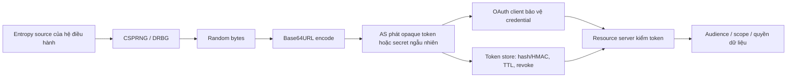
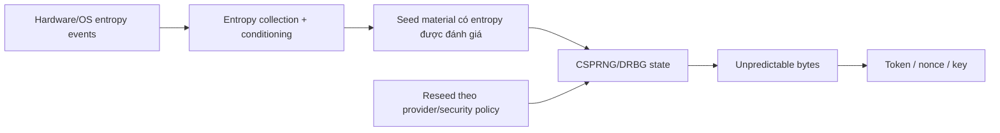
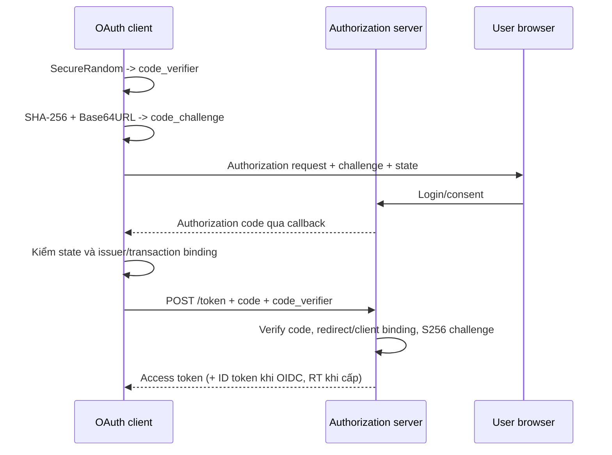
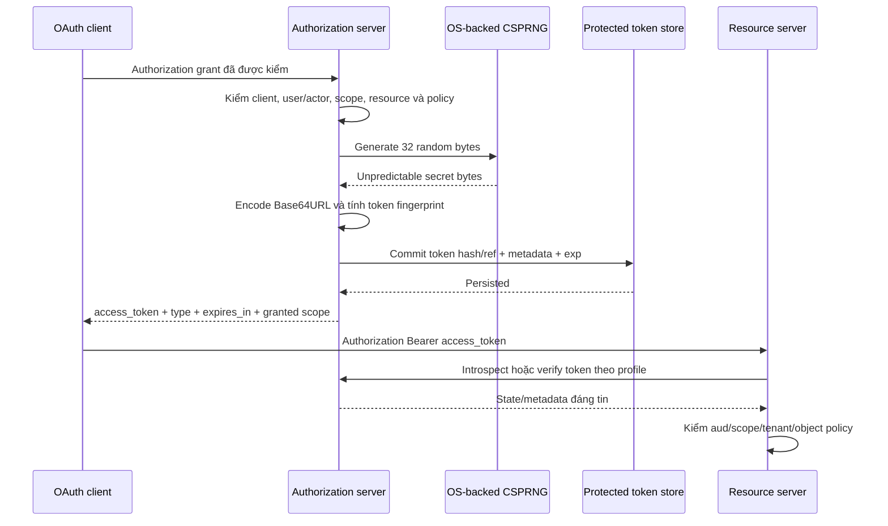
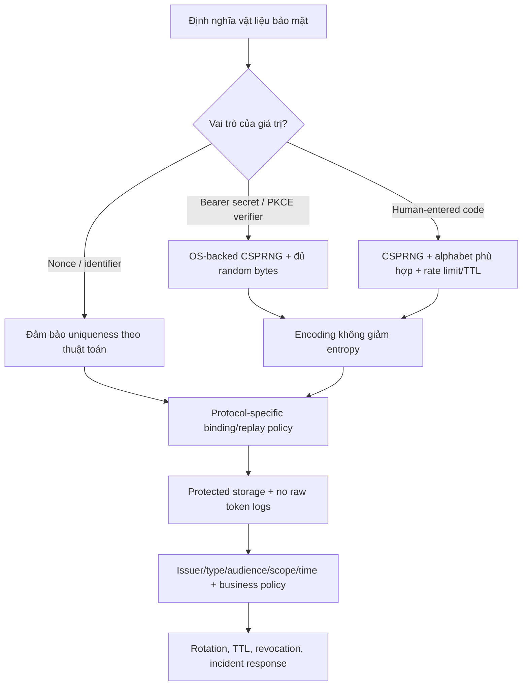

# Randomness và entropy

Một hệ thống đăng nhập tạo refresh token bằng cách nối `userId` với timestamp rồi mã hóa Base64. Kết quả trông dài và “ngẫu nhiên”:

```text
refresh_token = Base64URL("user-42:1795000000")
```

Nhưng bất kỳ ai biết hoặc đoán được user ID và thời điểm phát hành đều có thể tính lại chuỗi đó. **Base64URL là phép mã hóa biểu diễn, không phải nguồn entropy**. Nếu authorization server (AS) dùng chuỗi này như một bearer secret, kẻ tấn công có thể đoán credential dù nó dài hàng chục ký tự.

Trái lại, một chuỗi **32 byte được sinh từ cryptographically secure random number generator (CSPRNG)** có thể chứa xấp xỉ **256 bit entropy** nếu mỗi byte độc lập và phân bố đều. Khi được mã hóa Base64URL không padding, 32 byte trở thành 43 ký tự: chiều dài biểu diễn thay đổi, nhưng **độ khó đoán không tăng**.

Bài **“Randomness và entropy”** thuộc chương **Cryptography** của module **SECURITY_TOKEN_SECURITY_FUNDAMENTALS**. Module nghiên cứu mô hình tin cậy và vòng đời token bảo mật: JWT, opaque token, access token, refresh token, OAuth 2.0/OIDC, claims, scope, audience, lưu trữ, thu hồi và phòng chống token theft/replay. Ở đây, ta đi sâu vào **độ khó đoán của giá trị bí mật**, cách nguồn entropy và CSPRNG hoạt động, các phép tính rủi ro và cách ứng dụng thực tế trong token-security. Phạm vi không có ghi chú bổ sung.

**Mục tiêu học tập**

- Giải thích chính xác **randomness, unpredictability, entropy, min-entropy, uniqueness** và **cryptographic strength** không phải cùng một khái niệm.
- Tính số bit entropy lý tưởng từ số lượng giá trị có thể xảy ra; ước lượng xác suất đoán trúng và đụng độ.
- Phân biệt **CSPRNG, PRNG thường, DRBG và entropy source**, hiểu seed/reseed, virtual machine/container và cloning.
- Sinh opaque access token, refresh token, OAuth `state`, OIDC `nonce` và PKCE `code_verifier` đúng bằng Java `SecureRandom`.
- Tránh lỗi dùng timestamp, `Math.random()`, `Random`, UUID như một thay thế không đánh giá, modulo bias và mã hóa Base64 để “tạo randomness”.
- Hiểu vì sao device `user_code` và OTP ngắn cần rate limiting, expiry và chống brute force mạnh hơn secret 256 bit.
- Phân biệt JWT `jti`, chữ ký số, nonce của AES-GCM, nonce OAuth/OIDC và salt của password hashing.
- Thiết kế storage, rotation, audit, replay protection, negative tests và monitoring mà không tiết lộ token trong log.

## 1. Vị trí của randomness trong vòng đời token

Một token có thể trở thành credential cho phép gọi API hoặc xin token mới. Khi token là **bearer secret** (ví dụ opaque access token/refresh token), việc **không thể đoán** giá trị của nó là một lớp bảo vệ trọng yếu. Kẻ có chuỗi bearer token có thể dùng nó cho tới khi token hết hạn, bị thu hồi hoặc bị ràng buộc bằng cơ chế chứng minh sở hữu bổ sung.



**CSPRNG là một phần**, không phải toàn bộ bảo mật token. Một token ngẫu nhiên 256 bit vẫn có thể bị đánh cắp qua log, XSS, malware hoặc mạng không bảo vệ; access token bị cấp nhầm `aud` hoặc scope vẫn có thể trao quá quyền; refresh token không được thu hồi/rotate có thể kéo dài sự cố.

### 1.1. Mối liên hệ giữa tính ngẫu nhiên và các thuộc tính khác

| Thuộc tính | Câu hỏi cần trả lời | Cơ chế điển hình |
| --- | --- | --- |
| **Unpredictability** | Attacker có thể đoán giá trị chưa biết không? | CSPRNG + đủ entropy |
| **Uniqueness** | Hai lần phát có trùng nhau không? | Không gian lớn, kiểm trùng, counter/ID phù hợp |
| **Integrity/authenticity** | Có sửa/giả credential được không? | MAC/chữ ký số, AS state |
| **Confidentiality** | Có đọc được thông tin chứa trong token không? | TLS, encryption khi phù hợp, giảm PII |
| **Freshness/replay control** | Giá trị cũ có thể dùng lại trái phép không? | TTL, single-use, nonce/jti tracking, DPoP/mTLS |
| **Authorization** | Credential có quyền gọi API/tài nguyên này không? | Issuer, audience, scope, policy và object authorization |
| **Revocability** | Có ngăn dùng token trước `exp` không? | AS state, introspection/denylist, cache invalidation |

**Không dùng “random” làm câu trả lời thay cho “được phép” hoặc “không bị replay”.**

## 2. Randomness, entropy, unpredictability và uniqueness

### 2.1. Randomness là tính chất của quá trình sinh

Một nguồn random lý tưởng có các kết quả không bị lệch đáng kể và khó dự đoán. Với token 256 bit ngẫu nhiên đều, mỗi giá trị trong số `2^256` khả năng có xác suất bằng nhau. Nhưng một chuỗi trông lộn xộn không chứng minh nó được sinh từ nguồn tin cậy.

Ví dụ:

```text
random-looking: Base64URL(userId + ":" + timestamp)
random-looking: SHA256("fixed-seed")
random-looking: UUID tạo từ counter/clock

unpredictable secret:
  32 bytes từ CSPRNG có nguồn seed phù hợp,
  sau đó mã hóa Base64URL không padding
```

Hash hàm băm một đầu vào **có thể đoán được** không tự biến nó thành bí mật đủ mạnh; attacker có thể tự hash các ứng viên.

### 2.2. Entropy đo sự không chắc chắn

Entropy mô tả mức độ bất định của một biến ngẫu nhiên. Quan trọng là **phân bố xác suất nguồn**, không phải chỉ số ký tự nhìn thấy. Một chuỗi 64 ký tự toàn hexadecimal tạo từ seed 32 bit **không thể tự có 256 bit bí mật**, dù đầu ra có độ dài 256 bit hay hơn.

### 2.3. Unpredictability là thuộc tính cần cho secret

Đối với opaque bearer token, yêu cầu chính là attacker không thể **đoán đúng một credential còn sống** trong ngân sách tấn công thực tế. Một CSPRNG mạnh phải chống suy đoán đầu ra kế tiếp từ các đầu ra đã thấy, trong giới hạn giả định bảo mật và seed.

### 2.4. Uniqueness không đồng nghĩa bí mật

Một database ID tăng dần có thể **duy nhất** nhưng rất dễ đoán. JWT `jti` có thể cần duy nhất để tracking/replay detection, nhưng một `jti` duy nhất **không tự là access token bí mật**. Ngược lại, secret ngẫu nhiên mạnh có xác suất trùng cực nhỏ nhưng một hệ thống vẫn nên kiểm unique constraint nếu trùng sẽ gây hậu quả nghiêm trọng.

## 3. Shannon entropy và min-entropy: hai góc nhìn khác nhau

Với một biến ngẫu nhiên `X` có các kết quả `x` với xác suất `p(x)`:

\[
H(X) = -\sum_{x} p(x)\log_2 p(x)
\]

Đây là **Shannon entropy**, đo lượng thông tin bất định trung bình.

**Min-entropy**:

\[
H_{\infty}(X) = -\log_2\left(\max_x p(x)\right)
\]

Min-entropy quan trọng khi đánh giá **xác suất đoán đúng ở lần thử có lợi nhất**, vì attacker sẽ đoán giá trị có xác suất cao nhất trước.

### 3.1. Nguồn đều

Nếu có `N` giá trị **đồng xác suất**:

\[
H(X) = H_{\infty}(X) = \log_2 N
\]

Ví dụ 1 byte ngẫu nhiên đều cho 256 kết quả:

\[
\log_2 256 = 8 \text{ bit}
\]

32 byte độc lập, mỗi byte đều 8 bit:

\[
32 \times 8 = 256\text{ bit}
\]

**Điều kiện “độc lập và đồng phân bố đều” cực kỳ quan trọng.** Không cộng đơn giản entropy của hai nguồn có tương quan; hai giá trị 128 bit **giống hệt nhau** ghép nối không tạo ra 256 bit entropy.

### 3.2. Nguồn bị lệch

Giả sử một bộ sinh bit chỉ trả `0` với xác suất 0,9 và `1` với xác suất 0,1. Với một lần sinh:

\[
H_{\infty}(X)=-\log_2(0.9)\approx 0.152\text{ bit}
\]

Kết quả có hai khả năng nhưng **không đạt 1 bit min-entropy**. Lặp nguồn này 256 lần chỉ cho được 256 × 0,152 ≈ 38,9 bit min-entropy **nếu thực sự độc lập**. Trên thực tế phải đánh giá conditioning, correlation và entropy source health theo mô hình nghiêm túc.

**Không tuyên bố entropy bằng chiều dài output của một hash/DRBG**; entropy thực có thể bị giới hạn bởi seed hoặc entropy source.

### 3.3. Entropy đo từ đâu?

- **Cryptographic design estimate:** dựa trên entropy source, DRBG/CSPRNG implementation và security assumptions đáng tin.
- **Threat-model estimate:** attacker biết gì về seed, clock, process state, output, môi trường?
- **Statistical test:** có thể phát hiện một số sai lệch, **không chứng minh một generator không thể dự đoán**.

Một chuỗi vượt qua chi-square/monobit test vẫn có thể hoàn toàn dự đoán được nếu sinh từ PRNG có seed công khai.

## 4. Bit entropy không bằng số ký tự

Nếu một giá trị được chọn **đều, độc lập** từ alphabet có `A` ký tự trong `L` vị trí, entropy lý tưởng:

\[
H = L\log_2 A
\]

| Cách tạo | Không gian khả năng | Entropy **lý tưởng** | Ghi chú |
| --- | --- | --- | --- |
| 6 chữ số thập phân | `10^6` | ≈19,93 bit | Rất nhỏ nếu thử online nhiều |
| 8 chữ số thập phân | `10^8` | ≈26,58 bit | Cần rate limit và TTL |
| 8 ký tự từ alphabet 32 ký tự | `32^8` | 40 bit | Chỉ nếu sampling đều |
| 8 ký tự `A-Z,a-z,0-9` | `62^8` | ≈47,63 bit | Cần thuật toán unbiased |
| 16 byte CSPRNG | `2^128` | 128 bit | Base64URL không padding dài **22 ký tự** |
| 24 byte CSPRNG | `2^192` | 192 bit | Base64URL không padding dài **32 ký tự** |
| 32 byte CSPRNG | `2^256` | 256 bit | Base64URL không padding dài **43 ký tự** |

Ví dụ một chuỗi `"000000"` dài 6 ký tự chỉ là **một giá trị**; nếu chương trình **luôn phát** chuỗi này thì entropy thực **0 bit**, bất kể nó là “mã 6 chữ số”.

### 4.1. Base64URL, hex và encoding không bổ sung randomness

```text
32 random bytes -> Base64URL(no padding) -> 43 characters
32 random bytes -> hexadecimal           -> 64 characters
32 random bytes -> standard Base64        -> 44 characters (with "=" padding)
```

Cả ba biểu diễn cùng lượng dữ liệu **256 bit**. Base64URL có thể phù hợp token trong query/body hơn standard Base64 vì tránh `+` và `/`; nhưng **đưa bearer token vào URL** vẫn có nguy cơ lộ qua history, Referer, logs và telemetry.

**Ký tự nhiều hơn không đồng nghĩa nhiều entropy hơn.**

### 4.2. Nối nhiều thành phần không tự cộng entropy

```text
token = random128 || userId || timestamp
```

Nếu user ID và timestamp công khai hoặc dễ đoán, chúng không làm bearer secret mạnh hơn 128 bit random portion. Tệ hơn:

```text
token = SHA256(userId || timestamp)
```

Trong trường hợp này attacker có thể thử user ID/timestamp mà không cần phá SHA-256.

## 5. Đoán token: xác suất và ngân sách tấn công

Nếu một secret được chọn **đều trong `2^k` giá trị**, kẻ tấn công có `q` lần đoán các giá trị khác nhau và **chỉ có một token hợp lệ là mục tiêu**, xác suất thành công xấp xỉ:

\[
P(\text{guess success}) \approx \frac{q}{2^k}, \quad q \ll 2^k
\]

Nếu có **nhiều token hợp lệ**, xác suất đoán trúng *bất kỳ* token nào trong không gian đều có thể tăng theo số token còn hiệu lực; do đó phải tính **quy mô token population, tốc độ thử và cả online/offline threats**.

### 5.1. Ví dụ 6-digit code

Một mã có 1.000.000 khả năng. Nếu không có giới hạn, 100.000 lần thử khác nhau có thể đạt xác suất xấp xỉ **10%** với một mã hợp lệ. Với 3 lần thử độc lập/khác nhau trong cửa sổ sống, cận trên chỉ khoảng:

\[
3/1{,}000{,}000 = 0.000003 = 0.0003\%
\]

Đó là lý do **OTP/user code ngắn phải có rate limiting, TTL, khóa theo transaction/account và chống distributed guessing**. Không thể thay rate limiting bằng việc nói “mã được sinh từ CSPRNG”.

### 5.2. Ví dụ bearer secret 128 bit

Một token 128 bit ngẫu nhiên đều có `2^128` khả năng. Với một triệu guesses khác nhau đối với **một secret cụ thể**:

\[
P \approx 10^6/2^{128} \approx 2.94\times10^{-33}
\]

Đây là xác suất lý tưởng khi generator/seed thực sự mạnh, secret không bị lộ và attacker không có lỗ hổng khác. Trong hệ thống production, **token theft, key leak, lỗi endpoint và quyền cấp quá rộng thường thực tế hơn brute force 128/256 bit**.

### 5.3. Online vs offline attack

| Loại tấn công | Điều attacker có | Cần kiểm soát |
| --- | --- | --- |
| **Online guessing** | Thử token/code ở endpoint đang hoạt động | Secret entropy, throttling, TTL, lockout/risk signals, rate limits |
| **Offline candidate testing** | Có được verifier/hash/ciphertext hoặc seed yếu và tự kiểm ứng viên | Entropy mạnh, token hashing/HMAC, key protection, no low-entropy seeds |
| **Theft/replay** | Có giá trị token đúng | Storage, TLS, log redaction, sender constraints, revocation, short TTL |
| **Prediction from RNG flaw** | Quan sát outputs/biết seed hoặc snapshot state | CSPRNG đúng, OS entropy, tránh deterministic/reused state |

**Tăng độ dài token không sửa được việc token bị ghi plaintext trong log.**

## 6. Collision probability: sinh cùng giá trị khác với đoán trúng

Khi hệ thống phát **n token ngẫu nhiên độc lập**, xác suất **ít nhất một cặp trùng** trong không gian `2^k`, nếu n nhỏ so với `2^(k/2)`:

\[
P_{\text{collision}} \approx \frac{n(n-1)}{2^{k+1}}
\]

Đây là hiệu ứng **birthday bound**. Khác với xác suất attacker đoán đúng **một secret cụ thể**.

### 6.1. Ví dụ thực tế

- `n = 10^9` giá trị 128 bit: collision xấp xỉ `1.47 × 10^-21`, cực nhỏ dưới giả định uniform/independent.
- `n = 10^9` giá trị 96 bit: collision xấp xỉ `6.31 × 10^-12`; nếu tăng lên `n = 10^12`, xác suất xấp xỉ `6.31 × 10^-6` theo cùng giả định.
- `n = 10^9` giá trị 64 bit: collision xấp xỉ `0.027` (khoảng 2,7%); mức này đã đáng lo ngại với định danh cần duy nhất.
- `n = 10^6` giá trị 64 bit: collision xấp xỉ `2.7 × 10^-8` dưới giả định tương tự.

Đối với token bearer ngẫu nhiên 128–256 bit, xác suất trùng thường rất nhỏ. Tuy nhiên có thể đặt **unique constraint** trên record ID/fingerprint và **retry bằng mẫu random mới** nếu collision, nhất là khi tính đúng duy nhất là yêu cầu nghiệp vụ.

### 6.2. Uniqueness của nonce AEAD nguy hiểm hơn collision ID

Trong **AES-GCM**, tái sử dụng cùng nonce/IV dưới cùng khóa có thể phá confidentiality và authenticity nghiêm trọng. Với random 96-bit IV, birthday effect phải được quản lý bằng **giới hạn số lần mã hóa dưới một khóa**; nhiều thiết kế chọn counter/nonce construction bảo đảm uniqueness thay vì trông chờ xác suất collision thấp.

**Giá trị “random 96 bit” có thể phù hợp một vai trò, nhưng không thể được dùng vô hạn với bất kỳ mục đích crypto nào.**

## 7. PRNG thông thường, CSPRNG và DRBG

### 7.1. PRNG thông thường

`java.util.Random`, `ThreadLocalRandom` và `SplittableRandom` hữu ích cho simulation, sampling, randomized algorithm hoặc test data. Chúng **không được thiết kế làm nguồn bí mật mật mã**; seed/trạng thái có thể dự đoán hoặc khôi phục theo thuật toán.

Ví dụ **sai trong production**:

```java
// SAI: java.util.Random không phù hợp để sinh bearer secret.
Random random = new Random(System.currentTimeMillis());
long refreshToken = random.nextLong();
```

Timestamp còn tạo khoảng seed dễ đoán. Thay đổi seed phức tạp hơn **không biến Random thành CSPRNG**.

### 7.2. CSPRNG

**Cryptographically secure pseudorandom number generator** được thiết kế chống dự đoán theo các giả định mật mã, bao gồm việc các outputs đã quan sát không giúp attacker thực tế đoán outputs tiếp theo khi trạng thái bí mật được bảo vệ.

Trong Java, dùng `java.security.SecureRandom` từ một **provider tin cậy** thay cho `Random` khi sinh secrets. **SecureRandom không tự chứng minh môi trường không bị compromise**: nếu attacker lấy process memory/seed, thay provider hoặc chèn kết quả, nguồn ngẫu nhiên vẫn có thể bị phá.

### 7.3. DRBG và entropy source

**DRBG (Deterministic Random Bit Generator)** là một dạng CSPRNG được seed bằng entropy phù hợp, sau đó sinh nhiều byte bằng thuật toán mật mã và quản lý state/reseed. “Deterministic” không có nghĩa “không bảo mật”: **đầu ra phải khó dự đoán khi seed/state bí mật và đủ entropy**.



Nguồn và DRBG được mô tả trong **NIST SP 800-90A** (DRBG mechanisms), **SP 800-90B** (entropy sources) và hướng dẫn hệ điều hành/provider. Mô hình này dùng để giải thích, không có nghĩa mọi `SecureRandom` của mọi nền tảng triển khai chính xác cùng thuật toán.

### 7.4. Forward/backtracking resistance không nên được tự khẳng định

Một DRBG có thể có các tính chất chống suy ngược output trước đó khi state hiện tại lộ (*backtracking resistance*) hoặc phục hồi tính khó đoán sau reseed khi attacker mất quyền kiểm soát (*prediction resistance* dưới điều kiện cụ thể). Khả năng thật phụ thuộc implementation và reseed design. Đừng mặc định mọi CSPRNG bảo đảm tất cả thuộc tính đó trong mọi tình huống.

## 8. Entropy hệ điều hành, startup và môi trường ảo hóa

Phần mềm ứng dụng thường **không tự thu “tiếng ồn” hay timestamp** để làm entropy. Nên dựa trên OS cryptographic RNG và provider đã được kiểm chứng, được khởi tạo/seed theo hướng dẫn nền tảng.

### 8.1. Linux/Unix và Windows

- Linux hiện đại có cryptographic RNG của kernel và APIs như `getrandom()`; trạng thái đã được khởi tạo phải được bảo đảm bởi OS/boot process.
- Windows có OS cryptographic RNG API phù hợp nền tảng.
- JVM `SecureRandom` dùng security providers có implementation/seed strategies khác nhau tùy OS, JDK và cấu hình.

Không tự thay source bằng `System.nanoTime()`, PID, MAC address, thread ID, CPU usage hoặc thứ tự request. Các giá trị đó thường có entropy thấp và attacker có thể thu hẹp khoảng tìm kiếm.

### 8.2. Container, image và VM cloning

Một container mới **không phải một entropy source độc lập** chỉ vì có container ID khác. Khi khởi động nhiều containers/VMs từ một snapshot, hệ thống cần bảo đảm OS RNG/DRBG state được reseed/khởi tạo đúng, đặc biệt trong môi trường embedded, VM restore và cloned image.

Rủi ro đáng xét:

1. Snapshot sao chép process memory bao gồm DRBG state.
2. Hai instances tiếp tục sinh cùng một chuỗi outputs nếu không có reseed/isolation.
3. Secret/token collision hoặc predictability xảy ra ngoài assumptions.

Hãy dùng OS/JDK được duy trì, kiểm security provider, VM snapshot restoration procedures và **không serialize/backup object `SecureRandom` state làm seed cho instances khác**.

### 8.3. `SecureRandom.getInstanceStrong()` có bắt buộc không?

**Không bắt buộc** để sinh mọi token. API này chọn algorithm/provider theo cấu hình `securerandom.strongAlgorithms` và có thể có đặc tính blocking/latency khác nhau. Một `new SecureRandom()` với provider CSPRNG chuẩn, OS được khởi tạo đúng và cấu hình phù hợp thường là lựa chọn ứng dụng hợp lý.

Không sửa một hệ thống chậm bằng cách cố gọi `getInstanceStrong()` trên **mỗi request**; cũng không chọn một thuật toán lạ chỉ vì tên nghe “mạnh”.

## 9. Java: sinh opaque token bằng `SecureRandom`

Đây là ví dụ **có thể dùng làm nền tảng triển khai** cho opaque secret; policy và storage/HTTP vẫn phải được thiết kế riêng.

```java
import java.security.SecureRandom;
import java.util.Base64;

public final class OpaqueTokenGenerator {
    // Có thể tái sử dụng instance SecureRandom từ provider đã chọn.
    // Không gọi setSeed với timestamp để "tăng entropy".
    private final SecureRandom random = new SecureRandom();

    public String newOpaqueToken() {
        byte[] bytes = new byte[32]; // 256 bit random material
        random.nextBytes(bytes);
        return Base64.getUrlEncoder()
                .withoutPadding()
                .encodeToString(bytes);
    }
}
```

### 9.1. Điều ví dụ bảo đảm — và chưa bảo đảm

Nếu `SecureRandom`/provider/OS hoạt động đúng, đoạn mã cung cấp 32 byte ngẫu nhiên phù hợp cho **opaque bearer secret**. Nhưng nó **chưa** bao gồm:

- Client/subject/tenant binding, `aud`, `scope` và token type.
- TTL, unique constraint, persistence, hashing/HMAC token store.
- Refresh-token rotation, revoke, incident response.
- Log redaction, TLS, security headers, sender constraints.
- Rate limits, failure handling và monitoring.

**Một secret ngẫu nhiên không tự là một OAuth access token hợp lệ**; AS phải lưu/mô tả metadata và RS xác minh các điều kiện authorization.

### 9.2. Không log token vừa tạo

```java
String token = generator.newOpaqueToken();

// SAI: credential có thể bị copy từ log.
// logger.info("Issued refresh token {}", token);

// ĐÚNG VỀ MẶT NGUYÊN TẮC:
audit.recordIssuedToken(
        safeTokenRecordReference,
        clientId,
        expiresAt,
        "REFRESH_TOKEN");
```

`audit` ở đây là một interface **giả định**. Nó phải ghi metadata an toàn, không lấy chuỗi raw secret làm argument/field.

## 10. Sinh mã số và ký tự không bị modulo bias

Ngay cả với CSPRNG, bước **biến bytes thành alphabet** có thể tạo bias nếu viết sai.

### 10.1. Lỗi modulo

```java
// SAI nếu alphabet size không chia hết 256.
int index = (byteValue & 0xff) % alphabetLength;
```

Ví dụ chọn 1 chữ số trong 10 chữ số từ byte đều 0..255 bằng phép `%10`. Vì 256 không chia hết cho 10, các chữ số 0–5 xuất hiện **26 lần**, còn 6–9 chỉ **25 lần** trong 256 nguồn có thể. Kết quả **không đồng đều**; bias có thể tích lũy ở chuỗi dài/secret space nhỏ.

### 10.2. Dùng bounded `SecureRandom.nextInt`

```java
import java.security.SecureRandom;
import java.util.Locale;

public final class HumanCodeGenerator {
    private static final SecureRandom RNG = new SecureRandom();

    public static String sixDigitCode() {
        int value = RNG.nextInt(1_000_000);
        return String.format(Locale.ROOT, "%06d", value);
    }
}
```

`nextInt(bound)` của `SecureRandom` sử dụng thuật toán tránh phân bố modulo bias đối với khoảng nguyên được yêu cầu. **Nhưng chỉ có khoảng 19,93 bit entropy**. Một mã như thế phải gắn transaction, TTL, giới hạn số lần thử, brute-force detection và **không bao giờ** dùng làm opaque access/refresh token có thời hạn dài.

### 10.3. Chọn ký tự từ alphabet bằng bounded RNG

```java
import java.security.SecureRandom;

public final class AlphabetCodeGenerator {
    private static final String ALPHABET =
            "ABCDEFGHJKLMNPQRSTUVWXYZ23456789";
    private static final SecureRandom RNG = new SecureRandom();

    public static String generate(int length) {
        if (length < 1 || length > 128) {
            throw new IllegalArgumentException("Invalid length");
        }

        StringBuilder out = new StringBuilder(length);
        for (int i = 0; i < length; i++) {
            int index = RNG.nextInt(ALPHABET.length());
            out.append(ALPHABET.charAt(index));
        }
        return out.toString();
    }
}
```

Alphabet bỏ ký tự dễ nhầm giúp người dùng nhập mã. Đổi lại **không gian khả năng** phụ thuộc đúng kích thước alphabet và length; không tự ghi “40 bit” nếu không tính `L×log2(A)` với **A thật**.

### 10.4. Cắt chuỗi và chuẩn hóa có thể làm mất entropy

Nếu phát 43 ký tự Base64URL rồi database field chỉ giữ 20 ký tự, hệ thống **đã cắt bớt không gian token**; thậm chí gây collision. Nếu backend tự động chuyển lowercase/loại punctuation, entropy và uniqueness có thể thay đổi. Secret tokens nên được xử lý **byte-exact**, không lower-case/canonicalize tùy tiện, không trim hay truncate không được thiết kế.

## 11. OAuth `state`, OIDC `nonce` và PKCE `code_verifier`

Ba giá trị thường đều là chuỗi ngẫu nhiên nhưng **bảo vệ những ranh giới khác nhau**:

| Giá trị | Bên sinh/giữ và nơi dùng | Vai trò an ninh | Lỗi thường gặp |
| --- | --- | --- | --- |
| OAuth `state` | Client sinh trước authorization request, đối chiếu callback | Liên kết callback với browser/client transaction, chống CSRF/mix-up theo thiết kế | Dùng hằng số hoặc không kiểm callback |
| OIDC `nonce` | OIDC client tạo, gửi trong authentication request khi áp dụng, đối chiếu ID token | Liên kết ID token với authentication request, giảm substitution/replay | Chỉ kiểm tồn tại, không đối chiếu nonce đã gửi |
| PKCE `code_verifier` | OAuth client tạo và giữ bí mật đến token request | Chứng minh token exchanger thuộc transaction sinh `code_challenge` | Dùng secret dễ đoán hoặc dùng chung mọi requests |
| OAuth `code_challenge` | Client dẫn xuất từ verifier, gửi ở authorization request | Public commitment với `code_verifier`, **không phải secret** | Tự sinh challenge độc lập và làm exchange fail |

### 11.1. PKCE: 32 byte → 43 ký tự Base64URL

RFC 7636 định nghĩa `code_verifier` là chuỗi entropy cao, độ dài **43–128 ký tự** từ tập unreserved được cho phép. Phương pháp tạo được khuyến nghị là **32 octets ngẫu nhiên** rồi Base64URL không padding thành **43 ký tự**, cung cấp **256 bit** từ random bytes nếu RNG phù hợp.

```java
import java.security.MessageDigest;
import java.security.SecureRandom;
import java.nio.charset.StandardCharsets;
import java.util.Base64;

public final class PkceValues {
    private static final SecureRandom RNG = new SecureRandom();
    private static final Base64.Encoder B64URL =
            Base64.getUrlEncoder().withoutPadding();

    public static String newCodeVerifier() {
        byte[] bytes = new byte[32];
        RNG.nextBytes(bytes);
        return B64URL.encodeToString(bytes);
    }

    public static String s256Challenge(String verifier)
            throws java.security.NoSuchAlgorithmException {
        byte[] digest = MessageDigest.getInstance("SHA-256")
                .digest(verifier.getBytes(StandardCharsets.US_ASCII));
        return B64URL.encodeToString(digest);
    }
}
```

**Lưu ý:** `SHA-256` trong `S256` không “tạo thêm 256 bit entropy”. Nó tạo một commitment dẫn xuất từ `code_verifier` có entropy cao. Authorization request gửi `code_challenge`; token request gửi `code_verifier`. Với public clients, **ưu tiên `S256`**; không dùng `plain` trừ khi hoàn cảnh/profile thực sự cho phép và có lý do được đánh giá.

### 11.2. Vòng đời PKCE verifier



Verifier phải được giữ **theo từng authorization transaction**; không được tái sử dụng cùng một verifier tĩnh cho mọi người dùng hay ghi vào URL/tracing. Token endpoint phải kiểm verifier/challenge theo RFC, không cho client tự xác minh rồi bảo AS tin.

### 11.3. `state`: entropy đủ + session binding

Một `state` ngẫu nhiên có thể chống kẻ khác đoán state, nhưng **randomness đơn thuần không bảo đảm callback được liên kết đúng browser session**. Client phải:

- Sinh state mới cho mỗi transaction.
- Lưu state đúng ngữ cảnh của browser/session, với TTL.
- So khớp chính xác state ở callback (hoặc xác minh state integrity nếu là structured value).
- Chỉ chấp nhận callback đúng **issuer/client/redirect transaction** theo profile.
- Dọn trạng thái sau khi xử lý; không cho state cũ được dùng tùy tiện.

Một implementation có thể dùng opaque random state và server-side mapping; nếu dùng self-contained state, cần integrity binding, expiration và replay controls. Không nhúng access/refresh token vào `state` chỉ vì nó đi qua browser.

### 11.4. OIDC `nonce`: không phải Bearer token

Nonce OIDC được gửi trong authentication request ở các flow/profile tương ứng và xuất hiện trong ID token để RP kiểm. Trong Authorization Code flow, yêu cầu dùng nonce phụ thuộc profile; nếu gửi nonce, **phải kiểm giá trị khớp**. Không tự suy mọi OIDC ID token luôn có nonce.

Nonce OIDC không trao quyền gọi API, không thay `state`, PKCE hoặc access token. Một nonce 256 bit không bù cho việc RP bỏ kiểm `aud`, `iss` hoặc chữ ký ID token.

## 12. Opaque access token và refresh token: cần entropy như thế nào?

Đối với opaque token có khả năng được dùng như **bearer secret**, tính khó đoán phải đủ mạnh trước tấn công hiện thực. Trong một thiết kế mới, **32 byte CSPRNG (~256 bit lý tưởng)** là một lựa chọn thực dụng, rộng rãi và dễ triển khai cho opaque access/refresh token; 16 byte (~128 bit) cũng có không gian rất lớn nhưng quyết định cụ thể phụ thuộc lifetime, population, risk model, tiêu chuẩn tổ chức và hệ thống cấp phát.

### 12.1. Access token ngẫu nhiên không tự mang scope/audience

```text
raw opaque token: qC_s8v... (random secret)

AS protected token record:
    token_ref   = internal-identifier
    client_id   = orders-web
    subject     = user-42
    audience    = https://api.example.com/orders
    scope       = orders.read
    expires_at  = T
    status      = ACTIVE
```

Chuỗi token raw không nhất thiết chứa claims; AS/RS có thể truy metadata bằng token store/introspection. **Độ ngẫu nhiên bảo vệ khỏi đoán secret**, còn `aud`/scope/lifetime/owner bảo vệ khỏi quyền sai mục đích.

### 12.2. Refresh token cần bảo vệ mạnh hơn về vòng đời

Refresh token có thể tồn tại lâu hơn access token và dùng để xin access token mới. Dù có 256 bit entropy, nó vẫn:

- Có thể bị sao chép từ browser storage, mobile backup, server logs hoặc process memory.
- Cần rotation hoặc sender-constraining theo loại client và OAuth Security BCP.
- Cần quản lý refresh-token family/grant, reuse detection, expiry, revocation.
- Không được gửi tới resource API thay access token.

**Entropy cao không thay thế refresh-token rotation và storage controls**.

### 12.3. Token trong URL vẫn có thể bị đánh cắp

Một token 256 bit đặt trong URL query dễ bị ghi vào:

- Browser history và copied URLs.
- Reverse-proxy/access logs.
- Analytics, error reporting, tracing.
- Referrer khi điều hướng giữa origin theo điều kiện cụ thể.

OAuth access token Bearer nên được gửi theo profile thích hợp, thường qua `Authorization: Bearer` với HTTPS. Tránh đưa bearer tokens vào URL nếu có lựa chọn an toàn hơn.

## 13. Device Authorization Grant: `device_code` và `user_code` cần entropy khác nhau

RFC 8628 sử dụng hai loại mã với mục đích khác:

- **`device_code`:** secret có entropy cao, client giữ để polling token endpoint.
- **`user_code`:** mã ngắn dễ nhập trên điện thoại/browser, dùng để người dùng liên kết và phê duyệt đúng transaction.

### 13.1. Hai rủi ro khác nhau

| Mã | Ai nhìn thấy? | Threat chính | Biện pháp |
| --- | --- | --- | --- |
| `device_code` | Device client và AS; không công khai theo thiết kế | Theft/redeem bởi attacker | CSPRNG entropy cao, giữ kín, TTL, client binding, one-time consume |
| `user_code` | Hiển thị công khai trên TV và nhập vào AS | Online guessing, phishing, wrong-device approval | Đủ không gian mã, TTL, rate limits, user confirmation, anti-abuse |

Không làm `user_code` dài 43 ký tự chỉ để đạt 256 bit, vì người dùng rất khó nhập. Thay vào đó cần **thiết kế UX và anti-brute-force** phù hợp với entropy thấp. Nhưng **không bao giờ cho `user_code` trực tiếp redeem token**.

### 13.2. Xác suất đoán user code online

Với 8 ký tự từ alphabet 32 ký tự, không gian lý tưởng là `32^8=2^40`. Với 6 ký tự số, chỉ `10^6` khả năng. Với cả hai, AS còn phải tính:

- Có bao nhiêu giao dịch đang pending đồng thời?
- Có rate limit theo IP, account, client, device và toàn cục không?
- User code sống trong bao lâu?
- User đã xem rõ tên client/scopes trước khi bấm approve chưa?
- Attacker có thể thuyết phục user nhập code attacker cung cấp không?

**Rate limit và chống phishing không thể suy chỉ từ entropy**. Một attacker có thể xin device code hợp lệ và lừa nạn nhân approve nó trên trang AS thật, dù mã có rất nhiều entropy.

### 13.3. Mã phê duyệt không phải key của refresh token

Một số hệ thống “tái sử dụng” `user_code` làm refresh token vì đã có code trong DB. Đây là lỗi nghiêm trọng: `user_code` được trình cho người dùng và có entropy hạn chế, không phải long-lived secret. Token endpoint phải cấp **access/refresh token mới theo AS policy**, không lặp user code.

## 14. OTP, verification code và password reset token

Mục đích và security expectations khác nhau:

| Giá trị | Entropy thiết kế thường thấy | Ngữ cảnh | Kiểm soát bắt buộc khác |
| --- | --- | --- | --- |
| 6-digit OTP | ≈19,93 bit nếu đều | User nhập, hiệu lực ngắn | Rate limit, TTL, attempt counter, transaction binding |
| 8-digit OTP | ≈26,58 bit nếu đều | User nhập, hiệu lực ngắn | Những kiểm soát như trên |
| Email verification bearer link | Nên entropy cao, ví dụ 128–256 bit | Link/secret có thể bị lộ qua email/log | Single-use, TTL, audience/action binding |
| Password reset bearer link | Nên entropy cao, ví dụ 128–256 bit | Hành động rất nhạy cảm | One-time consume, TTL, session/CSRF rules, anti-enumeration |
| TOTP seed secret | Phải được tạo/bảo vệ như cryptographic key | Dẫn xuất codes theo thời gian | Protected key storage, drift window, lockout |

Một **TOTP 6-digit** có mã hiển thị ~20 bit, nhưng không phải “RNG tạo OTP mới mỗi 30 giây” theo cùng cách random email link: TOTP thường dùng một **secret seed có entropy cao** cùng thời gian/counter và HMAC theo chuẩn. Không dùng TOTP seed làm refresh token.

### 14.1. Password reset link vẫn là một token năng lực

Ví dụ link `https://example.com/reset?token=...` có thể bắt buộc phải dùng query parameter theo UX. Khi đó cần:

- Token ngẫu nhiên mạnh, action/subject binding và TTL ngắn.
- Không log full URL, Referrer-Policy phù hợp và hạn chế third-party resources trên trang reset.
- One-time consume nguyên tử, không reuse.
- Màn hình/result chống tiết lộ account existence.
- Hủy token cũ hoặc rotate theo policy khi cấp token reset mới.

**Không nhầm password reset bearer secret với OAuth access token**, dù cả hai đều có randomness.

### 14.2. CSPRNG cho mã số không thay input-rate control

Nếu `SecureRandom.nextInt(1_000_000)` phát 6-digit code đúng phân bố, mã vẫn chỉ có một triệu khả năng. Một trang không giới hạn thử/không hết hạn **không an toàn**. Mọi secrets có entropy thấp cho UX cần được bù bằng **online attack controls**.

## 15. JWT: `jti` ngẫu nhiên có cần không và chữ ký bảo vệ điều gì?

JWT có thể là **signed JWS** với claims `iss`, `aud`, `sub`, `exp`, `scope` và optional `jti`. Đối với JWT access token, tính chống giả mạo chủ yếu dựa trên **chữ ký/MAC và validation policy**, **không** chỉ vào randomness của `jti`.

### 15.1. `jti` là identifier, không mặc nhiên là secret

`jti` (JWT ID) giúp phân biệt token instances, phục vụ audit, denylist hoặc một số kiểm soát replay. Có thể sinh nó bằng CSPRNG:

```java
import java.security.SecureRandom;
import java.util.Base64;

final class JwtId {
    private static final SecureRandom RNG = new SecureRandom();

    static String newJti() {
        byte[] bytes = new byte[16]; // 128-bit random identifier
        RNG.nextBytes(bytes);
        return Base64.getUrlEncoder()
                .withoutPadding()
                .encodeToString(bytes);
    }
}
```

Đây chỉ là cách tạo **unique-ish identifier** với không gian lớn, không phải một yêu cầu mọi JWT `jti` đều cần đúng 128 bit. `jti` **không tự chống replay** nếu RS chấp nhận cùng JWT nhiều lần mà không có state/proof control.

### 15.2. Signed JWT có thể mang claims dễ đoán mà vẫn không thể giả

Một JWT có `sub=user-42, scope=orders.read, exp=T` có thể đoán được phần payload nhưng attacker **không thể tạo JWS có chữ ký hợp lệ** nếu key/algorithm/validator được bảo vệ đúng. Do đó:

- Không đánh giá JWT security bằng “payload random đến mức nào”.
- Kiểm **issuer, expected audience, token type/profile, signature, claims/time, scope và quyền dữ liệu** tại RS.
- Chữ ký không mã hóa nội dung: payload JWT thường **có thể đọc được** nếu không dùng JWE.
- Một JWT Bearer bị đánh cắp vẫn có thể được sử dụng lại nếu không có sender constraint/revocation.

### 15.3. Random `jti` không cứu thuật toán xác minh sai

Nếu API chấp nhận `alg=none` ngoài policy, bỏ audience hoặc lấy public key tùy ý theo header do attacker cung cấp, `jti` 128/256 bit cũng không sửa được lỗi. Randomness là **một lớp** trong thiết kế, không thay validation.

### 15.4. JWT có thể không chứa entropy bí mật từ client

Đừng gửi ID token tới resource API thay OAuth access token chỉ vì nó là một JWT hợp lệ. **Token type, audience và intended recipient** là điều kiện riêng; một ID token có nonce tốt vẫn phải bị API từ chối theo access-token profile.

## 16. Nonce khác nhau trong mật mã: AEAD IV, OIDC nonce và DPoP `jti`

Từ “nonce” nghĩa là **number used once**, nhưng yêu cầu kỹ thuật tùy giao thức:

| Giá trị | Mục tiêu chính | Có nhất thiết là bí mật? | Yêu cầu quan trọng |
| --- | --- | --- | --- |
| AES-GCM IV/nonce | Không lặp dưới cùng encryption key | Thường **không** | **Uniqueness dưới một khóa**, 96-bit IV thường dùng |
| OIDC nonce | Bind ID token với authentication request | Không phải bearer credential | Đủ khó đoán/khớp transaction theo profile |
| OAuth state | Bind authorization callback | Thường cần unpredictable/integrity | Exact match + session binding + expiry |
| PKCE verifier | Secret ràng buộc authorization code | **Có** trong transaction | CSPRNG entropy cao + S256 |
| DPoP `jti` | Replay detection cho proof | Không cần bí mật | Uniqueness trong replay window, RS replay cache |
| JWT `jti` | Token identifier | Không bắt buộc bí mật | Uniqueness/namespace theo purpose |

### 16.1. AES-GCM: uniqueness quan trọng hơn “trông ngẫu nhiên”

AES-GCM yêu cầu **không được tái sử dụng IV/nonce cho hai lần mã hóa khác nhau dưới cùng key** trong assumptions thông thường. Nếu dùng random 96-bit nonce, cần quản lý số lần mã hóa và collision risk; nếu dùng counter-based nonce, phải bảo đảm **atomic allocation**, crash recovery, multi-instance coordination và không wrap counter.

```text
AES-GCM:
    key = secret cryptographic key
    nonce = per-message unique IV under that key

INVALID:
    same key + same nonce for two different plaintexts

VALID DESIGN GOAL:
    unique nonce per key, with enforced invocation limits
```

**Đừng dùng đúng một chuỗi random đã sinh cho `access_token` làm AES-GCM IV cho nhiều lần mã hóa**. Mỗi vật liệu có mục đích, length, lifecycle và uniqueness requirement riêng.

### 16.2. ECDSA signing nonce có thể làm lộ private key

Một số thuật toán chữ ký như ECDSA dùng một ephemeral secret `k` cho từng chữ ký. Nếu `k` bị tái sử dụng/thiếu entropy hoặc bị rò, private key có thể bị suy ra trong các điều kiện nhất định. **Dùng thư viện chữ ký chuẩn/provider uy tín**, tránh tự tạo nonce ký. Deterministic ECDSA theo RFC 6979 là một cơ chế thiết kế có chủ đích, **không đồng nghĩa** dùng PRNG yếu.

Đây là ví dụ cho thấy **randomness requirements phụ thuộc thuật toán**: JWT `jti` không phải ECDSA signing nonce, còn AES-GCM IV không phải OAuth state.

### 16.3. Domain separation

Khi dẫn xuất nhiều bí mật từ cùng một master secret qua KDF, nên dùng **purpose-specific labels/context** để các mục đích không trùng đầu ra và tránh cross-protocol confusion. Đừng lấy một random token rồi “cắt làm đôi” cho refresh token, HMAC key và CSRF state mà không có thiết kế entropy/KDF rõ ràng.

Trong phần lớn ứng dụng token, cách đơn giản hơn là **gọi CSPRNG mới cho từng secret**, dùng các khóa chuyên biệt theo hệ thống quản lý khóa.

## 17. Salt, IV, key và token secret không thể hoán đổi

### 17.1. Password salt

Salt dùng trong password hashing để ngăn precomputed/rainbow-table attack và tạo hash khác nhau ngay cả khi người dùng chọn cùng password. Salt thường **không cần bí mật**, nhưng cần **duy nhất với xác suất rất cao** và được sinh/đặt đúng quy tắc thuật toán KDF. Một random salt 16 byte là lựa chọn phổ biến khi framework/KDF cho phép.

Password là đầu vào thường **có entropy thấp**, vì thế cần **password hashing/KDF chống brute force** như Argon2id theo policy, không chỉ `SHA-256(password + salt)`.

### 17.2. Random token hashing

Opaque access/refresh token **được sinh từ CSPRNG entropy cao** thường có thể lưu ở AS dưới dạng một **cryptographic hash hoặc keyed HMAC** để giảm hậu quả lộ database. Khi độ dài và entropy đủ mạnh, SHA-256 của token ngẫu nhiên là preimage-resistant trong threat model thông thường; HMAC còn giúp domain separation/che bớt bề mặt correlation nhưng yêu cầu bảo vệ key.

Không áp dụng một quy tắc duy nhất “mỗi token hash như password với Argon2” mà không xét **entropy và hiệu năng lookup**; password thấp entropy cần slow KDF, token mạnh thường thích hợp digest/HMAC cho indexed lookup. Dù lưu digest, **RS/introspection vẫn phải kiểm TTL, client, subject, audience, scope và revoke state**.

### 17.3. Cryptographic key

Một AES-256 key cần **256 bit key material hợp lệ**, không phải chuỗi password được pad thành 32 byte. Random key có thể sinh từ CSPRNG/KMS; nếu derivation từ password thì cần KDF thích hợp với salt và work factor. Khóa dùng ký JWT (HS256 HMAC secret, private signing key) cần bảo vệ bởi key management, rotation và algorithm constraints.

### 17.4. Nonce/IV

Nonce/IV có thể **công khai**, nhưng việc tái sử dụng có thể nguy hiểm tùy thuật toán. Password salt cũng có thể công khai. **Bí mật** của access token và **duy nhất** của GCM IV là hai yêu cầu khác nhau; đừng dùng cùng logic “random enough” cho cả hai mà bỏ qua uniqueness/usage limits.

## 18. Sinh và phát token an toàn: pipeline và điều kiện ràng buộc

AS phát opaque token mới theo flow khái niệm:



**Trình tự không cho phép cấp token chỉ vì random đã sinh xong**. AS phải xác thực client/grant, quyết định scope/resource, quản lý token record và chỉ phát response khi issuance đạt yêu cầu nhất quán.

### 18.1. Unique constraint và retry

Nếu token digest/identifier trùng giá trị đã lưu (vô cùng hiếm dưới CSPRNG mạnh), **không ghi đè token cũ**. Có unique index phù hợp, xử lý collision bằng **sinh mẫu mới độc lập** và retry có giới hạn. Nếu collision liên tục hoặc RNG lỗi, báo sự cố thay vì loop vô hạn.

### 18.2. Atomically redeem/revoke

Entropy không ngăn nhiều requests cùng dùng một refresh token cũ. **Refresh rotation/reuse detection** phải có CAS/transaction locking hoặc semantics nhất quán để xử lý concurrent refresh; password reset/device codes cũng cần **one-time consume**. Không chỉ dựa vào giá trị `jti` random để chống double redemption.

### 18.3. Quản lý thời hạn và clock

- `expires_in` là thời gian tương đối được AS trả cho access token.
- JWT `exp` thường là NumericDate (giây).
- Storage/cache phải không giữ một secret valid quá lifecycle policy.
- Randomness không thay issuer/audience/scope/time validation.

### 18.4. Idempotency không được tái phát raw secret tùy tiện

Khi HTTP token issuance response bị mất, một retry không được khiến AS **tái phát token trái chính sách** hoặc phát lặp vô hạn. Các flow như authorization code/refresh rotation/device code cần xử lý đúng one-time use/idempotency/recovery contract. Sinh token ngẫu nhiên mới mỗi lần retry **không tự sửa lỗ hổng replay**.

## 19. Token storage: có entropy cao vẫn phải bảo vệ

| Vị trí | Nguy cơ | Kiểm soát |
| --- | --- | --- |
| Browser JavaScript storage | XSS, extensions, shared device | Threat model, BFF/secure session khi phù hợp, TTL |
| Mobile app | Backup/rooting, malware, logcat | Keychain/Keystore, avoid logs, device binding khi có |
| CLI | Shell history, file permissions, process list | OS credential store, secret file ACL, no command-line tokens |
| Server runtime | Debug dumps, APM, exception strings | Secret redaction, least privilege, memory lifecycle |
| AS database | Breach/backups | Hash/HMAC opaque tokens, encrypted backups, ACL |
| Shared cache | Accidental key/value dumps | Token fingerprint keys, resource context, short TTL |
| Tracing/logs | Long retention và nhiều viewers | Không ghi raw token hoặc Authorization header |

### 19.1. Ưu tiên redaction ngay tại nguồn

Một access token bị log 1 lần có thể xuất hiện ở nhiều hệ thống sau đó (APM, SIEM, backup, chat, issue tracker). Không đủ chỉ ẩn ở dashboard. Cần lọc trong HTTP middleware, exception handling, tracing, metrics, request dumps và test harness.

### 19.2. Hash token lưu trong DB không thay quyền truy cập API

Hash/HMAC giúp giảm tác động của database leak; nó không giới hạn `orders.read` thành `orders.read:own`. Một RS vẫn phải xác minh token status và quyền trên tenant/object. Không nhầm **preimage resistance** với OAuth authorization.

## 20. Threat modeling cho entropy và RNG

Một review nên hỏi:

1. **Vật liệu nào là secret?** Access/refresh token, PKCE verifier, TOTP seed, signing key hay reset link?
2. **Vật liệu nào chỉ cần unique?** JWT `jti`, AES-GCM nonce (per key), database ID?
3. **Nguồn randomness?** OS-backed CSPRNG, JDK provider/version, embedded entropy source?
4. **Entropy assumption?** Bao nhiêu bits, uniform/independent không, seed có thể bị đoán không?
5. **Đầu ra có bị biến dạng?** Truncate, lower-case, modulo bias, restricted alphabet, URL encoding?
6. **Token population và lifetime?** Bao nhiêu giá trị còn active, issuance rate, attacker guesses?
7. **Có bị lộ ở đâu?** Logs, browser, backup, APM, cache, URL, network?
8. **Có bảo vệ replay?** TTL, one-time consume, sender constraint, refresh rotation?
9. **Có quản lý clones/restarts?** VM snapshot, RNG reseed, unique constraints?
10. **Có đo/giám sát?** Collision alarms, issuance failures, duplicate token references, security audit?

### 20.1. CSPRNG tests không phải chứng chỉ entropy

**Monobit/frequency/run tests** có thể phát hiện một số sai lệch output trong test harness. Nhưng một generator deterministic với seed công khai vẫn có thể vượt nhiều statistical tests mà **không an toàn**. Do đó:

- Dựa trên **standard implementation và provider review**, không tự chế PRNG.
- Sử dụng security advisories/updates của OS và JVM.
- Kiểm lỗi vận hành như **duplicate tokens, rejected RNG provider, provider downgrade, clone anomalies**.
- Không log hàng nghìn token thật để “phân tích entropy”.

### 20.2. Dùng deterministic RNG ở tests được không?

Có thể dùng deterministic fake RNG trong **unit tests được cô lập**, nếu nó không thể trở thành production provider và test tokens không được cấp quyền thật. Không đưa fixed seed/test implementation vào runtime production qua feature flag khó kiểm soát.

### 20.3. Lỗi RNG phải fail closed

Nếu môi trường không thể sinh entropy đáng tin hoặc provider báo lỗi:

- **Không fallback** sang timestamp/`Random`/constant string để giữ uptime.
- Không phát bearer token không đủ entropy.
- Phát tín hiệu lỗi vận hành/alert không có raw secrets.
- Khắc phục OS/provider/environment trước khi cho phép cấp secrets mới.

## 21. Case study 1 — Hash timestamp thành refresh token

**Bối cảnh:** Một service dùng cách sau:

```java
// SAI: SHA-256 không tạo entropy từ input dự đoán được.
String input = userId + ":" + System.currentTimeMillis();
byte[] digest = MessageDigest.getInstance("SHA-256")
        .digest(input.getBytes(StandardCharsets.UTF_8));
String refreshToken = Base64.getUrlEncoder()
        .withoutPadding()
        .encodeToString(digest);
```

Token đầu ra có **43 ký tự Base64URL** như token CSPRNG 32 byte. Developer tưởng hai cách tương đương vì cùng dùng SHA-256/256 bit.

**Phân tích:** attacker biết user ID, có thể ước lượng thời điểm đăng nhập từ log/browser/UI và kiểm tra một tập nhỏ timestamps. **Entropy thực bị giới hạn bởi độ khó đoán input**, không phải chiều dài SHA-256 digest. Một hash mạnh không phải nguồn bí mật mới.

**Thiết kế đúng:**

1. Sinh refresh token từ **32 byte SecureRandom**.
2. Metadata user/client/issued-at nằm trong **token store** đáng tin, không là seed tạo bearer secret.
3. Lưu digest/HMAC của token để lookup; bảo vệ refresh-token family, TTL, rotation/revocation.
4. Test không có đường fallback sang predictable generator.
5. Không log raw refresh token.

**Bài học:** **Hashing một dữ liệu đoán được không thay CSPRNG**.

## 22. Case study 2 — Dùng UUID v4 cho mọi secret và nhầm 128 với 256 bit

**Bối cảnh:** Một API dùng `UUID.randomUUID().toString()` cho password reset token. Team bảo “UUID có 128 bit” và báo cáo rằng mỗi token có **128 bit entropy**, hoặc thậm chí **256 bit** vì chuỗi được hash thêm SHA-256.

**Phân tích:** UUID version 4 có các bit cố định cho version/variant; có **122 bit random field** theo cấu trúc UUID v4. Java `UUID.randomUUID()` sử dụng một pseudo-random number generator mạnh theo contract của Java, nên UUID v4 **không mặc nhiên không an toàn**, và 122 bit có thể đủ cho một số mục đích dưới threat model cụ thể. Nhưng:

- Nó **không có 128 bit ngẫu nhiên đầy đủ**.
- Hash UUID bằng SHA-256 **không tạo thêm entropy** lên 256 bit.
- UUID là format identifier với quy tắc phiên bản, không phải lựa chọn phổ quát cho mọi bearer secret/crypto key.
- Nếu yêu cầu thiết kế là 256 bit secret, cần **32 byte SecureRandom** thay vì dựa vào format UUID.

**Thiết kế đúng:** phân biệt **UUID v4 để định danh** với **opaque secret 256 bit**. Nếu reset token dùng UUID v4, cần đánh giá thời hạn, rate limit, active population, token exposure và policy cụ thể; không mô tả độ mạnh sai. Đối với thiết kế mới, secret 32 byte CSPRNG đơn giản hơn và rõ contract.

**Bài học:** **Bit độ dài của kiểu dữ liệu khác bit entropy thực**.

## 23. Case study 3 — PKCE verifier cố định cho tất cả authorization requests

**Bối cảnh:** SPA tạo một `code_verifier` một lần khi build frontend, lưu thành constant. Nó tính `code_challenge=S256(code_verifier)` và gửi trong mọi authorization request. Độ dài verifier vẫn đúng 43 ký tự.

**Vấn đề:** Verifier bị public trong JS bundle; attacker có thể tính lại. `S256` không cứu một verifier **đã biết**. PKCE mất tính liên kết bảo mật của từng transaction.

**Thiết kế đúng:**

1. Sinh `code_verifier` **mới theo mỗi authorization transaction** bằng CSPRNG.
2. Dùng đủ entropy (ví dụ 32 byte) và Base64URL không padding.
3. Tính challenge bằng SHA-256 của verifier.
4. Giữ verifier bí mật trong transaction state an toàn cho đến token request.
5. AS phải kiểm verifier/challenge, client kiểm callback/`state` theo policy.
6. Dọn transaction khi hoàn tất hoặc hết hạn.

**Bài học:** **Đúng độ dài nhưng sai nguồn hoặc tái sử dụng vẫn không an toàn**.

## 24. Case study 4 — VM snapshot sao chép RNG state

**Bối cảnh:** Một hệ thống legacy tự cài DRBG, tạo seed lúc build image. Hàng chục VM clones được khôi phục từ cùng snapshot của một process với trạng thái DRBG giống hệt nhau.

**Vấn đề:** Các clones có thể phát cùng chuỗi random bytes ở cùng thứ tự, tạo tokens trùng nhau hoặc secret có thể dự đoán khi attacker biết state từ một clone. Tăng token từ 16 lên 32 byte **không sửa entropy source/state duplication**.

**Thiết kế đúng:**

- Dùng OS-backed CSPRNG/provider được cập nhật thay vì tự giữ seed cố định.
- Kiểm VM restore/clone procedures và reseeding phù hợp nền tảng.
- Không serialize state RNG từ template image vào các instances mới.
- Có unique constraints/duplicate issuance alarms để phát hiện điều bất thường.
- Trong incident, đánh giá và thu hồi/rotate tokens hoặc keys có thể bị ảnh hưởng.

**Bài học:** **Đầu ra rất dài không thể bù nguồn seed bị sao chép**.

## 25. Case study 5 — Device `user_code` ngắn không có chống brute force

**Bối cảnh:** Một smart TV hiển thị mã số 6 chữ số. AS cho nhập mã từ bất kỳ IP nào không giới hạn và mã sống 2 giờ.

**Vấn đề:** Không gian chỉ một triệu khả năng cho **mỗi mã**; nhiều mã pending làm xác suất đoán trúng bất kỳ phiên nào tăng. Attacker có thể tự động nhập mã và cố liên kết nhầm, hoặc dùng social engineering để nạn nhân nhập mã attacker đã tạo.

**Thiết kế đúng:**

- CSPRNG sinh user code với phân bố đúng.
- Thời gian sống ngắn phù hợp UX và số lượng pending transactions.
- Rate limits kết hợp IP/account/client/device/global và phát hiện abuse.
- Verification UI hiển thị **client/thiết bị/scopes**, user xác nhận mã trên thiết bị mình sở hữu.
- Device code là **secret entropy cao khác**, không đưa lên màn hình và không cho user code redeem token.
- Ghi audit và bảo vệ token endpoint chống retry/replay.

**Bài học:** **Entropy thấp của mã dễ nhập là trade-off có kiểm soát**, không phải permission bypass.

## 26. Case study 6 — Modulo bias và alphabet dùng sai

**Bối cảnh:** API key được tạo bằng cách lấy mỗi byte từ `SecureRandom` rồi dùng `byte % 62` để chọn ký tự. Team báo cáo key 32 ký tự có `32×log2(62)` bit entropy.

**Vấn đề:** Vì 256 không chia hết 62, phép modulo làm một số ký tự xuất hiện nhiều hơn; **phân bố output không đều**, nên công thức uniform `L log2(A)` không còn chính xác. Trong nhiều trường hợp tổn thất nhỏ nhưng việc **khẳng định nguyên vẹn entropy lý tưởng là sai**; biến thể nguy hiểm hơn có thể có bias lớn hoặc lỗi số âm/cắt length.

**Thiết kế đúng:**

```java
// Uniform selection qua bounded SecureRandom:
int index = secureRandom.nextInt(ALPHABET.length());
char next = ALPHABET.charAt(index);
```

Hoặc sinh **raw 32 bytes rồi Base64URL** để tránh tự viết mapping phức tạp. Bổ sung unit tests về alphabet/length, nhưng không coi statistical tests là chứng nhận cryptographic security.

**Bài học:** **CSPRNG mạnh vẫn có thể bị làm sai phân bố tại bước encoding/mapping**.

## 27. Case study 7 — AES-GCM dùng IV cố định vì “key bí mật”

**Bối cảnh:** Backend mã hóa refresh-token storage bằng AES-GCM, nhưng đặt IV constant 12 byte `00...00` cho mọi record và dùng cùng AES key.

**Vấn đề:** **Nonce reuse dưới cùng key** làm AES-GCM mất bảo mật nghiêm trọng; key mạnh 256 bit và token ngẫu nhiên 256 bit **không bù được**. IV GCM không nhất thiết bí mật, nhưng **phải duy nhất theo thuật toán và khóa**.

**Thiết kế đúng:**

- Dùng thư viện AEAD chuẩn, 96-bit nonce theo profile nếu áp dụng.
- Mỗi mã hóa dùng nonce duy nhất dưới cùng key, có generation/usage limit và key rotation.
- Với counter-based nonce, bảo đảm distributed coordination, crash recovery và no-wrap.
- Lưu nonce kèm ciphertext/tag theo format an toàn; không trùng dưới cùng key.
- Nếu phát hiện nonce reuse ở production, coi là incident cần đánh giá exposure và rotate key/re-encrypt theo quy trình.

**Bài học:** **Một số nonce cần uniqueness mạnh hơn “có vẻ random”**.

## 28. Case study 8 — Token entropy cao nhưng lộ qua telemetry

**Bối cảnh:** AS sinh opaque refresh token đúng từ 32 byte `SecureRandom`, nhưng HTTP middleware ghi toàn bộ response body, gồm `refresh_token`, vào APM và log aggregation.

**Vấn đề:** Attacker không cần brute force `2^256` giá trị: chỉ cần quyền đọc log. Thời hạn RT dài và thiếu rotation khiến attacker có thể xin access token mới.

**Thiết kế đúng:**

1. Tắt/redact token-bearing HTTP bodies, headers, cookies, URLs ở nguồn.
2. Chỉ log token record reference/correlation ID an toàn, không raw bearer token.
3. Bảo vệ APM/logs bằng RBAC/retention và audit-of-audit.
4. Khi lộ token, revoke/rotate affected RT families và kiểm access token revocation window tại RS.
5. Bổ sung sender constraining/refresh rotation theo client type và risk policy.

**Bài học:** **Entropy chống đoán, không chống sao chép một secret đã bị lộ**.

## 29. Anti-patterns và cách sửa

| Anti-pattern | Sai ở đâu? | Thiết kế đúng |
| --- | --- | --- |
| Token = Base64(userId + timestamp) | Encoding không thêm entropy | CSPRNG bytes độc lập |
| Token = SHA256(timestamp) | Hash seed dễ đoán vẫn dễ thử | Cryptographic RNG, không seed từ clock |
| Dùng `new Random()` cho refresh token | PRNG không dành cho secret | `SecureRandom` |
| Dùng `Math.random()` cho session key | Không có đảm bảo crypto | OS-backed CSPRNG/Web Crypto API phù hợp |
| Coi 43 Base64URL chars = 258 bits | Số ký tự không bằng entropy | Tính từ 32 bytes = 256 bits |
| Coi UUID v4 = 256-bit secret sau SHA256 | UUID v4 có 122 random bits | Đánh giá đúng hoặc 32 byte RNG |
| Dùng seed được hard-code | Dễ đoán/clone | OS entropy và provider phù hợp |
| Reuse DRBG state trong VM snapshots | Outputs có thể trùng/dự đoán | Reseed/isolation và clone review |
| Đánh giá entropy bằng nhìn một chuỗi | Một mẫu không chứng minh phân bố | Review nguồn/thuật toán/threat model |
| Statistical tests đạt ⇒ crypto-secure | PRNG seed công khai cũng có thể pass | CSPRNG được kiểm chứng, provider trust |
| Mỗi byte `% alphabetLength` | Modulo bias | Bounded RNG/rejection sampling |
| Cắt token 43 còn 16 ký tự để lưu DB | Giảm không gian, tăng collision | Schema đủ dài, byte-exact |
| Tự lowercase secret Base64URL | Trộn giá trị/gây entropy loss | Preserve case và exact bytes |
| Reuse `code_verifier` mọi user | PKCE commitment đoán được | New verifier/transaction, S256 |
| `state` ngẫu nhiên nhưng không kiểm callback | Không bind session/transaction | Exact match, one-time/TTL |
| Nonce OIDC ngẫu nhiên nhưng bỏ `aud`/signature | Token substitution | Validate full ID-token profile |
| Dùng `user_code` làm refresh token | Low entropy, public | User code chỉ ở verification UI |
| OTP 6 chữ số không rate limit | Online guessing | Attempts/TTL/rate controls |
| JWT `jti` random ⇒ không cần chữ ký | Token authenticity chưa được chứng minh | Verify signature/type/aud/claims |
| JWT có `jti` ⇒ tự chống replay | Không có replay state | Sender proof/nonce tracking khi cần |
| AES-GCM IV luôn = zero với cùng key | Catastrophic nonce reuse | Unique IV per-key |
| Thử dùng `SecureRandom.getInstanceStrong()` mỗi request để “tăng entropy” | Chậm/block, không giải quyết architecture | Initialize provider phù hợp, reuse CSPRNG |
| Log raw tokens để test entropy | Tạo nguồn token theft | Synthetic test data, redaction |
| Lưu refresh token plaintext trong DB/log | DB leak thành credential leak | Protected digest/HMAC, ACL, TTL |
| RNG lỗi thì fallback timestamp | Fail-open token issuance | Không phát secret, alert |
| Tăng key length để sửa token theft | Không xử lý rò secret | Storage/rotation/revocation/DPoP/mTLS |
| Opaque token có 256 bit ⇒ scope nào cũng được | Entropy không phải authorization | RS enforce audience/scope/object policy |
| DPoP proof jti cố định | Replay detection thất bại | Fresh proof jti, replay cache |
| Password chỉ SHA256 với random salt | Offline dictionary attack vẫn khả thi | Memory-hard password KDF/Argon2id |
| Không kiểm duplicate token issuance | RNG/collision incident khó thấy | Unique constraints + anomaly alerts |

## 30. Ma trận 60 tình huống kiểm thử

Kiểm thử được chia thành **định dạng/entropy assumptions**, **RNG implementation**, **OAuth/OIDC**, **token issuance/storage**, **replay/AEAD** và **incident/failure**. Một số test dùng **fake RNG trong môi trường test** để chứng minh code phản ứng đúng khi generator lỗi/trùng; không đưa fake RNG vào production.

| # | Tình huống | Kết quả mong đợi |
| --- | --- | --- |
| 1 | Sinh một opaque token từ 32 bytes `SecureRandom` | Base64URL không padding có **43 ký tự**, chỉ ký tự hợp lệ |
| 2 | Sinh 16 bytes rồi Base64URL không padding | Đầu ra **22 ký tự**; entropy nguồn lý tưởng 128 bit |
| 3 | Sinh 24 bytes rồi Base64URL không padding | Đầu ra **32 ký tự**; entropy nguồn lý tưởng 192 bit |
| 4 | Encode cùng 32 bytes bằng hex và Base64URL | Biểu diễn dài khác nhau, **entropy nguồn không đổi** |
| 5 | Input timestamp được hash SHA-256 rồi Base64URL | Test security review từ chối coi đó là 256-bit secret |
| 6 | Token generator dùng `java.util.Random` | Static/security test phát hiện, chặn trong production |
| 7 | Token generator dùng `Math.random()` | Security review từ chối cho bearer secrets |
| 8 | Token generator dùng hard-coded seed | Bị chặn, không deploy |
| 9 | Provider CSPRNG bị cấu hình sai/không khả dụng | Issuance fail closed, không fallback weak RNG |
| 10 | RNG test double luôn trả cùng bytes | Unique constraint không ghi đè token cũ; lỗi được báo |
| 11 | 1.000 opaque tokens tạo bằng CSPRNG trong test | Không có collision quan sát được; **không coi là chứng minh crypto** |
| 12 | Cùng một secret được log trong issuance response | Secret-redaction test fail và chặn phát hành |
| 13 | VM snapshot khôi phục hai instances với cùng fake RNG state | Test phát hiện duplicate/predictability và runbook |
| 14 | Start nhiều containers đồng thời | Không có fixed seed từ image; OS/provider initialization được kiểm |
| 15 | `getInstanceStrong()` có thể block trong thử nghiệm môi trường | Có timeout/architecture review; không gọi per request thiếu thiết kế |
| 16 | Lower-case Base64URL token trước lookup | Test từ chối do secret byte-exact bị thay đổi |
| 17 | Database cắt token field xuống 20 ký tự | Schema/test phát hiện truncation; từ chối silent truncate |
| 18 | Token string chứa ký tự `+`, `/` khi dùng standard Base64 | Encoding/transport đúng profile, ưu tiên URL-safe khi phù hợp |
| 19 | Alphabet 10 ký tự dùng `byte % 10` | Test/analysis phát hiện modulo bias |
| 20 | Alphabet 10 ký tự dùng `SecureRandom.nextInt(10)` | Uniform bounded selection theo contract RNG |
| 21 | Mã 6 digit value `7` | Hiển thị `000007`, không làm mất leading zeros |
| 22 | Mã 6 digit dùng làm refresh token lâu hạn | Design/security test từ chối |
| 23 | Nhập sai OTP 3 lần trong transaction có policy max 3 | Rate limit/lockout theo policy, audit không lộ OTP |
| 24 | OTP đúng nhưng đã quá TTL | Từ chối |
| 25 | OTP đúng nhưng thuộc transaction khác | Từ chối |
| 26 | Verification code bị thử từ nhiều IP phân tán | Có rate limit theo account/device/global, không chỉ IP |
| 27 | Password reset token được dùng thành công lần đầu | Token được **atomically consumed** |
| 28 | Password reset token dùng lần hai | Từ chối replay |
| 29 | Password reset token bị ghi trong URL access log | Logging/redaction test phát hiện |
| 30 | OAuth `state` đúng nhưng callback thuộc session khác | Client từ chối |
| 31 | OAuth `state` hằng số qua nhiều authorization requests | Security test/review từ chối |
| 32 | OIDC client gửi nonce, ID token nonce không khớp | RP từ chối ID token |
| 33 | OIDC nonce đúng nhưng ID token sai `aud` | RP vẫn từ chối |
| 34 | PKCE verifier 32 random bytes Base64URL | Đúng 43 ký tự; S256 challenge khớp computation |
| 35 | PKCE verifier cố định/hard-code ở bundle | Security test từ chối |
| 36 | Token request gửi sai `code_verifier` | AS từ chối authorization code exchange |
| 37 | PKCE challenge gửi khác hash của verifier | AS từ chối |
| 38 | Device `user_code` được dùng trực tiếp ở token endpoint | AS từ chối |
| 39 | Device `device_code` bị lộ qua telemetry | Redaction alert và incident handling |
| 40 | User-code verification không rate limit | Security test phát hiện; flow không đạt yêu cầu |
| 41 | JWT `jti` có 128 random bits nhưng chữ ký sai | RS từ chối |
| 42 | JWT `jti` trùng trong hai token ở cùng issuer/purpose | Hệ thống xử lý uniqueness/denylist ambiguity theo policy |
| 43 | JWT access token đúng chữ ký nhưng sai `aud` | Resource server từ chối |
| 44 | OIDC ID token được dùng làm access token | Resource server từ chối sai token type |
| 45 | Opaque AT ngẫu nhiên mạnh nhưng `scope` thiếu | Resource server trả insufficient scope khi phù hợp |
| 46 | Opaque token ngẫu nhiên nhưng bị revoke | RS từ chối theo introspection/state/TTL policy |
| 47 | Refresh token vừa rotate bị dùng lại | Reuse detection và family policy xử lý |
| 48 | Hai refresh requests đồng thời dùng cùng RT | Transaction logic không double-issue trái policy |
| 49 | Access token được gửi trong URL query | Review/logging tests cảnh báo token exposure |
| 50 | Token lưu hash/HMAC trong DB, raw token leak qua response log | Test vẫn phát hiện; hashing không cứu logging |
| 51 | AES-GCM cùng key, IV lặp trong hai encryptions | Cryptographic test chặn/đánh dấu sự cố |
| 52 | AES-GCM nonce được phát từ counter nhưng trùng sau restart | Crash-recovery test phát hiện |
| 53 | AES-GCM key được pad từ password ngắn | Security review từ chối, yêu cầu KDF/KMS phù hợp |
| 54 | ECDSA custom signing k lặp | Review chặn implementation, dùng provider/RFC phù hợp |
| 55 | DPoP proof dùng lại `jti` trong replay window | RS từ chối theo DPoP replay policy |
| 56 | DPoP proof có `ath` không khớp access token | RS từ chối |
| 57 | DPoP-bound AT thiếu proof nhưng credential có entropy 256 bit | RS vẫn từ chối |
| 58 | CSPRNG thống kê output “đẹp” nhưng seed cố định công khai | Security review từ chối vì đoán được |
| 59 | Kết quả token issuance trùng lặp bất thường trong production | Unique constraint/alert kích hoạt, điều tra RNG/clone |
| 60 | Incident phát hiện refresh token raw trong logs | Revoke/rotate theo scope, xóa credential exposure, audit an toàn |

### 30.1. Ví dụ kiểm thử Java/JUnit ở mức smoke test

Các assertions sau giúp bắt lỗi **format/truncation**, **không chứng minh entropy 256 bit**:

```java
// PSEUDOCODE dựa trên JUnit 5, giả định đã có OpaqueTokenGenerator.
@Test
void opaqueTokenHasExpectedUrlSafeFormat() {
    OpaqueTokenGenerator generator = new OpaqueTokenGenerator();
    String token = generator.newOpaqueToken();

    assertEquals(43, token.length());
    assertTrue(token.matches("[A-Za-z0-9_-]{43}"));
    assertEquals(32,
        Base64.getUrlDecoder().decode(token).length);
}

@Test
void doesNotRepeatInThisSmallSmokeTest() {
    OpaqueTokenGenerator generator = new OpaqueTokenGenerator();
    Set<String> issued = new HashSet<>();

    for (int i = 0; i < 1000; i++) {
        assertTrue(issued.add(generator.newOpaqueToken()));
    }
    // PASS không chứng minh cryptographic security hoặc entropy.
}
```

Ví dụ mang tính mô tả; cần imports/dependencies nếu chạy. Trong test khác, inject fake generator **chỉ tại test profile** để mô phỏng collision/provider exception; không bao giờ sinh tokens production bằng fake generator.

### 30.2. Kiểm thử đúng lớp

- **Unit tests:** length/encoding, bounded alphabet sampling, strict token parsing, TTL/scope format, duplicate handling.
- **Integration tests:** OAuth PKCE, `state`/`nonce` binding, AS token issuance, refresh rotation, device codes.
- **Security tests:** weak RNG/static seed checks, public token exposure, SSRF/logging, wrong audience, replay.
- **Fault injection:** OS RNG/provider failure, VM snapshot restore, DB collision, lost token response, cache/AS outage.
- **Cryptographic review:** AES-GCM nonce management, signature algorithm/provider, key lifecycle, entropy source policy.

Không thử brute force hoặc exploit token endpoints của bên thứ ba hay production không được phép.

## 31. Checklist production: randomness và entropy trong token-security

1. **Vật liệu nào là secret?** Phân loại bearer token, verifier, key, salt, IV, identifier riêng.
2. **Nguồn CSPRNG đã được xác minh?** Dùng OS-backed `SecureRandom`/crypto API được duy trì, không dùng `Random`/timestamp?
3. **Provider/OS khởi tạo đúng?** Boot entropy, embedded device và VM clone/restore được đánh giá?
4. **Có đủ entropy thực?** Tính từ raw random source và alphabet distribution, không suy theo output chars?
5. **Opaque AT/RT có policy rõ?** Ví dụ 32 byte RNG nếu chọn 256 bit, TTL và active population có threat model?
6. **Encoding không mất bits?** Base64URL/hex đúng, không truncate/lowercase/normalization secret?
7. **Có tránh modulo bias?** Bounded CSPRNG hoặc rejection sampling cho alphabet codes?
8. **Các mã người nhập có rate limits?** OTP/device user code có TTL, attempt counts, abuse detection?
9. **State và nonce được bind đúng?** OAuth `state`, OIDC `nonce`, PKCE verifier riêng theo transaction?
10. **PKCE dùng `S256` và verifier đúng format?** 43–128 chars; 32 bytes Base64URL là một cách được khuyến nghị?
11. **Device codes tách biệt?** `user_code` không được redeem token; `device_code` entropy cao và bí mật?
12. **JWT không bị đánh giá theo `jti` entropy duy nhất?** Chữ ký, typ, iss, aud, scope/exp/claims vẫn bắt buộc?
13. **AEAD nonce uniqueness được quản lý?** AES-GCM IV không trùng dưới cùng key, counter/volume/budget được kiểm?
14. **Cryptographic keys được sinh/quản lý phù hợp?** KMS/HSM/crypto provider, rotation, signing-key protection?
15. **Salt/password hashing đúng?** Salt unique và password slow KDF; không coi salt là secret?
16. **AT/RT được bảo vệ khi lưu/truyền?** TLS, secure storage, token hashes/HMAC, no raw token in logs?
17. **Có ngăn replay/rotate?** Refresh-token family, device/password-reset single use, DPoP/mTLS proof nếu áp dụng?
18. **Có limit/collision handling?** Unique constraints cho token refs, bounded retry, alert khi collision bất thường?
19. **Có fail closed khi RNG lỗi?** Không có fallback yếu, alert/incident response rõ?
20. **RS enforce authorization?** Audience/scope, token type, lifetime, tenant/owner/object policy tách khỏi entropy?
21. **Có test liệu tokens bị lộ qua telemetry?** Access logs, tracing, APM, CI, URL/referrer, crash dumps?
22. **Production không có fixed seed/test provider?** Build pipeline và runtime profile được kiểm?
23. **Đánh giá token population và guessing budget?** Cả online/offline threats và số tokens active?
24. **Có security review cho cryptographic construction?** Không tự viết DRBG, AEAD, ECDSA nonce hoặc KDF?
25. **Có runbook khi RNG/provider bị compromise?** Khoanh vùng token/key affected, revoke/rotate và đo RS enforcement?

## 32. Câu hỏi thường gặp

**Q1. Chuỗi Base64URL dài 43 ký tự có chắc 256 bit entropy không?**  
Không. **Chỉ khi nó mã hóa 32 bytes ngẫu nhiên độc lập và đồng đều từ một CSPRNG phù hợp** thì có thể ước lượng 256 bit lý tưởng. Một chuỗi 43 ký tự từ timestamp hoặc seed 32 bit không có 256 bit entropy.

**Q2. Vì sao `SHA256(userId + timestamp)` không an toàn cho refresh token?**  
Vì attacker có thể đoán đầu vào và tự tính lại digest. Hash không tạo entropy mới từ dữ liệu thấp entropy.

**Q3. `SecureRandom` có làm token bảo mật tuyệt đối không?**  
Không. Nó hỗ trợ tính khó đoán khi provider/OS/state đúng, nhưng token vẫn có thể bị đánh cắp, lạm dụng scope/audience, phát nhầm hoặc không được revoke.

**Q4. Có bắt buộc dùng `SecureRandom.getInstanceStrong()` không?**  
Không. Cần chọn **CSPRNG provider phù hợp, được duy trì**, bảo đảm OS entropy và hiệu năng. `getInstanceStrong()` có thể có blocking/latency khác, không phải lời giải cho mọi vấn đề.

**Q5. UUID v4 có an toàn để làm token không?**  
UUID v4 có **122 bit random field** và Java `UUID.randomUUID()` dùng generator mạnh theo contract; nó **không tự là lỗi bảo mật** trong mọi threat model. Nhưng không được báo cáo nó là 256-bit bearer secret, và format UUID không thay policy token. Với thiết kế muốn 256 bit secret, dùng **32 bytes SecureRandom**.

**Q6. Secret có 128 bit đủ chưa, sao bài ưu tiên 256 bit?**  
128 bit đồng đều đã tạo không gian cực lớn dưới mô hình brute force thông thường. 256 bit thường là lựa chọn bảo thủ, dễ triển khai và thêm biên độ khi lifetime/population thay đổi. Cần xét chuẩn tổ chức và threat model, không xem một con số là thuốc chữa token theft.

**Q7. Tại sao 6-digit OTP được dùng dù chỉ khoảng 20 bit?**  
Vì OTP là **mã ngắn do con người nhập**, nên hệ thống phải hạn chế online guesses bằng TTL, attempt limits, transaction/account binding và abuse detection. Không bao giờ coi OTP ngắn là long-lived bearer token không bị giới hạn thử.

**Q8. `code_verifier` PKCE có nhất thiết 256 bit?**  
RFC 7636 yêu cầu verifier entropy cao, dài **43–128 ký tự** theo syntax; 32 random bytes Base64URL (43 ký tự) là cách tạo được khuyến nghị, có 256 bit nguồn nếu RNG đúng. Không dùng verifier cố định dù đúng length.

**Q9. OAuth `state` có thay OIDC `nonce` không?**  
Không. `state` bind browser authorization callback/transaction; `nonce` bind ID token với authentication request khi dùng; PKCE verifier bind authorization code exchange. Các biện pháp bổ sung lẫn nhau theo flow/profile.

**Q10. AES-GCM IV có phải 256 bit random như access token không?**  
Không. Với AES-GCM, **nonce uniqueness dưới cùng key** là thuộc tính trọng yếu, 96-bit IV là lựa chọn phổ biến theo profile; 256-bit random token phục vụ tính khó đoán của bearer secret. Không trộn yêu cầu hai loại.

**Q11. Nếu JWT có chữ ký hợp lệ thì có cần `jti` ngẫu nhiên không?**  
Không phải mọi JWT bắt buộc có `jti`; nó có thể phục vụ uniqueness/denylist/audit. JWT chống giả mạo nhờ signing key và verification policy; replay protection còn cần state/sender constraints khi áp dụng.

**Q12. Vì sao password cần slow KDF còn token ngẫu nhiên có thể lưu SHA-256 digest?**  
Password thường thấp entropy và chịu offline dictionary attack; slow/memory-hard KDF tăng chi phí đoán. Token từ CSPRNG 128–256 bit khó brute force theo giả định, nên một hash/HMAC protected lookup phù hợp hơn trong nhiều kiến trúc.

**Q13. Có thể chạy statistical randomness test để chứng minh `SecureRandom` đủ mạnh không?**  
Không. Tests trên output chỉ phát hiện một số anomaly; chúng không chứng minh unpredictability hoặc chất lượng seed. Dựa trên chuẩn, trusted implementation và threat review.

**Q14. Có thể tạo token từ timestamp rồi thêm một random byte để “thay đủ entropy” không?**  
Không. Nếu timestamp dễ đoán, một byte random chỉ thêm tối đa **8 bit** bất định lý tưởng. Cần **đủ random bytes độc lập từ CSPRNG**, không làm đẹp chuỗi.

**Q15. Token 256 bit đã bị lộ thì có cứu bằng tăng chiều dài lên 512 bit không?**  
Không. Khi attacker có **chính giá trị token**, entropy không giúp; cần revoke/rotate, khắc phục đường lộ, sender constraints và policy API.

**Q16. Một nonce dùng hai lần có luôn là lỗi nghiêm trọng không?**  
Tùy giao thức. Với AES-GCM **reuse dưới cùng key có thể nghiêm trọng**; với JWT `jti` và DPoP proof `jti`, hậu quả phụ thuộc replay policy; với OIDC nonce, reuse giữa transactions làm yếu binding. Phải đọc **security contract của từng nonce**.

## 33. Tổng kết: tạo entropy đúng, giữ bí mật đúng, dùng token đúng



**Randomness không phải tên khác của security.** Với bearer secret, cần **CSPRNG có nguồn entropy tốt và độ dài đủ**; với user code/OTP ngắn, cần **rate limit, TTL và transaction binding**; với AES-GCM nonce, **uniqueness dưới một key** có thể quan trọng hơn bí mật; với JWT, **signature và validation** quan trọng hơn payload có “trông ngẫu nhiên” hay không.

Trong OAuth 2.0/OIDC, bảo vệ đúng chuỗi giá trị bao gồm: `state` và `nonce` được bind theo request, PKCE `code_verifier` đủ khó đoán và một lần mỗi authorization transaction, device `user_code` không bị dùng như bearer credential, access/refresh tokens có entropy/lifecycle phù hợp và không bị ghi vào logs. **Entropy bảo vệ trước khả năng dự đoán giá trị; issuer, audience, scope, token storage, sender constraints, revocation và business policy bảo vệ các ranh giới còn lại.** Một thiết kế an toàn phải có đủ các lớp đó.

## Tài liệu tham khảo

- [RFC 4086 — Randomness Requirements for Security](https://www.rfc-editor.org/rfc/rfc4086): nguồn entropy, randomness và lỗi thường gặp khi sinh bí mật.
- [NIST SP 800-90A Rev. 1 — Recommendation for Random Number Generation Using Deterministic Random Bit Generators](https://csrc.nist.gov/pubs/sp/800/90/a/r1/final): DRBG, seed/reseed và cryptographic pseudorandom generation.
- [NIST SP 800-90B — Recommendation for the Entropy Sources Used for Random Bit Generation](https://csrc.nist.gov/pubs/sp/800/90/b/final): nguồn entropy và phương pháp đánh giá.
- [NIST SP 800-38D — Recommendation for Block Cipher Modes of Operation: GCM and GMAC](https://csrc.nist.gov/pubs/sp/800/38/d/final): AES-GCM IV/nonce construction và yêu cầu uniqueness.
- [RFC 6749 — The OAuth 2.0 Authorization Framework](https://www.rfc-editor.org/rfc/rfc6749): OAuth roles, tokens, `state`, token confidentiality và credential guessing.
- [RFC 7636 — Proof Key for Code Exchange (PKCE)](https://www.rfc-editor.org/rfc/rfc7636): `code_verifier`, `code_challenge`, `S256` và random generation.
- [RFC 8628 — OAuth 2.0 Device Authorization Grant](https://www.rfc-editor.org/rfc/rfc8628): `device_code`/`user_code`, rate limits, phishing và token request.
- [RFC 9700 — Best Current Practice for OAuth 2.0 Security](https://www.rfc-editor.org/rfc/rfc9700): OAuth token security, refresh-token protection, PKCE, audience restriction.
- [OpenID Connect Core 1.0](https://openid.net/specs/openid-connect-core-1_0.html): OIDC `nonce`/`state`, ID token validation và authentication request.
- [RFC 7519 — JSON Web Token (JWT)](https://www.rfc-editor.org/rfc/rfc7519): `jti`, `iss`, `aud`, `exp`, `iat`, `nbf` và NumericDate.
- [RFC 8725 — JSON Web Token Best Current Practices](https://www.rfc-editor.org/rfc/rfc8725): JWT validation, cross-JWT confusion, signature/alg/issuer/audience.
- [RFC 9068 — JWT Profile for OAuth 2.0 Access Tokens](https://www.rfc-editor.org/rfc/rfc9068): JWT access token, token type/profile, issuer/audience/scope.
- [RFC 9449 — OAuth 2.0 Demonstrating Proof of Possession (DPoP)](https://www.rfc-editor.org/rfc/rfc9449): DPoP proof `jti`, `ath`, `htu`/`htm` và replay prevention.
- [RFC 7009 — OAuth 2.0 Token Revocation](https://www.rfc-editor.org/rfc/rfc7009): revoke token/grant sau khi lộ credential hoặc logout.
- [RFC 7662 — OAuth 2.0 Token Introspection](https://www.rfc-editor.org/rfc/rfc7662): opaque token status, `active` và RS validation.
- [RFC 6979 — Deterministic Usage of DSA and ECDSA](https://www.rfc-editor.org/rfc/rfc6979): deterministic signing nonce `k` thay vì dùng nonce yếu.
- [RFC 4226 — HOTP: An HMAC-Based One-Time Password Algorithm](https://www.rfc-editor.org/rfc/rfc4226): OTP secret seed và counter-based derivation.
- [RFC 6238 — TOTP: Time-Based One-Time Password Algorithm](https://www.rfc-editor.org/rfc/rfc6238): TOTP seed và time-step derivation.
- [Java SE API — java.security.SecureRandom](https://docs.oracle.com/en/java/javase/21/docs/api/java.base/java/security/SecureRandom.html): provider-based cryptographic RNG và các methods chuẩn.
- [OWASP Cryptographic Storage Cheat Sheet](https://cheatsheetseries.owasp.org/cheatsheets/Cryptographic_Storage_Cheat_Sheet.html): key/IV management, use of CSPRNG và tránh tự chế cryptography.
- [OWASP Session Management Cheat Sheet](https://cheatsheetseries.owasp.org/cheatsheets/Session_Management_Cheat_Sheet.html): session IDs, entropy, token handling và session protection.
- [OWASP Forgot Password Cheat Sheet](https://cheatsheetseries.owasp.org/cheatsheets/Forgot_Password_Cheat_Sheet.html): password reset tokens, expiry, one-time use, rate limits.
- [OWASP OAuth 2.0 Cheat Sheet](https://cheatsheetseries.owasp.org/cheatsheets/OAuth2_Cheat_Sheet.html): OAuth token/client protection, secure flows và common misconfigurations.


