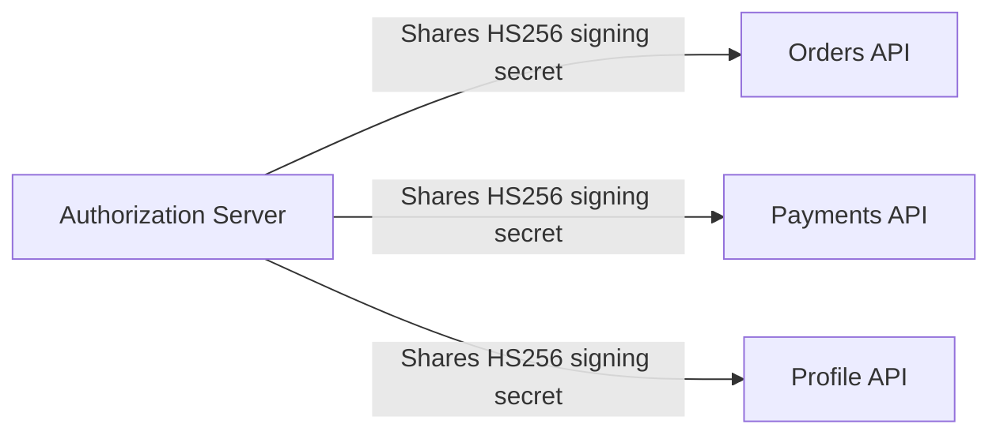

# Key length và algorithm policy

Một hệ thống OAuth 2.0/OIDC có thể kiểm đúng `iss`, `aud`, `exp`, `scope` và vẫn gặp lỗi bảo mật nghiêm trọng nếu **khóa ký quá yếu, thuật toán được chọn không nhất quán hoặc verifier chấp nhận thuật toán ngoài chính sách**. Ngược lại, dùng khóa RSA 4096 bit hay AES-256 **không tự động** làm token an toàn nếu ứng dụng bỏ qua audience, cấp scope quá rộng, làm lộ bearer token hoặc không có cách thu hồi token đã phát.

**Key length** mô tả kích thước khóa, nhưng **security strength** — mức khó khăn của cuộc tấn công tốt nhất đã biết — phụ thuộc cả họ thuật toán, mode, cách sinh khóa, entropy, tham số và cách sử dụng. **Algorithm policy** là bộ quy tắc có thể kiểm thử được xác định **thuật toán nào được phép phát hành, thuật toán nào được phép xác minh, khóa nào được tin, thông số tối thiểu là gì, cách xoay vòng hoặc loại bỏ thuật toán yếu ra sao**.

Ví dụ:

```text
Client requests API
        |
        v
Authorization Server signs JWT access token
  alg: PS256
  kid: key-2026-a
  private key: RSA 3072-bit, stored in KMS/HSM
        |
        v
Resource Server receives JWT
  - Resolve trusted issuer's JWKS (not URL from token header)
  - Allow PS256 under this access-token profile
  - Find registered public key by kid
  - Check RSA modulus length >= policy minimum
  - Verify JWS signature
  - Check typ, iss, aud, exp, scope, tenant and other policy
        |
        +-- any mandatory check fails -> DENY
        |
        v
  API authorization decision
```

Token có thể dùng **HS256** với bí mật HMAC entropy cao trong phạm vi một hệ thống khép kín, **RS256/PS256** với khóa RSA, **ES256** với khóa elliptic curve, hoặc **EdDSA/Ed25519** nếu các bên và chính sách hỗ trợ. Những lựa chọn này **không thể thay nhau chỉ bằng đổi chuỗi `alg` trong JWT header**. Bên phát hành và bên xác minh phải thống nhất thuật toán, loại khóa, key ID, issuer, token profile và thời gian chuyển đổi.

Bài thuộc chương **Cryptography** của module **SECURITY_TOKEN_SECURITY_FUNDAMENTALS**. Theo phạm vi module, ta học mô hình tin cậy và vòng đời JWT/opaque token, access/refresh token trong authentication, authorization và OAuth 2.0/OIDC; phát hành, xác minh claims, scope/audience, lưu trữ, thu hồi, phòng chống token bị đánh cắp hoặc phát lại. Bài này tập trung vào **độ dài khóa và chính sách thuật toán mật mã**, bao gồm cách kiểm chứng triển khai Java/Spring và phối hợp luân chuyển khóa mà không đánh mất các ranh giới authorization.

## 1. Mục tiêu học tập

Sau bài này, bạn có thể:

1. Phân biệt **kích thước khóa**, **entropy**, **security strength**, **độ dài chữ ký**, **độ dài hash** và **độ dài JWT**.
2. Giải thích vai trò **HMAC (HS256)**, **RSA PKCS#1 v1.5 (RS256)**, **RSA-PSS (PS256)**, **ECDSA (ES256/ES384/ES512)** và **EdDSA** trong JWS.
3. Nêu những ngưỡng/điều kiện quan trọng theo JOSE, như **HMAC HS256 tối thiểu 256-bit key** và **RSA JWS ít nhất 2048-bit modulus**, đồng thời biết tổ chức có thể yêu cầu mức mạnh hơn.
4. Thiết kế **allowlist thuật toán** theo issuer, token type, client/resource và trust boundary; không cho JWT header tự quyết định security policy.
5. Phòng tránh **`alg=none`**, **HS256↔RS256 algorithm confusion**, sai curve, key substitution và tải `jku`/`x5u` không đáng tin.
6. Hiểu **JWK/JWKS, `kid`, `kty`, `crv`, `use`, `key_ops`** và key rotation; phân biệt key selection với key trust.
7. Phân biệt **JWS ký**, **JWE mã hóa**, **AES-GCM/AEAD**, nonce/IV và các rủi ro dùng lại IV.
8. Áp dụng **tách khóa theo mục đích**, random key generation, secret manager/KMS/HSM, least privilege, rotation và incident response.
9. Viết guard và test cho **Java/Spring Security/Nimbus JOSE**, gồm sai thuật toán, khóa quá ngắn, issuer/audience sai, JWKS rotation và revoke.
10. Lập kế hoạch nâng chuẩn mật mã có kiểm soát khi provider/client cũ chỉ hỗ trợ thuật toán legacy.

## 2. Trước hết: ký, MAC, băm và mã hóa khác nhau

| Cơ chế | Mục đích | Bí mật/khóa | Người xác minh | Ví dụ |
| --- | --- | --- | --- | --- |
| **Hash** | Tạo digest, hỗ trợ integrity/cấu trúc dữ liệu | Không nhất thiết có secret | Bất kỳ ai tính lại được | SHA-256 |
| **MAC / HMAC** | Xác thực tính toàn vẹn và nguồn gốc giữa các bên biết **cùng secret** | Symmetric secret | Ai giữ secret cũng có thể tạo MAC | HS256 |
| **Digital signature** | Ký bằng private key, xác minh bằng public key | Asymmetric key pair | RS chỉ cần public key | RS256, PS256, ES256, EdDSA |
| **Encryption** | Giữ nội dung bí mật với người không có khóa giải mã | Symmetric hoặc asymmetric/hybrid | Bên có quyền decrypt | JWE, AES-GCM |
| **Authenticated encryption (AEAD)** | Vừa mã hóa, vừa kiểm tính toàn vẹn của ciphertext và associated data | Symmetric key + nonce/IV | Bên có key giải mã | A128GCM, A256GCM |

### 2.1. Hash không phải chữ ký

Ai cũng có thể tính `SHA-256(payload)`. Nếu token chỉ ghép `payload` với hash công khai mà không có khóa:

```text
payload = {"sub":"user-42","role":"reader"}
digest = SHA-256(payload)

Attacker can change:
payload = {"sub":"user-42","role":"admin"}
digest = SHA-256(new_payload)
```

Digest mới khớp payload mới nhưng **không chứng minh được payload đến từ authorization server**. JWS cần một **MAC hoặc digital signature đúng chính sách**; `alg=none` cũng không tạo integrity protection.

### 2.2. JWS được ký không có nghĩa payload được mã hóa

JWT JWS dạng compact thường có ba phần:

```text
BASE64URL(header) . BASE64URL(payload) . BASE64URL(signature)
```

Header và payload **đọc được** bởi bên có chuỗi JWT; base64url là encoding, không phải encryption. Tránh đưa password, refresh token, API secret, dữ liệu nhạy cảm không cần thiết hay PII vượt mục đích vào JWT access/ID token.

**Opaque token cũng không tự chống bị đánh cắp**: nó là bearer credential trừ khi được sender-constrain. Kỹ thuật ký/mã hóa và policy authorization giải quyết các vấn đề khác nhau.

### 2.3. Encryption không thay signature/policy

JWE có thể bảo vệ **tính bí mật** claims qua các bước key management/AEAD. Nhưng một RS vẫn cần xác định **ai tạo token, issuer nào được tin, token type, audience, thời hạn và quyền** theo profile. Việc một payload giải mã được **không tự cho quyền quản trị**.

## 3. Key length và security strength không đồng nhất

“Dùng khóa 256-bit” có thể nói đến **AES-256**, **HMAC secret 256 bit** hoặc một khóa liên quan elliptic curve, nhưng chúng có ý nghĩa bảo mật rất khác.

### 3.1. Đơn vị bit và byte

```text
1 byte = 8 bits
16 bytes = 128 bits
32 bytes = 256 bits
48 bytes = 384 bits
64 bytes = 512 bits
```

Khi chính sách nói **HS256 key ≥256 bits**, nó nói **ít nhất 32 byte khóa HMAC có entropy/phương pháp sinh phù hợp**, không phải “chuỗi gồm 32 ký tự người dùng tự đặt”. Với text ASCII, 32 ký tự vẫn có thể có entropy rất thấp, ví dụ chuỗi lặp chữ `a`.

### 3.2. Kích thước public key không bằng số bit an toàn tương đương

| Cơ chế | Tham số ví dụ | Security strength xấp xỉ / lưu ý |
| --- | --- | --- |
| AES | 128-bit key | Xấp xỉ 128-bit brute-force key strength trong mô hình phù hợp |
| AES | 256-bit key | Xấp xỉ 256-bit brute-force key strength; không đồng nghĩa mọi hệ thống đạt 256 bit |
| HMAC-SHA-256 | Secret đủ ngẫu nhiên, ≥256 bit theo JWA cho HS256 | Phụ thuộc entropy/key length và threat model; `HS256` không tự làm password yếu thành khóa mạnh |
| RSA | 2048-bit modulus | Khoảng 112-bit classical security strength theo bảng tương đương phổ biến |
| RSA | 3072-bit modulus | Khoảng 128-bit classical security strength |
| RSA | 4096-bit modulus | Mạnh hơn RSA-3072 nhưng **không bằng 4096-bit security strength** |
| NIST P-256 ECDSA | Curve khoảng 256-bit | Khoảng 128-bit classical security strength |
| NIST P-384 ECDSA | Curve khoảng 384-bit | Khoảng 192-bit classical security strength |
| NIST P-521 ECDSA | Curve khoảng 521-bit | Khoảng 256-bit classical security strength |
| Ed25519 | Key/curve theo Ed25519 | Khoảng 128-bit classical security strength |
| Ed448 | Key/curve theo Ed448 | Khoảng 224-bit classical security strength |

Các mức là **xấp xỉ truyền thống cho thiết kế và so sánh**, không phải chứng nhận an toàn tuyệt đối; việc triển khai, entropy nguồn, side-channel, key management, tính sẵn có thuật toán và mục tiêu compliance mới quyết định policy.

### 3.3. RSA 2048 bit không tương đương AES-2048

RSA dựa trên độ khó của **phân tích số nguyên lớn**, trong khi AES là block cipher đối xứng. Vì thế khóa RSA 2048 bit không có 2048-bit security strength. Tránh so trực tiếp độ dài chuỗi base64 public key, độ dài chữ ký hoặc `n` trong JWK với độ dài key AES.

### 3.4. Độ dài hash/chữ ký không bằng độ dài khóa

`HS256` dùng HMAC với SHA-256, không có nghĩa secret sinh bằng cách gọi `SHA-256("password123")` là đủ mạnh; hash password dễ đoán vẫn dễ bị tấn công từ điển ngoại tuyến. `ES256` ký bằng ECDSA P-256 và SHA-256, không phải khóa gồm “256 ký tự”. `RS256` dùng RSASSA-PKCS1-v1_5 với SHA-256, trong khi `PS256` dùng RSA-PSS với SHA-256 và tham số theo JWA; **cùng SHA-256 nhưng khác signature scheme**.

### 3.5. Quantum risk là bài toán riêng

RSA/ECDSA/EdDSA dựa trên các giả định mật mã cổ điển và chịu rủi ro từ máy tính lượng tử đủ mạnh trong tương lai. Việc chuyển sang **post-quantum cryptography** đòi lựa chọn thuật toán, chuẩn JOSE/protocol và khả năng hỗ trợ cụ thể; **không thể đạt hậu lượng tử chỉ bằng tăng RSA từ 2048 lên 4096 bit**. Chính sách dài hạn cần có **crypto agility** và kế hoạch thay thế, không tự phát thêm `alg` chưa được hệ sinh thái xác minh.

## 4. Bảng thuật toán JWS thường gặp và điều kiện khóa

Trong JOSE, `alg` xác định thuật toán ký/MAC được dùng cho JWS. **Thông tin header phải được kiểm** chứ không phải quyền ra lệnh cho verifier.

| JWS `alg` | Cơ chế | Khóa/signature profile | Điều kiện và lưu ý |
| --- | --- | --- | --- |
| **`HS256`** | HMAC SHA-256 | Secret shared | JWA yêu cầu HMAC key **≥256 bits** |
| **`HS384`** | HMAC SHA-384 | Secret shared | JWA yêu cầu key **≥384 bits** |
| **`HS512`** | HMAC SHA-512 | Secret shared | JWA yêu cầu key **≥512 bits** |
| **`RS256`** | RSA PKCS#1 v1.5 + SHA-256 | RSA private/public | JWA RSA modulus **≥2048 bits**; một số policy mới ưu tiên PS256 |
| **`RS384` / `RS512`** | RSA PKCS#1 v1.5 + SHA-384/512 | RSA pair | RSA modulus ≥2048 theo JWA, policy có thể đòi cao hơn |
| **`PS256`** | RSA-PSS + SHA-256 | RSA pair | RSA modulus **≥2048 bits** theo JWA; hash/MGF/salt profile đúng |
| **`PS384` / `PS512`** | RSA-PSS + SHA-384/512 | RSA pair | Kiểm đúng PSS parameters theo JWA; không dùng parameter tùy ý |
| **`ES256`** | ECDSA + SHA-256 | NIST **P-256** | Curve phải đúng `P-256`; không chỉ kiểm field size |
| **`ES384`** | ECDSA + SHA-384 | NIST **P-384** | Curve `P-384` đúng profile |
| **`ES512`** | ECDSA + SHA-512 | NIST **P-521** | Curve `P-521`, không phải P-512 |
| **`EdDSA`** | Edwards-curve digital signature | Ed25519/Ed448 theo JOSE implementation/profile | Bật khi provider/client/JOSE library hỗ trợ và được policy phê duyệt |
| **`none`** | Unsecured JWS | Không chữ ký | **Không chấp nhận** đối với OAuth access/ID tokens cần authentication |

**Ngưỡng 2048 bit là mức tối thiểu quy định cho RSA trong JWA, không phải lựa chọn tối ưu cho mọi vòng đời.** Ví dụ một tổ chức có thể chọn **RSA-3072** cho khóa ký mới nhằm đạt mức ~128-bit classical strength, đồng thời giữ RSA-2048 hợp lệ trong một giai đoạn migration đã xét compliance. Không hạ policy dưới mức JOSE/chuẩn áp dụng để tương thích với token cũ.

### 4.1. Không chọn bằng “thuật toán mạnh nhất trên giấy”

Lựa chọn còn phụ thuộc:

- **Issuer/RS profile:** provider thực tế ký và xác minh được thuật toán nào?
- **Cryptographic assurance:** chính sách tổ chức, FIPS validation/platform support, HSM/KMS capabilities.
- **Trust boundary:** có nhiều RS cần verify bằng public key hay cùng một dịch vụ kín?
- **Operational cost:** chữ ký RSA lớn, HSM throughput, key provisioning, key rotation, library support.
- **Security strength và thời gian bảo vệ:** token ngắn hạn khác chữ ký dùng làm chứng cứ nhiều năm.
- **Migration compatibility:** token cũ sẽ còn sống bao lâu và verifier đang cho phép gì?

Không ép `EdDSA` vào một provider không hỗ trợ, hoặc tự fallback từ `PS256` sang `HS256` khi HSM tạm lỗi. **Thuật toán phải được đăng ký/kiểm duyệt trước** và fallback chỉ có nếu chính sách xác định một migration path an toàn.

## 5. HMAC: secret đủ dài và đủ entropy

HMAC sử dụng khóa **đối xứng**. Người giữ secret có thể **ký và kiểm**. Điều này thuận tiện khi AS và RS là cùng trust boundary, nhưng mở rộng rủi ro nếu nhiều API được cung cấp **cùng một HMAC signing secret**.

### 5.1. Ví dụ HS256 hợp lệ về key length

```text
alg: HS256
key size: 32 bytes = 256 bits
key source: CSPRNG or KMS-generated random secret
key usage: JWS signature for a narrowly defined issuer/profile
storage: secret manager with least-privilege read access
```

Tại mức tối thiểu JWA cho HS256, secret phải **ít nhất 256-bit key length**. Trên thực tế phải có **entropy đủ cao**: một chuỗi 32 byte toàn zero có đúng chiều dài nhưng không đủ bí mật.

### 5.2. Không dùng password làm HMAC key trực tiếp

```text
BAD:
  secret = "12345678901234567890123456789012"
  secret = SHA256("CompanyName2026")
  secret = "change_me"
```

Password hoặc seed đoán được có thể cho attacker thử nhiều giá trị và tạo signature token giả. **Không “cải thiện” password yếu bằng cách hash một lần rồi dùng làm signing secret**. Với token signing, tạo khóa ngẫu nhiên từ **CSPRNG** hoặc hệ thống key generation đáng tin.

### 5.3. HS256 trong hệ thống nhiều resource servers



Nếu **bất kỳ RS nào** giữ cùng HMAC secret bị xâm nhập, attacker có thể **tự tạo JWS có MAC hợp lệ** theo secret đó, không chỉ verify. Khi nhiều RS chỉ cần kiểm token của AS, **asymmetric signing** thường tạo ranh giới tốt hơn:

```text
AS: keeps PRIVATE signing key
RS1/RS2/RS3: receive PUBLIC verification keys

Compromise of an RS's public verification key:
  does not by itself grant signing authority.
```

Không có nghĩa asymmetric luôn an toàn nếu private key của AS bị lộ, RS không kiểm issuer/audience, hoặc JWKS trust bị thiết kế sai.

### 5.4. HS256 key rotation

Khi đổi secret HMAC, verifiers cần biết key nào hợp lệ theo `kid`/key registry an toàn. Với secret symmetric, **mọi verifier giữ khóa cũ cũng có khả năng ký**, do đó cần kiểm soát phân phối/xóa secret cũ. Trong nhiều môi trường, migration từ HS256 sang PS256/ES256 giúp giảm rủi ro chia sẻ signing privilege.

## 6. RSA: modulus length, schemes và policy

RSA thường có trong JWT/JWS vì RS chỉ cần **public key**. JWK RSA công bố `n` (modulus), `e` (public exponent) và `kid`; private key phải được AS bảo vệ.

### 6.1. RSA 2048 vs 3072 vs 4096

| Modulus | Tính phù hợp mang tính tham khảo |
| --- | --- |
| **1024 bit** | Không phù hợp cho chữ ký token OAuth hiện đại, dưới yêu cầu RSA JWA và security strength quá thấp |
| **2048 bit** | Mức tối thiểu của RSA JWS theo JWA; ~112-bit classical security strength |
| **3072 bit** | Lựa chọn thường được cân nhắc khi policy muốn ~128-bit classical strength |
| **4096 bit** | Có thể dùng theo policy, nhưng chữ ký/key operations nặng hơn; không có nghĩa 4096-bit security |

Không chỉ kiểm độ dài **PEM string** hoặc modulus byte array thô có thể thêm leading zero. Parse một RSA key hợp lệ rồi kiểm **`RSAPublicKey.getModulus().bitLength()`**.

### 6.2. `RS256` và `PS256` không giống nhau

`RS256` = **RSASSA-PKCS1-v1_5 using SHA-256**.

`PS256` = **RSASSA-PSS using SHA-256** với các tham số MGF1/salt theo JWA.

Đổi từ RS256 sang PS256 đòi **AS thực sự ký bằng PSS** và **RS verify PSS**; chỉ sửa `alg` header rồi dùng lại chữ ký RSA-PKCS1-v1_5 sẽ không hợp lệ. Một số thư viện/thiết bị cũ không hỗ trợ PS256 nên cần kiểm compatibility/migration.

### 6.3. Key quality quan trọng hơn một con số

RSA private key cần được sinh bởi CSPRNG/cryptographic provider tin cậy với tham số an toàn, không tự viết prime generation. Cần kiểm:

- Modulus và public exponent phù hợp profile/provider.
- Private key được giữ bí mật, phân quyền `sign` không phải `export` nếu KMS/HSM hỗ trợ.
- Thuật toán ký và PSS parameters không bị caller tự chọn ngoài allowlist.
- Key usage/algorithm policy không cho dùng sai mục đích (ví dụ dùng một RSA key cho đủ ký, giải mã và client authentication mà không review).
- Không lưu PEM private key trong source/git, container image, exception logs hoặc support ticket.

### 6.4. RSA public key không trao quyền phát token

JWKS thường công bố `n`/`e` và `kid` cho verifiers. Public key có thể được chia sẻ rộng theo policy; **nó cho phép kiểm chữ ký, không tạo chữ ký**. Nếu RS dùng public key của attacker do chọn nguồn JWKS từ token header, ranh giới này bị phá: attacker có thể tự ký bằng private key của họ rồi dụ RS verify bằng public key của chính họ.

## 7. Elliptic-curve và EdDSA: policy phải ràng buộc curve

ECDSA và EdDSA có kích thước khóa/chữ ký thường gọn hơn RSA. Nhưng **kiểm thuật toán tên chung chưa đủ**: verifier phải kiểm curve/key type chính xác theo profile.

### 7.1. ECDSA `ES256` cần `P-256`

```text
JWS header:
  alg = ES256
  kid = ecc-key-2026-a

Trusted JWK:
  kty = EC
  crv = P-256
  x, y = public point coordinates
  use = sig (if supplied and enforced under policy)
```

`ES384` dùng `P-384`, `ES512` dùng `P-521`. Không nhận `crv=P-256K`/`secp256k1` thay `P-256` chỉ vì cả hai tên chứa “256”; nếu có support thuật toán khác, phải định nghĩa JOSE registration/profile riêng.

### 7.2. Curve OID và key parameter validation

Một điểm trên elliptic curve chỉ có thể được tin khi provider/decoder kiểm đúng **curve/domain parameters**, point encoding và group membership theo chuẩn triển khai. Chỉ kiểm `fieldSize >=256` là **không đủ**, vì có nhiều curve khác nhau cùng kích thước field. Dùng thư viện JOSE/JCA tin cậy với **named-curve policy**, không tự parse x/y rồi đo độ dài chuỗi.

### 7.3. ECDSA nonce không được tái sử dụng

Với ECDSA, **nonce `k`** dùng trong thuật toán ký phải được tạo/điều khiển đúng; tái sử dụng hoặc rò `k` có thể làm lộ private key. Nhà phát triển ứng dụng **không được tự triển khai ECDSA nonce generation** hoặc thao tác ký tay nếu đã có provider tin cậy. Một số provider dùng deterministic ECDSA theo profile; điều đó vẫn phải được thực hiện bởi thư viện đáng tin.

### 7.4. Ed25519 và Ed448

EdDSA sử dụng họ Edwards curves, với Ed25519 thường đạt khoảng **128-bit classical security** và Ed448 khoảng **224-bit** trong mô hình thông dụng. Với JOSE:

- Chỉ bật thuật toán và curve **được hai bên và thư viện thực sự hỗ trợ**.
- Nếu profile dùng `EdDSA` với `OKP` key, kiểm `crv` thích hợp (ví dụ Ed25519).
- Không coi khóa X25519/X448 dùng **key agreement** là signing key Ed25519/Ed448.
- Kiểm chính sách HSM/KMS/FIPS/provider, vì không phải platform nào cũng hỗ trợ cùng bộ key algorithms.

### 7.5. “Curve mạnh hơn” không sửa token authorization

Một ID token EdDSA/ES384 ký đúng vẫn phải bị RP từ chối nếu `aud` là client khác, `iss` lạ, `nonce` sai hoặc `exp` đã qua. Tương tự, access token ES256 không tự cho scope `payments:write`.

## 8. Tạo allowlist thuật toán: security policy không đến từ JWT header

**JWT header là input do sender/attacker có thể kiểm soát trước khi chữ ký được xác minh.** Nó có thể cung cấp **`alg` và `kid` để chọn đường xác minh**, nhưng không được **mở rộng tập thuật toán hoặc nguồn khóa đáng tin**.

### 8.1. Anti-pattern: verifier nghe theo `alg` bất kỳ

```text
BAD verification logic:
  header = decodeJWTHeaderWithoutVerification(token)
  algorithm = header.alg
  key = loadKeyChosenByHeader(header)
  return verify(token, algorithm, key)
```

Trong thiết kế này, attacker có thể thử:

- `alg=none` khiến token không được ký vẫn được coi hợp lệ.
- `alg=HS256` trong khi verifier kỳ vọng RSA, gây **algorithm/key confusion**.
- `kid` trỏ sang khóa khác issuer/client hoặc kích hoạt injection/path lookup.
- `jku`/`x5u` trỏ public key do attacker quản lý.

### 8.2. Logic allowlist đúng về nguyên tắc

```text
trustedProfile = lookupProfileFromTrustedRoutingAndRegistration()

require header.alg in trustedProfile.allowedAlgorithms
require header.alg == trustedKeyMetadata.approvedAlgorithm
require key.type/curve/length/usage match header.alg and profile
require issuer's trusted key registry / JWKS is used
require signature/MAC verification succeeds
require expected issuer, token type, audience, expiry and claims valid
require resource-level authorization policy allows request
```

Đây là logic khái niệm. **Không dùng `iss`/`aud` chưa verify trong payload để tự tải metadata từ Internet**. Khi hệ thống multi-issuer, lựa chọn trust profile cần từ **trusted routing/allowlist/registration** rồi xác minh claim khớp profile đó.

### 8.3. Policy theo token use, không chỉ một danh sách toàn hệ thống

Ví dụ cấu hình minh họa:

```yaml
crypto_policy:
  access_token_jws:
    trusted_issuer: https://id.example.test
    expected_typ: at+jwt
    accepted_algorithms: [PS256]
    min_rsa_modulus_bits: 3072
    trusted_jwks_uri: https://id.example.test/oauth2/jwks

  oidc_id_token_jws:
    trusted_issuer: https://id.example.test
    client_id: storefront-web
    accepted_algorithms: [RS256]
    min_rsa_modulus_bits: 2048
    require_nonce_when_sent: true

  client_assertion:
    accepted_algorithms: [PS256]
    registered_client_keys_only: true
    max_assertion_lifetime_seconds: 300

  dpop_proof:
    accepted_algorithms: [ES256]
    prohibit_symmetric_algorithms: true
    require_request_binding: true
```

**Đây là schema chính sách tự thiết kế để giảng giải**, không phải cấu hình Spring/JOSE có thể nạp nguyên trạng. Các con số và lựa chọn thuật toán **có chủ ý minh họa policy khác nhau**. Tổ chức phải xác định theo chuẩn, compliance, khả năng provider và security objective; không mặc định “ID token luôn được phép RS256” hoặc “access token luôn phải PS256”.

### 8.4. Signing policy và verification policy có thể khác trong migration

Ví dụ chuyển từ `RS256` sang `PS256`:

```text
Phase 1:
  Issuer signs: RS256
  RS accepts:  RS256

Phase 2 (controlled migration):
  Issuer signs: PS256
  RS accepts:  PS256 + RS256 with trusted old keys only

Phase 3 (after old token/key lifetime window):
  Issuer signs: PS256
  RS accepts:  PS256 only
```

**Khi nhận cả hai thuật toán tạm thời, phải ràng buộc key/issuer/token-type cụ thể**. Không mở một generic verifier “HS*, RS*, PS*, ES* đều được” chỉ để không lỗi. Sau migration, **loại bỏ old alg khỏi allowlist** và kiểm không có client bị bỏ sót.

### 8.5. Nếu provider chỉ có thuật toán ngoài policy?

Không âm thầm hạ yêu cầu. Cần đánh giá:

1. Provider/SDK có nâng cấp để hỗ trợ thuật toán được phê duyệt không?
2. Có cần thay provider hoặc tạo compatibility boundary an toàn không?
3. Có cơ chế key length/expiry/compensating control đủ theo security review không?
4. Nếu policy bắt buộc theo compliance, phải **từ chối token không phù hợp** thay vì chấp nhận trái chuẩn.

## 9. `alg=none` và algorithm confusion

### 9.1. Unsecured JWT không phải authentication proof

JWS có khái niệm unsecured JWT dùng `alg=none` trong những tình huống được kiểm soát. Nhưng **OAuth access token/ID token dùng để xác minh danh tính/quyền không được mặc định chấp nhận token không chữ ký**. Một RP/RS cho phép `alg=none` rồi chỉ parse claims là **lỗ hổng giả mạo token**.

### 9.2. HS256↔RS256 confusion

Mô hình lỗi lịch sử:

```text
Expected:
  RS256 signature verified with trusted RSA public key

Attacker tries:
  JWS header alg=HS256
  uses RSA public key bytes as HMAC shared secret
  signs forged payload with publicly known key bytes

Vulnerable generic verifier:
  wrongly treats RSA public key as an HMAC secret
  -> forged MAC may be accepted
```

**Phòng ngừa:** khóa phải có **type/purpose** cụ thể, thuật toán allowlist được pin, không truyền RSA public key dưới dạng “secret string” cho generic HMAC verifier. Dùng thư viện có key-type validation và automated negative tests.

### 9.3. Cross-JWT confusion

Ngay cả hai JWT có chữ ký hợp lệ từ **cùng issuer** vẫn có thể dành cho **hai mục đích khác nhau**:

- ID token dành cho OIDC RP.
- JWT access token dành cho RS (ví dụ `typ=at+jwt` theo RFC 9068).
- Client assertion dành cho token endpoint.
- DPoP proof dành cho một HTTP request.

Nếu verifier chỉ kiểm signature và `iss`, attacker có thể thử dùng **token loại này tại endpoint dành cho loại khác**. Cần **token type/audience/required claims/typ profile**, key separation và mutual exclusion rules theo RFC 8725.

### 9.4. Key strength không bù được algorithm confusion

Một public RSA key dài 4096 bit vẫn **công khai**. Nếu verifier dùng bytes của nó như secret HS256, attacker cũng biết “secret” đó. Tăng key length không sửa logic dùng sai loại khóa.

## 10. JWK và JWKS: chọn khóa đúng chưa đủ, phải tin đúng issuer

**JSON Web Key (JWK)** biểu diễn khóa mật mã bằng JSON; **JSON Web Key Set (JWKS)** chứa danh sách JWK. Với ký bất đối xứng, issuer thường công bố **public keys** qua `jwks_uri` để RS/RP xác minh chữ ký token. JWKS không phải là nơi công bố private signing key.

### 10.1. Một JWK RSA public key

```json
{
  "kty": "RSA",
  "kid": "issuer-key-2026-a",
  "use": "sig",
  "alg": "PS256",
  "n": "BASE64URL_PUBLIC_RSA_MODULUS_PLACEHOLDER",
  "e": "AQAB"
}
```

`n` ở đây là placeholder **không giải mã thành modulus hợp lệ**. Một JWK thật phải được parse bằng thư viện mật mã và kiểm modulus bits/provider parameters. Không đưa các tham số private như `d`, `p`, `q`, `dp`, `dq`, `qi` vào public JWKS.

| Thuộc tính | Ý nghĩa | Kiểm soát |
| --- | --- | --- |
| **`kty`** | RSA, EC, OKP, oct… | Phải phù hợp thuật toán/purpose |
| **`kid`** | Key ID để chọn khóa trong tập đáng tin | **Selector**, không tự tạo trust; chống trùng/mismatch |
| **`use`** | Mục đích `sig` hoặc `enc` nếu có | Không dùng encryption key làm signing key |
| **`key_ops`** | Hoạt động verify/sign/encrypt/decrypt… nếu có | Tuân theo key usage policy |
| **`alg`** | Thuật toán được chỉ ra cho key nếu có | Không thay verifier algorithm allowlist |
| **`n`/`e`** | Public RSA modulus và exponent | Parse/check độ dài RSA và tham số hợp lệ |
| **`crv`/`x`/`y`** | Curve và public coordinates EC | Kiểm named curve đúng thuật toán |
| **`x`** trong OKP | Public key bytes | Kiểm `kty=OKP`, curve và algorithm |

**Không phải mọi JWK đều bắt buộc có `alg` hoặc `use` theo schema.** Chính sách RS phải biết key được quản trị cho mục đích nào; nếu thiếu metadata cần thiết, có thể dùng **trusted key registry** nội bộ, không tự suy “key nào cũng được dùng cho mọi thuật toán”.

### 10.2. `kid` không phải bằng chứng tin cậy

Header:

```json
{
  "alg": "PS256",
  "typ": "at+jwt",
  "kid": "issuer-key-2026-a"
}
```

RS phải tìm `kid` trong **JWKS thuộc issuer đã tin** và key type đúng. Attacker có thể tự viết `kid=issuer-key-2026-a`, nhưng điều đó không cho phép họ tạo chữ ký hợp lệ bằng private key của issuer.

**Không được**:

- Dùng `kid` như tên file/path tự ghép chuỗi mà không validate.
- Dùng `kid` làm SQL/LDAP query không parameterized.
- Chọn khóa cùng `kid` từ issuer khác.
- Chấp nhận hai khóa cùng `kid` trong một trust set mà không có quy tắc giải quyết duy nhất.
- Coi `kid` có chữ “trusted” là đủ để bỏ signature verification.

### 10.3. `jku`, `x5u` và embedded JWK nguy hiểm khi chưa pin

JOSE header có những cơ chế tham chiếu URL/tài liệu khóa. Nếu RS tự fetch URI do token tự khai:

```text
Untrusted JWT:
  jku = https://attacker.example.test/my-jwks

Attacker signs JWT with their own private key
RS downloads corresponding public key from jku
RS verifies signature successfully
=> Key substitution if no trusted issuer/key policy
```

Vì vậy RS phải dựa vào **JWKS URI cấu hình tin cậy từ issuer registration/discovery được xác minh**, không tải `jku`/`x5u` tùy ý. Nếu một profile thực sự dùng header-provided key reference, cần **pin/allowlist, TLS, SSRF defenses, issuer binding và security review** cụ thể.

### 10.4. Issuer, client và trust set phải cô lập

```text
Issuer-A:
  iss = https://id-a.example.test
  trusted_jwks = issuer-A keys
  allowed_alg = PS256

Issuer-B:
  iss = https://id-b.example.test
  trusted_jwks = issuer-B keys
  allowed_alg = ES256

Token says iss=A but is signed by a key belonging to B:
  => REJECT
```

Không sử dụng một JWKS cache global chỉ lookup bằng `kid` mà không kèm **trusted issuer/registration context**. `kid` có thể trùng giữa các tổ chức; key selection phải có namespace.

### 10.5. JWK thumbprint

**RFC 7638** định nghĩa cách tính thumbprint từ các members chuẩn hóa của JWK. Nó hữu ích cho **khóa định danh công khai/key binding**, ví dụ `cnf.jkt` trong DPoP. Tuy nhiên thumbprint **không tự chứng minh public key thuộc một issuer đáng tin**, và không thay chứng chỉ, issuer registration hay authorization policy.

## 11. JWKS rotation và trạng thái khóa

Khóa ký JWT không nên sống vĩnh viễn. Một rotation an toàn thường có **chuẩn bị khóa mới → công bố public key → chuyển ký → duy trì xác minh token cũ → loại bỏ khóa cũ**. Cần xét cache và TTL chứ không chỉ cập nhật `kid`.

### 11.1. Rotation không sự cố (planned rotation)

```mermaid
sequenceDiagram
    participant Ops as Key Management
    participant AS as Authorization Server
    participant JWKS as Trusted JWKS Endpoint
    participant RS as Resource Server
    Ops->>AS: Provision signing key K2 (approved alg/size)
    AS->>JWKS: Publish K1 public + K2 public
    RS->>JWKS: Refresh trusted key set
    JWKS-->>RS: Public keys K1 and K2
    AS->>AS: Switch new signing to K2/kid2
    AS-->>RS: New JWT signed by K2
    RS->>RS: Verify K2; continue verify eligible K1 tokens
    Ops->>AS: Wait old token TTL + cache/skew bounds
    AS->>JWKS: Retire K1 public per approved policy
    RS->>JWKS: Refresh keys; K1 no longer trusted
```

**Đừng ký K2 trước khi RS có thể lấy public key K2**, nếu không cả hệ thống có thể trả 401 do không tìm được `kid`. Cũng đừng xóa K1 ngay khi chuyển ký nếu JWT K1 còn hợp lệ theo policy và không có tình huống compromise.

### 11.2. Trạng thái vòng đời khóa

| Trạng thái | Khóa private ở AS/KMS | Public key ở verifier | Mục đích |
| --- | --- | --- | --- |
| `PREPARED` | Sinh/kiểm thử, chưa ký production | Có thể công bố trước | Warm-up/trust distribution |
| `ACTIVE_SIGNING` | Được phép ký token mới | Được verify | Vận hành bình thường |
| `VERIFY_ONLY` | Không dùng ký token mới | Tạm được verify token cũ | Migration/TTL window |
| `RETIRED` | Không được dùng ký | Không còn được tin | Sau hết window |
| `COMPROMISED` | Ngừng sử dụng/thu hồi ngay theo incident plan | Cần khóa đường tin cậy khẩn cấp | Lộ private key/crypto break |

**Khóa public không phải secret**, nhưng public key được công bố sai issuer hoặc bị tráo vẫn là vấn đề trust nghiêm trọng.

### 11.3. Planned retirement khác emergency compromise

Nếu private key K1 bị lộ, attacker có thể tự ký token giả cho tới khi RS ngừng tin K1. **Không chờ tất cả JWT K1 hết hạn theo lịch rotation bình thường** nếu rủi ro yêu cầu chặn khẩn cấp. Có thể cần:

1. Disable signing với K1 và chặn issuance mới.
2. Ngừng tin/loại K1 khỏi trust set và **invalidate JWKS caches/verifiers**.
3. Phát K2 qua kênh tin cậy; kiểm key authorization.
4. Vô hiệu/đánh giá tokens cũ, session/grants/refresh liên quan theo incident scope.
5. Theo dõi RS nào còn accept chữ ký K1 và khắc phục propagation.

**Chỉ đổi `kid` hoặc phát K2 không vô hiệu mọi JWT giả mạo đã được ký bằng K1** nếu RS còn cache public K1 và policy vẫn cho phép thuật toán đó.

### 11.4. Key rotation không tương đương token revocation

| Sự kiện | Phạm vi |
| --- | --- |
| Token `jti` bị revoke | Một token hoặc family/grant theo AS policy |
| Refresh family bị revoke | Khả năng làm mới và tokens liên quan theo grant |
| Signing key bị ngừng tin | Có thể ảnh hưởng **mọi token** đã ký bằng khóa ấy |
| Algorithm bị loại khỏi allowlist | Mọi token dùng thuật toán đó bị RS từ chối |
| OP logout | Phiên đăng nhập, không tự đồng nghĩa toàn bộ access JWT hết hiệu lực |

Không dùng key rotation hàng loạt để thay cơ chế revoke token cá nhân hằng ngày. Nó có **blast radius lớn**, chi phí khả dụng và nhu cầu phối hợp giữa issuer, JWKS, RS, RP.

### 11.5. Cache JWKS cần kiểm

- Trust anchor: issuer/JWKS URI luôn từ cấu hình tin cậy.
- TLS trust validation và rate limiting.
- Cache TTL phù hợp thời gian pre-publish key và emergency invalidation.
- Xử lý `kid` mới có retry refresh **có giới hạn**, tránh attacker tạo `kid` ngẫu nhiên để gây DoS.
- Không dùng stale key bị đánh dấu compromised dù metadata chưa được đồng bộ.
- Không bỏ signature checking khi JWKS endpoint outage.

## 12. KMS/HSM và quản lý khóa trong vận hành

Việc dùng thuật toán đúng mà lưu private signing key trên disk không bảo vệ/commit vào git vẫn có thể làm mất toàn bộ hệ thống định danh. **Key management là một phần của algorithm policy**.

### 12.1. Các lớp kiểm soát

| Lớp | Ví dụ yêu cầu |
| --- | --- |
| **Sinh khóa** | CSPRNG, provider được kiểm duyệt, modulus/curve/key strength đạt policy |
| **Lưu trữ** | KMS/HSM hoặc secret manager với encryption/access controls phù hợp |
| **Key residency** | Private key không export nếu hệ thống yêu cầu HSM-backed signing |
| **Phân quyền** | AS service có quyền `sign`, RS chỉ `verify` với public key |
| **Tách môi trường** | Dev/test/prod không chia sẻ signing key |
| **Tách mục đích** | Token-signing key khác JWE decryption/client assertion/DPoP |
| **Audit** | Signing operations, key rotation, admin changes, unusual access |
| **Rotation** | Lịch, overlapping verify window, emergency revoke procedure |
| **Backup/recovery** | Theo recovery plan và risk, không lộ key material trong backup |
| **Incident** | Disable key/trust, stop issuance, notify verifiers, test time-to-deny |

### 12.2. KMS/HSM không tự kiểm audience

Một HSM có thể ký chính xác payload được đưa vào — kể cả payload **`aud=wrong-api`** hoặc scope quá rộng nếu AS logic sai. HSM bảo vệ signing key/operations, nhưng **authorization policy, token profile và claim validation** vẫn nằm ở AS/RS.

### 12.3. Không cho mọi service quyền ký

Với khóa ký JWT:

```text
Authorization Server:
  permission: KMS.Sign(key-token-issuer)

Orders Resource Server:
  permission: Read trusted public JWKS / Verify
  no permission: KMS.Sign(key-token-issuer)

Payments Resource Server:
  permission: Read trusted public JWKS / Verify
  no permission: KMS.Sign(key-token-issuer)
```

Điều này giúp giảm **signing authority blast radius**. Nếu RS bị xâm nhập, attacker không tự ký access token chỉ vì RS cần xác minh JWT.

### 12.4. HSM performance và thuật toán

HSM/KMS có thể hỗ trợ tập thuật toán khác nhau hoặc quota/latency khác nhau. Khi quyết định RSA-3072, PS256, ES256, EdDSA:

- Kiểm provider hỗ trợ **exact JOSE algorithm và parameters**.
- Đo throughput/latency token issuance với tải thực.
- Kiểm rằng API signing không tự fallback sang software/private key copy khi HSM timeout nếu policy không cho.
- Thiết kế key rotation/failover không đưa private key vào debug logs hoặc insecure export.
- Với verifier, có thể dùng public JWKS cache nhưng phải đáp ứng security objective khi key bị compromise.

## 13. JWE: phân biệt `alg` (key management) và `enc` (content encryption)

JWE khác JWS. Một **JWE Compact Serialization** thường có **năm phần**, còn JWS compact thường có ba phần. Trong JWE:

- `alg` mô tả **key management algorithm**: làm thế nào content encryption key (CEK) được mã hóa/thiết lập.
- `enc` mô tả **content encryption algorithm**: dùng CEK để bảo vệ nội dung, thường là authenticated encryption.

Ví dụ protected header minh họa:

```json
{
  "alg": "RSA-OAEP-256",
  "enc": "A256GCM",
  "typ": "JWT",
  "kid": "rp-encryption-key-2026"
}
```

**`alg=RSA-OAEP-256` không nói JWS ký RSA-PSS**; đây là thuật toán quản lý khóa của JWE. `enc=A256GCM` cần CEK phù hợp AES-256-GCM và sử dụng nonce/IV/tag đúng chuẩn.

### 13.1. Key lengths cho AES-GCM

| JWE `enc` | Content-encryption key | Ghi chú |
| --- | --- | --- |
| **`A128GCM`** | 128 bit = 16 byte | AES-GCM AEAD |
| **`A192GCM`** | 192 bit = 24 byte | AES-GCM AEAD |
| **`A256GCM`** | 256 bit = 32 byte | AES-GCM AEAD |

**Độ dài CEK khác RSA modulus/key management key**. Một JWE dùng RSA-OAEP-256 có thể dùng RSA key đủ lớn để bảo vệ CEK, nhưng `enc=A256GCM` vẫn yêu cầu CEK 256 bit; không suy `RSA key 2048` “biến thành 2048-bit AES”.

### 13.2. Nonce/IV uniqueness với GCM là điều kiện bắt buộc

AES-GCM yêu cầu **không tái sử dụng cùng nonce/IV với cùng encryption key**. Tái sử dụng có thể phá tính bí mật và toàn vẹn một cách nghiêm trọng. Trong JWE AES-GCM, IV 96 bit và authentication tag 128 bit thường là cấu trúc được profile chuẩn hóa; **dùng implementation JWE được kiểm thử**, không tự cắt IV/tag theo ý thích.

```text
BAD:
  key = fixed A256GCM content-encryption key
  iv  = all-zero 96-bit value reused for every message

GOOD PRINCIPLE:
  key/CEK and IV generated/managed per JWE algorithm requirements
  no key+IV reuse
  authentication tag verified before trusting plaintext
```

### 13.3. JWE mã hóa bằng public key không tự chứng minh issuer

Nếu người nhận công bố một **public encryption key**, nhiều người có thể gửi ciphertext được mã hóa cho người nhận. Việc người nhận **giải mã được** chỉ chứng minh ciphertext dùng đúng khóa/format, không nhất thiết chứng minh **AS đáng tin đã ký claims**.

Khi profile đòi cả confidentiality và issuer authentication, một phương án phổ biến là **JWS ký trước, sau đó JWE mã hóa ngoài**, với các quy tắc nested JWT/token typing đúng. Sau decrypt phải xác minh **inner JWS** và claims, không tin riêng plaintext.

### 13.4. Một số thuật toán mã hóa không phù hợp để bật rộng

- Không bật `RSA1_5` JWE key management chỉ vì library có hỗ trợ legacy; nó có lịch sử rủi ro padding-oracle và bị hướng dẫn hạn chế/khuyến nghị tránh trong các profile hiện đại.
- Với CBC-HMAC content encryption, bảo mật phụ thuộc **kết hợp encryption+MAC đúng chuẩn**; không tự bỏ bước tag check.
- Không dùng raw AES-CBC/CTR/ECB không có authentication tag để thay JWE AEAD.
- Không cho attacker tự chọn `alg`/`enc` bất kỳ mà không có allowlist và key-type checks.

### 13.5. JWE không sửa token theft/replay một cách tự động

Nếu client hợp lệ nhận và giải mã một JWT rồi bearer token bị sao chép, attacker vẫn có thể thử sử dụng bearer token trong phạm vi còn hạn. JWE bảo vệ **nội dung trên đường/ở nơi không có khóa**, không tự cung cấp sender-constraining, `jti` replay detection hay grant revocation.

## 14. Tách khóa theo mục đích và token profile

Một tổ chức có thể dùng nhiều loại JWT/JOSE:

| Use case | Chức năng | Key/trust boundary phù hợp |
| --- | --- | --- |
| OAuth JWT access token | AS ký; RS xác minh | AS private signing key, RS public JWKS |
| OIDC ID token | OP ký; RP xác minh | OP signing key; RP tin issuer/client profile |
| OAuth `private_key_jwt` assertion | Client ký; AS xác minh client | Client private key và **registered client JWKS** |
| DPoP proof | Client ký từng HTTP request; RS/AS xác minh | Ephemeral/registered public key binding, không dùng AS signing key |
| JWE encrypted ID token | OP mã hóa cho RP theo profile | RP private decryption key; OP public encryption key |
| mTLS client authentication | Chứng minh TLS client certificate | PKI/mTLS trust store và identity binding |
| HMAC webhook | Shared-secret authentication giữa các bên | Secret riêng, không dùng chung token JWT signing key |

**Không dùng một RSA private key cho đủ OAuth access token, client assertion và JWE decrypt** chỉ để giảm số lượng keys. Sự tái sử dụng làm tăng blast radius và có thể tạo cross-protocol confusion; nếu bắt buộc bởi thiết bị/protocol, cần security review rõ.

### 14.1. `private_key_jwt`: khóa của OAuth client

Trong client authentication:

```text
Client signs a short-lived JWT assertion
  iss = registered client_id
  sub = registered client_id
  aud = AS token endpoint (per profile)
  exp = near future
  jti = unique for replay defenses

AS verifies:
  caller's registered public key
  allowed algorithm/curve/key length
  iss/sub/aud/exp/jti and client policy
```

**Không sử dụng AS token-signing JWKS để mặc nhiên xác minh client assertion**. Client có **key registration/trust boundary riêng**. Header `alg` vẫn là input không đáng tin; AS phải pin thuật toán allowed cho client và kiểm claims/ràng buộc với token endpoint.

### 14.2. DPoP proof có algorithm policy riêng

DPoP (RFC 9449) sử dụng proof JWT ký bằng asymmetric key. AS/RS phải kiểm:

- Chỉ cho phép **asymmetric algorithm được profile hỗ trợ**, không dùng HS256 shared secret làm DPoP proof.
- `jwk` trong header có public key phù hợp, **không chứa private key**.
- `htu`, `htm`, `iat`, `jti`, nonce khi áp dụng và `ath` khi dùng access token.
- `cnf.jkt`/thumbprint binding của sender-constrained access token với key trong proof.
- Replay cache, canonicalization/URL matching theo RFC/profile.

**Một DPoP proof ký đúng nhưng gửi cho URL/method khác hoặc `ath` khác vẫn phải bị từ chối**. RSA/EC key length không thay các request-binding checks.

### 14.3. mTLS không phải `alg` của JWT

mTLS có thể xác thực workload/client và ràng buộc access token với certificate. Nhưng `Authorization: Bearer ...` hoặc OAuth JWT vẫn cần token validation/authorization riêng; RS phải kiểm certificate binding từ kết nối tin cậy, **không chỉ đọc một header do client tự khai**.

## 15. Algorithm policy cho OAuth access token và OIDC ID token

### 15.1. Access token của RS

Một RS chỉ nên chấp nhận token được AS cấp **cho chính RS**, theo token profile và algorithm policy:

```text
Trusted issuer: https://id.example.test
Accepted token use: OAuth access token
Accepted JWS algorithm: PS256
Min RSA modulus: 3072 bits
Expected audience: orders-api
Expected typ: at+jwt (or other exact profile-defined accepted form)
Required checks: signature, iss, aud, exp/nbf, scope, subject/client policy
```

Theo RFC 9068, JWT access token profile dùng explicit typing như `at+jwt` hoặc `application/at+jwt` trong trường hợp phù hợp. **Không chỉ kiểm `typ` mà bỏ signature/audience**, cũng không mặc định mọi access token của mọi AS phải là JWT: opaque access tokens có thể được xác minh bằng introspection.

### 15.2. ID token của OIDC RP

Một RP xác minh ID token theo OIDC:

- Chữ ký/JOSE algorithm phù hợp **client registration** và issuer metadata.
- `iss` đúng OP đã cấu hình, `aud` có RP `client_id`; `azp` khi áp dụng.
- `exp`, `iat`, `auth_time`/`max_age` nếu yêu cầu.
- `nonce` khớp authentication transaction nếu đã gửi/được profile yêu cầu.
- `sub` là identifier của end user trong namespace issuer.

**Không chuyển ID token thành access token** vì cả hai đều ký `RS256` hoặc `PS256`. Khóa và thuật toán có thể giống nhau về cơ chế, nhưng **purpose/audience/claims** khác nhau.

### 15.3. HMAC key cho opaque token lookup

Một opaque access/refresh token có thể chỉ là **chuỗi ngẫu nhiên entropy cao** dùng làm reference tại AS. Khi lưu token digest, AS có thể dùng **HMAC với key riêng** thay vì raw token để giảm rủi ro database leak. Đây là **key management purpose khác** với JWT HS256 signing:

```text
token_lookup_key:
  purpose = HMAC token digest / database lookup

jwt_signing_key:
  purpose = JWS signer (HMAC or asymmetric)

These must not automatically be the same secret.
```

Nếu token được AS phát hành là opaque bearer token, **độ ngẫu nhiên của token bản thân** cũng quan trọng. Hash/HMAC ở DB không cứu được token value dễ đoán hoặc được log ra ngoài.

### 15.4. Crypto policy không thay revoke

Một JWT PS256 ký bằng RSA-3072 có thể **vẫn còn signature valid sau khi grant bị revoke**. Nếu RS chỉ kiểm offline `sig`/`exp`, nó không biết trạng thái revoke mới. Khi security objective đòi chặn sớm, cần introspection, denylist, grant version hoặc cơ chế tương đương. Key rotation chỉ là một phần của vòng đời khóa, không tự là per-token revocation.

## 16. Java JCA: sinh và kiểm khóa an toàn ở mức cơ bản

**Không tự viết bộ sinh số nguyên tố, ECDSA, RSA-PSS hoặc thuật toán ký JWT.** Dùng Java Cryptography Architecture/provider được kiểm thử và thư viện JOSE chuyên dụng.

### 16.1. Sinh RSA 3072-bit và đo modulus

```java
import java.security.KeyPair;
import java.security.KeyPairGenerator;
import java.security.SecureRandom;
import java.security.interfaces.RSAPublicKey;

public final class RsaKeyPolicyExample {
    public static void main(String[] args) throws Exception {
        KeyPairGenerator generator = KeyPairGenerator.getInstance("RSA");
        generator.initialize(3072, new SecureRandom());

        KeyPair pair = generator.generateKeyPair();
        RSAPublicKey publicKey = (RSAPublicKey) pair.getPublic();

        int bits = publicKey.getModulus().bitLength();
        if (bits < 3072) {
            throw new SecurityException("RSA modulus below signing policy");
        }

        System.out.println("RSA modulus bits: " + bits);
        // Không in pair.getPrivate() hay PEM private key ra log.
    }
}
```

Đây là **minh họa học thuật**, không phải quy trình sinh khóa production. Khi production yêu cầu KMS/HSM, khóa nên được tạo/lưu **trong provider phù hợp** với chính sách non-exportability; không sinh khóa trong JVM rồi copy sang nhiều server nếu kiến trúc không cho.

### 16.2. Sinh khóa EC P-256 cho ES256

```java
import java.security.KeyPair;
import java.security.KeyPairGenerator;
import java.security.spec.ECGenParameterSpec;

public final class Es256KeyPolicyExample {
    public static KeyPair newKeyPair() throws Exception {
        KeyPairGenerator generator = KeyPairGenerator.getInstance("EC");
        generator.initialize(new ECGenParameterSpec("secp256r1"));
        return generator.generateKeyPair();
    }
}
```

`secp256r1` tương ứng NIST `P-256` trên các provider hỗ trợ. **Khi xác minh khóa đến từ JWK/nguồn ngoài**, phải kiểm **đúng named curve** qua JOSE/parser/provider, không chỉ lấy `ECField.getFieldSize()==256`.

### 16.3. Sinh HS256 secret từ CSPRNG

```java
import java.security.SecureRandom;
import java.util.Arrays;
import javax.crypto.SecretKey;
import javax.crypto.spec.SecretKeySpec;

public final class Hs256KeyPolicyExample {
    public static SecretKey newHs256Key() {
        byte[] randomBytes = new byte[32]; // 32 * 8 = 256 bits
        new SecureRandom().nextBytes(randomBytes);

        try {
            return new SecretKeySpec(randomBytes, "HmacSHA256");
        } finally {
            Arrays.fill(randomBytes, (byte) 0);
        }
    }
}
```

**Lưu ý:** `SecretKeySpec` giữ một bản sao key material; xóa temporary array không xóa key object. Đó là rủi ro vòng đời bộ nhớ Java, nên khi cần non-exportable key/rotation/audit hãy dùng **managed key/HSM provider** hoặc secret manager phù hợp. Không serialise/print `SecretKey`.

### 16.4. Không tạo key bằng password hoặc clock

```java
// SAI: không đủ entropy cho token-signing key.
String weak = "company-2026";
byte[] bytes = weak.getBytes(java.nio.charset.StandardCharsets.UTF_8);
javax.crypto.SecretKey secret =
    new javax.crypto.spec.SecretKeySpec(bytes, "HmacSHA256");
```

Tạo HS256 key từ timestamp, username, môi trường hoặc password đoán được không đáp ứng security objective dù chữ ký HMAC có đúng cú pháp.

## 17. Nimbus JOSE: kiểm JWS algorithm và RSA key trước verify

Thư viện **Nimbus JOSE + JWT** thường được dùng trong hệ sinh thái Java/Spring. Ví dụ dưới minh họa một phần verifier kiểm thuật toán, key type/length và claims; để production cần **thêm trust configuration, token type, issuer/audience/lifetime/tenant/scope policy đầy đủ, key rotation và error handling**.

### 17.1. Verifier PS256 với public JWK đã được tin

```java
import com.nimbusds.jose.JWSAlgorithm;
import com.nimbusds.jose.JWSHeader;
import com.nimbusds.jose.crypto.RSASSAVerifier;
import com.nimbusds.jose.jwk.JWK;
import com.nimbusds.jose.jwk.JWKSet;
import com.nimbusds.jose.jwk.RSAKey;
import com.nimbusds.jwt.SignedJWT;
import java.security.interfaces.RSAPublicKey;
import java.text.ParseException;

public final class PinnedPs256Verifier {
    private final JWKSet trustedIssuerKeys;

    public PinnedPs256Verifier(JWKSet trustedIssuerKeys) {
        // trustedIssuerKeys PHẢI đến từ issuer JWKS URI đã pin,
        // không lấy từ jku/x5u trong unverified JWT.
        this.trustedIssuerKeys = trustedIssuerKeys;
    }

    public SignedJWT parseAndVerify(String compactJws) throws Exception {
        SignedJWT jwt = SignedJWT.parse(compactJws);
        JWSHeader header = jwt.getHeader();

        if (!JWSAlgorithm.PS256.equals(header.getAlgorithm())) {
            throw new SecurityException("Unsupported JWS algorithm");
        }
        if (header.getKeyID() == null || header.getKeyID().isBlank()) {
            throw new SecurityException("Missing key ID");
        }

        JWK selected = trustedIssuerKeys.getKeyByKeyId(header.getKeyID());
        if (!(selected instanceof RSAKey rsaJwk)) {
            throw new SecurityException("Key is not registered RSA key");
        }

        RSAPublicKey publicKey = rsaJwk.toRSAPublicKey();
        if (publicKey.getModulus().bitLength() < 3072) {
            throw new SecurityException("RSA modulus below policy");
        }

        if (!jwt.verify(new RSASSAVerifier(publicKey))) {
            throw new SecurityException("Invalid JWS signature");
        }

        // Chỉ chữ ký chưa đủ:
        // caller tiếp tục kiểm issuer, audience, typ, exp/nbf,
        // token use, scope, client/subject và resource policy.
        return jwt;
    }
}
```

**Điều kiện của ví dụ:** `trustedIssuerKeys` là **đã được lấy bằng trust anchor riêng**, không phải chuỗi arbitrary JWKSet do attacker gửi. Trong hệ thống thật, xử lý `kid` duplicate, `use`/`key_ops`/`alg` nếu policy dùng, header `crit`/`b64`, token length/parse limits và time/claim validation bằng thư viện JOSE/JWT chuẩn. Không đưa `compactJws` vào exception message. Ngoài ra phải **ràng buộc key với đúng issuer**, không chỉ vì nó có mặt trong một key set chung.

### 17.2. Verify signature rồi vẫn phải kiểm claims

Pseudocode logic kế tiếp:

```text
claims = verifiedJwt.getJWTClaimsSet()

require claims.iss == "https://id.example.test"
require claims.aud contains exactly "orders-api"
require claims.exp exists and is in future (bounded clock skew)
require claims.nbf absent or already effective
require token typ/purpose == OAuth access JWT profile
require scope contains required endpoint permission
require client identity and tenant/resource policy allow action

else DENY
```

Việc giải mã thành `SignedJWT` hay kiểm signature không tự tạo authenticated principal hợp lệ; phải **chỉ gán principal sau tất cả validation bắt buộc**.

### 17.3. Chọn thuật toán từ profile, không từ token

```java
// SAI: tự chọn loại verifier theo header không được pin.
String incomingAlg = jwt.getHeader().getAlgorithm().getName();
if (incomingAlg.startsWith("HS")) {
    return verifyUsingSomeSharedSecret(jwt);
}
return verifyUsingWhateverPublicKeyHeaderReferences(jwt);
```

Lỗi thiết kế là **thuật toán và nguồn khóa do token kiểm soát**. Dùng policy `alg=PS256`, issuer JWKS cố định và key type RSA để tránh downgrade/confusion.

## 18. Spring Security: cấu hình accepted JWS algorithms và claims

Trong Spring Resource Server JWT, **JWT decoder** cần được cấu hình dựa trên issuer/JWKS đáng tin. Không giả định mọi phiên bản framework có audience hoặc token type check phù hợp mặc định với hệ thống.

### 18.1. Ví dụ Spring `NimbusJwtDecoder` và validator

```java
import org.springframework.context.annotation.Bean;
import org.springframework.context.annotation.Configuration;
import org.springframework.security.oauth2.core.OAuth2Error;
import org.springframework.security.oauth2.core.OAuth2TokenValidator;
import org.springframework.security.oauth2.core.OAuth2TokenValidatorResult;
import org.springframework.security.oauth2.core.DelegatingOAuth2TokenValidator;
import org.springframework.security.oauth2.jose.jws.SignatureAlgorithm;
import org.springframework.security.oauth2.jwt.Jwt;
import org.springframework.security.oauth2.jwt.JwtDecoder;
import org.springframework.security.oauth2.jwt.JwtValidators;
import org.springframework.security.oauth2.jwt.NimbusJwtDecoder;

@Configuration
public class OrdersJwtDecoderConfig {
    private static final String ISSUER = "https://id.example.test";

    @Bean
    JwtDecoder ordersJwtDecoder() {
        NimbusJwtDecoder decoder = NimbusJwtDecoder
            .withJwkSetUri("https://id.example.test/oauth2/jwks")
            .jwsAlgorithm(SignatureAlgorithm.PS256)
            .build();

        OAuth2TokenValidator<Jwt> defaults =
            JwtValidators.createDefaultWithIssuer(ISSUER);

        OAuth2TokenValidator<Jwt> audience = jwt ->
            jwt.getAudience().contains("orders-api")
                ? OAuth2TokenValidatorResult.success()
                : OAuth2TokenValidatorResult.failure(
                    new OAuth2Error("invalid_token", "Wrong audience", null));

        decoder.setJwtValidator(
            new DelegatingOAuth2TokenValidator<>(defaults, audience));
        return decoder;
    }
}
```

Ví dụ trên thể hiện **pin `PS256`** và **issuer/audience**. Nó **chưa thực thi tất cả crypto policy**: RSA modulus tối thiểu 3072 bits, JWK use/key_ops/key-type constraints, strict `typ=at+jwt`, client/token type/scope/tenant, sender constraints, JWKS key rotation incident behavior. Cần bổ sung phù hợp phiên bản Spring Security và AS profile, hoặc dùng JWKSource/JWTProcessor được kiểm soát.

### 18.2. `issuer-uri` không thay allowlist thuật toán riêng

```yaml
spring:
  security:
    oauth2:
      resourceserver:
        jwt:
          issuer-uri: https://id.example.test
```

Configuration này giúp discovery/JWKS/issuer validation theo auto-configuration, **không chứng minh** tổ chức đã buộc độ dài RSA-3072, `typ=at+jwt`, đúng audience hay token-specific permissions. Cần test những yêu cầu này theo policy, không suy từ việc API trả 200 với một token mẫu.

### 18.3. Opaque token không dùng JWS `alg` để xác minh tại RS

Với opaque access token, RS có thể dùng **RFC 7662 introspection**:

```yaml
spring:
  security:
    oauth2:
      resourceserver:
        opaquetoken:
          introspection-uri: https://id.example.test/oauth2/introspect
          client-id: orders-api-introspector
          client-secret: SECRET_FROM_MANAGER_PLACEHOLDER
```

Khi đó RS **không tự đọc JWS `alg`** trên opaque token. AS chịu trách nhiệm phát/token status và introspection; RS vẫn phải kiểm `active=true`, audience/scope/type/resource policy từ response hoặc contract đáng tin. **Đừng dùng JWT decoder cho opaque string** chỉ vì muốn tránh introspection latency.

### 18.4. Spring OIDC login có policy độc lập

OIDC RP dùng `oauth2Login()` có thể dựa vào issuer metadata, ID token signing algorithm và client registration. **Không dùng RS access-token algorithm allowlist để tự kết luận ID token verification đúng**. RP còn phải kiểm `aud=client_id`, `nonce` khi áp dụng, `azp`, `auth_time`/`max_age` nếu yêu cầu và (`iss`, `sub`) mapping.

## 19. Security test matrix: key length và algorithm policy

Một test suite chỉ có ca “PS256 token hợp lệ cho 200” là thiếu. Cần cả **negative tests** để chứng minh verifier không tự hạ chuẩn, nhận sai loại khóa hoặc nhầm token profile. Bảng sau xác định những đường cần kiểm; kết quả “deny” có thể là HTTP 401/invalid token hoặc lỗi validation nội bộ theo hợp đồng.

| # | Kịch bản | Điều kiện kiểm | Kết quả mong đợi |
| --- | --- | --- | --- |
| 1 | HS256 secret 32 byte entropy cao | Key ≥256 bit và profile cho HS256 | Có thể ký/verify nếu policy cho |
| 2 | HS256 secret 8 byte | HMAC key dưới JWA minimum | **Reject** signer/verifier configuration |
| 3 | HS384 secret 32 byte | <384 bit | Reject |
| 4 | HS512 secret 32 byte | <512 bit | Reject |
| 5 | HS256 secret dài nhưng đoán được | Cùng secret "AAAA..." | Test static/security review cấm weak secret |
| 6 | HS256 dùng public RSA key bytes làm secret | Key-type confusion | Reject |
| 7 | RSA 1024-bit JWS signing | RSA modulus dưới 2048-bit JWA | Reject |
| 8 | RSA 2048-bit khi policy yêu cầu 3072 | Có vượt JWA min nhưng dưới org policy | Reject |
| 9 | RSA 3072-bit PS256 | Đúng key/profile/signature | Signature PASS, sau đó claims checks |
| 10 | RSA 4096-bit RS256 nhưng policy chỉ PS256 | Thuật toán ngoài allowlist | Reject |
| 11 | RSA modulus check bằng PEM text length | Logic đo không đúng | Test phát hiện, thay bằng parsed modulus |
| 12 | PS256 signature nhưng header `alg=RS256` | Scheme mismatch | Reject |
| 13 | RS256 signature nhưng header `alg=PS256` | Scheme mismatch | Reject |
| 14 | PS256 wrong PSS parameters | MGF/salt không đúng JWA profile | Reject |
| 15 | ES256 ký bằng P-256 | Curve đúng | Signature PASS, validate claims tiếp |
| 16 | ES256 ký bằng P-384 | Wrong curve | Reject |
| 17 | ES256 ký bằng secp256k1 | Không đúng `P-256` | Reject |
| 18 | ES384 ký bằng P-256 | Wrong curve | Reject |
| 19 | ES512 ký bằng P-521 | Đúng curve | Có thể PASS theo profile |
| 20 | ECDSA signature format sai | DER vs JOSE raw R||S confusion | Reject; dùng thư viện JOSE |
| 21 | EdDSA Ed25519 đúng policy | Supported JOSE/provider profile | Verify rồi kiểm claims |
| 22 | EdDSA dùng key X25519 | Agreement key không phải signing key | Reject |
| 23 | Algorithm unsupported bởi library/HSM | Runtime không hỗ trợ | Fail closed, không downgrade |
| 24 | `alg=none` | Unsecured JWT | Reject protected access/ID tokens |
| 25 | Header `alg=HS256` khi RS chỉ PS256 | Algorithm substitution | Reject |
| 26 | JWT header thiếu `alg` | Không có JWS alg hợp lệ | Reject |
| 27 | JWT `alg` có casing bất thường | Không khớp exact algorithm identifier | Reject |
| 28 | Header có `crit` không hỗ trợ | Unrecognized critical parameter | Reject |
| 29 | JWT malformed/duplicate header params | Parser ambiguity | Reject theo strict parser/policy |
| 30 | `kid` lạ | Không tìm key trong issuer trust set | Reject, bounded JWKS refresh |
| 31 | Hai issuer dùng cùng `kid` | Wrong issuer JWKS selected | Reject; cache isolate by issuer |
| 32 | Một trust set có `kid` trùng | Ambiguous key selection | Reject/flag configuration error |
| 33 | `kid` chứa traversal/query syntax | Untrusted selector | Không đọc path/query tùy ý |
| 34 | JWT `jku` trỏ attacker host | Untrusted key URL | Không fetch/không tin |
| 35 | JWT `x5u` trỏ nội bộ cloud metadata | SSRF attempt | Block URL, không exfiltrate token |
| 36 | Header embedded attacker JWK | Attacker-chosen verification key | Reject ngoài profile được pin |
| 37 | JWKS có private `d` được public | Key material leak | Security gate FAIL, incident response |
| 38 | JWK `kty=oct` cho RS PS256 | Sai loại khóa | Reject |
| 39 | JWK `use=enc` cho JWS | Usage mismatch | Reject theo policy |
| 40 | JWK `alg=RS256` khi verifier chỉ PS256 | Metadata/policy conflict | Reject |
| 41 | Key mới `kid2` được công bố trước switch | Rotation pre-publish | RS verify token K2 |
| 42 | Key mới ký trước JWKS publish | Race/distribution | Detect outage, fix process |
| 43 | Old key verify-only trong migration | Cũ vẫn hợp lệ trong window | Chấp nhận chỉ đúng keys/alg/TTL |
| 44 | Old alg bị loại sau window | Legacy token hoặc forged substitution | Reject |
| 45 | K1 private compromised | Emergency key distrust | RS ngừng nhận K1 theo plan |
| 46 | JWKS cache cũ sau compromise | RS vẫn trust K1 | FAIL nếu quá emergency bound |
| 47 | AS signer HSM timeout | Key service unavailable | Fail closed, không fallback secret |
| 48 | Secret manager trả key môi trường dev | Issuer/prod key mismatch | Không nhận signing key sai môi trường |
| 49 | ID token gửi tới API | Token use/aud sai | RS reject |
| 50 | JWT access token dùng làm ID token | RP/client audience sai | RP reject |
| 51 | Client assertion gửi làm access token | Cross-JWT confusion | RS reject |
| 52 | DPoP proof alg HS256 | Symmetric alg trái profile | Reject |
| 53 | DPoP proof ký đúng nhưng `htu` sai | Request binding mismatch | Reject |
| 54 | DPoP proof ký đúng nhưng `ath` sai | Access-token binding mismatch | Reject |
| 55 | DPoP proof `jti` replay | Reuse same proof | Reject theo replay policy |
| 56 | JWE `enc=A256GCM` với 128-bit CEK | Incorrect CEK length | Reject |
| 57 | AES-GCM key/IV reuse | Same key+IV twice | Security test fails; fix implementation |
| 58 | JWE authentication tag bị sửa | AEAD integrity failure | Reject before trusting plaintext |
| 59 | JWE decrypt thành công nhưng JWS bên trong giả | No issuer signature | Reject |
| 60 | JWE `alg=RSA1_5` ngoài allowlist | Legacy weak key management | Reject |
| 61 | JWT đúng alg/key nhưng `iss` sai | Trust boundary mismatch | Reject |
| 62 | JWT đúng alg/key nhưng `aud` sai | Wrong resource/RP | Reject |
| 63 | JWT đúng alg/key nhưng `exp` đã qua | Token expired | Reject |
| 64 | JWT đúng alg/key nhưng scope thiếu | Authorization policy | 403/deny |
| 65 | JWT đúng alg/key nhưng tenant khác | Resource policy | 403/deny |
| 66 | JWT đúng alg/key nhưng đã revoke | Revocation-aware model | Reject theo propagation bound |
| 67 | JWKS network outage | Không thể tải key hợp lệ | Fail closed, không bỏ signature |
| 68 | Key ID random flood | Nhiều `kid` giả | Rate limit refresh, bảo vệ availability |
| 69 | Token/header size quá lớn | Parsing/DoS | Enforce size/depth limits |
| 70 | Không log raw JWT/secret/private key | Test log sink với sentinel | PASS chỉ khi credential bị redacted |

### 19.1. Các tầng test

- **Unit:** đọc thuật toán/key metadata, kiểm RSA modulus, curve, allowlist, token type, issuers, expiration.
- **Component:** JOSE library pin alg, JWKS lookup theo issuer, parser strict, fail closed.
- **Integration:** AS thật ký và RS thật verify qua JWKS; key rotation với `kid` mới/cũ; KMS/HSM signing.
- **E2E:** OIDC RP nhận ID token, OAuth RS nhận access token, DPoP/mTLS-bound requests, authorization.
- **Security:** key substitution/algorithm confusion, weak keys, SSRF, replay, secret logging và crypto downgrade.
- **Operational:** key compromise, KMS outages, rate limiting và chính sách emergency trust invalidation.

### 19.2. Test chỉ chữ ký đúng không đủ

Một test kiểm `jwt.verify(...) == true` có thể PASS khi `aud=other-api`. Phải có **hai tầng assertions**:

```text
1. Cryptographic validity:
    trusted key + allowed alg + valid signature + valid key parameters

2. Token/authz validity:
    expected issuer + token type + audience + time + required claims
    + scope/client/tenant/resource policy + revoke/sender constraints

Only then AUTHENTICATED + AUTHORIZED, if allowed.
```

## 20. JUnit: kiểm policy bằng test doubles và khóa thật

Những test sau dùng **mã giả theo domain** để trình bày oracle, không phải API built-in của JUnit/Nimbus/Spring. Nên chia thành test parser, crypto key policy, signature verification và authorization.

### 20.1. RSA modulus dưới policy bị từ chối

```java
import static org.junit.jupiter.api.Assertions.*;
import org.junit.jupiter.api.Test;

class SigningKeyPolicyTest {
    @Test
    void rsa2048RejectedWhenPolicyRequires3072() {
        var rsa2048 = testKeys.newRsaPair(2048);
        var policy = testPolicies.accessTokenPs256MinRsa(3072);

        assertThrows(WeakSigningKeyException.class,
            () -> policy.validateSigningKey(rsa2048.getPrivate(),
                rsa2048.getPublic()));
    }

    @Test
    void rsa3072AcceptedForPs256Profile() {
        var rsa3072 = testKeys.newRsaPair(3072);
        var policy = testPolicies.accessTokenPs256MinRsa(3072);

        assertDoesNotThrow(
            () -> policy.validateSigningKey(rsa3072.getPrivate(),
                rsa3072.getPublic()));
    }
}
```

`testKeys`, `testPolicies` và `WeakSigningKeyException` là fixtures/abstractions minh họa. Test production phải dùng cryptographic provider thực, JCA key interface và thuật toán library được kiểm thử; không lấy `getEncoded().length` làm RSA modulus bit length.

### 20.2. Chặn algorithm confusion

```java
@Test
void jwtCannotChooseHs256WhenProfileRequiresPs256() {
    String forged = fixtures.jwtHeaderAlgHs256UsingPublicKeyBytes();

    assertThrows(UnsupportedJwsAlgorithmException.class,
        () -> accessTokenValidator.validate(forged));
    verifyNoInteractions(authorizationDecisionService);
}
```

Khi token bị từ chối ở tầng crypto, **không được tạo principal hay gọi business authorization như thể token hợp lệ**. Không cần tự viết exploit signing code trong bài unit test; có thể dùng fixture kiểm thử được bảo vệ.

### 20.3. Wrong-issuer JWKS không được dùng

```java
@Test
void tokenSignedByOtherIssuerKeyIsRejected() {
    var token = issuerBFixtures.signJwtWithKid("key-1");
    token = issuerBFixtures.setClaim(token, "iss",
        "https://id-a.example.test");

    assertThrows(InvalidJwtSignatureException.class,
        () -> issuerAValidator.validate(token));
}
```

**Đây là pseudocode**, vì chỉnh claims của JWT sau khi ký cần ký lại trong fixture và các helper không có sẵn. Ý nghĩa test: issuer A **không được chấp nhận public key của issuer B** chỉ vì `kid` trùng hoặc token tự ghi `iss=A`.

### 20.4. RS kiểm chữ ký hợp lệ nhưng sai audience

```java
@Test
void validSignatureWithWrongAudienceDoesNotAuthorizeApi() {
    var token = testIssuer.signAccessJwt(
        "PS256", "profile-api", "profile:read");

    assertEquals(401, ordersApi.getOrders(token).statusCode());
    assertEquals(0, ordersRepository.countUnauthorizedReads());
}
```

Các helper là fixtures minh họa. Test bắt buộc có **API endpoint thật sự được bảo vệ**, không dùng `/health` public rồi kết luận.

### 20.5. Key rotation integration test

```text
Given:
  K1 signs JWT with kid=k1
  RS trusts K1 public key

When:
  AS publishes K2 public key, prewarms JWKS cache
  AS switches signing to K2

Then:
  valid K2 token is accepted (correct claims)
  valid unexpired K1 token is accepted only in planned overlap
  K1 token rejected after K1 retirement / policy deadline
  token from untrusted K3 is never accepted
```

Với **compromised K1**, không đợi normal overlap mà dùng emergency policy; test mục tiêu dừng chấp nhận K1 theo timeline được công bố.

## 21. Policy configuration phải versioned và audit được

Một allowlist viết rải rác trong nhiều service là khó kiểm soát:

```text
orders-api: accepts RS256 or PS256
payments-api: accepts PS256 only
profile-api: accepts HS256 or anything from JWKS
mobile-rp: accepts "none" under unexpected compatibility flag
```

Trong hệ thống OAuth/OIDC, sự không đồng nhất này tạo **đường hạ chuẩn dễ khai thác**, đặc biệt khi token bị gửi chéo RS hoặc các ứng dụng có cùng issuer.

### 21.1. Các trường policy thiết thực

```yaml
policy_id: oauth-access-token-crypto-v4
issuer: https://id.example.test
token_profile: oauth-access-jwt
allowed_jws_algorithms: [PS256]
min_rsa_modulus_bits: 3072
trusted_key_source_ref: issuer-jwks-registry
approved_key_ids: [issuer-key-2026-a, issuer-key-2026-b]
required_key_use: sig
forbidden_algorithms: [none, HS256, RS256]
required_audience: orders-api
expected_type: at+jwt
max_token_lifetime_seconds: 900
review_owner: security-platform-team
policy_version: 4
```

**Chỉ là cấu hình mẫu**, không phải format Spring/YAML chuẩn. `forbidden_algorithms` minh họa policy cụ thể của **một** RS; ở issuer khác `HS256` có thể được chấp thuận với khóa đủ entropy và trust boundary phù hợp. Không coi đây là universal allowlist của mọi OAuth server.

### 21.2. Change control khi sửa crypto policy

Mỗi thay đổi cần ghi:

- **Ai phê duyệt** thay thuật toán/key length hoặc trust anchor.
- **Lý do:** compliance, security review, provider support, response to incident.
- **Impact:** bao nhiêu AS/RS/RP, tokens sống tới khi nào, JWKS cache TTL.
- **Migration:** thứ tự deploy, rollback constraints, compatibility window và end date.
- **Test evidence:** positive + negative tests, performance/KMS throughput, issuer/audience.
- **Incident escape hatch:** cách disable compromised key/alg nhanh mà không cần redeploy toàn hệ thống nếu có thể.

### 21.3. Monitoring không làm lộ token

Ví dụ metric labels an toàn:

```text
jws_verification_total{issuer_ref="company-op",alg="PS256",result="ok"}
jws_verification_total{issuer_ref="company-op",alg="none",result="denied"}
jwks_refresh_total{issuer_ref="company-op",result="success|failure"}
signing_key_rotation_total{issuer_ref="company-op",result="success"}
crypto_policy_denial_total{reason="weak_key|wrong_alg|wrong_curve"}
```

**Không dùng raw JWT, `kid` từ token chưa kiểm, arbitrary issuer URLs hoặc user IDs làm metric labels không giới hạn**. Chúng có thể tạo high-cardinality DoS và rò metadata. Log event reason codes và safe references thay credential.

### 21.4. Đừng lấy `kid`/`alg` làm toàn bộ bằng chứng audit

Sự kiện:

```json
{
  "event": "jwt_verification_rejected",
  "trusted_issuer_ref": "company-op",
  "token_profile": "oauth-access",
  "alg_observed": "HS256",
  "policy_id": "oauth-access-token-crypto-v4",
  "reason_code": "ALGORITHM_NOT_ALLOWED",
  "result": "DENIED",
  "request_id": "test-request-201"
}
```

`alg_observed` là một value được chuẩn hóa/allowlisted trong telemetry, không ghi arbitrary header contents. Tránh log full JWT header/payload/signature, private key, HS secret hoặc client credential.

## 22. Migration: nâng cấp thuật toán và độ dài khóa không downtime

Giả sử hệ thống cũ ký `RS256` bằng RSA 2048. Chính sách mới muốn `PS256` với RSA 3072:

### 22.1. Kiểm kê

1. Liệt kê **từng issuer/token use**: access JWT, ID token, client assertion, DPoP, JWE.
2. Xác định RS/RP/verifier nào **thật sự** chấp nhận PS256 và RSA-3072.
3. Kiểm khả năng AS/HSM ký PSS với tham số đúng JWA, hiệu suất và key provisioning.
4. Xem **max token lifetime**, clock skew, JWKS cache duration và offline consumers.
5. Tìm hard-coded `kid`, JWKS URI hoặc algorithm allowlist đã cũ.

### 22.2. Pre-publish và phối hợp consumers

```text
Current:
  sign RS256 / RSA-2048 K1
  verify RS256 / K1

Step A:
  generate RSA-3072 K2 (PS256)
  publish K2 public in trusted JWKS
  deploy verifier policy accepting PS256/K2
  retain limited RS256/K1 acceptance only for existing tokens

Step B:
  AS signs new tokens PS256/K2
  verify both K2-new and K1-old in controlled window

Step C:
  after K1 token expiry + safety margin:
  remove K1 public + RS256 from accepted policy

Step D:
  verify no unknown legacy verifiers and no silent fallback
```

### 22.3. Không thực hiện “downgrade fallback” không kiểm soát

Nếu KMS PS256 tạm lỗi, một signer tự chuyển sang HS256 với `change_me` là **security failure**, dù token endpoint vẫn trả 200. Khi mất khả năng ký theo policy, **ngừng phát token mới hoặc dùng một khóa/thuật toán thay thế đã được phê duyệt**. Không để availability optimization mở cửa cho forged tokens.

### 22.4. Rollback cũng phải có quy tắc

Rollback sau khi AS đã ký PS256/K2 không thể chỉ trở về verifier chỉ chấp nhận RS256/K1; sẽ làm token vừa cấp bị từ chối. Phải có **compatibility plan** cho các token đang sống. Nếu K2 bị compromise, rollback về K1 có thể không an toàn nếu K1 đã retired/lộ; phải đánh giá rủi ro và phát hành keys mới.

### 22.5. Thu hẹp acceptance window

Trong giai đoạn tạm chấp nhận cũ/mới:

- Chỉ cho old algorithm với **đúng old key IDs và issuer**.
- Không nhận **old weak key từ arbitrary JWKS**.
- Cân nhắc TTL token ngắn hơn để rút ngắn migration.
- Theo dõi tỷ lệ token old alg mà không log credentials.
- Đặt **ngày gỡ bỏ cụ thể** và test old algorithm bị reject sau ngày đó.

## 23. Sự cố: private key/signing secret bị lộ

Một secret HS256 lộ hoặc private signing key RSA/EC/EdDSA bị lấy cắp có mức nghiêm trọng cao: attacker có thể **tạo token giả**, không chỉ replay một token đã có.

### 23.1. Dấu hiệu

- Private key xuất hiện trong repository, CI log, crash dump, backup không bảo vệ.
- KMS/HSM sign operations bất thường từ principal không được phép.
- JWT hợp lệ theo chữ ký nhưng claims/issuance audit không khớp AS.
- JWKS/trust configuration bị sửa, public key lạ được công bố.
- Token nhận `alg` bất thường hoặc `kid` trùng xuất hiện đột ngột.

### 23.2. Phản ứng có kiểm soát

1. **Khoanh vùng** issuer, key ID, algorithm, key usages, clients/RS/RP bị ảnh hưởng.
2. **Ngừng signing** bằng khóa nghi compromise; disable key/access trong KMS/HSM.
3. **Giảm thời gian verifier tiếp tục tin khóa cũ** theo incident policy; invalidation JWKS cache và phát key mới qua trusted channel.
4. Đánh giá **JWT giả/đã phát** trong thời gian rủi ro; có thể cần chặn mọi tokens signed by compromised key, thu hồi sessions/grants/refresh family liên quan.
5. Kiểm **authorization logs và API actions**, tránh dán raw token vào ticket.
6. Sửa nguồn lộ: CI, repo history, logs, runtime permissions, hardcoded secrets, KMS IAM.
7. Khôi phục issuance/validation bằng keys mới và thực hiện E2E verification/negative tests.
8. Theo dõi RS/RP còn accept khóa cũ qua mọi region/cache; đo thời gian chặn thực tế.

**Không bảo đảm** “remove key khỏi JWKS là token giả ngay lập tức chết” nếu RS còn cache JWKS cũ hoặc đã tin key cố định ngoài JWKS. Cần sự phối hợp enforcement và time-to-deny.

### 23.3. Không đồng nhất secret leak với bearer token leak

| Loại lộ | Khả năng của attacker | Phản ứng chính |
| --- | --- | --- |
| **Access token bearer** | Replay token có sẵn trong `aud`/`scope`/`exp` | Revoke/denylist, TTL, audit, sender constraint |
| **Refresh token** | Xin access token mới theo grant nếu chưa bị chặn | Revoke family, reuse detection, rotation |
| **HS256 signing secret** | Có thể tự tạo MAC hợp lệ cho tokens theo trust profile | Thay secret và revoke trust trên mọi verifier |
| **Asymmetric private signing key** | Có thể tạo JWS chữ ký hợp lệ dưới public key đã tin | Disable signing key, gỡ trust, cấp key mới |
| **Public verification key** | Thường chỉ có thể verify chữ ký, vốn là public | Không mặc định là incident leak, nhưng phải kiểm provenance/trust integrity |
| **RS introspection credential** | Có thể truy vấn metadata/abuse endpoint theo quyền RS | Rotate/disable credential, giới hạn introspection access |

Một RSA public key công khai **không phải signing secret**. Nhưng nếu attacker có thể **thay JWKS trusted key**, họ có thể khiến verifiers tin public key của họ — đây là **trust-store compromise**, cần xử lý nghiêm trọng tương tự.

### 23.4. Không nhầm “đổi thuật toán” với “thu hồi tất cả grant”

Khi chuyển PS256 sang thuật toán mới vì compliance, không nhất thiết mọi user phải đăng nhập lại nếu planned overlap an toàn. Khi private key compromise, có thể buộc ngừng tin tokens cũ/reauth. **Phạm vi incident và chính sách** quyết định, không tự động theo tên thuật toán.

## 24. Các tình huống thực tế

### A — HMAC secret dài 64 ký tự nhưng entropy thấp

Một nhóm tạo HS256 secret bằng cách lặp tên công ty 8 lần. Trong config nhìn rất dài, nhưng dễ đoán nếu attacker biết naming convention.

**Kết luận:** key length đúng chưa đủ; phải sinh random CSPRNG/KMS, thay secret yếu và kiểm token phát trong khoảng rủi ro. Đừng hash password yếu một lần rồi cho là 256-bit key an toàn.

### B — RSA 2048 đúng JWA nhưng tổ chức yêu cầu ~128-bit strength

Token ký RS256 RSA-2048 có thể vẫn thỏa minimum RSA của JWA, nhưng **không đạt policy RSA-3072** của tổ chức. Test phải từ chối khi policy yêu cầu 3072; migration cần giới hạn tokens cũ và triển khai keys mới.

### C — RS cho phép thuật toán theo header

RS thiết kế generic verifier: nếu header `alg` là HS256 thì dùng bytes public key làm HMAC secret. Attacker có thể thử thuật toán nhầm và forge JWT.

**Kết luận:** pin `alg`, key type, issuer JWKS, không cho header tự định nghĩa trust. Test algorithm confusion bắt buộc.

### D — OP ký ID token đúng nhưng RS nhận như access token

OP dùng PS256 cho cả ID và access JWT. Orders API chỉ kiểm chữ ký/issuer, bỏ `aud` và `typ`.

**Kết luận:** một algorithm policy tốt còn phải **tách token use** và kiểm audience/claims. ID token `aud=web-client` không thể dùng làm access token cho API.

### E — Key rotation gây outage

AS chuyển ký K2 trước khi JWKS phát K2/public cache được refresh. RS chỉ biết K1, nhận `kid=K2` rồi trả 401 hàng loạt.

**Kết luận:** pre-publish JWKS, prewarm verifiers, canary signing, bounded cache refresh, rollback plan và time-bound old key acceptance.

### F — Private key bị lộ nhưng JWT chưa hết hạn

Attacker có RSA signing private key K1; AS chuyển ký K2 nhưng RS còn tin public K1 trong 1 giờ.

**Kết luận:** attacker vẫn có thể tạo token được verifier chấp nhận bằng K1 nếu không có những checks ngăn nó. Emergency invalidate trust K1 và verify time-to-deny; chỉ đổi signer không đủ.

### G — JWE A256GCM dùng IV cố định

Developer tạo một A256GCM key dài 32 byte nhưng hardcode IV toàn zero cho mọi JWE.

**Kết luận:** key length đúng **không cứu** lỗi reuse IV; dùng JWE library AEAD/CEK/IV generation đúng profile, test tag tamper và no-reuse.

### H — DPoP proof dùng HS256

Client gửi DPoP proof ký HS256 vì library generic JWT mặc định HMAC; AS chấp nhận khi thiếu policy.

**Kết luận:** DPoP yêu cầu asymmetric proof; kiểm `alg` allowlist, `jwk`, request binding, `ath` và replay. Mã JWT ký đúng cú pháp chưa đủ.

### I — Nhiều issuer có cùng `kid`

Ứng dụng lưu cache key lookup bằng `kid` duy nhất. Issuer B phát JWT với `kid=main` giống issuer A. RS có thể dùng nhầm public key/trust.

**Kết luận:** key registry/cache phải namespace bởi **trusted issuer/registration và profile**, không chỉ string `kid`.

### J — RSA key policy trong Spring chưa được áp dụng

Spring decoder có `issuer-uri` và kiểm chữ ký RS256 mặc định, nhưng doanh nghiệp tuyên bố “tất cả RSA JWT phải ≥3072 bit và PS256”.

**Kết luận:** cấu hình issuer đơn thuần không chứng minh mục tiêu. Cần pin PS256, kiểm modulus của trusted JWK/key source, tests wrong alg/weak RSA và không cho fallback.

## 25. Bài thực hành

### Bài A — Bit, byte và entropy

Hãy tính độ dài byte của khóa 128, 256, 384 và 512 bit. Giải thích vì sao một secret 32 ký tự toàn `A` không có security strength tương đương một key 32 byte sinh bởi CSPRNG.

**Gợi ý:** giải thích entropy của nguồn sinh, không chỉ chiều dài chuỗi.

### Bài B — Chọn thuật toán theo trust boundary

Cho hai kiến trúc:

1. Một backend AS và RS nằm trong cùng process, không cần phát public JWKS.
2. Một AS phát JWT access token cho 30 microservices thuộc các nhóm vận hành khác nhau.

So sánh HS256 với PS256/ES256 về quyền tạo chữ ký, phân phối secret/public key, blast radius và rotation. Có thể dùng HS256 trong trường hợp 1 khi nào? Vì sao trường hợp 2 thường thích hợp asymmetric signing hơn?

### Bài C — Đọc bảng JWS algorithms

Cho các cặp:

```text
HS256 + 16-byte secret
HS256 + 32-byte CSPRNG secret
PS256 + RSA 1024
PS256 + RSA 3072
ES256 + P-384
ES256 + P-256
ES512 + P-521
EdDSA + X25519 agreement key
```

Chỉ ra trường hợp nào vi phạm **key length/curve/type**, trường hợp nào có thể phù hợp về mặt mật mã nhưng vẫn phải kiểm policy/claims.

### Bài D — Chặn `alg=none`

Một RP tự parse JWT và tạo session nếu `sub` tồn tại. Hãy viết test token không chữ ký `alg=none` và expected denial. Tại sao kiểm `sub`/`exp` mà không verify signature/issuer/audience là sai?

### Bài E — Chống algorithm confusion

RS kỳ vọng PS256 và RSA public JWKS, nhưng generic verifier cũng chấp nhận HS256. Hãy thiết kế allowlist pin `PS256` và kiểm `kty=RSA`, modulus/issuer/`kid`; giải thích cách ngăn public key bị dùng làm HMAC secret.

### Bài F — Kế hoạch rotation RSA

K1 ký RS256 RSA-2048. Chính sách mới yêu cầu PS256 RSA-3072, max access-token TTL 15 phút và JWKS cache có thể tới 5 phút.

Viết thứ tự:

1. Sinh và publish K2 public.
2. Đảm bảo RS nhận K2 trước khi AS ký mới.
3. Chuyển issuance sang PS256/K2.
4. Xác định migration window đủ để xử lý K1 tokens và cache/skew.
5. Gỡ K1/RS256 đúng thời điểm.

Giải thích vì sao **key compromise** không được chờ lịch K1 retirement bình thường.

### Bài G — JWE AES-GCM

Một người viết:

```text
alg = RSA-OAEP-256
enc = A256GCM
cek = 16 bytes
iv = fixed 12 bytes reused for all tokens
```

Xác định **hai lỗi** liên quan CEK length và IV reuse. Giải thích authentication tag không được bỏ qua và vì sao decrypt thành công chưa chứng minh issuer nếu không có signature/trust profile.

### Bài H — Kiểm các loại token khác nhau

AS phát:

```text
ID token:    iss=id.example, aud=storefront-web, alg=PS256
Access JWT:  iss=id.example, aud=orders-api, typ=at+jwt, alg=PS256
DPoP proof:  typ=dpop+jwt, alg=ES256, htm=GET, htu=/orders
```

Mô tả tại sao **không thể hoán đổi** ba token dù chữ ký của mỗi token được verify. Hãy xác định verifier cần kiểm issuer/audience/token use/request binding ở từng nơi.

### Bài I — Spring/Nimbus tests

Dựa trên ví dụ `PinnedPs256Verifier` và `OrdersJwtDecoderConfig`:

1. Tạo K1 RSA-3072 ký PS256, kiểm successful signature verification.
2. Tạo K2 RSA-2048, xác nhận bị policy 3072 từ chối.
3. Ký token RS256 bằng K1, xác nhận bị thuật toán allowlist từ chối.
4. Dùng đúng PS256 nhưng `aud=profile-api`, xác nhận RS orders từ chối.
5. Test `kid` không có trong trusted JWKS và `jku` trỏ attacker URL, không fetch arbitrary key.
6. Test corrupted signature, expired `exp` và missing `typ` theo policy.

### Bài J — Phân quyền HSM/KMS

Định nghĩa IAM permissions cho:

- AS signer: được gọi `Sign` với token signing key, không xuất private key.
- RS verifier: được đọc JWKS public hoặc verify theo approved mechanism, không được `Sign`.
- Security operator: được rotate/disable keys theo approval/audit.
- CI/test pipeline: không có quyền production signing key.

Tại sao **người có RSA public key** không được xem là có quyền phát token?

### Bài K — Incident signing key bị lộ

K1 private key xuất hiện trong CI log. JWKS đã phát K2 nhưng các RS còn chấp nhận K1.

Viết runbook để stop signing, disable trust K1, invalidate caches, điều tra tokens giả, bảo vệ logs/backup, cấp K2 mới nếu cần và test RS từ chối K1 trên tất cả vùng. Phân biệt với incident **một access bearer token** bị log.

### Bài L — Compliance và crypto agility

Provider A chỉ hỗ trợ RS256 RSA-2048, tổ chức yêu cầu mức ~128-bit và RSA-3072/PS256 hoặc ECDSA P-256 theo policy. Hãy đưa ra các lựa chọn migration, compatibility boundary, điều kiện security exception và khi nào phải từ chối tích hợp. Không tự nói “RSA-2048 luôn tương đương 128-bit”.

## 26. Checklist trước production

- [ ] Chọn cryptographic algorithm dựa trên **token use, issuer, trust boundary, threat model và security/compliance policy**.
- [ ] Phân biệt **key length** với **entropy, security strength, hash output và JWT length**.
- [ ] HMAC HS256/384/512 key đáp ứng mức tối thiểu 256/384/512 bit theo JOSE/JWA, với nguồn entropy đủ mạnh.
- [ ] Không dùng password, timestamp, username, chuỗi hardcode, hash password yếu làm signing key.
- [ ] RSA JWS key đạt ít nhất 2048-bit modulus theo JWA; áp dụng mức cao hơn như 3072 nếu policy yêu cầu.
- [ ] RSA modulus được đo trên **parsed public key**, không trên PEM/JSON string length.
- [ ] RSA-PSS, RSASSA-PKCS1-v1_5 và ECDSA được phân biệt; không sửa header `alg` thay scheme.
- [ ] ECDSA dùng đúng named curve: ES256/P-256, ES384/P-384, ES512/P-521.
- [ ] EdDSA/Ed25519/Ed448 chỉ dùng khi JOSE/provider/KMS và policy hỗ trợ; không nhầm Ed25519 với X25519.
- [ ] JWS verifier **pin algorithm allowlist** theo trusted issuer/client/token profile; không tin `alg` từ token để mở rộng phép xác minh.
- [ ] Protected OAuth access/ID token không chấp nhận `alg=none` ngoài profile đặc biệt được đánh giá.
- [ ] Có negative tests cho **HS↔RSA confusion**, wrong key type, weak key, wrong curve, compromised kid, malformed header.
- [ ] JWKS URI được pin từ issuer registration/discovery tin cậy; không fetch arbitrary `jku`/`x5u`/`jwk` từ unverified JWT.
- [ ] `kid` chỉ là selector trong namespace issuer/trust set; không là file path, SQL string hay quyền tin cậy.
- [ ] JWK `kty`/`crv`/`use`/`key_ops`/`alg` được so với trusted policy theo profile khi có.
- [ ] Private signing key không được public qua JWKS; RS chỉ có public verify authority khi dùng asymmetric signing.
- [ ] Tách signing keys với JWE decryption, `private_key_jwt`, DPoP, webhook và opaque-token digest keys theo risk policy.
- [ ] AES-GCM key length đúng `enc`, key/IV uniqueness, authentication tag validation; không tự triển khai AEAD.
- [ ] Khi cần cả confidentiality và issuer authentication, JWE processing có signature/trust checks đúng (ví dụ nested signed-then-encrypted JWT).
- [ ] DPoP proof dùng asymmetric algorithm đúng policy, key binding/`ath`/`htu`/`htm`/`iat`/`jti`/nonce khi áp dụng; không chỉ verify chữ ký.
- [ ] AS private key được tạo và bảo vệ trong KMS/HSM/secret manager phù hợp; signing IAM least privilege, audit/rotation.
- [ ] Dev/test/prod không dùng chung signing secrets/keys; CI không đọc production signing key.
- [ ] JWKS rotation có pre-publish/new key warm-up, accepted old-key window, gỡ old alg đúng thời hạn.
- [ ] Có emergency compromised-key invalidation và quy trình buộc RS ngừng tin key cũ, kể cả JWKS cache.
- [ ] Verifier fail closed khi signature/key/JWKS/crypto provider lỗi, không tự fallback HS256/none.
- [ ] JWT còn signature hợp lệ sau revoke không được xem là authorization hợp lệ nếu security policy yêu cầu revoke-aware check.
- [ ] RS kiểm **token type, issuer, audience, expiry, scope, tenant và resource policy**, không chỉ crypto signature.
- [ ] RP OIDC kiểm `aud=client_id`, `nonce` khi áp dụng, `iss`/`sub` và auth context theo OIDC profile.
- [ ] Algorithm policy có version, owner, phê duyệt, test evidence, migration deadline và monitoring an toàn.
- [ ] Logs/APM/CI không in raw JWT, signing secret, RSA/EC private key, DPoP private key, decrypted JWE hoặc headers chứa credentials.
- [ ] Đã test key compromise, rotation outage, unknown `kid` rate limits, cross-issuer confusion và failover/caches.

## 27. Câu hỏi tự kiểm tra

**1. Khóa RSA 2048 bit có mang 2048-bit security strength không?** Không. RSA 2048 thường được ước lượng khoảng 112-bit classical security strength, không đồng nhất modulus length.

**2. HS256 secret tối thiểu bao nhiêu bit theo JWA?** Ít nhất 256 bit (32 byte), và cần entropy/phương pháp sinh mạnh.

**3. Một secret 32 ký tự dễ đoán có đủ cho HS256 không?** Không chỉ vì chiều dài. Entropy là yếu tố trọng tâm.

**4. RS256 và PS256 có dùng cùng cơ chế chữ ký không?** Không. RS256 dùng RSA PKCS#1 v1.5; PS256 dùng RSA-PSS, cùng SHA-256 theo JOSE profile.

**5. RSA JWS key có minimum modulus bao nhiêu theo JWA?** Ít nhất 2048 bit; tổ chức có thể yêu cầu mạnh hơn.

**6. ES256 dùng P-384 được không?** Không theo JWA ES256; nó dùng P-256.

**7. ES512 tương ứng P-512 không?** Không. ES512 dùng P-521.

**8. Ed25519 có cùng chức năng với X25519 không?** Không. Ed25519 là signature, X25519 là key agreement.

**9. Public RSA key lộ có khiến attacker ký JWT được không?** Không chỉ từ public key; nhưng trust-store/key substitution có thể là lỗ hổng nghiêm trọng.

**10. Vì sao nhiều RS không nên chia sẻ HMAC signing secret khi không cần?** Mỗi RS biết secret cũng có thể tạo MAC hợp lệ, làm tăng blast radius.

**11. `alg` JWT header có phải security policy tin cậy không?** Không. Verifier phải pin allowlist từ trusted issuer/client/token profile.

**12. `alg=none` có được mặc định chấp nhận để login OIDC không?** Không trong chính sách bảo vệ token; token không chữ ký không cung cấp bằng chứng issuer cần thiết.

**13. Algorithm confusion HS256↔RS256 là gì?** Verifier nhầm public RSA key thành HMAC secret hoặc chọn sai key type theo untrusted header.

**14. `kid` có thể là khóa tin cậy độc lập không?** Không. Nó chỉ giúp chọn key trong trust set đã xác thực.

**15. Vì sao không tải `jku` từ JWT chưa verify?** Attacker có thể trỏ tới public key của họ hoặc gây SSRF/token exfiltration.

**16. JWKS công bố private key có đúng không?** Không; public JWKS cho verifiers không được chứa private signing material.

**17. JWK `alg`/`use` có thay allowlist verifier không?** Không. Key metadata phải được so với policy, không tự trao quyền sử dụng.

**18. Planned rotation có nên công bố public K2 trước khi AS ký K2 không?** Có, để các verifiers có thể lấy key trước chuyển đổi.

**19. Nếu private K1 bị lộ, chờ K1 token hết hạn mới xóa JWKS có an toàn không?** Không mặc định. Có thể cần gỡ trust khẩn cấp và cache invalidation.

**20. Key rotation có đồng nghĩa revoke riêng một access token không?** Không. Đây là các vòng đời và phạm vi khác nhau.

**21. JWE `alg` và `enc` khác gì?** `alg` quản lý/thiết lập CEK; `enc` mã hóa nội dung bằng CEK theo profile.

**22. A256GCM cần CEK bao nhiêu bit?** 256 bit (32 byte).

**23. AES-GCM có được dùng lại IV với cùng key không?** Không. Reuse key+IV là lỗi nghiêm trọng.

**24. Giải mã JWE có tự chứng minh AS phát nội dung không?** Không nhất thiết; cần trust/signature/issuer checks theo profile.

**25. KMS/HSM có tự xác minh scope và audience đúng không?** Không. Nó quản lý/key operations; business/token policy do AS/RS kiểm.

**26. OIDC ID token và OAuth access token có thể hoán đổi vì cùng PS256 không?** Không. Token purpose, audience và claims khác nhau.

**27. Một JWT ký PS256 đúng nhưng `aud=other-api` có được RS orders chấp nhận không?** Không. Crypto valid không đủ authorization.

**28. Khi JWKS outage, có nên bỏ signature verification để API tiếp tục chạy?** Không. Phải fail closed hoặc dùng trusted cache hợp lệ theo security policy.

**29. Đổi signer từ K1 sang K2 có vô hiệu JWT ký K1 ngay không?** Không nếu verifier vẫn tin K1; phải quản lý trust state/cache.

**30. Một crypto policy tốt cần lưu gì ngoài danh sách `alg`?** Issuer/token type, allowed key sources/strength, issuer-audience/claims, signing/verification transitions, owner, version, test evidence và emergency response.

## 28. Tiêu chuẩn và tài liệu tham khảo

- **RFC 7515 — JSON Web Signature (JWS):** protected header, compact serialization, signature validation và các tham số header.
- **RFC 7516 — JSON Web Encryption (JWE):** key management, content encryption, ciphertext/tag và compact serialization.
- **RFC 7517 — JSON Web Key (JWK):** `kty`, `kid`, `use`, `key_ops`, JWK/JWKS và key management metadata.
- **RFC 7518 — JSON Web Algorithms (JWA):** HS256/384/512, RSA/PS, ECDSA, key size requirements, encryption algorithms và JOSE key parameters.
- **RFC 7519 — JSON Web Token (JWT):** registered claims và JWT representation.
- **RFC 7638 — JSON Web Key (JWK) Thumbprint:** canonical key thumbprint.
- **RFC 8037 — CFRG Elliptic Curve Algorithms for JOSE:** EdDSA và các OKP keys trong JOSE.
- **RFC 8725 — JSON Web Token Best Current Practices:** algorithm verification, weak keys, key trust, cross-JWT confusion và token typing.
- **RFC 9068 — JWT Profile for OAuth 2.0 Access Tokens:** `typ=at+jwt`, token audience/issuer/claims và resource-server validation.
- **RFC 9700 — Best Current Practice for OAuth 2.0 Security:** bearer token theft/replay, client protection và OAuth security.
- **RFC 7523 — JWT Profile for OAuth 2.0 Client Authentication and Authorization Grants:** `private_key_jwt`/JWT assertion semantics.
- **RFC 9449 — OAuth 2.0 Demonstrating Proof of Possession (DPoP):** proof JWT, JWK thumbprint, asymmetric algorithm policy và replay checks.
- **RFC 8705 — OAuth 2.0 Mutual-TLS Client Authentication and Certificate-Bound Access Tokens:** mTLS identity/sender constraint.
- **RFC 7662 / RFC 7009 — OAuth 2.0 Token Introspection / Revocation:** kiểm active state và thu hồi access/refresh token độc lập chữ ký.
- **OpenID Connect Core 1.0 / Discovery 1.0:** ID token signature, algorithm registration, issuer metadata/JWKS và client authentication context.
- **NIST SP 800-57 Part 1:** key management recommendations và security strength comparisons cho các loại thuật toán/khóa.
- **NIST SP 800-131A:** chuyển đổi và thời gian sử dụng thuật toán/key strength theo chính sách mật mã liên quan.
- **OWASP JSON Web Token Cheat Sheet:** các lỗi chữ ký, key management, token storage, token sidejacking và các biện pháp bảo vệ.
- **Spring Security OAuth2 Resource Server / Nimbus JOSE + JWT documentation:** cấu hình JWS algorithms, JWT validators, JWKS, key selection và Spring integration.

**Kết luận:** **Độ dài khóa chỉ có ý nghĩa khi được hiểu cùng thuật toán, entropy, security strength, key purpose và trust boundary.** HS256 cần secret HMAC ngẫu nhiên đủ dài; RSA JWS có minimum modulus, nhưng RSA-3072, ES256/P-256 hoặc EdDSA/Ed25519 cần được chọn theo risk/compliance/provider support. **Algorithm policy** phải pin những thuật toán, key types/curves và nguồn khóa được phép theo từng issuer/token profile; không để JWT header tự mở `alg=none`, đổi từ RSA sang HMAC hay tải public key từ `jku` tùy ý. Quản lý private keys trong KMS/HSM, công bố trusted JWKS, rotate có kế hoạch, xử lý key compromise khẩn cấp và kiểm thử negative paths là điều kiện giữ chữ ký đáng tin. Sau cùng, **chữ ký hợp lệ không đồng nghĩa quyền hợp lệ**: OAuth/OIDC token vẫn cần issuer, audience, type, expiry, scope, grant/revocation và resource policy, để một token mạnh về mật mã không trở thành phương tiện truy cập sai quyền hoặc bị phát lại.
