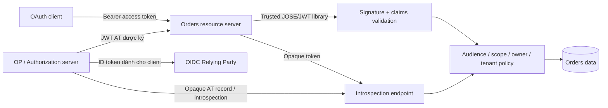
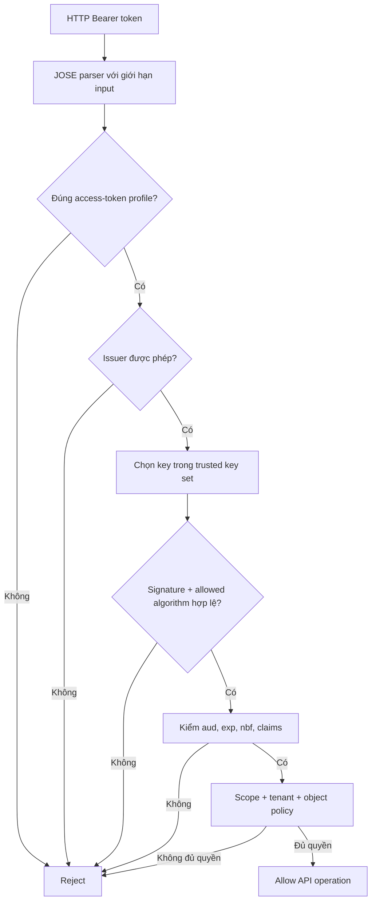
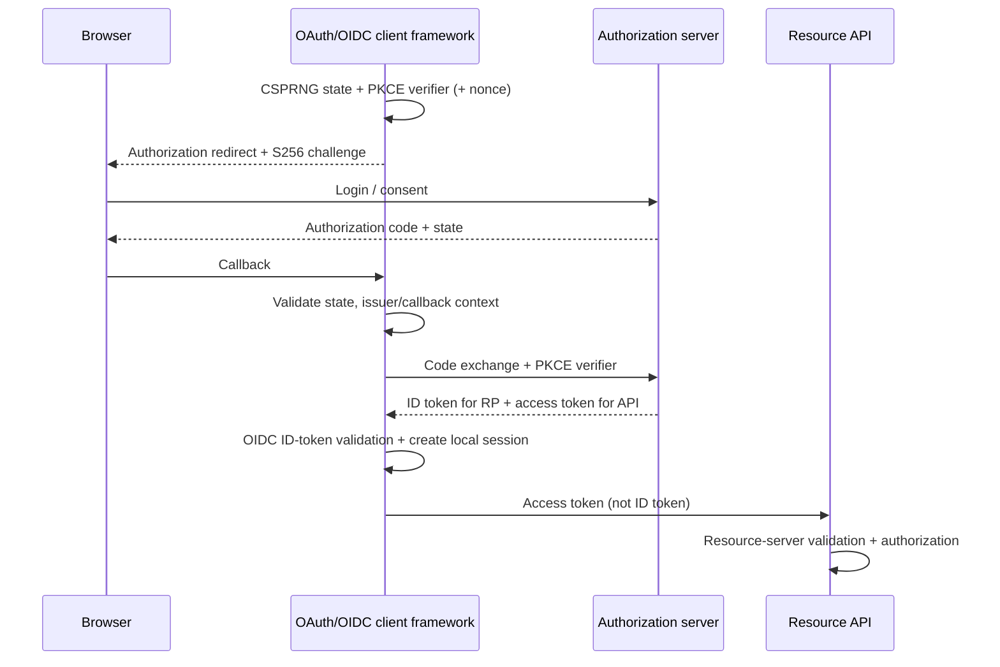
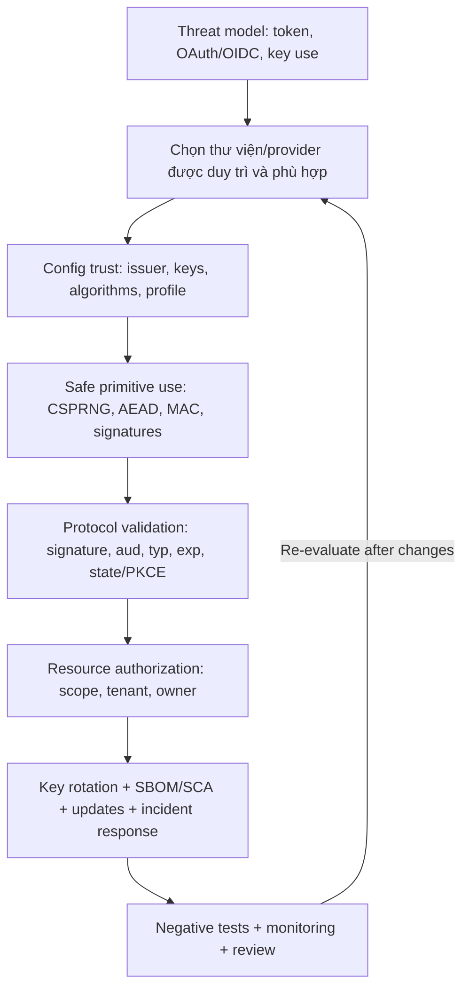

# Phụ thuộc thư viện crypto được kiểm chứng

Một nhóm backend tự viết hàm `verifyJwt(String token)`: tách chuỗi theo dấu chấm, giải mã Base64URL phần payload, đọc `sub`, `role` và trả về “đăng nhập thành công”. Hàm chạy được với hàng nghìn JWT thử nghiệm. Nhưng **không có bước kiểm chữ ký**, không giới hạn `alg`, không kiểm issuer, audience hay token type. Kẻ tấn công tự tạo payload `{"sub":"admin","role":"admin"}` và đi qua API mà không cần biết khóa ký.

Sau sự cố, nhóm chuyển sang một thư viện JWT phổ biến. Điều đó là **cần thiết nhưng chưa đủ**: nếu code vẫn gọi “decode” thay vì “verify”, dùng khóa do JWT header tự chỉ định, hoặc bỏ qua `aud`, thư viện tốt vẫn bị tích hợp sai. **Phụ thuộc thư viện crypto được kiểm chứng** nghĩa là chọn thành phần mật mã có độ tin cậy, dùng đúng API/hợp đồng bảo mật, cập nhật và kiểm thử nó trong toàn bộ vòng đời hệ thống. Không phải cài một package nổi tiếng rồi mặc nhiên an toàn.

Bài này thuộc chương **Cryptography** trong module **SECURITY_TOKEN_SECURITY_FUNDAMENTALS**. Module cung cấp kiến thức về mô hình tin cậy và vòng đời JWT, opaque access token, refresh token, OAuth 2.0/OIDC; phát hành/kiểm claims, scope, audience; lưu trữ, thu hồi và phòng chống token theft/replay. Trọng tâm bài là **lựa chọn, tích hợp, quản trị và kiểm thử những thư viện/provider thực thi mật mã** trong bối cảnh token-security, thay vì tự phát minh thuật toán. Không có ghi chú phạm vi bổ sung.

**Mục tiêu học tập**

- Phân biệt **thuật toán đã được nghiên cứu**, **implementation được duy trì**, **mô-đun đã được đánh giá/chứng nhận** và **tích hợp ứng dụng đúng**.
- Chọn API mật mã/JOSE/OAuth cho Java dựa trên threat model, maintenance, hồ sơ lỗ hổng, khả năng cấu hình và tính tương thích.
- Hiểu **JCA/JCE, security provider, JOSE/JWS/JWE, JWT verifier, OAuth resource server, introspection** và ranh giới trách nhiệm từng lớp.
- Thiết lập **algorithm/key allowlist, issuer, audience, token type, lifetime, scope, trust anchor**; không tin tham số khóa/thuật toán từ token chưa xác minh.
- Dùng `SecureRandom`, AEAD, MAC/KDF, signature và thư viện xử lý khóa đúng mục đích; tránh nonce reuse, parser confusion và lộ secret.
- Áp dụng pin/lock dependencies, SBOM, vulnerability monitoring, provenance và dependency upgrade có negative tests.
- Thiết kế key rotation, provider migration, failure handling và incident response mà không hạ cấp kiểm tra bảo mật.
- Nhận diện anti-pattern qua case study, ma trận kiểm thử và checklist triển khai production.

## 1. “Được kiểm chứng” phải được hiểu chính xác

Trong thực tế, không có nhãn duy nhất “thư viện crypto đã được kiểm chứng” bảo đảm an toàn cho mọi ứng dụng. Có nhiều mức độ bằng chứng:

| Mức | Bằng chứng có thể có | Điều **không** được suy ra |
| --- | --- | --- |
| Thuật toán/giao thức được chuẩn hóa | AES-GCM, HMAC, HKDF, RSA-PSS, ECDSA, JWT/JWS, OAuth RFC | Mọi code hiện thực thuật toán đều đúng |
| Implementation được dùng rộng, duy trì và review | Security policy, tests, code review, issue/advisory history, release process | Không có bug hoặc supply-chain compromise |
| Cryptographic module có kiểm định theo chuẩn cụ thể | Ví dụ **FIPS 140-3 validation** đối với mô-đun/bản build/cấu hình cụ thể | Toàn bộ ứng dụng hoặc mọi tính năng thư viện “đạt FIPS” |
| API có guardrails | Validate key sizes, nonce/tag lengths, reject invalid signatures | Caller đã chọn đúng issuer, audience, scope, authorization |
| Tích hợp được kiểm thử trong sản phẩm | Negative tests, threat modeling, dependency inventory, vận hành khóa | Hết rủi ro token theft, policy change hay revocation |

**Một package nổi tiếng không mặc nhiên là một mô-đun FIPS-validated; một mô-đun đã được kiểm định cũng không chứng minh JWT authorization logic của ứng dụng đúng.**

### 1.1. Phân biệt “well-vetted” và “formally validated”

**Well-vetted** là đánh giá thực dụng: thuật toán chuẩn, mã nguồn/implementation đáng tin, maintainers và quy trình cập nhật minh bạch, kiểm thử đa dạng và theo dõi lỗ hổng. **Formally validated** cần chỉ rõ *chương trình chứng nhận, certificate, module boundary, phiên bản/bản build, operational environment và approved mode*. Nếu có yêu cầu pháp lý/đấu thầu, đội compliance phải đối chiếu đúng chứng nhận; không suy từ marketing của một dependency.

### 1.2. Thư viện đã được kiểm chứng vẫn phụ thuộc cấu hình

Ví dụ cùng một JOSE library có thể hỗ trợ:

- Thuật toán chấp nhận được và thuật toán chỉ dành cho legacy compatibility.
- Decode không xác minh cho mục đích hiển thị/debug.
- JWT signed bằng asymmetric key hoặc symmetric MAC.
- JWE encrypted nhưng key-management configuration khác nhau.

Nếu caller chọn API sai, **một thư viện đúng chuẩn có thể thực hiện chính xác thao tác sai**. Security review phải bao gồm cả *caller contract*, không chỉ dependency name.

## 2. Mô hình tin cậy cho ứng dụng token-security

Một backend thường tin **authorization server (AS)** phát access token và giữ **resource server (RS)** để bảo vệ API. OIDC Relying Party (RP) là bên nhận ID token để xác minh authentication event.



**Ranh giới quan trọng:**

1. Token nhận từ HTTP request là **untrusted input** cho đến khi xác minh.
2. JWT header và payload **có thể đọc trước xác minh nhưng không được tin**.
3. Chữ ký hợp lệ chỉ xác minh tính toàn vẹn và nguồn ký trong một trust profile; **không tự chứng minh token dành cho API này**.
4. AS/OP có thể dùng cùng signing keys cho nhiều token purposes; API phải **phân biệt access token với ID token, reset token hoặc JWT assertion khác**.
5. Các scopes/claims được xác minh vẫn chưa thay kiểm tra **tenant, owner, object-level authorization**.
6. Library không biết tự động rằng user vừa bị khóa, refresh family bị revoke hoặc JWT offline bị đưa vào denylist; cần state/expiration/revocation policy.

### 2.1. Hai kiểu xác minh access token

| Kiểu token | Thành phần chính | Trách nhiệm của RS |
| --- | --- | --- |
| **Signed JWT access token** | JOSE/JWT verifier + trusted signing keys | Chữ ký, `typ`/profile, `iss`, `aud`, `exp`, `nbf`, scope, policy |
| **Opaque access token** | Authenticated RFC 7662 introspection client | `active`, intended resource, scope, expiry, cached-state policy, user/tenant policy |

**Không ép opaque token vào JWT decoder**, và không biến response `active=true` thành cho phép truy cập mọi API.

## 3. Nên dựa vào thư viện ở những lớp nào?

| Lớp | Ví dụ chức năng | Cách tiếp cận |
| --- | --- | --- |
| **Primitive crypto** | CSPRNG, AES-GCM, HMAC, RSA/ECDSA/EdDSA, digest | Dùng JCA/JCE/security provider phù hợp, không tự viết primitive |
| **Encoding / key parsing** | Base64URL, PEM/DER, ASN.1, JWK/JWKS | Dùng API chuẩn, giới hạn input và parsing |
| **JOSE** | JWS signing/verification, JWE encryption/decryption, JWK selection | Dùng thư viện JOSE được duy trì với strict validation |
| **JWT token validation** | `iss`, `aud`, `typ`, `exp`, profile, claims | Dùng validator đáng tin, **cấu hình policy ứng dụng** |
| **OAuth/OIDC protocol** | Authorization Code + PKCE, token endpoint, discovery, state/nonce | Dùng OAuth client/resource-server framework phù hợp |
| **Transport / identity** | HTTPS, mTLS, certificates, PKIX chain | Dùng TLS/PKI stack đáng tin; đúng trust anchors |
| **Keys / secrets** | KMS/HSM, rotation, access control, auditing | Dùng quản lý khóa có phân quyền, không hard-code |
| **Business authorization** | Scope→endpoint, owner, tenant, privilege | Code/policy engine của ứng dụng, **không phải crypto primitive** |

Không tồn tại một “thư viện crypto duy nhất” giải quyết từ SHA-256 đến toàn bộ OAuth/OIDC. Chọn **đúng lớp abstraction**. Nếu hệ thống có framework OAuth resource server tốt, **không nên tự parse `Authorization` và tự dùng `Signature.verify()` để tái tạo mọi validation protocol** mà không có lý do chắc chắn.

### 3.1. Token parser và token verifier là hai chức năng khác nhau

**Parser** có thể đọc JSON/JWT. **Verifier** phải xác minh chữ ký/MAC hoặc trạng thái token và các validation rules. Một decoder dùng để hiển thị claims **không đủ** cho authentication.

```text
parseBase64Url(jwt.payload)                 # Chỉ giải mã biểu diễn
jsonParse(payload)                         # Chỉ có object, chưa được tin

verifySignature(issuerKey, allowedAlg, jwt) # Xác minh chữ ký nếu profile phù hợp
validateClaims(iss, aud, exp, nbf, typ, ...)# Xác nhận intended use
authorize(scope, tenant, owner, resource)  # Quyết định nghiệp vụ
```

**Không nhầm method tên “decode” hoặc “parse” với xác thực một token**: API chính xác phụ thuộc thư viện/version và phải được đọc từ documentation tương ứng.

## 4. Hệ sinh thái Java: JCA, JCE, provider và framework

**Java Cryptography Architecture (JCA)** cung cấp interfaces như `SecureRandom`, `MessageDigest`, `Signature`, `Mac`, `KeyPairGenerator` và các key APIs. **Java Cryptography Extension (JCE)** bao gồm encryption/key agreement APIs như `Cipher` và `KeyGenerator`. Các thuật toán được hiện thực bởi **security providers** theo runtime/configuration.

Ví dụ:

```java
import java.security.SecureRandom;
import javax.crypto.Cipher;
import javax.crypto.Mac;
import java.security.Signature;

// Đây là các API thuộc tầng primitive/provider.
// Chúng KHÔNG tự tạo OAuth resource server.
SecureRandom rng = new SecureRandom();
Cipher aead = Cipher.getInstance("AES/GCM/NoPadding");
Mac hmac = Mac.getInstance("HmacSHA256");
Signature verifier = Signature.getInstance("SHA256withRSA");
```

**Những object trên chỉ minh họa API selection**, chưa khởi tạo key/nonce hay xác minh dữ liệu nào. `SHA256withRSA` là RSA PKCS#1 v1.5 signature trong nhiều providers; RSA-PSS có algorithm/parameter contract riêng. Không đổi signature algorithm cho token đã phát tùy ý; **thuật toán chấp nhận phải khớp profile AS và security policy**.

### 4.1. Provider giải quyết gì?

Provider thực thi primitive, key handling và có thể tích hợp HSM/FIPS module. Security review cần biết:

- JDK/runtime version được hỗ trợ và vòng đời cập nhật.
- Provider thực tế được dùng, thuật toán/parameters được hỗ trợ.
- Cấu hình thứ tự providers, chế độ vận hành, key storage và fallback behavior.
- Các security advisories, lỗi interoperability và giới hạn performance.
- Khi yêu cầu compliance, **đúng validated module/configuration**, không chỉ classname.

Không gọi `Security.insertProviderAt` hoặc ép provider bất kỳ để “chữa lỗi” khi chưa hiểu trust model; thứ tự providers và fallback có thể ảnh hưởng vận hành an ninh.

### 4.2. JOSE/JWT trong Java

Các thư viện/framework thường gặp gồm **Nimbus JOSE + JWT**, **jose4j**, **JJWT**, và **Spring Security OAuth2 Resource Server/Client**. Đây là **ví dụ hệ sinh thái**, không phải bảng xếp hạng, khuyến nghị phiên bản cụ thể hay khẳng định bất cứ package/version nào hiện tại không có CVE.

Một quyết định chọn library phải xem:

- Có giải đúng **use case**: JOSE/JWS/JWE, token verification, OAuth resource server hay OIDC login?
- Có explicit algorithm/key/issuer/audience validation và typed errors không?
- Có public security advisories, release history và maintenance policy không?
- Có hỗ trợ key rotation/JWKS cache/trusted issuer discovery theo profile không?
- Có các kiểm soát parser limits, untrusted header, invalid claims và negative tests không?
- Có kết hợp framework của ứng dụng mà không thêm một JWT verifier song song yếu hơn không?

**Không copy API example của một major version cũ vào code mới rồi giả định hành vi giống nhau**. Cần xem docs/version thật của sản phẩm khi triển khai.

## 5. Các tiêu chí chọn dependency có thể kiểm chứng

Một mẫu đánh giá theo threat model:

| Tiêu chí | Câu hỏi kiểm chứng | Bằng chứng cần giữ |
| --- | --- | --- |
| **Use-case fit** | Cần JWS verify, JWE decrypt, OAuth client hay RS introspection? | Requirement/threat model, supported profiles |
| **Standards fit** | Triển khai RFC/profile nào? Behavior với `alg`, `typ`, `crit`, `aud` ra sao? | Documentation, conformance tests |
| **Maintenance** | Maintainers, release cadence, supported versions, security policy? | Project metadata/release notes |
| **Known vulnerabilities** | Direct/transitive dependencies có advisory chưa khắc phục? | SCA scan, advisory triage record |
| **Configuration safety** | Có defaults quá permissive hay algorithms legacy? | Effective config review |
| **Key management** | HSM/KMS, JWKS, rotation, private key protection thế nào? | Architecture/test plan |
| **Operational behavior** | Timeout, parsing limits, crypto provider failure và logging? | Fault-injection results |
| **Supply chain** | Artifact provenance/signature/checksum, trusted repository, lockfile? | Build manifest/SBOM/verification |
| **License/compliance** | License phù hợp? Có yêu cầu FIPS/module certification? | Legal/compliance review |
| **Upgradeability** | Có migration path, deprecation policy, test coverage? | Dependency-update runbook |

**Không chấm “được kiểm chứng” chỉ dựa số sao GitHub hoặc số lượt tải**. Popularity có thể hỗ trợ tín hiệu usage, nhưng không thay hồ sơ bảo mật, bảo trì và tích hợp thực tế.

### 5.1. Ghi lại quyết định kiến trúc

Một Architecture Decision Record (ADR) hữu ích có thể mô tả:

```text
Decision: Use maintained JOSE/JWT verifier through OAuth RS framework
Scope: Orders API access tokens issued by trusted AS
Trust: fixed issuer and trusted JWKS endpoint
Accepted profile: signed JWT access token, expected resource audience
Algorithms: explicit allowlist agreed with AS
Claims: iss, aud, exp, nbf, scope, typ as profile requires
Rejected: ID tokens, refresh tokens, other-API tokens, alg=none
Operations: JWKS rotation, SCA, negative security tests, incident runbook
Owner: security + platform + Orders API maintainers
```

**Đây là bản ghi thiết kế minh họa**, không phải config của một thư viện cụ thể; giá trị thật phải theo hệ thống thực tế.

## 6. Đừng tự viết primitive mật mã hoặc “wrapper thông minh” thiếu kiểm soát

Những phần không nên viết lại chỉ để tiết kiệm dependency:

- AES, AES-GCM, ChaCha20-Poly1305, RSA/ECDSA/EdDSA implementations.
- HMAC, HKDF, password hashing/KDF, CSPRNG/DRBG.
- ASN.1/DER, certificate validation, PKIX chain path logic.
- JWS/JWE serialization, base64url canonical rules và JOSE signature input construction.
- TLS handshakes, mTLS trust chain, certificate pinning tùy tiện.

**Crypto wrapper** cũng có thể nguy hiểm nếu:

1. Chọn thuật toán từ untrusted JWT header rồi khởi tạo verifier.
2. Silently fallback từ strict verification sang decode-only.
3. Bắt exception và trả `true` hoặc dùng default admin identity.
4. Mặc định accept mọi issuer/audience để tương thích.
5. “Auto-fix” key length bằng padding, truncate IV hoặc đổi cipher mode.
6. Ghi raw tokens, keys hoặc plaintext vào exception/log.

### 6.1. Tầng adapter được phép làm gì?

Một adapter nhỏ có giá trị nếu nó:

- Cố định **trusted issuer, allowed algorithms, expected audience, token profile**.
- Dịch thông báo lỗi thành nhóm ổn định (`invalid_token`, dependency unavailable, etc.).
- Thêm telemetry **không chứa secret**.
- Ràng buộc framework với policy resource/tenant.
- Giữ test seam để mô phỏng key rotation/AS outage.

Adapter **không được tái cài đặt primitive crypto** hoặc tự tạo một cơ chế xác thực yếu hơn thư viện bên dưới.

## 7. JWT: việc ký và việc xác minh phải tách biệt

JWT thường là JWS dạng ba phần `header.payload.signature`. Một JSON payload có thể chứa `sub`, `scope`, `exp`, nhưng **mang các claims đó chưa đủ**. RS phải:

1. Phân loại **đúng token type/profile** dành cho API.
2. Giới hạn **issuer tin cậy và tập khóa**.
3. Chỉ cho phép thuật toán đã cấu hình, tương thích loại khóa.
4. Xác minh signature/MAC theo JOSE spec.
5. Kiểm audience, expiry/not-before, issuer, các claims bắt buộc.
6. Kiểm scope và object-level authorization.



**Không có “nếu signature fail thì cứ decode claims và tiếp tục”**.

### 7.1. `alg=none` và algorithm confusion

Một số JOSE contexts có định nghĩa `alg=none` cho unsecured JWT. **OAuth resource server đang yêu cầu signed access tokens không được chấp nhận unsecured tokens**. Đừng để header JWT quyết định sẽ verify hay bỏ verify.

Một lớp lỗi khác là **algorithm confusion**: verifier không ràng buộc key type, issuer và algorithm, làm một public key bị diễn giải nhầm thành shared secret cho HMAC trong cấu hình yếu. Dùng thư viện/framework chặt và **explicit algorithm–key binding**, không làm thuật toán “tự động” từ input chưa tin.

### 7.2. `typ` và cross-JWT confusion

**RFC 9068** định nghĩa JWT profile cho OAuth access tokens, sử dụng JOSE `typ` như `at+jwt` (hoặc `application/at+jwt` theo profile), giúp RS phân biệt với ID token. Tuy nhiên không phải mọi deployment đều dùng RFC 9068; phải làm theo **token contract** với AS.

**Chữ ký hợp lệ của ID token dành cho OIDC client không biến nó thành access token của Orders API**, ngay cả khi hai token dùng cùng issuer/JWKS. RS phải kiểm `aud` của resource và access-token type/profile, không dùng ID token như OAuth Bearer credential.

### 7.3. `crit`, extensions và parser behavior

JOSE cho phép các **critical header parameters** trong những trường hợp profile áp dụng. Verifier phải **hiểu và xử lý các giá trị `crit` bắt buộc**, hoặc từ chối, không bỏ qua tùy tiện. Đồng thời một library hỗ trợ JWE/JWS compression hoặc nhiều token serializations không có nghĩa API phải tự động chấp nhận mọi cấu trúc.

### 7.4. Token size/depth limits

JWT là untrusted HTTP input. Đặt max token length, HTTP header limits, JSON depth/claim limits, số lượng keys/JWKS bounds và timeout. Hạn chế tránh parser/memory DoS, nhưng **không silently truncate** JWT vì sẽ gây validation ambiguity. Reject input vượt giới hạn.

## 8. JWKS và discovery: chọn đúng khóa được tin cậy

AS thường công bố **JSON Web Key Set (JWKS)** để RS xác minh JWS. Library có thể hỗ trợ tự tải/caching keys, nhưng **nguồn JWKS phải được xác định từ issuer đã trust**.

```text
Trusted AS config:
    issuer = https://login.example.com
    jwks_uri = https://login.example.com/.well-known/jwks.json
    audience = https://api.example.com/orders

Untrusted JWT header:
    kid = "key-2026"
    alg = "RS256"
    jku = "https://attacker.invalid/keyset.json"
```

**`kid` chỉ là gợi ý chọn key trong tập khóa đã tin cậy**, không phải bằng chứng token được xác thực. `jku`/`x5u` từ token chưa verify là **dữ liệu không tin cậy**; tự fetch URL này có thể dẫn tới SSRF/key injection.

### 8.1. Correct trust sequence

1. RS được cấu hình **issuer allowlist** và metadata/JWKS source đáng tin.
2. RS lấy/cập nhật JWKS qua TLS và issuer/discovery validation.
3. JWT header chỉ dùng để **tìm candidate key trong trusted key set**, sau đó kiểm key type/algorithm/use đúng contract.
4. Library xác minh signature.
5. RS kiểm `iss`, `aud`, token type, time và policies.

Khi có nhiều issuers, chọn issuer/JWKS theo **tenant/route/trust config đã đăng ký**, không tự chấp nhận bất kỳ URL mà token tuyên bố.

### 8.2. Key rotation và `kid` cache

AS có thể công bố khóa mới trước khi bắt đầu ký và giữ khóa cũ cho đến khi tokens cũ hết hạn theo policy. RS phải có JWKS cache/refresh/retry có giới hạn và **không fail open** khi `kid` lạ hoặc fetch thất bại.

| Tình huống | Hành vi đúng |
| --- | --- |
| `kid` khớp key trusted, signature đúng | Tiếp tục claims validation |
| `kid` không tìm thấy trong trusted JWKS | Refresh JWKS có kiểm soát nếu policy, sau đó reject nếu vẫn không có |
| Signature sai với trusted key | Reject, không thử untrusted `jku` |
| JWKS endpoint timeout | Dùng trusted cached keys còn hợp lệ theo policy hoặc fail closed |
| AS rotate key | Đồng bộ keys, theo dõi verification errors |
| Khóa bị compromise | Incident response, cập nhật trust set/denylist, kiểm AT/RT đã phát |

**Đừng tắt signature verification để xử lý outage JWKS**.

## 9. Access token JWT, ID token và opaque token không dùng chung validator tùy tiện

| Loại credential | Intended recipient | Cơ chế tin cậy điển hình | Lỗi do tích hợp thư viện |
| --- | --- | --- | --- |
| **OIDC ID token** | OIDC Relying Party (client ID trong `aud`) | OIDC `iss`/`aud`/`nonce`/signature/time validation | Dùng nó làm Bearer token cho API |
| **JWT access token** | Resource server/API được chỉ định | JWS verification + access-token profile + policy | Chỉ decode JWT, bỏ audience/type |
| **Opaque access token** | Resource server/API | Trusted AS introspection/lookup, `active` và resource binding | Đưa vào JWT parser, fallback to allow |
| **Refresh token** | Authorization server/token endpoint | AS-controlled grant/rotation/state | Gửi tới RS như access token |
| **Authorization code** | OAuth token endpoint theo flow | Single-use code + client binding/PKCE | Gọi RS bằng code |
| **DPoP proof JWT** | Resource server cho một HTTP request | Proof signature, `htm`, `htu`, `ath`, `jti`, key binding | Coi DPoP proof là access token |

Thư viện JWT có thể parse được tất cả JWTs, nhưng **khả năng parse không đồng nghĩa được phép sử dụng thay thế**. Ví dụ một `id_token` được OP ký đúng, `aud` là `orders-web-client`, không phải `https://api.example.com/orders`. Resource server phải reject.

### 9.1. Opaque token và introspection

Đối với opaque access token, dùng RFC 7662:

```http
POST /oauth2/introspect HTTP/1.1
Host: login.example.com
Authorization: Basic <resource-server-authentication>
Content-Type: application/x-www-form-urlencoded

token=<opaque-access-token>&token_type_hint=access_token
```

```json
{
  "active": true,
  "iss": "https://login.example.com",
  "aud": "https://api.example.com/orders",
  "client_id": "orders-web",
  "scope": "orders.read",
  "exp": 1795000600
}
```

`active` là trường cốt lõi; các claims khác **không bắt buộc xuất hiện ở mọi introspection response**. RS phải có hợp đồng đáng tin về issuer/resource binding nếu thiếu metadata cần thiết. Khi AS outage, **không coi HTTP 503 hoặc timeout như `active=true`**.

### 9.2. Introspection cache không phải bằng chứng token chưa bị revoke mãi mãi

Cached `active=true` có thể lỗi thời sau revocation. Library/adapter caching phải giới hạn TTL theo `exp`, AS cache policy và **revocation-latency budget**, key theo issuer/RS/audience và không cache “allow every endpoint” thay authorization. Cache hit vẫn kiểm scope, owner/tenant và sender proof nếu token bound.

## 10. “Verify signature” không hoàn tất authorization

Ví dụ Orders API nhận JWT access token:

```json
{
  "iss": "https://login.example.com",
  "sub": "user-42",
  "aud": "https://api.example.com/orders",
  "scope": "orders.read",
  "exp": 1795000600
}
```

Ngay cả khi thư viện xác minh chữ ký và các claims trên, `GET /orders/9001` phải kiểm:

- Người dùng có nằm trong tenant sở hữu order không?
- Order có bị khóa/quy định dữ liệu đặc biệt không?
- Client có quyền gọi endpoint và scope thực tế là `orders.read` không?
- Token có bị revoke, có `cnf` sender-binding hoặc logout-dependent policy không?

**Không dùng crypto library làm hệ thống phân quyền**. Validation chứng minh token phù hợp với trust profile; authorization quyết định hành động cụ thể trên tài nguyên.

### 10.1. Không đọc quyền từ unverified claims

```java
// SAI: payload là input chưa verify.
String role = jsonParser.decode(jwtPayload).get("role");
if ("admin".equals(role)) {
    allowRefund();
}
```

**Đúng về kiến trúc:** lấy claims từ **verified access-token context** do framework/validator cung cấp; sau đó đánh giá scope, tenant, owner và policy. Không tin custom `role` xuất hiện trong bất kỳ JWT đã ký nào nếu role đó không nằm trong hợp đồng access-token/issuer được ủy quyền.

## 11. Java `SecureRandom`: dùng primitive được cung cấp thay tự xây generator

Khi cần tạo opaque access token, refresh token, PKCE `code_verifier`, OAuth `state` hoặc mã khôi phục entropy cao, dùng **cryptographic RNG** từ Java provider đáng tin. Không dùng `java.util.Random`, `ThreadLocalRandom`, `Math.random()`, thời gian hệ thống hoặc PID để tạo bearer secrets.

```java
import java.security.SecureRandom;
import java.util.Base64;

public final class TokenSecrets {
    private static final SecureRandom RNG = new SecureRandom();

    /** 32 random bytes, Base64URL no padding (43 characters). */
    public static String newOpaqueSecret() {
        byte[] raw = new byte[32];
        RNG.nextBytes(raw);
        return Base64.getUrlEncoder()
                .withoutPadding()
                .encodeToString(raw);
    }
}
```

**Nếu provider/OS entropy hoạt động đúng**, 32 byte ngẫu nhiên đều cho không gian lý tưởng `2^256` khả năng. Base64URL chỉ thay **cách biểu diễn**, không thêm entropy. Đoạn code chưa thực thi token metadata, persistence, grant binding, expiry, scopes hay authorization.

### 11.1. Vì sao không tự seed bằng timestamp?

```java
// SAI: seed đoán được, generator không dành cho cryptographic secret.
java.util.Random random = new java.util.Random(System.currentTimeMillis());

// KHÔNG THỂ CHẤP NHẬN cho token:
String token = Long.toHexString(random.nextLong());
```

`SecureRandom.setSeed(...)` cũng không phải giấy phép dùng timestamp làm entropy bảo mật. Tránh custom deterministic seeds, đặc biệt trong container/VM clones, test harness và environment restore. Nên dựa vào **OS-backed security provider** và review nền tảng khi tạo snapshot/khôi phục tiến trình.

### 11.2. `getInstanceStrong()` có phải lựa chọn duy nhất?

Không. `SecureRandom.getInstanceStrong()` chọn algorithm từ cấu hình JVM và có thể có đặc tính blocking/latency khác. `new SecureRandom()` chọn provider mặc định theo platform; cần đánh giá implementation và môi trường thật. **Đừng gọi `getInstanceStrong()` trên mỗi request chỉ để “tăng độ bảo mật”**, cũng đừng chuyển sang PRNG thường khi RNG lỗi.

### 11.3. Đừng tự viết `nextByte()%N` khi sinh user code

Modulo 256 theo alphabet length có thể tạo **bias**. Với mã người nhập (OTP, device `user_code`), dùng bounded `SecureRandom.nextInt(bound)` hoặc rejection sampling đúng; đồng thời kiểm rate limit, TTL và số giao dịch còn hiệu lực. Một mã 6 chữ số đều có khoảng 19,93 bit entropy, không phù hợp làm refresh token lâu hạn.

## 12. Authenticated encryption: để thư viện xử lý AEAD và authentication tag

Đối với dữ liệu cần **bí mật và toàn vẹn**, ưu tiên một **AEAD** được nghiên cứu như AES-GCM hoặc ChaCha20-Poly1305 theo khả năng provider/profile và chính sách. **Không tự ghép AES-CBC + custom checksum**, không dùng ECB cho dữ liệu nhạy cảm, không bỏ kiểm authentication tag.

### 12.1. Ví dụ Java JCE AES-GCM cho một record

```java
import java.nio.charset.StandardCharsets;
import java.security.SecureRandom;
import javax.crypto.Cipher;
import javax.crypto.SecretKey;
import javax.crypto.spec.GCMParameterSpec;

// PSEUDOCODE RÚT GỌN: key được cấp an toàn từ KMS/key management.
final class ProtectedRecord {
    private static final SecureRandom RNG = new SecureRandom();

    static EncryptedEnvelope encrypt(
            SecretKey key,
            byte[] plaintext,
            String recordId
    ) throws Exception {
        byte[] nonce = new byte[12]; // 96-bit IV, phải unique per key
        RNG.nextBytes(nonce);

        Cipher cipher = Cipher.getInstance("AES/GCM/NoPadding");
        cipher.init(Cipher.ENCRYPT_MODE, key,
                new GCMParameterSpec(128, nonce));
        cipher.updateAAD(recordId.getBytes(StandardCharsets.UTF_8));

        byte[] ciphertextAndTag = cipher.doFinal(plaintext);
        return new EncryptedEnvelope(nonce, ciphertextAndTag);
    }
}
```

`EncryptedEnvelope` là class minh họa, không thuộc Java SE. **Không copy nguyên ví dụ thành một encryption service production** nếu chưa có key management, IV allocation policy, format/version, crash recovery, per-key volume limits, decrypt validation và threat review.

### 12.2. Những thuộc tính thư viện không thể tự quyết định

- **Key:** 128/192/256-bit AES key material đúng profile, không tự pad password thành key.
- **Nonce/IV:** không lặp dưới **cùng key**; random 96-bit IV có birthday collision risk khi lượng mã hóa tăng, phải quản lý invocation limits và rotation.
- **Tag:** xác minh thành công trước khi sử dụng plaintext; exception tag mismatch phải từ chối.
- **AAD:** authentication cho context như record ID/tenant/type, phải cung cấp **chính xác cùng bytes** ở decrypt.
- **Envelope:** lưu algorithm/version, key reference, nonce, ciphertext/tag theo một định dạng có giới hạn và không nhầm version.
- **Authorization:** thành công decrypt không cho user đọc mọi record; vẫn phải kiểm owner/tenant.

### 12.3. Không ngầm downgrade khi decrypt thất bại

```text
SAI:
  try AES-GCM decrypt
  catch TagException:
      return plaintextFromLegacyBase64()

ĐÚNG:
  validate envelope version + key policy + AEAD tag
  fail closed on authentication failure
  allow legacy migration only through explicitly scoped, audited plan
```

Một crypto library có thể phát hiện tag sai. **Nếu application nuốt exception và trả dữ liệu không xác thực, toàn bộ tính toàn vẹn bị mất**.

## 13. MAC, digest và KDF: chọn đúng primitive và đúng thư viện

### 13.1. Digest không phải MAC

`SHA-256(message)` là digest công khai, không chứng minh người gửi có khóa bí mật. Để xác thực thông điệp bằng secret chung, dùng **HMAC**/MAC phù hợp profile:

```java
import javax.crypto.Mac;
import javax.crypto.SecretKey;

byte[] macForMessage(SecretKey key, byte[] message) throws Exception {
    Mac mac = Mac.getInstance("HmacSHA256");
    mac.init(key);
    return mac.doFinal(message);
}
```

**Không dùng `SHA256(secret || message)` hoặc `SHA256(message || secret)` thay HMAC** khi protocol yêu cầu MAC; cách ghép thủ công có các rủi ro như length extension hoặc domain ambiguity tùy construction.

### 13.2. So sánh MAC an toàn

Khi cần so sánh tag/MAC, nên dùng API so sánh bytes phù hợp như `MessageDigest.isEqual` hoặc primitive của thư viện đã được đánh giá, thay vì so string rồi trả kết quả theo ký tự đầu tiên khác. Thực tế khả năng chống timing leakage còn phụ thuộc input lengths, JDK/provider/runtime, branch/error behavior và các side channels khác.

**Không tự tuyên bố “constant-time tuyệt đối” chỉ vì dùng một method có tên gần giống constant-time.** Kiểm hợp đồng implementation được dùng và giữ messages/errors tương đối đồng nhất khi cần ngăn oracle.

### 13.3. HKDF và domain separation

Khi dẫn xuất keys từ một nguồn key material, dùng **HKDF (RFC 5869)** hoặc KDF được tiêu chuẩn hóa và implementation đáng tin, với thông tin context rõ ràng:

```text
derived_key_for_token_fingerprint =
    HKDF(master_key, salt, info="token-fingerprint/v1", length=32)

derived_key_for_audit_integrity =
    HKDF(master_key, salt, info="audit-integrity/v1", length=32)
```

Đây là **mô hình khái niệm**: không có nghĩa cứ hai dòng có nhãn khác nhau thì mọi key lifecycle/trust issue biến mất. Cần kiểm parameter constraints, salt semantics và master key access trong thư viện/profile. Nếu có thể, sử dụng các **keys riêng được quản lý bởi KMS** cho những mục đích khác nhau.

### 13.4. Password hashing khác hashing của random token

Password có **entropy thấp**, cần password hashing/KDF thích hợp (ví dụ Argon2id theo policy, hoặc lựa chọn được phép theo hệ sinh thái). Một opaque token 256-bit từ CSPRNG có entropy cao, có thể lưu **hash/HMAC** để lookup mà không cần slow password KDF trong nhiều thiết kế.

| Mục tiêu | Primitive/phương pháp | Vì sao |
| --- | --- | --- |
| Kiểm integrity với secret | HMAC/approved MAC | Xác minh bên biết khóa |
| Fingerprint opaque token entropy cao | SHA-256/HMAC theo threat model | Lookup mà không lưu raw bearer token |
| Hash password user | Password KDF chống offline guessing | Password có thể dễ đoán |
| Dẫn xuất nhiều keys | HKDF/approved KDF có context | Domain separation |
| Verify JWT JWS | JOSE library + Signature/MAC provider | Đúng signing input và thuật toán |
| Mã hóa token store fields | AEAD + key management | Bí mật và integrity |

**Một thư viện hash được kiểm chứng không tự biến password hashing hay signature validation thành đúng nếu dùng sai primitive.**

## 14. Signature algorithms: dùng thư viện JOSE để tránh sai format và khóa

**RS256**, **PS256**, **ES256**, **EdDSA** là những algorithm identifiers thuộc các họ signature khác nhau trong JOSE. Chỉ chấp nhận các thuật toán và profile được **AS/RS thỏa thuận và provider hỗ trợ an toàn**. Không khẳng định mọi thuật toán phù hợp mọi khóa, hardware module hoặc tiêu chuẩn compliance.

### 14.1. Những lỗi tự viết JWS verifier

- Ghép Base64URL padding hoặc chuyển đổi JSON rồi ký lại sai **JWS signing input**.
- Nhầm raw ECDSA `R || S` signature trong JOSE với DER-encoded ECDSA signature của provider.
- Dùng RSA public key làm HMAC secret do algorithm confusion.
- Chấp nhận `alg=none` dù RS yêu cầu signed token.
- Không kiểm `crit` header extensions.
- Bỏ qua key usage, key type, signature algorithm parameters.
- Không kiểm issuer/audience/time sau khi signature đúng.

**JOSE library nên xử lý serialization/signature encoding**, để ứng dụng tập trung vào trust profile và authorization. Nếu cần hỗ trợ custom profile, phải có test vectors và review chuyên môn thay vì một bộ parser tự chế.

### 14.2. RSA-PSS vs PKCS#1 v1.5

`PS256` (RSA-PSS) và `RS256` (RSASSA-PKCS1-v1_5) có **different encoding/parameter semantics**. Không chuyển algorithm identifiers bằng cách đổi một string hoặc tự gọi `Signature.getInstance(...)` với default provider parameters rồi hy vọng verifier tương thích.

### 14.3. ECDSA nonce và asymmetric signing

ECDSA cần ephemeral signing nonce `k` đúng security contract. Sai entropy hoặc reuse có thể làm lộ private signing key trong một số điều kiện. Dùng cryptographic provider đáng tin, không tự generate `k`. Khi deterministic ECDSA theo RFC 6979 được sử dụng, đó là thiết kế chuẩn, không phải permission dùng `Random` yếu.

### 14.4. MAC signatures và asymmetric signatures

Với HS256, bên verify thường có **shared symmetric secret** và do đó có thể tự ký token hợp lệ nếu được quyền truy cập khóa. Với RS256/PS256/ES256/EdDSA, RS thường chỉ giữ **public verification key**, còn AS giữ private signing key.

**Đừng chia HS256 signing secret rộng cho nhiều resource servers** nếu muốn chỉ AS có thể phát hành token. Việc chọn giữa HMAC và asymmetric signature là quyết định threat model/key distribution, không phải “thuật toán nào nhanh hơn”.

## 15. OAuth/OIDC library: giao thức quan trọng hơn primitive

Authorization Code + PKCE + OIDC bao gồm **nhiều ràng buộc ngoài chữ ký JWT**:

- `state` gắn authorization response với browser session/transaction.
- `code_verifier` entropy cao, `code_challenge_method=S256`, AS kiểm token request.
- OIDC `nonce` được đối chiếu ID token khi request/profile yêu cầu.
- `redirect_uri`, issuer và callback binding được kiểm theo OAuth/OIDC.
- Access token khác ID token, và refresh token chỉ dành cho AS/token endpoint.
- Scope granted có thể khác scope requested; RS kiểm quyền được cấp.

Một JOSE library không tự thực hiện **CSRF protection, redirect validation hoặc PKCE** nếu caller chỉ dùng JWS verify.



### 15.1. Library có cung cấp `state` không có nghĩa bạn dùng đúng

Một số framework mặc định quản lý transaction state; một số yêu cầu caller lưu state/nonce hoặc có callbacks đặc biệt. Phải biết **bản API được dùng** và kiểm negative flow: callback thiếu/sai state, login CSRF, wrong issuer, duplicated code, timeout, PKCE mismatch.

### 15.2. Sử dụng OAuth resource-server framework thay tự xử lý HTTP header

Framework có thể cung cấp bearer token extraction, authentication failure responses và hook validate access token. Ứng dụng còn phải cấu hình:

```text
resource_server:
    trusted_issuer: https://login.example.com
    intended_audience: https://api.example.com/orders
    accepted_token_profile: OAuth access token as issued by this AS
    accepted_algorithms: explicit reviewed list
    verify_signature_or_introspect: according to token format
    endpoint_permissions:
        GET /orders: orders.read
        POST /orders: orders.create
    resource_policy: tenant + owner + business restrictions
```

Đây là **pseudoconfig**. Framework/version có thể không kiểm `aud`, `typ` hoặc một số custom claims theo default; hãy xác minh effective validators thay vì suy đoán.

## 16. Spring Security, Nimbus và adapter: minh họa kiến trúc Java

Ví dụ tầng khái niệm cho Orders API:

```java
// PSEUDOCODE KHÁI NIỆM, không phải cấu hình Spring copy-paste.
final class OrdersAuthenticationPolicy {
    private final TrustedJwtVerifier jwtVerifier;
    private final TrustedOpaqueIntrospector opaqueIntrospector;
    private final OrderPolicy orderPolicy;

    VerifiedAccessContext authenticate(HttpRequest request) {
        String raw = request.requireBearerCredential();

        // Chỉ một token profile hợp lệ được chọn từ cấu hình AS,
        // không dựa vào untrusted token header để fallback.
        VerifiedAccessContext token = tokenValidationProfile
                .verifyOrIntrospect(raw, jwtVerifier, opaqueIntrospector);

        token.requireIssuer("https://login.example.com");
        token.requireAudience("https://api.example.com/orders");
        token.requirePurpose("oauth_access_token");
        token.requireUnexpired();
        return token;
    }

    OrderDetails readOrder(VerifiedAccessContext token, Order order) {
        token.requireGrantedScope("orders.read");
        if (!orderPolicy.canRead(token.subject(), token.clientId(), order)) {
            throw new Forbidden();
        }
        return orderPolicy.allowedView(order, token);
    }
}
```

Các types trong ví dụ là **interfaces giả định**, không thuộc Java SE/Spring. Mục tiêu là nhấn mạnh **strict token profile**, chứ không cài một `if (jwtVerifyFail) return claimsWithoutVerify`.

### 16.1. Trách nhiệm của framework

Trong một triển khai Spring Security OAuth2 Resource Server phù hợp, framework cung cấp authentication plumbing và support JWT/opaque token. Tuy nhiên **audience validator, access-token type validator, scopes mapping, claim normalization và tenant policy** phải được kiểm tra theo chính xác phiên bản/cấu hình đang dùng.

### 16.2. Không phát minh thứ tự thử validators thiếu ranh giới

Một anti-pattern:

```text
try verify as JWT using issuer A
if fails: try as opaque at issuer B
if fails: try as OIDC ID token
if fails: allow local session
```

Đây là **token-type confusion và trust downgrade**. Hãy xác định **accepted credential types** từ route/security contract. Nếu hỗ trợ nhiều issuers/profiles, phân tách trust conditions rõ ràng và **không biến lỗi xác minh thành quyền thử cơ chế yếu hơn**.

## 17. Quản lý keys: thư viện tốt không cứu khóa bị lộ

Khóa ký JWT, HMAC secrets, AES keys, TLS private keys và KMS credentials thường có vòng đời dài hơn access tokens và tác động lớn hơn một bearer token đơn lẻ.

| Loại khóa | Ai giữ secret? | Lưu trữ gợi ý | Rủi ro nếu lộ |
| --- | --- | --- | --- |
| AS JWT asymmetric private key | Chỉ signing service/trust boundary | KMS/HSM hoặc protected key store | Giả token của issuer |
| RS JWT public key | RS/gateway, có thể công khai | Trusted JWKS cache | Sai trust config gây key injection |
| HMAC signing key | Tất cả parties được verify/ký | Secret manager, hạn chế sharing | Mỗi holder có thể làm giả MAC token |
| AEAD encryption key | Authorized encrypt/decrypt components | KMS/HSM/envelope key management | Lộ plaintext/khả năng sửa dữ liệu nếu có quyền thao tác |
| Audit/token fingerprint HMAC key | Audit/AS service giới hạn | Secret manager/KMS | Link identifiers hoặc forge integrity evidence |
| Refresh token raw | OAuth client/AS issuance path | Secure client store; AS giữ digest khi phù hợp | Xin access token mới trái phép |

### 17.1. Nguyên tắc quản lý khóa

- Không hard-code secrets/private keys trong source, image, CI logs hoặc test fixtures được deploy.
- Giới hạn **who can sign** khác **who can verify**; tách duty và resource boundaries.
- Theo dõi key owner, purpose, algorithm, version, issuance/expiry, rotation và incident procedure.
- Đặt quyền KMS/HSM tối thiểu, audit key use/exports.
- Không ghi private key hoặc bearer token vào exception/tracing.
- Xác định thời gian giữ old verification keys phù hợp lifetime tokens và trust/revocation policy.

### 17.2. Envelope encryption không miễn nonce/validation

KMS có thể wrap data-encryption keys. Nhưng caller vẫn cần AES-GCM nonce uniqueness, AAD, key reference/version và tag verification khi tự encrypt dữ liệu ứng dụng. Nếu KMS cung cấp một **high-level encrypt/decrypt API**, có thể giảm lỗi hơn so với tự điều khiển primitive, miễn là đáp ứng data-size/context/security requirements.

### 17.3. Khi signing key bị compromise

Phải coi đây là incident khác với một access token bị lộ. Cần xác định affected issuer/key IDs/token populations, rotate/disable compromised key, cập nhật JWKS/validators, đánh giá tokens đã phát và refresh grants/RS caching. **Không tự xoay mọi key và xóa mọi phiên** nếu chưa xác định scope/cơ chế phục hồi, trừ trường hợp khẩn được incident policy cho phép.

## 18. Dependency supply chain: “được kiểm chứng” phải được duy trì qua cập nhật

Crypto libraries được build, publish, phân phối và nâng cấp giống các dependencies khác. Rủi ro nằm ở **direct dependency**, **transitive dependency**, build plugins, repositories, artifact provenance và runtime providers.

### 18.1. Inventory phải bao gồm transitive dependencies

Một ứng dụng có thể phụ thuộc vào:

```text
Orders application
  -> OAuth resource-server framework
     -> JWT/JOSE library
     -> JSON parser
     -> HTTP client / TLS provider
  -> Cryptographic provider / JDK security APIs
```

Nếu một vulnerability xuất hiện trong JSON parser/JWK handling, chỉ nhìn tên direct OAuth dependency có thể bỏ sót. Tương tự, JDK/provider runtime update là một phần security posture, không chỉ Maven artifact update.

### 18.2. Quy trình supply-chain cơ bản

1. Dùng **nguồn artifact tin cậy**, không tự mirror từ website/zip ngẫu nhiên.
2. Chọn version được duy trì theo support policy; kiểm security advisories.
3. Dùng **dependency locking/reproducible build** và xác minh checksums/signatures/provenance khi hạ tầng hỗ trợ.
4. Sinh **SBOM** (ví dụ CycloneDX/SPDX) và lưu artifact/build metadata.
5. Chạy **Software Composition Analysis (SCA)** trong CI và theo dõi vulnerabilities sau release.
6. Triage findings theo exploitability, reachable code path, profile, severity và business exposure.
7. Upgrade kèm negative security tests và rollback plan.
8. Không vô hiệu hóa toàn bộ SCA bằng global ignore chỉ vì một false positive.

### 18.3. Vì sao “pin version vĩnh viễn” cũng không an toàn?

Pin/lock giúp tránh kéo dependency không kiểm soát trong build; nhưng **không cập nhật phiên bản có lỗ hổng** sẽ để lại rủi ro lâu dài. Kết hợp:

- **Deterministic builds** mỗi lần phát hành.
- **Scheduled security review** và alert advisories giữa các release.
- **Urgent update process** khi có vulnerability ảnh hưởng tới token verification/key parsing.
- **Compatibility tests** trước rollout.

Một bản vá có thể thay behavior của parser, key selection, algorithm support hoặc exception handling. Vì vậy không nên áp dụng dependency upgrades vào production **mà không có test âm tính cho các trust boundaries**.

## 19. Vulnerability triage: không chỉ nhìn mã CVE

Khi có advisory về thư viện/provider:

| Câu hỏi | Vì sao quan trọng |
| --- | --- |
| Version/build nào bị ảnh hưởng? | Không giả định mọi version đều lỗi |
| Chức năng nào bị ảnh hưởng? | JWS verify, JWE decrypt, key parser, ASN.1 hay HTTP client? |
| Đầu vào attacker có kiểm soát không? | Public HTTP token, untrusted JWKS, malformed certificate? |
| Code path có được gọi trong runtime không? | Reachability và feature flags |
| Có thể exploit từ mạng không? | Attack surface và severity |
| Có mitigation an toàn trước upgrade không? | Disable feature, restrict alg/issuer, block affected input |
| Patch đã có và thử nghiệm chưa? | Compatibility và regression risk |
| Key/secret có thể đã bị lộ không? | Có cần rotate/revoke/tìm compromise? |
| Có thể quan sát exploitation không? | Logs/telemetry đã redacted và forensic |

**Không công bố một thư viện “hiện không có CVE” nếu chưa kiểm chứng đúng thời điểm và phiên bản đang deploy.** Hồ sơ được kiểm chứng là một **quy trình cập nhật liên tục**, không phải tem dán một lần.

### 19.1. Ví dụ tình huống vulnerability

Giả sử một JSON/JWK parser có thể bị DoS bởi input cực lớn. Dù RSA signature primitive không lỗi, RS vẫn có thể bị tê liệt **trước bước verify**. Biện pháp:

- Giới hạn HTTP token/header size và JSON depth.
- Không tự tải JWKS từ URL do attacker điều khiển.
- Patch thư viện/provider.
- Có test malformed/untrusted token.
- Theo dõi CPU/memory, parser errors và rate limits.

### 19.2. Không che lỗi bằng việc nới bảo mật

Không nên xử lý “JWT verification failed sau upgrade” bằng:

```text
allowAlgNone = true
skipAudienceValidation = true
acceptAnyIssuer = true
fallbackToUnverifiedDecode = true
```

Nếu upgrade phá compatibility, điều tra **profile/config/key mismatch** và sửa có kiểm chứng hoặc rollback có kiểm soát theo policy; không chuyển production sang fail-open.

## 20. FIPS, compliance và security claims: kiểm đúng phạm vi

Nếu tổ chức yêu cầu **FIPS 140-3**, cần xác định **cryptographic module được validation** và operational environment/bản build/approved mode cụ thể. Một thư viện Java gọi JCA không bảo đảm nó đang dùng module đã validation; tên thuật toán AES hay SHA-256 cũng không tự đồng nghĩa tuân thủ FIPS.

### 20.1. Những câu hỏi compliance cần trả lời

1. Tổ chức thực sự yêu cầu loại validation nào và theo chuẩn/khu vực nào?
2. Cryptographic module nào, certificate nào, version/build nào?
3. Java runtime/provider hiện thực thuật toán có nằm trong validated boundary không?
4. Ứng dụng có chạy đúng **approved mode/configuration** không?
5. Key generation/storage có ở trong boundary được công nhận không?
6. Có algorithm/key sizes hoặc features không được phép trong mode đó không?
7. Có bằng chứng release/config kiểm thử và audit để trình bày không?

Không gọi hệ thống “FIPS compliant” chỉ vì thêm dependency có tên chứa `FIPS`. Ngược lại, không loại một thư viện well-vetted chỉ vì thiếu chứng nhận mà **hệ thống không bắt buộc phải có**.

### 20.2. Mức tin cậy phải phù hợp use case

Một CLI local demo ít nhạy cảm và một hệ thống phát hành refresh token tài chính có risk/assurance requirements khác nhau. Tuy nhiên ngay cả trong demo, **không dạy code tự viết AES hoặc JWT verification sai như production pattern**. Có thể dùng cấu hình đơn giản nhưng vẫn giữ đúng primitive và validation boundaries.

## 21. Mã nguồn và artifacts: kiểm định không chỉ là test “happy path”

Một thư viện có thể xử lý JWT hợp lệ rất tốt. Để chứng minh **ứng dụng dùng nó đúng**, cần kiểm các trường hợp âm tính:

- Token `alg=none`, signature sai, `kid` lạ.
- JWT có `iss`/`aud` khác, ID token hoặc access token cho API khác.
- Token expired/`nbf` tương lai, scope thiếu, subject disabled.
- JWT header `jku`/`x5u` dẫn tới attacker URL, `crit` không hỗ trợ.
- JSON/JWS malformed, duplicate/ambiguous headers, oversized tokens.
- Key rotation, JWKS outage, introspection timeout/cache stale.
- HMAC/AEAD key mismatch, AES-GCM tag lỗi và nonce reuse controls.
- Dependency upgrade đổi exception/validator behavior.

**Tích hợp đúng thường bộc lộ qua những input hệ thống phải từ chối**, không chỉ qua 200 OK của token hợp lệ.

### 21.1. Test vectors và conformance

Sử dụng test vectors từ chuẩn hoặc library khi phù hợp và không copy secrets production vào test fixture. Với JOSE, phải kiểm serialization, alg, key selection và expected failure modes. Có thể dùng interop tests giữa AS và RS thực, nhưng **không dùng “hai libraries cùng accept token” làm bằng chứng mọi policy đã đúng**.

### 21.2. Kết quả trả lỗi có thể tiết lộ thông tin?

Crypto exception có thể bao gồm raw ciphertext/claims/keys trong diagnostic strings tùy integration. Đối với HTTP API:

- Invalid access token thường trả **401** theo Bearer contract.
- Token đúng nhưng thiếu scope thường **403** khi phù hợp.
- Key/introspection dependency outage có thể cần **503** hoặc failure handling riêng, nhưng **không allow**.
- Public error không nói cụ thể private key ID/subject/token contents khi không cần.

Internal telemetry nên dùng **error category/correlation ID**, không giữ raw bearer credential.

## 22. Cryptographic agility: có thể đổi thuật toán nhưng không chấp nhận mọi thuật toán

**Crypto agility** là khả năng thay thuật toán, khóa, provider hoặc token profile một cách kiểm soát khi chính sách/standards/vulnerability thay đổi. Nó **không có nghĩa** API cho phép bất kỳ JWT header `alg` nào caller cung cấp.

Một thiết kế nâng cấp có thể:

1. Định nghĩa accepted algorithms/profile ở cấu hình tin cậy.
2. Provision ký bằng khóa mới và đưa public key/JWKS vào rotation window.
3. Phát hành tokens mới theo profile/algorithm đã chấp thuận.
4. Cho phép **một tập hẹp gồm algorithm/keys cũ và mới** trong thời hạn chuyển đổi có kiểm soát.
5. Theo dõi tỷ lệ token được ký bằng khóa/profile cũ.
6. Loại bỏ khóa/algorithm cũ khi tokens không còn phải chấp nhận, hoặc revoke sớm theo incident plan.
7. Audit sự thay đổi policy và rollback.

```text
Migration window (ví dụ):
  accepted_issuers = [trusted-issuer]
  accepted_token_types = [access-token-profile]
  allowed_signature_algorithms = [old-reviewed-alg, new-reviewed-alg]
  trusted_keys = [known-old-key, known-new-key]
  allowed_audiences = [orders-resource]

After window:
  allowed_signature_algorithms = [new-reviewed-alg]
  trusted_keys = [known-new-key]
```

Đây là **policy skeleton**, không phải lời khuyên giữ algorithm legacy lâu vô hạn. Các algorithm identifiers thật phụ thuộc AS/RS, key types, compliance và rollout plan.

### 22.1. Đừng auto-discover trust từ header

Cho phép `alg` thay đổi theo một allowlist **cấu hình trước** khác hoàn toàn với việc đọc JWT header rồi tự dùng bất kỳ algorithm, key URL hoặc certificate nó chỉ. **Untrusted input không được quyết định trust anchor**.

### 22.2. Tách policy version và cache key

JWT/JWKS caches, introspection caches hoặc verification results có thể bị lỗi thời sau migration. Đặt policy version vào các cache scopes khi cần, invalidate khi issuer/key/algorithm acceptance thay đổi. Không giữ kết quả `verified=true` vô hạn sau khi signing key bị thu hồi.

### 22.3. Failure rollback phải bảo toàn security invariants

Nếu provider mới không verify được tokens hiện có:

- Điều tra signature encoding, key types, allowed algorithms, trust source và token profile.
- Phân biệt lỗi issuer/JWKS rotation với library regression.
- Giới hạn phạm vi rollback, có mốc kết thúc và security approval.
- Không bật `skipSignature=true`, `acceptAnyAudience=true` hoặc fallback unverified decoder.

## 23. Monitoring và runbook khi thư viện/provider có sự cố

Nên theo dõi:

| Metric/telemetry | Ý nghĩa | Không được ghi |
| --- | --- | --- |
| `jwt_verification_failures_total` theo category | Signature, expired, wrong audience, unknown key | JWT raw, PII claims |
| `jwks_refresh_errors_total` | Trust source/key rotation outage | Private keys, full malicious URLs nếu có secrets |
| `crypto_provider_errors_total` | Algorithm unavailable, signing/decrypt failure | Secret material, plaintext |
| `introspection_errors_total` | AS 401/429/5xx/timeout | Raw bearer token/form body |
| `dependency_version_inventory` | Biết build/runtime version nào đang chạy | Không cần user/token identifiers |
| `sca_findings_open` | Known vulnerabilities chưa xử lý | Không đưa secret vào build logs |
| `token_type_rejections_total` | ID token/reset token dùng như AT | Không cần ghi token contents |
| `key_rotation_status` | Old/new key rollout, unknown `kid` | Không in private JWK |
| `aead_tag_verification_failures` | Ciphertext/AAD/key mismatch hoặc tampering | Plaintext, raw sensitive AAD |
| `audit_redaction_failures` | Lộ secrets vào observability pipeline | Alert chỉ chứa category/correlation ID |

### 23.1. Runbook khi xuất hiện security advisory

1. Xác định **artifact + exact deployed version + environment**, gồm transitive/runtime providers.
2. Xác định code paths bị ảnh hưởng: verify JWS, decrypt JWE, parse JWKS, TLS, etc.
3. Đánh giá exploitability theo attacker-controlled input và security boundary.
4. Áp mitigation **không hạ cấp** (chặn feature/algorithm/URL path, giới hạn input, tạm khóa API nguy hiểm).
5. Build bản vá qua trusted pipeline, kiểm provenance/lockfile.
6. Chạy negative tests + interoperability + performance/reliability tests.
7. Rollout có thể đảo chiều, quan sát key/issuer/profile validation errors.
8. Nếu compromise có thể xảy ra, đánh giá key rotation/token revocation và forensic scope.
9. Audit quyết định, thời điểm, người phụ trách và evidence.

### 23.2. Khi phải tạm dừng token issuance

Nếu CSPRNG/provider ký không tin cậy, **fail closed** có thể yêu cầu dừng phát token mới. Điều này không đòi hỏi mọi API phải ngừng xác minh tokens hiện có nếu trusted verification path vẫn đúng; phải phân tích **rõ signing và verification boundaries**.

### 23.3. “Mật mã an toàn” không đồng nghĩa “không có side channel”

TLS termination, timing differences, parsing errors, key use telemetry, cache behavior và messages có thể tạo oracle ngay cả khi primitive crypto an toàn. Cần giới hạn input, error normalization, resource protections và side-channel review theo exposure thực tế.

## 24. Case study 1 — JWT decoder được dùng như verifier

**Bối cảnh:** Orders API dùng một thư viện JWT phổ biến. Developer gọi method giải mã payload, đọc `sub` và `role` rồi tạo authenticated user.

```java
// SAI — method names là mô tả tổng quát, không phải library API thật.
String payloadJson = jwtDecoder.decodeBase64Payload(bearerToken);
String subject = parseJson(payloadJson).get("sub");
return new AuthenticatedUser(subject);
```

**Tấn công:** Một client tự tạo payload và token không có signature hợp lệ. Vì code chưa kiểm chữ ký, API vẫn cho truy cập.

**Thiết kế đúng:**

- Dùng **verified JWT access-token API** của library/framework.
- Trusted issuer/JWKS được cấu hình ngoài token.
- Allowed algorithms, `typ`, `aud`, expiry, scope được kiểm.
- Resource policy tiếp tục kiểm owner/tenant.
- Test token tự tạo, signature sai, `alg=none`, wrong audience đều bị từ chối.

**Bài học:** Cài một thư viện crypto đúng **không đồng nghĩa đã gọi chức năng xác minh**.

## 25. Case study 2 — JWT `jku` khiến RS tải khóa từ attacker

**Bối cảnh:** Một custom verifier đọc `jku` trong JWT header rồi tải JWKS từ URL đó, sau đó kiểm chữ ký. Developer cho rằng “token đã có chữ ký hợp lệ với public key trong JWKS” là đủ.

**Tấn công:** Attacker tạo key pair riêng, tự ký JWT, đặt `jku` trỏ đến JWKS của mình. Verifier tải khóa attacker và chấp nhận chữ ký. Nếu fetch không bị giới hạn, đây còn là nguy cơ **SSRF**.

**Thiết kế đúng:**

1. Cố định issuer và **trusted JWKS URI** từ registration/discovery đã xác minh.
2. `kid` chỉ chọn key trong trusted key set.
3. Không tự follow untrusted `jku`/`x5u`.
4. Giới hạn redirects, response size, keys và cache behavior của JWKS client.
5. Kiểm `iss`, `aud`, type, expiry sau signature.
6. Có negative test với `jku` attacker URL và unexpected `kid`.

**Bài học:** Một JWS có chữ ký đúng với **khóa do attacker chọn** không phải bằng chứng từ issuer được tin cậy.

## 26. Case study 3 — Nâng thư viện rồi tắt audience check để “chữa lỗi”

**Bối cảnh:** Sau dependency upgrade, Orders API trả 401 nhiều hơn trước. Nguyên nhân: phiên bản mới có validator nghiêm hơn, chặn access tokens dành Billing. Nhóm bật `disableAudienceValidation=true` để giữ uptime.

**Nguy cơ:** Billing token cùng issuer, chữ ký hợp lệ được trình tới Orders; audience restriction biến mất, tạo **cross-resource token substitution**.

**Thiết kế đúng:**

- Kiểm token issuance contract với AS: resource indicator và expected `aud`.
- Dùng migration có scope rõ, phát đúng AT cho Orders.
- Chạy negative test với Billing token ở Orders.
- Không hạ cấp validator; rollback/feature gate an toàn nếu cần.
- Ghi ADR/security acceptance khi thay đổi policy.

**Bài học:** **Hành vi nghiêm hơn của thư viện có thể đang ngăn lỗi bảo mật đã tồn tại từ trước**, không phải “bug để bỏ qua”.

## 27. Case study 4 — HS256 secret bị dùng chung với mọi resource server

**Bối cảnh:** AS ký access tokens bằng HS256, chia HMAC secret cho 20 microservices chỉ để verify. Một microservice bị compromise.

**Nguy cơ:** Vì key để verify HMAC cũng là key để ký, attacker có thể tự tạo MAC tokens hợp lệ nếu kiểm soát shared secret và các policy khác cho phép. Hệ thống có **signing authority bị phân tán quá rộng**.

**Thiết kế đúng:**

- Đánh giá asymmetric JWS signatures: AS giữ private key, RS chỉ giữ public key.
- Nếu phải dùng HMAC, phân tách trust domains, quản lý secret chặt và chấp nhận rủi ro có chủ đích.
- Rotate keys khi bị lộ, kiểm issuer/audience/typ/scope trên mọi RS.
- Không dùng key string public JWK làm shared HMAC secret.

**Bài học:** Một thuật toán chuẩn vẫn có thể tạo rủi ro **phân phối khóa sai**.

## 28. Case study 5 — AES-GCM đúng provider nhưng tái dùng IV

**Bối cảnh:** Dịch vụ dùng `Cipher.getInstance("AES/GCM/NoPadding")` từ provider được duy trì, nhưng mọi lần encrypt refresh-token records đều dùng cùng 12-byte IV với một AES key.

**Nguy cơ:** Reuse nonce/IV dưới cùng AES-GCM key có thể phá confidentiality và authenticity nghiêm trọng. **Provider không thể bảo đảm nonce uniqueness nếu caller cứ truyền cùng một IV**.

**Thiết kế đúng:**

- Key management + unique IV generation theo key.
- Có per-key volume/counter policy, reset/crash recovery và multi-instance allocation.
- Authentication tag phải được verify trước khi dùng plaintext.
- Key rotation/forensic plan khi phát hiện nonce reuse.
- Test với deterministic fake IV trong môi trường test để phát hiện duplicate.

**Bài học:** Thư viện primitive đáng tin **không cứu được sai invariant tại caller**.

## 29. Case study 6 — OAuth library cập nhật nhưng dependency transitive bị bỏ quên

**Bối cảnh:** Nhóm cập nhật thư viện JOSE chính nhưng không cập nhật dependency transitive parser/HTTP client có advisory liên quan đến untrusted key material. SBOM không được sinh; staging chỉ thử happy-path login.

**Nguy cơ:** Input do attacker điều khiển có thể đi qua code path còn lỗi. Vì không có inventory và tests âm tính, team không biết runtime thực sự đã dùng bản nào.

**Thiết kế đúng:**

1. Inventory **direct/transitive dependencies** và JDK providers.
2. Pin/lock/review artifact provenance và sinh SBOM.
3. Triaging advisory dựa reachable code path.
4. Patch chính xác version bị ảnh hưởng, kiểm multiple version conflicts.
5. Test malformed JWT, unexpected headers, size limits, JWKS rotation và outage.
6. Monitoring sau rollout, rollback có kiểm soát nếu cần.

**Bài học:** **Một library chain chỉ đáng tin bằng những thành phần và cấu hình thực sự có mặt ở runtime**.

## 30. Case study 7 — “Có FIPS provider” nhưng runtime không ở approved mode

**Bối cảnh:** Một dự án thêm provider có thể hỗ trợ FIPS rồi tuyên bố toàn hệ thống “FIPS 140-3 validated”. Trên môi trường thực, JWT signer lại chạy qua provider mặc định không thuộc validated module, thuật toán/config chưa được đối chiếu.

**Nguy cơ:** Sai phạm vi tuyên bố tuân thủ; các kiểm soát compliance dựa trên giả định không có bằng chứng.

**Thiết kế đúng:**

- Xác định certificate/module version/build/environment đúng.
- Kiểm Java provider path và approved configuration thực tế.
- Audit key lifecycle, RNG, algorithm/key sizes, security policy.
- Document application controls nằm **ngoài** validated module boundary.
- Không tuyên bố tuân thủ khi chưa kiểm chứng.

**Bài học:** **Chứng nhận mô-đun không tự động kế thừa cho toàn ứng dụng**.

## 31. Case study 8 — Token ký đúng nhưng bị log đầy đủ

**Bối cảnh:** OIDC login và JWT signature verification đã triển khai đúng qua thư viện được duy trì, nhưng gateway ghi `Authorization: Bearer <access-token>` vào access logs. APM giữ response token endpoint gồm refresh token.

**Nguy cơ:** Attacker có quyền xem logs không cần phá RSA/AES; chỉ việc copy bearer credential. Nếu token còn sống hoặc refresh token chưa rotate/revoke, nó có thể bị sử dụng lại.

**Thiết kế đúng:**

- Redact `Authorization`, cookies, token response body và URL tokens ở nguồn.
- Dùng protected reference/correlation ID trong audit thay raw tokens.
- Giới hạn log retention/ACL, audit hành động đọc/export.
- Token TTL ngắn, refresh rotation/sender constraints và revoke plan theo threat model.
- Negative telemetry tests bảo đảm không xuất raw secrets khi exception.

**Bài học:** Thư viện crypto tốt không thay thế **vận hành secrets**.

## 32. Case study 9 — Thư viện hỗ trợ nhiều thuật toán, gateway tự động chấp nhận mọi loại

**Bối cảnh:** Một gateway có JOSE library hỗ trợ signed JWT, encrypted JWT, unsecured JWT, key confusion profiles và nhiều issuers. Để “tương thích”, nhóm cài generic parse-any-credential function, thử mọi format cho đến khi một verifier trả về success.

**Vấn đề:** Gateway vô tình nhận ID token của client, JWT reset password hoặc token từ issuer tenant khác. Các validation rules không còn **mutually exclusive**; failure ở strong profile dẫn đến fallback yếu.

**Thiết kế đúng:**

1. Mỗi route định nghĩa **accepted credential type, issuer, audience, algorithms và key set**.
2. Không fallback sang unverified parse/ID-token verification khi AT verification fail.
3. Nếu nhiều token profiles, dùng policy routing với điều kiện tách biệt; test same issuer/same keys/different purpose.
4. Cấm untrusted key sources và algorithm downgrades.
5. Log reason category, không raw JWT.

**Bài học:** “Library hỗ trợ nhiều tính năng” là **khả năng kỹ thuật**, không phải **quyền cho phép mọi loại token**.

## 33. Anti-patterns khi chọn và dùng crypto dependencies

| Anti-pattern | Rủi ro | Cách sửa |
| --- | --- | --- |
| Viết JWT parser + signature verifier từ đầu | Sai JOSE serialization/alg/key trust | Dùng maintained JOSE/OAuth framework |
| Dùng decoder thay verifier | Tin claims attacker tự tạo | Signature/claims validation bắt buộc |
| Trust `jku`/`x5u` từ JWT header | Key injection/SSRF | Trusted JWKS URI từ issuer config |
| Cho JWT header tự quyết định `alg` | Algorithm confusion/downgrade | Explicit allowed algorithms |
| Chấp nhận `alg=none` cho signed AT | Authentication bypass | Enforce signed access-token profile |
| Dùng key public làm HMAC secret | Algorithm-key confusion | Bind key type/algorithm/issuer |
| Bỏ `aud` vì issuer/chữ ký đúng | Cross-resource token substitution | Strict resource audience |
| Nhận ID token làm access token | Cross-JWT confusion | Type/profile/audience separation |
| JWT quá hạn nhưng parser không check exp | Expired token accepted | Claims/time validation |
| Thư viện đã verify token ⇒ không cần scope/tenant | BOLA/privilege escalation | Authorization per resource |
| Introspection timeout ⇒ allow | Fail-open authentication | Fail closed/503 theo contract |
| Cache introspection vô hạn | Revoked token còn được chấp nhận | TTL ≤ exp/revocation budget |
| Tự viết AES-GCM tag validator | Mất integrity | Dùng AEAD provider doFinal/check tag |
| AES-GCM IV tái sử dụng | Mất confidentiality/authenticity | Unique IV under key + usage limits |
| RSA/ECDSA nonce tự tạo | Private key compromise | Standard Signature provider |
| Mã hóa bằng AES-ECB | Lộ cấu trúc dữ liệu | AEAD theo threat model |
| `SHA256(secret+message)` thay HMAC | Sai MAC construction | `Mac.getInstance("HmacSHA256")` |
| `Random` để tạo refresh token | Secret dự đoán được | `SecureRandom` từ provider đáng tin |
| Hard-code crypto keys trong code | Key theft/rotation khó | KMS/HSM/secret manager |
| Chia HS256 secret cho mọi RS | Mọi holder có signing capability | Asymmetric signatures/least privilege |
| Pin dependency rồi không cập nhật | Known vulnerabilities tồn tại | Lock + advisory monitoring + updates |
| Tải JAR từ nguồn không tin cậy | Supply-chain compromise | Trusted artifact repositories/provenance |
| Chỉ scan direct dependency | Bỏ sót transitive vulnerabilities | SBOM/SCA toàn dependency graph |
| SCA finding nào cũng ignore | Bỏ mất alert thật | Reachability triage + expiry |
| Upgrade library rồi tắt validator | Bảo mật suy giảm | Fix issuance/profile, negative tests |
| Tin package nổi tiếng là FIPS validated | Compliance misstatement | Check exact certified module/config |
| Catch crypto exception rồi return true | Bypass khi lỗi | Fail closed, typed errors |
| Expose raw token/key trong log | Credential theft | Redaction + audit references |
| Token verify pass ⇒ role admin | Chữ ký không trao mọi quyền | Policy/tenant/owner check |
| Chỉ có happy-path unit tests | Không phát hiện token confusion | Negative/conformance/fault tests |
| “Universal JWT verifier” cho mọi purpose | Cross-token acceptance | Separate mutually exclusive profiles |

## 34. Ma trận 60 tình huống kiểm thử

Các ca kiểm thử nên chạy trong **môi trường được phép**, với keys/tokens tổng hợp, không dùng bearer secrets của người dùng thật hoặc gọi thử exploit lên hệ thống không thuộc quyền kiểm thử. Mỗi phép thử cần biết rõ **issuer, audience, token profile, security provider và dependency versions** đang được dùng.

| # | Tình huống | Kết quả mong đợi |
| --- | --- | --- |
| 1 | JWT access token được AS ký, đúng issuer/audience/scope/expiry | RS verify và đánh giá thêm object policy |
| 2 | JWT payload tự tạo có `role=admin`, không signature hợp lệ | RS từ chối, không đọc role làm quyền |
| 3 | JWT có `alg=none` ở API yêu cầu signed AT | RS từ chối |
| 4 | JWT đổi `alg` sang thuật toán ngoài allowlist | RS từ chối |
| 5 | JWT cố dùng public RSA key như HS256 HMAC secret | RS từ chối algorithm/key confusion |
| 6 | JWT có signature bị sửa một byte | RS từ chối |
| 7 | JWT đúng signature nhưng `iss` khác trusted issuer | RS từ chối |
| 8 | JWT đúng issuer/signature nhưng `aud` là Billing, API là Orders | RS từ chối |
| 9 | ID token OIDC được trình như access token ở Orders | RS từ chối sai token profile |
| 10 | JWT dùng cho email verification/password reset được trình ở Orders | RS từ chối sai token purpose |
| 11 | RFC 9068 access token `typ` khác profile được cấu hình | RS từ chối theo profile |
| 12 | JWT `exp` đã qua | RS từ chối |
| 13 | JWT `nbf` ở tương lai ngoài clock skew policy | RS từ chối |
| 14 | JWT signature/time hợp lệ nhưng scope thiếu `orders.read` | API không cho đọc Orders |
| 15 | JWT đủ scope nhưng order thuộc tenant khác | Object policy từ chối |
| 16 | JWT header có `jku` trỏ tới attacker-controlled host | Không fetch/không trust key đó |
| 17 | JWT header có `x5u` trỏ vào internal metadata service | Không tạo SSRF |
| 18 | `kid` không có trong trusted JWKS | Refresh theo policy/giới hạn, sau đó reject nếu unresolved |
| 19 | Trusted JWKS có key nhưng type/use/alg không phù hợp | RS từ chối key selection |
| 20 | JWT có `crit` header parameter verifier không hiểu | RS từ chối |
| 21 | JWT có malformed Base64URL/JSON/JOSE structure | Parser reject không crash |
| 22 | JWT/JWKS oversized hoặc JSON cực sâu | Size/depth limits ngăn DoS |
| 23 | Duplicate/ambiguous JOSE headers theo input xấu | Library/policy từ chối hoặc xử lý không nhập nhằng |
| 24 | AS xoay key, công bố trusted new JWK | RS refresh cache, verify token mới đúng profile |
| 25 | Unknown `kid` gây request storm trong cùng thời điểm | Bounded JWKS refresh/rate limit/single flight |
| 26 | JWKS endpoint timeout khi RS có trusted cached key còn hợp lệ | Theo policy: verify bằng key cached hoặc fail closed |
| 27 | JWKS endpoint lỗi khi không có key tin cậy | Fail closed, không fallback unverified |
| 28 | Signing key bị đánh dấu compromised | RS cập nhật trust/denylist theo incident policy |
| 29 | OAuth client callback `state` sai session/transaction | Client từ chối |
| 30 | OIDC ID token `nonce` sai khi nonce đã được gửi | RP từ chối |
| 31 | Authorization Code + PKCE verifier không khớp challenge | AS từ chối token exchange |
| 32 | PKCE `code_verifier` tĩnh/hard-code qua các requests | Security tests phát hiện/review chặn |
| 33 | Opaque AT đúng token/profile, introspection `active=true` | RS xét resource/scope/tenant đúng |
| 34 | Opaque introspection `active=false` | RS từ chối |
| 35 | Opaque introspection 200 nhưng thiếu `active` | RS từ chối schema sai |
| 36 | Opaque introspection 503/timeout | Không fail open; response theo outage policy |
| 37 | Introspection trả `active=true` nhưng aud khác resource | RS từ chối |
| 38 | Cached introspection hit sau token `exp` | RS không accept |
| 39 | Cached metadata cũ sau revoke | Không accept vượt revocation-latency contract |
| 40 | JWT/opaque validator fail, code thử decode unverified fallback | Negative test chặn fallback |
| 41 | `SecureRandom` tạo 32 bytes rồi Base64URL no padding | 43 ký tự hợp lệ; test format, không tuyên bố chứng minh entropy |
| 42 | PRNG `java.util.Random`/timestamp dùng tạo RT | Static review/test chặn |
| 43 | RNG provider báo lỗi | Token issuance fail closed, không fallback seed yếu |
| 44 | AES-GCM encrypt/decrypt với đúng key/nonce/AAD | Decrypt thành công sau tag validation |
| 45 | AES-GCM ciphertext bị thay một byte | Tag verify fail, không phát hành plaintext |
| 46 | AES-GCM AAD bị thay | Tag verify fail |
| 47 | AES-GCM dùng lại IV dưới cùng key trong fake-key test | Nonce tracking/review phát hiện trước production |
| 48 | AES-GCM invalid key size/algorithm parameters | Provider/policy reject |
| 49 | HMAC test vector đúng key/message | MAC expected, không dùng simple digest thay |
| 50 | MAC sai key hoặc sửa message | Verification từ chối |
| 51 | Password được hash bằng fast SHA-256 dù policy yêu cầu password KDF | Security test/review từ chối |
| 52 | Private signing key xuất hiện trong source/build logs | Secret scanner chặn |
| 53 | Một RS giữ HS256 shared signing secret trái key policy | Architecture/security review phát hiện |
| 54 | DPoP-bound access token thiếu proof hoặc key binding sai | RS từ chối độc lập với AT signature |
| 55 | SBOM không bao gồm transitive JOSE/JSON parser version | Pipeline cảnh báo/inventory fail |
| 56 | SCA phát hiện reachable vulnerable dependency | Triage/upgrade theo severity và risk |
| 57 | Maven/Gradle dependency được đổi phiên bản không qua lock/review | Build policy phát hiện |
| 58 | Library update thay behavior của audience/alg validation | Regression tests chặn trước rollout |
| 59 | Ứng dụng tuyên bố FIPS nhưng provider không thuộc validated configuration | Compliance validation fail/không đưa ra claim |
| 60 | Token raw/JWKS private key bị đưa vào tracing/error response | Redaction test phát hiện và chặn |

### 34.1. Phân lớp bài kiểm thử

- **Unit tests:** typed validator outcomes, algorithm allowlist, issuer/audience comparisons, MAC/tag failure handling, config policy.
- **Integration tests:** AS-issued tokens, JOSE/JWKS interop, OIDC callback/PKCE, opaque introspection, key rotation.
- **Conformance tests:** JWT/JWS/JWE/JOSE official vectors theo profiles, byte-level serialization và parser corner cases.
- **Security negative tests:** token substitution, wrong `typ`/`aud`, malicious `jku`, parser DoS, signature forgery, fail-open fallback.
- **Supply-chain tests:** lockfile/SBOM, advisory detection, provenance, upgrade behavior và rollback.
- **Fault-injection tests:** OS crypto provider unavailable, JWKS timeout, stale cache, malformed cert, compromised-key response.
- **Operational tests:** key expiry, rotation windows, no secret logging, effective config and audit permissions.

### 34.2. Negative-test assertion quan trọng

```text
assert valid_access_token_passes_cryptographic_validation
assert unverified_claims_never_create_authenticated_identity
assert unexpected_algorithm_is_rejected
assert untrusted_key_url_is_never_used
assert wrong_issuer_audience_token_type_is_rejected
assert crypto_failure_never_falls_back_to_allow
assert bearer_token_and_private_keys_never_appear_in_logs
assert dependency_upgrade_preserves_all_security_invariants
assert every_allowed_request_still_passes_object_authorization
```

**Test pass không đồng nghĩa library hoàn toàn không có vulnerability**. Bộ test này xác minh **hợp đồng sử dụng cụ thể trong ứng dụng**, cần kết hợp với dependency maintenance, review và response procedures.

## 35. Checklist production khi phụ thuộc thư viện crypto

1. **Threat model rõ?** Biết cần signing, verification, encryption, MAC, key derivation hay OAuth protocol, không chọn package chỉ theo tên?
2. **Primitive chuẩn?** Không tự triển khai AES, HMAC, JWT signatures, DRBG, TLS, certificate validation?
3. **Library/maintainer được đánh giá?** Release/security policies, support status và known vulnerabilities đã được review?
4. **Runtime/provider được xác nhận?** JDK, security provider, supported algorithms và fallback behavior đã kiểm?
5. **Trusted issuer/keys cố định?** Không auto-fetch `jku`/`x5u` từ unverified JWT?
6. **JOSE algorithm allowlist?** Key type/algorithm binding rõ, signed AT không nhận `alg=none`?
7. **JWT profile đúng?** ID token, access token, password-reset JWT và DPoP proofs không thay thế nhau?
8. **`typ`/`crit` policy rõ?** Validator áp dụng đúng chuẩn/profile mà AS sử dụng?
9. **Issuer/audience/time checks?** Không chỉ kiểm chữ ký rồi cấp quyền?
10. **Scope/object policy per request?** Tenant, owner, business rules và dynamic entitlements được kiểm?
11. **Opaque token introspection đúng?** `active`, AS trust, audience/resource binding, cache/revocation budget?
12. **OAuth client framework xử lý transaction?** `state`, PKCE, nonce, redirect/issuer binding được test?
13. **SecureRandom provider đáng tin?** Không dùng timestamp/`Random` hoặc deterministic seed ở production?
14. **AEAD đúng invariants?** GCM tag, nonce uniqueness under key, AAD, key sizes, volume limits?
15. **MAC/KDF đúng mục đích?** HMAC thay custom hash; password KDF cho password, digest/HMAC cho high-entropy token lookup?
16. **Keys không hard-code?** Signing keys, HMAC secrets, AEAD keys, private certs có KMS/HSM/secret lifecycle?
17. **Có key rotation/runbook?** JWKS rollover, compromised key, algorithm migration và expiry overlap được kiểm thử?
18. **Không có crypto fallback yếu?** Exception không trả authenticated user/allow, không accept any issuer?
19. **Token parsing bounded?** Input lengths, JSON depth, JWKS size, HTTP timeouts, rate limits?
20. **Artifact provenance?** Trusted repositories, checksums/signatures nếu hỗ trợ, lockfile/reproducible build?
21. **Có SBOM/SCA?** Direct/transitive crypto/JOSE/JSON/HTTP providers được inventory và advisory monitoring?
22. **Update policy hoạt động?** Có owner và lịch security updates, emergency path, negative tests và rollback?
23. **FIPS claim chính xác?** Module/certificate/build/approved mode được đối chiếu nếu thực sự bắt buộc?
24. **Secrets được redacted?** Raw tokens, private keys, headers, cookies, plaintext không vào logs/APM/CI/errors?
25. **Có regression tests bắt buộc?** alg confusion, JWT cross-purpose, wrong aud, malicious JWKS, AES-GCM tag fail, AS/key outage?
26. **Cryptographic provider failure fail closed?** Không sinh token yếu hoặc bỏ verify để giữ uptime?
27. **Observability an toàn?** Metrics categories, alerts và audit events không chứa credential/PII không cần?
28. **Production config được kiểm?** Không chỉ code review: kiểm issuer, validators, key paths, provider selection thực tế?
29. **Incident response có chủ sở hữu?** Ai có quyền thay key, revoke grants, cập nhật AS/RS và thông báo người dùng?
30. **Library lựa chọn được tài liệu hóa?** Có ADR nói rõ phạm vi trust, limitations, security contract và người duy trì?

## 36. Câu hỏi thường gặp

**Q1. Dùng thư viện JWT phổ biến có đủ để API an toàn không?**  
Không. Library có thể xử lý JWS đúng nhưng ứng dụng vẫn phải **chọn API verify thay decode**, trusted issuer/keys, allowlist thuật toán, `typ`, audience, expiry, scopes và quyền dữ liệu. Ngoài ra còn token storage và revocation.

**Q2. Có nên tự viết AES vì “chỉ cần vài dòng Java” không?**  
Không. Dùng implementation/provider chuẩn và high-level AEAD API. Tự triển khai primitive hoặc tự kết hợp mode, padding, MAC/IV thường tạo các lỗi khó phát hiện.

**Q3. JCA/JCE có phải bản thân là một thư viện JWT không?**  
Không. JCA/JCE cung cấp primitive interfaces và providers; **JOSE/JWT library** xử lý chuẩn JWS/JWE/token structures; **OAuth/OIDC framework** xử lý protocol flow, trust và security context. Chọn đúng tầng.

**Q4. `Cipher.getInstance("AES/GCM/NoPadding")` đã bảo đảm mã hóa an toàn tuyệt đối chưa?**  
Chưa. Caller phải dùng **khóa đúng, nonce duy nhất dưới khóa đó, AAD nhất quán, tag verification**, quản lý key rotation, định dạng ciphertext và authorization; nonce reuse có thể gây sự cố nghiêm trọng.

**Q5. Tại sao không để JWT header `alg` quyết định thuật toán?**  
Vì header là **untrusted input** trước khi xác minh. Nếu verifier accept mọi thuật toán hoặc nhầm key type có thể bị algorithm confusion/downgrade. Hãy kiểm thuật toán theo **trust config** và token profile.

**Q6. `kid` có phải chứng minh key do AS cấp không?**  
Không. Nó chỉ là identifier/hint. Key phải được tìm **trong trusted issuer JWKS/key store**. Không tự tải khóa từ `jku`/`x5u` do JWT chưa verify đưa ra.

**Q7. Thư viện có chức năng decode JWT payload, khi nào được dùng?**  
Có thể dùng để **hiển thị/debug dữ liệu chưa tin** ở nơi được kiểm soát, nhưng không dùng nó để tạo authenticated identity hoặc cấp quyền. Token có claims hợp lệ chỉ sau signature/profile validation.

**Q8. Có cần kiểm `aud` nếu chữ ký đúng?**  
Có. Chữ ký chứng minh nguồn phát hành theo khóa tin cậy, nhưng không chứng minh token dành cho **resource server này**. ID token của RP cũng có thể được cùng OP ký.

**Q9. Thư viện crypto mã nguồn mở hay thương mại cái nào “được kiểm chứng” hơn?**  
Không có kết luận theo license. Xem standards, implementation quality, security response, provenance, testing, support, key handling, threat model và compliance requirements cụ thể.

**Q10. Không tìm thấy CVE có nghĩa library không có bug không?**  
Không. CVE/advisory là nguồn bằng chứng về lỗi **đã được biết và công bố**, không chứng minh không có lỗi chưa phát hiện. Theo dõi advisories và kiểm integration là việc liên tục.

**Q11. Pin version hay luôn dùng phiên bản mới nhất?**  
Kết hợp **lock/pin cho build tái lập** và **nâng cấp có kiểm soát khi có security updates**. Tự động nhận version bất kỳ hoặc đóng băng version mãi mãi đều có rủi ro.

**Q12. Package có ghi “FIPS compatible” thì có thể tuyên bố ứng dụng FIPS 140-3 validated không?**  
Không. Phải kiểm **certificate/module/build/operational environment/approved mode** thuộc phạm vi validation và phần ứng dụng nào nằm ngoài boundary.

**Q13. Một JWT verify thành công có cần introspection nữa không?**  
Tùy token/RS contract và revocation requirements. JWT access token có thể được RS verify offline theo profile; nếu cần trạng thái thu hồi sớm, có thể có introspection/denylist/state lookup. Không dùng introspection lỗi để fallback allow.

**Q14. Dùng KMS có giải quyết hết vấn đề khóa không?**  
Không. KMS giúp quản lý quyền và key operations, nhưng application vẫn phải chọn đúng thuật toán, scope keys, nonce/AAD, rotation, resource policy và monitoring. Nếu key material được export ra app memory, exposure vẫn tồn tại.

**Q15. Nếu library update làm login thất bại, có thể tạm tắt signature verification không?**  
Không. Điều đó hạ cấp trust boundary. Cần tìm root cause, sửa issuer/JWKS/token profile hoặc rollback có kiểm soát mà không chấp nhận token chưa xác minh.

**Q16. Có thể dùng chung một JOSE verifier cho tất cả issuers và token types không?**  
Chỉ khi nó có **các validation profiles tách biệt và không nhập nhằng** theo trust contract. Một generic parse-and-accept function cho ID token/access token/DPoP proof/reset token là thiết kế nguy hiểm.

**Q17. JCA `MessageDigest` có phải cách đúng để xác thực thông điệp có secret không?**  
Không nếu cần MAC. Dùng **HMAC/approved MAC** qua `Mac` hoặc thư viện phù hợp, thay vì tự ghép SHA-256 với secret.

**Q18. Có cần tự viết constant-time compare cho signature tags?**  
Nên ưu tiên **API verification của thư viện/crypto provider**. Nếu phải so tag hoặc secret, dùng primitive phù hợp với dữ liệu bytes và threat model, không tự tạo vòng lặp dễ lỗi; đồng thời xét error timing/length side channels.

## 37. Tổng kết: tin thư viện có điều kiện và kiểm chứng cả cách dùng



**Phụ thuộc thư viện crypto được kiểm chứng** là một **quyết định kiến trúc và vòng đời vận hành**, không chỉ là dependency declaration. Hãy dựa vào các primitives và giao thức được nghiên cứu, chọn implementation/provider có thể đánh giá và cập nhật, cấu hình **trust anchors, key types và algorithms**, rồi kiểm các ranh giới OAuth/JWT: **issuer, audience, token type, chữ ký/trạng thái, thời gian, scope và authorization**.

Thư viện đúng vẫn có thể bị dùng sai nếu application bỏ verify, tự tải khóa attacker chỉ định, tái dùng AES-GCM nonce, lộ private signing key hoặc tắt audience validation sau nâng cấp. Vì vậy cần **negative tests, key management, lock/SBOM/SCA, security advisories, controlled migration, redaction và incident runbook**. Mục tiêu không phải “không có code crypto tự viết” đơn thuần, mà là **không có đường truy cập trái phép khi cryptographic inputs, dependencies hoặc môi trường vận hành không đúng như kỳ vọng**.

## Tài liệu tham khảo

- [RFC 7515 — JSON Web Signature (JWS)](https://www.rfc-editor.org/rfc/rfc7515): chữ ký/MAC và JOSE headers.
- [RFC 7516 — JSON Web Encryption (JWE)](https://www.rfc-editor.org/rfc/rfc7516): mã hóa JWT/JOSE và key management parameters.
- [RFC 7517 — JSON Web Key (JWK)](https://www.rfc-editor.org/rfc/rfc7517): JWK/JWKS và key metadata.
- [RFC 7518 — JSON Web Algorithms (JWA)](https://www.rfc-editor.org/rfc/rfc7518): signature, MAC, key management và encryption algorithm identifiers.
- [RFC 7519 — JSON Web Token (JWT)](https://www.rfc-editor.org/rfc/rfc7519): JWT claims, issuer/audience/expiry/JWT ID.
- [RFC 8725 — JSON Web Token Best Current Practices](https://www.rfc-editor.org/rfc/rfc8725): algorithm/key validation, cross-JWT confusion, typing và security controls.
- [RFC 9068 — JWT Profile for OAuth 2.0 Access Tokens](https://www.rfc-editor.org/rfc/rfc9068): `at+jwt` token profile, RS validation và audience.
- [RFC 6749 — The OAuth 2.0 Authorization Framework](https://www.rfc-editor.org/rfc/rfc6749): OAuth client/AS/RS roles, tokens, grants và scopes.
- [RFC 6750 — OAuth 2.0 Bearer Token Usage](https://www.rfc-editor.org/rfc/rfc6750): Bearer scheme, `invalid_token`/`insufficient_scope`.
- [RFC 7662 — OAuth 2.0 Token Introspection](https://www.rfc-editor.org/rfc/rfc7662): opaque token state và metadata.
- [RFC 7009 — OAuth 2.0 Token Revocation](https://www.rfc-editor.org/rfc/rfc7009): lifecycle/revocation semantics.
- [RFC 7636 — Proof Key for Code Exchange (PKCE)](https://www.rfc-editor.org/rfc/rfc7636): `code_verifier`, `S256` và transaction binding.
- [RFC 8414 — OAuth 2.0 Authorization Server Metadata](https://www.rfc-editor.org/rfc/rfc8414): trusted discovery, issuer và metadata.
- [RFC 8707 — Resource Indicators for OAuth 2.0](https://www.rfc-editor.org/rfc/rfc8707): xác định intended resource.
- [RFC 9700 — Best Current Practice for OAuth 2.0 Security](https://www.rfc-editor.org/rfc/rfc9700): PKCE, redirect, audience, refresh token và client security.
- [RFC 9449 — OAuth 2.0 Demonstrating Proof of Possession (DPoP)](https://www.rfc-editor.org/rfc/rfc9449): sender-constraining, proof JWT, replay controls.
- [RFC 8705 — OAuth 2.0 Mutual-TLS Client Authentication and Certificate-Bound Access Tokens](https://www.rfc-editor.org/rfc/rfc8705): mTLS key/certificate binding.
- [RFC 5869 — HMAC-based Extract-and-Expand Key Derivation Function (HKDF)](https://www.rfc-editor.org/rfc/rfc5869): KDF và purpose separation.
- [RFC 5116 — An Interface and Algorithms for Authenticated Encryption](https://www.rfc-editor.org/rfc/rfc5116): AEAD API contract và nonce considerations.
- [RFC 6979 — Deterministic Usage of DSA and ECDSA](https://www.rfc-editor.org/rfc/rfc6979): ECDSA nonce generation.
- [NIST SP 800-38D — GCM and GMAC](https://csrc.nist.gov/pubs/sp/800/38/d/final): AES-GCM nonce/IV và integrity requirements.
- [NIST SP 800-57 Part 1 — Key Management](https://csrc.nist.gov/pubs/sp/800/57/pt1/r5/final): cryptographic key lifecycle và security strength.
- [NIST SP 800-90A Rev. 1 — Deterministic Random Bit Generators](https://csrc.nist.gov/pubs/sp/800/90/a/r1/final): CSPRNG/DRBG.
- [NIST SP 800-90B — Entropy Sources](https://csrc.nist.gov/pubs/sp/800/90/b/final): entropy source assumptions.
- [Java SE Documentation — Java Cryptography Architecture (JCA)](https://docs.oracle.com/en/java/javase/21/security/java-cryptography-architecture-jca-reference-guide.html): provider model, primitives và JCA APIs.
- [Java SE API — SecureRandom](https://docs.oracle.com/en/java/javase/21/docs/api/java.base/java/security/SecureRandom.html): CSPRNG provider selection và methods.
- [NIST Cryptographic Module Validation Program](https://csrc.nist.gov/projects/cryptographic-module-validation-program): xác định phạm vi FIPS-validated cryptographic modules.
- [OWASP Cryptographic Storage Cheat Sheet](https://cheatsheetseries.owasp.org/cheatsheets/Cryptographic_Storage_Cheat_Sheet.html): primitive/key/IV lựa chọn và storage.
- [OWASP JSON Web Token for Java Cheat Sheet](https://cheatsheetseries.owasp.org/cheatsheets/JSON_Web_Token_for_Java_Cheat_Sheet.html): JWT validation/storage và common vulnerabilities.
- [OWASP OAuth 2.0 Cheat Sheet](https://cheatsheetseries.owasp.org/cheatsheets/OAuth2_Cheat_Sheet.html): OAuth tokens, scopes, PKCE và resource validation.
- [OWASP Dependency-Check Project](https://owasp.org/www-project-dependency-check/): dependency vulnerability analysis.
- [CycloneDX Specification](https://cyclonedx.org/specification/overview/): SBOM representation cho dependency inventory.

