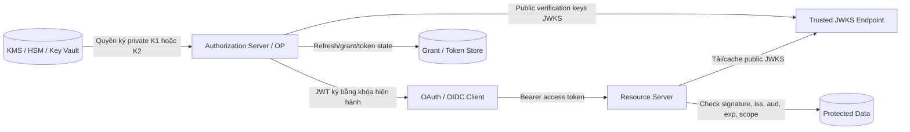
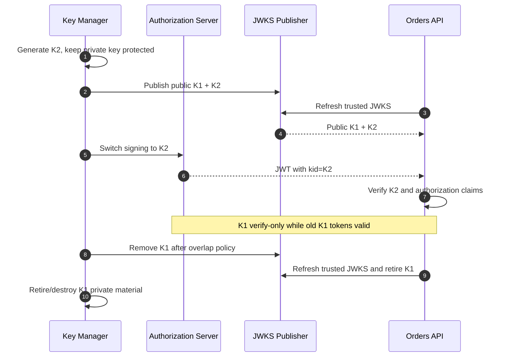
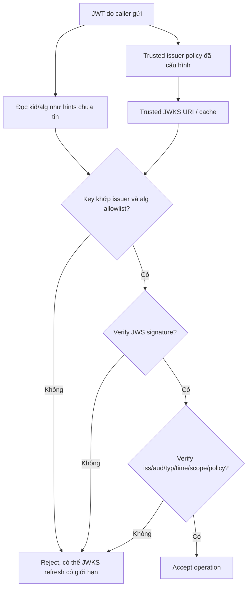

# Key rotation

Một authorization server (AS) phát **JWT access token** ký bằng RSA private key `K1`; Orders API chỉ có RSA public key tương ứng để kiểm chữ ký. Đến ngày xoay khóa, AS bắt đầu ký token mới bằng `K2`. Nếu Orders API chưa lấy được public key `K2`, token mới bị từ chối. Nếu AS xóa `K1` quá sớm khỏi JWKS, người dùng có token `K1` **vẫn còn hạn** cũng có thể đột ngột mất quyền truy cập. Nhưng nếu private key `K1` đã bị đánh cắp, tiếp tục tin nó để tránh gián đoạn có thể cho phép kẻ tấn công **tạo JWT giả có chữ ký hợp lệ**.

Đó là bài toán **key rotation**: thay thế khóa mật mã một cách có kiểm soát, duy trì tính sẵn sàng khi xoay định kỳ và **thu hẹp ngay trust** khi khóa bị lộ. Xoay khóa không chỉ là tạo một cặp key mới; nó đòi hỏi phối hợp giữa **issuer, signer, JWKS publisher, resource servers, caches, session/grant policy và vận hành**.

Bài thuộc chương **Key management** của module `SECURITY_TOKEN_SECURITY_FUNDAMENTALS`. Trọng tâm là vòng đời khóa ký và xác minh token trong OAuth 2.0/OpenID Connect (OIDC), liên hệ JWT/opaque token, access/refresh/ID tokens, claims `iss`, `aud`, `scope`, lưu trữ khóa, thu hồi, replay và phòng chống token bị đánh cắp.

> **Mục tiêu cốt lõi:** Phân biệt khóa **được dùng để ký token mới** và khóa **còn được tin để xác minh token cũ**, biết khi nào giữ overlap, khi nào phải chặn khóa cũ ngay, và cách chứng minh các resource server thực sự đã cập nhật trust.

## 1. Key rotation là gì?

**Key rotation** là quy trình thay thế một khóa mật mã đang sử dụng bằng khóa mới theo chính sách; cập nhật hệ thống phát hành/xác minh; cuối cùng vô hiệu, lưu trữ hoặc tiêu hủy khóa cũ phù hợp yêu cầu bảo mật và tính sẵn sàng.

Với JWT access token ký bất đối xứng:

- AS giữ **private signing key**; dùng nó để tạo JWS signature.
- RS nhận **public verification key** từ cấu hình tin cậy hoặc JSON Web Key Set (JWKS).
- AS chọn **một khóa ký hiện hành** khi phát token.
- RS có thể tin **nhiều public verification keys** trong giai đoạn chuyển tiếp, vì token cũ và token mới đều tồn tại.
- Mỗi token thường có `kid` trong protected header để giúp tìm key tương ứng.

**Key rotation không tự động thu hồi token.** Nếu public key `K1` vẫn được RS chấp nhận và token ký `K1` chưa hết hạn, token đó vẫn có thể hợp lệ. Thu hồi token/grant và xoay khóa là **hai vòng đời khác nhau**.

### Ba câu hỏi phải tách biệt

| Câu hỏi | Ví dụ |
|---|---|
| **Đang ký bằng khóa nào?** | Từ T0, AS ký access JWT mới bằng private key `K2`. |
| **Đang verify bằng khóa nào?** | RS chấp nhận public keys `K1` và `K2` trong overlap. |
| **Khóa nào còn đáng tin?** | `K1` đã bị compromise ⇒ phải thu hồi trust sớm, không chỉ ngừng ký. |

## 2. Những khóa khác nhau trong một hệ thống token

“Xoay khóa” có thể chỉ nhiều đối tượng, với tác động khác nhau.

| Loại khóa/credential | Vai trò | Cách xoay | Điều không được suy ra |
|---|---|---|---|
| **AS JWT signing private key** | Ký JWT access/ID token. | Tạo K2, phát hành bằng K2, cập nhật trusted public keys. | Tất cả token K1 tự bị revoke. |
| **RS public verification key/JWKS** | Xác minh chữ ký issuer. | Thêm hoặc loại trusted public key theo chính sách issuer. | RS có quyền ký token. |
| **HS256 shared secret** | Vừa tạo vừa kiểm HMAC. | Phân phối secret mới tới issuer và verifiers được phép. | Secret có thể public như RSA JWK. |
| **JWE content/key-encryption key** | Bảo mật ciphertext/token đã mã hóa. | Dùng encryption key mới, giữ decryption key cũ có hạn. | Decrypt thành công nghĩa là JWT hợp lệ về authorization. |
| **Session/cookie signing/encryption key** | Xác thực/bảo vệ session cookie. | Quản lý key ring và version; invalidation policy. | OP SSO và OAuth grants tự logout. |
| **OAuth client secret** | Xác thực confidential client. | Giai đoạn hai credential khi provider hỗ trợ rồi revoke cũ. | AS signing key thay đổi. |
| **`private_key_jwt` client auth key** | Client ký assertion để AS xác thực client. | Cập nhật public key tin cậy của client, đổi private key. | Key này là access-token signing key của AS. |
| **mTLS certificate/private key** | Xác thực caller hoặc sender constraint. | Cấp cert/key mới, cập nhật trust và bound tokens. | Khóa JWT signing đổi theo. |
| **DPoP client key** | Chứng minh client sở hữu khóa gắn với access token. | Dùng key mới và access token ràng buộc với key mới. | Token cũ tự ràng buộc sang key mới. |
| **Opaque token random value** | Token identifier, thường tra trạng thái AS. | Phát identifier mới/revoke token hoặc grant. | Có JWS public signing key để rotate. |

Bài tập trung **khóa ký và khóa verify JWS/JWT**, đồng thời chỉ ra các trường hợp dễ nhầm với **refresh-token rotation**, client-secret rotation và encryption-key rotation.

## 3. Vai trò và ranh giới tin cậy



**Private key** nên nằm trong signer/KMS/HSM hoặc kho bí mật được bảo vệ. **Public key** được chia sẻ cho những verifier cần nó. **Không đưa private key vào JWKS công khai**, application config, source code, container image hoặc logs.

**Issuer identity là trust anchor.** Resource server phải biết **issuer nào được tin**, dùng metadata/JWKS tương ứng theo cấu hình; không tải khóa từ URL do token hoặc người dùng tự cung cấp.

Một chữ ký hợp lệ chỉ chứng minh nội dung được ký bởi **bên giữ khóa tương ứng với public key đã chọn**. Nếu RS chọn **khóa của attacker** từ header `jku`, phép toán vẫn có thể “verify=true” nhưng trust đã sai.

## 4. Vòng đời khóa: từ tạo đến tiêu hủy

Một key rotation policy cần mô tả các trạng thái:

| Trạng thái | Có ký token mới? | Có thể verify token cũ? | Quy tắc |
|---|---|---|---|
| **GENERATED** | Chưa | Chưa | Key mới tạo bằng CSPRNG/KMS; kiểm metadata và ownership. |
| **STAGED / PUBLISHED** | Chưa | Có thể, nếu public key được phân phối hợp lệ. | JWKS đã công bố K2 để verifier nạp trước. |
| **ACTIVE_SIGNING** | **Có** | Có | Chính xác khóa được issuer chọn cho token mới. |
| **VERIFY_ONLY / RETIRING** | **Không** | **Có** cho token hợp lệ còn hạn. | Khóa cũ K1 còn trong trusted key set khi normal rotation. |
| **RETIRED** | Không | Không theo policy. | Gỡ khỏi JWKS/verify trust sau overlap an toàn. |
| **COMPROMISED / REVOKED** | **Không** | **Không nên tiếp tục tin**. | Kích hoạt emergency rotation, chặn token K1 tại verifiers. |
| **DESTROYED** | Không | Không bằng private key đó. | Tiêu hủy private material theo policy, giữ audit không chứa secret. |

Đây là **state machine khái niệm**, không phải enum chuẩn của JWK/JWS RFC. Trong thực tế, KMS/HSM, issuer và JWKS publisher có thể quản lý các trạng thái khác nhau; cần một **nguồn quyết định chính** và kiểm tính nhất quán.

**Không lấy `kid` làm trạng thái.** `kid` là key identifier trong JWS/JWK, không phải dấu bảo đảm khóa còn tin cậy.

## 5. Xoay khóa định kỳ: hai giai đoạn phát hành và xác minh

Kịch bản chuẩn: K1 chưa bị lộ; AS muốn thay K1 bằng K2 không làm người dùng đang có JWT bị đăng xuất.

1. **Chuẩn bị K2** với thuật toán/kích thước/curve phù hợp policy, key ID riêng.
2. **Lưu private K2 an toàn** trong KMS/HSM/secret boundary, không export nếu chính sách cấm.
3. **Công bố public K2** vào JWKS của issuer trong lúc K1 vẫn có mặt; xác minh endpoint, cache, metadata.
4. **Chờ verifiers cập nhật** theo prepublication/cache/rollout window; chạy canary tests.
5. **Chuyển signing**: AS ký token mới bằng K2; K1 chuyển sang verify-only.
6. **Giữ public K1** đến khi các token K1 hợp lệ cuối cùng không còn được chấp nhận theo TTL/clock-skew/policy.
7. **Gỡ public K1** khỏi JWKS/trust config, đồng bộ caches/nodes, không cấp token K1 nữa.
8. **Khóa/tiêu hủy private K1** theo key lifecycle và audit retention.



**Đừng đổi signing trước khi các RS có khả năng nhận K2** nếu yêu cầu zero-downtime. Ngược lại, **đừng gỡ K1 ngay khi K2 bắt đầu ký** nếu token K1 còn hạn và không có incident.

## 6. Timeline: overlap cần dài bao lâu?

Giả sử:

- Access token được ký bằng K1 tối đa **15 phút**.
- K1 ngừng ký tại **T_switch**.
- Clock skew được RS cho phép: **30 giây**.
- Dữ liệu về thời hạn issuance thực tế có thể trễ do AS đa vùng/queue.
- Một số JWT khác, chẳng hạn ID token hoặc token dùng cho job, có **lifetime dài hơn**, nếu chúng cũng dùng K1.

Công thức xác định **thời điểm sớm nhất có thể nghỉ verify K1** trong normal rotation:

```text
T_last_K1_issuance = thời điểm cuối cùng BẤT KỲ issuer instance nào
                     thực sự phát token với K1

T_last_K1_expiry   = max(exp của mọi token K1 được phép đang tồn tại)

T_retire_K1        >= T_last_K1_expiry
                      + clock_skew_tolerance
                      + margin_for_rollout_and_validation
```

Ví dụ token K1 cuối cùng phát lúc 10:00, TTL tối đa 15 phút, skew 30 giây. Việc gỡ K1 **trước 10:15:30** có thể làm token cũ bị từ chối sớm; khoảng margin phụ thuộc triển khai và bằng chứng các issuer đã ngừng K1 thật sự.

**Đừng lấy một TTL “15 phút” từ tài liệu rồi bỏ qua ID token, nested JWT, offline jobs hoặc loại token khác dùng cùng key ring.** Cần thống kê **max lifetime theo token classes thực sự dùng key K1**.

### Phân biệt hai cửa sổ thời gian

| Cửa sổ | Giải thích |
|---|---|
| **Prepublication lead time** | K2 được công bố trước T_switch đủ để verifiers/cache tải khóa mới. |
| **Verification overlap** | K1 tiếp tục được tin sau T_switch cho đến khi token K1 còn hợp lệ hết hạn. |

**JWKS cache TTL** ảnh hưởng chủ yếu đến **khả năng lấy K2 trước khi chuyển signing** và **tốc độ RS ngừng tin K1 sau khi gỡ/compromise**. Nó **không tự kéo dài `exp`** của token, nhưng một RS có cache K1 cũ vẫn có thể kiểm token K1 nếu chính sách khác còn cho phép.

## 7. JWKS và `kid`: công bố nhiều khóa đúng cách

Ví dụ JWKS công khai của `https://id.example.test` khi đang overlap:

```json
{
  "keys": [
    {
      "kty": "RSA",
      "use": "sig",
      "alg": "RS256",
      "kid": "rsa-2026-10",
      "n": "OLD_PUBLIC_MODULUS_BASE64URL_PLACEHOLDER",
      "e": "AQAB"
    },
    {
      "kty": "RSA",
      "use": "sig",
      "alg": "RS256",
      "kid": "rsa-2026-11",
      "n": "NEW_PUBLIC_MODULUS_BASE64URL_PLACEHOLDER",
      "e": "AQAB"
    }
  ]
}
```

Các giá trị `n` chỉ minh họa hình thức, **không phải JWK có thể dùng để verify**. Public JWKS **không được chứa** private key fields như RSA `d`, `p`, `q` hay HMAC `k`.

Token mới có protected header:

```json
{
  "alg": "RS256",
  "typ": "at+jwt",
  "kid": "rsa-2026-11"
}
```

RS tìm K2 **trong tập key của issuer đã tin**, kiểm thuật toán/key type và verify JWS signing input. Sau đó vẫn kiểm `iss`, `aud`, `exp`, `scope` và authorization.

### Ràng buộc chọn key

- `kid` là **gợi ý tra khóa**, không phải proof nguồn gốc.
- Dùng **key ID khác nhau** cho K1 và K2; không reuse `kid` cho key material khác trong cùng issuer.
- `kid` có thể **trùng ở hai issuers**; cache key/lookup phải bao gồm issuer.
- Tránh hai keys có cùng `kid` trong cùng trust set gây ambiguous selection.
- Kiểm `kty`, `alg` (theo policy), `use`/`key_ops` khi áp dụng; không tin một chuỗi `alg` từ token để hạ chuẩn.
- Không tự dùng key khác khi `kid` không khớp và policy yêu cầu một key xác định.
- Không dùng một `kid` chứa ký tự bất thường làm file path, SQL hoặc URL.

## 8. JWKS URI phải xuất phát từ issuer tin cậy

Một resource server có thể được cấu hình:

```text
Trusted issuer:  https://id.example.test
Trusted JWKS:    https://id.example.test/oauth2/jwks
Allowed algs:    RS256
Expected aud:    orders-api
```

**Không**:

- Dựa vào `jku` hoặc `x5u` trong JWT header để tải JWKS từ attacker.
- Nhận `iss` chưa verified rồi fetch URL mới không thuộc issuer allowlist.
- Lấy JWKS URI từ HTTP header/query do client gửi.
- Follow redirect cross-origin không kiểm soát hoặc bỏ TLS certificate verification.
- Xem mọi certificate chain do `x5c` trong token gắn kèm là trust anchor.

Một attacker có thể tự ký token bằng K_attacker, đặt `jku=https://attacker.example.test/keys`, và nếu RS tin public key trả về thì **signature sẽ verify bằng key của attacker**. Đây là **key substitution**, không phải issuer authentication.



## 9. JWKS caching và unknown `kid`

RS thường cache JWKS để tránh tải public keys mỗi request. Xoay khóa trở nên khó khi issuer bắt đầu ký K2 nhưng RS vẫn giữ JWKS chỉ có K1.

Các lựa chọn:

1. **Prepublish K2** đủ sớm theo JWKS `Cache-Control`, thời gian cập nhật và trạng thái verifiers.
2. **Refresh khi gặp `kid` chưa biết** nhưng dùng cooldown, rate limit và cache locking.
3. **Giới hạn JWKS response size, key count, HTTP timeouts** và TLS policy.
4. **Bảo vệ cache per issuer/trust domain**; không dùng global `kid → key` map.
5. **Giới hạn retry** để attacker không tạo 1000 `kid` ngẫu nhiên dẫn tới 1000 HTTP requests.
6. **Fail closed** nếu không xác minh được key; không bỏ chữ ký hoặc thử tải từ `jku`.

### Không suy luận quá mức từ JWKS TTL

```text
HTTP Cache-Control: max-age=300
```

Một số verifier có cache riêng **không theo hoàn toàn HTTP max-age**. Việc “đã công bố K2 trước 5 phút” không bảo đảm mọi RS instance đã cập nhật: cần quan sát issuer signing distribution, decoder metrics và canary test.

Trong **emergency key compromise**, cached K1 là rủi ro: **gỡ K1 khỏi JWKS không đủ để bảo đảm mọi RS ngừng tin ngay**. Cần cơ chế invalidate trust cache/denylist hoặc thay đổi key configuration tại verifiers theo response plan.

## 10. KMS/HSM và bảo vệ private signing key

**Key Management Service (KMS)** hoặc **Hardware Security Module (HSM)** có thể giữ private signing key với quyền truy cập được kiểm soát. Một kiến trúc thường dùng:

```text
AS signer pod:
    request Sign(keyRef=K2, bytes=JWS_SIGNING_INPUT)
    không cần xuất private key ra application memory nếu KMS/HSM hỗ trợ.

KMS/HSM:
    kiểm workload identity + authorization policy
    ký bằng K2 private key trong trust boundary
    trả signature bytes.

AS:
    mã hóa JWS signature đúng thuật toán
    phát token có kid=K2.
```

**Không phải mọi KMS API đều tự trả JWS-ready signatures.** Ví dụ ECDSA signature có thể là DER trong khi JWS ES256 yêu cầu `R||S`; RSA-PSS phải cấu hình đúng hash/salt theo JWA. Dùng JOSE adapter được kiểm thử, không tự kết hợp bytes theo suy đoán.

### Kiểm soát khóa nên có

| Yếu tố | Yêu cầu |
|---|---|
| **Key generation** | CSPRNG/approved KMS algorithms, key size và curve đúng security baseline. |
| **Key inventory** | Key ID, issuer, purpose, algorithm, creation, activation, retirement, owner. |
| **Least privilege** | Chỉ issuer signer được dùng Sign; RS chỉ được đọc public JWKS. |
| **No private export** | Không export private key khỏi HSM nếu policy cho phép non-exportable. |
| **Separation of duties** | Người phê duyệt rotation và người triển khai/đọc secret có kiểm soát. |
| **Audit** | Ghi keyRef, operation class, timestamp, workload identity; không log private material hoặc token thô. |
| **Backups/recovery** | Theo chính sách hệ thống, bảo vệ khóa và kiểm khả năng khôi phục có kiểm soát. |
| **Destruction** | Hủy/disable private key cũ sau lifecycle; lưu chứng cứ không chứa secret. |

KMS/HSM giúp bảo vệ khóa **nhưng không thay** policy xác minh issuer, audience, scope hoặc bảo vệ quyền dùng API ký. Nếu attacker chiếm workload có quyền `Sign(K2)`, họ có thể yêu cầu chữ ký hợp lệ ngay cả khi private key không export được.

## 11. Xoay khóa trên hệ thống nhiều node/region

Khi có nhiều AS signer instances, mỗi node phải ký nhất quán theo **activation state** được điều phối.

| Rủi ro | Hệ quả | Biện pháp |
|---|---|---|
| Region A ký K2, region B vẫn ký K1. | Overlap thực tế bắt đầu/kết thúc sai mốc. | Thời điểm cutover xác minh theo telemetry từng region. |
| JWKS publisher A có K2, publisher B chỉ có K1. | RS cache ngẫu nhiên, lỗi signature. | Công bố public keys đồng nhất trước cutover. |
| Autoscaling tạo node đọc config cũ. | K1 tiếp tục được phát sau T_switch. | Versioned config, readiness gate, deployment verification. |
| Cache JWKS ở edge/CDN stale. | RS không tìm thấy K2 hoặc tiếp tục tin K1 sau revoke. | Cache policy, purge/invalidate có theo dõi. |
| Clock skew giữa AS và RS. | Token `nbf`/`exp` bị đánh giá khác. | NTP/clock monitoring, bounded leeway. |
| Rollback ứng dụng vô tình bật lại K1 signer. | K1 tiếp tục phát token sau khi đã ngừng. | Key activation state độc lập rollout code, rollback guard. |

**Không dựa duy nhất vào một dấu “rotation completed” ở AS**. Hoàn tất normal rotation cần cả **issuer signing state** và **RS key acceptance state** được quan sát.

## 12. HS256 rotation khác RSA/EC/EdDSA ở chỗ nào?

HS256 là **MAC đối xứng**: tất cả verifier có secret đều có khả năng tạo MAC hợp lệ. Vì thế:

- Không công bố HS256 secret trong JWKS public.
- Phải phân phối K2 qua secret manager tới **mọi verifier có quyền giữ secret**.
- Một số verifier có thể tạm chấp nhận cả K1 và K2 trong overlap, nhưng mỗi key phải gắn version/kid đáng tin và policy.
- Nếu secret K1 bị lộ ở một RS, attacker có thể **tự phát tokens ký HS256** cho tới khi toàn bộ verifiers ngừng tin K1.
- Rotation ở nhiều services khó kiểm soát hơn vì có nhiều bản sao của **signing-capable secret**.

| Thuộc tính | HS256 | RS256/PS256 | ES256 | EdDSA/Ed25519 |
|---|---|---|---|---|
| Khóa tạo signature/MAC | Shared secret. | RSA private key. | P-256 private key. | Ed25519 private key. |
| Khóa verify | **Cùng secret**. | RSA public key. | EC public key. | OKP public key. |
| Public JWKS phù hợp | **Không cho secret HS256**. | Có. | Có. | Có nếu profile/library hỗ trợ. |
| Verifier có thể tự ký? | **Có**, vì giữ secret. | Không nếu chỉ giữ public key. | Không nếu chỉ giữ public key. | Không nếu chỉ giữ public key. |
| Giai đoạn overlap | Phân phối secret K2 an toàn; tạm giữ K1. | Public JWKS K1+K2. | Public JWKS K1+K2. | Public JWKS K1+K2. |

**Không cho algorithm downgrade:** token header `alg=HS256` không được khiến RS dự kiến RSA verify dùng bytes public RSA key làm HMAC secret.

## 13. Thuật toán và key type không được đổi tùy tiện

Một số hệ thống vừa rotate **key material** vừa migrate **signing algorithm**, ví dụ RS256 → PS256 hoặc ES256.

Đó là **hai thay đổi**: (1) thay khóa; (2) đổi verifier profile. Cần rollout riêng và tests.

- **RS256:** RSA PKCS#1 v1.5 + SHA-256.
- **PS256:** RSA-PSS + SHA-256 với PSS parameters theo JOSE.
- **ES256:** ECDSA P-256 + SHA-256; JWS signature là raw `R||S`, không phải DER.
- **EdDSA:** JOSE EdDSA với OKP/Ed25519 hoặc biến thể được hỗ trợ theo profile.

Không cho phép thuật toán chỉ vì JWKS có field `alg`. **Allowed algorithms** là chính sách độc lập đã đăng ký theo issuer/client/resource. Key `kty`, curve, `alg` và JWS protected header phải tương thích.

**Nếu environment/JDK/JOSE library không hỗ trợ thuật toán mới**, giữ thuật toán đã được phép trong lúc bổ sung kiểm thử; không bật fallback `alg=none` hoặc bypass signature.

## 14. Access JWT rotation không đồng nghĩa refresh-token rotation

Hai cụm từ dễ bị nhầm:

| Cụm từ | Đối tượng thay đổi | Mục đích |
|---|---|---|
| **JWT signing key rotation** | Private signing key và public verify key set. | Giới hạn vòng đời signing keys và chuyển trust an toàn. |
| **Refresh token rotation** | Refresh token `R1` đổi sang `R2` sau mỗi lần refresh hợp lệ. | Giảm rủi ro replay, hỗ trợ phát hiện reuse và revoke family. |
| **Access token renewal** | Access token mới khi token cũ hết hạn/refresh hợp lệ. | Duy trì quyền truy cập theo grant. |
| **Client credential rotation** | Client secret/private key/certificate. | Bảo vệ xác thực client với AS. |

Một access JWT mới ký bằng K2 **không chứng minh refresh token family đã được rotate**. Ngược lại, AS có thể phát R2 thay R1 nhưng **vẫn ký access JWT bằng cùng signing key K1**.

### Ví dụ

```text
09:00  AS ký Access A1 bằng K1; Refresh R1 đang active.
09:10  R1 refresh hợp lệ → AS phát A2 + R2, cả A1/A2 có thể ký K1.
10:00  Signing key K2 active → Access A3 từ R2 có thể ký K2.
10:05  K1 vẫn còn trong JWKS để verify A1/A2 nếu chúng còn hạn.
```

Nếu **R1 bị lộ**, phải đánh giá refresh family/grant và access tokens liên quan; chỉ chuyển signing key K1 → K2 **không ngăn attacker sử dụng R1**.

## 15. JWT access token và opaque access token

**JWT access token** thường là JWS tự chứa. RS kiểm signature bằng trusted public key rồi kiểm issuer/audience/time/type/scope.

**Opaque access token** thường là token identifier ngẫu nhiên; RS không dựa vào chữ ký JWS của token. Nó có thể hỏi AS qua **RFC 7662 Token Introspection** để biết `active` và các metadata.

| Nội dung | JWT tự chứa | Opaque + introspection |
|---|---|---|
| Key rotation nhìn thấy ở RS | Public verification keys/JWKS. | TLS trust, credential introspection; signing key có thể chỉ là chi tiết nội bộ AS. |
| Token validity sau AS đổi signer | Token K1 vẫn có thể verify khi K1 được tin. | AS quyết định `active` theo token state. |
| Revocation | Cần denylist/grant status/introspection hoặc TTL. | AS có thể trả `active=false`, nhưng RS cache tạo trễ. |
| Lỗi JWKS rotation | Có thể làm RS từ chối JWT mới/cũ. | Không nhất thiết ảnh hưởng opaque identifier, nhưng AS/introspection vẫn có thể phụ thuộc key khác. |

**Không chỉ vì AS xoay signing key mà coi mọi opaque token bị vô hiệu.** Cũng không diễn giải “JWT signature hợp lệ” thành “grant/consent còn hiệu lực”.

## 16. Token classes dùng cùng key ring cần tách policy

Một OP có thể dùng cùng hoặc khác signing key rings cho:

- **OAuth JWT access tokens** dành cho resource servers.
- **OIDC ID tokens** dành cho relying parties.
- **Logout Tokens** dùng trong OIDC Back-Channel Logout.
- **JWT client assertions**, token exchange hoặc các message chuyên biệt khác theo profile.

**Cùng signature key không làm các JWT trở nên có thể dùng thay nhau.** Verifiers phải kiểm token type, audience và claims theo profile riêng.

Ví dụ:

```json
{
  "alg": "RS256",
  "kid": "rsa-2026-11",
  "typ": "at+jwt"
}
```

Với RFC 9068 JWT access token, `typ=at+jwt` (hoặc định dạng được profile cho phép) giúp chống token confusion nếu RS kiểm nghiêm ngặt. **OIDC ID token** có `aud` là client ID RP, không phải Orders API; nó cần `nonce` khi đã yêu cầu và các validation theo OIDC.

Khi tính **max token lifetime của K1**, phải tính mọi token class thực tế có thể còn được verifier hợp lệ chấp nhận bằng K1, không chỉ access token TTL ngắn nhất.

## 17. Key rotation khác token revocation và logout

### Bình thường: không thu hồi token chỉ vì khóa đổi

Trong normal rotation, K1 có thể ở trạng thái **VERIFY_ONLY**. JWT ký K1 tiếp tục được chấp nhận đến khi hết hạn nếu các claims và policy còn đúng.

### Khi access token bị nghi đánh cắp

Nếu kẻ tấn công sao chép nguyên JWT ký K1, signature vẫn verify. **Thay signing key K2 không sửa được bản sao token**. Cần **revoke token/grant** và RS enforcement (denylist `jti`, introspection, grant-state check, short TTL hoặc sender constraints).

### Khi private signing key bị nghi đánh cắp

Đây là cấp nghiêm trọng hơn: attacker có thể **tự tạo tokens mới ký K1**, với `sub`, `scope` hoặc `exp` giả nếu RS tiếp tục tin K1 mà không có kiểm soát cấp phát bổ sung. Khi đó:

- **Không đủ chỉ revoke một `jti`** vì attacker có thể tự tạo nhiều `jti`.
- **Không đủ chỉ đổi key để ký mới**, bởi RS vẫn tin K1.
- Cần **ngừng ký bằng K1 và loại quyền verify K1 tại các RS** theo emergency plan, đồng thời kiểm các issuer/clients/grants liên quan.
- Nếu trust removal không đồng bộ tức thời, cần bảo vệ đặc biệt các APIs nhạy cảm và áp dụng issuer-backed token state/ledger khi thích hợp.

**Tuyệt đối không giữ compromised K1 chỉ vì muốn đợi token cũ hết hạn như trong normal rotation.**

## 18. Normal rotation và emergency rotation phải là hai runbooks khác nhau

| Quyết định | **Normal rotation** | **Emergency: private key compromised** |
|---|---|---|
| Mục tiêu ưu tiên | Không gián đoạn, tuân thủ key lifecycle. | Chặn signer giả mạo, giảm thiệt hại ngay. |
| Công bố K2 trước cutover | Nên thực hiện. | Làm nhanh nhất khả thi; có thể có interruption. |
| Giữ public K1 trong JWKS | Có thể tới hết token K1 hợp lệ. | **Không nên** tiếp tục tin K1; gỡ/deny sớm. |
| Token K1 còn hạn | Thường chấp nhận tới `exp`. | Có thể phải từ chối ngay vì khó phân biệt thật/giả. |
| JWKS cache | Thiết kế prepublication/overlap. | Cần purge/invalidate/RS coordination. |
| Giao tiếp | Thông báo maintenance/key change. | Security incident, blast radius, reauth, business impact. |
| Rollback về K1 | Có thể nếu K1 sạch và policy cho phép. | **Không rollback sang compromised key**. |
| Tiêu chí hoàn thành | RS nhận K2; token K1 hết hạn; K1 retired. | Không còn AS ký K1, RS không còn tin K1, sự cố được điều tra. |

## 19. Key compromise: vì sao “gỡ K1 khỏi JWKS” vẫn chưa đủ?

Giả sử private signing key K1 bị lộ và attacker có thể ký JWT bằng K1. AS xóa public K1 khỏi JWKS lúc 10:00, nhưng một RS đã cache JWKS gồm K1 với TTL 10 phút. Nếu verifier chỉ dùng cached keys và không có cơ chế cập nhật tin cậy khẩn cấp, nó vẫn có thể chấp nhận **JWT giả ký K1 trong khoảng cache còn hoạt động**.

```text
09:55  RS-A cache JWKS {K1, K2}.
10:00  AS phát hiện private K1 lộ và ngừng ký K1.
10:01  AS xóa K1 khỏi JWKS origin.
10:02  Attacker tạo JWT giả signed by K1, exp còn hạn.
10:03  RS-A dùng cached K1 -> có thể verify JWT giả.
10:05  RS-B đã refresh JWKS -> từ chối K1.
10:10  RS-A cache hết hạn -> mới nhận bản JWKS không có K1.
```

**Key rotation khẩn cấp cần phối hợp trust invalidation tại verifiers**, không chỉ đổi AS signer. Các chiến lược tùy kiến trúc:

- Triển khai **denylist key identifier/version** tại gateway/RS, ràng buộc chính xác issuer + key fingerprint/`kid` và không tin header `kid` trần để kết luận.
- Invalidate/purge JWKS caches ở proxy, CDN, RS instances khi được hỗ trợ.
- Phát cấu hình trusted-key-set version mới qua kênh quản trị an toàn.
- Từ chối mọi token ký K1 tại APIs nhạy cảm kể cả khi token thật còn hạn, nếu không có cách phân biệt chính xác thật/giả.
- Nếu cần giữ một tập token cũ nào đó, chỉ tin **issuer-backed token registry/ledger** đã được bảo vệ và verified; tự verify chữ ký K1 không còn đủ.
- Theo dõi ở **từng region/RS node** xem K1 còn được chấp nhận không, thay vì chỉ xem JWKS origin.

### Vì sao `jti` denylist đôi khi vô dụng?

Nếu attacker giữ private key K1, họ có thể tạo JWT mới với `jti` ngẫu nhiên chưa có trong denylist. Một denylist chỉ chứa token IDs bị biết trước **không chặn tokens giả mới**. Phòng vệ chính là **ngừng tin signing key K1** hoặc yêu cầu additional authoritative issuance checks khi phù hợp.

### Nếu không thể phân phối trust removal ngay?

Có thể cần tạm **giảm bề mặt tiếp nhận token**, vô hiệu routes nhạy cảm, dùng introspection/issuer-issued-token allowlist hoặc cắt quyền một nhóm clients/grants, theo emergency policy. Hệ thống phải chấp nhận trade-off availability để tránh mở cửa cho signature giả mạo.

## 20. Runbook xoay khóa khẩn cấp

Một quy trình ứng phó nên phân rõ các bước với owner và bằng chứng.

| Thứ tự | Hành động | Bằng chứng xác minh |
|---|---|---|
| 1 | Tạo incident, xác nhận key ID/issuer/algorithm và nghi vấn nguồn lộ. | Incident reference và key inventory; không copy private key vào ticket. |
| 2 | Thu hẹp quyền truy cập private key/HSM Sign API. | K1 signing operation bị disable theo policy. |
| 3 | Kích hoạt trusted key K2 hoặc phát K2 an toàn nếu chưa có. | JWKS/issuer trust config chứa K2, RS có thể verify K2. |
| 4 | Chuyển issuer signing sang K2 và ngăn rollback K1. | Telemetry cho thấy không còn JWT mới ký K1. |
| 5 | Loại K1 khỏi trusted verification ở RS/gateway. | Từng RS/region từ chối test token ký K1. |
| 6 | Phân tích tokens/grants/subjects/clients có khả năng bị ảnh hưởng. | Audit không chứa token raw; policy scope rõ. |
| 7 | Xử lý revoke grants/refresh families/sessions khi cần. | Token endpoint và API chứng minh trạng thái chặn. |
| 8 | Yêu cầu reauthentication/reissuance đối với token thật bị vô hiệu do gỡ K1. | Người dùng/client nhận token K2 qua flow hợp lệ. |
| 9 | Điều tra key usage, logs, secrets, build images, KMS IAM permissions. | Root cause, thời gian exposure, bằng chứng. |
| 10 | Khôi phục an toàn, monitor và đóng incident. | RS coverage, key version consistency, residual risk được phê duyệt. |

**Tránh đưa private key K1 vào test để tạo token giả ngay trong production**. Dùng test token đã chuẩn bị trong môi trường cách ly hoặc token thử an toàn với tài khoản không có quyền nhạy cảm theo chính sách. Trong tình huống cần xác minh production, có thể dùng **key fingerprint/JWKS configuration state** và status probe không tiết lộ credentials.

### Chặn key signing ở nhiều lớp

Nếu signing key nằm trong KMS, chỉ đổi cấu hình `activeKid=K2` ở AS chưa đủ khi một workload bị xâm nhập vẫn có quyền gọi `Sign(K1)`. Cần **disable/quarantine K1 và thu hồi quyền ký với K1** trong KMS/HSM, đồng thời điều tra identities có quyền sign.

## 21. Backup, recovery và key escrow: giữ khả năng khôi phục có kiểm soát

Key management còn bao gồm mất khóa, không chỉ lộ khóa.

**Nếu private signing key K1 bị mất** nhưng public K1 vẫn được RS tin, token K1 đã phát có thể tiếp tục verify tới khi hết hạn; issuer không còn ký token mới bằng K1. Có thể chuyển sang K2. **Nếu private JWE decryption key bị mất**, dữ liệu/token đã mã hóa bằng key đó có thể **không giải mã được**, tác động khác hẳn.

| Key kind | Cần giữ key cũ để làm gì? | Nguy cơ khi giữ lâu |
|---|---|---|
| JWT signing private key | Thường **không cần** cho verify token cũ; chỉ public key là đủ. | Bị lộ có thể ký token giả. |
| JWT verification public key | Verify tokens cũ trong overlap. | Nếu private key bị lộ, tiếp tục trust public key nguy hiểm. |
| JWE decryption private key / symmetric key | Giải mã ciphertext cũ còn cần truy cập. | Mở rộng khoảng thời gian attacker có thể decrypt nếu key lộ. |
| Session/cookie encryption key | Giải mã cookie/session state đã phát, nếu profile cần. | Cookie cũ có thể tiếp tục được chấp nhận nếu policy không giới hạn. |
| KMS master/wrapping key | Unwrap data keys cũ khi rewrap chưa hoàn tất. | Blast radius lớn nếu root key bị lộ. |

**Backups của private keys phải theo policy riêng, mã hóa, quyền truy cập và kiểm restore.** Không lưu một bản private key trong Git “để phòng mất khóa”. Có thể dùng KMS/HSM key-versioning, secure backup hoặc rewrap strategy theo hệ thống, kèm audit/approval.

## 22. JWE encryption-key rotation khác signing-key rotation

Với **JWE**, cần phân biệt:

- **Encryption key (new)** dùng mã hóa token/dữ liệu mới.
- **Decryption key (old)** có thể vẫn cần để giải mã ciphertext đã phát và còn hiệu lực.
- **Nested JWT** có thể yêu cầu giải mã JWE rồi xác minh JWS bên trong, đúng thứ tự/profile.

```text
Normal JWE rotation:
    T0: Encrypt new content using E2.
        Accept decrypt using E1 + E2 during controlled overlap.
    T1: Old ciphertext E1 expired or re-encrypted.
        Retire E1 decrypt capability.

Emergency E1 compromise:
    Do not keep E1 just for convenience without threat review.
    Re-encrypt or invalidate affected content as required.
```

**Đổi khóa ký JWT không làm JWE ciphertext được mã hóa lại.** Nếu token hoặc session cookie chứa dữ liệu nhạy cảm, cần security review riêng cho at-rest/transit encryption và encryption-key lifecycle.

Với asymmetric JWE, **public encrypt key** có thể phân phối; **private decrypt key** phải giữ bí mật. Với symmetric JWE, secret được bảo vệ ở cả issuer và receiver được phép.

## 23. Session/cookie key rotation và đăng xuất

Một số framework dùng key để ký hoặc mã hóa **stateless session cookies** hoặc session data. Nếu application pods sử dụng key khác nhau trong lúc rollout, người dùng có thể liên tục bị logout do cookie không verify được.

- Normal rotation có thể cần **key ring** gồm current-sign + old-verify/decrypt keys.
- Các pods phải dùng **cùng key ring phiên bản** hoặc một trust source chia sẻ.
- Cookie lifetime phải giới hạn thời gian giữ old session keys.
- Nếu signing/encryption key của cookie bị lộ, cần **invalidate sessions**, rotate keys và điều tra session hijacking.
- Với server-side session, rotation của cookie-signing key **không mặc nhiên revoke access token** nằm ở authorized-client store.
- Với OP SSO, RP cookie key rotation **không tự kết thúc OP session** hoặc refresh-token family.

**Không nhầm signing key của access JWT với key dùng cho Spring Session cookie, CSRF token hoặc application encryption.** Các secret cần key inventory và rotation plan riêng.

## 24. OAuth client secret và `private_key_jwt` rotation

Một confidential OAuth client có thể xác thực với AS bằng:

- **Client secret**, ví dụ `client_secret_basic`.
- **`private_key_jwt`**, với public client key/JWKS đã đăng ký.
- **mTLS client certificate**, theo profile triển khai.

### Client secret rotation không làm AS JWT signing key đổi

Nếu `invoice-companion` thay secret để gọi token endpoint, **resource servers không cần nhận public JWKS khác** chỉ vì client secret đổi. AS vẫn phát JWT access token bằng key riêng của issuer.

### Overlap hai secrets

Một số AS cho phép tạm thời hai secrets cùng có hiệu lực:

1. Tạo secret mới và lưu trong secret manager.
2. Rollout client instances sang secret mới.
3. Xác nhận token endpoint/AS xác thực credential mới.
4. Revoke secret cũ và test nó không thể tiếp tục xác thực.
5. Dọn secret cũ khỏi logs, CI, deployments và backups theo policy.

Nếu AS **không hỗ trợ overlap**, cần rollout phối hợp, xử lý downtime hoặc phương pháp migration khác có kiểm chứng. **Không để cả hai secrets sống vô thời hạn**.

### `private_key_jwt` key rotation

Client ký assertion bằng private key của mình; AS verify bằng public key đăng ký. Phải validate `iss`/`sub`, `aud`, `exp`, `jti` và chống replay theo profile. Đây là **client authentication key**, không phải JWS access-token signing key của AS.

## 25. Sender-constrained tokens: DPoP và mTLS

Khi access token được ràng buộc với khóa client:

- **DPoP** (RFC 9449): access token có thể chứa `cnf.jkt` ràng buộc với DPoP key thumbprint.
- **mTLS-bound token** (RFC 8705): access token được ràng buộc với client certificate fingerprint.

**Đổi client key/certificate không tự thay binding của token cũ**. Cần nhận access token mới ràng buộc khóa mới qua flow hợp lệ; RS vẫn phải kiểm DPoP proof hoặc mTLS certificate trên **mỗi request**.

| Sự kiện | Hướng xử lý |
|---|---|
| Client tự đổi DPoP key theo lịch. | Cấp tokens mới bound to new key, chấm dứt dùng tokens cũ theo policy. |
| DPoP private key bị lộ cùng access token. | Revoke affected tokens/grants và rotate key. |
| mTLS certificate hết hạn. | Cấp cert mới, cập nhật AS/RS trust và token bindings; kiểm downtime. |
| AS JWT signing key rotate. | Không tự làm DPoP/mTLS key của client rotate. |

**Một claim `cnf` không tự bảo vệ replay.** RS cần verify proof phù hợp; chữ ký access JWT và chữ ký DPoP proof là **hai kiểm tra độc lập**.

## 26. Java 17: minh họa ký và verify RS256 bằng JCA

Ví dụ sau chỉ minh họa việc dùng **hai cặp RSA** và chọn public key tương ứng khi rotate; không tự tạo token JWT hoàn chỉnh.

```java
import java.nio.charset.StandardCharsets;
import java.security.KeyPair;
import java.security.KeyPairGenerator;
import java.security.Signature;
import java.security.interfaces.RSAPublicKey;

public class RsaKeyRotationDemo {

    private static byte[] sign(String text, KeyPair key)
            throws Exception {
        Signature signer = Signature.getInstance("SHA256withRSA");
        signer.initSign(key.getPrivate());
        signer.update(text.getBytes(StandardCharsets.US_ASCII));
        return signer.sign();
    }

    private static boolean verify(
            String text,
            byte[] signature,
            RSAPublicKey trustedPublicKey) throws Exception {
        Signature verifier = Signature.getInstance("SHA256withRSA");
        verifier.initVerify(trustedPublicKey);
        verifier.update(text.getBytes(StandardCharsets.US_ASCII));
        return verifier.verify(signature);
    }

    public static void main(String[] args) throws Exception {
        KeyPairGenerator generator = KeyPairGenerator.getInstance("RSA");
        generator.initialize(3072);
        KeyPair k1 = generator.generateKeyPair();
        KeyPair k2 = generator.generateKeyPair();

        // Minh họa JWS signing input: encodedHeader + "." + encodedPayload
        String signingInput =
            "ENCODED_PROTECTED_HEADER.ENCODED_PAYLOAD";

        byte[] oldSignature = sign(signingInput, k1);
        byte[] newSignature = sign(signingInput, k2);

        boolean oldValidWithK1 = verify(
            signingInput, oldSignature, (RSAPublicKey) k1.getPublic());
        boolean newValidWithK2 = verify(
            signingInput, newSignature, (RSAPublicKey) k2.getPublic());
        boolean newInvalidWithK1 = verify(
            signingInput, newSignature, (RSAPublicKey) k1.getPublic());

        System.out.println(oldValidWithK1); // true
        System.out.println(newValidWithK2); // true
        System.out.println(newInvalidWithK1); // false
    }
}
```

### Giới hạn của ví dụ

- Dùng key ephemeral trong memory chỉ để **minh họa thuật toán**; production lấy private keys từ KMS/HSM/secret store.
- `signingInput` là placeholder, **không phải JWS/JWT có thể dùng**; verify JWS thật cần đúng encoded header và payload bytes.
- Hàm chưa kiểm `alg`, `kid`, `typ`, issuer, audience, thời gian, scope hoặc revocation.
- Dùng `SHA256withRSA` cho RS256; **không dùng** nó cho PS256, ES256 hoặc EdDSA.
- Không cấp quyền API chỉ dựa vào `verify() == true`; ưu tiên thư viện JOSE/Spring Security có validation profile.

## 27. Java: mô hình trạng thái signing và verification keys

Pseudocode dưới minh họa việc **tách lựa chọn key dùng ký token mới** khỏi **tập public keys được tin để verify**.

```java
// Pseudocode: domain types do hệ thống tự định nghĩa.
enum KeyState {
    GENERATED, STAGED, ACTIVE_SIGNING,
    VERIFY_ONLY, RETIRED, COMPROMISED
}

record SigningKeyVersion(
    String issuer,
    String kid,
    String algorithm,
    String kmsKeyReference,
    KeyState state
) {}

SigningKeyVersion selectSigningKey(String issuer, String tokenType) {
    // Key inventory là nguồn đáng tin, không lấy từ request token.
    SigningKeyVersion key =
        keyInventory.findExactlyOneActiveSigningKey(
            issuer, tokenType);

    requireApprovedAlgorithmForIssuer(
        issuer, tokenType, key.algorithm());

    if (key.state() != KeyState.ACTIVE_SIGNING) {
        throw new SecurityException("No trusted active signer");
    }
    return key;
}

List<PublicJwk> publishedVerificationKeys(
        String issuer, String tokenType) {

    return keyInventory.findKeys(issuer, tokenType).stream()
        .filter(key -> key.state() == KeyState.ACTIVE_SIGNING
                    || key.state() == KeyState.STAGED
                    || key.state() == KeyState.VERIFY_ONLY)
        .map(key -> publicJwkOnly(key))
        .toList();
}
```

**Đây không phải API Spring Authorization Server** và chưa giải quyết toàn bộ concurrency/distributed consistency. Trong production cần:

- **Atomic activation** hoặc monotonic config version để tránh nhiều signers chọn K1/K2 không nhất quán ngoài planned window.
- Separate authority cho **signing** và **publishing public keys**.
- Không phát private JWK fields.
- Map kid/algorithm/purpose/issuer chính xác, không reuse key ID.
- Xóa **COMPROMISED** khỏi verify trust ngay theo incident policy.
- Bảo vệ rollback: không cho config cũ khôi phục signer K1 sau emergency disable.

Một key đang STAGED được public không có nghĩa **issuer đã bắt đầu ký bằng key đó**.

## 28. Spring Security Resource Server: tự cập nhật trusted JWKS

Với Spring Security 6.x, RS có thể dùng issuer discovery để lấy trusted JWKS và verify token.

```yaml
spring:
  security:
    oauth2:
      resourceserver:
        jwt:
          issuer-uri: "https://id.example.test"
```

Cấu hình minh họa giới hạn RS256 và kiểm audience:

```java
import org.springframework.context.annotation.Bean;
import org.springframework.context.annotation.Configuration;
import org.springframework.http.HttpMethod;
import org.springframework.security.config.annotation.web.builders.HttpSecurity;
import org.springframework.security.config.annotation.web.configuration.EnableWebSecurity;
import org.springframework.security.oauth2.core.DelegatingOAuth2TokenValidator;
import org.springframework.security.oauth2.core.OAuth2Error;
import org.springframework.security.oauth2.core.OAuth2TokenValidator;
import org.springframework.security.oauth2.core.OAuth2TokenValidatorResult;
import org.springframework.security.oauth2.jose.jws.SignatureAlgorithm;
import org.springframework.security.oauth2.jwt.Jwt;
import org.springframework.security.oauth2.jwt.JwtDecoder;
import org.springframework.security.oauth2.jwt.JwtValidators;
import org.springframework.security.oauth2.jwt.NimbusJwtDecoder;
import org.springframework.security.web.SecurityFilterChain;

@Configuration
@EnableWebSecurity
public class OrdersApiKeyRotationConfig {

    private static final String ISSUER =
        "https://id.example.test";

    @Bean
    JwtDecoder jwtDecoder() {
        NimbusJwtDecoder decoder =
            NimbusJwtDecoder.withIssuerLocation(ISSUER)
                .jwsAlgorithm(SignatureAlgorithm.RS256)
                .build();

        OAuth2TokenValidator<Jwt> standard =
            JwtValidators.createDefaultWithIssuer(ISSUER);

        OAuth2TokenValidator<Jwt> audience = jwt -> {
            if (jwt.getAudience() != null
                    && jwt.getAudience().contains("orders-api")) {
                return OAuth2TokenValidatorResult.success();
            }
            return OAuth2TokenValidatorResult.failure(
                new OAuth2Error(
                    "invalid_token", "Audience mismatch", null));
        };

        decoder.setJwtValidator(
            new DelegatingOAuth2TokenValidator<>(
                standard, audience));

        return decoder;
    }

    @Bean
    SecurityFilterChain apiSecurity(HttpSecurity http)
            throws Exception {

        http.authorizeHttpRequests(auth -> auth
            .requestMatchers(HttpMethod.GET, "/api/orders/**")
                .hasAuthority("SCOPE_orders.read")
            .anyRequest().denyAll());

        http.oauth2ResourceServer(oauth2 ->
            oauth2.jwt(org.springframework.security.config.Customizer
                .withDefaults()));

        return http.build();
    }
}
```

**Kiểm tra phiên bản cụ thể của Spring Security** khi tích hợp: JWKS cache refresh behavior, issuer discovery tại startup/first request, HTTP client timeout, algorithm allowlist và token type validator có thể khác nhau. Đây là **cấu hình minh họa**, không phải hướng dẫn production đầy đủ.

### Điều Spring Security không tự bảo đảm

- Chỉ cấu hình `issuer-uri` **không thay kiểm audience** theo application contract.
- JWKS đổi K1 → K2 **không revoke tokens K1** nếu verifier vẫn giữ key trong cache.
- Thư viện không tự biết private key K1 bị compromise; cần **emergency trust invalidation** ở decoder/cache/gateway.
- `SCOPE_orders.read` không thay tenant/object authorization.
- Nếu dùng RFC 9068 JWT access token, cần kiểm token profile/`typ`, issuer, audience, required claims và token purpose theo hợp đồng (một số versions cần tùy biến type validation).
- Nếu yêu cầu chặn token bị đánh cắp trước expiry, cần **revocation/status layer** riêng.

Đừng sửa lỗi unknown `kid` bằng cách tắt chữ ký hoặc mở `alg=none`.

## 29. Chuyển signing key ở AS: cần cố định key selection

Một AS tự phát JWT qua JOSE library có thể gặp lỗi nếu JWKS gồm K1 + K2 nhưng signer được chọn **ngẫu nhiên** từ list keys không có trạng thái.

**Quy tắc vận hành:**

1. Có **một key version xác định** cho mỗi issuer + token class + algorithm dùng signing.
2. Việc chọn key dựa trên **server-side key state**, không dựa vào `kid` do OAuth client gửi.
3. Protected header `kid` phải đúng key đã được dùng để ký.
4. JWKS có thể công bố nhiều public keys, nhưng signing decision không phải “lấy key đầu tiên”.
5. Khi chuyển K1 → K2, mọi signer cần nhận cùng activation version, hoặc được phép có cửa sổ chuyển tiếp rõ ràng.
6. Nếu K2 không khả dụng, chính sách phải nêu failover hợp lệ; **không tự quay về compromised K1**.
7. Định kỳ kiểm issuer key inventory, KMS permissions và JWKS public set.

Nếu sử dụng **Spring Authorization Server** và `JWKSource<SecurityContext>`, cần cấu hình key source/selector theo phiên bản và loại token để **chỉ một key active signing được chọn nhất quán**, trong khi keys verify-only vẫn được xuất dưới dạng public JWKS thích hợp. Không coi việc thêm hai JWKs vào một source là đã xây xong quy trình rotate.

## 30. Rollout và rollback: bằng chứng kỹ thuật cần có

| Pha | Gate trước khi đi tiếp | Triệu chứng lỗi cần chú ý |
|---|---|---|
| **Prepare** | K2 key size/algorithm/KMS owner được approve; JWKS schema đúng. | K2 private key không truy cập được hoặc có private fields trong JWKS. |
| **Publish** | K2 public xuất hiện nhất quán trên issuer JWKS ở mọi region. | CDN cache chỉ có K1, duplicate kid. |
| **Prewarm** | Canary RS xác minh test token K2; old K1 token vẫn pass. | Unknown kid, JWKS timeout, alg rejected. |
| **Switch signing** | Issuer phát token mới kid=K2 ở mọi signer instances. | Region/pod tiếp tục ký K1 ngoài kế hoạch. |
| **Overlap** | Old K1 token hợp lệ pass; K2 pass, claims validation vẫn đúng. | 401 spikes hoặc sai issuer/audience. |
| **Retire** | Last K1 token hết hạn; K1 bị loại khỏi trusted key set. | Caches còn K1 quá lâu hoặc gỡ quá sớm. |
| **Close** | K1 private state retired/destroyed, audit đủ, alerts bình thường. | Signing requests bằng K1 sau cutoff. |

### Rollback an toàn

Trong **normal rotation**, nếu K2 chưa dùng ổn định, có thể tạm quay lại K1 **chỉ khi K1 còn sạch, còn trong key inventory và policy cho phép**. Việc rollback phải cập nhật T_last_K1_issuance và **tính lại verification overlap**.

Trong **emergency compromise**, **không được rollback sang K1**. Cần K3 hoặc pause issuance theo fail-closed plan.

**Không roll back JWKS origin về file cũ thiếu K2** khi các regions đã phát token K2; làm vậy có thể khiến hàng loạt token vừa phát trở nên không verify được.

## 31. Monitoring, metrics và alerting trong key rotation

Những metrics có thể quan sát mà không log JWT raw:

| Metric / event | Câu hỏi trả lời |
|---|---|
| `jwt_issued_total{issuer,kid,token_type}` | Signers đang dùng key nào? |
| `jwt_verify_success_total{issuer,kid}` | Token K1/K2 được RS chấp nhận với phân bố ra sao? |
| `jwt_verify_failed_total{issuer,reason}` | Unknown key, signature, audience hay expiry? |
| `jwks_fetch_total{issuer,status}` | Tải trusted JWKS có ổn định không? |
| `jwks_cache_age_seconds{issuer}` | Caches có stale vượt policy không? |
| `jwks_unknown_kid_total{issuer}` | Có lỗi rotation hay token scanning? |
| `kms_sign_total{key_ref,result}` | K1 có còn bị gọi Sign sau cutover/disable? |
| `key_state_change{key_ref,old,new}` | Ai thay key state, khi nào và theo approval nào? |
| `rs_emergency_reject_k1_total{issuer,resource}` | Sau compromise, RS có chặn K1 không? |
| `token_reauth_required_total{client,reason}` | Compromised key gây tác động user ở đâu? |

**Metric labels phải có cardinality giới hạn**. Không đưa raw token, `sub`, private keys, ID token payload, arbitrary `kid` dài hoặc các giá trị attacker kiểm soát trực tiếp vào labels. `kid` có thể được normalized hoặc map sang key inventory ID.

Cảnh báo cần phân biệt **unknown `kid` tăng vì rollout K2** với **token scanning**. Dù vậy, không mở đường tin attacker key để “giảm báo động”.

## 32. Những sai lầm phổ biến

| Sai lầm | Hậu quả | Cách khắc phục |
|---|---|---|
| AS bắt đầu ký K2 trước khi công bố K2. | JWT mới bị RS trả 401 unknown kid. | Prepublish + prewarm trusted JWKS. |
| Xóa public K1 ngay sau khi K2 active. | Token K1 còn hạn bị từ chối sớm. | Normal overlap theo max token expiry. |
| Giữ K1 sau khi private key bị lộ. | Attacker tạo JWT giả, RS vẫn nhận. | Emergency trust removal. |
| Chỉ xóa K1 ở JWKS origin mà bỏ qua caches. | RS tiếp tục tin K1. | Cache purge/RS coordination. |
| Reuse `kid` cho K2. | Verifier dùng nhầm K1 hoặc cache không cập nhật. | Key ID/version duy nhất theo issuer. |
| Dùng global `kid → key` map không gắn issuer. | Key confusion giữa issuers. | Issuer-bound key lookup/cache. |
| Tin `jku`/`x5u` của token để tải keys. | Attacker key injection/SSRF. | Pinned issuer JWKS. |
| Public JWKS chứa RSA private `d` hoặc HMAC `k`. | Lộ signing capability. | Public-only JWK serialization. |
| Key K2 có `alg=ES256` nhưng verifier chỉ cho RS256. | Rotation fail hoặc alg policy bypass. | Algorithm migration plan riêng. |
| Dùng HMAC secret yếu/đưa vào public config. | Attacker forge HS256 token. | High-entropy secret manager, separation of duties. |
| Tất cả RS dùng chung HS256 secret. | Một RS breach có signing capability. | Asymmetric signing khi phù hợp. |
| Rollback config làm AS ký lại K1 sau compromise. | Duy trì forgery window. | Disable key trong KMS, monotonic state. |
| Chỉ theo dõi JWKS origin, không theo dõi RS. | Không thấy inconsistent acceptance. | Per-region canary/enforcement metrics. |
| Dùng signing-key rotation làm token revocation. | Token bị đánh cắp vẫn hợp lệ. | Grant/token status và RS enforcement. |
| Bỏ audience check vì signature đúng. | Nhận token dành API khác. | Exact `aud` validator. |
| Dùng ID token vào resource server. | Token type confusion. | `typ`/purpose/issuer/audience policy. |
| Rotation của access key coi là refresh-token rotation. | Family bị lộ vẫn refresh. | Xử lý grant/refresh riêng. |
| JWE key cũ bị xóa trước khi ciphertext hết cần. | Mất khả năng decrypt. | Decryption-key overlap/rewrap policy. |
| Không test KMS permission failover. | AS issuance outage hoặc fallback sai. | Chaos/security tests, fail closed. |
| Log raw tokens/private keys để debug rotation. | Phơi bày credential lần nữa. | Reference/hash, redaction và retention. |
| Không có key inventory/owner/approval. | Khóa “mồ côi”, không rõ ai retire. | Key governance/automated lifecycle. |
| Một incident đóng khi AS đã đổi K2 nhưng RS vẫn nhận K1. | Sự cố vẫn có forgery window. | End-to-end verification ở RS. |

## 33. Ma trận kiểm thử Key rotation

Giả sử AS `https://id.example.test` ký **JWT access token RS256** cho Orders API (`aud=orders-api`), token TTL tối đa 15 phút, K1 là key cũ, K2 là key mới. Resource server xác minh JWS signature, issuer, audience, time, type, scope và owner/tenant. Các ca về HS256, JWE, DPoP, EdDSA thuộc **profiles riêng** và không có nghĩa Orders API phải nhận mọi thuật toán.

| ID | Tình huống | Kết quả mong đợi |
|---|---|---|
| KR01 | JWKS chỉ có public K1, token K1 hợp lệ. | RS verify và kiểm claims thành công. |
| KR02 | Publish public K2 khi AS vẫn ký K1. | RS có thể cache K1 + K2; tokens K1 không lỗi. |
| KR03 | Canary token ký K2 trước cutover. | RS trusted verifier nhận K2 theo allowlist/claims. |
| KR04 | AS chuyển signing K1 → K2. | Token mới có `kid=K2` và signature K2. |
| KR05 | K1 chuyển verify-only. | AS không ký K1 mới; RS vẫn nhận token K1 còn hạn. |
| KR06 | Gỡ K1 khi có token K1 chưa hết hạn. | Test phát hiện 401 sớm ngoài kế hoạch. |
| KR07 | Token K1 cuối cùng đã hết hạn + skew. | RS có thể retire trust K1 bình thường. |
| KR08 | AS một region vẫn ký K1 sau cutover. | Telemetry/rollout gate phát hiện. |
| KR09 | JWKS publisher một region chưa có K2. | Gate fail; không chuyển signing hoàn toàn. |
| KR10 | Unknown K2 kid ở RS có cache JWKS cũ. | Refresh trong policy, verify lại nếu trusted K2 có. |
| KR11 | Attacker gửi 10.000 random kids. | Rate-limited JWKS refresh, bounded DoS impact. |
| KR12 | K2 dùng trùng `kid` với K1. | Inventory/publish policy reject. |
| KR13 | Issuer A/B cùng có `kid=k1`. | Verifier không cross-use keys. |
| KR14 | JWT header chứa `jku` trỏ domain attacker. | RS bỏ qua/reject source không tin, không fetch attacker. |
| KR15 | JWT nhúng `jwk` của attacker. | RS không coi embedded key là issuer trust. |
| KR16 | `x5u` trỏ URL nội bộ. | SSRF policy chặn. |
| KR17 | JWKS bị HTTP redirect đến host lạ. | Trust/network policy từ chối. |
| KR18 | JWKS TLS cert/hostname sai. | Không sử dụng dữ liệu key. |
| KR19 | Public JWKS lộ RSA private field `d`. | Security test fail và incident response. |
| KR20 | Public JWKS lộ HMAC secret `k`. | Security test fail, secret compromise. |
| KR21 | RSA K2 key size thấp hơn baseline. | Reject key creation/activation. |
| KR22 | `alg=none` khi API chỉ nhận RS256. | Reject unsigned token. |
| KR23 | Token khai HS256 khi configured RS256. | Reject algorithm confusion. |
| KR24 | PS256 key/token gặp verifier chỉ cho RS256. | Reject, không đổi algorithm ngầm. |
| KR25 | ES256 signature có JOSE `R||S`. | JOSE verifier hiểu đúng encoding. |
| KR26 | EdDSA key mà runtime không hỗ trợ. | Reject/canary fail, không bỏ signature. |
| KR27 | K2 ký đúng nhưng `iss` khác issuer trusted. | Reject. |
| KR28 | K2 ký đúng nhưng `aud=payments-api`. | Orders API reject. |
| KR29 | K2 ký đúng nhưng token đã `exp`. | Reject. |
| KR30 | K2 ký đúng nhưng `nbf` ở tương lai. | Reject. |
| KR31 | K2 ký đúng nhưng thiếu `orders.read`. | Route deny theo scope policy. |
| KR32 | K2 ký đúng, scope đọc, order tenant khác. | Object authorization deny. |
| KR33 | K2 ký đúng nhưng OIDC ID token gửi tới Orders API. | Reject token type/audience. |
| KR34 | K2 ký đúng nhưng token bị revoke/grant inactive. | RS deny theo enforcement policy. |
| KR35 | Bearer token K1 bị copy, K2 bắt đầu ký. | Token copy không tự invalid chỉ vì rotation. |
| KR36 | Refresh token R1 bị lộ nhưng K2 đã active. | Rotation K2 không làm R1 bị revoke. |
| KR37 | Refresh rotation R1 → R2 không thay signing key. | Token issuance/key policy vẫn độc lập. |
| KR38 | K1 private key bị lộ, AS chỉ ngừng ký K1. | Test cho thấy RS còn nhận K1: incident chưa khép. |
| KR39 | K1 private key lộ, AS gỡ K1 khỏi JWKS origin nhưng RS cache K1. | Phát hiện cache trust chưa invalid. |
| KR40 | Attacker ký JWT giả K1 với jti mới. | Per-jti denylist không tự đủ; RS phải block K1 hoặc kiểm ledger. |
| KR41 | K1 compromised, rollout rollback tới signer K1. | Policy chặn; không rollback. |
| KR42 | K1 compromised, RS key trust được invalidate toàn fleet. | Mọi RS cần thiết từ chối K1. |
| KR43 | K2 signing permission chưa có ở KMS. | Issuance fail closed/canary phát hiện. |
| KR44 | Workload cũ còn quyền Sign(K1) sau compromise. | Security test phát hiện, KMS key disabled. |
| KR45 | KMS/HSM signer trả ECDSA DER nhưng JWS cần raw. | Adapter/crypto test phát hiện encoding mismatch. |
| KR46 | AS signing timeout, code fallback unsigned JWT. | Security test fail: không được fallback. |
| KR47 | K1 key có trong backup ngoài policy. | Key inventory/access review phát hiện. |
| KR48 | JWE E1 cũ cần decrypt nhưng bị xóa quá sớm. | Functional test phát hiện mất dữ liệu. |
| KR49 | JWE E1 compromise, chỉ xoay signing key. | Security review fail: encryption leak chưa xử lý. |
| KR50 | Cookie signing keys khác nhau giữa nodes. | Session consistency test phát hiện logout đột ngột. |
| KR51 | Client secret cũ vẫn accepted sau cutover. | Test yêu cầu revoke đúng policy. |
| KR52 | `private_key_jwt` client key K2 mới nhưng AS chỉ trust K1. | Client auth fail, cần registration overlap. |
| KR53 | DPoP key mới với access token bound old key. | RS từ chối key binding mismatch. |
| KR54 | mTLS client cert mới chưa được trust. | Token endpoint/RS fail, rollout gate chặn. |
| KR55 | JWKS cache hết hạn, issuer outage, không có trusted K2. | RS fail closed với token chưa thể verify. |
| KR56 | Cached trusted K2 còn hợp lệ khi JWKS outage bình thường. | RS có thể verify theo cache/trust policy, vẫn kiểm claims. |
| KR57 | Emergency revoke K1 nhưng JWKS cache cho phép stale K1. | Không xem incident hoàn tất; cần explicit trust invalidation. |
| KR58 | Multi-tenant token A được ký bằng trusted key nhưng truy cập tenant B. | RS deny theo tenant/owner. |
| KR59 | Attacker gửi JWT header nhiều MB / unknown `kid` dài. | Bounded parse, không crash/DoS. |
| KR60 | Duplicate `kid` hoặc malformed JWKS JSON. | Strict key-set validation; không ambiguous accept. |
| KR61 | Spring Resource Server chỉ cấu hình issuer mà thiếu `aud` validator. | Integration test phát hiện lỗ hổng. |
| KR62 | Spring Security Test dùng mock `jwt()` và route pass. | Không coi là crypto/JWKS rotation test thật. |
| KR63 | Log chứa raw JWT khi unknown `kid`. | Log-redaction/security test fail. |
| KR64 | K1 private key bị export trái policy từ KMS. | Audit/permission alert kích hoạt incident. |
| KR65 | Old key K1 bị gỡ khỏi JWKS sau overlap, CDN vẫn phục vụ bản cũ. | Kiểm cache TTL và per-region acceptance. |
| KR66 | Rollback normal rotation ký lại K1 hợp lệ. | Tính lại T_last_K1_issuance và overlap. |
| KR67 | Nhân viên không có quyền thay active signing key. | IAM/approval policy từ chối. |
| KR68 | Signer chọn ngẫu nhiên K1/K2 do JWKS có hai keys. | Test phát hiện, chỉ dùng active signing key. |
| KR69 | Key rotation hoàn tất ở AS nhưng RS không verify K2. | Trạng thái rollout vẫn PARTIAL. |
| KR70 | Key compromise kéo theo yêu cầu reauth cho RPs. | Token K1 bị chặn, new K2 flow hợp lệ, session policy đúng. |

### Test theo tầng

- **Unit:** state transitions, key ID uniqueness, algorithm allowlist, key selection, expiry/clock skew, overlap calculation.
- **Cryptography:** ký token thật bằng K1/K2, verify đúng/wrong keys, RS256/PS256/ES256/EdDSA encodings, key size/purpose.
- **JWKS integration:** prepublication, update/rollback, unknown kid cache, issuer binding, redirects/TLS/SSRF, duplicate keys.
- **Resource server integration:** JWT signature/issuer/audience/type/time/scope, object authorization và revoke; dùng JWT thật ký bằng test issuer.
- **KMS/HSM tests:** Sign permissions, key-disable, key-ref activation, failover không unsigned fallback, audit.
- **Disaster/security drills:** compromised key, cache purge, cross-region propagation, client reauthentication, persistence/backup exposure.
- **Separate token flows:** refresh family rotation, opaque introspection, JWE decryption retention, DPoP/mTLS key binding.
- **Observability:** per-kid issuance, per-issuer JWKS cache age, 401 unknown kid, token leakage in logs.

**Mock principal với Spring Security Test `jwt()` có thể kiểm route scope/authority, nhưng không chứng minh signature verification hoặc JWKS rotation thực tế.** Cần các JWT **được ký thật** và controlled test JWKS/key store.

## 34. Tình huống thực hành

### A. Xóa K1 quá sớm

AS ký K2 thành công lúc 10:00. K1 bị gỡ khỏi JWKS ngay sau đó. Một access token K1 phát lúc 09:59 có TTL 15 phút.

**Hỏi:** Vì sao người dùng có thể bị 401 dù token chưa hết hạn?

> Vì RS không còn public K1 để verify. Với **normal rotation**, K1 nên ở trạng thái verify-only đến khi token K1 cuối cùng hết hạn cộng clock skew/margin. Đồng thời xác định thời điểm **cuối cùng thực sự ký K1** ở mọi AS node.

### B. Public K2 được công bố sau khi bắt đầu ký

AS chuyển ký K2, nhưng RS cache JWKS chỉ chứa K1.

**Hỏi:** Có thể bật `alg=none` tạm để tránh lỗi không?

> **Không.** Hệ thống phải prepublish/prewarm JWKS, refresh có giới hạn và fail closed khi không có trusted key. Bỏ signature verification là lỗ hổng xác thực token.

### C. K1 private key bị công khai

K1 bị commit vào repository công khai. AS xoay K2 nhưng vẫn để K1 trong JWKS thêm 15 phút để old tokens không lỗi.

**Hỏi:** Có chấp nhận được như normal rotation không?

> **Không nên.** Attacker có signing capability K1, có thể tạo JWT giả. Phải xử lý **emergency key compromise**, chặn K1 ở RS và chấp nhận reauthentication/gián đoạn cần thiết theo incident policy.

### D. Attacker tạo token bằng private K1 với `jti` mới

AS đã đưa những `jti` bị biết vào denylist nhưng không vô hiệu key K1 ở RS.

**Hỏi:** Denylist đã đủ chưa?

> Chưa. Attacker biết private K1 có thể tạo JWT với `jti` mới. Cần loại K1 khỏi trust hoặc kiểm issuer-backed issuance state không thể giả mạo bằng K1.

### E. Đổi client secret, người dùng vẫn bị lỗi JWKS

Client `reporting-worker` thay client secret nhưng Orders API vẫn không verify được K2 của AS.

**Hỏi:** Hai việc có liên quan trực tiếp không?

> **Không.** Client secret dùng xác thực client với AS; JWT signing public key dùng RS xác minh access token. Cần xử lý JWKS/key rotation riêng.

### F. DPoP key thay đổi khi access token còn hạn

Client đổi DPoP key D1 → D2 rồi tiếp tục dùng access token bound to D1.

**Hỏi:** RS có nên chấp nhận token vì AS signing key không đổi?

> **Không.** DPoP-bound access token ràng buộc với key đã cấp. Client phải nhận token phù hợp D2 hoặc tiếp tục dùng proof D1 theo chính sách; đổi DPoP key khác signing key của AS.

### G. Issuer dùng K1 cho cả ID token và access token

Access JWT TTL 10 phút; ID tokens có lifetime dài hơn. AS định retire K1 sau 10 phút.

**Hỏi:** Cần kiểm gì?

> **Tất cả token classes dùng K1** có thể còn được verifier chấp nhận. Normal retirement time phải dựa trên **token K1 cuối cùng còn hợp lệ**, không chỉ TTL access token ngắn nhất. Nếu K1 compromise thì áp emergency policy, không kéo dài trust.

### H. Rollback deployment sau cutover K2

Một ứng dụng AS pod bị rollback về config cũ và bắt đầu ký K1, dù K1 dự kiến đã ngừng ký từ 10:00.

**Hỏi:** Vấn đề dài hạn?

> T_last_K1_issuance bị kéo dài, khiến lịch retire K1 sai; nếu K1 compromised thì thảm họa nghiêm trọng hơn. Key activation phải được quản lý versioned/atomic độc lập với deployment rollback.

### I. Rotation chỉ được đo ở issuer

Monitoring báo toàn bộ JWT mới có kid K2, nhưng một RS ở region khác vẫn cache JWKS không có K2.

**Hỏi:** Có thể đánh dấu hoàn thành không?

> **Chưa.** Phải có bằng chứng **các RS cần thiết** verify được K2 và vẫn áp issuer/audience/type/scope policies. Thành công ở AS không chứng minh tính sẵn sàng hay trust đồng nhất ở RS.

### Câu hỏi tự đánh giá

1. Key rotation và token revocation khác nhau ở đối tượng và mục đích nào?
2. Vì sao một khóa đã ngừng ký có thể vẫn cần được tin để verify?
3. Hai cửa sổ prepublication và verification overlap khác nhau thế nào?
4. Cách xác định thời điểm K1 có thể retire dựa trên TTL và last issuance?
5. `kid` có chứng minh issuer hoặc key legitimacy không?
6. Vì sao JWKS phải được pin theo issuer và không fetch `jku` tùy ý?
7. HS256 khác RS256 về số lượng bên có khả năng ký ra sao?
8. Vì sao đổi từ RS256 sang ES256 không chỉ là “đổi khóa”?
9. Nếu JWKS cache chưa có K2, RS nên xử lý thế nào?
10. Khi K1 bị compromise, vì sao không được giữ overlap như normal rotation?
11. Một `jti` denylist có đủ bảo vệ khi attacker giữ private signing key không?
12. Rotation signing key có làm refresh token bị lộ hết khả năng refresh không?
13. OIDC ID token và access token được ký cùng key có dùng thay nhau không?
14. Vai trò của HSM/KMS và giới hạn của “private key không export được” là gì?
15. Rotation JWE decrypt key khác JWS verify key ở điểm nào?
16. DPoP client key/certificate rotation có ảnh hưởng token binding thế nào?
17. Làm sao bảo vệ rollback không vô tình khôi phục compromised signer?
18. Những metrics nào chứng minh RS đã chấp nhận K2 và ngừng tin K1?
19. Khi nào cần yêu cầu reauthentication sau key rotation?
20. Có thể đánh dấu hoàn thành rotation dựa vào AS đổi activeKid mà không test RS không?

## 35. Checklist triển khai thực tế

### Trước normal rotation

- [ ] Có key inventory và owner cho issuer + token type + algorithm.
- [ ] Xác định K1/K2 `kid` duy nhất, key type/curve/strength phù hợp.
- [ ] Private keys được bảo vệ bởi KMS/HSM hoặc secret store; public JWKS không lộ secrets.
- [ ] Trusted issuer/JWKS URI đã pin, HTTP/TLS policies rõ ràng.
- [ ] Biết max lifetime của **mọi token class** K1 dùng để ký và clock skew.
- [ ] Có prepublication lead time theo JWKS/cache behavior thực tế.
- [ ] Có canary verifiers cho từng resource server/region và rollback policy.
- [ ] Có alerting khi unknown kid, KMS sign failures và 401 tăng.

### Trong rotation

- [ ] Công bố public K2 trước khi bật signing K2.
- [ ] Chạy token K2 test ký thật, xác minh signature và claims.
- [ ] Chuyển signing sang K2 có versioning; kiểm tất cả AS instances.
- [ ] Giữ K1 verify-only nếu normal rotation, không ký K1 mới.
- [ ] Giữ K1 đủ overlap theo last issuance + expiry + bounded skew.
- [ ] Theo dõi RS JWKS cache, issuer and audience validation, business authorization.

### Sau rotation

- [ ] Xác nhận token K1 cuối cùng đã hết hạn theo policy.
- [ ] Gỡ K1 khỏi trusted public key sets và kiểm per-region.
- [ ] Disable/destroy private K1 theo key lifecycle, bảo vệ backups.
- [ ] Audit approvals, timeline, metrics và cleanup.
- [ ] Xác minh không có fallback insecure hoặc signer config cũ.

### Khi phát hiện private key bị lộ

- [ ] Kích hoạt incident response riêng, không dùng normal overlap vô điều kiện.
- [ ] Disable signing K1 cả trong AS và KMS/HSM.
- [ ] Loại K1 khỏi RS trust, invalidate caches/gateway trust.
- [ ] Verify token K1 bị từ chối ở mọi RS cần thiết.
- [ ] Cấp mới tokens/reauthentication an toàn theo policy.
- [ ] Điều tra issuer, grants, impacted clients/sessions và forged-token risk.
- [ ] Không rollback về K1; ghi rõ residual risk và trạng thái PARTIAL nếu còn node chấp nhận K1.

## 36. Ghi nhớ

- **Key rotation là thay vòng đời khóa, không phải token revocation.** JWT ký K1 vẫn verify nếu K1 còn trusted và token còn hạn.
- **Tách signing key hiện hành và verification key set**. Normal rotation có thể công bố K2 trước, ký bằng K2 rồi giữ K1 ở verify-only trong overlap.
- **Overlap dựa trên last K1 issuance và max token expiry**, không chỉ theo một JWT TTL cố định.
- **JWKS là trust surface**. Chỉ tải keys theo issuer được cấu hình, không tin arbitrary `jku`, `x5u` hoặc `kid`.
- **Algorithm/key type binding** ngăn `alg=none`, HS256/RS256 confusion và chuyển đổi key/curve ngoài policy.
- **Private key phải được bảo vệ** bằng least privilege, KMS/HSM/secret manager, monitoring và ownership rõ.
- **HS256 shared secret không được public**, và verifiers có secret cũng có khả năng tạo MAC. RSA/EC/EdDSA public verifiers thì không có signing private key.
- **Emergency compromise khác normal rotation:** khi private K1 lộ, không tiếp tục tin K1 chỉ để các token cũ còn dùng được.
- **Gỡ K1 khỏi JWKS origin chưa chắc chặn ngay K1 ở RS** vì caches còn public key; cần verifiers phối hợp trust invalidation.
- **Signing key rotation không thay refresh token rotation, client credential rotation, DPoP/mTLS key rotation hoặc JWE key rotation**.
- **Signature hợp lệ vẫn phải kiểm `iss`, `aud`, `exp`, token type, `scope`, tenant/owner và revoke state**.
- **Đo hoàn thành ở resource servers và từng region**, không chỉ theo `activeKid=K2` tại issuer.
- **Không dùng token thật hoặc private key raw trong logs, tickets và rotation probes**.

### Tài liệu tham khảo chuẩn

- [RFC 7515 — JSON Web Signature (JWS)](https://www.rfc-editor.org/rfc/rfc7515): JWS Compact, chữ ký và protected header `kid`.
- [RFC 7517 — JSON Web Key (JWK)](https://www.rfc-editor.org/rfc/rfc7517): JWK, JWKS, key type, use và key identifier.
- [RFC 7518 — JSON Web Algorithms (JWA)](https://www.rfc-editor.org/rfc/rfc7518): HS256, RS256, PS256, ES256, key constraints.
- [RFC 7519 — JSON Web Token (JWT)](https://www.rfc-editor.org/rfc/rfc7519): JWT claims, expiration, issuer và audience.
- [RFC 7516 — JSON Web Encryption (JWE)](https://www.rfc-editor.org/rfc/rfc7516): khóa mã hóa/giải mã và nested JWT.
- [RFC 8037 — CFRG Elliptic Curve OKP/EdDSA for JOSE](https://www.rfc-editor.org/rfc/rfc8037): Ed25519, Ed448 và OKP JWK.
- [RFC 8725 — JSON Web Token Best Current Practices](https://www.rfc-editor.org/rfc/rfc8725): algorithm confusion, key trust, explicit typing và validation.
- [RFC 9068 — JWT Profile for OAuth 2.0 Access Tokens](https://www.rfc-editor.org/rfc/rfc9068): `at+jwt`, audience/issuer/type và RS validation.
- [RFC 8414 — OAuth 2.0 Authorization Server Metadata](https://www.rfc-editor.org/rfc/rfc8414): issuer, `jwks_uri`, metadata/discovery.
- [OpenID Connect Core 1.0](https://openid.net/specs/openid-connect-core-1_0.html) và [OIDC Discovery](https://openid.net/specs/openid-connect-discovery-1_0.html): ID Token validation, OP signing keys, JWKS metadata.
- [RFC 6749 — OAuth 2.0 Authorization Framework](https://www.rfc-editor.org/rfc/rfc6749): AS, clients, access/refresh token lifecycle.
- [RFC 7009 — OAuth 2.0 Token Revocation](https://www.rfc-editor.org/rfc/rfc7009) và [RFC 7662 — Token Introspection](https://www.rfc-editor.org/rfc/rfc7662): revocation/status khác signature key rotation.
- [RFC 9700 — OAuth 2.0 Security Best Current Practice](https://www.rfc-editor.org/rfc/rfc9700): token replay, refresh rotation và security recommendations.
- [RFC 9449 — OAuth 2.0 DPoP](https://www.rfc-editor.org/rfc/rfc9449) và [RFC 8705 — OAuth 2.0 Mutual TLS](https://www.rfc-editor.org/rfc/rfc8705): sender-bound access tokens.
- [NIST SP 800-57 Part 1 Rev. 5 — Recommendation for Key Management](https://csrc.nist.gov/pubs/sp/800/57/pt1/r5/final): key lifecycle, cryptoperiod và key protection.
- [Spring Security — JWT Resource Server](https://docs.spring.io/spring-security/reference/servlet/oauth2/resource-server/jwt.html): JWT decoder, issuer/JWKS và validation.
- [Spring Authorization Server — Core Model/Configuration](https://docs.spring.io/spring-authorization-server/reference/core-model-components.html): JWKSource, signing/AS components theo framework version.
