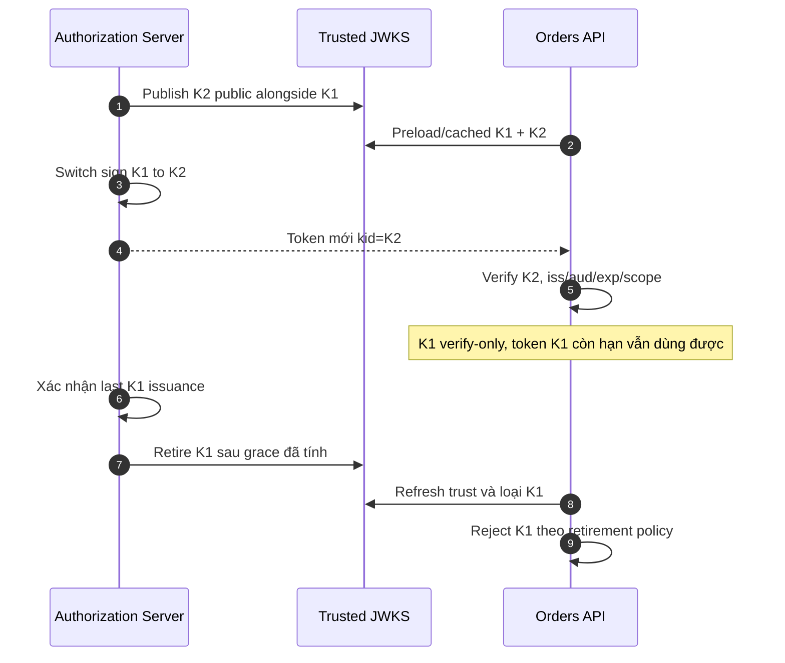
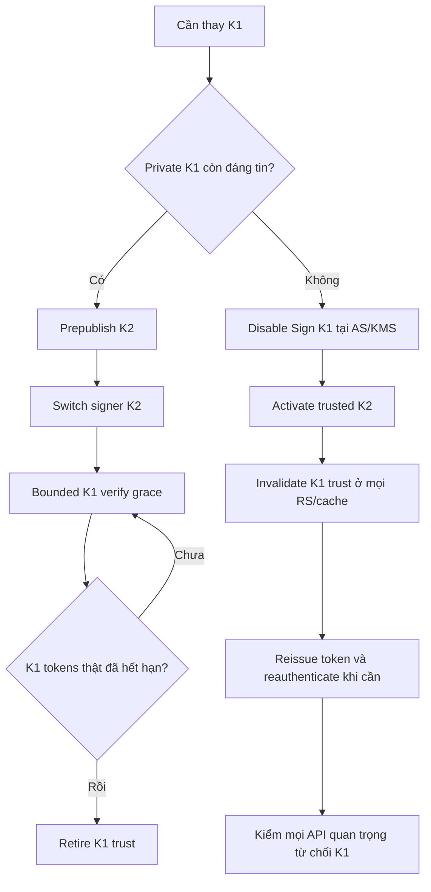
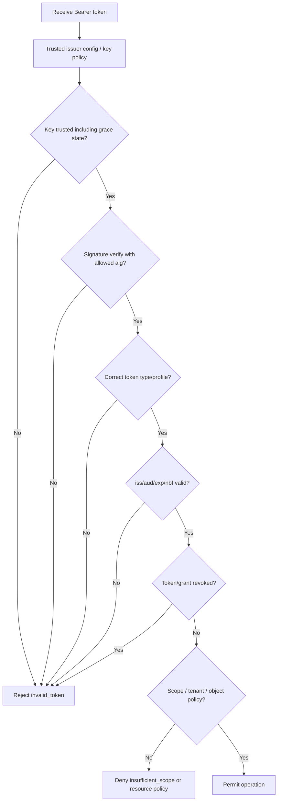

# Grace period khi xoay key

Giả sử authorization server (AS) của hệ thống OAuth 2.0 phát JWT access token ký bằng private key `K1`. Lúc **10:00**, AS bắt đầu ký token mới bằng `K2`. Orders API vẫn có các token K1 được phát lúc **09:59**, hạn dùng 15 phút. Nếu resource server (RS) **ngừng tin K1 ngay lúc 10:00**, người dùng có token hoàn toàn hợp lệ có thể gặp `401 invalid_token`. Nếu RS giữ K1 vô thời hạn, nó tiếp tục chấp nhận chữ ký từ một khóa cũ không còn cần thiết. Nếu private key K1 đã bị đánh cắp thì vấn đề nghiêm trọng hơn: attacker có thể **tạo JWT giả** ký bằng K1.

**Grace period khi xoay key** là khoảng chuyển tiếp **có giới hạn và đo được** cho phép các token thực sự hợp lệ ký bằng khóa cũ tiếp tục được xác minh trong khi hệ thống đã chuyển sang ký token mới bằng khóa mới. Nó giải quyết sự khác biệt thời gian giữa **phát hành, phân phối public key, cache của verifier và hết hạn token**, nhưng **không** có nghĩa cho phép token hết hạn, bỏ xác minh chữ ký hay tiếp tục tin khóa đã bị compromise.

Bài thuộc chương **Key management** của module `SECURITY_TOKEN_SECURITY_FUNDAMENTALS`. Trọng tâm là grace period của khóa ký JWS/JWT trong OAuth 2.0/OpenID Connect (OIDC), liên hệ JWT, opaque token, access/refresh/ID token, claims `iss`, `aud`, `scope`, lưu trữ, thu hồi và phòng chống token bị lấy cắp/phát lại.

## 1. Grace period giải quyết vấn đề nào?

Xoay signing key tạo ra sự thay đổi không đồng bộ giữa các thành phần:

- **Authorization server** chọn khóa dùng **ký token mới**.
- **JWKS publisher** công bố public keys.
- **Resource server** sử dụng cache JWKS để xác minh JWT.
- **OAuth client** tiếp tục cầm token đã được phát và chưa hết hạn.
- **OpenID Provider/Relying Party** có thể kiểm ID token hoặc Logout Token ký cùng một key ring.
- **Gateway/CDN/nhiều region** cập nhật theo lịch và cache khác nhau.

| Tình huống | Hậu quả |
|---|---|
| K2 bắt đầu ký trước khi RS nạp public K2. | Token mới bị từ chối do `unknown kid`. |
| K1 bị loại khỏi trusted set đúng lúc K2 bắt đầu ký. | Token K1 còn hạn có thể bị từ chối sớm. |
| K1 không bao giờ được retire. | Trust surface kéo dài, key governance yếu. |
| K1 đã compromised nhưng vẫn được giữ vì grace. | JWT giả ký K1 có thể bị RS nhận. |
| Grace bị hiểu là kéo dài `exp`. | Mở rộng khả năng bearer token replay. |

**Grace period chỉ phù hợp với key rotation bình thường khi K1 còn đáng tin**, không phải lời hứa mọi token cũ đều được chấp nhận bất kể điều kiện.

## 2. Các mốc thời gian cần định nghĩa

| Ký hiệu | Ý nghĩa |
|---|---|
| `T_publish_K2` | Public key K2 xuất hiện trong JWKS tin cậy. |
| `T_sign_K2` | AS bắt đầu ký token mới bằng private K2. |
| `T_last_K1_sign` | Mốc **cuối cùng trên thực tế** mọi AS signer ngừng tạo token K1. |
| `T_last_K1_exp` | Hạn muộn nhất của JWT K1 hợp lệ theo các token profiles. |
| `T_retire_K1` | Thời điểm mọi RS phải ngừng tin public K1. |

Các biến bổ sung: **maximum lifetime**, bounded clock skew, rollout margin, JWKS cache TTL, issuer consistency và RS propagation.

```text
T_publish_K2  <  T_sign_K2
                    |
                    +--> K2 ký token mới
                    +--> K1 chỉ verify token cũ hợp lệ
                                       |
                                       v
                                  T_retire_K1
```

Trong nhiều AS instances, `T_last_K1_sign` có thể **sau** `T_sign_K2` do rollout hoặc rollback. Không lấy một deployment timestamp để giả định K1 đã ngừng ký trên toàn hệ thống.

## 3. Ba cửa sổ khác nhau: prepublish, overlap và propagation

| Cửa sổ | Mục tiêu | Cần giữ/cập nhật |
|---|---|---|
| **Prepublication window**: K2 được công bố trước khi ký. | RS kịp cache K2. | Trusted JWKS chứa K1 + K2; signer vẫn dùng K1. |
| **Verification grace/overlap**: sau khi chuyển signer. | Token K1 hợp lệ còn hạn vẫn có thể verify. | K2 được dùng ký mới, public K1 chỉ còn verify-only. |
| **Retirement propagation**: ngừng trust K1 trên fleet. | Mọi RS có cùng trust state sau cutover. | Gỡ K1 khỏi JWKS **và** invalid cache/key config nếu policy yêu cầu. |

**Clock-skew leeway đối với `exp`/`nbf` là cơ chế khác**: một độ lệch đồng hồ nhỏ, không phải khoảng gia hạn vô hạn cho token.

### Sơ đồ thời gian minh họa



Mốc cụ thể do **token lifecycle và cache behavior của hệ thống** quyết định, không có “grace 10 phút” phổ quát theo một RFC.

## 4. Grace không làm token cũ được sống thêm

Khi RS nhận JWT ký K1 trong grace, vẫn phải kiểm:

1. Signature hợp lệ bằng **key K1 của issuer được tin**.
2. `alg` đúng allowlist; `kid` chọn đúng key type/kid theo issuer.
3. `iss` trùng issuer đã cấu hình.
4. `aud` chứa resource server hiện tại.
5. `exp`, `nbf` và token lifetime theo chính sách.
6. Token type đúng: access token cho API, không phải ID/refresh token.
7. `scope`/authority chính xác và quyền user/tenant/object.
8. Trạng thái token/grant **chưa bị revoke** nếu kiến trúc yêu cầu kiểm.

| Token | Signature K1 có thể verify? | API được phép? |
|---|---|---|
| K1, `exp=10:12`, request 10:11, scope/aud đúng. | Có trong grace. | Có thể, nếu quyền nghiệp vụ đúng. |
| K1, `exp=10:05`, request 10:10. | Vẫn có thể đúng về mật mã. | **Không**, expired. |
| K1, `aud=payments-api`, request Orders. | Có thể. | **Không**, wrong audience. |
| K1, `scope=orders.read`, request Approve. | Có thể. | **Không**, thiếu scope. |
| K1 đã bị revoke qua grant/jti policy. | Có thể. | **Không**, revoke enforcement. |
| K1 bị compromise. | Phép toán có thể đúng cả với token giả. | **Không được giữ normal grace**. |

**Đừng thêm một “15 phút sau `exp`” chỉ để khỏi trả 401.** Leeway nhỏ do clock skew cần policy và kiểm thử riêng.

## 5. Tính grace theo token expiry và issuance thực tế

Trong normal rotation, điều kiện tối thiểu để nghỉ verify K1 an toàn là **không còn token K1 hợp lệ nào cần khóa ấy**.

```text
T_safe_retire_K1 >=
    T_last_K1_exp
    + allowed_clock_skew
    + operational_safety_margin
```

Nếu không lưu inventory mọi JWT đã phát, dùng một cận trên bảo thủ:

```text
T_safe_retire_K1 >=
    T_last_K1_sign
    + max_lifetime_of_all_relevant_K1_token_classes
    + allowed_clock_skew
    + operational_safety_margin
```

### Ví dụ cụ thể

| Biến | Giá trị |
|---|---:|
| Token K1 cuối cùng **thực tế** được ký | 10:00:00 |
| Max lifetime của các token cần verify bằng K1 | 15 phút |
| Bounded clock skew | 30 giây |
| Margin vận hành để kiểm propagation | 90 giây |
| Mốc retire được tính | **10:17:00** |

10:00 + 15 phút + 30 giây + 90 giây = **10:17**.

Đây là **mốc minh họa từ chính sách ví dụ**, không phải TTL/grace bắt buộc của OAuth. Nếu có ID token hoặc token nghiệp vụ khác ký K1 sống **60 phút**, cần tính lại cận trên cho những verifier còn phải tin K1.

### Điều kiện của phép tính

- Max lifetime được **enforce** khi phát JWT, không chỉ ghi trong tài liệu.
- `T_last_K1_sign` dựa vào telemetry tất cả region, kể cả node rollback/chậm cập nhật.
- Không có signer cũ được tự động bật lại.
- Các mốc hết hạn dựa trên NumericDate (giây từ Unix epoch).
- Retirement phải được phân phối và xác minh đến mọi RS quan trọng.

Nếu một node tiếp tục ký K1 thêm 4 phút thì **cận trên phải dịch thêm ít nhất 4 phút**; không giữ lịch retire dựa trên planned cutover.

## 6. Lifetime khác nhau của access, ID, refresh và opaque tokens

| Loại token | Liên quan key grace thế nào? |
|---|---|
| **JWT access token** | RS cần public K1 verify token K1 còn hạn. |
| **OIDC ID token** | RP có thể cần public K1 kiểm ID token theo OIDC; lifetime có thể khác access token. |
| **OIDC Logout Token** | RP kiểm JWT event của OP; có thể dùng cùng signing key ring, nhưng profile khác. |
| **JWT client assertion** | Dùng public key của **client** cho client authentication, thường không cùng AS signing key. |
| **Opaque access token** | RS chủ yếu dùng RFC 7662 introspection; không tự verify JWS của opaque string. |
| **Opaque refresh token** | AS quản lý grant/refresh; **không cộng thời hạn 30 ngày của refresh token vào K1 JWT grace** một cách máy móc. |
| **JWT refresh token nếu có** | Token endpoint có thể cần key verification grace **riêng**, theo issuer policy. Không mặc định refresh token là JWT. |

Một refresh token R1 còn hạn 30 ngày có thể đổi lấy JWT access token mới **ký bằng K2** sau cutover. Việc R1 còn hợp lệ không buộc public K1 phải được tin 30 ngày, trừ khi **cấu trúc bảo mật của R1 thật sự phụ thuộc K1**.

## 7. Grace phải có giới hạn và được ghi thành policy

Các yếu tố quyết định:

- Maximum token lifetime cho **mọi lớp JWT dùng K1**.
- Thời điểm issuer instance cuối cùng ký K1.
- Clock skew nhỏ được cho phép.
- Thời gian xác minh rollout/monitoring, không phải một margin bất tận.
- Key cryptoperiod, sensitivity và compliance.
- JWKS cache behavior thực tế của SDK, gateway, RP/RS.
- Thời gian đồng bộ key retirement đến tất cả regions.
- Mục tiêu availability và error budget.

**Không mở rộng K1 grace vô hạn** vì một node cũ chưa cập nhật. Phải báo trạng thái PARTIAL, xác định nguyên nhân và quyết định theo risk owner nếu buộc gia hạn.

## 8. JWKS đồng thời chứa public K1 và public K2

Một issuer có thể công bố:

```json
{
  "keys": [
    {
      "kty": "RSA",
      "use": "sig",
      "alg": "RS256",
      "kid": "as-2026-10",
      "n": "OLD_RSA_MODULUS_BASE64URL_PLACEHOLDER",
      "e": "AQAB"
    },
    {
      "kty": "RSA",
      "use": "sig",
      "alg": "RS256",
      "kid": "as-2026-11",
      "n": "NEW_RSA_MODULUS_BASE64URL_PLACEHOLDER",
      "e": "AQAB"
    }
  ]
}
```

Đây chỉ là mẫu cấu trúc JSON, **không chứa RSA public key thật**. Private key fields `d`, `p`, `q` hoặc HMAC secret `k` **không được công bố** trong public JWKS.

**K1 verify-only** nghĩa là:
- K1 public key còn tin trong bounded overlap.
- AS **không ký JWT mới** bằng K1.
- K2 private key ký token mới; JWS header có `kid=K2`.
- RS kiểm riêng issuer, algorithm, audience, expiry, type và scope cho cả hai khóa.
- K1 phải retire theo lịch nếu không có incident; nếu compromise thì ngừng trust sớm.

## 9. `kid` và trust anchor trong grace period

Header token K1 và K2:

```json
{"alg":"RS256","typ":"at+jwt","kid":"as-2026-10"}
```

```json
{"alg":"RS256","typ":"at+jwt","kid":"as-2026-11"}
```

**`kid` là gợi ý lựa chọn khóa, không phải quyền chọn trust source.**

- Chỉ tra key trong tập JWKS của **issuer tin cậy đã cấu hình**.
- Không để JWT `jku`, `x5u`, embedded `jwk` điều khiển fetch attacker key.
- Không cho unverified `iss` tự tạo URL JWKS mới ngoài issuer allowlist.
- Không dùng `kid` làm file path/SQL không kiểm chuẩn.
- Cần match `alg` allowlist với key type, key usage, curve và key status.
- Không reuse cùng `kid` cho hai key material khác nhau trong một issuer.
- Multi-issuer cache phải phân vùng theo issuer; `kid` không phải ID toàn cục.

**Grace period không phải lý do mở rộng thuật toán chấp nhận.** Một RS256-only resource server phải từ chối `alg=none` hoặc HS256, ngay cả khi chữ ký token khác đang gặp sự cố vì rotation.

## 10. Prepublish K2 và JWKS cache

Một lịch phối hợp khả thi:

1. **T_publish_K2:** public K2 xuất hiện ở JWKS của issuer, K1 vẫn có.
2. RS/gateway/RP cập nhật caches hoặc prefetch trusted JWKS.
3. Kiểm canary **JWT thật ký K2** với issuer/audience/time/type chuẩn.
4. Đảm bảo CDN và các vùng đều công bố K2.
5. Chuyển signer sang K2.
6. Theo dõi lỗi unknown `kid`, không bypass signature.
7. Giữ public K1 chỉ trong verification grace đã tính.

**JWKS `Cache-Control: max-age=300` không bảo đảm mọi SDK refresh sau đúng 300 giây.** Một số thư viện có cache riêng, cooldown và stale-while-revalidate. Cần đo **hành vi thực tế**, không chỉ suy từ header.

### Hai lỗi cache đối xứng

| Lỗi | Hệ quả |
|---|---|
| RS chưa thấy K2 sau khi AS ký K2. | Token mới bị reject. |
| RS vẫn cache K1 sau khi có quyết định ngừng trust. | Token K1 vẫn có thể được verify, đặc biệt nghiêm trọng khi K1 bị lộ. |

Với **normal rotation**, còn tin K1 trong bounded overlap là chủ đích. Với **emergency compromise**, cached K1 phải được **invalidation/deny policy** chặn, không được viện JWKS cache TTL để tiếp tục tin.

### Unknown `kid` không được gây DoS

Attacker có thể phát hàng loạt JWT tự tạo với `kid` ngẫu nhiên. Nếu mỗi unknown kid dẫn đến HTTP fetch JWKS, AS bị tấn công qua chính verifier. Dùng cooldown/rate limit, request coalescing, bounded size/timeout; nếu vẫn không có trusted key thì **fail closed**.

## 11. Multi-region: grace tính từ signer cuối cùng

```text
10:00  Region A đã ký K2.
10:01  Region B vẫn ký K1 do triển khai chậm.
10:03  Region C đã ký K2.
10:04  Region B mới thật sự ngừng ký K1.
```

Khi đó `T_last_K1_sign=10:04`, không phải 10:00. Nếu token K1 TTL tối đa 15 phút thì không retire K1 theo phép tính dựa trên 10:00.

### Giám sát

- Issued JWT count theo issuer + token type + normalized kid + region.
- KMS/HSM Sign calls theo key reference và workload identity.
- Version public JWKS ở origin/CDN/region.
- Unknown kid, signature failure, 401 rate tại RS.
- RS trusted key state và cache age.
- Rollback cũ có còn khả năng ký K1 không.

**Không đánh dấu rotation xong chỉ vì cấu hình issuer hiển thị `activeKid=K2`.** Cần bằng chứng từ fleet signers và verifiers.

## 12. Logout, revocation và grace period có liên quan nhưng không thay nhau

- **Local logout** vô hiệu session ứng dụng và xóa credentials client quản lý.
- **OIDC OP logout** kết thúc SSO session theo cơ chế được hỗ trợ.
- **RFC 7009 revocation** xử lý token/grant ở AS.
- **RS revoke enforcement** qua denylist/introspection/grant status có thể từ chối access token trước `exp`.
- **Key grace** chỉ quyết định K1 còn được dùng verify signature token K1 không.

Một JWT access token K1 còn hạn đã bị revoke **không được chấp nhận** chỉ vì public K1 vẫn trusted. Ngược lại, JWT chưa bị revoke nhưng K1 bị loại khỏi trust do compromise cũng **không thể được RS xác thực theo cách cũ**.

Đối với **opaque token**, RS thường hỏi AS qua RFC 7662; trạng thái `active=false` sau revoke khác hoàn toàn việc gỡ một JWT signing key. Cache introspection có thể tạo độ trễ riêng.

## 13. Emergency compromise: không áp dụng normal grace

Nếu private K1 bị lộ, attacker có thể ký JWT với `sub`, `aud`, `scope` và `jti` họ tự chọn. Vì vậy:

- Không đủ chỉ **chuyển AS sang ký K2**.
- Không đủ chỉ **revoke những token IDs đã biết**; attacker có thể tạo `jti` mới.
- Không đủ chỉ **gỡ K1 khỏi JWKS origin** nếu RS còn cache và tin K1.
- Không thể “giữ K1 thêm 15 phút cho token thật” nếu không phân biệt thật/giả bằng nguồn phát hành đáng tin khác.



**Cần sẵn sàng chấp nhận interruption an toàn**, thay vì một “grace vì khả dụng” khiến attacker tiếp tục forge token.

Một phương án issuer-backed token ledger/allowlist chỉ hữu ích nếu **không thể bị giả bởi kẻ có K1** và RS thực sự hỏi nguồn đó. Không nên coi nó là giải pháp mặc định cho mọi hệ thống.

## 14. Grace của signing key khác grace của refresh-token rotation

“Grace period” còn được nhà cung cấp OAuth dùng cho **refresh-token rotation**, nhưng **không cùng ý nghĩa**:

| Cơ chế | Đối tượng cũ | Tại sao có overlap? |
|---|---|---|
| **JWT signing-key grace** | Public K1 còn trusted. | Token JWT K1 đã phát, chưa hết hạn cần verify. |
| **Refresh-token rotation leeway** | Refresh R1 vừa dùng để nhận R2. | Một số provider cho retry/race tolerance rất ngắn. |
| **Session-cookie key grace** | Key MAC/encrypt cookie cũ. | Browser vẫn gửi cookies đã cấp. |
| **JWE decryption grace** | D1 để decrypt ciphertext cũ. | Dữ liệu mã hóa cũ còn được xử lý. |

Refresh-token rotation leeway là **provider-specific**; RFC 9700 yêu cầu public clients dùng refresh token có sender-constraining hoặc rotation theo profile. Nó **không mặc định có một cửa sổ sử dụng R1 nhiều lần**. Nếu một R1 đã rotation tái xuất hiện, AS phải xử lý reuse detection theo family/risk policy.

```text
R1 refresh hợp lệ -> AS phát R2.
R1 xuất hiện lại -> retry/race hợp lệ HOẶC token replay.
Key K1 còn trong JWT JWKS không cấp thêm quyền sử dụng R1.
```

## 15. HS256: verifier giữ secret cũng có quyền ký

Với RS256/ES256/EdDSA, RS chỉ giữ **public K1**. Với HS256, RS và AS dùng **cùng secret K1** cho HMAC.

| Thuộc tính | Asymmetric JWS | HS256 |
|---|---|---|
| RS giữ | Public key. | Shared secret. |
| RS có signing capability nếu bị lộ key? | Không, nếu chỉ giữ public key. | **Có**, secret tạo MAC hợp lệ. |
| Phân phối | Public JWKS trusted. | Secret manager/kênh bí mật. |
| Grace tồn tại ở RS | Public K1 verify-only. | Secret K1 còn khả năng tạo MAC. |
| Public JWKS | Có thể công bố public key. | **Không bao giờ công bố HMAC secret `k`**. |

Giữ HS256 K1 lâu làm nhiều bản sao secret tồn tại. Nếu secret bị lộ tại một RS, không dùng **normal grace**; cần emergency trust removal. Không để `alg=HS256` trong header ép verifier RS256 dùng RSA public key như HMAC secret.

## 16. Grace của JWE và session cookies khác JWS

- **JWS**: public K1 còn được dùng **verify signature** của JWT cũ.
- **JWE**: decryption D1 còn cần để **giải mã** ciphertext cũ.
- **Session cookie key**: S1 có thể cần để xác thực/decrypt cookies cũ khi S2 đã active.

Xóa D1 quá sớm có thể khiến dữ liệu mã hóa cũ không còn đọc được; giữ D1 quá lâu khi bị lộ ảnh hưởng confidentiality. Một số hệ thống cần **rewrap/re-encrypt** thay vì giữ key cũ mãi.

**Xoay session cookie key không tự revoke OAuth access token**, và xoay JWT signing key không thay JWE decryption key. Cần inventory và policy riêng cho từng loại.

## 17. DPoP/mTLS client key không phải AS signing key

- **DPoP** (RFC 9449) dùng client key để tạo proof, token có thể mang `cnf.jkt`.
- **mTLS-bound token** (RFC 8705) gắn với client certificate.
- **AS signing key** xác thực nguồn phát JWT access token.

K2 của AS được dùng ký access JWT mới **không tự chuyển binding `cnf`** của token đã phát từ client key D1 sang D2. Nếu client xoay DPoP/mTLS key, cần token mới với binding đúng theo profile. RS vẫn phải kiểm proof/cert trên từng request.

## 18. Java 17: công thức tính mốc retire K1

Đây là **planning calculation**, không phải JWT validation và không được dùng để trì hoãn emergency key compromise.

```java
import java.time.Duration;
import java.time.Instant;
import java.util.Objects;

public final class KeyGracePlanner {
    private KeyGracePlanner() {}

    public record RotationPlan(
            String issuer,
            String oldKid,
            Instant actualLastK1Issuance,
            Duration maxRelevantTokenLifetime,
            Duration allowedClockSkew,
            Duration operationalMargin) {
        public RotationPlan {
            Objects.requireNonNull(issuer);
            Objects.requireNonNull(oldKid);
            Objects.requireNonNull(actualLastK1Issuance);
            Objects.requireNonNull(maxRelevantTokenLifetime);
            Objects.requireNonNull(allowedClockSkew);
            Objects.requireNonNull(operationalMargin);
            if (issuer.isBlank() || oldKid.isBlank()
                || maxRelevantTokenLifetime.isNegative()
                || allowedClockSkew.isNegative()
                || operationalMargin.isNegative()) {
                throw new IllegalArgumentException("Invalid rotation policy");
            }
        }
    }

    public static Instant notBeforeNormalRetirement(
            RotationPlan p) {
        return p.actualLastK1Issuance()
            .plus(p.maxRelevantTokenLifetime())
            .plus(p.allowedClockSkew())
            .plus(p.operationalMargin());
    }

    public static void main(String[] args) {
        RotationPlan p = new RotationPlan(
            "https://id.example.test",
            "as-2026-10",
            Instant.parse("2026-11-23T10:00:00Z"),
            Duration.ofMinutes(15),
            Duration.ofSeconds(30),
            Duration.ofSeconds(90));
        System.out.println(notBeforeNormalRetirement(p));
        // 2026-11-23T10:17:00Z
    }
}
```

**Điều kiện:** thời điểm K1 ký cuối cùng phải lấy từ telemetry AS đáng tin, không từ unverified `iat` do caller gửi; TTL phải bao trùm mọi JWT classes được ký K1; phải tính lại nếu rollback khiến signer dùng K1. Mốc này **không** gia hạn `exp` từng token và không thay RS cache/trust-retirement verification.

## 19. Tách trạng thái ký mới và xác minh key cũ

Một thiết kế issuer-side có thể dùng state machine:

```java
// Pseudocode: types/methods do ứng dụng tự định nghĩa.
enum KeyState {
    GENERATED, PREPUBLISHED, ACTIVE_SIGNING,
    VERIFY_ONLY, RETIRED, COMPROMISED
}

record KeyVersion(
    String issuer,
    String kid,
    String algorithm,
    String kmsKeyRef,
    KeyState state
) {}

KeyVersion selectSigningKey(String issuer, String tokenProfile) {
    KeyVersion key = inventory.findExactlyOneActiveSigner(
        issuer, tokenProfile);
    if (key.state() != KeyState.ACTIVE_SIGNING) {
        throw new SecurityException("No trusted signer");
    }
    requireAllowedAlgorithmAndKey(key, tokenProfile);
    return key;
}

List<PublicJwk> publishJwks(String issuer) {
    return inventory.keysOfIssuer(issuer).stream()
        .filter(k -> k.state() == KeyState.PREPUBLISHED
                  || k.state() == KeyState.ACTIVE_SIGNING
                  || k.state() == KeyState.VERIFY_ONLY)
        .map(k -> publicFieldsOnly(k))
        .toList();
}
```

Không phải API Spring Authorization Server sẵn có. Production cần **atomic activation/versioning**, key purpose/alg checks, KMS permissions và rollback guards. K1 VERIFY_ONLY **không còn được AS ký**; K1 COMPROMISED phải bị loại trust, không tiếp tục publish vì một grace deadline cũ.

## 20. Spring Security 6.x: JWT decoder trong giai đoạn K1/K2 overlap

Spring Security Resource Server có thể nhận trusted JWKS của issuer chứa K1 + K2. Ví dụ cấu hình RS256 và audience check:

```yaml
spring:
  security:
    oauth2:
      resourceserver:
        jwt:
          issuer-uri: "https://id.example.test"
```

```java
import org.springframework.context.annotation.Bean;
import org.springframework.context.annotation.Configuration;
import org.springframework.http.HttpMethod;
import org.springframework.security.config.Customizer;
import org.springframework.security.config.annotation.web.builders.HttpSecurity;
import org.springframework.security.oauth2.core.DelegatingOAuth2TokenValidator;
import org.springframework.security.oauth2.core.OAuth2Error;
import org.springframework.security.oauth2.core.OAuth2TokenValidator;
import org.springframework.security.oauth2.core.OAuth2TokenValidatorResult;
import org.springframework.security.oauth2.jose.jws.SignatureAlgorithm;
import org.springframework.security.oauth2.jwt.Jwt;
import org.springframework.security.oauth2.jwt.JwtDecoder;
import org.springframework.security.oauth2.jwt.JwtValidators;
import org.springframework.security.oauth2.jwt.NimbusJwtDecoder;
import org.springframework.security.web.SecurityFilterChain;

@Configuration
public class OrdersJwtSecurity {
    private static final String ISSUER =
        "https://id.example.test";

    @Bean
    JwtDecoder jwtDecoder() {
        NimbusJwtDecoder decoder =
            NimbusJwtDecoder.withIssuerLocation(ISSUER)
                .jwsAlgorithm(SignatureAlgorithm.RS256)
                .build();

        OAuth2TokenValidator<Jwt> aud = jwt -> {
            boolean valid = jwt.getAudience() != null
                && jwt.getAudience().contains("orders-api");
            return valid
                ? OAuth2TokenValidatorResult.success()
                : OAuth2TokenValidatorResult.failure(
                    new OAuth2Error("invalid_token",
                        "Audience mismatch", null));
        };
        decoder.setJwtValidator(
            new DelegatingOAuth2TokenValidator<>(
                JwtValidators.createDefaultWithIssuer(ISSUER), aud));
        return decoder;
    }

    @Bean
    SecurityFilterChain api(HttpSecurity http) throws Exception {
        http.authorizeHttpRequests(auth -> auth
            .requestMatchers(HttpMethod.GET, "/api/orders/**")
                .hasAuthority("SCOPE_orders.read")
            .anyRequest().denyAll());
        http.oauth2ResourceServer(rs ->
            rs.jwt(Customizer.withDefaults()));
        return http.build();
    }
}
```

**Giới hạn mẫu:** Đây là decoder dùng trusted issuer và algorithm allowlist; audience check độc lập. Cần thêm token type/profile validation (ví dụ `typ=at+jwt` theo RFC 9068), quyền tenant/owner, revocation/status, bounded clock skew, JWKS cache behavior của phiên bản thư viện và vận hành nhiều issuer. **Cache JWKS còn K1 có thể tiếp tục verify K1 sau khi origin gỡ K1**; khi K1 bị compromise phải triển khai trust invalidation phía decoder/gateway, không tin ví dụ trên là đủ.

Spring Security Test `jwt()` chỉ mock principal để test authorization; **test grace thực** cần JWT ký bằng K1/K2 và trusted test JWKS.

## 21. Emergency trust invalidation ở Resource Server

Khi private K1 bị nghi lộ, chỉ thay JWKS origin chưa đủ vì RS có thể vẫn cache K1. Một thiết kế nâng cao có thể có **key trust policy** riêng:

```text
Trusted issuer: https://id.example.test
Allowed alg: RS256
Trusted JWKS URI: https://id.example.test/oauth2/jwks

Emergency banned key:
  issuer = https://id.example.test
  key ID = as-2026-10
  public-key fingerprint = INVENTORY_FINGERPRINT_PLACEHOLDER

Policy:
  K1 compromised -> refuse K1 even if stale cache contains K1.
  K2 verified via trusted issuer JWKS -> may accept if claims valid.
```

Đây là mô hình policy, **không phải một thuộc tính có sẵn mặc định của Spring Security**.

Để áp dụng an toàn:

1. Việc ra quyết định bị compromise đến từ **key management/incident authority đáng tin**, không từ JWT của client.
2. Ràng buộc issuer + key ID/fingerprint, tránh trùng `kid` giữa issuers.
3. Enforce ngay tại **trusted key selection/decoder**, hoặc tại key policy layer không thể bị bypass.
4. Không chỉ check `kid` trong header chưa verified rồi tự cho token khác vượt qua.
5. Invalidate JWKS cache/decoder key sets, gateway và các nodes theo emergency plan.
6. Đo từng RS/region từ chối K1; không kết luận chỉ dựa vào origin JWKS.
7. Chống rollback key policy hoặc dùng stale config khi RS restart.

**Lưu ý:** Nếu token K1 đã được issuer thật phát nhưng chưa hết hạn, nó cũng có thể bị từ chối trong emergency rotation. Đây là **sự đánh đổi có chủ đích** để chặn việc attacker forge tokens bằng cùng private key.

## 22. Runbook normal grace từ chuẩn bị đến đóng

| Bước | Hành động | Bằng chứng/gate |
|---|---|---|
| **N1** | Xác nhận K1 chưa bị compromise. | Key audit/IAM state và threat review đạt. |
| **N2** | Kiểm inventory: token classes, max TTL, clock skew, issuer, JWKS caching. | Tài liệu và số liệu issuance từ AS. |
| **N3** | Tạo K2 trong KMS/HSM hoặc secret store đạt chuẩn. | Key strength, algorithm và permissions được duyệt. |
| **N4** | Publish public K2 alongside K1. | Mọi JWKS origins có K1+K2, không có private fields. |
| **N5** | Prewarm và chạy canary JWT ký K2 thật. | RS/RP validate K2, token type/audience/time chính xác. |
| **N6** | Cutover signing K1 → K2. | Các AS instances có active signer K2. |
| **N7** | Xác định T_last_K1_sign thực tế. | Telemetry issuer/KMS theo region. |
| **N8** | Tính T_safe_retire_K1 và giám sát overlap. | Last issuance + max expiry + bounded skew + margin. |
| **N9** | Sau grace, remove public K1 khỏi trusted verify set. | JWKS origin/caches/RS fleet đồng nhất. |
| **N10** | Disable/destroy K1 private material theo policy. | KMS/key inventory và audit record. |
| **N11** | Đóng rotation khi cả issuance và verification đạt gate. | Không còn K1 signer/verifier ngoài policy; metrics ổn định. |

**Không tự kích hoạt N9 khi issuer còn một node đang ký K1.** Khi telemetry phát hiện drift hoặc rollout rollback, lập tức rà lại T_last_K1_sign. N6 không có nghĩa N9 được làm ngay.

### Trước cutover cần đo cache thật

Một phép thử thực tế:

- AS công bố public K2 trong JWKS.
- RS đang sử dụng phiên bản thư viện/decoder production, không mock.
- K2 canary JWT đúng issuer/audience/type/expiry.
- RS verify thành công ở từng region và gateway path.
- Thử token K1 hợp lệ để chắc chắn overlap không phá phiên cũ.
- Thử `kid` không tồn tại, `alg` sai và JWT forged để chắc chắn key resolver không mở fallback nguy hiểm.

## 23. Runbook emergency: bỏ qua normal grace

Khi **private signing K1 bị lộ hoặc có bằng chứng đủ mạnh rằng không còn đáng tin**, quy trình cần ưu tiên integrity:

1. **Mở incident** và xác định issuer/key version/algorithm thật sự ảnh hưởng.
2. **Disable Sign(K1)** ở AS và KMS/HSM; kiểm all regions và workloads có quyền ký.
3. Kích hoạt K2 hoặc khóa dự phòng an toàn; nếu không có, **fail closed** với issuance cần bảo vệ.
4. **Gỡ K1 khỏi trusted verification**, invalidate caches/decoder/gateway.
5. Kiểm RS từng region **không chấp nhận token ký K1**, kể cả token có `exp` còn hạn.
6. Revoke grants/refresh families, OP/RP sessions khi threat model cho thấy có ảnh hưởng thêm.
7. Yêu cầu reauthentication hoặc reissuance token hợp lệ bằng K2.
8. Kiểm dấu hiệu forged JWT, API access và các permissions bất thường.
9. Xoay/restrict KMS IAM, build pipeline, signing permissions và lưu trữ private key.
10. Đóng incident chỉ khi RS trust, AS signing, người dùng/client impacted và residual risk đã được xác minh.

**Không được** giữ K1 trong normal grace để tránh 401 nếu nó đã compromised. Đừng tin một per-`jti` denylist là đủ, vì attacker có thể ký JWT với jti mới.

### Thời gian giữa disable signer và RS ngừng trust

Có thể xuất hiện:

```text
10:00  Private K1 bị xác định compromised.
10:01  AS ngừng ký K1, bắt đầu ký K2.
10:02  Public K1 bị gỡ khỏi JWKS origin.
10:03  RS-A vẫn cache K1 => attacker có thể forge JWT K1.
10:06  RS-A nhận explicit trust invalidation.
```

**Thời điểm chặn giả mạo ở RS-A là lúc trust K1 không còn được chấp nhận**, không phải lúc AS đổi signer. Đây là lý do emergency monitoring phải kiểm **verifier acceptance state**.

## 24. Sự cố JWKS outage trong grace period

JWKS endpoint có thể timeout hoặc trả 5xx ngay giữa rollout.

| Trạng thái | Xử lý an toàn |
|---|---|
| RS có cached K1/K2 đáng tin, chưa vượt trust policy. | Có thể tiếp tục verify JWT theo cache được phê duyệt; vẫn kiểm claims. |
| JWT có `kid=K2` nhưng RS chỉ cache K1. | Thử trusted refresh theo giới hạn; nếu vẫn không có K2, **reject**. |
| JWKS origin có K1 nhưng K1 vừa compromised. | Không dùng cached K1; ưu tiên emergency key invalidation. |
| Unknown kid flood làm refresh liên tục. | Rate limit/backoff/coalescing; không fetch arbitrary URL. |
| JWKS body chứa private JWK fields hoặc malformed JSON. | Reject key-set/publisher compromise, alert. |
| HTTP redirect cross-origin hoặc TLS cert sai. | Không tải key ngoài trust boundary. |
| Gateway/RS áp dụng config cũ sau restart. | Readiness/security gate từ chối hoặc cập nhật trust state bắt buộc. |

**Không dùng lỗi mạng làm lý do accept unsigned token hoặc tắt signature verification.** Thiết kế khả dụng bằng JWKS prepublication/cache/timeout/failover đã được bảo vệ.

## 25. Lỗi thường gặp khi chọn độ dài grace

| Sai lầm | Vì sao sai? | Sửa thế nào? |
|---|---|---|
| Lấy grace bằng đúng 15 phút từ lúc cấu hình đổi. | Signer khác có thể ký K1 muộn hơn. | Tính từ **T_last_K1_sign thực tế**. |
| Chỉ dùng access JWT TTL, bỏ ID token cùng key ring. | RP có thể còn cần K1 lâu hơn. | Inventory mọi token class cần verify. |
| Giữ K1 bằng max refresh-token lifetime 30 ngày. | Refresh token opaque có vòng đời khác. | Tách refresh grant và JWS key policy. |
| Gia hạn token `exp` bằng key grace. | Mở rộng bearer replay window. | Kiểm exp độc lập, skew nhỏ. |
| Đồng nhất JWKS cache TTL với token lifetime. | Hai loại thời gian không cùng ý nghĩa. | Đo riêng readiness và verification overlap. |
| Gỡ K1 khỏi origin và coi fleet đã ngừng tin. | RS cache K1 vẫn có thể chấp nhận. | Kiểm per-region trust invalidation. |
| Grace K1 sau key compromise. | Kẻ có private K1 forge JWT mới. | Emergency revoke trust ngay. |
| Chấp nhận token `alg=none` khi unknown K2 kid. | Bỏ bảo vệ toàn vẹn. | Fail closed. |
| Để token header chọn `jku` tùy ý. | Attacker key substitution/SSRF. | Pin issuer/JWKS. |
| Reuse `kid` cho K2. | Cache có thể nhầm K1/K2. | Unique key ID per issuer. |
| Giữ K1 signing capability sau cutover. | Issuer tiếp tục phát token K1, deadline sai. | KMS state/config guard. |
| Cho rollback sang K1 compromised. | Mở lại forgery window. | Disable key và monotonic policy. |
| Dùng duy nhất `jwt()` mock để test rotation. | Không test signature/key cache thật. | Test JWT K1/K2 có chữ ký thật. |
| Log raw JWT/private key để debug. | Credential/key exposure. | Reference IDs, redact logs. |

## 26. Đường đi kiểm soát trong Resource Server

Một resource server không được coi grace là điều kiện cấp quyền đầy đủ:



Việc chọn trusted key từ JWKS cần bảo đảm **issuer và algorithm policy**. Dù chữ ký verify đúng, access token gửi nhầm audience, token hết hạn, ID token dùng như access token hoặc token bị revoke vẫn phải bị từ chối.

### Khác biệt chữ ký và Bearer replay

Một attacker có **bản sao nguyên vẹn** của access JWT K1 chưa hết hạn vẫn có signature hợp lệ trong grace. **Grace không trực tiếp ngăn replay**. Cần TLS, token storage, TTL, least-privilege scope/audience, revoke và sender constraints (DPoP/mTLS) khi phù hợp.

## 27. Ma trận kiểm thử Grace period khi xoay key

Giả định AS có issuer `https://id.example.test`, ký JWT access token RS256 cho Orders API với audience `orders-api`. Key K1 có `kid=as-2026-10`, key K2 có `kid=as-2026-11`. Max JWT access TTL là 15 phút, allowed clock skew 30 giây, margin vận hành 90 giây. Với token classes khác, phải điều chỉnh thời hạn tương ứng.

| ID | Kịch bản | Kết quả mong đợi |
|---|---|---|
| G01 | JWT K1 hợp lệ trước cutover. | RS verify và kiểm claims thành công. |
| G02 | Publish public K2 trước khi AS bắt đầu ký K2. | JWKS có K1+K2, token K1 không lỗi. |
| G03 | Canary JWT K2 ký thật trước cutover. | RS verify được K2 qua trust config. |
| G04 | AS chuyển signing K1 → K2. | Token mới có `kid=K2` và signature K2. |
| G05 | K1 chuyển verify-only. | Không có token K1 mới; K1 token cũ còn hạn pass. |
| G06 | Gỡ K1 lúc 10:00 khi token K1 phát 09:59 còn hạn. | Test phát hiện 401 quá sớm. |
| G07 | K1 token hết hạn nhưng K1 còn JWKS. | Reject expired, không grace `exp`. |
| G08 | K1 token đúng signature nhưng `aud=payments-api`. | Orders reject. |
| G09 | K1 token thiếu scope cho route. | Deny theo scope policy. |
| G10 | K1 token đã revoke trong normal grace. | RS deny theo revocation policy. |
| G11 | K1 token `nbf` ở tương lai. | Reject trước thời điểm hiệu lực. |
| G12 | OIDC ID token K1 được gửi vào Orders API. | Reject token type/audience. |
| G13 | K1 token sai issuer dù chữ ký kiểm bằng key khác đúng. | Reject issuer. |
| G14 | K2 JWT mới có type/issuer/audience/scope đúng. | Verify + authorization pass. |
| G15 | RS chỉ có K1 cache, token K2 xuất hiện. | Trusted refresh, nếu chưa có K2 thì fail closed. |
| G16 | JWKS cache TTL nội bộ khác HTTP max-age. | Readiness test phản ánh behavior thực. |
| G17 | JWKS origin A có K2, origin B chưa có. | Gate chưa cho cutover hoàn tất. |
| G18 | Region B vẫn ký K1 sau planned cutover. | T_last_K1_sign được cập nhật. |
| G19 | Rollback deployment làm K1 ký lại. | Recompute grace; cảnh báo và audit. |
| G20 | K2 reuse cùng `kid` của K1. | Inventory từ chối ambiguous key ID. |
| G21 | Hai issuers cùng có `kid=k1`. | Cache tách theo issuer; không cross-use. |
| G22 | Token `alg=none` trong API RS256-only. | Reject. |
| G23 | Token HS256 MAC với RSA public key bytes. | Reject algorithm confusion. |
| G24 | Token PS256 khi API chỉ cho RS256. | Reject alg mismatch. |
| G25 | JWT `jku` trỏ JWKS attacker. | Không fetch hoặc trust key attacker. |
| G26 | JWT `x5u` trỏ host nội bộ. | SSRF/key injection bị chặn. |
| G27 | Token nhúng public `jwk` của attacker. | Không dùng làm issuer trust anchor. |
| G28 | `kid` chứa path traversal/SQL injection. | Strict lookup/size validation. |
| G29 | 10.000 unknown kids mỗi phút. | JWKS refresh rate-limited/bounded. |
| G30 | JWKS response quá lớn hoặc hàng nghìn keys. | Bounded parser/key count. |
| G31 | Public JWKS vô tình chứa RSA private `d`. | Security test fail và incident response. |
| G32 | Public JWKS chứa HMAC secret `k`. | Secret leak; rotate và revoke trust. |
| G33 | JWKS TLS certificate sai hostname. | Không tin key fetch. |
| G34 | JWKS cross-origin redirect tới host attacker. | Không follow untrusted origin. |
| G35 | JWKS outage, RS có K1/K2 trusted cached. | Verify trong cache policy, vẫn check claims. |
| G36 | JWKS outage, K2 chưa có trong trust cache. | Fail closed, không bỏ signature. |
| G37 | Grace hết sau max K1 expiry + skew + margin. | Retire K1 đúng normal policy. |
| G38 | ID token K1 sống 60 phút, access JWT chỉ 15 phút. | Retire time bao trùm ID token khi cần. |
| G39 | Opaque refresh token sống 30 ngày. | Không tự lấy 30 ngày làm signing key grace. |
| G40 | JWT refresh token thật sự phụ thuộc K1 tại AS. | AS dùng key policy riêng cho token endpoint. |
| G41 | Clock skew nhỏ theo policy gần `exp`. | Chỉ bounded leeway, không key grace thay exp. |
| G42 | AS/RS clock drift 10 phút. | Alert/fix clock; không tăng skew vô hạn. |
| G43 | Retire deadline dùng planned 10:00, signer cuối 10:04. | Test phát hiện tính sai thời điểm. |
| G44 | Grace deadline lấy từ unverified `iat` user gửi. | Reject scheduling authority không tin. |
| G45 | Private K1 bị lộ giữa normal grace. | Chuyển emergency, dừng trust K1. |
| G46 | AS ký K2 nhưng RS vẫn tin K1 compromised. | Incident chưa hoàn tất. |
| G47 | Gỡ K1 khỏi origin, RS cache K1 và vẫn accept. | Explicit trust invalidation bắt buộc. |
| G48 | Attacker ký K1 JWT giả với `jti` mới. | Per-jti denylist không đủ; block K1. |
| G49 | K1 compromised, rollback ứng dụng bật Sign(K1). | KMS/monotonic policy chặn. |
| G50 | RS-A chặn K1, RS-B vẫn nhận K1. | Incident PARTIAL, cross-region test fail. |
| G51 | Token K1 thật còn hạn nhưng key K1 compromised. | Có thể cần reject để ngăn forgery. |
| G52 | K2 signer lỗi trong emergency. | Fail closed/K3 theo policy, không quay K1. |
| G53 | K2 ký nhưng header `kid=K1`. | Key selection/verification fail. |
| G54 | AS chọn ngẫu nhiên K1/K2 vì JWKS có hai keys. | Enforce đúng ACTIVE_SIGNING. |
| G55 | HS256 secret K1 bị lộ ở một RS. | Revoke shared secret ở mọi verifier. |
| G56 | HS256 secret bị lộ nhưng chỉ rotate RSA key. | Security test fail: vẫn có signing capability. |
| G57 | JWE D1 retire trước khi ciphertext D1 hết cần. | Test phát hiện decryption failure. |
| G58 | Session-cookie S1 retire quá sớm. | Session test phát hiện mass logout. |
| G59 | DPoP key đổi D1 → D2, token vẫn bound D1. | RS từ chối proof D2 dùng với token D1. |
| G60 | mTLS cert mới không khớp token bound cert cũ. | RS từ chối certificate binding mismatch. |
| G61 | JWT K1 đúng signature nhưng order của tenant khác. | Object-level authorization deny. |
| G62 | Scope `orders.read-all` trong token, route cần `orders.read`. | Không dùng substring match. |
| G63 | RS kiểm chữ ký/issuer nhưng không kiểm audience. | Integration test phát hiện thiếu validator. |
| G64 | Spring Security Test `jwt()` pass dù K2 JWKS thiếu. | Không coi mock là crypto rotation test. |
| G65 | User revoke access JWT K1 trong normal grace. | RS từ chối dù signature hợp lệ. |
| G66 | Token K1 đã hết hạn được chấp nhận vì K1 còn trusted. | Test fail; exp luôn enforce. |
| G67 | Metrics label chứa raw JWT hoặc unbounded `kid`. | Security/cardinality test fail. |
| G68 | Key K1 private bị lộ từ backup/logs. | Incident, bỏ normal grace. |
| G69 | Sau retire, CDN vẫn phát JWKS có K1 tại một region. | Detect trust propagation inconsistency. |
| G70 | Dashboard “K2 active” nhưng RS chưa verify K2. | Rollout PARTIAL, không báo hoàn tất. |

### Kiểm thử theo lớp

- **Unit:** Grace calculator, actual-last-issuance, max JWT lifetime, skew, key-state transitions.
- **Cryptography:** JWT ký thật bằng K1/K2, algorithm/key mismatch, tampering và token profile.
- **JWKS integration:** Publish/cache/refresh, unknown kid flood, redirects/TLS, issuer-bound trust.
- **RS integration:** Signature, `iss`, `aud`, `exp`, `typ`, scope, revoke và tenant/object authorization.
- **Emergency drill:** Disable Sign(K1), trust invalidation ở mọi RS/region, forged-token rejection.
- **Other credentials:** Opaque introspection, refresh family rotation, JWE decrypt overlap, DPoP/mTLS binding.
- **Observability:** Key issuance metric, cache age, retirement evidence, raw-token log redaction.

**Một unit test chỉ mock JWT claims không chứng minh key rotation.** Muốn kiểm thực tế cần dùng **JWT ký bằng private test keys**, trusted test JWKS và resource-server decoder giống môi trường production.

## 28. Tình huống áp dụng

### A. K1 bị xóa khi K2 bắt đầu ký

AS đổi signing K2 lúc 10:00. Token K1 phát 09:59 còn 15 phút lifetime, nhưng public K1 bị xóa tức thì.

**Kết luận:** Đây là lỗi **verification grace**. Trong normal rotation, giữ K1 verify-only cho token K1 hợp lệ đến khi thời hạn kết thúc theo policy.

### B. Region B tiếp tục ký K1

Region A ký K2 từ 10:00, region B chỉ ngừng ký K1 lúc 10:04.

**Kết luận:** Tính deadline từ **T_last_K1_sign=10:04**, không phải planned cutover 10:00.

### C. K1 bị lộ nhưng chưa hết grace

Private K1 đã bị công bố, còn 10 phút grace bình thường.

**Kết luận:** Phải **bỏ normal grace**, disable K1 signer và chặn K1 tại RS, kể cả cache. Có thể cần reauthentication/reissuance bằng K2.

### D. K1 còn trong JWKS, token đã expired

Token K1 có `exp=10:05`, request đến 10:14; K1 retire lúc 10:17.

**Kết luận:** Reject token. Trust K1 không làm token sống thêm.

### E. K2 publish quá muộn

K2 public key xuất hiện lúc 09:58 nhưng RS có 5 phút JWKS cache; AS ký K2 từ 10:00.

**Kết luận:** Đây là vấn đề **prepublication readiness**, không phải thiếu K1 grace. Publish sớm hơn hoặc có controlled prewarm và readiness gate.

### F. Refresh token opaque còn hạn 30 ngày

Access JWT K1 sống tối đa 15 phút, refresh R1 opaque có hạn 30 ngày.

**Kết luận:** Không mặc định giữ K1 30 ngày. Refresh grant/rotation khác signing-key lifecycle; access token mới sau refresh có thể ký K2.

### G. K1 bị compromise và attacker tạo jti mới

Attacker có private K1, RS còn cache K1, AS đã denylist các token IDs bị biết.

**Kết luận:** Attacker có thể tạo JWT giả với jti mới. Cần ngừng trust K1 hoặc yêu cầu issuer-backed issuance state không thể giả mạo bằng key K1.

### H. HS256 key nằm ở ba resource servers

Secret K1 bị lộ từ một RS, AS muốn giữ secret cũ ở các RS khác trong grace.

**Kết luận:** Verifier HS256 giữ **signing-capable secret**. Khi K1 bị lộ, không dùng normal overlap; rotate/revoke ở mọi RS.

### I. JWT ký đúng nhưng scope sai

JWT K1 được verify trong grace, token có `scope=orders.read` nhưng request là phê duyệt đơn.

**Kết luận:** Từ chối, vì **authorization không được gia hạn theo key grace**. Kiểm scope và quyền object/tenant.

### J. Hệ thống báo K2 active nhưng RS chưa nhận K2

AS đã ký K2, một RS vẫn dùng JWKS chỉ có K1 và trả 401 hàng loạt.

**Kết luận:** Rotation chưa hoàn tất. Có thể cần tạm dừng cutover normal, tăng prepublication và điều tra cache; **không được bypass signature**.

## 29. Câu hỏi tự đánh giá

1. Vì sao signing-key grace cần thiết dù AS đã chuyển sang ký K2?
2. Prepublication window khác verification overlap ở mục đích nào?
3. Tại sao tính grace dựa trên last K1 issuance thật, không dựa planned cutover?
4. Mốc retire cần xét max token lifetime, skew và margin thế nào?
5. Token K1 đã hết `exp` có được chấp nhận chỉ vì K1 còn JWKS không?
6. ID token và access token dùng chung K1 nhưng TTL khác nhau ảnh hưởng thế nào?
7. Opaque refresh token 30 ngày có buộc giữ K1 verification 30 ngày không?
8. Grace của refresh-token rotation khác JWS signing-key grace như thế nào?
9. Tại sao JWKS cache TTL không đồng nhất với key-grace duration?
10. Khi gặp unknown kid, RS được phép fetch key từ đâu?
11. Vì sao key ID phải ràng buộc với issuer?
12. K1 compromised có được giữ overlap để tránh user 401 không?
13. Per-jti denylist vì sao có thể thất bại nếu private K1 lộ?
14. HS256 key grace có rủi ro gì so với public RSA key grace?
15. JWE decryption key overlap khác JWS verification key overlap thế nào?
16. DPoP/mTLS client key có tự rotate cùng AS signing key không?
17. Trong Spring Security, `issuer-uri` có đủ bảo đảm audience và scope không?
18. Những trường hợp nào được rollback K2 → K1, và khi nào bị cấm?
19. Những metric nào chứng minh mọi RS đã ngừng tin K1?
20. Một rotation job trả success có đủ chứng minh grace đã kết thúc không?

## 30. Checklist triển khai

### Trước cutover

- [ ] Đã kiểm K1 còn đáng tin, không có dấu compromise.
- [ ] Có inventory issuer, token types, maximum TTL và clock skew được enforce.
- [ ] Public K2 đã prepublish cùng K1 trên mọi trusted JWKS origins.
- [ ] `kid` của K1/K2 độc lập, alg/key type/size đúng policy.
- [ ] Canary RS xác minh JWT K2 ký thật và token K1 hợp lệ.
- [ ] Biết behavior JWKS cache/refresh theo framework version thực tế.
- [ ] Có metrics signing key usage theo region và test rollback.

### Trong cutover và normal grace

- [ ] AS phát token mới bằng K2; K1 ở verify-only.
- [ ] Đã ghi nhận T_last_K1_sign thực tế.
- [ ] Grace deadline = last issuance + max relevant lifetime + bounded skew + margin.
- [ ] RS vẫn enforce `iss`, `aud`, `exp`, type, scope và revoke.
- [ ] Không bypass signature hoặc tự động trust attacker `jku`/`x5u`.
- [ ] Mọi signer/region không còn ký K1 ngoài kế hoạch.

### Kết thúc grace

- [ ] Tất cả token K1 hợp lệ cuối cùng đã hết cửa sổ chấp nhận.
- [ ] K1 bị loại khỏi trusted verification set và caches được xác minh.
- [ ] KMS/HSM không còn cho Sign(K1).
- [ ] Không có region/verifier tiếp tục accept K1 sai chính sách.
- [ ] Owner đã xác nhận audit, metrics và trạng thái hoàn thành.

### Emergency khi K1 private bị lộ

- [ ] Bỏ normal grace; disable K1 signer/KMS Sign(K1).
- [ ] Không chỉ xóa JWKS origin, phải invalidate trust K1 ở RS/gateway/cache.
- [ ] Phát K2/K3 theo kế hoạch an toàn; reauthenticate/reissue khi cần.
- [ ] Chặn K1 tokens tại mọi resource quan trọng, dù chúng chưa hết hạn.
- [ ] Không rollback sang K1; báo PARTIAL nếu một node vẫn accept.
- [ ] Điều tra source of compromise và thu hồi các grants/credentials liên quan khi cần.

## 31. Ghi nhớ

- **Grace period khi xoay key là bounded verification overlap**, không phải gia hạn `exp`.
- **Publish K2 trước khi ký K2** để verifiers biết public key mới.
- **K1 ngừng ký trước khi ngừng verify** trong normal rotation, để token K1 hợp lệ chưa hết hạn không bị lỗi sớm.
- **Tính deadline từ K1 issuance thực tế cuối cùng**, max lifetime của tất cả token types liên quan, bounded skew và margin.
- **JWKS cache không phải key trust policy**: origin gỡ K1 chưa chắc RS đã ngừng tin K1.
- **Bất kỳ JWT nào trong grace vẫn phải kiểm signature, `iss`, `aud`, `exp`, token type, `scope`, tenant và revocation**.
- **Nếu private K1 bị compromise, normal grace phải nhường chỗ cho emergency trust invalidation**.
- **HS256 verifier giữ secret có khả năng ký**, khác với RSA/EC/EdDSA public verification key.
- **Signing-key grace khác refresh-token rotation leeway**, session-cookie/JWE decryption overlap và client DPoP/mTLS key rotation.
- **Không lấy `kid` hoặc `jku` trong token làm trust anchor**; issuer và algorithm allowlist phải được cấu hình.
- **Đo hoàn thành từ cả AS và RS**, bao gồm last signing timestamp, K2 acceptance và K1 retirement trên từng region.
- **Không log raw JWT, keys hoặc secrets** khi điều tra rotation.

### Tài liệu chuẩn tham khảo

- [RFC 7515 — JSON Web Signature (JWS)](https://www.rfc-editor.org/rfc/rfc7515): protected header, ký và verify.
- [RFC 7517 — JSON Web Key (JWK)](https://www.rfc-editor.org/rfc/rfc7517): JWK/JWKS, key ID, public key metadata.
- [RFC 7518 — JSON Web Algorithms (JWA)](https://www.rfc-editor.org/rfc/rfc7518): RS256, PS256, ES256, HS256 và key constraints.
- [RFC 7519 — JSON Web Token (JWT)](https://www.rfc-editor.org/rfc/rfc7519): issuer, audience, expiration và NumericDate.
- [RFC 8725 — JSON Web Token Best Current Practices](https://www.rfc-editor.org/rfc/rfc8725): algorithm confusion, typing, issuer/key trust.
- [RFC 9068 — JWT Profile for OAuth 2.0 Access Tokens](https://www.rfc-editor.org/rfc/rfc9068): `at+jwt`, claims và RS validation.
- [RFC 8414 — OAuth 2.0 Authorization Server Metadata](https://www.rfc-editor.org/rfc/rfc8414): trusted discovery và `jwks_uri`.
- [OpenID Connect Core 1.0](https://openid.net/specs/openid-connect-core-1_0.html) và [OIDC Discovery](https://openid.net/specs/openid-connect-discovery-1_0.html): ID Token validation, OP JWKS.
- [RFC 9700 — OAuth 2.0 Security Best Current Practice](https://www.rfc-editor.org/rfc/rfc9700): token theft, refresh rotation, sender constraints.
- [RFC 7009 — OAuth 2.0 Token Revocation](https://www.rfc-editor.org/rfc/rfc7009) và [RFC 7662 — Token Introspection](https://www.rfc-editor.org/rfc/rfc7662): revoke/status độc lập key grace.
- [RFC 7516 — JSON Web Encryption](https://www.rfc-editor.org/rfc/rfc7516): decryption-key overlap khác signature grace.
- [RFC 9449 — OAuth 2.0 DPoP](https://www.rfc-editor.org/rfc/rfc9449) và [RFC 8705 — OAuth 2.0 mTLS](https://www.rfc-editor.org/rfc/rfc8705): sender-constrained tokens.
- [NIST SP 800-57 Part 1 Rev. 5 — Recommendation for Key Management](https://csrc.nist.gov/pubs/sp/800/57/pt1/r5/final): cryptoperiod và key lifecycle.
- [Spring Security — JWT Resource Server](https://docs.spring.io/spring-security/reference/servlet/oauth2/resource-server/jwt.html): trusted issuer, JWKS và JWT validation.
- [Spring Authorization Server — Core Model Components](https://docs.spring.io/spring-authorization-server/reference/core-model-components.html): cấu hình JWKSource/AS signer theo phiên bản.
