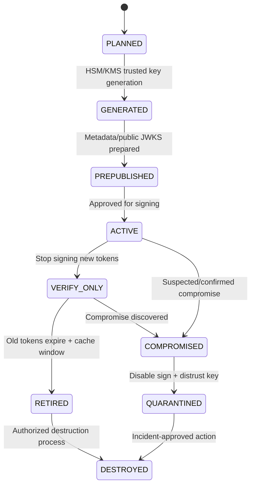
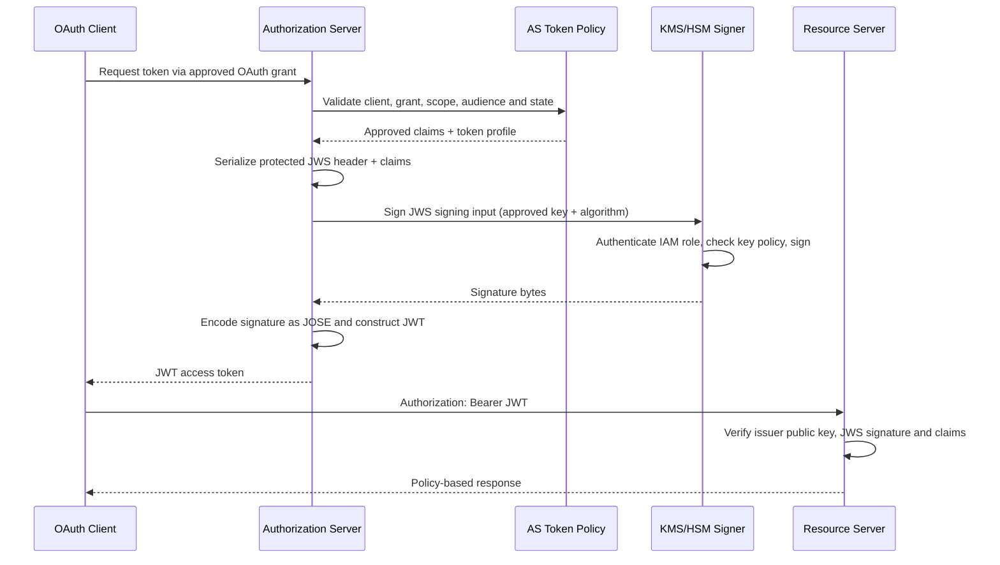
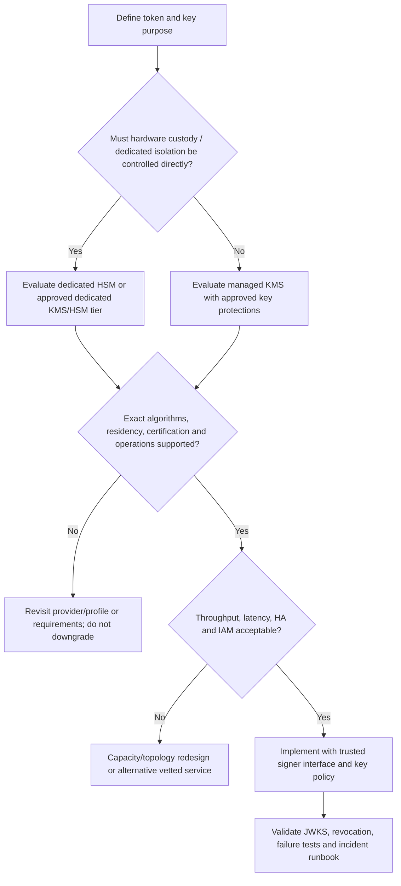
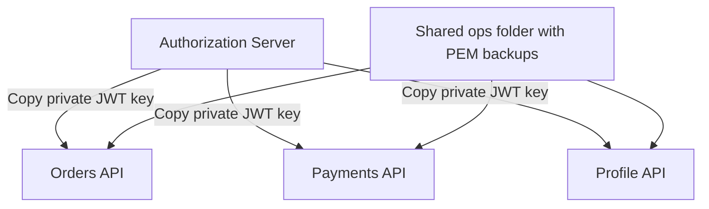
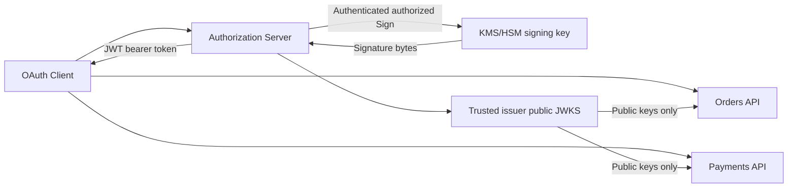

# HSM hoặc KMS

**HSM (Hardware Security Module)** và **KMS (Key Management Service/System)** đều liên quan đến bảo vệ và sử dụng khóa mật mã, nhưng **không phải hai lựa chọn luôn loại trừ nhau**. HSM tập trung vào phần cứng và ranh giới thực thi mật mã được bảo vệ; KMS tập trung vào **quản lý vòng đời khóa, danh tính/quyền sử dụng, API, chính sách, audit và vận hành**, và chính KMS có thể sử dụng HSM ở tầng dưới.

Trong một hệ thống OAuth 2.0/OIDC, nếu **authorization server (AS)** phát hành JWT access token bằng private key RS256/PS256/ES256, private key đó là một **tài sản đặc biệt nhạy cảm**: kẻ có khả năng ký như AS có thể tạo token được nhiều resource servers (RS) tin, trừ khi các chính sách kiểm issuer, token type, audience, scope, thời hạn và quyền khác ngăn chặn. Cất private key trong mã nguồn, biến môi trường bị log, file PEM trên nhiều máy hoặc copy nó tới từng RS đều làm tăng nguy cơ. KMS/HSM giúp **giảm phạm vi lộ key material**, nhưng **không tự ngăn AS phát token sai quyền**.

Một kiến trúc thường gặp:

```text
       OAuth Client                          Authorization Server (AS)
           |                                           |
           | Authorization Code + PKCE /                | policy validates client,
           | Client Credentials, etc.                   | subject, scope, resource
           +------------------------------------------>|
                                                       |
                                   Allowed signing key + alg selected by AS
                                                       |
                                                       v
                                                 KMS sign API
                                                 IAM + key policy
                                                       |
                                                       v
                                              HSM-backed key operation
                                             private key not given to AS
                                                       |
                                                       v
                                            signature of JWS signing input
                                                       |
                                                       v
                                           AS serializes signed JWT
                                                       |
                              JWT access token for orders-api
                                                       |
                                                       v
    Orders Resource Server <----------------------------+
            |
            +-- Obtain trusted issuer public JWK/JWKS
            +-- Verify JWS signature and algorithm/key type
            +-- Validate iss, aud, typ, exp, nbf, scope
            +-- Enforce tenant/resource authorization
            +-- Check revocation state if architecture requires
            |
            +-- ALLOW only if all checks pass; otherwise DENY
```

**Điểm quan trọng:** AS có thể yêu cầu KMS/HSM **ký** mà không nhận bytes của private key. RS chỉ cần public verification key/JWKS, **không cần** quyền gọi `Sign` và không được nhận private key. Tuy nhiên, một principal được cấp quyền `Sign` không đúng phạm vi có thể lợi dụng KMS như **signing oracle** để ký payload tùy ý. Vì vậy **IAM/key policy, claim policy và phân tách người có quyền** quan trọng không kém việc giữ khóa trong phần cứng.

Bài này thuộc chương **Key management** của module **SECURITY_TOKEN_SECURITY_FUNDAMENTALS**. Module khảo sát mô hình tin cậy và vòng đời token bảo mật, JWT/opaque token, access/refresh token trong authentication, authorization, OAuth 2.0/OIDC; phát hành, kiểm claims, scope, audience, lưu trữ, thu hồi và chống token bị đánh cắp/phát lại. Ở đây chúng ta tập trung vào **khi nào dùng HSM, KMS hoặc kết hợp cả hai**, các quyết định kiến trúc để khóa phục vụ token đúng mục đích, cách tích hợp Java/Spring và các kiểm thử/vận hành cần thiết.

## 1. Mục tiêu học tập

Sau bài này, bạn có thể:

1. Giải thích đúng **HSM là gì**, **KMS là gì** và vì sao một dịch vụ KMS có thể được **HSM-backed** mà không phải là HSM chuyên dụng của riêng khách hàng.
2. Phân biệt **key custody, generation, usage, access control, non-exportability, wrapping, rotation, destruction** và **audit**.
3. Lập bảng yêu cầu để chọn **managed KMS, HSM chuyên dụng hoặc giải pháp kết hợp** theo threat model, compliance, latency, chi phí và operational burden.
4. Thiết kế đường **AS ký JWT → trusted JWKS → RS verify**, không làm lộ private signing key.
5. Phân biệt **signing key**, **encryption key**, **HMAC secret**, **JWE decryption key**, **opaque-token digest key** và **refresh token storage**.
6. Hiểu thuật toán **HS256, RS256, PS256, ES256, EdDSA**, kiểm key type/size và JOSE algorithm policy trước khi dùng KMS/HSM.
7. Thiết kế **IAM/key policies**, service identity, least privilege và separation of duties để chặn signing oracle, cross-tenant/key substitution.
8. Lập kế hoạch **JWKS/key rotation**, old-key verification window, emergency key compromise, audit, HA/DR và multi-region consistency.
9. Tích hợp signing qua **Java JCA PKCS#11 provider hoặc KMS API**, phân biệt dữ liệu ký **JWS Signing Input**, DER ECDSA và JOSE ECDSA signature.
10. Viết tests cho issuance, verification, key policy, KMS outages, rollback, grant revocation, security monitoring và key-lifecycle incidents.

## 2. HSM khác KMS ở lớp nào?

### 2.1. HSM: vùng thực thi mật mã được bảo vệ

**Hardware Security Module** là thiết bị/dịch vụ phần cứng chuyên dụng được thiết kế để bảo vệ khóa và thực hiện các phép toán mật mã trong một ranh giới có cơ chế chống can thiệp phù hợp, chẳng hạn:

- Sinh keypairs/secret keys bằng nguồn entropy/cryptographic provider của module.
- Lưu private keys/symmetric keys theo object policies và usage attributes.
- Ký/verify, mã hóa/giải mã, wrap/unwrap hoặc sinh key theo khả năng được cấp.
- Hạn chế xuất private key khi được tạo với thuộc tính **non-exportable/sensitive** theo chính sách/hardware capabilities.
- Cung cấp sự kiện quản trị/audit, phân vai vận hành và cơ chế backup/replication theo thiết bị.

**Không có nghĩa mọi khóa ở “HSM” đều tự động non-exportable.** Khả năng xuất khóa, cơ chế backup, key attributes, firmware, provider, administrative roles và security certifications là **thuộc tính cụ thể phải kiểm chứng**. HSM bị cấu hình sai hoặc IAM của cổng truy cập quá rộng vẫn có thể bị lạm dụng.

### 2.2. KMS: lớp quản lý vòng đời và API sử dụng khóa

**Key Management Service** thường cung cấp:

- Key identifiers, versions, aliases và metadata (purpose, algorithm, trạng thái).
- API cho `CreateKey`, `Sign`, `Verify`, `Encrypt`, `Decrypt`, `GenerateDataKey` hoặc thao tác tương đương **tùy nhà cung cấp**.
- Policy/IAM để xác định workload/role nào có thể làm gì trên key nào.
- Rotation, disable, scheduling deletion, audit/monitoring và tích hợp secret/config systems.
- Quota, availability, failover, networking, compliance controls và quản trị tập trung.

Một KMS có thể đặt khóa trong **HSM do provider vận hành**, dùng software crypto trong một số sản phẩm/profile hoặc kết hợp nhiều lớp; phải **đọc assurance/provenance thực tế** của provider, không suy từ chữ “KMS” rằng khóa luôn nằm trong HSM đạt một mức chứng nhận cụ thể.

### 2.3. Không đồng nhất tên sản phẩm với bảo đảm mật mã

| Thuộc tính | HSM chuyên dụng | Managed KMS | KMS sử dụng HSM chuyên dụng |
| --- | --- | --- | --- |
| Trọng tâm | Protected cryptographic boundary | Key lifecycle/service API/policies | Key management + isolated hardware boundary |
| Vận hành thiết bị | Tổ chức hoặc provider tùy hình thức | Thường do provider quản lý | Tùy dịch vụ, có thêm ràng buộc/quyền quản trị |
| Quyền kiểm soát firmware/hardware | Có thể cao nhưng gánh vận hành lớn | Thường bị trừu tượng hóa | Tùy hợp đồng triển khai |
| IAM và service integration | Cần gateway/provider/client PKCS#11/SDK | API/IAM/audit thường tích hợp sẵn | KMS API cùng hạ tầng HSM riêng |
| Non-exportable signing | Có thể cấu hình nếu hỗ trợ | Có thể hỗ trợ theo key type/tier | Phụ thuộc key/policy/hardware |
| RSA/EC/EdDSA/PSS | Phụ thuộc firmware/provider | Phụ thuộc API và region/key type | Cần kiểm cả KMS/HSM path |
| Latency/throughput | Local/network HSM và sessions | Network API + quotas | Network orchestration + HSM capacity |
| Cost/complexity | Thiết bị, HA, firmware, backup, chuyên gia | Phí API/key + IAM/cloud dependencies | Cao hơn tùy isolation/assurance |
| Compliance | Phụ thuộc module, version, mode và chứng chỉ | Phụ thuộc dịch vụ/tier/điều kiện được chứng thực | Phải xác minh phạm vi chứng nhận |

**Không có câu trả lời chung “HSM luôn bảo mật hơn KMS” hoặc “KMS luôn thay được HSM”.** Đây là hai trục: **hardware security boundary** và **management/service security boundary**. Một managed KMS dùng HSM đúng cấu hình có thể đáp ứng nhu cầu của phần lớn dịch vụ; tổ chức có quy định nghiêm ngặt về quyền sở hữu thiết bị, custody hoặc offline signing có thể cần HSM riêng.

## 3. Chọn giải pháp từ yêu cầu, không từ tên gọi

Trước khi quyết định mua/triển khai, hỏi:

| Câu hỏi | Vì sao ảnh hưởng lựa chọn? |
| --- | --- |
| Private key có được rời cryptographic boundary không? | Xác định non-exportability/custody requirements |
| Ai được quyền gọi `Sign`? | Signing oracle là một phần threat model |
| Có bắt buộc **single tenant/dedicated hardware** không? | Quy định assurance và isolation |
| Thuật toán cần `PS256`, `ES256`, Ed25519 hay chỉ HMAC? | Không phải mọi provider/tier hỗ trợ |
| Có yêu cầu FIPS/certification cụ thể không? | Phải đối chiếu exact module/version/mode/approved operations |
| Issuance peak TPS và latency budget là bao nhiêu? | Remote signing có quota/network cost |
| Có bao nhiêu regions/issuers/tenants? | Key replication/HA/namespace và JWKS propagation |
| Có cần BYOK/HYOK/external key control? | Key import/origin/administration trade-offs |
| Thời gian failover/DR cần đạt? | HSM cluster/backups vs managed KMS redundancy |
| Khi compromise, có thể ngừng mọi verifier tin key nhanh thế nào? | Emergency distrust là quan trọng hơn chỉ xoay signer |
| Team có kỹ năng HSM/P11 vận hành không? | Firmware, HA, PKCS#11 sessions, key recovery |
| Chi phí vận hành/khả dụng có mục tiêu gì? | Managed service và thiết bị có cost models khác |

### 3.1. Ví dụ chọn kiến trúc

**Trường hợp A — SaaS vừa, dùng cloud, JWT access tokens PS256.** Managed KMS hỗ trợ asymmetric `Sign`, IAM per AS workload, key non-exportability, audit và region/availability phù hợp thường là **lựa chọn khởi đầu hợp lý**; RS chỉ nhận public JWK. Nếu KMS service sử dụng HSM, không cần tự quản một HSM vật lý chỉ vì token được ký bằng RSA.

**Trường hợp B — Môi trường yêu cầu thiết bị chuyên dụng, custody độc lập và kiểm soát physical/administrative domain.** HSM cluster chuyên dụng, có PKCS#11/JCA provider và quản trị dual control có thể phù hợp, với giá phải trả là thiết kế HA, key backup, phiên PKCS#11, latency, firmware upgrades và khôi phục thảm họa.

**Trường hợp C — Cần key policy/API tập trung nhưng cryptographic boundary dành riêng.** Một managed KMS có **dedicated/external HSM integration** hoặc một lớp key-service tự xây trên HSM (được bảo mật review) có thể kết hợp hai mặt. Đừng tự phát minh giao thức ký; dùng provider/SDK chuẩn với protected channel, caller authentication và authorization.

**Trường hợp D — Opaque access token do AS sinh random và lưu server-side.** Nhu cầu chính có thể là CSPRNG, token storage/indexing an toàn, KMS-encrypted persistence và introspection; **không nhất thiết cần một asymmetric JWT signing HSM** cho loại token đó. Tuy nhiên database encryption keys, secrets hoặc client assertions vẫn có key-management requirements riêng.

### 3.2. Những lựa chọn không nên mặc định

- “Mọi khóa phải tự copy PEM vào containers vì KMS tăng latency.”
- “Chỉ cần HSM, không cần IAM hoặc audit.”
- “KMS có HSM nên AS không thể phát token sai `scope`.”
- “Thêm HSM là không cần TLS/issuer/audience checks.”
- “Một HSM key dùng cho mọi issuer, tenant, token type và môi trường để tiết kiệm chi phí.”
- “Mất kết nối KMS thì ký bằng secret mặc định.”

Đó là các biểu hiện **thiếu threat model, thiếu key purpose separation hoặc availability/security contract**.

## 4. Threat model của signing key cho token

Giả sử AS ký access JWT bằng private key K1 và RS xác minh public K1. Các tài sản chính:

1. **Private signing key hoặc HMAC secret**: bị lộ có thể tạo chữ ký/MAC hợp lệ.
2. **Quyền gọi `Sign` trên KMS/HSM**: bị lạm dụng có thể tạo chữ ký hợp lệ **dù key material không bị xuất**.
3. **Trust registry/JWKS/public key mapping**: bị tráo có thể khiến RS tin khóa của attacker.
4. **Issuer policy**: phát token sai subject/scope/audience vẫn có chữ ký đúng.
5. **Revocation/token store**: sai grant state có thể tiếp tục cấp/cho phép token bị thu hồi.
6. **Logs, CI, backups, caches**: có thể làm lộ credential hoặc giữ key/token cũ quá lâu.

### 4.1. Bốn kiểu compromise khác nhau

| Sự cố | Attacker có gì? | Hệ quả và ưu tiên |
| --- | --- | --- |
| **Private key bytes bị lộ** | Có thể ký bên ngoài KMS/HSM | Ngừng tin K1 khẩn cấp, điều tra tokens giả và phát K2 |
| **IAM `Sign` bị chiếm** | Không cần export key, gọi service ký | Disable principal/policy, audit signing requests, đánh giá tokens phát trong cửa sổ |
| **JWKS/trust configuration bị tráo** | Thay public key verifier tin | Khôi phục trust anchor, revoke giả tokens, invalidate caches |
| **AS business logic bị sửa** | Bắt AS cấp scope/aud sai dưới key thật | Sửa authorization gates, chặn issuance, điều tra tokens/permissions |

**HSM/KMS giải quyết tốt nhất bài toán custody và key operation control; không thể thay threat model của toàn AS.** Nếu attacker có quyền truy cập ứng dụng AS ở điểm sau khi policy approve nhưng trước khi gọi `Sign`, họ có thể tạo signing input tùy ý khi quyền ký không được giới hạn bằng policy/app checks bổ sung.

### 4.2. Ranh giới identity quan trọng

```text
Registered OAuth client ≠ AS workload identity
Authenticated end user  ≠ key administrator
Resource server          ≠ token signer
KMS key operator         ≠ application policy authority

Permission "can call Sign" ≠ "is allowed to issue every token"
```

Thiết kế phân vai, phê duyệt thay policy, least privilege và audit để không một người/hệ thống đơn lẻ dễ dàng vừa sửa claims issuance vừa cấp `Sign` cho mình.

## 5. Vòng đời khóa mật mã (key lifecycle)



Đây là **state machine khái niệm**, không phải tên trạng thái API chung của mọi KMS. Một số KMS chỉ có Enabled/Disabled/PendingDeletion và key versions theo cơ chế riêng. Cần map state kỹ thuật sang **security lifecycle**.

### 5.1. Sinh khóa

- Dùng entropy/CSPRNG đáng tin hoặc **key generation bên trong HSM/KMS**.
- Chọn **key usage = sign/verify** hoặc **encrypt/decrypt** đúng nhu cầu.
- Pin thuật toán và key parameters: RSA modulus, EC named curve, HMAC length.
- Chọn scope: issuer, environment, token type, tenant/security domain.
- Thiết lập ownership, IAM, aliases/IDs và rotation plan.
- **Không sinh RSA/EC private key trong CI rồi copy plaintext vào KMS** nếu mục tiêu là non-exportable key generated in hardware.

### 5.2. Kích hoạt ký

Chỉ sau khi:

- Public key/JWK đã được công bố từ issuer qua **trusted JWKS URI** nếu cần.
- Verifiers đã được cập nhật để **nhận đúng algorithm/key ID**.
- Workload được cấp `Sign` tối thiểu.
- AS policy đã bảo đảm authorization/claim issuance gates.
- Monitoring đã có key-specific safe identifiers, rate/latency alarms và reconciliation với issuance audit.

### 5.3. Ngừng ký nhưng vẫn verify

Khi planned rotation, key cũ có thể **không được phép ký token mới** nhưng RS tạm thời **vẫn verify token cũ** trong một bounded overlap. Với HSM/KMS, key state “disabled” có thể chặn cả verify API của KMS tùy sản phẩm, trong khi RS verify bằng public key cache là hoạt động **độc lập**. Phân biệt **KMS key operation state** với **RS trust state**.

### 5.4. Retire, destroy và backup

Xóa key không chỉ là xóa alias; private key có thể còn qua snapshots, backups, disaster recovery copies hoặc HSM cluster replication. Chính sách cần định nghĩa **cryptographic erasure, retention, deletion approval, recovery và audit** theo khả năng provider. Không hứa “destroy ngay lập tức và không thể khôi phục” nếu service thực tế có waiting period hoặc backup retention.

### 5.5. Compromise là đường xử lý riêng

Khi private K1 bị nghi lộ, **không chờ hết planned overlap**. Cần:

1. Ngừng signing operations K1.
2. Chặn principal bị nghi compromise.
3. Ngừng RS tin K1 theo incident plan, kể cả JWKS caches.
4. Phát/đưa vào sử dụng key mới qua trusted process.
5. Rà tokens/refresh/grants/client và API actions trong cửa sổ rủi ro.
6. Đo toàn bộ verifiers đã ngừng accept K1 trước thời hạn emergency.

## 6. Token signing: thuật toán và key purpose

| JOSE `alg` | Khóa dùng ký | RS dùng để xác minh | Ghi chú quản lý |
| --- | --- | --- | --- |
| **`HS256`** | Secret HMAC ≥256-bit với entropy đủ | **Cùng secret** | RS nắm secret cũng có thể ký, tăng blast radius |
| **`HS384`** | Secret HMAC ≥384-bit | Cùng secret | Không dùng password/hash dễ đoán |
| **`HS512`** | Secret HMAC ≥512-bit | Cùng secret | Không tự suy output hash length là entropy |
| **`RS256`** | RSA private key, PKCS#1 v1.5 + SHA-256 | RSA public key | JWA yêu cầu RSA modulus ≥2048 bit |
| **`PS256`** | RSA private key, PSS + SHA-256 | RSA public key | PSS parameters theo JWA, provider phải hỗ trợ |
| **`ES256`** | EC P-256 private key, ECDSA + SHA-256 | EC P-256 public key | JOSE ECDSA signature encoding khác DER thường gặp |
| **`EdDSA`** | Ed25519/Ed448 private key theo profile | Public OKP | Hỗ trợ KMS/HSM/JOSE tùy provider |

**Các mức tối thiểu theo JWA không tự là mức chính sách doanh nghiệp**. Ví dụ một tổ chức có thể đòi RSA-3072 cho chữ ký mới nhằm mục tiêu ~128-bit classical strength; RSA-2048 vẫn là minimum JWA của RSA JWS nhưng chỉ tương đương khoảng 112-bit classical security theo bảng tham khảo. Không gọi modulus 3072 là “3072-bit security”.

### 6.1. Vì sao chọn asymmetric cho AS → nhiều RS?

```text
AS holds private signing key in KMS/HSM
  |
  +--> Orders RS has public verification key only
  +--> Payments RS has public verification key only
  +--> Profile RS has public verification key only

Compromise of one RS public verification key:
  does not let attacker produce AS signatures.
```

Với HS256, mọi verifier cầm cùng secret **cũng có thể tạo MAC**. Asymmetric signing thường tách quyền tốt hơn khi có nhiều bên cần verify, dù HMAC vẫn có các trường hợp hợp lệ trong trust boundary khép kín.

### 6.2. Token format không quyết định có cần HSM

- **JWT access token:** cần bảo vệ signing private key hoặc HMAC secret; managed signing có thể phù hợp.
- **Opaque access token:** thường là random reference và trạng thái lưu AS; cần bảo vệ token store, random generation, hashing/lookup keys, introspection credentials, nhưng không nhất thiết asymmetric JWS signing.
- **Refresh token:** credential cực nhạy cảm, cần storage/rotation/reuse detection, có thể được bảo vệ bằng DB encryption key và server-side digest; HSM không thay chính sách token family.
- **OIDC ID token:** OP ký theo client registration/profile; RP chỉ verify bằng trusted public key.
- **JWE:** cần key management để bảo vệ **decryption key/CEK**, khác JWS signing.
- **Client assertion `private_key_jwt`:** private signing key thuộc **OAuth client**, AS xác minh bằng client-registered public keys; không dùng AS JWT signing key thay nó.

### 6.3. Không dùng một key cho mọi purpose

```text
Key K_AS_JWS   -> AS JWT access/ID signing (or separate by profile)
Key K_DATA_KEK -> encryption/wrapping for databases
Key K_WEBHOOK  -> webhook HMAC signing
Key K_LOOKUP   -> opaque/refresh token lookup digest HMAC
Key K_CLIENT   -> registered OAuth client assertion signing
Key K_DPOP     -> client proof-of-possession signing
```

**Key separation** giảm nguy cơ cross-protocol confusion, giới hạn blast radius và cho phép rotate từng purpose. Nếu cùng AS signing key ký cả ID token và access JWT vì provider/profile cho phép, RS/RP vẫn phải có **explicit token typing/audience validation**; ưu tiên tách keys nếu risk policy yêu cầu.

## 7. “Non-exportable” nghĩa là gì và không nghĩa là gì?

Một HSM/KMS có thể cho phép **ký trên private key mà không xuất key bytes**. Điều đó giảm nguy cơ:

- PEM bị commit vào repository.
- Private key nằm trong heap dump/container memory.
- Ops copy key qua email/support.
- Backup của nhiều AS nodes chứa plaintext secret.

Tuy nhiên nó **không ngăn**:

- Workload có quyền `Sign` ký payload/token giả nếu application compromise.
- Người có quyền quản trị **thay key policy hoặc add signer principal**.
- Attacker thay public JWKS/key registry làm RS tin key khác.
- AS ký claims sai quyền do logic business.
- JWT/bearer tokens bị đánh cắp ở client/log và replay.
- RS bỏ issuer/audience/scope/expiry/revocation checks.

### 7.1. Non-exportable là yêu cầu phải kiểm theo key/path

Với từng key, hỏi:

1. Khóa **được sinh ở đâu**: trong HSM/KMS hay import plaintext?
2. **Key origin** là hardware-generated, imported/BYOK hay external/HYOK? Thuộc tính export phụ thuộc mode nào?
3. Các API `ExportKey`, `WrapKey`, backup/restore có tồn tại không; principal nào được phép?
4. Key aliases/metadata có thể bị thay sang key khác không?
5. KMS key policy và HSM object attributes có hạn chế extractable/sensitive không?
6. Có chứng cứ và audit để xác minh các giả định trên không?

**Không dùng nhãn "HSM-backed" trong slide marketing làm bằng chứng duy nhất** của non-exportability, tenant isolation hay compliance.

### 7.2. BYOK, HYOK và CMEK không đồng nghĩa

- **BYOK (Bring Your Own Key):** khách hàng đưa hoặc import key material theo cơ chế provider; ảnh hưởng key origin/custody.
- **HYOK (Hold Your Own Key):** thuật ngữ thường mô tả key custody bên ngoài provider, nhưng **ý nghĩa cụ thể tùy sản phẩm/hợp đồng**.
- **CMEK (Customer-Managed Encryption Key):** khách hàng quản lý policy/lifecycle của key dùng dịch vụ mã hóa; không mặc nhiên có quyền export hoặc sở hữu vật lý HSM.

Đừng suy chỉ từ acronym rằng đáp ứng bảo vệ **JWT signing key**, vì nhiều tính năng CMEK chỉ phục vụ **data-at-rest encryption**, không cung cấp `Sign` theo JOSE.

## 8. IAM và key policy: chặn signing oracle

**Đừng đặt quyền `kms:*` hoặc toàn bộ PKCS#11 functions lên role AS chỉ vì cần ký JWT.** Áp dụng least privilege theo principal, key, algorithm, môi trường và mạng/operation khi provider hỗ trợ.

### 8.1. Ma trận quyền

| Principal | Key/action được phép | Không nên có |
| --- | --- | --- |
| **AS JWT signer workload** | `Sign` trên approved private key K_AS, có audit | `ExportPrivateKey`, `DeleteKey`, thay IAM, ký key khác |
| **RS JWT verifier** | Đọc public JWKS của issuer qua trusted endpoint | `Sign` hoặc đọc private key |
| **AS revocation service** | Đọc/ghi grant state theo role, không nhất thiết ký token | Quản trị HSM/JWT signing key nếu không cần |
| **Key custodian/operator** | Create/rotate/disable theo approval và audit | Tự phát token với business claims không cần |
| **Security reviewer** | Read metadata/audit, approve changes | Runtime `Sign` credential vô hạn |
| **CI/test runner** | Test keys trong môi trường cô lập | Production signing permissions |
| **Application developer** | Dev/test key administration theo role | Plaintext prod private keys/`Sign` prod |

### 8.2. Mẫu policy khái niệm

```yaml
# SCHEMA MINH HỌA, KHÔNG PHẢI IAM SYNTAX CỦA CLOUD PROVIDER
key_id: as-access-signing-2026-a
environment: production
key_purpose: JWS_SIGNING
algorithm: PS256
min_rsa_modulus_bits: 3072
origin: HSM_MANAGED
exportable: false
authorized_signers:
  - workload://prod/auth-server/issuer-A
authorized_operations:
  - Sign
restricted_token_profile:
  issuer: https://id.example.test
  token_use: access_token
  audience_set: [orders-api, profile-api]
require_audit: true
require_approval_for:
  - DisableKey
  - AddSigner
  - ReplaceAlias
```

**Lưu ý lớn:** KMS phổ thông thường **không hiểu claims JWT** như `aud`, `iss` hay `scope`. Những trường `restricted_token_profile` trong ví dụ là **policy của AS/application signing gateway riêng**, không được coi là điều KMS tự kiểm. KMS có thể giới hạn algorithm/key/principal, nhưng **business claims validation phải do AS hoặc signer service có trust/authorization boundary đảm nhiệm**.

### 8.3. Identity workload nên ngắn hạn

Ưu tiên workload identity/temporary credentials/mTLS theo nền tảng hơn hardcode một static KMS API key trong container image. Khi triển khai:

- Pin workload identity vào đúng AS deployment/service account.
- Xác minh instance/namespace/tenant context đáng tin.
- Hạn chế network egress tới key service theo policy.
- Audit thay role, key policy, service account trust bindings.
- Rotate credentials và revoke quyền ngay khi có nghi ngờ compromise.

### 8.4. Separation of duties và dual control

Trong môi trường cần assurance cao, không để một operator tự tạo key, tự cấp quyền `Sign`, tự thay JWKS và tự xóa audit logs. Có thể yêu cầu **dual approval**, separation of duties và tamper-evident audit. Nhưng phải giữ quy trình **emergency disable** đủ nhanh khi key bị lộ; nhiều lớp phê duyệt không nên biến incident response thành không thể thực hiện.

## 9. JWKS: public verification keys và trust anchor

Với asymmetric JWS, public key có thể công bố qua JWKS của issuer:

```json
{
  "keys": [
    {
      "kty": "RSA",
      "kid": "as-ps256-2026-a",
      "use": "sig",
      "alg": "PS256",
      "n": "BASE64URL_PUBLIC_MODULUS_PLACEHOLDER",
      "e": "AQAB"
    }
  ]
}
```

`n` là placeholder không dùng verify thật. Một JWK RSA public key **không được chứa private parameters** như `d`, `p`, `q`, `dp`, `dq`, `qi`. RS cần:

1. Chọn issuer/registration từ **trusted configuration**, không dựa vào URL token tự khai.
2. Fetch public JWKS qua TLS với trust/caching policy đúng.
3. Resolve `kid` **trong tập key thuộc issuer đó**; `kid` chỉ là selector, không tự tạo trust.
4. Pin thuật toán `alg`, key type/size/curve/`use`/`key_ops` phù hợp token profile.
5. Verify JWS signature.
6. Kiểm `iss`, `aud`, `typ`, `exp`/`nbf`, scope, client/tenant/resource policy và revoke nếu cần.

### 9.1. KMS Key ID khác JOSE `kid`

KMS resource ID có thể là URI/ARN/provider name nội bộ; `kid` là identifier được **issuer quản lý** cho JOSE header/JWKS. Có thể ánh xạ:

```text
JOSE kid: as-ps256-2026-a
    |
    v (trusted AS key registry)
KMS signing key reference: kms://prod/issuer-A/key-v42
    |
    v
HSM-backed RSA private signing operation
```

Không đặt raw internal KMS secret/credential vào JWT header. Không để caller chọn `kid` rồi nội suy trực tiếp thành KMS key path/URL mà không kiểm issuer, mapping, allowed key versions. **Issuer phải kiểm soát `kid` và thuật toán của token phát hành**.

### 9.2. JWKS URL và `jku`

Một JWT header có thể có `jku`/`x5u`, nhưng RS **không được tải tùy ý URL do token chưa xác minh gửi**, vì attacker có thể đưa JWKS do họ kiểm soát hoặc SSRF endpoint nội bộ. JWKS URI phải được pin theo trusted issuer registration/discovery profile; giới hạn redirect/fetch/rate và cache.

### 9.3. JWKS rotation có thể trễ hơn KMS key switch

KMS ký bằng K2 ngay không chứng minh RS đã tải public K2. **Pre-publish** K2 trong trusted JWKS, cho verifiers refresh, rồi mới chuyển signing sang K2. Khi retire K1, cần cân nhắc token TTL, clock skew, cache TTL, offline verifiers và các bên thứ ba.

### 9.4. Public key không bí mật nhưng integrity rất quan trọng

Nếu attacker thay được JWKS của issuer, họ có thể **đưa public key của mình** để RS tin token giả; dù private K1 trong HSM vẫn an toàn, RS trust boundary đã bị phá. Bảo vệ JWKS endpoint, DNS/TLS/configuration, key registry và change approval; test deliberate wrong-key injection.

## 10. KMS Sign operation nằm ở đâu trong JWT?

Một JWT JWS compact có ba đoạn:

```text
BASE64URL(protected_header)
    .
BASE64URL(payload)
    .
BASE64URL(signature)
```

**JWS Signing Input** thông thường là **chính xác**:

```text
ASCII(BASE64URL(UTF8(protected_header)) + "." + BASE64URL(payload))
```

Việc ký phải tuân **JWS profile và algorithm**. KMS có thể cung cấp các kiểu API:

- **Raw message signing:** provider tự hash message trước khi ký.
- **Digest signing:** client đã hash message, service ký digest với algorithm chỉ định.
- **Provider/JCA signing:** một `Signature` implementation có thể gọi HSM/KMS ở dưới.

**Không được băm hai lần hoặc không băm khi algorithm yêu cầu**. Ví dụ `PS256` là RSA-PSS với SHA-256 và các tham số salt/MGF theo JWA; “RSA sign” chung chung không đủ. Cần đối chiếu exact provider signing algorithm và cách API xử lý `MessageType=RAW`/`DIGEST` hoặc thuật ngữ tương ứng.

### 10.1. Đường ký minh họa



### 10.2. Key type/algorithm phải khớp

| Token header | KMS/HSM operation | Điều RS cần kiểm |
| --- | --- | --- |
| `alg=RS256` | RSA PKCS#1 v1.5 SHA-256 signing | RSA public, RS256 allowlist |
| `alg=PS256` | RSA-PSS SHA-256 với PSS parameters đúng JWA | RSA public, PS256 allowlist |
| `alg=ES256` | ECDSA P-256 SHA-256 | EC P-256 public, JOSE R\|\|S signature |
| `alg=EdDSA` | Ed25519/Ed448 theo profile | OKP public + approved curve/algorithm |

**Không thể đổi `alg` string trong JWT header mà vẫn giữ signature scheme cũ.** Khi chuyển RS256 → PS256 phải xác minh KMS hỗ trợ PSS parameters đúng và RS nhận algorithm/key tương ứng.

### 10.3. ECDSA DER vs JOSE signature

Nhiều signing APIs/JCA providers biểu diễn ECDSA signature bằng **ASN.1 DER SEQUENCE(r,s)**, trong khi **JWS ES256 compact cần raw signature cố định 64 byte `R || S`** (mỗi thành phần 32 byte với P-256). Với ES384 là 96 byte, ES512 (P-521) là 132 byte. Phải dùng **thư viện JOSE** để chuyển DER ↔ JOSE đúng quy tắc; không tự cắt signature bằng “lấy 64 byte cuối”.

Một chữ ký ES256 được KMS tạo có thể **cryptographically valid nhưng không verify được ở RS** nếu AS đưa DER bytes thẳng vào phần cuối JWT compact. Điều này là lỗi **serialization/profile**, không phải HSM bị hỏng.

### 10.4. Key alias và key version

Nếu `kid=as-ps256-2026-a` nhưng ứng dụng gọi alias KMS `current-signer` đã trỏ sang K2, JWT có thể chứa `kid=K1` nhưng signature bằng K2 → RS không verify. Thiết kế nên:

- Chọn **immutable key version/reference** đồng bộ với `kid` và public JWK.
- Khi rotation, cập nhật **atomic signing configuration** hoặc bảo đảm mapping nhất quán.
- Không để cache cũ/hot-reload tạo mismatched signer/headers.
- Test concurrent rotation, multiple AS nodes và KMS alias updates.

## 11. Java/JCA: signing bằng khóa nằm trong HSM

Trong một số hệ thống, HSM cung cấp **PKCS#11** và một **JCA/JCE provider** để Java gọi `Signature` bằng **private key handle**. Đối tượng `PrivateKey` trong Java lúc này có thể là một tham chiếu đến key bên trong HSM, không phải raw key bytes có thể export; đặc điểm chính xác tùy provider/PKCS#11 object attributes.

### 11.1. Mô hình JCA provider

```text
Java Authorization Server
    |
    +-- JCA Signature("RSASSA-PSS", approved provider)
    |
    +-- provider-backed PrivateKey handle
            |
            +-- authenticated PKCS#11 session
                    |
                    +-- HSM key K1 (no raw private key in AS)
```

**Không tự xây giao thức PKCS#11 trên socket**. Sử dụng provider/driver đã được kiểm thử, kiểm khả năng hỗ trợ thuật toán, PIN/session handling, concurrency và key object attributes. Nếu chạy HSM/network appliance, cần thiết kế retry và failure state, không cho fallback sang một private key file dự phòng không bảo vệ.

### 11.2. Java `Signature` RSA-PSS có tham số minh bạch

```java
import java.security.PrivateKey;
import java.security.Signature;
import java.security.spec.MGF1ParameterSpec;
import java.security.spec.PSSParameterSpec;

public final class Ps256JcaSigner {
    private static final PSSParameterSpec PS256_PARAMS =
        new PSSParameterSpec(
            "SHA-256",
            "MGF1",
            MGF1ParameterSpec.SHA256,
            32, // Salt length in bytes for PS256
            1   // Trailer field
        );

    public static byte[] signJwsInput(
        byte[] signingInput,
        PrivateKey providerBackedPrivateKey
    ) throws Exception {
        if (signingInput == null || signingInput.length == 0) {
            throw new IllegalArgumentException("Empty JWS signing input");
        }

        // Production: chọn JCA provider đã được cấu hình/kiểm thử rõ.
        Signature signer = Signature.getInstance("RSASSA-PSS");
        signer.setParameter(PS256_PARAMS);
        signer.initSign(providerBackedPrivateKey);
        signer.update(signingInput);
        return signer.sign();
    }
}
```

**Giới hạn:** đây là **đoạn minh họa JCA của phép ký**, không phải một OAuth token issuer/JWT builder production. `signingInput` phải là **JWS Signing Input do JOSE library tạo đúng**, key phải là RSA private key đã được đăng ký `PS256`, provider/HSM phải thực sự hỗ trợ RSA-PSS SHA-256/MGF1/SALT32 và key must be authorized for signing. Không tự tạo JWT claims từ request của client hoặc cho caller chỉ định `kid`/`alg`.

### 11.3. Java kiểm RSA modulus của public key

```java
import java.security.interfaces.RSAPublicKey;

public final class KeyStrengthGuard {
    public static void requireRsa3072(RSAPublicKey publicKey) {
        if (publicKey == null ||
            publicKey.getModulus().bitLength() < 3072) {
            throw new SecurityException("RSA modulus below policy");
        }
    }
}
```

`3072` là **ví dụ minimum của tổ chức**, không phải universal JWA minimum; JWA yêu cầu RSA modulus ít nhất 2048 bit cho các thuật toán RSA JWS. Kiểm modulus trên key đã parse chứ không đo chiều dài PEM hay `n` string Base64.

### 11.4. Chỉ signer được phép chạm private key handle

Nếu AS expose một API nội bộ `/sign-anything` cho tất cả microservices, một service bị compromise có thể yêu cầu ký JWS tùy ý. **Tạo key-service với boundary mạnh**:

- Chỉ OAuth token issuance component được gọi.
- Signing input phải xuất phát từ **đường đã kiểm grant/authentication/consent**.
- Key reference/algorithm/issuer được pin, không do request bên ngoài quyết định.
- IAM/PKCS#11 roles chỉ cho đúng key usage.
- Audit caller/workload, token type và safe request ID, không in raw access/refresh token.

### 11.5. PKCS#11 sessions và PIN

Nếu dùng HSM PKCS#11:

- Session/slot/token selection phải ổn định qua restart/failover.
- PIN hoặc authentication credentials không đưa trong code/CI/command line hay logs.
- Session pooling có giới hạn; không share stateful session object không an toàn giữa threads.
- Xử lý các lỗi `CKR_*` theo provider/driver guidance, nhất là retries và key object invalidation.
- Không thử lại một signing request vô hạn khi response không rõ đã ký xong hay chưa; AS issuance cần idempotency/transaction semantics phù hợp.

## 12. Java: remote KMS signing API không giống local JCA

Nhiều managed KMS cung cấp **HTTPS API** thay vì `PrivateKey` JCA. Quy trình:

1. OAuth AS đã xác thực client/grant và tạo approved claims.
2. JOSE library tạo protected header và JWS Signing Input đúng.
3. AS gọi **KMS Sign** bằng workload identity trên key/reference cố định.
4. KMS kiểm authentication/IAM/key state/algorithm và trả signature.
5. JOSE adapter chuyển signature sang representation đúng thuật toán và hoàn tất JWS.
6. AS **có thể local verify** signature bằng public key đã đăng ký như một defense-in-depth/test.
7. AS trả access/ID token theo profile.

### 12.1. Trừu tượng hóa ký từ xa

```java
/**
 * Contract khái niệm cho adapter với một KMS cung cấp PS256.
 * Không phải cloud SDK sẵn có.
 */
public interface RemoteJwtSigningKey {
    String joseKeyId();

    /**
     * Nhận đúng JWS signing input.
     * Adapter phải biết API KMS chờ RAW message hay SHA-256 digest.
     * Adapter áp đúng RSA-PSS SHA-256/MGF1/salt profile của PS256.
     */
    byte[] signPs256(byte[] jwsSigningInput)
        throws SigningServiceUnavailableException;
}
```

**Pseudocode contract:** các class/method/error này không tồn tại sẵn trong JDK/Spring. Trong implementation thực, tạo adapter từ provider SDK, pin key version, cung cấp deadline, cancellation, retry strategy, key policy và metrics. Đừng để method nhận `String algorithm` tùy ý rồi truyền thẳng tới KMS.

### 12.2. Lưu ý RAW vs DIGEST

```text
JOSE signing input:
  bytes("base64url(header).base64url(payload)")

Option A: KMS receives RAW message and internally SHA-256 hashes it.
Option B: AS SHA-256 hashes input and tells KMS "DIGEST" mode.

Wrong:
  AS hashes input AND KMS hashes again in RAW mode.

Wrong:
  AS sends RAW input to KMS "DIGEST" mode.
```

Phải xác nhận **algorithm + message type + output format** từ SDK/provider. Signature không trùng expected JWS bytes nếu double hash, sai PSS salt/mask generation hoặc ECDSA DER chưa convert. Không “fix verify fail” bằng cách bỏ signature check.

### 12.3. Java local verify chữ ký PS256 do KMS tạo

```java
import java.security.Signature;
import java.security.interfaces.RSAPublicKey;
import java.security.spec.MGF1ParameterSpec;
import java.security.spec.PSSParameterSpec;

public final class RemoteSignerVerification {
    public static boolean verifyPs256Signature(
        byte[] jwsSigningInput,
        byte[] signatureBytes,
        RSAPublicKey trustedPublicKey
    ) throws Exception {
        Signature verifier = Signature.getInstance("RSASSA-PSS");
        verifier.setParameter(new PSSParameterSpec(
            "SHA-256", "MGF1", MGF1ParameterSpec.SHA256, 32, 1
        ));
        verifier.initVerify(trustedPublicKey);
        verifier.update(jwsSigningInput);
        return verifier.verify(signatureBytes);
    }
}
```

Đây là kiểm **một signature** chứ không thực thi toàn bộ OAuth/JWT validation. Trong production, dùng JOSE/JWT library để xử lý compact serialization và kiểm `typ`/`iss`/`aud`/`exp`/scope cùng API authorization. Dùng public key **thuộc issuer đáng tin**, không cho caller tự chọn public key rồi tự verify chữ ký của họ.

### 12.4. Mô hình retry và issuance one-time

Remote signing có thể timeout sau khi HSM **đã ký** nhưng trước khi AS nhận response. Việc ký lại cùng JWS input có thể sinh chữ ký khác nhau với một số scheme/nonce mà không làm thay đổi claims; tuy nhiên **token issuance business transaction** phải giữ các invariant:

- Authorization code chỉ được redeem theo one-time semantics.
- Refresh token rotation không vô tình phát nhiều token families khác nhau do retry.
- `jti`/issuance audit records có stable transaction linkage.
- AS không cấp token khi policy chưa approve, ngay cả sau một retry.
- Không khiến callback timeout tự fallback sang signer/key không được phê duyệt.

Thiết kế transaction state và idempotency riêng; KMS **không biết** authorization code hay refresh family của ứng dụng.

## 13. Spring Security: tách AS signing và RS verification

**Spring Security Resource Server** ở RS chỉ cần **verifier**, không nên nhận quyền AS signing. Với JWT:

```yaml
spring:
  security:
    oauth2:
      resourceserver:
        jwt:
          issuer-uri: https://id.example.test
```

Khi triển khai thật, thêm **audience**, token type, algorithm allowlist và resource-level policies. `issuer-uri` là một trust/config element, không tự chứng minh mọi yêu cầu bảo mật đã đáp ứng.

### 13.1. Chỉ chấp nhận PS256 và audience của API

```java
import org.springframework.context.annotation.Bean;
import org.springframework.context.annotation.Configuration;
import org.springframework.security.oauth2.core.OAuth2Error;
import org.springframework.security.oauth2.core.OAuth2TokenValidator;
import org.springframework.security.oauth2.core.OAuth2TokenValidatorResult;
import org.springframework.security.oauth2.core.DelegatingOAuth2TokenValidator;
import org.springframework.security.oauth2.jose.jws.SignatureAlgorithm;
import org.springframework.security.oauth2.jwt.Jwt;
import org.springframework.security.oauth2.jwt.JwtDecoder;
import org.springframework.security.oauth2.jwt.JwtValidators;
import org.springframework.security.oauth2.jwt.NimbusJwtDecoder;

@Configuration
public class OrdersJwtVerifierConfig {
    private static final String ISSUER = "https://id.example.test";

    @Bean
    JwtDecoder ordersJwtDecoder() {
        NimbusJwtDecoder decoder = NimbusJwtDecoder
            .withJwkSetUri("https://id.example.test/oauth2/jwks")
            .jwsAlgorithm(SignatureAlgorithm.PS256)
            .build();

        OAuth2TokenValidator<Jwt> standard =
            JwtValidators.createDefaultWithIssuer(ISSUER);

        OAuth2TokenValidator<Jwt> audience = jwt ->
            jwt.getAudience().contains("orders-api")
                ? OAuth2TokenValidatorResult.success()
                : OAuth2TokenValidatorResult.failure(
                    new OAuth2Error("invalid_token", "Wrong audience", null));

        decoder.setJwtValidator(
            new DelegatingOAuth2TokenValidator<>(standard, audience));
        return decoder;
    }
}
```

**Giới hạn:** ví dụ này pin PS256 và kiểm issuer/audience/time qua validators. Nó **không tự kiểm** mọi key parameter như RSA modulus ≥3072 theo policy, `typ=at+jwt`, sender-binding, revocation, tenant/object authorization hoặc các claim cần thiết khác. Thêm validators/JOSE key selection policy và integration tests theo version Spring Security/Nimbus hiện dùng.

### 13.2. Filter chain: scope và object policy

```java
import org.springframework.context.annotation.Bean;
import org.springframework.context.annotation.Configuration;
import org.springframework.http.HttpMethod;
import org.springframework.security.config.Customizer;
import org.springframework.security.config.annotation.web.builders.HttpSecurity;
import org.springframework.security.web.SecurityFilterChain;

@Configuration
class OrdersApiResourceSecurity {
    @Bean
    SecurityFilterChain apiFilter(HttpSecurity http) throws Exception {
        http
            .authorizeHttpRequests(auth -> auth
                .requestMatchers(HttpMethod.GET, "/v1/orders/**")
                    .hasAuthority("SCOPE_orders:read")
                .requestMatchers(HttpMethod.POST, "/v1/orders/**")
                    .hasAuthority("SCOPE_orders:write")
                .anyRequest().denyAll()
            )
            .oauth2ResourceServer(oauth -> oauth.jwt(
                Customizer.withDefaults()
            ));
        return http.build();
    }
}
```

Đây là ví dụ **method/scope routing**. Ứng dụng vẫn phải kiểm user/tenant/order ownership tại business authorization layer, xác định CSRF/session model nếu kết hợp browser cookies và không cho arbitrary HTTP headers làm authenticated principal.

### 13.3. AS với Spring Authorization Server

Spring Authorization Server có extension points cho token generation, `JWKSource`, `OAuth2AuthorizationService` và các thành phần policy tùy phiên bản. **Không tự động giả định** truyền KMS key ID như thể nó là `RSAPrivateKey` JCA là đủ.

Các hướng tích hợp:

1. **PKCS#11/JCA provider:** private key handle non-exportable được JCA `Signature`/JOSE signer hỗ trợ (kiểm provider, session và algorithm).
2. **Remote KMS/JWS signer adapter:** triển khai signer interface của JOSE library **đúng phiên bản**, cung cấp signing input và format chuyển đổi, đồng thời giữ trusted key mapping.
3. **Dedicated signer service:** component được ủy quyền nhận approved token claims/transaction reference và chỉ ký theo issuer/alg/key profile; bảo vệ khỏi arbitrary payload signing.

Mỗi hướng cần **functional + security integration tests** thật với HSM/KMS sandbox. Không đưa một custom signer vào production chỉ dựa trên việc unit test mock `Sign` trả byte array.

## 14. Envelope encryption: KMS/HSM với dữ liệu lưu trữ

Không phải mọi use case key-management đều là ký JWT. **Refresh token material, client secrets, authorization records và dữ liệu cấu hình** có thể cần encryption at rest hoặc **one-way protected lookup**.

### 14.1. Envelope encryption là gì?

```text
KMS/HSM Key Encryption Key (KEK)
       |
       +--> Generate or wrap Data Encryption Key (DEK)
                    |
                    v
            DEK encrypts application data using AEAD
                    |
                    v
       Stored:
         ciphertext + tag + IV/nonce
         encrypted/wrapped DEK
         key/version metadata (no plaintext DEK)
```

KMS `GenerateDataKey` hoặc tương đương có thể trả **plaintext DEK cho workload** và bản encrypted DEK; **trong trường hợp đó DEK vẫn xuất hiện trong bộ nhớ ứng dụng**. Envelope encryption **không có nghĩa mọi dữ liệu/khóa đều không bao giờ ở ngoài HSM**. Nếu security objective cần non-exportable data key/crypto trong hardware, phải chọn một cơ chế/đường thực thi khác.

### 14.2. Signing key vs KEK/DEK

| Thuộc tính | JWT signing private key | KMS KEK | DEK |
| --- | --- | --- | --- |
| Mục đích | Tạo chữ ký cho token | Wrap/unwrap/derive-protect data keys | Mã hóa payload/storage |
| RS cần? | Public verify key | Thường không | Thường không |
| Có thể lưu plaintext trong app? | Nên tránh theo non-exportable design | Thường tránh | Có thể tạm ở RAM theo envelope architecture |
| Rotation | Phối hợp JWKS, `kid` và token TTL | Có thể rewrap/wrap new DEKs | Re-encrypt data tùy strategy |
| Revoke riêng token? | Không | Không | Không |

Đừng dùng KMS `Encrypt` của symmetric key như thể nó là JWT `Sign`, hoặc dùng private signing key để mã hóa dữ liệu DB. **Key purpose separation là ranh giới bắt buộc**.

### 14.3. Opaque token/refresh token storage

Với opaque bearer/refresh token có **entropy cao**, AS có thể chỉ lưu **hash/keyed digest** phục vụ lookup/verification, thay vì raw token, nếu business design không cần khôi phục plaintext. Ví dụ:

```text
tokenValue: CSPRNG-generated high-entropy string
tokenDigest: HMAC(K_lookup, tokenValue) for DB lookup
dbRecord:
  tokenDigest
  client/grant/subject reference
  expiry, status, refresh family, rotation metadata
```

Một keyed HMAC digest làm giảm rủi ro từ token DB dumps trong một số threat models, nhưng khóa HMAC `K_lookup` phải được bảo vệ và rotate theo storage/indexing design. **Không dùng JWT signing key làm token digest key**. Nếu token đã lộ từ request/log, hashing ở DB không cứu được bearer token.

### 14.4. Refresh rotation và revocation độc lập encryption

KMS encryption bảo vệ data at rest; **không tự phát hiện refresh token reuse hoặc thu hồi access token**. AS phải có state machine:

```text
Refresh R1 ACTIVE
   -> successful refresh
   -> R1 ROTATED; issue R2 + A2

Reuse R1 (according to AS policy)
   -> reject invalid_grant
   -> potentially revoke family/grant

RS using access A2
   -> check active/revocation state if freshness required
```

Sự lựa chọn grant/family cascade phụ thuộc AS policy, không suy mọi provider xử lý giống nhau. Không mặc định “revoke refresh token” là “khóa KMS cũng phải bị disable”.

## 15. OIDC, client assertions, DPoP và mTLS

### 15.1. OIDC ID token và AS signing

OIDC OP ký ID token bằng algorithm đã đăng ký phù hợp client; RP kiểm issuer, audience `client_id`, expiry, nonce khi áp dụng và các claims theo OIDC profile. Public JWKS của OP dùng cho **verification**; RP không cần private OP signing key. KMS/HSM bảo vệ OP signer nhưng **không thay kiểm nonce/`azp`/`auth_time` hoặc session/consent state**.

### 15.2. `private_key_jwt` thuộc client, không thuộc AS

Với OAuth client authentication:

```text
OAuth Client:
  owns private key K_client (possibly in own KMS/HSM)
  signs short-lived client assertion

Authorization Server:
  trusts registered K_client public key/JWKS
  validates client_id, iss/sub/aud/exp/jti and algorithm policy
```

Không dùng AS `K_AS_JWS` để xác minh mọi client assertion; đây là **trust registry riêng**. Nếu client private key cũng được giữ trong KMS/HSM thì AS **không điều khiển** key operation của client, nó chỉ xác minh assertion theo registration/policy.

### 15.3. DPoP proof key tại client

DPoP (RFC 9449) dùng **client-held asymmetric key** và JWT proof cho request, có binding `htu`/`htm`/`iat`/`jti`/`ath` và nonce khi áp dụng. Client có thể giữ private proof key trong secure enclave/managed key store phù hợp, nhưng **độ trễ ký per request** và portability cần đánh giá. KMS/HSM lưu key **không tự khiến proof đúng**; AS/RS vẫn phải xác minh binding và chống replay.

### 15.4. mTLS certificate private key

Client/RS có thể giữ private key của TLS client certificate trong HSM/KMS/OS key store nếu provider hỗ trợ TLS handshake operation. **Không đồng nhất certificate key với JWT signing key**. Với certificate-bound access token, RS phải kiểm binding từ TLS peer đáng tin và claim `cnf` theo profile, không tin một header `X-Client-Cert` do external caller tự gửi.

### 15.5. Key custody không thay token theft defenses

Một bearer access token có thể bị lấy từ browser XSS, proxy log, referrer hoặc SDK debug. Private signing key vẫn an toàn trong HSM nhưng stolen bearer token có thể được replay cho tới khi expire/revoke theo policy. Biện pháp bổ sung: short TTL, least scope/audience, sender constraints (mTLS/DPoP), secure storage, log redaction và timely revocation.

## 16. Availability: khi KMS/HSM không thể ký

Remote signing tạo một **runtime dependency** ở issuance path. Nếu KMS/HSM timeout, rate limit hoặc bị disable, AS có thể không phát token mới dù token cũ vẫn được RS verify bằng cached public JWKS.

### 16.1. Failure classes

| Sự kiện | Ý nghĩa | Hành động an toàn |
| --- | --- | --- |
| KMS 403/access denied | Workload IAM/key policy sai hoặc bị revoke | Không ký fallback, alert cấu hình/security |
| Key disabled/deleting | Signing key không khả dụng/không còn hợp lệ | Không phát bằng key đó, kiểm rotation/incident |
| 429/rate limit | Signing quota/throughput thiếu | Backoff bounded, capacity planning, không hạ alg |
| 5xx/network timeout | Không chắc operation đã tới HSM | Retry bounded theo issuance transaction semantics |
| HSM session exhausted | PKCS#11 sessions/driver saturation | Pool/capacity tuning, không dùng key file plaintext |
| JWKS endpoint outage | RS chưa lấy được new key | Trusted cache theo policy; unknown key fail closed |
| Old K1 verifier cache stale | RS còn tin K1 | Rotation/emergency invalidation theo mục tiêu |
| Region outage | AS/KMS replicas/paths thay đổi | Failover chỉ tới key/profile được phê duyệt |

### 16.2. Đừng fallback sang thuật toán yếu

```java
// ANTI-PATTERN: Không dùng logic này.
try {
    return kmsSigner.signPs256(signingInput);
} catch (Exception unavailable) {
    return localHardcodedHs256Signer.sign(signingInput);
}
```

Hệ thống vừa chuyển từ private key non-exportable/KMS+PS256 sang một HMAC secret local — **một security downgrade**. Cách đúng là **không phát token mới** (hoặc dùng key thay thế đã được phê duyệt, published JWKS, client/RS compatible theo runbook) và cung cấp lỗi/availability response phù hợp.

### 16.3. Cache signature không thay giải pháp HA

Không được reuse chữ ký của JWS payload cũ để “ký” JWT mới. Signature ràng buộc với **exact JWS Signing Input**, trong đó có header và claims. Nếu access token đã tồn tại và còn hạn, client có thể tiếp tục sử dụng theo policy; đó là một chuyện khác với AS **phát token mới bằng chữ ký cache**.

### 16.4. Capacity planning

Cần đo:

- Token issuances/s (peak, p95, p99).
- `Sign` RPC latency, error rate, quota, KMS rate limits.
- Số tokens/transaction và token rotation frequency.
- HSM sessions/connections, key-specific throttling và warm-up.
- Multi-region latency, network routing và retry amplification.
- KMS costs per sign và capacity reserve trong sự kiện login surge.

Không log raw JWT/signing input khi đo latency; metrics label nên là **approved key alias/version, algorithm, result code và workload identity** có cardinality giới hạn.

## 17. High availability, disaster recovery và replication

### 17.1. Signing key cần khôi phục cùng trust

Một AS region B nếu phát JWT bằng **key B** khác region A vẫn có thể hoạt động khi JWKS công bố cả hai public keys và các RS đã nhận trust set phù hợp. Nếu nhiều regions dùng **cùng private key replicated**, phạm vi key custody/compromise lớn hơn; cần đánh giá khả năng provider và compliance.

```text
Region A AS -> KMS K_A -> JWT kid=A
                         \
Trusted Issuer JWKS ------+--> public A + public B
                         /
Region B AS -> KMS K_B -> JWT kid=B

RS must validate:
  exact issuer + allowed alg + trusted JWKS + aud/claims
```

Không bắt buộc mọi hệ thống dùng K_A/K_B riêng; đây là **một topology minh họa**. Chọn theo key residency, region policy, availability, token TTL và JWKS distribution.

### 17.2. DR không chỉ khôi phục private key

DR plan phải giữ:

- Key material/custody hoặc khả năng tạo approved replacement key.
- Key ID/alias ↔ public JWK mapping; tránh `kid` mismatch.
- AS token/grant state, issuer/client registrations, client keys.
- JWT algorithm/claim policy cùng versions.
- Revocation store, refresh token rotation/family state.
- JWKS publish endpoint và caches/revalidation.
- IAM/service identity của AS mới, audit/monitoring sau failover.

Một HSM backup có private key nhưng **không khôi phục grant/revoke data** có thể gây token bị thu hồi sống lại trong introspection hoặc refresh reissue trái policy.

### 17.3. Key replication không được lách sovereignty

Một số tổ chức buộc key material ở một vùng/quốc gia hoặc HSM partition cụ thể. KMS multi-region key replication có semantics khác nhau theo provider. **Không giả định “multi-region enabled” cho phép sử dụng private key ở mọi vùng hợp pháp**; xác minh key residency và compliance.

### 17.4. Thử failover không chạm production keys

Test trong môi trường cô lập:

1. Phát JWT K_A, RS verify.
2. Cắt KMS A/network route hoặc disable test key theo scenario.
3. Chuyển issuance sang K_B có policy/JWKS đã approved.
4. Kiểm JWT mới verify, không mang `kid=A` sai.
5. Kiểm token cũ theo valid-overlap hoặc incident policy.
6. Kiểm AS không fallback local key, không phát token sau failed auth/consent.

## 18. Rotation: KMS signer và JWKS verifier đi cùng nhau

### 18.1. Timeline planned rotation

```text
T0:
  AS signs PS256 with K1; JWKS contains public K1.

T1:
  Generate K2 (approved alg, size, purpose) in KMS/HSM.
  Obtain K2 public key; validate and publish K2 to JWKS.

T2:
  Confirm verifiers can see K2 and all AS nodes know kid->K2 mapping.
  AS switches NEW signing to K2.

T3:
  K1 no longer signs; trusted JWKS temporarily retains K1 public.
  RS verifies eligible old K1 JWT until expiry/security window.

T4:
  Past max old token TTL + clock skew + cache/offline bounds,
  retire K1 verifier trust and remove old alg if applicable.

T5:
  Destroy/disable key by approved retention/deletion policy.
```

**Không lấy các mốc làm lịch cố định**. Thời gian phụ thuộc JWT max lifetime, key caching, client/RP/RS interoperability, authentication/authorization state và operational policies.

### 18.2. Algorithm migration (RS256 → PS256)

Key size/key type không tự nâng protocol. Cần:

- KMS/HSM thực sự hỗ trợ RSA-PSS + SHA-256 theo JOSE `PS256`.
- Private key `K2` mới hoặc key reuse theo security/key policy; **ưu tiên key separation khi migration cần**.
- Verifiers pin `PS256` với đúng K2; giữ RS256/K1 chỉ trong bounded window.
- Audit mọi token còn `alg=RS256`, không log raw tokens.
- Loại RS256 khỏi allowlist khi old window kết thúc.
- Negative tests: `alg=none`, HS↔RSA confusion, wrong key, wrong issuer/audience.

### 18.3. Rotation của symmetric HMAC secret

Nếu HS256 được dùng:

- Phải đổi secret trên **mọi verifiers** có quyền verify và vì thế cũng có thể sign.
- Key registry/`kid` cần tách old/new secret với issuer/profile.
- Không đưa secret vào public JWKS; `kty=oct` không được công bố như public verify key.
- Remove old secret sau eligible tokens expire theo policy.
- Khi leak HMAC secret, **không thể chỉ đổi AS signer** nếu RS vẫn tin secret cũ.

### 18.4. Rotation của encryption keys

Với KMS KEK rotation, dữ liệu đã mã hóa có thể còn cần old key versions để unwrap DEKs. **Rewrapping** encrypted DEKs khác với **re-encrypting** toàn bộ payload data; quyết định tùy provider/schema/risk. Không xóa old KEK khi còn ciphertext hợp lệ cần khôi phục, trừ khi incident/erasure objective yêu cầu và có chiến lược chấp nhận mất khả năng giải mã.

## 19. Emergency key compromise khác planned rotation

### 19.1. Runbook

```text
ALERT: suspected private signing key compromise
  |
  +-- Identify issuer, key ID/version, alg, window, affected regions
  +-- Disable signer K1 + compromised principals
  +-- Stop API routes that can sign arbitrary JWT claims
  +-- Publish/activate K2 through approved trust channel
  +-- Emergency distrust K1 across JWKS/caches/verifiers
  +-- Revoke/reissue affected grants/tokens/sessions as policy requires
  +-- Investigate forged/unauthorized API actions
  +-- Verify time-to-deny of K1 tokens across RS regions
  +-- Fix root cause, rotate credentials, preserve safe audit evidence
```

**Ngừng key operation tại KMS không đủ** nếu attacker đã có **bytes của private K1** và RS vẫn giữ public K1 trong JWKS cache. Attacker có thể ký bên ngoài KMS. Cần **remove verifier trust K1** theo security objective.

### 19.2. Khi chỉ IAM `Sign` bị lộ

Nếu private key không export nhưng attacker có workload credential để gọi KMS `Sign`, cần:

1. Disable/revoke compromised principal, key grant hoặc IAM binding.
2. Audit KMS signs và AS issuance (correlation từ safe request IDs).
3. Đánh giá khả năng attacker ký payload trực tiếp ngoài AS business policy.
4. Nếu không thể chứng minh phạm vi hẹp, có thể cần **rotate/distrust signing key**, không chỉ rotate workload credential.
5. Khóa đường tạo signing oracle, dùng restricted signer service/policy.

### 19.3. Khi trust registry/JWKS bị sửa

Private key vẫn ở HSM có thể không lộ, nhưng attacker đã đưa public key của họ vào JWKS. Cần:

- Khôi phục issuer JWKS từ source of truth, kiểm change provenance.
- Ngừng tin public key lạ và invalidate caches.
- Đánh giá JWT giả/issued claims và RS actions.
- Xác minh cloud IAM/DNS/TLS/CDN/CI path công bố JWKS.
- Chặn diễn biến lại bằng release approvals, integrity checks và alerts.

### 19.4. Không biến key rotation thành per-token revoke

Một user chọn logout/disconnect app thường cần revoke session/grant/access/refresh theo architecture. **Đổi khóa ký KMS cho mọi logout** có blast radius lớn, làm gián đoạn tokens không liên quan và không cần thiết. Cơ chế revocation như RFC 7009/7662, denylist, short-lived JWT/sender binding phục vụ yêu cầu khác.

## 20. Tiêu chí quyết định HSM, KMS hoặc cả hai

Không có sản phẩm nào tự tối ưu **bảo mật, vận hành, chi phí, latency và compliance** cho mọi hệ thống. Hãy tạo một ma trận quyết định dựa trên yêu cầu được chấp thuận.

### 20.1. So sánh theo mục tiêu

| Tiêu chí | Managed KMS thường có lợi thế | HSM chuyên dụng thường có lợi thế | Điều cần chứng minh |
| --- | --- | --- | --- |
| Time-to-market | API/IAM/audit tích hợp | Tốn thời gian thiết lập/driver/HA | Proof of concept end-to-end |
| Quyền kiểm soát hardware | Bị trừu tượng hóa | Có thể điều khiển ownership/custody nhiều hơn | Model/tier và control contract |
| Hardware isolation | Theo assurance của provider/tier | Dedicated partition/module theo thiết kế | Exact cryptographic boundary/certification |
| Sign latency | Remote API/hop có thể tăng | Local HSM có thể thấp, network HSM chưa chắc | Benchmark p95/p99 với tải thật |
| Throughput & quota | API rate limits/tier quota | HSM capacity/connections/session ceilings | Peak TPS + failure reserve |
| IAM | Cloud-native policy/workload identity | Cần PKCS#11 roles/service gateway/IAM tích hợp | Least privilege verified |
| Maintenance | Provider xử lý phần lớn | Firmware, patches, cluster/backup do owner vận hành | RTO/RPO, patch cadence |
| Region/sovereignty | Provider region/key residency rules | Có thể chọn physical site/cluster | Contract/compliance review |
| Custom algorithm/provider | Phụ thuộc supported API | Có thể tùy thiết bị/firmware | Exact PS256/ES256/EdDSA operations |
| Kết nối outage | Network/API dependency | Network/local driver dependency | Tested fail-closed/failover |
| Cost | Key + per API + data transfer | Appliance/partition + license + team + HA | 12–36 tháng TCO |

**Không suy “HSM chuyên dụng luôn có latency thấp hơn”**: network HSM cluster xa AS, sessions bận hoặc middleware có thể chậm hơn managed KMS gần ứng dụng. Đo trước khi chọn và cân nhắc cache public JWKS cho verification, không gọi remote signing cho mỗi API request nếu chỉ cần verify.

### 20.2. Decision tree khái niệm



### 20.3. TCO và chi phí ẩn

Một ước lượng ngân sách có thể xét:

```text
Cost_total =
  key_creation_and_monthly_key_count
  + signing_request_volume
  + region_and_network_cost
  + HSM/appliance/partition/licensing
  + operations, security review, audit and compliance
  + HA/DR testing and capacity reserve
  + incident handling / migration cost
```

Đây là **công thức khái niệm**, không phải báo giá. Chi phí phải được lấy từ provider/hợp đồng và mô hình lưu lượng thật. Đừng chỉ so phí `Sign`/1.000 requests và quên expense của team vận hành HSM hoặc cost khi AS không phát được token.

## 21. Audit, giám sát và đối chiếu chữ ký với issuance

KMS có thể ghi một event kiểu “principal P gọi `Sign` trên key K1 thành công”. Nhưng **nó thường không biết** ký cho subject/scope/audience nào, và càng không tự biết grant có được approve hay không. AS cần **issuance audit** riêng.

### 21.1. Hai loại telemetry

**KMS/HSM operation-level:**

```json
{
  "event": "kms_sign",
  "workload_ref": "prod-issuer-A",
  "key_ref": "as-ps256-2026-a",
  "operation": "Sign",
  "algorithm": "PS256",
  "result": "success",
  "request_id": "safe-kms-request-123"
}
```

**AS issuance-level:**

```json
{
  "event": "oauth_access_token_issued",
  "issuer_ref": "prod-issuer-A",
  "client_ref": "client-storefront",
  "grant_ref": "grant-safe-opaque-id",
  "resource_ref": "orders-api",
  "scope_category": "read",
  "signing_key_ref": "as-ps256-2026-a",
  "issuance_decision": "approved",
  "correlation_id": "safe-tx-456"
}
```

Đây là **mẫu dữ liệu**, không phải event schema bắt buộc. Trong production, cần tránh lưu subject/PII không cần thiết; key aliases, grant refs và request IDs phải được chuẩn hóa, giới hạn cardinality, quyền truy cập và retention. **Không ghi raw JWT, signing input, refresh token, ID token, client secret, private key hoặc decrypted JWE**.

### 21.2. Đối chiếu phát hiện signing oracle

Một quy trình giám sát có thể so:

```text
KMS.Sign successful calls from AS workload
    ↔ authorized AS token issuance records
    ↔ OAuth grant / policy decisions
```

Nếu số `Sign` operations tăng đột biến mà AS không có issuance records tương ứng, có thể là:

- Một signer mới bị cấp IAM ngoài ý muốn.
- Attacker lạm dụng credential `Sign`.
- Logging/correlation bị lỗi.
- Các hệ thống khác có use case key reuse không được ghi nhận.

**Không kết luận compromise chỉ từ chênh lệch metrics**, vì retry, batch signing và audit delivery latency có thể tạo khác biệt. Nhưng sự không khớp cần được điều tra.

### 21.3. Metrics phù hợp

```text
token_sign_requests_total{issuer="A",alg="PS256",result="ok|deny|error"}
token_sign_duration_seconds{issuer="A",alg="PS256"}
kms_key_policy_changes_total{environment="prod",action="grant|revoke"}
jwks_refresh_total{issuer="A",result="success|failure"}
token_verification_failures_total{reason="kid|alg|signature|issuer|audience"}
key_rotation_phase{issuer="A",state="prepublished|active|verify_only"}
key_compromise_distrust_delay_seconds{issuer="A"}
```

Nhãn là minh họa; trong telemetry thực, **đừng dùng token bytes, arbitrary `kid`/issuer URL chưa trusted hoặc user IDs làm labels** để tránh leakage/high-cardinality DoS.

## 22. Compliance và assurance: hỏi đúng chứng cứ

**FIPS, Common Criteria, PCI, eIDAS, quy định ngân hàng hoặc yêu cầu nội bộ** có thể ảnh hưởng lựa chọn key service, nhưng không nên khẳng định một nhà cung cấp/thư viện **tự đạt chuẩn** chỉ từ marketing.

### 22.1. Những thông tin cần xác minh

- Exact **module/product/hardware/firmware/software version** và chứng nhận applicable.
- Cryptographic boundary được đánh giá gồm những thành phần nào?
- Key algorithm, size, operation và **approved mode** có nằm trong phạm vi chứng nhận không?
- Key generation, backup, import/export, zeroization có điều kiện nào?
- Multi-tenancy/isolation, key residency và admin controls trong hợp đồng dịch vụ?
- KMS audit logs có đủ cho chính sách compliance không?
- Trách nhiệm shared-responsibility: cloud operator vs khách hàng.

### 22.2. FIPS không thay business security review

Một module được chứng nhận đúng mode có thể thực thi RSA-PSS theo chuẩn, nhưng **AS vẫn có thể gọi `Sign` sau khi authentication/MFA chưa hoàn tất** hoặc cấp token `aud=payments-api` cho client không được phép. Compliance của cryptographic module **không tự chứng minh end-to-end OAuth authorization correctness**.

### 22.3. Số hóa assurance thành test

```text
Requirement: prod JWT signing key must be non-exportable.
Evidence:
  - approved key origin/attributes/provider configuration
  - IAM denies export/unwrap or unsupported private-key operations
  - operator cannot read private bytes via backup paths
  - test that RS does not receive private key
  - security review of HSM/KMS tier's exact guarantees

Requirement: only AS workload can sign with K1.
Evidence:
  - policy review
  - denial test for RS and CI principal
  - audit event coverage
  - separation-of-duties records
```

Các câu **"không export được"** phải được kiểm theo API/hardware thực, không làm thử nghiệm phá hoại trên production key mà không có change approval.

## 23. Negative security tests trước khi đưa vào production

Chỉ kiểm “AS ký JWT, RS nhận 200” không chứng minh KMS/HSM design đạt yêu cầu. Cần cả tests về **trạng thái key, IAM, JOSE serialization, trust, cấp token và phục hồi sự cố**.

### 23.1. Ma trận 80 kịch bản

| # | Test case | Oracle bảo mật |
| --- | --- | --- |
| 1 | AS ký PS256 bằng approved KMS key K1 | JWT verify theo trusted public K1, claims đúng |
| 2 | RS gọi `Sign` trên K1 | Bị IAM/key policy từ chối |
| 3 | CI principal gọi `Sign` production K1 | Bị từ chối |
| 4 | OAuth client tự truyền key reference `K2` | AS bỏ qua/reject ngoài trusted signer policy |
| 5 | Caller đưa `alg=HS256` khi signer chỉ PS256 | Reject, không downgrade |
| 6 | Token `alg=none` | RS từ chối |
| 7 | RSA public key dùng làm HMAC secret | Key-type confusion bị chặn |
| 8 | RSA 1024-bit trong trusted JWKS | Reject dưới JWA minimum |
| 9 | RSA 2048 khi org policy đòi RSA 3072 | Reject theo org policy |
| 10 | RSA 3072 PS256, PSS parameters đúng | Verification PASS |
| 11 | RSA-PSS salt length khác JOSE profile | Verification FAIL |
| 12 | AS dùng RAW message còn KMS chờ DIGEST | Signature test fail, adapter không bypass |
| 13 | AS hash input rồi KMS RAW hash lại | Double-hash detected by test |
| 14 | ES256 KMS trả ASN.1 DER | Convert đúng JOSE R||S trước compact JWT |
| 15 | ES256 DER bytes đưa thẳng vào JWT | Verify fail; no fallback |
| 16 | ES256 ký bằng P-384 | Reject wrong curve |
| 17 | EdDSA algorithm unsupported by provider | Fail closed/no HMAC fallback |
| 18 | KMS alias `current` chuyển K2 nhưng `kid` vẫn K1 | Reject/deploy guard blocks mismatched issuance |
| 19 | `kid` lạ hoặc bị đổi bởi attacker | RS chỉ chọn trusted issuer keys |
| 20 | Cùng `kid` giữa issuer A/B | JWKS cache isolate issuer, không cross-verify |
| 21 | JWT `jku` trỏ attacker URL | RS không fetch/trust |
| 22 | JWT `x5u` trỏ metadata IP | SSRF protected |
| 23 | Public JWKS có RSA private `d` | Security test FAIL/incident |
| 24 | JWKS key `use=enc` dùng JWS | Reject theo policy |
| 25 | JWK `kty=oct` cho PS256 | Reject |
| 26 | JWT signed right key, wrong `iss` | Reject |
| 27 | JWT signed right key, wrong `aud` | Reject |
| 28 | JWT signed right key, missing expected `typ` | Reject theo access-token profile |
| 29 | JWT đúng crypto, `exp` đã qua | Reject |
| 30 | JWT đúng crypto, `nbf` tương lai | Reject |
| 31 | JWT đúng crypto, thiếu scope | 403/deny business action |
| 32 | JWT đúng crypto, sai tenant/order ownership | 403/deny |
| 33 | ID token đưa tới RS | Reject purpose/aud |
| 34 | Refresh token đưa tới RS | Reject |
| 35 | Client assertion dùng như access token | Reject |
| 36 | AS nhận client grant chưa authenticated | No token, no KMS Sign |
| 37 | AS authentication pending MFA | No token issuance/sign |
| 38 | Consent bị từ chối | No grant issuance/sign |
| 39 | Authorization code replay | AS reject, no unintended double sign |
| 40 | PKCE verifier sai | No access token/sign |
| 41 | Refresh token rotate và old token replay | Family policy/revocation enforced |
| 42 | Access JWT K1 đã revoke nhưng RS offline-only | Detect design gap; require target policy |
| 43 | Opaque token `active=false` | RS deny, KMS signing irrelevant |
| 44 | KMS Sign unauthorized IAM principal | Deny + audit event |
| 45 | Admin thay `Sign` permission trái phê duyệt | Guard/audit triggers |
| 46 | KMS signing key disabled | AS fails closed issuance |
| 47 | Key queued for deletion | AS stops signing per policy |
| 48 | KMS 401/403 | No local weak signing fallback |
| 49 | KMS 429 | Bounded backoff/quota handling |
| 50 | KMS timeout | No duplicate unauthorized issuance |
| 51 | HSM session exhausted | Fail closed/capacity alarm |
| 52 | HSM PIN expired/incorrect | No silent bypass |
| 53 | KMS logging accidentally includes token/secret | Redaction test FAIL |
| 54 | AS logs raw JWS signing input | Security policy FAIL (may include PII) |
| 55 | AS signs after token grant revoked | Security gate FAIL |
| 56 | AS signer K2 public key not yet JWKS published | Canary/test blocks rollout |
| 57 | K2 public prepublished, AS signs K2 | RS verifies new tokens |
| 58 | K1 verify-only during planned overlap | Unexpired K1 token accepted only while policy permits |
| 59 | Old K1 tokens after retirement | RS rejects |
| 60 | Emergency compromise K1 | All RS distrust K1 before incident bound |
| 61 | K1 private leaked but only `Sign` disabled | Test detects RS still trusts K1 |
| 62 | JWKS registry tampered with attacker public key | Verify trust/config integrity, reject |
| 63 | JWKS endpoint outage | No skip-signature fallback |
| 64 | Random `kid` flood | Refresh bounded, rate-limited; no DoS amplification |
| 65 | KMS region A down | Approved failover key/profile only |
| 66 | KMS region B uses wrong issuer key | RS rejects, no cross-tenant trust |
| 67 | AS grant DB lost during DR restore | Issuance/revocation not allowed to rewind wrongly |
| 68 | HSM backup restores old disabled key | Key state/trust policy not resurrected |
| 69 | KMS key origin imported vs generated | Assurance evidence matches claimed custody |
| 70 | HS256 secret repeated predictable phrase | Weak entropy policy FAIL |
| 71 | HS256 16-byte secret | Reject below JWA HS256 key minimum |
| 72 | Symmetric secret exposed in public JWKS | Security gate FAIL |
| 73 | JWT signing key reused as DB encryption key | Key separation policy FAIL |
| 74 | Envelope DEK plaintext appears in app memory | Document expected boundary/cleanup controls |
| 75 | AES-GCM key+nonce reused | AEAD security test FAIL |
| 76 | AES-GCM ciphertext tag tampered | Reject plaintext before use |
| 77 | Refresh token raw stored in world-readable logs | Security gate FAIL |
| 78 | KMS Sign count greatly exceeds approved issuances | Audit reconciliation alarm/investigation |
| 79 | DPoP/mTLS bound token sent with wrong proof/cert | RS denies despite KMS-issued token |
| 80 | KMS key migration rollback enables old weak signer | No-downgrade regression test fails |

### 23.2. Nhóm test nào chạy ở đâu?

- **Unit:** claims policy, JOSE alg/key mapping, issuer/audience, safe key selection, signer adapter RAW/DIGEST assumptions.
- **Component:** JCA PKCS#11 `Signature`, KMS SDK adapter, quota/timeouts, ECDSA DER↔JOSE conversion.
- **Integration:** AS thật hoặc sandbox AS + KMS/HSM test keys; JWKS public extraction/rotation; signed token accepted by RS.
- **End-to-end:** OAuth grant → token issuance → KMS Sign → RS verification/authorization → revocation.
- **Resilience:** key disable, quota, HSM session exhaustion, region failover, JWKS outage, cache stale, concurrent rotation.
- **Security:** IAM deny, key substitution, algorithm confusion, arbitrary payload signing, credential leaks, non-exportability assurance.

### 23.3. Những test không nên làm trên production key

Không cố ý:

- Xuất private key, disable/delete key đang ký production, reset HSM.
- Đột ngột rotate `kid` hoặc xóa JWKS active.
- Tạo `Sign` flood không giới hạn trên shared service.
- Revoke grant/người dùng thật để “thử”.
- Ghi raw access/refresh token hoặc private key vào test artifacts.

Các bài destructive nên chạy với **test tenants/test key versions riêng**, có change control nếu test môi trường nhạy cảm.

## 24. Kịch bản Java/JUnit: kiểm signer và verifier

### 24.1. Test signer trả chữ ký phù hợp PS256

Đây là **test minh họa với RSA key pair in-memory**. Nó **không chứng minh key trong HSM**; chỉ kiểm API tương đương `RSASSA-PSS` dùng tham số đúng. HSM/KMS integration test phải thêm separately.

```java
import java.nio.charset.StandardCharsets;
import java.security.KeyPair;
import java.security.KeyPairGenerator;
import java.security.Signature;
import java.security.spec.MGF1ParameterSpec;
import java.security.spec.PSSParameterSpec;
import org.junit.jupiter.api.Test;
import static org.junit.jupiter.api.Assertions.*;

class Ps256PrimitiveCompatibilityTest {
    static PSSParameterSpec params() {
        return new PSSParameterSpec(
            "SHA-256", "MGF1", MGF1ParameterSpec.SHA256, 32, 1
        );
    }

    @Test
    void ps256RoundTripWithApprovedRsaKey() throws Exception {
        KeyPairGenerator generator = KeyPairGenerator.getInstance("RSA");
        generator.initialize(3072);
        KeyPair pair = generator.generateKeyPair();

        // Giả định signer đã nhận đúng JWS signing input bytes.
        byte[] signingInput =
            "headerBase64Url.payloadBase64Url"
                .getBytes(StandardCharsets.US_ASCII);

        Signature signer = Signature.getInstance("RSASSA-PSS");
        signer.setParameter(params());
        signer.initSign(pair.getPrivate());
        signer.update(signingInput);
        byte[] signatureBytes = signer.sign();

        Signature verifier = Signature.getInstance("RSASSA-PSS");
        verifier.setParameter(params());
        verifier.initVerify(pair.getPublic());
        verifier.update(signingInput);

        assertTrue(verifier.verify(signatureBytes));
    }
}
```

**Không dùng** test này làm production key generation procedure: keypair sinh in-memory để test, không non-exportable, `signingInput` là dummy bytes, không phải JWT hợp lệ. Nó chỉ kiểm một phần thuật toán. Test KMS thật phải verify **JWS compact JWT** với thư viện JOSE và claims policy, đối chiếu `kid` public JWK của đúng issuer.

### 24.2. Test principal không có `Sign`

```java
// DOMAIN PSEUDOCODE; testKms, principals, keys không là cloud SDK.
@Test
void resourceServerPrincipalCannotSignJwt() {
    var input = fixtures.approvedTestJwsSigningInput();

    assertThrows(PermissionDeniedException.class,
        () -> testKms.as(principals.ordersResourceServer())
            .sign(keys.asPs256SigningKey(), input));
}
```

Unit mock trả PermissionDenied **không chứng minh** IAM thật chặn. Phải có **integration test bằng test principal thật** trong sandbox provider/HSM, đi qua chính policy được deploy.

### 24.3. Test signer key/kid consistency

```java
@Test
void signingKeyVersionAndJoseKidMustMatch() {
    var config = fixtures.signerConfig(
        "as-ps256-2026-a", // JOSE kid K1
        "kms-test-key-version-K2" // nhưng KMS key thực là K2
    );

    assertThrows(KeyMappingMismatchException.class,
        () -> signerFactory.createValidatedSigner(config));
}
```

Một triển khai thật cần kiểm từ **key registry/approved mapping** và public-key thumbprint; không chỉ so tên `kid`/KMS key ID bằng string, vì hai namespace khác nhau. Bài test xác nhận **mapping đúng** trước token issuance.

### 24.4. Test AS không ký khi MFA chưa xong

```java
@Test
void pendingAuthenticationCannotTriggerKmsSigning() {
    var transaction = oauthFixtures.passwordCompletedMfaPending();

    assertThrows(AuthenticationIncompleteException.class,
        () -> authorizationService.issueAccessToken(transaction));

    verifyNoInteractions(kmsSigningGateway);
}
```

Các class/helper là conceptual. **Sự hiện diện của HSM không thay authentication/consent policy**; AS phải kiểm trước khi ký.

### 24.5. Test KMS outage fail closed

```java
@Test
void signTimeoutMustNotFallbackToUnsignedJwt() {
    kmsTestAdapter.simulateTimeout();

    assertThrows(TokenIssuanceUnavailableException.class,
        () -> authorizationService.issueAccessToken(
            oauthFixtures.approvedClientCredentialsGrant()));

    assertEquals(0, localFallbackSigner.invocationCount());
}
```

Đây là model test, không là framework API. Response HTTP từ token endpoint phụ thuộc AS/error contract, nhưng **không có đường nào được phát unsigned/weakly-signed token**.

## 25. Vận hành: troubleshooting theo tầng

| Dấu hiệu | Khả năng nguyên nhân | Kiểm tra tiếp |
| --- | --- | --- |
| AS token endpoint timeout | KMS RPC latency/quota/HSM session capacity | Trace safe request IDs, p95/p99 sign latency |
| KMS `Sign` trả 403 | Workload identity/key policy sai, key disabled | Audit policy/principal/key state |
| KMS `Sign` trả signature nhưng RS 401 | Wrong `kid`, wrong alg, JWKS chưa publish, hash mode/scheme | Local verify exact JWS input with trusted public key |
| RS 401 chỉ với ES256 | KMS trả ASN.1 DER, JOSE cần raw R||S | Review JOSE adapter encoding |
| RS 401 sau planned rotation | Old/new public keys chưa phân phối đồng bộ | JWKS caching và signer key mapping |
| JWT signature OK nhưng RS 401 | Wrong issuer/aud/type/expiry | Claims/validator/security profile |
| JWT signature OK nhưng RS 403 | Thiếu scope hoặc resource-level policy | Grants/tenant ownership |
| Revoke JWT nhưng RS vẫn 200 | Stateless validation, cache hoặc AS state trễ | Revocation-aware RS architecture |
| HSM key “non-exportable” nhưng PEM xuất hiện | Key origin/backup/driver/config khác claim | Custody/key-policy incident review |
| KMS signing count không khớp AS issues | Signing oracle, retries, audit gaps | Correlation records và IAM |
| DR restore làm token cũ active | Grant/refresh/revocation state restore lỗi | State consistency, immutable version |
| API gateway trusted header bị giả | External headers chưa strip, backend trust sai | mTLS/proxy boundary và ingress policy |

### 25.1. Không debug bằng cách in token/key

Trong một sự cố, không bật indiscriminate HTTP wire dumps chứa:

- `Authorization: Bearer ...`, Basic introspection credentials.
- OAuth authorization codes/PKCE verifier/client secret.
- Raw refresh tokens, raw ID tokens hoặc JWT signing input claims chứa PII.
- HSM PIN, PKCS#11 session secrets, KMS access keys.
- Private signing material, unwrapped DEKs hoặc JWE plaintext.

Thay bằng **safe correlation ID**, key ID đã chuẩn hóa, algorithm, HTTP status, KMS error category, signing duration, issuer/client/resource references và approved redaction.

### 25.2. Tối ưu hiệu năng không được đổi trust

Các tối ưu an toàn hơn:

- Cache **public JWKS** tại RS có TTL/invalidation.
- Pre-publish key mới và warm verifier caches trước rotation.
- Batching/connection reuse theo SDK/HSM capabilities.
- Giảm các token grants không cần thiết/thiết kế token TTL hợp lý.
- Dùng RS local signature verification thay remote KMS verification cho mỗi API request khi profile cho phép.
- Điều chỉnh KMS quota/capacity/regions, không dùng weak signer fallback.

Không tối ưu bằng cách **tắt signature validation, cho mọi audience, giữ raw private PEM trong RS** hoặc bỏ revoke checks khi security policy yêu cầu.

## 26. Câu chuyện thiết kế: hai kiến trúc đối lập

### 26.1. Anti-pattern: mọi service có private key



Nhược điểm:

1. Một RS compromise có thể lộ private signing key.
2. Rotation phải đồng bộ secret trên mọi node; dễ giữ key cũ.
3. Backup/CI/logs xuất hiện nhiều nơi có plaintext key.
4. Không tách quyền phát token khỏi quyền xác minh.
5. Khó audit service nào ký token mới.

### 26.2. Hướng khuyến nghị: AS duy nhất có ký, RS chỉ xác minh



Ưu điểm: AS tập trung issuance policy và quyền `Sign`; RS không giữ private key; rotation/public trust có thể quản lý rõ. Nhưng thiết kế vẫn cần:

- Cách chặn signer oracle.
- Rate/latency/availability của KMS/HSM.
- JWKS integrity và đúng `kid`/algorithm.
- Audience/scope/tenant/resource authorization.
- Revocation state và token theft defenses.
- Cross-region DR và non-exportability assurance.

## 27. Bài thực hành và tình huống

### Bài A — Phân biệt HSM và KMS

Một manager nói: “Chúng ta đã mua KMS nên chắc chắn không cần HSM và private key luôn ở phần cứng đã chứng nhận.” Hãy phân tích **hai giả định** sai có thể có, và danh sách evidence cần thu thập từ provider/key configuration.

### Bài B — Quyền `Sign` lạm dụng

Private key K1 trong non-exportable HSM. Attacker lấy được workload credential có quyền `Sign(K1)`. Họ không xuất được private key nhưng có thể gọi service ký raw input. Đây có phải sự cố nghiêm trọng không? Thiết kế IAM, token-issuance gateway, audit reconciliation và incident response.

### Bài C — AS/RS separation

AS phát JWT PS256 cho ba RS. Một đề xuất cho mọi RS đọc cùng RSA private PEM để “kiểm nhanh hơn”. Hãy giải thích:

1. Public key đủ để verify tại sao?
2. Blast radius khi một RS bị compromise?
3. KMS/HSM ký ở AS và JWKS ở RS bảo vệ ranh giới nào?
4. Tại sao vẫn cần `iss`/`aud`/scope/resource policy?

### Bài D — Chọn giải pháp

Một tổ chức yêu cầu:

```text
JWT signing: 300 token/s peak
New algorithm: PS256 with RSA modulus >= 3072
Private key must not be exported
Regions: 2
RTO: less than 30 minutes
Compliance: named approved crypto boundary (verify exact certification)
Budget: limited operations team
```

Hãy thiết kế **bảng đánh giá** managed KMS, dedicated HSM hoặc combined service. Không kết luận chỉ từ tên vendor; đề xuất POC đo latency, quotas, algorithm/assurance, failover, IAM, JWKS rotation và TCO.

### Bài E — Kiểm dữ liệu được ký

AS tạo:

```text
protected_header = Base64URL({"alg":"PS256","kid":"K1","typ":"at+jwt"})
payload = Base64URL({"iss":"https://id.example.test","aud":"orders-api",...})
signing_input = ASCII(protected_header + "." + payload)
```

KMS có chế độ **RAW** tự hash và **DIGEST** nhận SHA-256 digest. Hãy mô tả hai cách đúng để tạo signature PS256 mà không double hash, và vì sao RSA-PSS parameters cần match JWA. Không tự đổi chữ ký `alg=RS256` để “thử”.

### Bài F — ES256 DER và JOSE

KMS ký P-256 rồi trả ASN.1 DER signature, nhưng RS verify JWS ES256 compact thất bại. Cần chuyển đổi gì? Vì sao không cắt 64 bytes ngẫu nhiên? Viết negative tests với `r`/`s` padding và signature length.

### Bài G — Đổi `kid` sai

AS header `kid=K1` nhưng KMS alias `current` đã trỏ K2. RS chỉ có trusted K1/K2 public keys và verify thất bại. Hãy thiết kế **atomic signer/key mapping**, prepublish, canary và version pinning.

### Bài H — Planned rotation

Access JWT max TTL 15 phút, JWKS cache TTL 5 phút, hai regions và clock skew được phép nhỏ. Hãy lập trình tự **K2 prepublish → switch sign → verify overlap K1/K2 → retire K1** và định nghĩa test ở mọi region. Không tự suy “chờ đúng 15 phút là đủ” khi còn cache/offline consumers/clock differences.

### Bài I — Emergency compromise

K1 private bytes bị lộ, KMS K1 bị disable nhưng RS vẫn cache K1 public. Token giả do attacker ký vẫn có thể qua RS ở trường hợp nào? Lập runbook emergency distrust, cache invalidation, reissuance/revocation và monitoring.

### Bài J — Token access vs refresh

Một kiến trúc dùng HSM ký access JWT nhưng refresh token là opaque random string lưu raw trong DB. Hãy xác định:

- Rủi ro của raw refresh token storage/logs.
- Token digest/lookup HMAC hoặc encryption at rest.
- Rotation, family state và reuse detection.
- Tại sao HSM ký JWT **không tự thu hồi refresh token**.

### Bài K — Envelope encryption

Một KMS `GenerateDataKey` trả plaintext DEK và encrypted DEK. Hãy vẽ data flow mã hóa DB bằng AES-GCM và giải thích vì sao DEK **vẫn nằm trong memory** dù KEK non-exportable; cần key/nonce uniqueness, AAD và data-key lifecycle.

### Bài L — Client assertion

Một OAuth confidential client dùng `private_key_jwt`, private key nằm trong client-owned HSM. AS có cần quyền `Sign` trên client key không? AS xác minh assertions bằng key nào? Cần kiểm `iss`/`sub`/`aud`/`exp`/`jti` và client registered algorithm ra sao?

### Bài M — DPoP và KMS

Client muốn dùng remote KMS mỗi HTTP request để ký DPoP. Thảo luận key custody, p95 latency, client attestation, key thumbprint binding, `htu`/`htm`/`ath`/`jti`/nonce/replay và rotation. Vì sao một proof ký hợp lệ **vẫn có thể bị RS từ chối**?

### Bài N — Compliance verification

Provider nói “HSM-backed FIPS compliant”. Hãy liệt kê thông tin cần kiểm: exact module/version/mode, key type/approved operation, tenant isolation, import/export, custody, audit, region, SLA và evidence. Vì sao chứng nhận module không chứng minh AS scope/consent policy?

### Bài O — Failover race

Region A KMS lỗi; AS chuyển sang K2 region B. Node AS-1 đã cập nhật `kid=K2`; node AS-2 vẫn ghi `kid=K1` trong header khi gọi signing key mới. Hãy thiết kế integration tests phát hiện mismatch, transaction-level signer config pin và rollout coordination.

### Bài P — KMS signing oracle

Số `KMS.Sign` thành công trong 1 giờ là 10.000, còn AS issuance audit chỉ có 2.000 approved tokens. Đề xuất cách điều tra **không kết luận ngay compromise**: retry/amplification, audit delay, authorized non-token uses, malicious Sign principal, duplicate recording, keys shared purposes.

### Bài Q — Phân loại lỗi API

Token ký đúng bằng KMS K1 nhưng RS trả 403. Vì sao không nên đổ lỗi HSM? Hãy phân biệt **signature/key error (401)** với **missing scope/tenant policy (403)** và **KMS signing outage ở AS (issuance error)**.

### Bài R — Tạo kế hoạch production

Viết 1 trang design review với **issuer, token types, signing algorithm/key size, key origin, IAM, public JWKS, key rotation, revocation architecture, KMS availability, DR, monitoring, security tests và incident owners**. Đưa ra tiêu chí PASS rõ cho mỗi hạng mục.

## 28. Checklist production: HSM/KMS cho token security

### 28.1. Scope, key purpose và threat model

- [ ] Có **data flow/trust boundary** AS → KMS/HSM → JWKS → RS, client → token endpoint và refresh/revocation state.
- [ ] Xác định key nào dùng cho **JWT JWS signing, JWE decrypt, envelope encryption, HMAC lookup, client assertion và DPoP/mTLS**.
- [ ] Không xem HSM và KMS là hai nhãn mutually exclusive; chọn theo custody/IAM/availability/compliance requirements.
- [ ] Ghi threat model của **private-key leak, `Sign` credential abuse, JWKS key substitution, token theft và business authorization bypass**.
- [ ] Có documented security strength/key size/algorithm policy cho từng token profile.
- [ ] Không sử dụng cùng key material cho các purposes ngoài review, không chia dev/test/prod signing keys.

### 28.2. Sinh khóa và bảo vệ custody

- [ ] Private signing key được sinh trong **approved KMS/HSM** theo yêu cầu key origin/non-exportability.
- [ ] Kiểm key properties thực tế; không suy từ nhãn “HSM-backed” rằng mọi key non-exportable.
- [ ] Không commit private PEM, API keys, HSM PIN, refresh token hoặc KMS credentials vào git/CI.
- [ ] Backup/restore, key import/export và deletion windows có policy, audit, approval.
- [ ] Chọn RSA modulus/EC curve/HMAC key length đúng JOSE và org security policy.
- [ ] Đã xác minh provider thực sự hỗ trợ exact algorithms như `PS256`/`ES256` và format output.
- [ ] Non-exportable key/object attributes, service permissions và administrative paths đã được security review.

### 28.3. IAM và signing operation

- [ ] Chỉ AS issuer/signer workload được gọi `Sign` trên **đúng key version**.
- [ ] RS, CI, support accounts, app developers không có production `Sign`/private-key access.
- [ ] Key policy hạn chế IAM principals, operations, environment và tenant/issuer boundary.
- [ ] Có separation of duties/approval cho key policies, signer grant, alias mapping và delete.
- [ ] Signing service không expose arbitrary-input `Sign` cho untrusted callers.
- [ ] AS kiểm **client authentication, grant, user/MFA/consent, scope, audience** trước khi ký.
- [ ] Không để user request chọn `alg`, KMS resource path hoặc JOSE `kid` ngoài trusted registry.
- [ ] Workload identity/temporary credentials được dùng và có rotation/audit.
- [ ] Audit KMS operations có thể đối chiếu với AS issuance decisions mà không lộ raw token.

### 28.4. JOSE/JWKS verification

- [ ] JWS Signing Input được tạo bởi JOSE implementation, đúng bytes và encoding.
- [ ] KMS RAW vs DIGEST mode được kiểm; không double hash.
- [ ] RSA-PSS hash/MGF/salt parameters khớp `PS256`; không trộn RS256/PS256.
- [ ] ECDSA signatures được chuyển DER ↔ JOSE raw R||S khi provider yêu cầu.
- [ ] Header `kid` ↔ exact immutable key version ↔ public JWK nhất quán.
- [ ] JWKS public chỉ chứa public keys; không có symmetric secrets/private parameters.
- [ ] RS lựa chọn JWKS từ **trusted issuer registration**, không tải `jku`/`x5u` tùy ý.
- [ ] RS pin allowed `alg`, key type, key usage, length/curve và issuer namespace.
- [ ] RS từ chối `alg=none`, HS↔RSA confusion, wrong curve, untrusted `kid` và unsupported critical headers.
- [ ] RS kiểm `iss`/`aud`/`typ`/`exp`/`nbf`, scope, tenant và resource-level authorization.
- [ ] OIDC ID token không được dùng như OAuth access token; refresh token không gửi vào RS.

### 28.5. Rotation, revoke, storage và crypto agility

- [ ] K2 public key được **prepublish** trước khi AS chuyển signing sang K2.
- [ ] K1 chỉ verify trong bounded overlap khi planned rotation, sau đó retire trust.
- [ ] Emergency compromise runbook có cách ngừng tin K1 ở **mọi RS/region/cache**.
- [ ] Token revocation (RFC 7009/introspection/denylist) **không bị nhầm** với key rotation.
- [ ] AS/RS có cơ chế chống stale grants/refresh replay theo security objective.
- [ ] Envelope encryption KEK/DEK rõ key custody; plaintext DEK memory risk được quản lý nếu có.
- [ ] Opaque/refresh token storage có random entropy và digest/encryption strategy đúng mục đích.
- [ ] Không sử dụng signing key làm DB KEK/DEK hoặc token lookup digest secret.
- [ ] Khi bỏ algorithm cũ, acceptance window có deadline/no-downgrade tests.

### 28.6. Availability, resilience và quan sát

- [ ] Peak/p95/p99 `Sign` latency, throughput/quota, network cost và KMS/HSM capacity đã được đo.
- [ ] KMS/HSM errors, 403, 429, timeout, unavailable và session exhaustion **fail closed**.
- [ ] Không có hardcoded/local insecure signer fallback khi key service lỗi.
- [ ] DR plan bao gồm **signing key, JWKS mapping, AS grant/revoke state, client registrations và audit**.
- [ ] Multi-region deployment có issuer/key ID consistency và rõ key residency.
- [ ] Test canary key rotation, cache refresh, key-disabled behavior và approved failover.
- [ ] Giám sát key policy changes, unexpected `Sign` principals và KMS–issuance audit mismatches.
- [ ] Logs/APM/CI reports không chứa raw JWT/signing inputs chứa PII, refresh/access tokens, key/PIN/secrets.
- [ ] Đã chạy unit/component/integration/E2E và security negative tests với test-only keys.
- [ ] Có owner cho key lifecycle, rotation approval, emergency disable và incident communications.

## 29. Câu hỏi tự kiểm tra

**1. HSM và KMS có phải hai công nghệ luôn loại trừ nhau không?** Không. KMS là lớp quản lý dịch vụ/policy/API, có thể sử dụng HSM để bảo vệ và thực thi khóa.

**2. HSM bảo đảm những gì?** HSM có thể cung cấp protected key operations/hardware boundary theo cấu hình/sản phẩm, nhưng không tự đảm bảo JWT issuer/claims/business authorization đúng.

**3. Một key nằm trong HSM có chắc chắn không xuất được không?** Không mặc định. Phải kiểm key origin, object attributes, export/wrap/backup APIs và assurance theo provider.

**4. KMS có luôn dùng HSM đạt chứng nhận nhất định không?** Không thể giả định; phải kiểm exact tier/module/mode/certification.

**5. KMS key `Sign` và JOSE `kid` có giống nhau không?** Không nhất thiết. Cần trusted registry ánh xạ `kid` tới exact key version và public JWK.

**6. Vì sao RS không nên có quyền `Sign` của AS?** RS chỉ cần xác minh public key; có quyền sign sẽ tăng blast radius khi RS bị compromise.

**7. Non-exportable key có chống attacker lạm dụng `Sign` không?** Không. Attacker có quyền ký vẫn có thể dùng KMS làm signing oracle.

**8. KMS kiểm được `scope=orders:read` hợp lệ không?** Không mặc định. AS/application authorization policy phải quyết định claims trước `Sign`.

**9. Vì sao JWT signed key K1 cần public JWKS?** Để RS/RP kiểm signature bằng public key do issuer tin cậy công bố mà không cần private key.

**10. `kid` tự nó chứng minh token do issuer thật ký không?** Không. Nó là selector trong trusted key set; signature/issuer/audience vẫn phải kiểm.

**11. Có nên tải `jku` bất kỳ từ JWT chưa verify không?** Không. Có nguy cơ key substitution/SSRF và token exfiltration.

**12. `PS256` nghĩa là gì?** RSA-PSS với SHA-256 và các PSS parameters theo JWA.

**13. KMS RAW vs DIGEST khác nhau ở đâu?** RAW thường để provider hash thông điệp; DIGEST đòi digest đã tính theo profile. Dùng sai gây double hash/mismatch.

**14. Vì sao ECDSA KMS signature DER cần chuyển sang JOSE?** JWS ECDSA yêu cầu raw R||S có chiều dài cố định, không phải ASN.1 DER thông thường.

**15. RSA-2048 và RSA-3072 có cùng classical strength không?** Không. RSA-2048 thường xấp xỉ 112 bit, RSA-3072 xấp xỉ 128 bit theo cách ước lượng truyền thống.

**16. HMAC HS256 có cần HSM không?** Có thể dùng hardware/managed symmetric keys theo threat model, nhưng cần secret ≥256 bit có entropy tốt; nhiều RS cùng giữ secret có signing privilege.

**17. KMS có thể giúp opaque token theo cách nào?** Bảo vệ token store/lookup HMAC keys/data-encryption keys và secrets; không bắt buộc tạo JWT signing key cho opaque token.

**18. KMS encryption có tự bảo vệ refresh token khỏi replay không?** Không. Refresh token cần rotation, reuse detection, grant/family state và revocation.

**19. Envelope encryption có đảm bảo plaintext DEK không bao giờ ra RAM không?** Không. Một số APIs trả plaintext DEK cho workload; cần threat model và memory/key lifecycle.

**20. KMS KEK và JWT signing private key dùng chung được không?** Không nên; key purposes và blast radius khác nhau.

**21. AS key K1 bị disable, JWT giả ký bằng leaked K1 còn có thể được RS nhận không?** Có nếu RS vẫn trust public K1; phải emergency invalidate verifier trust.

**22. Planned rotation nên làm gì trước khi AS ký K2?** Prepublish public K2 vào trusted JWKS và bảo đảm verifiers có thể nhận K2.

**23. Key rotation có thay revocation của một token không?** Không. Rotation ảnh hưởng key trust; per-token/grant revoke là trạng thái khác.

**24. Vì sao alias `current` có thể gây lỗi?** Nếu alias trỏ K2 trong khi JWT header vẫn ghi `kid=K1`, signature và public key selection sẽ lệch.

**25. KMS `Sign` timeout có nên fallback HS256 local không?** Không nếu chưa được security policy phê duyệt; đây là cryptographic downgrade.

**26. Một lỗi KMS ở AS có buộc RS ngừng verify JWT cũ không?** Không nhất thiết. RS có thể verify bằng trusted cached public keys, nhưng cần key compromise/expiry/revocation policy.

**27. Mục tiêu của DR không chỉ là khôi phục key vì sao?** Còn phải khôi phục issuer/client registrations, grant/revoke state, refresh family, JWKS mapping và trust policies.

**28. Chứng nhận FIPS của cryptographic module có chứng minh API không lộ dữ liệu tenant khác không?** Không. Business authorization và OAuth claims policy nằm ở các tầng khác.

**29. Có thể dùng KMS như một signing oracle mà không leak private key không?** Có nếu key policy cấp `Sign` quá rộng hoặc signer service nhận arbitrary input.

**30. Test IAM `Sign` deny bằng mock có đủ không?** Không. Phải có integration test với key/principal/policy sandbox thật.

**31. Vì sao không log JWS Signing Input?** Nó chứa protected header và base64url claims, có thể gồm subject, tenant/PII hoặc thông tin nhạy cảm.

**32. AS có được phát JWT khi user còn MFA pending nếu HSM ký đúng không?** Không. Authentication/authorization assurance gate phải hoàn tất trước issuance.

**33. OIDC ID token, OAuth access token và client assertion có thể cùng dùng một key không?** Tùy provider/policy nhưng vẫn cần token purpose/issuer/audience/claim separation; tách key khi risk yêu cầu.

**34. DPoP proof key có giống AS token-signing key không?** Không. DPoP là sender/client-held key, phục vụ request binding; AS key thuộc issuer.

**35. Vấn đề chính của một RS nhận token K2 nhưng chưa có public K2 là gì?** JWKS/rotation propagation gap, không phải JWT claims tự sai.

**36. Nếu RS trả 403 với token ký đúng KMS, có phải HSM lỗi?** Không nhất thiết. Có thể do scope/resource/tenant authorization.

**37. Vì sao cần đối chiếu KMS Sign operations với AS issuance?** Để phát hiện ký ngoài đường issuance approved, abuse hoặc audit gaps.

**38. Khi chọn HSM/KMS, yếu tố nào ngoài bảo mật phải đo?** Algorithm support, p95/p99 latency, quota/throughput, HA/DR, operational skills, region, TCO và compliance.

**39. Managed KMS phù hợp mọi sovereignty requirements không?** Không. Cần xác minh key residency, replicas, service controls và hợp đồng.

**40. Thành công cuối cùng của một kiến trúc HSM/KMS là gì?** Key được tạo/giữ/dùng đúng purpose và quyền; chỉ AS phát token hợp lệ, RS verify/authorize đúng; rotation, revocation, outage và compromise được chặn/khôi phục theo policy.

## 30. Tài liệu tiêu chuẩn và hướng dẫn tham khảo

Các tài liệu dưới đây giúp tra cứu nguyên tắc, nhưng **không thay hướng dẫn phiên bản cụ thể của KMS/HSM provider**:

- **OASIS PKCS #11 Cryptographic Token Interface:** API/object attributes, key operations, sessions và tích hợp phần cứng cryptographic tokens.
- **NIST SP 800-57 Part 1 — Recommendation for Key Management:** key management lifecycle, strength, key usage, recovery và policy.
- **NIST SP 800-131A — Transitioning the Use of Cryptographic Algorithms and Key Lengths:** migration/key strength considerations.
- **NIST SP 800-38D — Recommendation for Block Cipher Modes of Operation: GCM and GMAC:** AEAD, IV/nonce uniqueness và authentication tag.
- **FIPS 140-3 — Security Requirements for Cryptographic Modules:** đánh giá module cryptographic boundary và assurance trong phạm vi chứng nhận cụ thể.
- **RFC 7515 — JSON Web Signature (JWS):** protected header, signing input và signature verification.
- **RFC 7516 — JSON Web Encryption (JWE):** CEK, content encryption, key management và compact serialization.
- **RFC 7517 — JSON Web Key (JWK):** JWK/JWKS, `kid`, `kty`, key use và operations.
- **RFC 7518 — JSON Web Algorithms (JWA):** HS/RS/PS/ES, modulus/key requirements và JOSE signature encoding.
- **RFC 7519 — JSON Web Token (JWT):** token structure và registered claims.
- **RFC 8037 — CFRG Elliptic Curve Algorithms for JOSE:** EdDSA/OKP keys trong JOSE.
- **RFC 7638 — JSON Web Key Thumbprint:** stable public key identification và các ứng dụng key binding.
- **RFC 8725 — JWT Best Current Practices:** key trust, algorithm confusion, token typing và validation best practices.
- **RFC 9068 — JWT Profile for OAuth 2.0 Access Tokens:** `at+jwt`, `iss`, `aud`, `scope` và RS validation.
- **RFC 6749 — The OAuth 2.0 Authorization Framework:** grants, token endpoint, client authentication, scope.
- **RFC 9700 — Best Current Practice for OAuth 2.0 Security:** token theft, refresh rotation, protected grants và OAuth security guidelines.
- **RFC 7009 — OAuth 2.0 Token Revocation:** revoke access/refresh token và grant semantics theo AS.
- **RFC 7662 — OAuth 2.0 Token Introspection:** `active`, caller authentication và token-state lookup.
- **RFC 7523 — JWT Profile for OAuth 2.0 Client Authentication and Authorization Grants:** client JWT assertions và registered key trust.
- **RFC 8705 — OAuth 2.0 Mutual-TLS Client Authentication and Certificate-Bound Access Tokens:** TLS client identity và sender constraints.
- **RFC 9449 — OAuth 2.0 Demonstrating Proof of Possession (DPoP):** sender-held signing key, proof JWT và request binding.
- **OpenID Connect Core 1.0 / Discovery 1.0:** ID token, issuer/client validation, JWKS/discovery và OP/RP roles.
- **OWASP Key Management Cheat Sheet:** key generation/storage/distribution/rotation, access controls và secure operational practices.
- **OWASP JSON Web Token Cheat Sheet:** JWT signing/verification, storage, key policies, token theft và algorithm confusion.
- **Spring Security OAuth2 Resource Server documentation:** JWT/opaque introspection, issuer/audience/claims validation và scope authorization.
- **Spring Authorization Server documentation:** token issuance/authorization persistence, JWKSource/token customizers và extension points.
- **Nimbus JOSE + JWT documentation:** JWS/JWE/JWK/JWKS, key selection, signer/verifier interfaces và JOSE signature encoding.

**Kết luận:** **HSM và KMS không phải câu hỏi chọn một cách máy móc**. HSM cung cấp **cryptographic hardware boundary** khi được cấu hình/vận hành đúng; KMS cung cấp **key lifecycle, IAM, API, audit và availability**, đôi khi dựa trên chính HSM. Với OAuth 2.0/OIDC, kiến trúc tốt thường để **AS giữ quyền ký trên private key non-exportable qua KMS/HSM**, phát public JWK/JWKS từ issuer đáng tin để **RS chỉ xác minh**. Nhưng **key custody không thay claim/authorization policy**: token vẫn phải qua `iss`, `aud`, `typ`, `exp`, `scope`, client/tenant/resource, sender binding và revocation khi được yêu cầu. Chọn giải pháp bằng threat model, kiểm algorithm/assurance, hạn chế `Sign` như một đặc quyền nhạy cảm, quản trị aliases/kid và rotation nhất quán, đo KMS latency/HA, kiểm DR và có runbook emergency distrust khi khóa bị lộ. Khi làm đúng, KMS/HSM trở thành **một lớp kiểm soát đáng tin trong toàn bộ vòng đời token**, thay vì một chiếc hộp được kỳ vọng tự giải quyết mọi vấn đề bảo mật.
