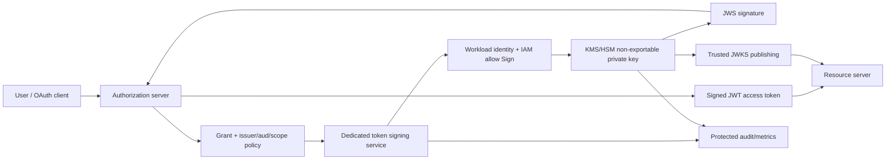
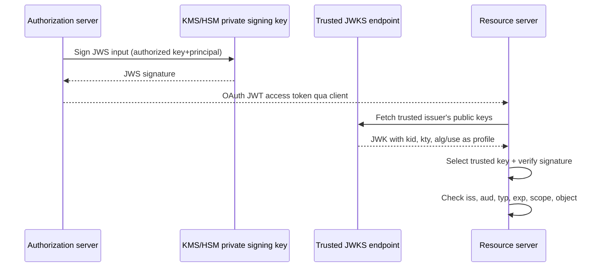
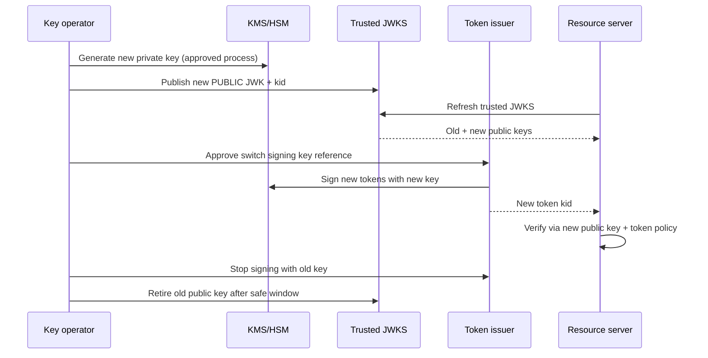
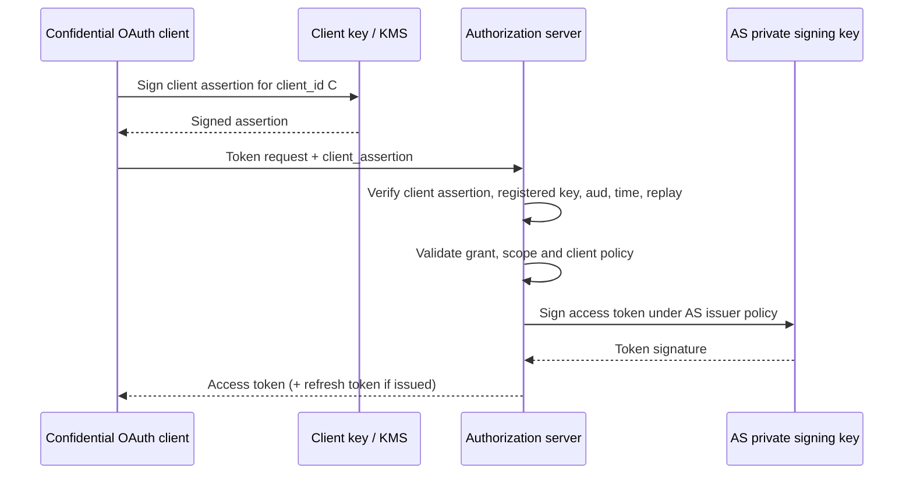
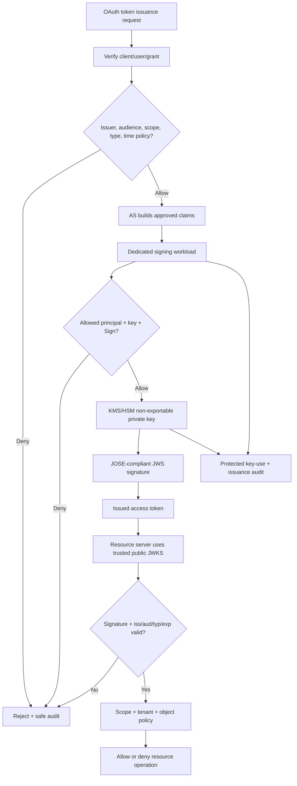

# Phân quyền sử dụng private key

Giả sử một hệ thống thương mại điện tử sử dụng JWT access token do **authorization server (AS)** ký bằng RSA private key. **Orders API** và **Billing API** chỉ cần xác minh token bằng public key. Nhưng nhóm triển khai đã đưa private key vào một biến môi trường dùng chung cho mọi microservice “để triển khai nhanh”. Một lỗ hổng remote code execution trong Orders API có thể trở thành **sự cố phát hành token giả mạo**: attacker lấy private key và tự ký JWT có `sub=admin`, `scope=payments.refund` hoặc `aud` tùy ý. Mọi resource server còn tin public key tương ứng có thể chấp nhận chữ ký nếu không có biện pháp giới hạn phù hợp.

Sau sự cố, nhóm chuyển khóa sang **KMS/HSM**, không còn xuất plaintext private key ra ứng dụng. Đây là một bước tiến lớn, nhưng nếu tất cả services đều có quyền gọi `Sign` trên **khóa của AS**, một service bị xâm nhập vẫn có thể yêu cầu KMS ký các thông điệp/JWT trái phép. **Không xuất được khóa** và **không lạm dụng được quyền ký** là hai mục tiêu bảo vệ khác nhau.

**Phân quyền sử dụng private key** là thiết kế giới hạn **ai được dùng khóa nào, để làm thao tác gì, theo danh tính/ngữ cảnh nào, với chính sách nào, ở thời điểm nào**, đồng thời tách quyền sử dụng khóa khỏi quyền xem, xuất, thay chính sách và quản trị vòng đời khóa. Chủ đề này đặc biệt quan trọng với khóa ký JWT/JWS, khóa OAuth client authentication, private key mTLS, DPoP và các khóa mã hóa/bọc khóa trong hệ thống xử lý token.

Bài thuộc chương **Key management** của module **SECURITY_TOKEN_SECURITY_FUNDAMENTALS**. Module bao quát mô hình tin cậy và vòng đời JWT, opaque access token, refresh token, OAuth 2.0/OIDC, claims, scope, audience, lưu trữ, phát hành, xác minh, thu hồi và phòng chống đánh cắp hoặc phát lại token. Phạm vi ở đây là **ủy quyền truy cập và sử dụng private key**, gắn với cả mật mã, hệ thống định danh, API và vận hành. Không có ghi chú đặc biệt bổ sung.

**Mục tiêu học tập**

- Phân biệt **private key, public key, key reference, key version, credential dùng để gọi KMS** và quyền thao tác lên từng đối tượng.
- Giải thích **use/sign/decrypt/unwrap**, **read/export**, **create/rotate/disable/delete**, **policy administration** và **audit access** là các quyền khác nhau.
- Thiết kế **least privilege, separation of duties, workload identity và tenant/environment isolation** cho private key.
- Hiểu vai trò của **KMS/HSM/non-exportable keys** và giới hạn của chúng khi một ứng dụng được cấp quyền ký tùy ý.
- Ngăn **confused deputy/signing oracle** trong dịch vụ ký JWT bằng kiểm soát issuer, audience, scope, subject, token type, thuật toán và mục đích.
- Phân biệt private key của **AS ký access token** với private key của **OAuth client**, **DPoP** hoặc **mTLS**.
- Tổ chức key lifecycle, `kid`/JWKS, cryptoperiod, rotation và key compromise response.
- Triển khai Java-style pseudocode, audit, monitoring, policy-as-code và kiểm thử âm tính cho private-key permissions.

## 1. Vấn đề cốt lõi: bảo vệ “khóa” và bảo vệ “quyền dùng khóa”

Một private key nằm trong KMS/HSM thường được thiết kế để không rời khỏi vùng bảo vệ dưới dạng plaintext. Tuy vậy, mọi ứng dụng có quyền yêu cầu thao tác bằng khóa cần được coi là một **thực thể có khả năng sử dụng quyền mật mã**, ngay cả khi không biết bytes của private key.

| Trạng thái | Attacker có thể làm gì? | Điều chưa được bảo vệ |
| --- | --- | --- |
| Có private key plaintext | Có thể ký/giải mã tùy thuật toán, sao chép và dùng ngoài hệ thống | Bảo mật gần như hoàn toàn phụ thuộc việc khóa chưa bị lấy |
| Không export được khóa, nhưng có quyền `Sign` không giới hạn | Có thể yêu cầu dịch vụ/KMS ký nhiều thông điệp bằng khóa | Chưa giới hạn **được ký nội dung nào** |
| Có `Sign` trên khóa đúng nhưng ứng dụng kiểm policy chặt | Chỉ ký theo luồng được cho phép, nếu policy/identity/integration không bị bypass | Vẫn phải bảo vệ identity, policy engine, logging và key lifecycle |
| Chỉ có public key | Có thể verify chữ ký, thường không thể ký như chủ private key | Phải kiểm issuer, audience, type, time và quyền API |
| Không có quyền `Sign` nhưng có quyền sửa key policy | Có thể tự cấp quyền cho mình nếu không có governance | Cần tách quyền policy administration và phê duyệt thay đổi |

**Nguyên tắc quan trọng:** *khóa không thể xuất* giảm nguy cơ **key exfiltration**, nhưng chưa ngăn **authorized-operation abuse** khi một principal hoặc service bị xâm nhập.

### 1.1. Hai lớp kiểm soát cần có

- **Key access control:** KMS/HSM/IAM xác minh service identity, key reference, operation, policy/conditions và trạng thái khóa.
- **Application authorization:** signing service/AS xác minh **tại sao** cần ký, **loại token nào**, subject/client/grant/scope/audience nào được phép và nội dung nào được phát hành.

KMS thường chỉ thấy một yêu cầu ký theo algorithm/key; nó **không biết** một JWT có `payments.refund` chỉ được cấp cho một admin đã step-up MFA, trừ khi sản phẩm và ứng dụng đã thiết kế một lớp policy kiểm soát điều này.

### 1.2. Ai có thể verify không đồng nghĩa có thể sign

Với **asymmetric JWS**, AS giữ private signing key và RS giữ public verification key. Resource server chỉ cần:

1. Trusted issuer/JWKS và public key phù hợp.
2. Đúng signature algorithm/profile.
3. Xác minh chữ ký, `iss`, `aud`, `typ`, `exp` và các claims.
4. Kiểm scope và object-level authorization.

Không có lý do thông thường để trao private signing key của AS cho RS chỉ vì RS cần verify JWT.

## 2. Private key là tài sản mật mã, key permission là quyền nghiệp vụ kỹ thuật

Một khóa bất đối xứng gồm:

- **Private key:** phải giữ bí mật, dùng ký hoặc giải mã/thiết lập khóa **tùy thuật toán và key usage**.
- **Public key:** dùng xác minh chữ ký hoặc tác vụ public-key phù hợp, có thể được phân phối qua JWKS/certificate.
- **Key reference/key ID:** tham chiếu nội bộ để gọi KMS/HSM, không phải private key bytes.
- **Key version:** giúp phân biệt vật liệu khóa qua rotation; semantics thay đổi tùy nhà cung cấp.
- **Key policy/IAM:** xác định principals, actions, conditions và governance.
- **Workload credential:** phương tiện một service chứng minh danh tính khi gọi KMS; nó **không phải** private key của AS và cần bảo vệ riêng.

### 2.1. Không phải private key nào cũng có cùng mục đích

| Loại private key | Chủ thể giữ | Tác vụ | Không được nhầm với |
| --- | --- | --- | --- |
| AS JWT signing key | Authorization server/signing boundary | Ký access tokens/ID tokens theo profile | Quyền xác minh của RS |
| OAuth client `private_key_jwt` key | Confidential client | Ký client assertion gửi AS | Khóa của AS phát access token |
| mTLS client private key | OAuth client/workload | Chứng minh sở hữu certificate trong TLS handshake | JWT signing key của AS |
| DPoP private key | OAuth client/key holder | Ký DPoP proof theo từng HTTP request | Bearer token và `jti` của access token |
| HSM admin/authentication key | Quản trị key infrastructure | Authentication/quản trị HSM theo thiết kế | Khóa ký token production |
| Asymmetric decryption key | Backend hoặc KMS service | Giải mã/wrapping theo key usage | Khóa ký JWT không có quyền decrypt |

Nên tách **purpose**, **owner**, **principal** và **cryptographic usage** cho từng key. Một khóa có thể hỗ trợ nhiều primitive theo implementation nhưng **không có nghĩa nên tái dùng nó cho nhiều mục đích**.

## 3. Mô hình đe dọa: ai cố lạm dụng private key?

Không chỉ attacker “đọc file PEM” mới đáng lo. Các tác nhân:

1. **External attacker** khai thác RCE/SSRF trên microservice có quyền KMS.
2. **Insider** có quyền quản trị IAM/KMS nhưng không có quyền phát token.
3. **Build/CI compromise** chèn signing code hoặc lấy credential deployment.
4. **Compromised workload identity** bị dùng để gọi `Sign` trực tiếp.
5. **Cross-tenant abuse**: service tenant A ký dữ liệu/token tenant B.
6. **Confused deputy**: signing service hợp lệ bị API caller xúi ký JWT có claims quá quyền.
7. **Key lifecycle misuse**: xóa/disable key sai, thay JWKS, làm mất availability hoặc acceptance.
8. **Audit tampering**: kẻ có quyền ký cũng xóa vết yêu cầu ký.

### 3.1. Các tài sản cần bảo vệ

| Tài sản | Nếu bị compromise | Ưu tiên bảo vệ |
| --- | --- | --- |
| Private signing key | Forged access/ID tokens | Non-exportability, least privilege, secure signing workflow |
| KMS `Sign` authorization | Forged signatures không cần lấy private key | Narrow workload identity, purpose-bound signing service |
| Key policy administration | Self-grant `Sign`, disable/delete, alter access | Separation of duties, approvals, audit |
| JWKS/issuer metadata | Trust/key injection hoặc availability attack | Trusted publishing pipeline, TLS, change review |
| Audit/signing event trail | Điều tra không biết ai ký gì | Durable protected logs, integrity/access control |
| OAuth token issuance policy | Phát hành token sai scope/audience/user | Validated grant/actor checks, explicit claims policy |

### 3.2. Giới hạn bảo mật cần nói rõ

Kể cả nếu service chỉ có đúng `Sign`, attacker chiếm service đó **vẫn có thể ký trong phạm vi được phép**. Việc giảm blast radius cần **purpose-specific keys**, issuer/resource isolation, hạn mức, anomaly detection, rate limits, policy checks và thu hồi quyền khi incident.

## 4. Ma trận quyền: use, export, manage và audit

Một permission model tốt không gộp mọi operation vào “key admin”.

| Quyền | Hoạt động minh họa | Chủ thể điển hình | Rủi ro nếu mở rộng quá mức |
| --- | --- | --- | --- |
| `Sign` | Ký JWS hoặc client assertion | Dedicated AS signer/client workload | Signing oracle, giả mạo token |
| `Verify` hoặc đọc public key | Xác minh chữ ký | Resource server, verifier | Nhầm lẫn trust nếu public key source sai |
| `Decrypt` / `UnwrapKey` | Giải mã/bóc khóa | Workload cần decrypt | Lộ plaintext/DEK từ ciphertext |
| `Encrypt` / `WrapKey` | Mã hóa/bọc khóa | Authorized producer | Khóa dùng sai context/audience |
| `GetPublicKey`/`DescribeKey` | Lấy metadata/public key | Verifier, operator | Lộ metadata; có thể hỗ trợ enumeration nếu không giới hạn |
| `ExportPrivateKey` | Xuất key material nếu loại khóa cho phép | Thường **không ai** ở production signing key | Khóa rời vùng bảo vệ, sao chép không kiểm soát |
| `CreateKey`/`ImportKeyMaterial` | Tạo/nhập khóa | Key provisioning pipeline | Key origins sai hoặc key injection |
| `RotateKey`/`UpdateAlias` | Chuyển phiên bản đang dùng | Key operator được duyệt | JWT verify lỗi, key substitution |
| `DisableKey`/`ScheduleDeletion` | Ngừng sử dụng hoặc xóa có điều kiện | SecOps/key custodian | Gián đoạn token issuance/verification |
| `UpdateKeyPolicy`/`GrantAccess` | Thay quyền KMS/IAM | Security governance | Privilege escalation, tự cấp `Sign` |
| `ReadAudit`/`ExportAudit` | Điều tra hoạt động sử dụng khóa | Auditors/SecOps | Rò metadata người dùng, xóa dấu |

Tên action cụ thể tùy provider; đây là **permission taxonomy**, không phải một bảng IAM policy sao chép được cho tất cả KMS.

### 4.1. Quyền sử dụng không mặc định bao gồm quyền đọc khóa

Một service có thể gọi API `Sign(key_ref, digest/message)` mà **không bao giờ nhận private key bytes**. Với ký JWT bằng asymmetric key, hướng thiết kế này thường an toàn hơn đưa private key vào config/env.

### 4.2. “Read access” phải phân biệt metadata/public key và private key

Đọc `publicKey` từ JWKS không phải đọc private key. **`DescribeKey`** có thể cho biết metadata/usage nhưng không nên đồng nghĩa được `Sign`, `Decrypt` hoặc export.

### 4.3. “Manage policy” có thể mạnh hơn “Sign”

Một account không được phép ký nhưng có quyền `GrantSign` cho chính nó thực tế **có đường leo quyền tới ký**. Review phải nhìn **effective privileges**, bao gồm quyền đổi policy, assume role, impersonate service, deploy code và đổi KMS alias.

## 5. Least privilege: identity × key × action × context × time

Một quy tắc phân quyền vững nên trả lời:

> Principal nào, sau khi được xác thực, có thể thực hiện action nào trên key cụ thể, từ trusted workload/context nào, vào thời điểm nào, và dưới điều kiện nghiệp vụ nào?

Mô hình khái niệm:

```text
KMS_authorize =
    verified_principal
    AND permission(action = Sign)
    AND matching_key_resource
    AND allowed_key_state_and_usage
    AND trusted_context_conditions

AS_issue_token =
    verified_issuance_actor_or_grant
    AND permitted_client_and_subject
    AND allowed_issuer_and_audience
    AND granted_scope_and_token_type
    AND signing_key_selection_policy
```

**Cả hai điều kiện phải đúng** để phát token được phép. Nếu chỉ KMS check đúng, AS vẫn có thể ký token có `scope` hoặc `sub` do caller tùy ý cung cấp.

### 5.1. Granularity khi cấp quyền

- **Key:** chỉ đúng key ARN/resource ID/identifier đã chọn, không wildcard toàn project nếu không cần.
- **Operation:** `Sign` trên signing key; không thêm `Decrypt`, `Export`, `Delete`.
- **Principal:** một workload identity theo service/environment; không chia chung credential giữa apps.
- **Context:** issuer, environment, zone, service account, trusted network/request origin, tags theo tính năng provider.
- **Time:** short-lived workload credentials, temporary grants và recertification.
- **Business context:** các claims/subject/audience do AS kiểm trong signing service, không mong KMS tự hiểu OAuth policy.

### 5.2. Deny by default và không tự cấp lại

Không có key permission thì phải **từ chối**. Tránh policy wildcard hoặc cho owner tự thay permissions mà không có approval. Một KMS deny còn phải được bảo vệ khỏi đường bypass: assume privileged role, deploy code vào signer, thay policy-as-code repository, đổi alias hay sửa cấu hình issuer.

## 6. Phân vai: signer, key custodian, security reviewer, auditor

| Vai trò | Được phép | Không nên được phép cùng lúc |
| --- | --- | --- |
| **Token signing workload** | Yêu cầu `Sign` đúng key, đúng use case | Đọc/export private key, sửa key policy |
| **Key provisioning operator** | Tạo key/alias theo change approval | Tự phát JWT production |
| **Security policy administrator** | Review/áp IAM conditions/policies | Tự sử dụng private key để cấp token |
| **Release/deployment operator** | Deploy phiên bản signer đã phê duyệt | Tự vượt review để sửa token claims policy |
| **Auditor** | Đọc audit events theo scope | Ký token, sửa hoặc xóa audit records |
| **Incident responder** | Thu hồi principal/disable key theo runbook | Quyền break-glass vĩnh viễn không ghi log |

### 6.1. Separation of duties không chỉ ở giao diện console

Nếu một người vừa có quyền merge code signer, vừa có quyền deploy không kiểm review, vừa quản trị IAM và tự xóa audit, việc gắn “role: observer” ở UI không tạo ranh giới thực. Cần xét **CI/CD permissions, IAM role assumption, KMS key policy, service account impersonation và audit access**.

### 6.2. Dual control / four-eyes principle

Các thay đổi tác động lớn—cấp `Sign` cho principal mới, đổi production issuer key, disable signer, export khóa ngoại lệ—nên cân nhắc **two-person approval**, MFA/step-up, ticket/change ID, thời hạn và rollback plan theo risk policy.

Không phải mọi HTTP request ký JWT đều yêu cầu hai người duyệt; dual control nhắm vào **thay đổi quyền và key operations nhạy cảm**, còn token issuance được tự động hóa trong phạm vi policy chặt.

## 7. Kiến trúc mẫu: chỉ dedicated signer có quyền dùng AS private key



Sơ đồ là **mô hình trách nhiệm**, không phải mô tả giao thức API KMS cụ thể. Một số AS gọi KMS trực tiếp thay vì qua signing service riêng. Điều không đổi:

1. **Chỉ signer workload** cần quyền dùng private signing key.
2. **KMS/HSM** bảo vệ private key và kiểm permission mức key operation.
3. **AS/signing policy** kiểm token contents và issuance authorization.
4. **RS** chỉ có trusted public key/JWKS để verify, không có quyền `Sign`.
5. **Audit** quan sát key uses, policy changes và suspicious signing, không chứa raw private key hoặc raw bearer tokens.

### 7.1. Tại sao signing service cần boundary riêng?

Nếu mọi backend nhận quyền ký, bug ở service ít nhạy cảm có thể thành issuer compromise. Tập trung signing giảm số principals có `Sign` và tạo nơi áp policy, rate limit, audit, algorithm và token type.

**Tập trung không đồng nghĩa tin mọi caller**: signing service phải authenticate/authorize requests, không đơn giản nhận payload JSON bất kỳ rồi ký.

### 7.2. Không trao signing key của AS cho API Gateway để “verify nhanh”

Gateway chỉ cần verification keys hoặc introspection. Nếu gateway có `Sign`, một RCE tại gateway có thể tác động mọi resource tin issuer. Sử dụng **public-key verification** khi profile phù hợp.

## 8. Workload identity: ai đang gọi KMS?

Một lệnh gọi KMS được thực hiện bằng một **principal**: service account, workload identity/federated identity, VM identity hoặc IAM role theo môi trường. **Không dùng API key/KMS credential lâu hạn chia sẻ** làm danh tính cho nhiều services nếu có thể tránh.

### 8.1. Danh tính workload phải có biên rõ

```text
prod-token-signer  -> Sign on prod-AS-access-token-key
staging-signer     -> Sign on staging-only-key
orders-resource    -> Verify/public-key only
billing-resource   -> Verify/public-key only
key-rotation-job   -> Create/Rotate/Alias subject to approval
audit-reader       -> Read scoped key-use/audit logs only
```

Đây là **mẫu phân vai**, không phải cú pháp IAM của một nhà cung cấp. Tên principal và permissions thật phụ thuộc cloud/KMS/HSM.

### 8.2. Workload federation và credentials ngắn hạn

Khi có thể, ưu tiên **short-lived service credentials** dựa trên workload identity federation thay vì đưa cloud secret tĩnh vào config map hoặc biến môi trường lâu hạn. Đảm bảo federation có trust mapping chặt (subject, issuer, audience của workload token, cluster/service identity, repository/build conditions).

**Một OIDC token dùng để xác thực workload với cloud không phải JWT access token cho Orders API**; không nhầm audience và token type của các hệ thống này.

### 8.3. Đề phòng khả năng impersonate/deploy

Nếu attacker không có `kms.sign` nhưng có thể **deploy code vào signer pod** hoặc **assume service identity** của signer, họ có thể gián tiếp gọi `Sign`. Vì vậy permission review gồm:

- Ai có quyền sửa deployment/CI variables/image?
- Ai có quyền chạy command trong pod/VM signer?
- Ai có quyền create job với service account signer?
- Ai có quyền mint/federate credentials cho identity signer?
- Ai có quyền update key policy/alias/key grants?

**Effective access ≠ chỉ những entries trong một IAM policy gắn trực tiếp vào principal.**

## 9. KMS/HSM: non-exportable giảm tác hại gì và không giải quyết gì?

Một key được đánh dấu **non-exportable** và tạo trong KMS/HSM có thể ngăn lấy private key bytes bằng API thông thường. Điều này giúp giảm rủi ro key exfiltration và cho phép ghi audit key operations. Nhưng:

- Principal có `Sign` vẫn có thể dùng private key qua API.
- Người có quyền đổi policy có thể cấp `Sign` cho một principal khác.
- App có thể ký message sai nếu key-use authorization không kiểm claims.
- KMS API có thể ký **digest** hoặc **raw message** theo kiểu algorithm/provider; không tự biết JWS profile.
- Không chứng minh token phù hợp `aud`, `scope`, `exp`, `typ`.
- Không thay key rotation, monitoring, compromise handling hoặc business authorization.

### 9.1. Key material custody và key-use authority là hai trục

| Cách lưu key | Quyền key material | Quyền key use | Kết luận |
| --- | --- | --- | --- |
| PEM trong env cho nhiều services | Private key có thể bị đọc/sao chép | Mọi service có thể ký cục bộ | Blast radius lớn |
| PEM trong secret manager cho signer duy nhất | Signer có thể đọc material vào memory | Hạn chế ở signer theo secret access | Tốt hơn, nhưng vẫn có exfiltration risk |
| KMS non-exportable; signer có `Sign` | Service không đọc private key | Chỉ được ký theo IAM/KMS policy | Giảm key theft, cần chặn signing oracle |
| HSM với application-level policy + strict role separation | Key custody hạn chế | Ký theo approved workflow | Giảm cả exfiltration và misuse, vẫn cần bảo vệ app |

### 9.2. HSM không phải công cụ phân quyền nghiệp vụ

HSM có thể kiểm user/partition/key permissions và thực thi cryptographic algorithms, nhưng **thường không biết** customer ABC có đồng ý scope `payments.refund` hay không. AS phải đưa quyết định nghiệp vụ ra trước **hoặc trong** tầng signing policy đáng tin.

## 10. Signing oracle / confused deputy: nguy cơ dù private key không thể xuất

Một signer tự động có API:

```http
POST /internal/sign-jwt HTTP/1.1
Authorization: Bearer <service-credential>
Content-Type: application/json

{"iss":"https://login.example.com",
 "sub":"admin",
 "aud":"https://api.example.com/refunds",
 "scope":"refunds.approve",
 "exp":1795000999}
```

Nếu request từ **bất kỳ service có authentication** đều được ký, caller có thể chỉ định claims vượt quyền. KMS vẫn ký đúng key, nhưng ứng dụng đã biến nó thành **JWT minting oracle**.

### 10.1. Đưa policy vào trước hoạt động ký

Signer không nên nhận “arbitrary claims to sign” từ tất cả callers. Thay vào đó nó nhận:

```text
issue_access_token(
    verified_grant_reference,
    client_identity,
    target_resource,
    requested_scope_subset
)
```

Sau đó **AS** kiểm grant/token issuance state và tự xây claims theo nguồn tin cậy, rồi gửi protected JWS signing input tới KMS.

### 10.2. Ràng buộc caller với token purpose

| Caller | Hành động được phép | Hành động không được phép |
| --- | --- | --- |
| AS authorization-code handler | Ký AT sau khi code/PKCE/client/grant được xác minh | Ký AT cho subject/audience bất kỳ |
| AS client-credentials handler | Ký service AT theo client/scope/resource đã đăng ký | Ký user-impersonation token tùy ý |
| OIDC ID-token handler | Ký ID token cho RP/audience theo authentication event | Ký OAuth AT với client audience thay vì RS |
| Orders API | **Không được ký** AS AT | Chuyển caller-supplied payload thành JWT |
| Admin console | Request revoke/grant policy theo quyền; không trực tiếp `Sign` | Ký `admin` token bằng nút “debug” |

### 10.3. Chặn bypass từ raw KMS credentials

Nếu signing service áp strict claims policy nhưng caller khác cũng có direct `kms.sign` trên cùng key, caller có thể **bỏ qua service**. Chỉ signer được cấp key-use permission; các clients gửi request qua **API business/authz boundary**. Quan trọng là kiểm **tất cả đường direct và indirect** tới key-use operation.

## 11. Phân tách khóa theo issuer, environment, tenant và token purpose

Nếu nhiều hệ thống cùng dùng một private key, việc một hệ thống bị xâm nhập có thể tác động tất cả những nơi chấp nhận public key của nó. **Key separation** giúp giảm **blast radius**.

| Phạm vi | Phân tách khuyến nghị theo risk | Điều kiện phải kiểm |
| --- | --- | --- |
| **Production vs staging/development** | Tách keys, IAM principals, issuer/JWKS, trust configs | Prod RS không tin staging key/issuer |
| **AS access token vs OIDC ID token** | Có thể tách signing keys theo purpose khi hệ thống hỗ trợ/risk yêu cầu | Dù dùng chung key vẫn phải tách `typ`/audience/token validation |
| **Issuer A vs issuer B** | Tách key owner/trust namespaces | RS không tin issuer mới chỉ vì key ID trùng |
| **Tenant A vs tenant B** | Tách signing permissions/keys hoặc tối thiểu tenant-bound issuance/trust policies | Tenant A không thể ký claim cho tenant B |
| **Client assertion vs AS-issued AT** | Tách key custody theo client và AS | Client key không có authority ký AT |
| **DPoP/mTLS vs server token signing** | Tách key purposes và principals | Proof-of-possession không trao quyền token issuance |
| **Online signer vs offline root/certification key** | Tách operational controls và key custody | Online app không có quyền dùng offline root |

**Không nhất thiết** mỗi tenant phải có một asymmetric signing key riêng; điều đó phụ thuộc chi phí, số tenants, JWKS management, trust boundaries và threat model. Nhưng **tenant isolation phải được thực thi**, bất kể key sharing policy.

### 11.1. Phân vùng key namespace

```text
prod/as-a/at-signing/key-v4       -> prod-as-a-signer only
prod/as-a/id-signing/key-v2       -> prod-id-token-signer only (if separated)
prod/client-17/private-key-jwt    -> client-17 workload only
staging/as-a/at-signing/key-v5    -> staging signer only
dev/as-a/at-signing/test-key     -> local/test environment only
```

Đây là sơ đồ đặt tên **minh họa**. Provider có thể dùng key IDs/ARNs/versions không theo format trên. Không suy ra key có quyền sử dụng dựa vào **prefix tên** mà thiếu resource IAM/policy kiểm chứng.

### 11.2. `kid` không thay key access control

JOSE `kid` là **key identifier hint** để verifier tìm đúng public key trong **tập khóa đã tin cậy**. Nó không phải principal ID, không phải password để dùng KMS và không được chấp nhận như quyền ký.

Ví dụ hai issuers cùng dùng `kid=key-1`; RS phải giữ namespace theo issuer, không tự chọn một key từ global JWKS chỉ bằng `kid`.

### 11.3. Mismatch giữa signer và issuer

Signing service không được ký JWT với `iss=https://issuer-b.example` bằng key của issuer A chỉ vì caller gửi một chuỗi `iss`. Đặt issuer/key mapping trong trusted configuration:

```text
trusted_mapping:
  issuer_A:
    key_ref: protected-key-A
    jwks_uri: trusted-JWKS-A
    token_profiles: [oauth_access_token]
  issuer_B:
    key_ref: protected-key-B
    jwks_uri: trusted-JWKS-B
    token_profiles: [oauth_access_token]
```

Nguồn policy phải được bảo vệ và review, không lấy trực tiếp từ token/request untrusted.

## 12. JWT/JWS: private key được dùng để ký điều gì?

Một JWT access token dạng JWS compact:

```text
BASE64URL(UTF8(protected_header))
  + "."
  + BASE64URL(UTF8(claims_payload))
  + "."
  + BASE64URL(signature)
```

**Signing input** của JWS compact là:

```text
BASE64URL(protected_header) + "." + BASE64URL(payload)
```

Các chi tiết JOSE encoding, key type và signature representation nên do **thư viện JOSE được duy trì** quản lý. Caller không nên tự xây thuật toán JWT ký bằng một hàm Base64/`Signature.sign()` rồi đoán format.

### 12.1. Signing key được phép ký một profile cụ thể

Ví dụ access-token profile:

```json
{
  "iss": "https://login.example.com",
  "sub": "user-42",
  "aud": "https://api.example.com/orders",
  "client_id": "orders-web",
  "scope": "orders.read",
  "iat": 1795000000,
  "exp": 1795000300,
  "jti": "safe-internal-token-id"
}
```

Các claims và timestamps **chỉ là ví dụ**. Để ký hợp lệ, AS cần xác minh grant/actor, client, audience/resource, scope và lifetime. Một KMS có `Sign` chỉ xác minh key-use IAM; nó **không xác nhận user-42 có quyền Orders**.

### 12.2. Cấm arbitrary claims

Một signing endpoint nhận object tùy ý rồi ký cho mọi caller là **token minting service không có authorization**. Nên xây claims từ:

- Authenticated OAuth grant/client/session records.
- Registered scopes/resources và các authorization decisions.
- AS issuer configuration (cố định).
- Signing policy/version, token type và intended recipient.
- Server-side clock và `exp` bound policy.

Không cho caller gửi `sub=admin`, `scope=*`, `iss=trusted-issuer` hay `exp=10 years` rồi ký nguyên.

### 12.3. `alg`/key type binding

Trong JWS, `alg` phải nằm trong **allowlist được issuer/AS và verifier đồng thuận**, tương thích private key type và provider. Ví dụ `RS256`, `PS256`, `ES256` hoặc `EdDSA` có chữ ký/parameters khác nhau; không để JWT header từ caller chọn thuật toán bất kỳ.

Đặc biệt không chấp nhận `alg=none` khi token profile yêu cầu signed JWT. **Một key-use permission đúng không cứu được verifier chấp nhận token không ký**.

### 12.4. JWS vs JSON payload signing

Nếu KMS API nhận **message bytes** hoặc **digest** tùy thuật toán, adapter phải dùng đúng contract của KMS và JOSE:

- Kiểm rõ có phải KMS tự hash hay caller cần pre-hash.
- Chọn signature algorithm/parameters chính xác.
- Với ECDSA, đối chiếu DER encoding của provider với JOSE `R || S` raw format khi library yêu cầu.
- Với RSA-PSS, chọn đúng parameter/salt-length/profile.
- Không double hash, không ký plain JSON thay cho JWS signing input.

**Đừng copy mã ký AES/RSA từ ví dụ không cùng profile** rồi dùng để phát OAuth access token.

## 13. Public JWKS publishing khác quyền dùng private key

RS xác minh asymmetric JWT qua **public key** do issuer công bố trong JWKS. Public key có thể được phân phối rộng, nhưng **nguồn công bố JWKS và issuer mapping phải đáng tin**.



Sơ đồ bỏ qua HTTP client đi giữa AS và RS để nhấn mạnh ranh giới key custody. RS **không gọi KMS `Sign`** để verify JWS.

### 13.1. Chỉ public JWK được công bố

Khi xuất JWKS cho RS:

- Chỉ công bố **public fields** của asymmetric keys (ví dụ RSA `n`/`e`, EC `crv`/`x`/`y`, tùy kty).
- **Không công bố private JWK fields** như RSA private parameters hoặc EC `d`.
- `kid` phải ổn định trong vòng đời key publication/validation policy.
- Các fields như `use`, `key_ops`, `alg` cần được kiểm compatibility với token profile.
- Kiểm trusted source, TLS và cache/key-rotation policy.

### 13.2. Không tin `jku` hoặc `x5u` do token tự khai

JWT header có thể chứa `jku`/`x5u` hoặc `kid`. Nếu RS tự tải JWKS từ URL attacker đưa vào, hắn có thể tự ký token bằng private key **của chính hắn** rồi khiến RS tin public key tương ứng. Chọn key từ **trusted issuer JWKS** đã cấu hình, không từ header của token chưa xác minh.

### 13.3. JWKS admin cũng là vị trí nhạy cảm

Kẻ có quyền thay public key ở JWKS có thể đưa key của mình vào trust set, khiến chữ ký attacker được chấp nhận nếu RS không có bảo vệ bổ sung. Vì vậy **quyền sửa JWKS/trust config** có thể gần tương đương quyền ký giả token; cần phê duyệt, audit và tách khỏi developer ít quyền.

## 14. Key lifecycle và permission changes theo từng giai đoạn

Key management bao gồm **tạo → kích hoạt → sử dụng → rotate → retire/disable → hủy theo policy**. Những giai đoạn này cần vai trò và kiểm soát khác nhau.

| Giai đoạn | Ai thực hiện | Quyền tối thiểu | Điều cần kiểm/audit |
| --- | --- | --- | --- |
| Generate/import | Provisioning service/key custodian | Create/import theo approval | Entropy, key origin, algorithm, purpose |
| Activate/enable | Authorized key operator | Enable/alias update được duyệt | Key state, release ID, issuer mapping |
| Sign token | Dedicated signing workload | `Sign` trên key đã chấp thuận | Principal, key, algorithm, token purpose, policy version |
| Publish public key | Trusted JWKS publisher | Read/export **public** metadata | JWKS key set integrity, `kid` |
| Rotate | Key rotation operator | Create/activate/retire/alias | Overlap và RS readiness |
| Disable in incident | Security response role | Disable/revoke grants according to runbook | Blast radius, rollback strategy |
| Delete/destroy | Key custodian with approval | Scheduled destruction only | Retention, cryptoperiod/legal hold, backups |

### 14.1. Key states và behavior

KMS/HSM thường có trạng thái key **enabled, disabled, pending deletion** hoặc tương đương. Nên kiểm trạng thái trước use, chặn ký bằng khóa đã retire/disabled và theo dõi signing failures. Không mặc định “key bị disable” khiến tất cả JWT đã ký **lập tức không thể verify**: RS có thể đã cache public key và vẫn chấp nhận tokens theo policy.

### 14.2. Key cryptoperiod và token lifetime

**Cryptoperiod** là giai đoạn được phép sử dụng key cho mục đích mật mã theo policy; **token lifetime** là khoảng hiệu lực của JWT/opaque token. Hai thời gian liên quan nhưng không đồng nhất:

- Sau khi key ngừng **ký mới**, public key có thể cần còn **được xác minh** cho tokens chưa hết `exp`.
- Signing key bị **compromise** có thể buộc loại bỏ public key/deny tokens sớm hơn, chấp nhận tác động availability theo incident plan.
- Key mới có thể được publish trước khi AS bắt đầu ký để RS làm nóng JWKS cache.

### 14.3. Key rotation không phải chỉ đổi `kid` string

`kid` là identifier. Nếu đổi `kid` mà vẫn dùng cùng key material, **không phải** rotation cryptographic key theo nghĩa thay vật liệu bí mật. Ngược lại, key material đổi nhưng JWKS chưa publish đúng sẽ làm RS verify thất bại.

## 15. Kế hoạch rotation an toàn cho JWT signing key



### 15.1. Một runbook thực tế

1. Tạo key mới đúng algorithm/size/purpose, không export private material.
2. Kiểm security policy cấp **chỉ** signer production mới có `Sign`.
3. Public JWK mới được publish trên **trusted issuer JWKS**.
4. Xác minh resource servers fetch/cached key mới và có negative tests.
5. Chuyển AS signing pointer/alias theo rollout/canary.
6. Theo dõi tỷ lệ tokens ký bởi `kid` cũ/mới, unknown-kid và signature errors.
7. Ngừng dùng khóa cũ cho issuance.
8. Giữ **public verification key** cũ đủ lâu cho tokens đã phát còn hiệu lực, trừ khi key compromise yêu cầu revoke sớm.
9. Disable/retire private key cũ theo cryptoperiod/policy.
10. Audit key grants, alias changes, rollout approvals, việc xóa quyền cũ.

### 15.2. Điều cần tránh khi chuyển alias

Một permission `Sign on alias=prod/current` có thể vô tình cấp quyền dùng **mọi key tương lai** mà alias được trỏ tới, tùy semantics của provider. Phải hiểu quyền được đánh giá trên **alias hay underlying key resource** và kiểm role không thể tự thay alias.

### 15.3. Key rotation rollback

Rollback chỉ được dùng nếu key cũ chưa compromise và vẫn đáp ứng policy. Nếu key bị lộ, “rollback cho dịch vụ chạy” có thể mở lại quyền ký giả. Cần phối hợp AS/RS, JWKS, client tokens, cache và sự cố khóa theo risk.

## 16. Private key của OAuth client: `private_key_jwt` không phải khóa AS

Trong OAuth 2.0, confidential client có thể xác thực với token endpoint bằng **JWT client assertion được ký bằng private key của client**, ví dụ phương pháp **`private_key_jwt`** theo RFC 7523/OIDC client authentication profiles.

Các lớp tin cậy:

- **Client** giữ private key và chỉ có quyền ký **client assertion** cho danh tính chính mình.
- **AS** giữ public key/certificate/JWKS của client hoặc registration trust để verify assertion.
- **AS** giữ **private signing key khác** để phát access token/ID token.



### 16.1. Client assertion gồm claims nào?

Một assertion JWT theo RFC 7523 client authentication thường có:

```json
{
  "iss": "my-confidential-client",
  "sub": "my-confidential-client",
  "aud": "https://login.example.com/oauth2/token",
  "iat": 1795000000,
  "exp": 1795000060,
  "jti": "unique-assertion-ref"
}
```

Đây là **ví dụ theo một deployment**, không phải yêu cầu mọi AS phải chấp nhận đúng URL audience hoặc mọi extension claim. AS kiểm issuer/subject client ID, intended audience/token endpoint theo registration/policy, signature từ **client key đã đăng ký**, thời hạn và replay/`jti` theo profile/AS policy.

### 16.2. Giới hạn quyền client key

Một service dùng `private_key_jwt` không nên được trao quyền dùng **AS JWT signing key**. Nếu client assertion private key bị lộ, có thể cần thu hồi/rotate **registration key/credential của client đó**; không mặc định nó cho phép giả mọi token của issuer.

### 16.3. Client key trên KMS/HSM

Khi confidential client dùng KMS để ký assertion, IAM `Sign` chỉ nên cấp cho **workload identity của client** và **client key**; không cấp quyền KMS admin/Export. Ngoài KMS, AS vẫn phải validate client assertion và grant. Private-key JWT không thay authorization-code/PKCE/redirect security.

## 17. mTLS và DPoP: private keys của client có vòng đời và quyền khác

### 17.1. mTLS client private key

Với **mutual TLS (mTLS)**, client sở hữu private key tương ứng certificate được dùng trong TLS handshake. Trong OAuth mTLS (RFC 8705), AS có thể dùng certificate để xác thực client; access token cũng có thể bị **certificate-bound** khi profile hỗ trợ.

Mục tiêu phân quyền:

- Chỉ workload/máy tương ứng có thể dùng private key để hoàn tất handshake.
- Không export key nếu có thể sử dụng trusted key store/HSM.
- Certificate được phát/rotate bởi CA/PKI tin cậy.
- Client authorization tại AS phải kiểm đúng certificate/key binding.
- RS hoặc trusted TLS terminator kiểm token sender binding **mỗi request** khi token là certificate-bound.

**Có certificate hợp lệ không tự trao quyền gọi mọi OAuth API**: AS/RS vẫn kiểm client registration, audience, scope và token.

### 17.2. DPoP private key

Trong **DPoP (RFC 9449)**, OAuth client dùng private key ký DPoP proof JWT gắn với HTTP method/URI và access token theo protocol. Access token có thể bị bind với public key thumbprint (`cnf.jkt`). RS phải kiểm proof trên từng request:

- Signature và public-key binding.
- `htm`, `htu`, `ath` nếu áp dụng.
- `iat`/nonce, `jti` và replay cache theo profile.
- Access token `cnf` binding và token authorization.

**Không trao AS token-signing key cho DPoP client**. DPoP key sở hữu ở client; compromise DPoP key có ảnh hưởng theo phạm vi token đó, khác signing authority của toàn issuer.

### 17.3. Non-exportable trên thiết bị không chứng minh thiết bị hoàn toàn an toàn

Mobile secure enclave/hardware keystore có thể giảm key extraction, nhưng malware có quyền gọi signing API vẫn có thể xin ký, hoặc điều khiển request trong phạm vi API. Vì vậy app còn cần **user presence/biometric policy nếu phù hợp, device attestation theo threat model, TTL, anti-replay, revocation và fraud controls**.

## 18. Private key dùng giải mã và ký không phải một permission chung

Một RSA private key có thể được API provider hỗ trợ cho các use cases khác nhau, nhưng **không nên mặc định một key vừa ký JWT vừa giải mã dữ liệu**. Phân tách **key purpose, algorithm policy và key usage**.

| Use case | Quyền kỹ thuật | Mục đích | Kiểm soát bổ sung |
| --- | --- | --- | --- |
| JWT/JWS signature | `Sign` | Xác nhận token từ issuer | Strict token claims/alg/aud/typ |
| JWE recipient decrypt | `Decrypt`/`Unwrap` | Mở ciphertext được mã hóa cho recipient | Envelope validation, authenticated encryption, token type |
| mTLS handshake | Private-key operation trong TLS stack | Chứng minh possession của certificate | PKI, cert auth, channel binding |
| OAuth client assertion | `Sign` trên client key | Xác thực OAuth client | Client ID/audience/time/replay |
| AEAD data at rest | Symmetric `Encrypt`/`Decrypt` hoặc KMS envelope | Bảo vệ dữ liệu token store | Nonce uniqueness, AAD, tag validation, access controls |

**Không cấp `Decrypt` chỉ vì signer cần ký JWT**, không cấp export key chỉ vì backup operator muốn thử khôi phục. Với asymmetric keys, phân biệt **key agreement/decapsulation/decryption** theo đúng primitive và provider.

### 18.1. Envelope encryption

KMS có thể giữ key-encryption key (KEK) và bảo vệ data-encryption keys (DEK). Workload cần quyền `GenerateDataKey`/`Decrypt` hoặc tương đương theo policy, nhưng **không nhất thiết cần private signing key của AS**.

### 18.2. AAD/encryption context

Khi provider và thiết kế hỗ trợ encryption context/AAD, có thể ràng buộc ciphertext với tenant/resource purpose. Nhưng **context phải xuất phát từ trusted configuration/authorization**, không tin `tenant=other` do caller tự khai. AAD giúp xác minh integrity binding, **không tự thay RBAC hoặc tenant policy**.

## 19. Quản trị quyền thay đổi key policy

Phân quyền `Sign` chặt nhưng cho nhiều người **UpdateKeyPolicy** là một security gap. Hãy xét:

1. Ai có quyền tạo grant mới cho signer?
2. Ai được chuyển key alias/issuer mapping?
3. Ai được thêm IAM principal vào policy?
4. Ai được thay principal conditions hoặc service identity trust?
5. Ai có quyền disable/delete key?
6. Ai có thể xóa audit records?
7. Ai có quyền deploy code vào service có `Sign`?

### 19.1. Policy-as-code

IAM/KMS permissions có thể quản lý bằng IaC và pull request có owner review:

```yaml
# PSEUDOPOLICY: ví dụ thể hiện ý nghĩa, không phải cú pháp cloud IAM.
key: prod/as-a/access-token-signing
key_purpose: SIGN_VERIFY
algorithm: reviewed-asymmetric-jws-algorithm
grants:
  - principal: workload/prod-as-a-token-signer
    actions: [Sign]
    resources: [prod/as-a/access-token-signing]
    conditions:
      environment: production
      trusted_workload: prod-as-a-token-signer
  - principal: workload/key-publisher
    actions: [GetPublicKey, DescribeKey]
    resources: [prod/as-a/access-token-signing]
denies:
  - principal: workload/orders-api
    actions: [Sign, Decrypt, ExportPrivateKey, UpdateKeyPolicy]
  - principal: workload/billing-api
    actions: [Sign, Decrypt, ExportPrivateKey, UpdateKeyPolicy]
```

**Đây là YAML minh họa**. Không phải mọi cloud provider có explicit deny syntax hoặc mọi điều kiện nêu trên; actual IAM policy phải dùng đúng semantics và được test trên provider thật.

### 19.2. Drift detection

Một người chỉnh policy trực tiếp qua console có thể tạo quyền trái với IaC. Cần:

- Theo dõi **effective policy** và các grants/runtime aliases.
- Cảnh báo thay đổi ngoài change approval.
- Review quyền theo chu kỳ, thu hồi principals không còn phục vụ hệ thống.
- Test “service X thật sự không thể `Sign`” thay vì chỉ nhìn file policy.

### 19.3. “Just-in-time” cho quyền quản trị

Key management admin quyền cao có thể được cấp tạm, theo approval/case ID, dùng MFA và tự hết hạn. Tránh permanent emergency admin trên production signing keys. **Break-glass** cần được audit và review sau sự cố.

## 20. Chính sách phát hành token và key-use policy phải cùng bảo vệ

Signing service thường là “chốt chặn” cuối trước khi một JWT được ký. Điều cần bảo vệ:

| Điều kiện trước khi ký | Nguồn xác minh | Lỗi nếu bỏ qua |
| --- | --- | --- |
| Client authentic/registered | AS client registry/auth handler | Service giả client khác |
| Grant/authentication event valid | AS transaction/grant store | Ký token không có grant hợp lệ |
| Subject đúng | Verified grant, session hoặc client credential policy | User impersonation |
| Issuer/key mapping đúng | Trusted AS config | Ký token như issuer khác |
| Audience/resource allowed | Registered resources và request policy | Token substitution giữa APIs |
| Scope là tập quyền được cấp | Grant/client/user policy | Privilege escalation |
| Token type/`typ` đúng | AS profile | ID token dùng làm access token |
| Expiry bounded | AS server clock/lifetime policy | Long-lived forged token |
| Signing algorithm/key ID đúng | Trusted signing policy | Alg confusion/downgrade |
| Key principal được phép `Sign` | IAM/KMS/HSM policy | Unauthorized key use |

### 20.1. Không dùng `key_ref` do caller gửi trực tiếp

Nếu API `issueToken` cho caller chọn `key_ref=prod-admin-signing`, một client ít quyền có thể xin ký bằng khóa có trust rộng hơn. **Key selection thuộc trusted issuer/token-profile policy**, không phải lựa chọn tùy ý từ user request.

### 20.2. Sign-only KMS role vẫn cần application-level scoped capability

Một service có `Sign` không nên được dùng như general-purpose “ký bytes bất kỳ”. Trong thiết kế an toàn hơn, service chỉ thấy **lệnh nghiệp vụ** như `issue access token for validated grant ID`; mọi claims được server-side policy xác lập.

## 21. Java-style pseudocode: dịch vụ phát token với quyền ký tối thiểu

Ví dụ sau minh họa cách **kiểm quyền nghiệp vụ trước KMS Sign**. Đây là **Java-style pseudocode**, các types như `KmsSigner`, `TrustedGrantStore`, `JoseCodec` và `IssuancePolicy` là **interfaces giả định**, không phải JDK/Spring API có sẵn. Trong triển khai thật, nên dùng **JOSE/OAuth library đáng tin** để tạo JWS và chọn signature encoding/algorithm chính xác.

```java
final class AccessTokenIssuer {
    private final TrustedGrantStore grants;
    private final IssuancePolicy policy;
    private final ClaimsFactory claimsFactory;
    private final JoseCodec jose;
    private final KmsSigner kms;
    private final ProtectedIssuanceAudit audit;
    private final TrustedSignerConfiguration config;

    IssuedAccessToken issue(
            VerifiedIssuanceActor actor,
            ValidatedGrantReference grantRef,
            RequestedResource requestedResource,
            RequestedScopes requestedScopes,
            CorrelationId correlation
    ) {
        // Lookup và authorization do AS thực hiện.
        Grant grant = grants.requireActiveGrant(grantRef);
        IssuanceDecision decision = policy.requireAuthorized(
            actor, grant, requestedResource, requestedScopes
        );

        // Không lấy issuer, key_ref, alg, typ từ raw caller payload.
        TrustedSigningProfile profile =
            config.accessTokenProfileFor(decision.issuer());

        TokenClaims claims = claimsFactory.fromApprovedDecision(
            decision,
            profile.issuer(),
            profile.allowedAudience(),
            profile.maxTokenLifetime()
        );

        JoseProtectedHeader header = jose.protectedHeader(
            profile.algorithm(),
            profile.keyId(),
            profile.tokenType()
        );

        // JOSE library tạo signing input đúng RFC 7515.
        byte[] signingInput = jose.encodeSigningInput(header, claims);

        // Workload identity của service chỉ được Sign một key cụ thể.
        // KMS signer phải ràng buộc key_ref, algorithm và IAM policy.
        byte[] signature = kms.sign(
            profile.protectedKeyReference(),
            profile.algorithm(),
            signingInput
        );

        String jwt = jose.buildCompactJws(
            header, claims, signature
        );

        // Audit metadata an toàn, không ghi raw jwt/signingInput.
        audit.recordSuccessfulIssuance(
            correlation,
            actor.safeReference(),
            profile.keyId(),
            profile.issuer(),
            decision.clientId(),
            decision.resourceClass(),
            decision.scopeNames(),
            claims.expiresAt()
        );
        return IssuedAccessToken.of(jwt, claims.expiresAt());
    }
}
```

**Lưu ý:** ví dụ không mô tả đầy đủ transaction persistence/idempotency. Khi token issuance còn liên quan refresh-token rotation hoặc one-time authorization code, cần đảm bảo state transition và token response theo policy. Audit phải phân biệt **KMS signing operation thành công** với **token thực sự được commit/trao cho client**; một chữ ký được tạo chưa chắc đã trở thành credential có hiệu lực.

### 21.1. Tính chính xác của adapter JOSE–KMS

Trong một số KMS APIs, `Sign` nhận **message**; một số lựa chọn nhận **digest**. Với ES256, signature representation từ KMS có thể phải được thư viện JOSE chuyển giữa DER và JOSE `R || S`. Với RSA-PSS, salt/hash parameters cần khớp `PS256`. Vì vậy **`JoseCodec` và `KmsSigner` phải do implementation được review** xây dựng; mã giả không định nghĩa wire contract thật.

### 21.2. Failure path phải đóng

```java
// PSEUDOCODE: tuyệt đối không fallback sang ký tùy tiện.
try {
    return issuer.issue(actor, grantRef, resource, scopes, corr);
} catch (KmsPermissionDenied exception) {
    audit.recordSigningDenied(corr, "KMS_PERMISSION_DENIED");
    throw new ServiceUnavailableOrSecurityIncident();
} catch (KmsUnavailable exception) {
    audit.recordSigningFailure(corr, "KMS_UNAVAILABLE");
    throw new ServiceUnavailableOrSecurityIncident();
}

// SAI:
// catch (Exception x) { return locallySignWithSharedDevPem(...); }
```

Không trả access token “chưa ký”, không giảm thuật toán sang `none`, không chuyển sang staging key và không dùng khóa dev đã hard-code.

### 21.3. Client identity khác end-user identity

KMS thấy `workload/prod-token-signer`. Business layer của AS mới biết **user/client/grant** theo OAuth. Audit nên liên kết hai lớp, không ghi `user-42 invoked KMS directly` nếu user thực tế chỉ đăng nhập qua AS.

## 22. Ví dụ kiểm soát API: Sign-only role và policy enforcement

Một cấu hình quyền minh họa:

```yaml
# CONCEPTUAL POLICY ONLY — KHÔNG COPY thẳng vào AWS/Azure/GCP KMS IAM.
principal: workload/prod-token-signer
resource: kms-key/prod/as/access-token/current
allow:
  - Sign
  - DescribeKey
deny_by_default:
  - ExportPrivateKey
  - Decrypt
  - UpdateKeyPolicy
  - GrantKeyUsageToOtherPrincipal
  - ScheduleKeyDeletion
conditions:
  trusted_service_identity: prod-token-signer
  deployment_environment: production
  approved_signature_algorithm: as-access-token-profile
key_ownership:
  iam_policy_owner: security-platform
  signing_code_owner: identity-platform
  audit_reader: security-audit
```

Tùy provider, **explicit deny**, algorithm conditions hoặc exact key-reference matching có semantics khác nhau hoặc **không hỗ trợ** một số fields. Mục đích là cho thấy **action-level least privilege và governance**. Đừng tự tin rằng YAML này là một policy enforce được nếu chưa chuyển sang cú pháp/provider và kiểm **effective permissions**.

### 22.1. Hai đường kiểm soát độc lập

**KMS route:** principal đúng, key đúng, action `Sign` đúng, key enabled, algorithm được chấp thuận.

**Token issuance route:** grant đúng, subject/actor đúng, client đúng, requested scopes là subset được cấp, audience/resource đúng, TTL bounded, token type đúng.

Nếu service có thể bị gọi để ký raw bytes, **bất kỳ caller được nó tin có thể lợi dụng quyền KMS của service**. Do đó không exposure `SignRawJwsForArbitraryPayload` như endpoint nghiệp vụ.

### 22.2. Quản lý danh sách principals

Khi workload đổi tên, bị tách service hoặc hết nhiệm vụ, cần thu hồi role/grant cũ. Tránh giữ permissions cho service identities không còn tồn tại, ephemeral test jobs hoặc developer user accounts không cần key use.

### 22.3. Permission simulation và integration tests

Security review nên chứng minh:

```text
prod-token-signer  Sign(production-key)    -> ALLOW
prod-token-signer  ExportPrivateKey        -> DENY
prod-token-signer  UpdateKeyPolicy         -> DENY
orders-api         Sign(production-key)    -> DENY
staging-signer     Sign(production-key)    -> DENY
dev-user           Sign(production-key)    -> DENY
key-rotation-job   CreateApprovedNewKey    -> ALLOW with review
auditor            ReadSafeAuditOnly       -> ALLOW
auditor            Sign(production-key)    -> DENY
```

Kết quả chỉ là kỳ vọng mẫu. Kiểm với IAM simulator/provider/API thật trong một môi trường kiểm thử có quyền phù hợp, không giả định áp dụng ở production chỉ vì file policy trông đúng.

## 23. Audit quyền dùng private key: phân biệt “attempt”, “signed” và “issued”

Một sự kiện KMS `Sign` có thể ghi:

- **Principal/workload identity** đã yêu cầu.
- **Key reference/version** được dùng.
- **Operation** `Sign`, algorithm/provider và request/result class.
- **Request/correlation ID** liên kết với AS token issuance.
- **Time, environment, trusted resource context** theo policy.

Audit ứng dụng bổ sung **token purpose, client ID, audience/resource class, granted scope class, token lifetime/policy version**, theo mức dữ liệu cần thiết.

### 23.1. Ba loại thành công khác nhau

| Event | Khi nào ghi? | Không thể suy ra |
| --- | --- | --- |
| `KEY_SIGN_REQUESTED` | Signer đã nhận một thao tác ký | KMS đã cho phép |
| `KEY_SIGN_SUCCEEDED` | KMS/HSM thực hiện thao tác ký thành công | JWT đã được phát đúng policy, client đã nhận |
| `TOKEN_ISSUANCE_COMMITTED` | AS hoàn tất issuance/state theo contract | RS đã cho phép mọi request, token chưa bị revoke |

**Không ghi “token đã phát hành thành công” chỉ vì KMS trả signature bytes**; lỗi sau khi ký có thể ngăn issuance. Ngược lại, nếu event audit tới external sink muộn, không thay đổi thời điểm thực tế của KMS/AS operation.

### 23.2. Ví dụ audit event an toàn

```json
{
  "schema_version": "1",
  "event_id": "evt-sign-214",
  "event_type": "KEY_SIGN_SUCCEEDED",
  "occurred_at": "2026-11-23T03:04:18.120Z",
  "correlation_id": "corr-214",
  "verified_workload": "prod-as-a-token-signer",
  "key_ref": "safe-key-ref-v4",
  "algorithm": "PS256",
  "key_usage": "JWT_ACCESS_TOKEN_SIGNING",
  "issuer_ref": "prod-as-a",
  "client_ref": "orders-web",
  "resource_class": "orders-api",
  "issuance_policy_version": "at-policy-v8",
  "decision": "ALLOW",
  "result": "SIGNATURE_CREATED"
}
```

Đây là ví dụ nội bộ; không chứa private key, raw access token, raw signed JWT, refresh token, private user claims hay secrets. Các references cần có ACL và retention phù hợp.

### 23.3. Audit những hành động nhạy cảm khác

- Thêm/xóa `Sign` permission.
- Đổi key alias/version, enable/disable key.
- Tạo key, import, yêu cầu export nếu loại key cho phép.
- Thay public JWKS, trust issuer và token-profile config.
- Assume privileged IAM role/deploy signer code.
- Break-glass, policy override, xóa/đổi retention audit logs.

**Quyền đọc audit không được ngầm cấp quyền xóa/sửa vết audit**.

### 23.4. Lưu và bảo vệ audit

Nên có durable/append-only storage hoặc cơ chế tương đương được kiểm chứng, access control, timestamps/correlation, retention và alert khi có gaps. Không ghi raw JWS signing input nếu nó mang PII/secret claims hoặc dữ liệu không cần thiết; mã hash/correlation chỉ nên dùng khi có purpose rõ và bảo vệ khỏi correlation leak.

## 24. Phát hiện lạm dụng quyền ký: metrics và cảnh báo

| Metric/alert | Ý nghĩa | Điều tra |
| --- | --- | --- |
| `kms_sign_requests_total` theo key/principal | Volume key-use | Signing spike ngoài expected issuance rate |
| `kms_sign_denied_total` | IAM/action/key policy từ chối | Unauthorized signer, drift hoặc intrusion |
| `kms_sign_errors_total` | HSM/KMS unavailable, wrong algorithm | Dependency outage hoặc misconfiguration |
| `token_issuance_total` theo profile/issuer | Số token thực sự được cấp | Chênh lệch với KMS signing events |
| `unexpected_key_principal_attempts` | Principal lạ gọi key | Impersonation, privilege escalation |
| `key_policy_change_total` | Số IAM/grant/alias changes | Change không có approval |
| `jwks_unknown_kid_total` | RS gặp kid lạ | Rotation lỗi hoặc malicious tokens |
| `signing_key_version_usage` | Khóa nào đang ký | Old key không được retire đúng |
| `token_claims_policy_rejections` | Issuer/aud/scope/exp bị từ chối | Caller cố yêu cầu quá quyền |
| `audit_pipeline_backlog_seconds` | Độ trễ audit delivery | Lost evidence risk |
| `break_glass_usage_total` | Emergency access | Kiểm review/ticket hậu sự kiện |

**Không dùng raw JWT, private key bytes, refresh token, user email hoặc full access-token claims làm metric labels.** Dùng normalized principal, key alias an toàn, token profile và error category.

### 24.1. KMS sign volume không bằng số access tokens

Signer có thể ký ID tokens, client assertions, test probes hoặc retries, nên **không so trực tiếp** mỗi `Sign` với một access token được chấp nhận. Nhưng chênh lệch lớn bất thường giữa sign operations và issuance events có thể là dấu hiệu **signing oracle abuse** hoặc lỗi idempotency.

### 24.2. Kiểm dynamic policy changes

Nếu principal mới được thêm `Sign`, cần alert và approval validation, nhất là nếu nó thuộc account/tenant ngoài trust boundary. KMS audit kết hợp IAM change logs và signer deployment logs giúp phát hiện đường vòng.

## 25. Lỗi KMS/HSM và nguyên tắc fail closed

| Lỗi | Xử lý an toàn | Tuyệt đối tránh |
| --- | --- | --- |
| Principal không có `Sign` | Từ chối issuance, alert config/security | Nâng quyền tự động |
| Key disabled/pending deletion | Không ký, route đúng sự cố | Dùng key dev/local fallback |
| KMS timeout/5xx | Bounded retry/backoff/circuit breaker, không phát token chưa ký | Trả token `alg=none` |
| Unknown key alias | Từ chối, kiểm trusted config | Chọn key gần giống tên |
| Algorithm/key type không khớp | Từ chối, sửa profile | Bỏ algorithm allowlist |
| Audit sink outage | Durable event/outbox hoặc failure policy đã duyệt | Giả mạo audit success hoặc vô hạn chờ không kiểm soát |
| JWKS chưa có public key mới | Dừng canary/rollout key mới | Tắt signature verify ở RS |
| Workload identity hết hạn | Refresh identity theo cơ chế chuẩn | Gắn static admin credential vào image |

### 25.1. Retry có thể tạo nhiều signatures

Một thao tác KMS `Sign` bị timeout **không có nghĩa KMS chưa ký**. Retry có thể tạo signature khác (tùy thuật toán/implementation), nhưng token issuance/one-time grant/refresh rotation phải giữ **idempotency và state machine** phù hợp. Không chấp nhận phát hai access/refresh tokens trái policy chỉ vì request ký bị retry.

### 25.2. Không dùng shared local key làm fallback

Một đường dự phòng `if KMS down, sign locally with PEM` có thể tạo private key ở nhiều services và không được audit. Nếu yêu cầu high availability, thiết kế **multi-zone KMS/HSM, approved failover key, trust/JWKS và IAM policy** theo threat model, không tự chuyển sang cơ chế yếu.

### 25.3. Availability khác authorization

KMS downtime có thể khiến **không phát hành token mới**, nhưng RS vẫn có thể verify tokens đã phát bằng trusted public JWKS nếu policy và key material không bị compromise. Không biến sự cố signer thành yêu cầu tất cả APIs chấp nhận token chưa xác minh.

## 26. Compromised key và compromised signer identity: hai runbook khác nhau

Phải xác định **vật liệu khóa đã bị lộ** hay chỉ **quyền sử dụng khóa bị lạm dụng**:

| Tình huống | Điều attacker có | Phản ứng chính |
| --- | --- | --- |
| Private key plaintext bị lộ | Có thể ký ngoài hệ thống và ngoài KMS audit | Ngừng trust key, thay signing key, đánh giá tokens |
| Workload identity có `Sign` bị lấy | Có thể ký qua KMS khi quyền còn hiệu lực | Revoke IAM/grants, rotate workload credentials, audit KMS usage |
| Signing endpoint bị confused-deputy | Có thể yêu cầu signer ký claims trái policy | Khóa endpoint, sửa authorization, rà signed tokens |
| JWKS publishing bị compromise | Có thể làm RS tin public key attacker | Khôi phục trusted JWKS/trust, phân tích tokens |
| Key policy admin bị compromise | Có thể tự cấp/quản trị key permissions | Emergency revoke privileged roles, audit policy changes |
| KMS signing operation được cho phép nhưng logs thiếu | Có thể mất bằng chứng forensic | Khôi phục audit pipeline/đánh giá state, không suy không có abuse |

### 26.1. Runbook tổng quan

1. **Triage:** xác định issuer/key ID, algorithm, affected principals/tenants/RS audiences.
2. **Containment:** khóa stolen workload identity, thu hồi grants, vô hiệu signing endpoint hoặc key theo tác động đã đánh giá.
3. **Key material:** nếu private key có thể lộ, chuẩn bị trusted replacement và public JWKS propagation.
4. **Token populations:** xác định tokens đã phát trong compromised window, lifetime, audience, scope và client types.
5. **RS enforcement:** chặn forged/compromised tokens qua trust-set update, denylist/state verification theo khả năng.
6. **Refresh tokens/sessions:** rà grant/RT families liên quan; key compromise không mặc nhiên revoke mọi RT nếu profile khác, nhưng có thể cần hành động theo risk.
7. **Evidence:** lấy KMS key-use events, AS issuance records và RS decisions; không đưa raw credentials vào incident chat.
8. **Recovery:** rotate/provision keys, review policy, negative tests, staggered rollout.
9. **Lessons:** sửa privilege boundary, signing oracle, IAM drift, logging, incident detection và review.

### 26.2. Vì sao key compromise nghiêm trọng hơn lộ một bearer AT?

Một bearer AT bị lộ ảnh hưởng phạm vi **token cụ thể** (dù có thể lớn). Private signing key bị lộ cho phép attacker tạo **nhiều tokens mới** trong tất cả profiles/issuers mà verifier còn tin key, cho đến khi trust được loại bỏ hoặc có kiểm soát state phù hợp.

### 26.3. Thu hồi key chưa chắc loại bỏ ngay tokens đã ký

RS có thể cache JWKS/public key và không biết KMS key đã disabled. Key disable thường ngăn **ký mới trong KMS**, không làm JWT đã ký hết hạn. Khi compromised key, cần một **RS trust/revocation rollout plan**, không chỉ nhấn nút “Disable” ở KMS.

## 27. Quyền hành chính khẩn cấp, break-glass và bảo đảm phục hồi

Key-use IAM có thể khóa cả hệ thống nếu policy bị áp sai. Cần một quy trình khẩn, nhưng **không để “break-glass” trở thành admin vĩnh viễn không kiểm soát**.

### 27.1. Yêu cầu tối thiểu cho break-glass

- Định danh người thực hiện và lý do/incident ID.
- MFA/step-up và approval/hai người khi phù hợp mức độ rủi ro.
- Scope key/action cụ thể, thời hạn ngắn và automatic revoke.
- Central audit/independent alert, báo cáo hậu sự kiện.
- Không cấp private-key export chỉ vì một lỗi ký; ưu tiên sửa IAM/rollout.
- Kiểm recovery khi KMS/IAM provider outage mà không tự tạo đường ký yếu.

### 27.2. Chính sách tạo/restore khóa

Nếu key hoàn toàn non-exportable và bị xóa không có backup/restore path hợp lệ, một số dữ liệu mã hóa có thể mất vĩnh viễn; với signing keys, việc mất key ảnh hưởng việc phát token mới và verify tokens còn sống. Cần thiết kế **backup/escrow/recovery** đúng loại khóa và chính sách HSM/KMS, không biến nó thành quyền export plaintext tùy tiện.

### 27.3. Kiểm recertification quyền

Theo chu kỳ, đối chiếu:

1. Danh sách key references và key owners.
2. Principals đang có `Sign`, `Decrypt`, `Manage`, `Export` (nếu được phép).
3. Các quyền gián tiếp: assume role, admin/deploy, policy edit, alias switch.
4. Workload còn hoạt động hay đã bị retire.
5. Approval/ticket hết hạn.
6. Audit truy cập và các ngoại lệ còn mở.

**Recertification phải đánh giá effective access**, không chỉ danh sách được khai báo trong IaC.

## 28. Case study 1 — Tất cả microservices cùng được cấp `Sign`

**Bối cảnh:** Một hệ thống có 30 microservices. Để giảm cấu hình, nhóm platform tạo một IAM role chung, có quyền `Sign` trên JWT signing key production của AS. Orders, Billing và Notification services đều được gắn role này.

**Lỗi:** RCE ở Notification service có thể biến thành quyền yêu cầu KMS ký dữ liệu bằng khóa của AS. Attacker không cần export key; với một JWS signing adapter có thể tự tạo, hắn có thể phát JWT có chữ ký issuer hợp lệ nếu RS chấp nhận public key tương ứng và token profile/policy bị vượt.

**Thiết kế đúng:**

1. Thu hồi `Sign` khỏi tất cả resource/business services.
2. Cấp `Sign` **duy nhất** cho dedicated AS signing workload.
3. AS xác minh grant, issuer, token type, scope, audience và lifetime trước khi ký.
4. RS chỉ được đọc trusted public JWKS hoặc introspect token.
5. Audit key use, đổi IAM role và điều tra tokens đã được ký trong compromised window.

**Bài học:** **Không export được private key không đồng nghĩa không thể giả token** nếu quá nhiều services có key-use authority.

## 29. Case study 2 — KMS non-exportable nhưng signing API nhận arbitrary claims

**Bối cảnh:** Nhóm AS dùng KMS key non-exportable. Một endpoint nội bộ `POST /sign-jwt` nhận JSON claims do caller gửi và chỉ kiểm bearer service authentication. App A có thể gửi `scope=admin:all`, `sub=ceo` và `exp` rất xa.

**Lỗi:** KMS chỉ biết `Sign` được phép. Nó không kiểm caller có quyền cấp `admin:all`. Một ứng dụng ít quyền trở thành **confused deputy** phát JWT trái phép.

**Thiết kế đúng:**

- Không public API ký raw JWT bất kỳ cho downstream services.
- Nhận lệnh nghiệp vụ như `issueToken(validatedGrantReference)`.
- Claims lấy từ validated AS state, không từ request tùy ý.
- Audience/token type/issuer/key mapping/TTL fixed theo profile.
- Có negative tests cho arbitrary `sub`/`scope`/`aud`/`key_ref`.
- Audit có liên kết KMS sign request và AS issuance decision.

**Bài học:** **KMS kiểm quyền dùng khóa, AS kiểm quyền phát token**.

## 30. Case study 3 — Staging signer ký được production tokens

**Bối cảnh:** Staging và production dùng chung KMS signing key hoặc share IAM principal. Developer deploy staging app có debug endpoint ký JWT; production RS tin cùng issuer/JWKS/key.

**Lỗi:** Một hệ thống kiểm thử ít bảo vệ có khả năng phát credentials được production API chấp nhận.

**Thiết kế đúng:**

1. Tách environment keys và workload identities.
2. Production issuers/JWKS/trust profiles không chấp nhận staging issuer/key.
3. Cấm staging signer sử dụng production private key bằng effective KMS policy.
4. Test staging token gọi production API phải bị từ chối ngay cả khi claims/scope “trông đúng”.
5. Bảo vệ CI/CD roles khỏi khả năng assume prod signer từ staging.

**Bài học:** **Environment isolation phải có ở cả key-use permission và resource-server trust configuration**.

## 31. Case study 4 — Nhân viên không thể `Sign` nhưng có thể đổi JWKS

**Bối cảnh:** Developer được cấp quyền deploy web tĩnh cho `/.well-known/jwks.json`. KMS policy cấm developer gọi `Sign`. Họ lại có thể sửa JWKS public key set mà mọi RS tin.

**Lỗi:** Attacker kiểm soát đường publish JWKS có thể thêm public key của mình, ký token bằng private key của mình rồi khiến RS chấp nhận nếu các validation rules khác không chặn.

**Thiết kế đúng:**

- Bảo vệ JWKS publishing và issuer metadata với trusted release process.
- Có approvals, signature/checksums/provenance theo hạ tầng và audit content changes.
- Không nhận untrusted `jku`/`x5u` từ JWT header.
- RS kiểm `iss`, `aud`, `typ`, algorithms và trusted JWKS origin.
- Kiểm người có quyền update JWKS gần như một **trust administrator**.

**Bài học:** **Quyền quản trị public trust material có thể nguy hiểm tương đương đường phát token giả**.

## 32. Case study 5 — OAuth client dùng chung private key với AS

**Bối cảnh:** Một confidential OAuth client dùng `private_key_jwt` để xác thực với AS. Vì tiện, người triển khai gán cho nó cùng private key mà AS dùng ký JWT access tokens.

**Lỗi:** Client (đặc biệt phần chạy trên thiết bị không được bảo vệ) có khả năng ký token dưới issuer nếu private key thực sự được chia sẻ. Mục đích **client authentication** và **AS token issuance** đã bị đánh đồng.

**Thiết kế đúng:**

- Mỗi client hoặc trust group có **client signing key** riêng theo registration/policy.
- AS chỉ giữ public verification key của client, trừ khi có mô hình custody riêng được duyệt.
- AS signing private key chỉ thuộc AS signing service; client không được `Sign` trên key đó.
- Client assertion kiểm `iss/sub`, intended `aud`, expiry, `jti` replay policy và registered key.
- Audit/revoke riêng client key nếu lộ; không tự kết luận AS key bị lộ khi key custody thật sự tách biệt.

**Bài học:** **Hai bên cùng ký JWT không có nghĩa được dùng chung private key**.

## 33. Case study 6 — DPoP private key bị nhầm với issuer key

**Bối cảnh:** Một ứng dụng CLI dùng DPoP. Developer cho rằng cả DPoP proof và access token đều là JWT, nên tái dùng một service key có quyền ký access tokens để tạo DPoP proofs.

**Lỗi:** Client DPoP key là **chứng minh sở hữu phía client**; AS signing key là quyền phát hành token của issuer. Dùng chung làm mất key-purpose separation và tăng blast radius. Ngay cả khi proof được ký, RS vẫn phải kiểm `ath`, `htm`, `htu`, `jti`, `cnf.jkt` và replay.

**Thiết kế đúng:**

- Client DPoP key riêng, được quản lý trong device/workload security boundary.
- Không cấp quyền AS key cho DPoP clients.
- AS cấp token bound với public key thumbprint theo profile.
- RS kiểm DPoP proof **mỗi request**; cached AT state không thay proof check.
- Review compromise scope riêng theo token-bound key.

**Bài học:** **Private keys phải tách theo mục đích của bên sở hữu và protocol**.

## 34. Case study 7 — Key rotation thành công ở KMS nhưng RS không nhận khóa mới

**Bối cảnh:** Key operator tạo version mới và đổi AS signer alias ngay lập tức. JWKS endpoint vẫn chỉ có public key cũ; RS cache còn `kid` cũ.

**Lỗi:** AS ký tokens mới bằng key mới, RS không biết public key tương ứng và reject toàn bộ requests. Một operator đề xuất “bỏ verify chữ ký trong 10 phút” để duy trì dịch vụ.

**Thiết kế đúng:**

1. Publish public key mới trước khi chuyển signing.
2. Kiểm RS có thể fetch/verify canary token key mới.
3. Rollout AS signing pointer/alias theo mốc được phê duyệt.
4. Giữ old public key đủ lâu cho valid old tokens khi không có compromise.
5. Theo dõi unknown `kid`, signature failures và token populations.
6. **Không fail-open** verifier khi rotate.

**Bài học:** **Rotate key là thay đổi phối hợp giữa AS, KMS, JWKS và RS**, không chỉ một thao tác alias.

## 35. Case study 8 — Operator tự cấp `Sign` qua `UpdateKeyPolicy`

**Bối cảnh:** Security policy cấm operator trực tiếp `Sign`, nhưng cho operator tự cập nhật KMS key policy không cần approval. Operator tạo grant `Sign` cho service account cá nhân và thử ký JWT.

**Lỗi:** Review chỉ kiểm dòng `Sign` ban đầu, không xét **indirect permission escalation** qua `GrantAccess`/`UpdateKeyPolicy`.

**Thiết kế đúng:**

- Tách policy administrators, signing workloads và auditors.
- Policy changes theo IaC, approval, audit, limited break-glass.
- Guardrails cho self-grant, service impersonation, alias changes.
- Automated tests kiểm effective privilege sau policy updates.
- Alert nếu một principal mới có quyền `Sign` trên production signing key.

**Bài học:** **Quyền quản trị permission là một cách có thể đạt quyền dùng khóa**.

## 36. Case study 9 — KMS outage dẫn đến local PEM fallback

**Bối cảnh:** AS đã chuyển sang KMS non-exportable. Nhưng vì lo uptime, nhóm vẫn giữ `fallback-private-key.pem` trong Docker image. Khi KMS trả 503, service tự ký token bằng PEM dự phòng.

**Lỗi:** Fallback làm lộ một signing key có thể sao chép, không chịu KMS IAM/audit, và có thể không khớp issuer/JWKS/trust. Attacker gây gián đoạn KMS hoặc ép exception path để tăng xác suất sử dụng key yếu.

**Thiết kế đúng:**

- Xóa private key fallback khỏi image/repository/secrets có khả năng bị đọc bởi service ngoài policy.
- Thiết kế resilience bằng **approved multi-zone KMS/HSM** và key-use permissions/rollout rõ.
- Fail closed trên issuance nếu không có signer đáng tin, trả lỗi dịch vụ phù hợp.
- RS vẫn verify valid existing tokens bằng public key theo policy.
- Test KMS timeout/403/5xx mà không bao giờ phát token unsigned/dev-signed.

**Bài học:** **Khả dụng không được đánh đổi bằng một signing path yếu không kiểm soát**.

## 37. Case study 10 — Multi-tenant signer nhận `tenant_id` từ request

**Bối cảnh:** Một signing service hỗ trợ nhiều tenants, nhận `tenant_id` từ JSON rồi chọn issuer, key alias và scope tương ứng. Tenant A gửi `tenant_id=B` và yêu cầu cấp token có `scope=orders.read.all`.

**Lỗi:** Service tin tenant/issuer/key selection từ client input, nên KMS ký token dưới identity B dù caller chỉ có quyền A.

**Thiết kế đúng:**

1. Suy tenant từ **verified grant, authenticated client/service, trusted routing context**.
2. Key reference/issuer mapping từ **server-side policy**, không từ raw request.
3. Áp ABAC/tenant ownership và scope/resource allowlist trước ký.
4. Nếu key dùng chung, vẫn phải chặn cross-tenant claim escalation; nếu tách key, IAM phải buộc đúng principal/tenant.
5. Test tenant A request B cả ở AS business layer và KMS key access; audit safe identity/correlation.

**Bài học:** **Key separation và tenant authorization bổ sung nhau; không điều nào thay thế điều còn lại**.

## 38. Anti-patterns cần loại bỏ

| Anti-pattern | Nguy cơ | Kiểm soát |
| --- | --- | --- |
| Private signing key trong env cho mọi microservice | Key theft, issuer-wide forgery | KMS/HSM signer-only |
| Tất cả services có `Sign` trên AS key | Signing oracle qua service RCE | Dedicated signer principal |
| “Non-exportable” đồng nghĩa không thể lạm dụng | Authorized-operation abuse | Application-level issuance checks |
| KMS `Sign` endpoint nhận arbitrary JWT claims | Privilege escalation | Validated grants, restricted token profiles |
| Caller chọn `key_ref`/`iss` tùy ý | Cross-issuer/tenant signing | Trusted server-side mapping |
| Signer tự lấy scope từ HTTP request | Cấp quá quyền | Granted-scope subset từ AS policy |
| IAM role của staging dùng được prod key | Test key minting production tokens | Env/key/principal isolation |
| Dùng private key của AS trong RS chỉ để verify | Phân tán signing authority | Public JWKS only |
| Dùng chung key client assertion và AS signing | Client compromise thành issuer compromise | Separate key purpose/owners |
| DPoP private key là AS signer key | Trust boundary collapse | Client-specific sender key |
| Cert có private key ⇒ được gọi mọi API | Thiếu client/resource authorization | Verify cert + registration/token policy |
| KMS IAM chỉ có Sign nhưng role có UpdateKeyPolicy | Indirect escalation | Effective privilege/SoD review |
| Owner được thay alias không có approval | Key substitution | Change control, audit và approval |
| `kid` là bằng chứng chủ sở hữu key | Key spoofing | Trusted issuer JWKS/keyset |
| RS tự lấy `jku` từ attacker JWT | SSRF/key injection | Trusted issuer discovery/config |
| Disable KMS key ⇒ mọi JWT cũ bị revoke | RS vẫn tin public key | Trust/denylist/expiry rollout |
| Rotate bằng đổi `kid` nhưng giữ private material | Không thay cryptographic secret | New key material + key lifecycle |
| Remove old JWKS key ngay sau routine rotation | Valid tokens bị reject | Overlap token TTL/clock skew |
| Giữ compromised old key để rollback | Forged tokens tiếp tục được chấp nhận | Incident deny trust/revoke policy |
| KMS failure ⇒ local PEM/dev-key fallback | Fail-open signing, key spread | Approved resilient KMS/fail closed |
| KMS signing log = token issuance commit | Audit sai state | Separate key use vs issuance event |
| In raw JWT/claims/private key vào audit | PII/credential leak | Protected metadata references |
| Dùng algorithm tự động từ caller header | Signature confusion | Allowlist and key-type binding |
| Ký arbitrary message bằng production issuer key | Cross-protocol misuse | Purpose-specific sign interface |
| Bỏ step-up/approval cho prod IAM policy edit | Insider privilege escalation | Dual control/JIT admin |
| Chia workload credentials giữa services | Không quy trách nhiệm/blast radius | One workload identity per signer |
| Signer pod cho phép arbitrary exec từ dev | Bypass signing service IAM | Runtime/deploy privilege limits |
| Không theo dõi sign volume/key changes | Abuse khó phát hiện | Key-use metrics/audit/alerts |
| Không test denial paths | Permission drift không bị phát hiện | Negative IAM/provider tests |
| KMS private key không export ⇒ key không bao giờ bị compromise | Attacker vẫn có thể lạm dụng Sign | Incident response cho material và identity |

## 39. Ma trận 60 tình huống kiểm thử phân quyền private key

Các tests ở đây kiểm cả **IAM/KMS key-use boundary**, **AS signing policy**, **resource-server token validation** và **operations/audit**. Không chạy thử giả token trên hệ thống thứ ba hoặc production không được phép. Sử dụng keys/clients/issuers dành cho môi trường test và provider IAM simulator/integration environment phù hợp.

| # | Tình huống | Kết quả mong đợi |
| --- | --- | --- |
| 1 | Production AS signer gọi `Sign` đúng production key | IAM/KMS cho phép theo key/action policy |
| 2 | Orders API gọi `Sign` trên AS key | IAM/KMS từ chối |
| 3 | Billing API gọi `Sign` trên AS key | IAM/KMS từ chối |
| 4 | Staging signer gọi `Sign` trên prod key | IAM/KMS từ chối, không phát valid prod JWT |
| 5 | Developer user account gọi `Sign` trực tiếp | Từ chối nếu không thuộc approved signer role |
| 6 | Signer yêu cầu `ExportPrivateKey` | Từ chối; non-exportable theo key profile |
| 7 | Signer yêu cầu `UpdateKeyPolicy` | Từ chối; policy admin tách biệt |
| 8 | Signer yêu cầu `Decrypt` trên signing key | Từ chối theo key usage/permission |
| 9 | RS chỉ yêu cầu public key/JWKS | Có thể verify, không có quyền ký |
| 10 | Auditor yêu cầu `Sign` nhưng có `ReadAudit` | Từ chối `Sign` |
| 11 | Caller gửi `sub=admin` trong raw issuance request | Claims không được tin; AS kiểm grant |
| 12 | Caller gửi `scope=payments.refund` vượt grant | AS signing policy từ chối |
| 13 | Caller gửi `aud` của service không được cấp | AS từ chối hoặc giới hạn audience |
| 14 | Caller gửi `iss` của issuer khác | Không dùng key của issuer đó |
| 15 | Caller gửi `key_ref` là private key production khác | Key selection chỉ theo trusted profile |
| 16 | Caller gửi `exp` rất xa so với AS policy | Lifetime bị giới hạn/từ chối |
| 17 | Caller cố ký ID token qua access-token-only signer | Token type/profile từ chối |
| 18 | Caller chọn `alg=none` hoặc thuật toán ngoài allowlist | Signer/validator từ chối |
| 19 | Grant hết hạn/bị revoke nhưng caller còn service auth | AS không phát AT, không gọi `Sign` cho grant đó |
| 20 | Client-credentials caller yêu cầu impersonate user khác | AS kiểm client type và từ chối |
| 21 | JWT key ID thuộc trusted issuer JWKS, signature đúng | RS verify rồi kiểm claims/scope/policy |
| 22 | JWT key ID lạ nhưng attacker cung cấp `jku` | RS không tự tin attacker JWKS |
| 23 | JWKS public key bị thay ngoài release policy | Change control/integrity alert chặn hoặc phát hiện |
| 24 | JWT có signature đúng nhưng `aud` của Billing | Orders RS từ chối |
| 25 | OIDC ID token được trình như OAuth access token | RS từ chối token type/profile |
| 26 | JWT signature bị sửa một byte | RS từ chối |
| 27 | Routine rotation publish new public key trước signing | RS verify token key mới khi rollout |
| 28 | Signer đổi alias sang key mới chưa có JWKS | Canary/validation ngăn rollout hoặc RS reject, không fail-open |
| 29 | Old public key còn hiệu lực với old valid tokens | RS có thể verify theo window policy |
| 30 | Private signing key bị compromise | Trusted key set/denylist/response xử lý theo incident runbook |
| 31 | OAuth client `private_key_jwt` ký bằng registered client key | AS xác minh đúng client, audience, time |
| 32 | OAuth client gửi assertion ký bằng AS signing key không đăng ký cho client | AS từ chối client authentication |
| 33 | Client A assertion giả `sub=client-B` | AS kiểm registered key/client binding và từ chối |
| 34 | Client assertion đã quá `exp` | AS từ chối |
| 35 | Client assertion `jti` replay trong window được kiểm soát | AS từ chối theo replay policy/profile |
| 36 | OAuth client key bị lộ nhưng AS key không liên quan | Incident giới hạn scope client key; không tự coi AS key bị lộ |
| 37 | mTLS certificate-bound AT dùng certificate khác | RS từ chối sender binding |
| 38 | mTLS client dùng private key không khớp registered certificate | AS/TLS authentication từ chối |
| 39 | DPoP-bound AT request không có proof | RS từ chối |
| 40 | DPoP proof ký bởi key khác `cnf.jkt` | RS từ chối sender binding |
| 41 | DPoP proof có `ath`/`htu`/`htm` sai | RS từ chối theo profile |
| 42 | KMS Sign trả PermissionDenied | Token issuance fail closed, audit denied |
| 43 | KMS Sign trả 503/timeout | Bounded retry; không dùng dev PEM fallback |
| 44 | KMS key disabled/pending deletion | Issuer không tiếp tục sign bằng key đó |
| 45 | KMS algorithm/key type mismatch | Operation từ chối; không downgrade |
| 46 | JWKS timeout khi RS có cached trusted public key còn hợp lệ | Theo cache/trust policy, không bỏ verify |
| 47 | JWKS timeout khi không có trusted key | RS từ chối, không allow unverified token |
| 48 | KMS Sign thành công nhưng AS DB issuance rollback | Audit không ghi `TOKEN_ISSUANCE_COMMITTED` giả |
| 49 | KMS audit sink chậm và event publish retry | Durable evidence/IDs và alert backlog |
| 50 | Audit event chứa raw JWT/private key | Redaction test phát hiện/chặn |
| 51 | Operator có `UpdateKeyPolicy` cố tự cấp `Sign` | SoD/approval/guardrail chặn và alert |
| 52 | Signer pod có người lạ được `exec` và đọc workload token | Runtime/deploy privilege test phát hiện |
| 53 | Test workload có thể assume prod signer role | Federation/IAM trust test từ chối |
| 54 | Principal mới được gán `Sign` ngoài change window | Drift detection/alert và approval |
| 55 | `Sign` permission gắn alias rộng trỏ sang key khác | Provider-specific effective-permission test phát hiện |
| 56 | Tenant A yêu cầu ký JWT cho tenant B | AS tenant policy từ chối; key isolation không bị bypass |
| 57 | Bulk key policy change không có approval | IaC/change management chặn theo policy |
| 58 | Break-glass role được kích hoạt rồi quá TTL | Quyền hết hạn, có actor/case/approval audit |
| 59 | Signing key rotated; old permissions vẫn còn | Recertification/test phát hiện và thu hồi grants cũ |
| 60 | Incident report chỉ nói “KMS key disabled nên JWT hết hạn ngay” | Runbook/test chỉ ra RS trust/JWKS/exp/revocation effect thực tế |

### 39.1. Kiểm thử ở nhiều tầng

- **Unit tests:** claim policy (scope/audience/subject/expiry/issuer), token type/key purpose, allowed algorithm, mappings.
- **IAM/KMS integration tests:** effective `Sign` vs `Export`/`Manage`, cross-env/tenant, principal impersonation, policy drift, alias semantics.
- **JOSE/OAuth tests:** signature/key selection, JWT type/audience, client assertion, DPoP/mTLS proof/registration.
- **Concurrency/failure injection:** concurrent issuance vs revoke, KMS timeout/lost response, rotation, retries, partial audit failure.
- **Operational tests:** key disable, JWKS overlap, compromised-key runbook, break-glass, privileged role expiry, monitoring alerts.
- **Privacy tests:** no raw private key, bearer/refresh token, client assertion hoặc signing input nhạy cảm trong logs/metrics/tracing.

### 39.2. Assertions quan trọng

```text
assert only_trusted_signer_identity_can_use_prod_signing_key
assert resource_servers_cannot_call_KMS_Sign
assert signer_cannot_export_or_change_its_key_policy
assert tenant_or_issuer_cannot_be_chosen_from_untrusted_input
assert arbitrary_claims_are_never_signed_without_grant_authorization
assert mismatched_algorithm_or_key_purpose_is_rejected
assert KMS_error_never_triggers_weak_local_signing_fallback
assert signed_JWT_still_requires_aud_typ_iss_exp_scope_checks_at_RS
assert rotation_and_compromise_paths_have_distinct_trust_behavior
assert privileged_key_policy_changes_are_reviewed_and_audited
```

**Một test “JWT được ký và verify thành công” không xác minh rằng đúng service đã ký, đúng grant đã được phê duyệt hoặc không có caller nào khác có quyền ký**.

## 40. Checklist production: phân quyền private key

1. **Key inventory:** Có danh sách private keys, owner, purpose, environment, issuer, tenant/key version và cryptoperiod?
2. **Key location:** Key material non-exportable ở KMS/HSM khi phù hợp hoặc secret store có threat model rõ?
3. **Key usage:** Sign, Decrypt, Unwrap, Export, Rotate, Delete, UpdatePolicy được tách đúng?
4. **Signer-only:** Chỉ dedicated AS signer/workload có `Sign` cho AS key?
5. **RS least privilege:** APIs/gateways chỉ có public verification keys; không có AS `Sign`?
6. **Workload identity:** Một signer identity riêng, short-lived credentials, federation restrictions đúng?
7. **Implicit privileges:** Ai có thể assume role, deploy signer, impersonate pod hoặc tự cấp grant?
8. **No self-grant:** Policy administrators không được tự mở `Sign` không phê duyệt?
9. **Key alias governance:** Rotation/alias changes theo approval, permissions dưới alias đã được kiểm?
10. **Issuer mapping:** Key reference, issuer, algorithm, token profile từ trusted config?
11. **Tenant isolation:** Một tenant không thể buộc signer ký claims/AT cho tenant khác?
12. **Environment isolation:** Dev/staging không có đường dùng/trust prod key hoặc prod issuer?
13. **Purpose isolation:** AS key khác client assertion, DPoP, mTLS và encryption keys?
14. **Claims policy:** AS kiểm grant, client, subject, aud, scope, exp, type trước khi ký?
15. **No arbitrary sign endpoint:** API không cho caller truyền arbitrary JWT claims/signing input vượt policy?
16. **JOSE implementation:** Library xử lý encoding/JWS signing input/ES256/RSA-PSS chính xác?
17. **Algorithms:** Explicit allowlist và key-type binding, không `alg=none`/unknown algorithm?
18. **Public JWKS:** Chỉ public fields, nguồn được kiểm, `kid` namespaced theo issuer?
19. **JWKS publishing privilege:** Ai có thể sửa public trust set, approvals/audit có như signer key?
20. **Rotation plan:** New public key publish trước sign, old key verify overlap và retire theo TTL?
21. **Compromise plan:** Private material leak và `Sign` principal abuse có runbook riêng?
22. **KMS outage:** Fail closed, không fallback local PEM/dev key/unsigned token?
23. **Audit:** Ghi key-use principal, key/version, algorithm, outcome, policy version, correlation không raw tokens?
24. **Policy changes:** Grants, alias, disable/delete và signer deployments được audit độc lập?
25. **Monitoring:** Alert sign spike, denied requests, unknown principals, unexpected key versions và drift?
26. **Approval/JIT:** Thay policy production/disable key/break-glass có MFA, scope, expiration/approval khi cần?
27. **Client key:** `private_key_jwt` public key registration/client assertion aud/exp/replay được kiểm?
28. **Sender proof:** mTLS/DPoP keys ở client; RS kiểm sender binding trên mỗi request?
29. **Data key separation:** KMS encryption/DEK operations không sử dụng AS signing key?
30. **Verification after signing:** RS kiểm `iss`, `aud`, `typ`, `exp`, `scope` và owner/tenant/object policy?
31. **Refresh/revoke:** Key use không thay RT rotation, sender constraints, token expiry và revocation?
32. **Negative tests:** Prod/staging, RS signer, key policy self-grant, arbitrary claims, tenant cross-use, JWKS rotation?
33. **Compliance:** Nếu cần FIPS/HSM validation, exact module/version/approved mode được kiểm?
34. **Access review:** Có recertification effective privileges sau key rotation, nhân sự thay đổi và service decommission?
35. **Incident owner:** Security, identity platform, key custodians và application teams thống nhất trách nhiệm và SLA?

## 41. Câu hỏi thường gặp

**Q1. Private key non-exportable có bảo đảm người khác không thể ký JWT giả không?**  
Không. Nó giúp chống **đọc/sao chép key bytes**, nhưng một principal có `Sign` hoặc một signing endpoint có thể bị lạm dụng vẫn có khả năng tạo chữ ký bằng key. Cần least-privilege key-use IAM và application-level issuance policy.

**Q2. Resource server xác minh JWT có cần quyền dùng private key không?**  
Với **asymmetric JWS**, **không**. RS dùng public verification key từ trusted JWKS hoặc key store. Đừng chia private key cho RS chỉ để verify. Nếu dùng symmetric HMAC (HS256), verifier giữ shared secret và có thể tạo MAC hợp lệ; đó là một trust model khác cần cân nhắc kỹ.

**Q3. Chỉ cấp `Sign` cho AS signer đã đủ an toàn chưa?**  
Chưa. AS signer còn phải kiểm **grant/subject/client/audience/scope/type/expiry**, caller identity, key selection và signing purpose. Nếu app ký arbitrary JSON, key-use IAM vẫn bị biến thành signing oracle.

**Q4. Ai nên có quyền `UpdateKeyPolicy`?**  
Một tập nhỏ **security/key administrators** theo quy trình được phê duyệt, tách khỏi signing workloads và auditors. Người có thể sửa policy/grants hoặc assume signer role có **quyền gián tiếp** rất nhạy cảm, cần review.

**Q5. Có thể để developer tự thêm chính mình vào `Sign` trong lúc debug không?**  
Không nên ở production. Dùng **staging/dev keys riêng**, synthetic tokens và least-privilege test environment. Nếu cần emergency access, phải có break-glass có phạm vi, thời hạn, approval và audit.

**Q6. Private key ký OAuth client assertion có phải khóa dùng ký access token không?**  
Không. Với `private_key_jwt`, **OAuth client** giữ private key để chứng minh danh tính với AS; **AS** dùng một signing key thuộc trust boundary của issuer để phát JWT AT/ID token. Hai khóa cần tách custody/purpose.

**Q7. DPoP key có phải private key của AS không?**  
Không. DPoP là **client-held proof-of-possession key**, liên kết access token với public-key thumbprint theo profile. AS token-signing key có authority khác. RS kiểm DPoP proof cho request hiện tại, không chỉ access-token signature.

**Q8. mTLS private key được đặt trong HSM thì client có quyền API nào?**  
HSM có thể giúp bảo vệ key và thực hiện TLS private-key operation, nhưng quyền OAuth API vẫn do **client registration, access token, audience, scope và RS authorization** quyết định. Sở hữu certificate không tự cấp quyền mọi API.

**Q9. `kid` là secret hoặc là quyền Sign?**  
Không. `kid` là **identifier** để verifier chọn key trong một trusted key set. Kẻ tấn công có thể tự đặt `kid` trong token chưa verify; trust đến từ issuer/JWKS config và signature verification.

**Q10. Disable private key trong KMS thì JWT đã ký có hết hiệu lực ngay không?**  
Thông thường **không thể giả định như vậy**. KMS disable có thể ngừng **ký mới**, nhưng RS có public key đã cache vẫn verify tokens cũ đến `exp` hoặc theo denylist/trust policy. Key compromise đòi hỏi RS enforcement plan.

**Q11. Có nên thay đổi key mỗi lần phát access token không?**  
Không phải quy tắc chung. Key rotation cần cryptoperiod/security policy và quản lý JWKS/RS. AS có thể dùng một signing key cho nhiều token trong thời hạn được phép, trong khi token `jti`/claims/expiry vẫn riêng. Không tạo key per token chỉ để “an toàn hơn” nếu không có mô hình phù hợp.

**Q12. Một key KMS có thể dùng vừa `Sign` vừa `Decrypt` không?**  
Phụ thuộc key type/algorithm/provider, nhưng về **thiết kế** nên tách signing key và decryption key theo key purpose. Không cấp thêm `Decrypt` cho signer chỉ vì hai operation dùng private-key APIs.

**Q13. Khi key rotation, có cần xóa public key cũ khỏi JWKS ngay không?**  
Với **routine rotation và key chưa compromise**, thường phải giữ old public key đủ lâu cho tokens đã phát còn hiệu lực theo policy. Với **compromised key**, có thể phải loại khỏi trust set sớm hơn và phối hợp revoke/deny tokens, chấp nhận tác động availability được đánh giá.

**Q14. Nếu KMS Sign bị 503, có nên dùng local PEM dự phòng không?**  
Không tạo fallback bí mật không kiểm soát. Dùng **approved high-availability signer/KMS design**; khi không có signing path đáng tin, **không phát token mới**. RS có thể tiếp tục verify tokens hiện có theo trust policy.

**Q15. Sử dụng một signing key cho mọi tenant có sai tuyệt đối không?**  
Không mặc nhiên. Nhiều hệ thống dùng **một issuer key** cho nhiều tenants, nhưng AS phải có **tenant-bound issuance policy** và RS tenant/object authorization. Key separation per tenant có thể giảm blast radius khi threat model yêu cầu. Quan trọng là **không để tenant A yêu cầu claims cho tenant B**.

**Q16. KMS audit đã ghi Sign thành công, có chứng minh user nhận access token hợp lệ không?**  
Không. Nó chứng minh một **cryptographic operation**. AS còn có thể fail transaction, revoke grant hoặc không phát response. Cần tách `KEY_SIGN_SUCCEEDED` và `TOKEN_ISSUANCE_COMMITTED`, liên kết correlation ID.

**Q17. Có thể chặn signer bị compromise bằng cách chỉ cho ký một algorithm không?**  
Algorithm allowlist rất cần, nhưng **không đủ**. Một JWT giả có thể dùng đúng algorithm và key được phép, nhưng chứa `sub`/`scope` trái quyền. Cần policy claims/grant, kiểm key use và phát hiện abuse.

**Q18. Vì sao quyền thay JWKS cũng rất nhạy cảm nếu public key không bí mật?**  
Vì RS tin public keys trong JWKS đã xác minh nguồn. Kẻ thay JWKS có thể khiến RS tin **public key attacker sở hữu private key**, tạo đường giả chữ ký. Bảo vệ JWKS publishing và issuer trust gần như một security boundary phát token.

**Q19. Có thể hạn chế KMS Sign theo audience hoặc scope bằng IAM không?**  
Thông thường KMS ký bytes/digest theo key/principal/algorithm policy, **không phân tích OAuth claims như `aud` hay `scope`**. Một vài provider có context/conditions riêng, nhưng **application signing service** vẫn phải xác minh claims và grant. Không giả định IAM điều khiển JWT content nếu chưa có enforcement thiết kế cụ thể.

**Q20. Nếu private signing key đã bị lấy, làm sao phân biệt JWT hợp pháp và JWT attacker ký?**  
Vì cả hai có thể có chữ ký hợp lệ dưới key bị compromise, **signature verification đơn thuần không phân biệt được**. Có thể cần issuance records/allowlists/denylist, key trust removal, short TTL và incident-scoped revocation; thiết kế cụ thể tùy khả năng AS/RS và độ tin cậy của issuance logs.

## 42. Tổng kết: kiểm soát ai được ký, được ký gì và ai được tin chữ ký



**Phân quyền sử dụng private key** không chỉ là “có được đọc file PEM không?”. Với khóa ký JWT của AS, điều cần kiểm soát là **quyền `Sign`** cũng như **quyền tự cấp `Sign`, đổi key policy, alias, JWKS hoặc deploy signer code**. KMS/HSM non-exportable hạn chế key extraction, nhưng **không tự kiểm quyền phát OAuth token**; AS phải xác minh grant, issuer, audience, scopes, token profile, lifetime và caller trước khi yêu cầu ký.

Thiết kế vững có **dedicated signing workload, workload identity riêng, IAM/key-use policy tối thiểu, môi trường/tenant/purpose isolation, key rotation/JWKS được phối hợp, protected audit và incident response**. Resource server chỉ giữ trusted public verification keys, đồng thời vẫn kiểm scope và quyền nghiệp vụ. Client assertion, DPoP và mTLS có **private keys của client** với mục đích khác AS signing key; không gộp các trust boundaries.

Cuối cùng, hãy kiểm **cả quyền trực tiếp lẫn gián tiếp**: có thể một service không được `Sign` nhưng có thể sửa IAM, giả danh signer hoặc thay JWKS. Một hệ thống an toàn không chỉ bảo vệ được bytes của private key, mà còn **giới hạn và chứng minh được mọi hoạt động sử dụng quyền mật mã mà khóa đó đại diện**.

## Tài liệu tham khảo

- [RFC 7515 — JSON Web Signature (JWS)](https://www.rfc-editor.org/rfc/rfc7515): protected header, JWS signing input và chữ ký.
- [RFC 7517 — JSON Web Key (JWK)](https://www.rfc-editor.org/rfc/rfc7517): JWK/JWKS, `kid`, public/private key fields và key usage.
- [RFC 7518 — JSON Web Algorithms (JWA)](https://www.rfc-editor.org/rfc/rfc7518): ký/mac algorithms, key types và parameters.
- [RFC 7519 — JSON Web Token (JWT)](https://www.rfc-editor.org/rfc/rfc7519): `iss`, `aud`, `sub`, `exp`, `jti` và JWT validation.
- [RFC 8725 — JSON Web Token Best Current Practices](https://www.rfc-editor.org/rfc/rfc8725): algorithm/key trust, cross-JWT confusion, issuer/audience/typing.
- [RFC 9068 — JWT Profile for OAuth 2.0 Access Tokens](https://www.rfc-editor.org/rfc/rfc9068): `at+jwt` và access-token issuer/resource validation.
- [RFC 6749 — The OAuth 2.0 Authorization Framework](https://www.rfc-editor.org/rfc/rfc6749): OAuth roles, grants, token endpoint, scopes, client authentication.
- [RFC 7523 — JWT Profile for OAuth 2.0 Client Authentication and Authorization Grants](https://www.rfc-editor.org/rfc/rfc7523): client assertion JWT, issuer/subject/audience/expiry/signature.
- [RFC 8414 — OAuth 2.0 Authorization Server Metadata](https://www.rfc-editor.org/rfc/rfc8414): issuer/JWKS/introspection/token-endpoint metadata.
- [RFC 9700 — Best Current Practice for OAuth 2.0 Security](https://www.rfc-editor.org/rfc/rfc9700): audience restriction, token security, sender-constrained credentials, client protections.
- [RFC 8705 — OAuth 2.0 Mutual-TLS Client Authentication and Certificate-Bound Access Tokens](https://www.rfc-editor.org/rfc/rfc8705): client private key/certificate và sender binding.
- [RFC 9449 — OAuth 2.0 Demonstrating Proof of Possession (DPoP)](https://www.rfc-editor.org/rfc/rfc9449): client-held proof key, `cnf.jkt`, proof checks và replay controls.
- [RFC 7662 — OAuth 2.0 Token Introspection](https://www.rfc-editor.org/rfc/rfc7662): token state/RS validation và introspection caching.
- [RFC 7009 — OAuth 2.0 Token Revocation](https://www.rfc-editor.org/rfc/rfc7009): revocation semantics và grant/token lifecycle.
- [RFC 7636 — Proof Key for Code Exchange (PKCE)](https://www.rfc-editor.org/rfc/rfc7636): authorization-code binding, client verifier.
- [NIST SP 800-57 Part 1 Rev. 5 — Recommendation for Key Management](https://csrc.nist.gov/pubs/sp/800/57/pt1/r5/final): key lifecycle, cryptoperiod, key usage, protection và distribution.
- [NIST SP 800-130 — Framework for Designing Cryptographic Key Management Systems](https://csrc.nist.gov/pubs/sp/800/130/final): key management system design, roles, policies và security architecture.
- [NIST SP 800-53 Rev. 5 — Security and Privacy Controls](https://csrc.nist.gov/pubs/sp/800/53/r5/upd1/final): AC least privilege, audit/accountability, change controls.
- [NIST Cryptographic Module Validation Program (CMVP)](https://csrc.nist.gov/projects/cryptographic-module-validation-program): validated cryptographic modules và boundary/mode verification.
- [OWASP Key Management Cheat Sheet](https://cheatsheetseries.owasp.org/cheatsheets/Key_Management_Cheat_Sheet.html): key custody, storage, usage, access control và rotation.
- [OWASP Secrets Management Cheat Sheet](https://cheatsheetseries.owasp.org/cheatsheets/Secrets_Management_Cheat_Sheet.html): workload secrets, distribution, auditing và rotation.
- [OWASP JSON Web Token for Java Cheat Sheet](https://cheatsheetseries.owasp.org/cheatsheets/JSON_Web_Token_for_Java_Cheat_Sheet.html): JWT validation, algorithms, storage và security pitfalls.
- [OWASP OAuth 2.0 Cheat Sheet](https://cheatsheetseries.owasp.org/cheatsheets/OAuth2_Cheat_Sheet.html): OAuth client/token security, PKCE và server trust boundaries.
- [OWASP Logging Cheat Sheet](https://cheatsheetseries.owasp.org/cheatsheets/Logging_Cheat_Sheet.html): security event logging, secret redaction và audit protection.
