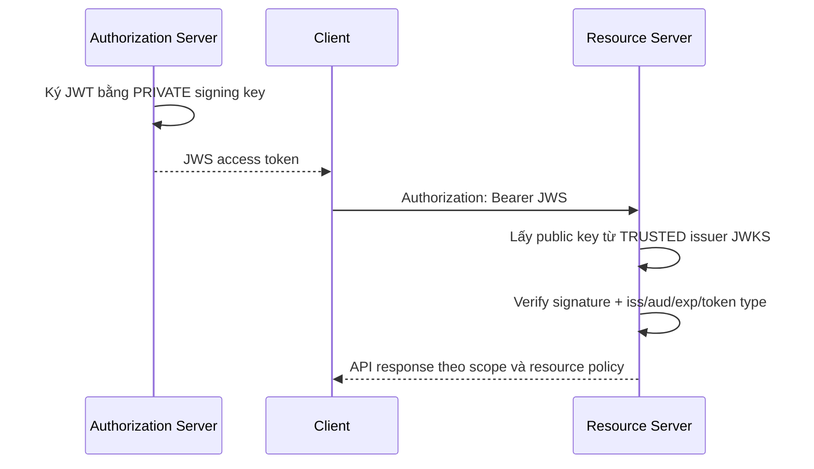
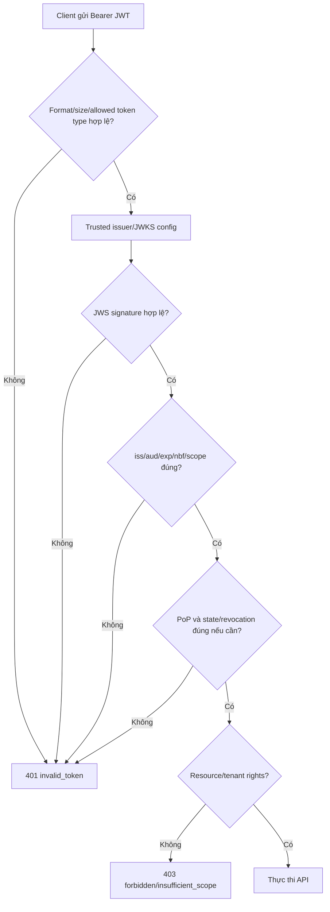

# JWS và JWE ở mức khái niệm

## 1. Tình huống mở đầu: token “có chữ ký” có giữ bí mật dữ liệu không?

Một nhóm kỹ sư xây dựng hệ thống đăng nhập cho ứng dụng quản lý đơn hàng. OpenID Provider (OP) cấp một JWT access token có dạng chuỗi dài:

```text
eyJhbGciOiJSUzI1NiIsImtpZCI6ImtleS0xIn0
.
eyJpc3MiOiJodHRwczovL2F1dGguZXhhbXBsZS5jb20iLCJzdWIiOiJ1c2VyLTEyMyJ9
.
<signature>
```

Ba đoạn trên chỉ minh họa cấu trúc, **không phải token JWT hợp lệ để sử dụng**.

Một kỹ sư nói: “Chúng ta ký JWT bằng RSA nên email, nhóm người dùng và thông tin khách hàng trong token đã được mã hóa; người dùng không đọc được.” Nhận định này **sai**.

Trong cấu trúc **JWS (JSON Web Signature)**, phần payload thường được **Base64url-encode, không phải mã hóa**. Ai cầm token có thể decode và đọc payload, nhưng không thể tự ý sửa mà vẫn vượt qua kiểm tra chữ ký nếu thuật toán/khóa được triển khai đúng.

Kỹ sư khác đề nghị “Đổi sang JWE để mã hóa thì khỏi cần quan tâm tính xác thực người phát token”. Nhận định này cũng **không đủ**. **JWE (JSON Web Encryption)** bảo vệ tính bí mật và tính toàn vẹn của dữ liệu được mã hóa, nhưng tùy cách quản lý khóa, nó **không tự chứng minh ai là người phát hành nội dung**. Ví dụ với mô hình mã hóa bằng **public key của người nhận**, bất kỳ ai biết public key đó đều có thể tạo JWE gửi cho người nhận. Vì vậy, JWE chỉ đủ làm assertion đáng tin nếu **nguồn phát hành đã được ràng buộc bởi thiết kế mật mã/giao thức**, hoặc nội dung bên trong có chữ ký được kiểm tra.

> **Mấu chốt:** **JWS trả lời “nội dung có bị sửa và chữ ký có hợp lệ theo khóa đáng tin không?”**, còn **JWE trả lời “nội dung có được giữ bí mật khỏi người không có khóa và có bị sửa khi truyền không?”**. Trong một security token, cần thêm **issuer, audience, expiry, scope, token type, grant/session state** và ngữ cảnh giao thức; JWS/JWE không tự thay thế các kiểm tra này.

Bài **“JWS và JWE ở mức khái niệm”** thuộc chương **Token encryption** của module `SECURITY_TOKEN_SECURITY_FUNDAMENTALS`. Module tập trung vào mô hình tin cậy/vòng đời security token, phân biệt JWT với opaque token, access token với refresh token, phát hành, claims, scope, audience, OAuth 2.0/OpenID Connect và phòng chống token theft/replay.

## 2. Mục tiêu học tập

Sau bài này, bạn có thể:

1. Giải thích **JOSE, JWT, JWS, JWE, JWK và JWKS**; biết chúng không phải từ đồng nghĩa.
2. Phân biệt **encoding**, **signing**, **encryption** và **hashing** theo mục tiêu an ninh.
3. Nhận biết JWS Compact Serialization thường có **3 phần**, JWE Compact Serialization có **5 phần**, cùng ngoại lệ/profile phù hợp.
4. Diễn giải protected header, payload, signature, encrypted key, IV/nonce, ciphertext, authentication tag.
5. Hiểu các vai trò **issuer/signer, recipient, verifier, key owner** và ranh giới tin cậy.
6. Phân biệt `alg` và `enc` trong JWE, và `alg` trong JWS.
7. Biết khi nào nên dùng **JWS**, **JWE**, **signed-then-encrypted nested JWT**, hoặc **opaque token**.
8. Hiểu quy trình nhận token an toàn: **chọn trust config, xác minh JWS hoặc giải mã JWE theo profile, rồi kiểm tra claims và token purpose**.
9. Nhận biết các lỗi thuật toán, khóa, header, `kid`, `jku`, `crit`, compression, cross-JWT confusion và oracle attacks.
10. Thiết kế test matrix và chiến lược key rotation, logging/privacy, token revocation/expiration phù hợp.

## 3. Bản đồ các thuật ngữ JOSE

**JOSE — JSON Object Signing and Encryption** là một họ tiêu chuẩn cho việc ký số, kiểm tra chữ ký, mã hóa, mô tả khóa và thuật toán.

| Viết tắt | Tên đầy đủ | Vai trò |
| --- | --- | --- |
| **JWS** | JSON Web Signature | Biểu diễn **chữ ký số hoặc MAC** bảo vệ payload |
| **JWE** | JSON Web Encryption | Biểu diễn **nội dung được mã hóa có bảo vệ tính toàn vẹn** |
| **JWK** | JSON Web Key | Biểu diễn một khóa mật mã dưới dạng JSON |
| **JWKS** | JSON Web Key Set | Tập hợp các JWK để sử dụng theo trust configuration |
| **JWA** | JSON Web Algorithms | Tên và quy tắc thuật toán JOSE |
| **JWT** | JSON Web Token | Format token chứa một tập claims dạng JSON; được biểu diễn bằng JWS hoặc JWE theo profile |

Một JWT thường được ký dưới dạng **JWS**, nhưng cũng có thể là **JWE**. Không phải mọi JWS/JWE đều là JWT: chúng có thể bảo vệ **payload bất kỳ**, không nhất thiết là JSON claims set.

### 3.1. Mối quan hệ quan trọng

```text
JOSE family
    |
    +-- JWS: integrity/authentication of protected content
    |
    +-- JWE: encrypted content + integrity protection
    |
    +-- JWK/JWKS: cryptographic key representations
    |
    +-- JWA: algorithms and parameters

JWT:
    a claims JSON object
    carried using a JOSE representation/profile
    (commonly JWS; optionally JWE, sometimes nested)
```

**Không suy ra JWT có chữ ký là JWE, hoặc JWE luôn chứa JWT.** Việc định danh token dựa trên **protocol/application profile**, không chỉ số dấu chấm.

### 3.2. JWT, opaque token và access token

Phân biệt ba trục độc lập:

- **Loại credential:** access token, refresh token, ID token, logout token...
- **Biểu diễn:** JWT hay opaque string.
- **Cơ chế bảo vệ:** JWS, JWE, TLS, sender-constraining, lưu trữ server-side...

Ví dụ:

| Credential | Cách biểu diễn có thể gặp | Ai xác minh/sử dụng? |
| --- | --- | --- |
| OAuth access token | JWT JWS, JWE nếu profile hỗ trợ, hoặc opaque | Resource server đúng audience |
| OAuth refresh token | Thường opaque; có thể dạng ký/mã hóa theo AS | Authorization server token endpoint |
| OIDC ID token | JWT thường dùng JWS, có thể JWE/nested theo registration | Relying Party/OIDC client |
| OIDC Logout Token | JWT có profile back-channel logout và chữ ký theo yêu cầu | RP back-channel logout handler |

**Không có quy tắc “cứ chứa ba đoạn là token cho API”.** API cần biết loại token mà nó được phép nhận.

## 4. Trước JWS/JWE: phân biệt bốn thao tác

| Thao tác | Mục tiêu | Che dữ liệu khỏi người đọc? | Chống sửa đổi? |
| --- | --- | --- | --- |
| **Encoding (Base64url)** | Biến bytes thành chuỗi dễ vận chuyển | **Không** | **Không** |
| **Hashing** | Tạo digest dùng kiểm tra/định danh theo thiết kế | Không phải encryption | Hash đơn lẻ không chứng minh nguồn |
| **Signing/MAC (JWS)** | Xác minh payload không bị sửa, người có khóa ký/MAC đã tạo | **Không** | **Có**, khi verify đúng |
| **Authenticated encryption (JWE)** | Bảo vệ nội dung khỏi người không có khóa, phát hiện sửa đổi | **Có** | **Có**, trong ranh giới AEAD/JOSE |

### 4.1. Base64url không phải mã hóa

Giả sử payload JSON:

```json
{"sub":"user-123","email":"employee@example.com"}
```

Khi encode Base64url, chuỗi trông “khó đọc” nhưng có thể decode công khai mà **không cần khóa**. Kẻ cầm token có thể đọc `sub`/`email` hoặc các claims nhạy cảm.

- `base64url(plaintext)` không phải `encrypt(plaintext, key)`.
- “Dùng HTTPS” cũng không biến JWS payload thành ciphertext: TLS bảo vệ **đường truyền**, còn token có thể được sao chép vào logs, browser storage và crash dumps sau khi TLS giải mã.
- Chữ ký JWS không che metadata. Nếu cần confidentiality ở cấp token, cân nhắc JWE hoặc **giảm claims/opaque token**.

### 4.2. Chữ ký không phải phân quyền

Một JWS ký hợp lệ bởi issuer chưa chắc được chấp nhận:

```json
{
  "iss": "https://auth.example.com",
  "aud": "https://payments-api.example.com",
  "sub": "user-123",
  "scope": "payments:read",
  "exp": 1900000600
}
```

Orders API **phải từ chối** token này vì `aud` dành cho Payments API, dù chữ ký đúng. Kiểm tra cryptographic integrity là **một bước**, không phải authorization decision.

### 4.3. Mã hóa không tự chứng minh issuer

Khi Alice mã hóa dữ liệu bằng **public encryption key của Bob**, Bob có thể giải mã bằng private key. Tuy nhiên **Carol cũng có thể dùng public key của Bob mã hóa một nội dung khác**.

Vì vậy:

```text
Bob can decrypt JWE addressed to Bob.
    ≠
Bob knows Alice authored the plaintext.
```

Để xác thực nguồn, Bob cần **JWS bên trong được ký bởi Alice**, hoặc một mô hình khóa/giao thức **được thiết kế để ràng buộc người gửi**, chẳng hạn khóa symmetric chỉ hai bên biết, nhưng khi đó attribution/khả năng không chối bỏ rất khác.

## 5. JWS: ký nội dung mà không giấu payload

Một **JWS** biểu diễn:

1. **Protected header** mô tả thuật toán, khóa, các thông số cần thiết.
2. **Payload** cần bảo vệ.
3. **Chữ ký số hoặc MAC** trên signing input theo JWS.

JWS Compact Serialization thường có **ba đoạn** nối bằng dấu chấm:

```text
BASE64URL(UTF8(protected_header))
.
BASE64URL(payload)
.
BASE64URL(signature_or_mac)
```

Ví dụ **minh họa cấu trúc**, không phải chữ ký có thể verify:

```text
eyJhbGciOiJSUzI1NiIsImtpZCI6Im9wLTIwMjYtMDEifQ
.
eyJpc3MiOiJodHRwczovL2F1dGguZXhhbXBsZS5jb20iLCJzdWIiOiJ1c2VyLTEyMyJ9
.
<signature-bytes-base64url>
```

Một bộ kiểm tra an toàn không nên “split ba phần rồi tin payload”; phải **verify** bằng thuật toán/khóa đúng issuer trước khi dùng claims.

### 5.1. Protected header của JWS

Ví dụ:

```json
{
  "alg": "RS256",
  "kid": "op-signing-2026-01",
  "typ": "JWT"
}
```

Ý nghĩa:

- `alg`: thuật toán **ký/MAC**, như RS256, PS256, ES256, EdDSA hoặc HS256 tùy profile.
- `kid`: **key identifier** giúp chọn key trong tập khóa đã tin cậy.
- `typ`: kiểu media/object theo convention hoặc profile; không tự giải quyết type confusion nếu chỉ đặt một string tùy ý.

Protected header được đưa vào signing input; sau khi verify thành công, thay đổi header bị phát hiện. Nhưng **trước verification**, nội dung header vẫn là dữ liệu do token mang đến, **không phải chính sách**.

### 5.2. Payload của JWT là claims

Ví dụ:

```json
{
  "iss": "https://auth.example.com",
  "sub": "user-123",
  "aud": "https://orders-api.example.com",
  "scope": "orders:read",
  "iat": 1900000000,
  "exp": 1900000600
}
```

Payload có thể đọc được khi token dạng **JWS compact bình thường**. Vì vậy không nhúng:

- Password, OTP, PIN hoặc private key.
- Refresh token trong claims.
- Thông tin khách hàng hoặc hồ sơ người dùng không cần thiết.
- Danh sách hàng nghìn quyền/ACL chỉ để API “tự tiện tra”.
- Secrets dùng gọi database/external APIs.
- Dữ liệu nhạy cảm kỳ vọng được che khỏi holder token.

**Tối thiểu hóa claims** có thể an toàn và đơn giản hơn việc triển khai JWE cho một payload quá nhiều dữ liệu.

### 5.3. Signing input của JWS Compact

Ở dạng phổ biến (không bật các JOSE extensions đặc biệt), input để ký:

```text
signing_input =
    ASCII(BASE64URL(protected_header)
          + "."
          + BASE64URL(payload))

signature = SIGN(signing_key, signing_input)
```

Verifier thực hiện điều tương ứng:

```text
verify(signature, signing_input, trusted_verification_key)
  -> true / false

Nếu false:
    không tin payload hoặc header.
```

Các biến thể **JWS JSON Serialization** có thể chứa nhiều signatures; JWS cũng có quy tắc về `b64` unencoded payload theo RFC 7797, nhưng **không được tùy tiện áp extension đó cho JWT**. Bài tập trung **JWS Compact thông dụng** trong security tokens.

### 5.4. Người ký và người kiểm tra

Với thuật toán **bất đối xứng** như RS256:



- AS phải giữ **private key** bí mật.
- RS có thể dùng **public key** để verify.
- Public key verify không cho RS quyền **ký** token mới.
- Issuer/JWKS phải được trust configuration ràng buộc trước, không lấy từ `jku` tự khai của token chưa xác minh.

Với **HS256**, cả bên ký và bên verify dùng **cùng shared secret**; bất kỳ verifier giữ secret cũng có năng lực tạo MAC hợp lệ. Phải cân nhắc blast radius và key ownership, không dùng một HMAC secret chung cho nhiều resource servers thiếu ranh giới.

## 6. JWS bảo vệ những gì, và không bảo vệ những gì?

| Tính chất | JWS đúng cấu hình cung cấp? | Điều kiện/lưu ý |
| --- | --- | --- |
| Payload integrity | **Có** | Signature/MAC verify bằng key đúng |
| Protected header integrity | **Có** | Signing input gồm protected header |
| Authentication của key holder | **Có** theo loại chữ ký/khóa | Cần map key với trusted issuer/signer |
| Non-repudiation | Không thể khẳng định chung | HMAC không hỗ trợ attribution riêng; PKI/evidence policy cần rõ |
| Payload confidentiality | **Không** | Base64url có thể decode |
| Token expiry enforcement | **Không tự động** | Verifier kiểm tra `exp` |
| Audience restriction | **Không tự động** | Verifier kiểm tra `aud` |
| Token active/not revoked | **Không tự động** | Revocation/introspection/state checks khi cần |
| Sender possession | **Không tự động** | Bearer vs DPoP/mTLS |
| Business authorization | **Không** | Scope/tenant/resource-level policy |

### 6.1. Chữ ký hợp lệ chỉ chứng minh đúng ranh giới khóa

Khi RS trả “JWS verified”, câu đúng là:

> Dữ liệu đã được ký/MAC bằng một khóa mà hệ thống tin cậy theo profile, và không bị sửa so với dữ liệu được bảo vệ bởi chữ ký.

Câu **chưa đúng** nếu chưa làm tiếp:

> Vì vậy, user có quyền sửa mọi đơn hàng và token chưa từng bị thu hồi.

Một issuer có thể ký tokens dành cho nhiều clients, audiences và mục đích khác nhau. RS phải tránh **cross-JWT confusion** (dùng ID token làm access token, dùng token reset-password làm bearer access token...).

### 6.2. JWS có thể được log mà vẫn gây lộ bí mật

Nếu JWS access token bị lộ trong logs:

- Payload chứa PII có thể đọc được.
- Nếu token là **bearer**, attacker có thể trình **nguyên token** tại RS trước khi hết hạn.
- Chữ ký vẫn hợp lệ vì attacker không cần sửa token.

**JWS không chống đánh cắp bearer token.** Cần TLS, storage security, token minimization, audience limitation, short TTL, DPoP/mTLS khi phù hợp, revocation và redaction.

## 7. JWE: mã hóa nội dung có phát hiện bị sửa đổi

**JWE** biểu diễn dữ liệu được mã hóa để chỉ các bên có khóa giải mã phù hợp mới đọc được plaintext. JOSE JWE sử dụng **content encryption** (thường authenticated encryption như AES-GCM) và **key management** để xác định/bao bọc khóa mã hóa nội dung.

JWE Compact Serialization có **năm đoạn**:

```text
BASE64URL(protected_header)
.
BASE64URL(encrypted_key)
.
BASE64URL(initialization_vector)
.
BASE64URL(ciphertext)
.
BASE64URL(authentication_tag)
```

Viết gọn:

```text
protected_header.encrypted_key.iv.ciphertext.tag
```

Một phần có thể **rỗng theo thuật toán key management**, ví dụ `alg=dir` dùng direct symmetric key và đoạn `encrypted_key` rỗng. Vì vậy **không dùng kiểm tra “năm đoạn nào cũng phải non-empty” làm quy tắc JWE phổ quát**.

### 7.1. Năm thành phần giải thích

| Thành phần | Vai trò | Có mã hóa theo nghĩa plaintext-confidential không? |
| --- | --- | --- |
| **Protected header** | Thuật toán, key ID, tùy chọn JOSE; integrity-protected | **Không**, thường đọc được |
| **Encrypted key** | CEK được wrap/transport tùy `alg` hoặc rỗng khi direct | Không phải plaintext claims |
| **IV/nonce** | Giá trị cần cho content-encryption mode | **Không bí mật**, nhưng phải dùng đúng tính duy nhất/quy tắc |
| **Ciphertext** | Payload đã mã hóa | **Có**, chứa nội dung được che |
| **Authentication tag** | Phát hiện thay đổi ciphertext/AAD theo AEAD | Không phải chữ ký độc lập của issuer |

Đừng đồng nhất JWE `authentication_tag` với **JWS signature**. Tag xác minh toàn vẹn theo khóa mã hóa nội dung; nó **không mặc nhiên định danh signer**.

### 7.2. JWE protected header

Ví dụ:

```json
{
  "alg": "RSA-OAEP-256",
  "enc": "A256GCM",
  "kid": "orders-rp-encryption-2026-01",
  "typ": "JWT"
}
```

- `alg`: **key management algorithm** — cách thiết lập/vận chuyển/bao bọc content-encryption key (CEK).
- `enc`: **content encryption algorithm** — dùng CEK để mã hóa nội dung và tạo authentication tag.
- `kid`: giúp recipient chọn **decryption key của mình** từ tập khóa đã cấu hình.
- `typ`: token type hint theo profile; không thay validation.

Ví dụ trên dùng **RSA-OAEP-256** để vận chuyển/bọc CEK và **A256GCM** để bảo vệ plaintext. Nó **không nói rằng RSA trực tiếp mã hóa toàn bộ JSON payload**.

### 7.3. Content Encryption Key (CEK)

Một cấu trúc JWE phổ biến:

```text
Sender:
  plaintext JSON
  CEK = random symmetric key
  ciphertext, tag = AEAD_Encrypt(CEK, IV, plaintext, protected_header_as_AAD)
  encrypted_key = WrapForRecipient(CEK, recipient_public_key)
  -> serialize JWE

Recipient:
  CEK = UnwrapWithPrivateKey(encrypted_key)
  plaintext = AEAD_DecryptAndVerify(CEK, IV, ciphertext, tag, AAD)
  -> parse payload only if authentication tag valid
```

Có nhiều key management modes: key wrapping, key agreement, direct encryption... **Không phải mọi JWE đều tự tạo/wrap một CEK theo đúng chuỗi trên**, nên xem đó là **mô hình phổ biến**, không phải thuật toán duy nhất.

### 7.4. JWE integrity và AAD

Với JWE authenticated encryption, **Additional Authenticated Data (AAD)** thường bao gồm protected header dạng Base64url; các JSON serializations còn có cơ chế AAD riêng.

Khi header/ciphertext/tag bị sửa không hợp lệ, recipient phải **không trả plaintext** và không coi giải mã là thành công.

Ví dụ:

```text
Attacker changes aud inside ciphertext
  -> tag verification fails
  -> recipient rejects JWE

Attacker changes enc header without matching AEAD structure
  -> authentication/algorithm checks fail
  -> recipient rejects JWE
```

Tuy nhiên nếu attacker có thể tạo **JWE mới cho recipient public key**, tag của JWE mới vẫn hợp lệ. Vì thế **AEAD integrity không tự chứng minh token do OP đáng tin phát hành**.

## 8. So sánh JWS và JWE trên cùng một payload

Giả sử payload:

```json
{
  "sub": "user-123",
  "aud": "orders-web",
  "email": "employee@example.com"
}
```

### 8.1. Dùng JWS

```text
Issuer:
  payload JSON
      |
      v
  Sign using trusted signing key
      |
      v
  JWS compact (3 parts)
      |
      v
  RP:
    decode payload (readable)
    verify issuer signature
    validate claims
```

**Tác dụng:** RP có thể xác minh nguồn theo signing key. **Email vẫn có thể bị đọc** bởi ai giữ token.

### 8.2. Dùng JWE

```text
Sender:
  payload JSON
      |
      v
  Encrypt for recipient
      |
      v
  JWE compact (5 parts)
      |
      v
  Recipient:
    decrypt and validate tag
    parse claims
    establish issuer authenticity separately
```

**Tác dụng:** Chỉ recipient/key holder đọc được payload. **Nếu encryption key là public key, người khác có thể tạo ciphertext mới**; payload chưa có issuer authentication nếu không ràng buộc thêm.

### 8.3. Dùng nested: ký trước, mã hóa sau

```text
Trusted OP signs ID-token JWT -> inner JWS
                         |
                         v
RP's encryption public key encrypts inner JWS -> outer JWE
                         |
                         v
RP decrypts JWE with private key
                         |
                         v
RP verifies inner JWS with trusted OP signing key
                         |
                         v
RP validates iss/sub/aud/exp/nonce/auth_time...
```

**Tác dụng:** Đúng cấu hình/profile, **giữ bí mật nội dung đối với bên ngoài RP** và **chứng minh nguồn phát hành bằng chữ ký OP**.

### 8.4. Bảng quyết định nhanh

| Yêu cầu chính | JWS | JWE | JWS rồi JWE |
| --- | --- | --- | --- |
| Chứng minh issuer ký payload | **Có**, nếu key trusted | **Không mặc định** | **Có**, nhờ inner JWS |
| Giữ bí mật payload khỏi token holder không có private key | **Không** | **Có** | **Có** |
| Bảo vệ integrity khi truyền | **Có** | **Có** qua AEAD tag | **Có** cả hai lớp |
| Bên nhận phải giữ decryption key | Không | Có | Có |
| Dễ chia sẻ xác minh cho nhiều RS bằng public signing keys | Thường phù hợp | Phức tạp hơn | Phức tạp hơn |
| Token có thể bị replay khi bị đánh cắp | **Có** nếu bearer | **Có** nếu bearer/JWE reused | **Có** nếu bearer |
| Cần `iss/aud/exp/scope` checks | **Có** | **Có** | **Có** |
| Kích thước token nhỏ/gọn | Thường tốt hơn | Lớn hơn | Thường lớn nhất |

Không có hàng nào nghĩa “JWE luôn an toàn hơn JWS”. **Chúng giải quyết những yêu cầu khác nhau.**

## 9. Thế nào là “nested JWT”?

**Nested JWT** là token được bảo vệ bằng một lớp JOSE nằm trong một lớp JOSE khác, thường gặp khi muốn **ký rồi mã hóa**.

Ví dụ outer JWE header:

```json
{
  "alg": "RSA-OAEP-256",
  "enc": "A256GCM",
  "cty": "JWT",
  "kid": "rp-decrypt-key-01"
}
```

`cty` (content type) có thể chỉ ra nội dung bên trong là JWT theo nested usage; khi nested theo JWT rules, `cty=JWT` có vai trò đặc biệt trong JOSE header. Tuy nhiên **header do token khai không thể thay thế validation**.

### 9.1. Trình tự “sign then encrypt”

1. Issuer tạo JWT claims.
2. Issuer ký claims bằng **signing key** của mình → inner JWS.
3. Issuer mã hóa inner JWS cho recipient với **recipient encryption key** → outer JWE.
4. Recipient kiểm tra outer JWE algorithm/key policy, giải mã và xác minh authentication tag.
5. Recipient parse inner JWS, kiểm tra **signature bằng trusted issuer signing key**.
6. Recipient kiểm tra JWT/OIDC/OAuth claims theo token type/profile.
7. Chỉ sau đó tạo principal hoặc quyết định cho phép request.

### 9.2. Không nhầm vai trò hai khóa

| Key | Bên sở hữu | Mục đích |
| --- | --- | --- |
| OP **signing private key** | Issuer/OP | Ký inner JWS |
| OP **signing public key** | RP/RS trusted verifier | Verify inner JWS |
| RP **encryption public key** | OP biết để mã hóa cho RP | Encrypt/wrap CEK |
| RP **decryption private key** | Chỉ RP/recipient đáng tin giữ | Decrypt outer JWE |

Không dùng cùng một keypair cho signing và decryption nếu thiết kế/policy không cho phép; key separation giúp giảm rủi ro **cross-protocol use/key confusion**.

### 9.3. Vì sao không chỉ giải mã outer JWE rồi tin payload?

Nếu outer JWE được mã hóa cho public key của RP, attacker cũng có thể mã hóa một payload tự tạo cho public key đó. Không có **inner trusted JWS** hoặc issuer-authenticated channel/profile tương đương, RP chưa biết plaintext do issuer thật phát hành.

**Đặc biệt trong OIDC encrypted ID token:** RP phải tuân **cấu hình ký/mã hóa đã đăng ký** và quy tắc OIDC ID Token Validation, không tự giảm yêu cầu xác thực chỉ vì decrypt thành công.

### 9.4. Đảo chiều “encrypt then sign” có thể được dùng không?

Có các thiết kế mật mã **encrypt-then-sign** hoặc wrapping khác. Nhưng:

- Signature ngoài sẽ bảo vệ **ciphertext**, không tự thay thế việc decrypt và validate claims.
- Outer signature có thể lộ issuer/metadata/key ID cho người ngoài nếu không che.
- Quy tắc nested JWT và OIDC registration có các kỳ vọng cụ thể.
- Không tự đổi thứ tự trong sản phẩm đang có hợp đồng “sign then encrypt”.

**Chọn một profile đã chuẩn hóa và được các bên hỗ trợ**, thay vì ghép JOSE primitives tùy ý.

## 10. Thuật toán JOSE: `alg`, `enc` và thuật toán thực tế

### 10.1. Trong JWS: `alg` là thuật toán ký/MAC

| Ví dụ `alg` | Họ thuật toán | Trust model cơ bản |
| --- | --- | --- |
| `RS256` | RSA PKCS#1 v1.5 signature với SHA-256 | Private ký, public verify |
| `PS256` | RSA-PSS signature với SHA-256 | Private ký, public verify |
| `ES256` | ECDSA P-256 với SHA-256 | Private ký, public verify |
| `EdDSA` | Edwards-curve signatures theo JWA/profile | Private ký, public verify |
| `HS256` | HMAC-SHA-256 | Shared symmetric secret |
| `none` | Unsecured JWS representation | Không có chữ ký/MAC; **không dùng cho authenticated bearer/ID token khi profile không cho phép** |

**Không lấy `alg` trong token làm “danh sách thuật toán cho phép”**. Ứng dụng phải xác định allowlist từ AS/OP trusted metadata và client/RS configuration.

### 10.2. Trong JWE: `alg` là key management, `enc` là content encryption

| Tham số | Ví dụ | Câu hỏi nó trả lời |
| --- | --- | --- |
| JWE `alg` | `RSA-OAEP-256` | Làm sao chuyển CEK an toàn tới recipient? |
| JWE `alg` | `ECDH-ES` / profile key agreement | Làm sao hai bên dẫn xuất CEK/key material? |
| JWE `alg` | `A256KW` | Làm sao wrap CEK bằng shared key? |
| JWE `alg` | `dir` | Dùng symmetric key đã chia sẻ trực tiếp làm CEK |
| JWE `enc` | `A256GCM` | Dùng CEK mã hóa nội dung bằng thuật toán nào? |
| JWE `enc` | `A128GCM` | Một cấu hình content encryption khác |

Ví dụ protected header:

```json
{
  "alg": "dir",
  "enc": "A256GCM",
  "kid": "shared-cek-rotation-03"
}
```

Với `alg=dir`, receiver đã có CEK (shared symmetric key); phần `encrypted_key` trong Compact Serialization **rỗng** theo cơ chế này. **Đừng dùng shared CEK giữa nhiều clients/tenants khi không có thiết kế key separation và rotation**.

### 10.3. Key management không phải content encryption

Câu “Token được mã hóa bằng RSA-OAEP-256 nên mọi byte plaintext đều qua RSA” thường là mô tả sai về JWE.

Trong cấu trúc hybrid thông dụng:

```text
RSA-OAEP-256:
   protects key material / CEK

A256GCM:
   encrypts plaintext and provides authentication tag
```

Các tham số cần nhất quán với key type/size, algorithm allowlist, OP/RP registration và cryptographic provider. Không cần tự thiết kế primitives hay IV algorithms từ đầu.

### 10.4. IV/nonce của AEAD

Một key/IV reuse không an toàn trong chế độ như AES-GCM có thể phá vỡ security guarantees nghiêm trọng. Dùng **JOSE library đã được kiểm chứng** sinh IV/CEK đúng theo thuật toán/protocol.

Phân biệt **JWE IV/nonce** với **OIDC `nonce` claim**:

| Thuật ngữ | Vị trí | Mục đích |
| --- | --- | --- |
| JWE IV/nonce | Trường/đầu vào content encryption | Đảm bảo yêu cầu an ninh của thuật toán mã hóa |
| OIDC `nonce` | JWT ID token claim/authorization request | Liên kết ID token với authentication transaction |
| DPoP `nonce` | DPoP proof/protocol | Hỗ trợ freshness/replay controls |

**Ba thứ không thay thế nhau**, dù cùng tên “nonce”.

## 11. Khóa JWK/JWKS: chọn khóa đúng mục đích

### 11.1. JWK là gì?

Một JWK là biểu diễn JSON của một khóa, có thể là public key, private key hoặc symmetric key tùy nội dung/trust boundary.

Ví dụ **public RSA JWK minh họa**:

```json
{
  "kty": "RSA",
  "use": "sig",
  "alg": "RS256",
  "kid": "issuer-signing-01",
  "n": "<base64url-modulus>",
  "e": "AQAB"
}
```

Đây chỉ là ví dụ cấu trúc; `n` phải là modulus hợp lệ trong key thật.

- `kty`: key type.
- `use`: mục đích dùng khóa, ví dụ `sig` hoặc `enc` khi có.
- `alg`: thuật toán liên quan theo key metadata/profile.
- `kid`: định danh khóa.
- `n/e`: public modulus/exponent RSA.

**Không tự tin vào một JWK public key do token attacker gửi kèm**. Key phải đến từ nguồn đã được cấu hình tin cậy.

### 11.2. JWKS thường ở issuer metadata

Ví dụ OIDC/OAuth provider metadata có:

```json
{
  "issuer": "https://auth.example.com",
  "jwks_uri": "https://auth.example.com/.well-known/jwks.json"
}
```

Resource server có thể tải/cached JWKS từ **URL đã tin cậy**, chọn key bằng `kid` kết hợp `kty/use/alg` và policy.

**Không xây JWKS URL bằng cách nối `iss` lấy từ token chưa verified**. Nếu attacker cấp token với `iss=https://evil.example` và server tự tải JWKS của attacker, server có thể “verify đúng” chữ ký bằng khóa attacker rồi chấp nhận issuer sai.

### 11.3. `kid` không phải bằng chứng tin cậy

```text
Header kid = "issuer-signing-01"
      |
      v
Find matching candidate from trusted JWKS
      |
      v
Check allowed algorithm, key type/usage, issuer binding
      |
      v
Verify signature
```

Không:

```text
Header kid = "../../../secrets/key.pem"
      |
      v
load file named by kid
```

hoặc:

```text
Header jku = "https://attacker.example/jwks"
      |
      v
fetch and trust those public keys
```

Hai mẫu sau tạo **file path/key injection, SSRF hoặc key substitution**. `kid` thường chỉ là selector, không tự là path/URL tin cậy.

### 11.4. Signing keys và encryption keys tách biệt

Mặc dù cùng biểu diễn JWK, signing key và encryption key có **nhiệm vụ khác nhau**:

- AS/OP public signing keys có thể công bố rộng để RPs/RS verify.
- RP public encryption key có thể được đăng ký cho issuer để mã hóa token gửi RP.
- **Private decryption key** của RP không được công bố trong JWKS công khai.
- **Shared symmetric JWK** không được đưa lên public JWKS.
- Private signing key của issuer phải được bảo vệ trong KMS/HSM hoặc secret manager phù hợp.

JWK từ bên ngoài chứa cả private fields như `d` hoặc symmetric `k` có thể là **sự cố lộ khóa**. Không log hoặc trả private JWK trong debugging.

## 12. Khi nào nên chọn JWS, JWE hoặc opaque token?

### 12.1. Bài toán “API cần xác minh token offline”

Issuer cấp access token cho nhiều microservices; resource servers có thể verify issuer signature qua public JWKS.

**Phù hợp:** JWS JWT access token với `iss/aud/exp/scope` và token-type validation đúng profile.

**Rủi ro còn lại:** revoked token vẫn có chữ ký hợp lệ cho đến expiry; cần TTL, introspection/state check hoặc denylist theo SLO. Claims có thể đọc được; hạn chế PII.

### 12.2. Bài toán “RP cần đọc thông tin cá nhân nhưng browser không nên đọc”

OIDC client có private decryption key ở backend, issuer cần gửi một ID token có claims không nên lộ cho intermediaries.

**Có thể phù hợp:** encrypted ID token JWE theo OP/RP registration, thường là **signed-then-encrypted JWT** khi cần xác thực issuer độc lập.

**Rủi ro còn lại:** Recipient backend sau decrypt vẫn có PII trong memory/logs. Browser không nên giữ private decryption key; CSRF/XSS/session security vẫn cần.

### 12.3. Bài toán “không muốn dữ liệu token lộ cho client”

Nếu client chỉ cần bearer handle để gọi API, AS/RS có thể dùng **opaque access token** và introspection (RFC 7662), thay vì đưa claims trực tiếp cho holder.

**Có thể phù hợp:** opaque token + AS-side metadata/policy + RS introspection/cache.

**Rủi ro còn lại:** Opaque bearer token bị đánh cắp vẫn có thể bị replay; phải bảo vệ storage/TLS, audience/scope, PoP và revocation.

### 12.4. Bài toán “refresh token phải dễ thu hồi”

Refresh token là credential dùng với AS để phát AT mới. **Không mặc định cần JWE** chỉ vì nó là long-lived token. Opaque high-entropy RT được AS lưu digest và quản lý rotation/family/grant state có thể phù hợp hơn.

Nếu RT là JWT/JWE, AS vẫn phải kiểm tra **revocation/rotation/reuse state** khi được dùng, không chỉ verify JWS/giải mã JWE rồi cấp AT.

### 12.5. Ma trận quyết định

| Yêu cầu | Phương án thường xét | Điều cần xác minh |
| --- | --- | --- |
| RS offline signature verification | JWS JWT | Issuer keys, aud/scope, expiry, type, current rights |
| Payload confidentiality với recipient có decryption key | JWE / nested JWS→JWE | Key management, inner signer authenticity, claims |
| Không muốn client biết claims | Opaque token | Introspection access control, caching, revocation |
| RT rotation/reuse detection | Opaque RT + AS state | Single-use, family binding, client/sender proof |
| AT có PII tối thiểu | Minimized JWS JWT | Không cần JWE nếu không có confidentiality requirement khác |
| Hệ thống có nhiều RS không cùng decryption key | JWS hoặc opaque theo architecture | Không chia sẻ private keys tùy tiện |
| High-risk multi-tenant | Audience/resource-specific tokens + policy | Không coi encryption là tenant authorization |

**Độ nhạy dữ liệu, trust boundary, nơi giữ khóa, khả năng revoke và rủi ro client** mới quyết định chọn công nghệ; số dấu chấm không quyết định.

## 13. Áp dụng vào OIDC: ID token ký hay mã hóa?

Trong OpenID Connect, **ID token là JWT** phục vụ Relying Party (RP). Những điều RP cần kiểm tra gồm:

- `iss`: OP issuer expected/trusted.
- `sub`: subject identifier; dùng cùng `iss` làm identity key.
- `aud`: có chứa RP `client_id`.
- `exp`, `iat` và clock skew policy.
- `nonce` nếu đã gửi/yêu cầu theo flow.
- `auth_time` nếu request `max_age`, và `acr/amr/azp/at_hash/c_hash` theo profile/flow.
- JOSE signature/encryption rules đã đăng ký.

### 13.1. Một ID token JWS

RP thường nhận JWS có thể decode payload:

```text
OP private signing key
    -> Signed ID Token (JWS)
    -> RP verifies OP public signing key
    -> RP validates OIDC claims and transaction
```

RP **không được tạo phiên chỉ bằng decode**. Nếu JWS chỉ có claims đúng tên nhưng chữ ký sai, issuer/audience/nonce sai, phải từ chối.

### 13.2. Một ID token JWE

Khi ID token được **mã hóa** theo registration, RP phải có **private decryption key** phù hợp, giải mã theo JWE profile và thực hiện **signature validation khi profile yêu cầu**.

```text
OP:
   sign ID token (inner JWS)
   encrypt for RP (outer JWE)

RP:
   decrypt JWE
   verify inner JWS
   verify iss/sub/aud/exp/nonce...
```

**Quan trọng:** Trong OIDC Core, yêu cầu về ký ID token và các ngoại lệ đặc biệt phụ thuộc flow/thuật toán client registration. **Không tự quy định “bất kỳ decrypt thành công đều đủ tin cậy”** hoặc “luôn bắt buộc đúng một chữ ký JWS inner” cho mọi profile mà không xem contract. Mặc định kiến trúc nên ưu tiên rõ **issuer authentication và token validation**, dùng certified OIDC library.

### 13.3. JWE có thể giữ kín thông tin với browser, nhưng không che hết metadata

Protected header vẫn đọc được, và **kích thước/timing/recipient key ID** có thể tiết lộ một số thông tin hệ thống. Nội dung chỉ được bảo mật **khi private key và ciphertext được xử lý đúng**.

Một hệ thống có thể đạt yêu cầu privacy tốt hơn bằng **ID token tối giản + UserInfo ở backend** thay vì nhúng rất nhiều PII vào encrypted JWT.

## 14. Áp dụng vào OAuth access token

### 14.1. RS nhận JWS JWT access token



Một JWT access token profile như **RFC 9068** có yêu cầu về claims/JOSE khác ID token. **Không đem ID token `aud=client_id` đến Resource Server để đổi lấy quyền API**.

### 14.2. RS nhận JWE JWT access token

Một RS có private decryption key có thể decrypt JWE, sau đó:

1. Xác minh JOSE và inner content theo agreed token profile.
2. Kiểm tra đúng issuer/signature/authenticated origin contract.
3. Kiểm tra token purpose và claims.
4. Kiểm tra scope, audience, resource authorization.
5. Kiểm tra revocation nếu security SLO yêu cầu.

**Chỉ giải mã token không phải authorization.** Nếu JWE chứa `{"scope":"admin"}` do attacker tự mã hóa cho public key của RS, RS không được tin claim đó như grant từ AS.

### 14.3. Không mặc định mọi OAuth token có JWT claims

Một opaque AT có thể không có ba/năm đoạn và vẫn hợp lệ nếu AS cấp nó theo token contract; RS dùng introspection. Ngược lại, một chuỗi ba phần có thể là **JWS giả** hoặc JWS không phải access token.

## 15. Nguyên tắc validation: trust trước, parse/decrypt/verify sau

Một vấn đề gây nhiều lỗi thực tế là **token header tự quyết định cách kiểm tra**. Token header chưa verified chỉ là đầu vào.

### 15.1. Cấu hình đáng tin cần biết trước

```text
expected_issuer     = https://auth.example.com
expected_audience   = https://orders-api.example.com
accepted_token_type = OAuth access token profile
allowed_jws_algs    = [RS256, PS256] (ví dụ)
trusted_jwks_uri    = issuer metadata đã xác minh
allowed_jwe_algs    = [RSA-OAEP-256] (nếu RS nhận JWE)
allowed_jwe_encs    = [A256GCM] (nếu RS nhận JWE)
recipient_key_ids   = managed decryption keys
expected_scope      = orders:read cho route
```

Danh sách trên **chỉ minh họa**, không phải danh sách thuật toán duy nhất được chuẩn cho phép. Triển khai phải chọn algorithms theo threat model, khả năng provider và tiêu chuẩn mật mã của tổ chức.

### 15.2. Quy trình nhận JWS

```text
1. Extract exactly one expected token credential.
2. Reject overlarge/malformed/unsupported JOSE structure.
3. Parse protected header with strict key/alg/crit policy.
4. Obtain candidate verification key ONLY from trusted issuer JWKS.
5. Verify JWS signature/MAC over exact signing input.
6. Strictly parse claims and validate iss/aud/exp/nbf/iat/type.
7. Enforce scope, sender binding/revocation if required.
8. Check current resource-level authorization.
9. Never log raw token.
```

### 15.3. Quy trình nhận JWE/nested

```text
1. Extract expected encrypted token; bound size and depth.
2. Validate JWE alg/enc/key type/key ID against recipient policy.
3. Decrypt and authenticate JWE; fail closed on tag failure.
4. Identify expected inner content/type only via trusted profile.
5. If inner JWS required: verify with trusted issuer signing key.
6. Validate claims as for ID token/access token/logout token profile.
7. Enforce audience/resource rights and token lifecycle.
8. Avoid reflecting crypto failures and plaintext to attacker.
9. Never cache plaintext or keys in public logs.
```

### 15.4. Fail closed

Sai:

```text
try decrypt JWE:
    if succeeds:
        allow
catch:
    decode base64 payload and allow as fallback
```

Đúng:

```text
if required cryptographic validation fails:
    reject without granting access

if expected token type/profile not met:
    reject
```

Không tự “hạ tiêu chuẩn” từ ký+mã hóa xuống unsigned JSON chỉ vì client cũ chưa được nâng cấp.

## 16. So sánh signing key rotation và encryption key rotation

Hai vấn đề có blast radius khác nhau.

### 16.1. Signing key rotation

Issuer đổi **private signing key** dùng tạo JWS mới; RS/RP refresh **trusted public JWKS**.

Để tránh downtime:

- Phát public key mới trước hoặc đồng thời theo rollout plan.
- Ký token mới bằng key mới khi verifiers đã có thể tải.
- Giữ public key cũ để verify tokens chưa hết hạn theo contract.
- Thu hồi khẩn nếu private key bị compromise, biết tác động tới token đang hoạt động.
- Theo dõi `kid`, signing algorithm allowlist và JWKS cache TTL.

### 16.2. Encryption key rotation

Recipient đổi **private decryption key/public encryption key pair**:

- Issuer phải biết **public encryption key mới** để mã hóa JWE mới.
- Recipient cần giữ private key cũ đủ lâu để decrypt JWTs chưa hết hạn trong rollout khi được phép.
- Nếu private decryption key bị lộ, attacker có thể giải mã ciphertext họ đã ghi lại nếu không có tính chất forward secrecy phù hợp; key rotation về sau **không xóa khả năng đọc ciphertext cũ** đã bị ghi và decryption key đã bị lộ.
- Cần chính sách key retirement, HSM/KMS, backups và destruction.
- Không trả private encryption JWK trong JWKS public.

### 16.3. `kid`/JWKS cache không phải revocation state

Khi issuer đổi signing key hoặc recipient đổi encryption key, hệ thống có thể ảnh hưởng **khả năng xác minh/giải mã**. Nhưng:

- Revoke một refresh token không yêu cầu đổi signing/encryption key toàn hệ thống.
- Không dùng key rotation hàng loạt như cách “logout một thiết bị” trừ khi security incident yêu cầu blast radius rất rộng.
- Access token đã phát và user sessions cần **status/expiry/denylist/grant policy** riêng.

## 17. Tính bí mật: JWE vẫn cần TLS và storage security

### 17.1. JWE không thay HTTPS

Nếu một JWE được gửi qua HTTP không TLS:

- Network attacker có thể thấy header metadata và token length.
- Attacker có thể **sao chép nguyên JWE** để replay nếu nó là bearer credential.
- Không có transport authentication đến đúng endpoint.
- Những request headers/cookies khác có thể lộ.
- Các thao tác session, request/response metadata vẫn bị giám sát/sửa đổi.

**Luôn dùng HTTPS/TLS đúng certificate/hostname** cho OAuth/OIDC/token endpoints và resource APIs.

### 17.2. JWE không ngăn replay của ciphertext nguyên vẹn

Một token mã hóa hợp lệ vẫn có thể bị attacker gửi **y nguyên** tới RS nếu nó là bearer. AEAD tag vẫn đúng vì attacker không sửa một byte nào.

Chống replay cần cơ chế khác:

- Token lifetime ngắn.
- Audience/resource restriction.
- Sender-constraining DPoP/mTLS.
- Single-use codes/RT rotation khi phù hợp.
- Nonce/jti/state/transaction binding theo profile.
- Revocation/introspection và resource authorization.

### 17.3. Decryption ở backend có thể tạo lộ plaintext

Các nơi nguy hiểm:

- Crash/heap dumps.
- Debug logging sau decrypt.
- APM traces, structured logging.
- Database caches chứa full decrypted payload.
- Exception messages khi JSON parse lỗi.
- KMS/decryption service audit chứa dữ liệu.
- Support tickets/chat screenshots với token/claims.

JWE **giữ bí mật trên đường đi đến recipient**, không tự bảo vệ plaintext một khi recipient đã giải mã.

### 17.4. Metadata và traffic analysis

Dù payload encrypted, bên ngoài có thể thấy:

- JWE header `alg/enc/kid`.
- Token length.
- Request path, timing, traffic volume (tùy TLS và network path).
- Recipient endpoint và client behavior.

Đừng quảng cáo JWE là “ẩn danh hoàn toàn”. Identity privacy còn phụ thuộc identifier policy, logs và data minimization.

## 18. Token transport, kích thước và performance

### 18.1. JWE thường lớn hơn JWS

Một JWT JWS Compact có ba đoạn; JWE Compact có năm đoạn, thêm:

- Encrypted key.
- IV.
- Authentication tag.
- Header của key/content encryption.
- Nếu nested, **toàn bộ inner JWS lại là plaintext cần mã hóa**.

Khi nhúng trong `Authorization: Bearer <token>` hoặc cookie, kích thước tăng có thể đụng **header size limits** tại CDN, WAF, reverse proxy, API gateway hay web server.

### 18.2. Base64url inflation

Base64url biểu diễn khoảng **4/3 kích thước bytes** trước khi tính dots/headers (tùy padding và cấu trúc). Thêm một lớp mã hóa không miễn trừ giới hạn HTTP header.

Một công thức ước lượng:

```text
Authorization value bytes
  = byte_length("Bearer ")
    + byte_length(compact_token)

Total request headers
  ≈ sum of all header field sizes/values + protocol overhead
```

Giới hạn per-field và total header list **khác nhau theo hop/protocol/configuration**. Dùng test tại gateway/proxy thực tế; không dựa vào “token vẫn parse được local”.

### 18.3. Đánh đổi latency và complexity

JWS verification có chi phí chữ ký và key lookup. JWE thêm **key-management + authenticated decryption**, có thể cần HSM/KMS.

Các vấn đề vận hành:

- Private key access/decryption rate limits.
- KMS outages/latency.
- Key rotation/old key compatibility.
- CPU, allocations và JSON parsing giới hạn.
- Logging/metrics không được chứa plaintext.
- Tính tương thích giữa client libraries/JOSE profiles.

Chọn **JWE theo confidentiality requirement thật**, không chỉ vì “mã hóa nghe an toàn hơn”.

## 19. Các lỗi an ninh điển hình khi dùng JOSE

### 19.1. Chấp nhận `alg=none` ngoài profile

Một JWT unsigned có thể có header:

```json
{"alg":"none","typ":"JWT"}
```

Nếu RP/RS tin claims vì token có ba đoạn và parser đọc được JSON, attacker có thể tự tạo `sub`, `scope` hoặc `aud`. **Đúng:** token acceptance policy quyết định signing requirements và algorithms trước; nếu profile yêu cầu signed token, **từ chối `alg=none`**.

### 19.2. Algorithm confusion: HS256 và RS256

Một lỗi cổ điển:

```text
Server expects issuer RS256 token
Attacker changes header to HS256
Vulnerable validator treats public RSA key bytes as HMAC secret
Attacker MACs the token using publicly known RSA key bytes
Server mistakenly accepts
```

Phòng vệ:

- Pin/allowlist **algorithm theo issuer và token profile**.
- Ràng buộc **key type** với algorithm; RSA public key không thành HMAC secret.
- Dùng JOSE library đã khắc phục algorithm confusion.
- Tách validation pipelines cho ID token, access token, logout token.
- Reject unsupported `alg` hoặc key metadata mâu thuẫn.

### 19.3. JWKS key substitution và `jku`/`x5u` injection

Nếu validator lấy `jku` hoặc `x5u` từ JWS header chưa verified rồi tải key, attacker có thể trỏ đến JWKS của chính họ và ký token giả.

**Đúng:** JWKS URL, issuer và trust policy lấy từ trusted configuration/discovery. Không cho token tự đổi nơi lấy key. Chặn SSRF/redirects và áp network/size limits khi fetch metadata.

### 19.4. `kid` trỏ tới file hoặc khóa ngoài ý muốn

Sai:

```text
kid = "../../secrets/shared-key"
validator loads filesystem path derived from kid
```

Đúng: `kid` chỉ là selector trong **trusted key set**, không sử dụng trực tiếp làm tên file, URL, đường dẫn hoặc SQL string chưa tham số hóa.

### 19.5. Token-type confusion

Một issuer có thể ký nhiều JWT:

```text
OIDC ID Token:
  aud = orders-web (client ID)

OAuth Access Token:
  aud = https://orders-api.example.com

Back-Channel Logout Token:
  events = backchannel-logout
```

Nếu API chỉ verify chữ ký và đọc `sub`, nó có thể **nhận nhầm ID token hay Logout Token** làm access token. Phải tách validation profiles: issuer, audience, token purpose, required claims, `typ` khi profile quy định, ngữ cảnh endpoint.

### 19.6. JWE giải mã thành công nhưng bỏ xác thực nguồn

Sai:

```text
decrypt JWE -> {"role":"admin","sub":"attacker"}
no inner signature/issuer-binding checks
allow admin
```

Vì recipient **public encryption key** có thể được biết công khai, attacker cũng tạo được JWE mới cho recipient với authentication tag hợp lệ. **Đúng:** cần **trusted issuer authentication**, ví dụ inner JWS đã được ký bởi AS/OP và verify theo profile.

### 19.7. Không kiểm tra authentication tag

Nếu ứng dụng “decrypt best effort” rồi parse plaintext trước khi AEAD tag verification hoàn tất, có nguy cơ integrity/malleability/oracle.

**Đúng:** JOSE library phải authenticate toàn bộ các thành phần được bảo vệ và chỉ trả plaintext sau khi tag pass. Không tự viết fallback “bỏ tag nếu dữ liệu parse được”.

### 19.8. JWE decryption oracle

Một endpoint phản hồi quá khác nhau cho từng lỗi:

```text
"RSA padding invalid"
"CEK length wrong"
"tag mismatch"
"plaintext JSON malformed"
```

có thể trở thành decryption/padding oracle, tùy thuật toán. Bảo vệ:

- Ưu tiên key management/content encryption hiện đại theo profile (ví dụ RSA-OAEP-256 và AES-GCM).
- Không cho phép legacy `RSA1_5` nếu không có interoperability requirement và biện pháp an ninh được đánh giá.
- Không tiết lộ chi tiết cryptographic failures tới untrusted caller.
- Dùng library/provider đã được kiểm chứng; rate limit/monitor failed decrypt.
- Không tự xử lý RSA padding và không bỏ issuer authentication.

### 19.9. Reuse IV/nonce trong AES-GCM

IV reuse với cùng content-encryption key có thể phá hủy security guarantees của AES-GCM. Không dùng IV cố định cho mọi token:

```text
IV = "000000000000" for every JWE
CEK = same long-lived symmetric key
```

Dùng JOSE library sinh/kiểm soát IV theo tiêu chuẩn. **JWE IV khác OIDC `nonce` claim**: một cái liên quan content encryption, một cái liên kết ID token với authentication request.

### 19.10. Compression và zip bomb

JWE có thể có `zip` header khi profile hỗ trợ compression:

```json
{"alg":"RSA-OAEP-256","enc":"A256GCM","zip":"DEF"}
```

Rủi ro:

- Compression trước encryption có thể lộ side-channel qua chiều dài nếu attacker kiểm soát một phần plaintext.
- Decompression có thể tạo dữ liệu lớn gây DoS.
- Không phải mọi JWT/OIDC profile khuyến nghị hoặc hỗ trợ `zip`.

**Mặc định tránh compression cho token chứa secrets/PII**; chỉ bật khi thật sự cần với input/output limits và security review.

### 19.11. Unprotected headers và `crit`

JOSE JSON Serialization có thể có unprotected headers. Không dựa vào giá trị unprotected để chọn trust/alg/key policy.

Header `crit` báo extension quan trọng:

```json
{
  "alg": "RS256",
  "crit": ["some-extension"],
  "some-extension": "special-value"
}
```

Nếu verifier không hiểu extension được đánh dấu critical, phải **từ chối** thay vì im lặng bỏ qua.

### 19.12. Duplicate JSON keys và type coercion

Ví dụ claims mơ hồ:

```json
{
  "aud": "https://orders-api.example.com",
  "aud": "https://payments-api.example.com"
}
```

Một parser có thể giữ giá trị đầu, parser khác giữ giá trị cuối. Dùng **strict/consistent JSON parsing**, reject ambiguity theo policy và kiểm tra đúng kiểu của `exp` (NumericDate), `aud` (string/array) và boolean claims.

Không dùng truthiness để biến string `"false"` thành true hoặc Java milliseconds thay Unix seconds.

### 19.13. Nested JWE không giới hạn độ sâu

Một attacker có thể gửi JWE chứa JWE chứa JWS chứa JWE để gây CPU/memory exhaustion. Giới hạn token bytes, JOSE layer count, JSON nesting, key lookup attempts, decryption workload, header count và decompressed output.

### 19.14. Key reuse và verifier có khả năng ký

Với HS256, mọi verifier giữ shared HMAC secret cũng có thể tạo MAC hợp lệ. Điều này khác RSA/ECDSA/EdDSA với public verification keys. Phải có key separation, blast-radius policy và không chia sẻ signing-capable secret rộng rãi cho nhiều RS.

### 19.15. Algorithm downgrade qua fallback

Anti-pattern:

```text
if RS256 verification fails:
   try HS256
if signature fails:
   try decryption
if decryption fails:
   accept raw JSON payload
```

Đúng: **expected token format và algorithms được cố định bởi profile**, không thử “một cách bất kỳ để token hợp lệ” khi gặp lỗi.

## 20. Java 17: Base64url decode chỉ để quan sát, không phải verify

Đoạn sau minh họa một JWS Compact thường có ba đoạn và tại sao **đọc JWT không phải verify JWT**. Đây là **công cụ học tập**, không sử dụng kết quả để tạo session/cấp quyền.

```java
import java.nio.charset.StandardCharsets;
import java.util.Base64;

public final class JwtPayloadInspector {
    private JwtPayloadInspector() {}

    public static void inspectUntrustedJws(String compact) {
        if (compact == null || compact.length() > 8192) {
            throw new IllegalArgumentException("Invalid token size");
        }

        String[] parts = compact.split("\\.", -1);
        if (parts.length != 3) {
            throw new IllegalArgumentException(
                    "Not a three-part JWS Compact input");
        }

        // Decode chỉ để QUAN SÁT, không để quyết định auth.
        byte[] headerBytes = Base64.getUrlDecoder().decode(parts[0]);
        byte[] payloadBytes = Base64.getUrlDecoder().decode(parts[1]);

        String untrustedHeader = new String(
                headerBytes, StandardCharsets.UTF_8);
        String untrustedPayload = new String(
                payloadBytes, StandardCharsets.UTF_8);

        // Không log nội dung token thật có PII.
        System.out.println("Header is untrusted before verify");
        System.out.println("Payload is untrusted before verify");

        // Không được lấy user/role từ hai chuỗi này để cấp quyền.
    }
}
```

Ví dụ **không** xác minh signature/MAC, không tải JWKS, không kiểm tra `iss/aud/exp/scope/type`, không phát hiện revoke và không xử lý JWE/nested content.

Nếu library trả `Map<String,Object>` từ token chưa verified và developer dùng:

```java
// SAI: payload chưa verify.
String role = decodedPayload.get("role").toString();
if ("admin".equals(role)) {
    allowSensitiveOperation();
}
```

thì attacker có thể tự tạo JSON claims. Nên thiết kế các security APIs để **chỉ một JOSE validator thành công mới tạo được `VerifiedClaims`**.

## 21. Java 17: phân tách trust boundary trong API

Một skeleton minh họa, không phải cryptographic implementation:

```java
import java.time.Instant;
import java.util.Set;

public record ExpectedJwtProfile(
        String trustedIssuer,
        String expectedAudience,
        String expectedTokenType,
        Set<String> allowedJwsAlgorithms,
        Set<String> allowedJweKeyAlgorithms,
        Set<String> allowedJweContentAlgorithms) {}

public record VerifiedClaims(
        String issuer,
        String subject,
        Set<String> audiences,
        Set<String> scopes,
        Instant expiresAt,
        String tokenType) {}

public interface TrustedJoseProcessor {
    /**
     * Verify JWS with trusted issuer keys, then validate claims/profile.
     */
    VerifiedClaims verifySignedJwt(
            String compactJws,
            ExpectedJwtProfile policy) throws SecurityException;

    /**
     * Decrypt/authenticate JWE with configured recipient private key,
     * verify inner JWS via trusted issuer keys, then validate claims.
     */
    VerifiedClaims decryptAndVerifyNestedJwt(
            String compactJwe,
            ExpectedJwtProfile policy) throws SecurityException;
}
```

**Lưu ý:** Mỗi Java public top-level declaration cần nằm trong file phù hợp. Các khai báo trên được trình bày chung vì mục đích học tập, chưa phải một source file có thể compile và chưa có implementation.

### 21.1. Business layer chỉ nhận claims đã xác minh

```java
public final class OrdersAuthorization {
    public boolean canReadOrder(
            VerifiedClaims verified,
            String tenantId,
            String orderId) {

        if (!verified.audiences().contains(
                "https://orders-api.example.com")) {
            return false;
        }
        if (!verified.scopes().contains("orders:read")) {
            return false;
        }

        // Cần kiểm tra current ACL/tenant/user/client policy ở nguồn thật.
        return lookupCurrentOrderPermission(
                verified.issuer(), verified.subject(), tenantId, orderId);
    }

    private boolean lookupCurrentOrderPermission(
            String issuer, String subject,
            String tenantId, String orderId) {
        throw new UnsupportedOperationException(
                "Implement trusted authorization policy");
    }
}
```

Đoạn này **chưa thực thi end-to-end**. Mục đích là nêu rõ: JOSE verification tạo một **đầu vào có cơ sở tin cậy**; authorization với resource là trách nhiệm tiếp theo.

### 21.2. Không dùng một parser chung rồi nhận mọi loại token

Sai:

```text
JoseUtils.parseOrDecrypt(rawToken)
   -> ClaimsMap
   -> any endpoint accepts any claims
```

Đúng hơn:

```text
OidcIdTokenValidator.validate(...)
OAuthAccessTokenValidator.validate(...)
OidcLogoutTokenValidator.validate(...)
EncryptedNestedTokenValidator.validateForRegisteredClient(...)

Each validator knows:
   trusted issuer/audience
   algorithms and key purpose
   token-type profile
   required claims and transaction binding
```

Khi dùng **Nimbus JOSE + JWT**, **Spring Security OAuth2 Resource Server** hoặc **OIDC Client**, ưu tiên các bộ xử lý đã kiểm chứng với trusted keys/metadata. Mã ví dụ không thay một library xử lý JOSE đầy đủ.

## 22. Header: parse trước nhưng không tin trước

Một bộ xử lý cần đọc `alg`/`kid` để chọn key, nhưng đó chỉ là **candidate selection**:

```text
read bounded untrusted JOSE header
      |
      v
check accepted format, alg/enc/crit/type profile
      |
      v
lookup candidate key ONLY in trusted key store/JWKS
      |
      v
verify JWS / authenticate JWE
      |
      v
validate claims and token usage
```

### 22.1. `typ` không phân biệt token một mình

`typ=JWT` là thông tin quá chung. OAuth JWT access token profile có thể dùng `typ=at+jwt` theo RFC 9068, còn OIDC ID token/logout token có quy tắc riêng. Cần issuer/audience/required claims/context checks.

### 22.2. `cty=JWT` trong nested JOSE

`cty` có thể báo inner JWT. Nhưng chỉ chấp nhận các nested layers/algorithm combinations được **profile định nghĩa**:

1. Outer JWE decrypt/tag verification.
2. Inner content parsed với bound depth/size.
3. Inner JWS verify bằng trusted issuer signing key.
4. Token-type-specific claims validation.
5. Resource/session permission checks.

Không mặc định `cty=JWT` đồng nghĩa plaintext được issuer tin cậy phát.

### 22.3. Protected và unprotected header conflicts

Với JOSE JSON Serialization, các unprotected header parameters không cùng integrity boundary với protected header. Nếu protected/unprotected fields xung đột, trùng tên không hợp lệ hoặc vi phạm profile, phải từ chối. Không dùng giá trị unprotected để thay trusted key/algorithm policy.

## 23. Private key compromise và key rotation

### 23.1. Issuer private signing key bị lộ

- Attacker có thể tạo JWS có chữ ký hợp lệ theo key bị lộ.
- Verifiers phải loại key compromised ra khỏi trusted acceptance theo incident plan.
- Cần quản lý JWKS cache/propagation, tokens đã phát và denylist/grant state.
- Không giải quyết bằng cách chỉ đổi client secret hoặc bật JWE.

### 23.2. Recipient private decryption key bị lộ

- Attacker có thể giải mã JWE ciphertext được ghi lại cho key đó, tùy thuật toán/profile.
- Privacy/PII của payload cũ có thể bị ảnh hưởng; đổi key sau này không làm dữ liệu đã bị giải mã trở lại bí mật.
- Nếu nested inner JWS dùng trusted issuer signing key **chưa bị lộ**, attacker có decryption key vẫn không ký giả được issuer theo profile.
- Cần rotate encryption key, đánh giá data exposure và bảo vệ decryption endpoint/heap/logs.

### 23.3. Shared HS256 secret bị lộ

Vì verifier và signer cùng dùng secret, secret compromise có thể cho attacker tạo MAC/JWS giả. Phải rotate secret, kiểm tra tokens đã phát, hạn quyền từng consumer và tránh dùng một symmetric key quá rộng.

### 23.4. HSM/KMS không thay validation

HSM/KMS giúp giới hạn key exposure và audit cryptographic operations, nhưng ứng dụng vẫn phải kiểm tra issuer/audience/type, key purpose, claims, token revocation và resource authorization. Một ứng dụng bị compromise được quyền gọi decrypt service vẫn có thể lộ plaintext qua logs.

## 24. Bảo vệ nội dung khác bảo vệ quyền

JWT minh họa:

```json
{
  "iss": "https://auth.example.com",
  "sub": "user-123",
  "aud": "https://orders-api.example.com",
  "scope": "orders:read",
  "tenant_id": "tenant-alpha",
  "iat": 1900000000,
  "exp": 1900000600
}
```

Dù được ký và mã hóa đúng:

- `scope=orders:read` không chứng minh quyền đọc **đơn 42**.
- `tenant_id` là custom claim có semantics riêng theo AS/RS contract.
- `roles=admin` có thể cũ khi user bị thu hồi role.
- `exp` còn hạn không chứng minh grant chưa revoke.
- `sub` không phải identity toàn cầu giữa mọi issuers.
- Bearer token không chứng minh requester giữ private key dù ciphertext encrypted.

Một hệ thống an toàn cần **nhiều lớp**:

```text
JOSE cryptography:
   signature or authenticated encryption

Protocol:
   issuer, audience, token type, transaction/context binding

Lifecycle:
   expiry, revocation, sender proof, grant state

Business:
   current user/client/tenant/resource authorization

Operations:
   key rotation, cache, redaction, monitoring
```

Tăng độ dài khóa hay thêm JWE **không tự bù** được một lớp còn thiếu.

## 25. Case study A: JWS access token lộ dữ liệu cá nhân

AS phát một JWS có:

```json
{
  "sub": "user-123",
  "email": "user@example.com",
  "phone_number": "+84-000-000-000",
  "home_address": "Example Street",
  "groups": ["finance", "admin-ops"],
  "aud": "https://orders-api.example.com"
}
```

Một debug logger ghi `Authorization` header khi có lỗi mạng. Đội ngũ tưởng JWS có chữ ký thì payload không đọc được; thực tế attacker dễ decode PII, và có thể replay cả bearer token nếu chưa hết hạn.

**Sửa:** giảm claims không cần thiết, không ghi raw bearer tokens/PII vào logs, cân nhắc UserInfo/backend lookup, dùng JWE theo đúng recipient nếu thực sự có confidentiality requirement, dùng BFF hoặc sender binding/short TTL/revocation khi phù hợp.

**Kết luận:** JWE có thể bảo vệ confidentiality nhưng **không hợp thức hóa việc nhúng PII quá mức vào token**.

## 26. Case study B: encrypted token giả được chấp nhận làm admin

Payments API có RSA public encryption key được công bố. Middleware:

```text
decryptJweWithPrivateKey(...)
if plaintext.role == "admin":
    allow()
```

Attacker mã hóa JSON `{"role":"admin"}` bằng public key đó. JWE có tag hợp lệ nên API giải mã thành công, dù **không hề có chữ ký issuer**.

**Sửa:** yêu cầu authenticated issuer source theo profile, chẳng hạn issuer ký inner JWS rồi mã hóa outer JWE; RS decrypt + verify inner JWS + validate `iss/aud/exp/scope/type` và current authorization.

**Kết luận:** **Decryption success ≠ authentication success**.

## 27. Case study C: signing key và encryption key quay vòng lệch nhau

OP phát nested encrypted ID tokens:

```text
OP signs inner JWS with signing key S2
OP encrypts outer JWE for RP key E2
RP only has decryption private key E1
=> JWE decrypt fails before inner signature can be verified
```

Nếu đội ngũ “sửa tạm” bằng tắt signature validation, họ vừa phá an ninh mà vẫn không giải quyết được decryption failure.

**Sửa:** tách signing key rotation của OP và recipient encryption key rotation của RP; triển khai E2 private key trước khi OP dùng E2 public key; giữ E1 trong overlap window; cập nhật trusted signing keys S1/S2 riêng; theo dõi lỗi decrypt/verify nội bộ **không lộ ciphertext/plaintext**.

## 28. Khi nào **không** nên dùng JWE?

1. **Không có confidentiality requirement ở cấp payload**: JWS JWT với claims tối giản, protected TLS và đúng token validation có thể đơn giản hơn.
2. **Muốn chống token replay**: JWE bearer token vẫn bị replay nếu bị sao chép. Dùng PoP, TTL, audience, grant state.
3. **Muốn revoke token tức thì**: cần AS/RS token state, introspection, denylist, cache TTL, không phải JWE.
4. **Muốn giấu mọi metadata**: JWE header, token length, network timing vẫn quan sát được.
5. **Muốn bỏ TLS**: không. TLS bảo vệ endpoint identity, toàn request/response và chống nhiều MITM threats.
6. **Muốn bỏ XSS/CSRF controls**: JWE không ngăn script độc hại gọi API bằng session hiện tại.
7. **Không muốn RS quản lý private decryption keys**: opaque token với introspection hoặc JWS JWT có thể phù hợp hơn.
8. **Gặp HTTP header size limits**: nested JWE thường lớn hơn JWS; hãy giảm claims/chuyển kiến trúc thay vì nhồi thêm ciphertext.

**Chọn JWE vì requirement về confidentiality và trust boundary, không phải vì tên “Encryption” nghe an toàn hơn.**

## 29. Ma trận kiểm thử JWS/JWE và token security

Giả định cho ma trận:

- Issuer/OP đáng tin: `https://auth.example.com`.
- OIDC client: `orders-web`.
- Resource server: `https://orders-api.example.com`.
- Trusted issuer signing public JWKS đã đăng ký.
- JWE recipient keypair cho backend/RP được quản lý riêng.
- Các algorithms được phép là **một danh sách cấu hình**, không lấy tùy ý từ token.
- Ứng dụng có access-token validation, OIDC ID-token validation, session/grant state riêng.

Các ca dưới đây cần được chọn theo **profile/thuật toán thực tế**. Không nhất thiết một hệ thống phải bật cả JWS, JWE và nested JWE; nếu không hỗ trợ định dạng nào, hành vi đúng là **từ chối**.

### 29.1. Cấu trúc, encoding và kiểu dữ liệu

| # | Ca kiểm thử | Kết quả mong đợi |
| --- | --- | --- |
| 1 | JWS Compact có 3 đoạn, thuật toán/key/signature hợp lệ | Verify thành công và tiếp tục claims validation |
| 2 | JWE Compact có 5 đoạn, `alg/enc` đúng key/profile | Decrypt + tag authentication thành công |
| 3 | JWS có sai số đoạn | Từ chối |
| 4 | JWE có sai số đoạn | Từ chối |
| 5 | JWE `alg=dir` có đoạn `encrypted_key` rỗng hợp lệ | Không từ chối chỉ vì đoạn đó rỗng; kiểm tra policy |
| 6 | Token dùng ký tự ngoài Base64url alphabet ở đoạn cần encode | Từ chối |
| 7 | Protected header không phải JSON object hợp lệ | Từ chối |
| 8 | Claims JSON bị hỏng hoặc nesting vượt giới hạn | Từ chối |
| 9 | Duplicate `aud` trong JWT claims | Từ chối/strict parsing policy nhất quán |
| 10 | Duplicate `alg` trong JOSE header | Từ chối ambiguous header |
| 11 | `exp` là string thay vì NumericDate | Từ chối theo strict JWT profile |
| 12 | `email_verified` là string `"true"` | Không coi như boolean verified |
| 13 | JWT khổng lồ vượt byte limit | Reject trước expensive crypto/JSON parsing |
| 14 | Nested token vượt maximum allowed depth | Reject |
| 15 | JWS Compact payload Base64url decode được nhưng chữ ký sai | Không coi decode là verify |
| 16 | JWE ciphertext decode được nhưng tag sai | Không trả plaintext/không auth |
| 17 | JWS JSON Serialization gửi tới endpoint chỉ hỗ trợ Compact | Từ chối unsupported format |
| 18 | JWE JSON Serialization gửi tới Compact-only profile | Từ chối unsupported format |
| 19 | Unencoded JWS payload/`b64` extension không được profile hỗ trợ | Từ chối |
| 20 | Header có `crit` extension không được verifier hiểu | Từ chối |

### 29.2. JWS signature, thuật toán và trusted JWKS

| # | Ca kiểm thử | Kết quả mong đợi |
| --- | --- | --- |
| 21 | JWS ký RS256 bằng đúng issuer key | Verify pass, sau đó claims/purpose checks |
| 22 | JWS sửa một byte payload sau khi ký | Verify fail |
| 23 | JWS sửa protected header sau khi ký | Verify fail |
| 24 | JWS sửa signature bytes | Verify fail |
| 25 | `alg=none` với API yêu cầu signed AT | Reject |
| 26 | `alg=HS256` nhưng policy chỉ chấp nhận RS256 | Reject |
| 27 | RS public key bytes bị dùng làm HS256 secret | Algorithm confusion test phải fail |
| 28 | `alg=RS256` với EC key type | Reject key/alg mismatch |
| 29 | `kid` khớp key từ trusted JWKS | Chỉ dùng key candidate đó, verify signature |
| 30 | `kid` trỏ tới key không tồn tại | Fail closed/key refresh theo policy |
| 31 | Header `jku` trỏ tới JWKS của attacker | Không fetch/trust attacker JWKS |
| 32 | Header `x5u` trỏ tới nội bộ/cloud metadata | Chống SSRF và untrusted key URL |
| 33 | `kid=../../...` như file path | Không load file từ untrusted kid |
| 34 | JWS do issuer B ký nhưng transaction đòi issuer A | Reject dù signature đúng theo key B |
| 35 | JWS có multiple keys cùng `kid` trong trusted set | Không chọn key tùy ý; kiểm tra key type/alg và ambiguity |
| 36 | Signing key rotate có overlap đúng | Token cũ/mới xử lý theo trusted key policy |
| 37 | Issuer signing private key compromised | Key được thu hồi khỏi trust, incident flow |
| 38 | HS256 verifier bị xem là bên chỉ verify dù giữ secret | Review phát hiện verifier có signing capability |
| 39 | Signature đúng nhưng `aud` sai | Reject |
| 40 | Signature đúng nhưng `exp` đã hết hạn | Reject |

### 29.3. JWE confidentiality, key management và authentication tag

| # | Ca kiểm thử | Kết quả mong đợi |
| --- | --- | --- |
| 41 | JWE đúng `RSA-OAEP-256/A256GCM` và recipient key | Decrypt/tag verify pass, rồi content validation |
| 42 | JWE đúng `dir/A256GCM` theo trusted shared-key profile | Decrypt pass khi direct-key policy đúng |
| 43 | JWE dùng `enc` không được allowlist | Reject |
| 44 | JWE dùng `alg` không được allowlist | Reject |
| 45 | JWE có `kid` trỏ tới decryption key ngoài quyền recipient | Reject |
| 46 | Recipient dùng private key sai | Decrypt fail |
| 47 | Attacker sửa một byte ciphertext | Tag/authentication fail |
| 48 | Attacker sửa IV | Tag/decrypt fail |
| 49 | Attacker sửa protected header | Authentication/key policy fail |
| 50 | Attacker sửa tag bytes | Reject |
| 51 | JWE không có required authentication tag | Reject theo algorithm/profile |
| 52 | JWE dùng IV cố định với cùng CEK | Security test phát hiện IV reuse |
| 53 | Content encryption key có kích thước sai | Reject |
| 54 | JWE `alg=dir` có encrypted-key nonempty trái cấu trúc thuật toán | Reject |
| 55 | JWE public encryption key cho phép attacker tự tạo ciphertext | Không coi decrypt pass là issuer auth |
| 56 | JWE có `zip` ngoài profile | Reject |
| 57 | JWE decompressed output vượt limit | Reject DoS |
| 58 | Endpoint trả chi tiết padding/tag/key errors cho attacker | Security review fail; giảm oracle |
| 59 | JWE dùng legacy key transport ngoài allowlist | Reject |
| 60 | Recipient encryption key rotate E1→E2 | Decrypt token mới E2; E1 overlap theo policy |

### 29.4. Nested token, OIDC và OAuth profile

| # | Ca kiểm thử | Kết quả mong đợi |
| --- | --- | --- |
| 61 | Outer JWE chứa inner JWS ký bởi trusted OP | Decrypt + verify + claims checks pass |
| 62 | Outer JWE decrypt pass nhưng inner JWS signature sai | Reject |
| 63 | Outer JWE decrypt pass nhưng inner issuer sai | Reject |
| 64 | Outer JWE decrypt pass nhưng inner audience sai | Reject |
| 65 | Outer JWE chứa plain claims do attacker tạo, không có required inner signature | Reject |
| 66 | Outer `cty=JWT` nhưng inner content không theo expected profile | Reject |
| 67 | Nested JWE/JWS có quá nhiều lớp | Reject |
| 68 | ID token JWS đúng issuer nhưng `aud` là client khác | RP reject |
| 69 | OIDC ID token có nonce sai so với authentication request | RP reject |
| 70 | OIDC request `max_age` mà ID token thiếu/old `auth_time` | RP reject theo profile |
| 71 | ID token được gửi làm Bearer tới Orders API | Resource server reject |
| 72 | JWT access token được dùng như OIDC ID token | RP reject |
| 73 | OIDC Logout Token được dùng thay access token | RS reject |
| 74 | OAuth AT đúng `aud` nhưng scope không đủ | RS reject (insufficient_scope) |
| 75 | OAuth AT đúng scope nhưng user không được đọc order 42 | RS reject resource ACL |
| 76 | Access token có đúng issuer, aud, exp nhưng bị revoke | RS từ chối khi contract yêu cầu state check |
| 77 | Bearer JWE được attacker sao chép và replay | PoP/revocation/TTL controls cần chặn theo SLO |
| 78 | DPoP-bound AT có signature JOSE đúng nhưng proof sai `htm/htu/ath` | RS reject |
| 79 | mTLS-bound AT có certificate sai | RS reject |
| 80 | Refresh token JWE/JWS còn `exp` nhưng family đã revoked | AS từ chối refresh |

### 29.5. Key lifecycle, privacy, operations và logging

| # | Ca kiểm thử | Kết quả mong đợi |
| --- | --- | --- |
| 81 | Private signing JWK xuất hiện trong public JWKS | Security incident; key removed/rotated |
| 82 | Private decryption JWK bị trả qua debug API | Security incident; key rotated/exposure assessed |
| 83 | Shared `k` symmetric key công khai trong JWKS | Reject deployment, treat as secret leak |
| 84 | KMS service outage lúc giải mã JWE | Fail closed; service error phù hợp |
| 85 | JWKS endpoint timeout khi key đã cache hợp lệ | Theo bounded cache/trust policy; không tin untrusted fallback |
| 86 | JWE plaintext có PII bị log sau decrypt | Test fail; redact và review retention |
| 87 | JWS access token raw bị log trong Authorization header | Test fail; nguy cơ bearer replay |
| 88 | Token header chứa `jku` dẫn tới redirect host không trusted | Không follow/send token credentials |
| 89 | Token vượt HTTP proxy header limit | Test phát hiện rejection; giảm claims/đổi kiến trúc |
| 90 | Nested JWE token khiến key lookup liên tục vô giới hạn | Rate-limit/key candidate bounds |
| 91 | Signing key mới chưa được RS lấy về | Rollout/key distribution xử lý có kiểm soát |
| 92 | RP private decrypt key E1 bị lộ sau khi đã rotate E2 | Đánh giá khả năng decrypt ciphertext cũ |
| 93 | Decryption error response chứa plaintext đã giải mã một phần | Security fail; không leak |
| 94 | JWKS chứa hai keys `use` khác nhau cùng `kid` | Không dùng sai signing/decryption key purpose |
| 95 | Token chứa PII không cần dù JWE đã mã hóa | Data minimization review yêu cầu giảm claims |
| 96 | AS ký JWT AT với đúng signature nhưng user bị disable | RS business/current policy vẫn từ chối |
| 97 | Session cookie/JWE còn thời hạn sau logout-all | Session epoch/state check từ chối theo SLO |
| 98 | Attacker trình token nhiều lần qua nhiều regions | Replay/issuer/aud/state/PoP controls phù hợp |
| 99 | AS đổi issuer identifier mà key vẫn giữ nguyên | RS không bỏ issuer equality; cần migration contract |
| 100 | JWE tag hợp lệ nhưng payload không phải JWT đã xác thực | Không tạo principal/authorization |

### 29.6. Kiểm thử xuyên suốt đường truyền

```text
Step A:
  AS creates a minimal access-token claims set.

Step B:
  AS signs it with configured issuer key -> JWS AT.

Step C:
  Client sends AT to Orders API over TLS.

Step D:
  RS validates JWS, issuer, audience, expiry, scope, token type.

Step E:
  RS checks DPoP/mTLS/state if required, then current order ACL.

Optional encrypted profile:
  AS signs inner JWT -> JWS.
  AS encrypts inner JWS for recipient -> JWE.
  Recipient decrypts, verifies inner JWS and validates claims.

Attack simulations:
  tamper header/payload/tag,
  change issuer/audience/type,
  swap key/algorithm,
  replay token and revoke grant,
  test key rotation and logs.
```

Một test chỉ assert “Base64url decode thành JSON” hoặc “AES decrypt ra text” **không đủ** để chứng minh security token an toàn.

## 30. Ba bài thực hành tư duy

### 30.1. Bài thực hành A — chọn bảo vệ cho Orders API

**Yêu cầu:** RS cần đọc `sub`, `aud`, `scope` và `exp`; client không được phép xem dữ liệu cá nhân. Không có PII trong token.

**Câu hỏi:** Có cần JWE không?

**Gợi ý giải:** Một JWS JWT access token với claims tối giản, TLS, audience/scope validation và token lifecycle policy có thể đủ. JWE chưa đem lại nhiều lợi ích nếu không có confidentiality requirement bổ sung. Nếu client không nên thấy ngay cả claims tối giản, dùng **opaque token + introspection** cũng là lựa chọn đáng xét.

### 30.2. Bài thực hành B — RP phải nhận encrypted ID token

**Yêu cầu:** OP và RP ký hợp đồng rằng ID token có personal data chỉ được RP backend đọc.

**Trình tự phù hợp ở mức khái niệm:**

```text
OP:
  1. Build ID token with required claims.
  2. Sign as required by OIDC/client registration.
  3. Encrypt for RP public encryption key.
  4. Send JWE via trusted OAuth/OIDC flow.

RP:
  1. Validate transaction/state/PKCE as appropriate.
  2. Decrypt JWE using registered private key.
  3. Verify OP's inner signature when required.
  4. Validate iss, aud, sub, exp, iat, nonce and conditions.
  5. Create app session, avoid PII leakage.
```

**Rủi ro:** Chỉ decrypt JWE rồi đọc `email` để auto-link accounts mà không verify trusted issuer/subject hoặc không xét email changes.

### 30.3. Bài thực hành C — refresh token bị đánh cắp

**Yêu cầu:** Một RT đã phát bị leak; AS sử dụng refresh token rotation.

**Câu hỏi:** Đổi RT từ JWS sang JWE đã đủ chưa?

**Gợi ý giải:** Chưa. Nếu attacker giữ nguyên encrypted RT, họ có thể **trình raw token** tới AS nếu nó là bearer. AS cần client/grant binding, rotation/sender-constraining, reuse detection, absolute/idle expiration và revocation. JWE giúp che nội dung token nếu payload chứa secrets, không thay server-side lifecycle controls.

## 31. Checklist production review

1. **Nhu cầu:** JWS để bảo vệ integrity/authentication, JWE để bảo vệ confidentiality, hay opaque token phù hợp hơn?
2. **Tối thiểu dữ liệu:** Claims có chỉ chứa thông tin thực sự cần không?
3. **Định dạng:** API hỗ trợ chính xác Compact/JSON Serialization nào?
4. **Thuật toán:** Có allowlist `alg/enc` cho từng issuer, recipient và token profile?
5. **Không downgrade:** `alg=none`/fallback unsigned JSON/unsupported legacy algorithms bị chặn?
6. **Key trust:** Trusted issuer/JWKS URI được cấu hình/discovery an toàn, không lấy từ untrusted token?
7. **Key purpose:** JWK `kty/use/alg/kid` được kiểm tra, không dùng signing key làm encryption key tùy tiện?
8. **No key URL injection:** `kid/jku/x5u` không dẫn tới filesystem/SSRF/key substitution?
9. **JWS:** Verify signature/MAC trên đúng signing input trước khi tin claims?
10. **JWE:** Chỉ trả plaintext sau thành công authenticated decryption/tag check?
11. **Nested:** Nếu yêu cầu issuer signature, có verify inner JWS sau decrypt JWE?
12. **OIDC:** ID token xác minh `iss/sub/aud/exp/iat/nonce/auth_time` theo response type?
13. **OAuth:** Resource server chỉ nhận access token đúng audience/scope/type/profile?
14. **Type confusion:** ID/AT/RT/logout token không dùng lẫn vai trò?
15. **Claims parser:** JSON duplicate, type errors và NumericDate được kiểm soát?
16. **JOSE header:** `crit/cty/typ` được xử lý theo profile; unknown critical extensions bị từ chối?
17. **Depth/size limits:** Nested token, claims count, decoded length/decompression bị giới hạn?
18. **IV/CEK:** Library sinh và dùng CEK/IV đúng thuật toán; không reuse AES-GCM IV với cùng CEK?
19. **Compression:** Không bật `zip` khi không cần hoặc chưa kiểm soát side channels/DoS?
20. **TLS:** OAuth/OIDC/RS endpoints dùng HTTPS và verify certificate/hostname?
21. **Key storage:** Private signing/decryption keys trong KMS/HSM/secret store thích hợp?
22. **Public JWKS:** Không lộ private JWK fields/symmetric keys?
23. **Rotation:** Có lộ trình riêng cho issuer signing keys và recipient encryption keys, hỗ trợ overlap?
24. **Compromise:** Có playbook cho signing/decryption/symmetric key leak và token revocation?
25. **Lifecycle:** AT/RT revocation, introspection, expiration và cache TTL đáp ứng SLO?
26. **Sender proof:** DPoP/mTLS kiểm tra cho bearer-replay risk khi token bound?
27. **Authorization:** Scope/tenant/record-level permissions được kiểm tra riêng?
28. **Privacy:** Raw token/ciphertext/plaintext/PII/private keys không vào logs/traces?
29. **HTTP headers:** JWE/nested token size không vượt hop/proxy/header budget?
30. **Monitoring:** Có audit key usage, decrypt failures, signature failures, replay và suspicious token types?
31. **Error handling:** Crypto failures không tạo decryption oracle hoặc tiết lộ plaintext?
32. **Testing:** Chạy đủ invalid alg, wrong key, tampering, wrong issuer/audience/type, key rotation, revocation và 100-case matrix?

## 32. Tổng kết

**JWS và JWE là hai công cụ JOSE có mục đích khác nhau**:

- **JWS:** bảo vệ **tính toàn vẹn và xác thực theo signing/MAC key**, nhưng **không mã hóa payload**. JWS Compact thường có **ba phần**: protected header, payload, signature/MAC.
- **JWE:** bảo vệ **tính bí mật và toàn vẹn của nội dung được mã hóa**, nhưng **không mặc nhiên chứng minh issuer** trong mô hình người nhận có public encryption key. JWE Compact có **năm phần**: protected header, encrypted key, IV, ciphertext và authentication tag.
- **Nested signed-then-encrypted JWT:** khi profile yêu cầu cả **issuer authentication** và **payload confidentiality**, issuer ký inner JWS, mã hóa outer JWE; recipient giải mã, xác minh inner signature rồi kiểm tra token claims.

Dù dùng cơ chế nào, **token chỉ đáng tin sau khi kiểm tra đầy đủ issuer, audience, thời gian, token purpose, scope và context**. JWS/JWE không tự ngăn bearer token theft/replay, không thay revocation/refresh-token rotation, không thay HTTPS, không làm role/tenant claims luôn mới nhất và không cấp quyền trên từng resource.

Để xây security tokens an toàn trong OAuth 2.0/OIDC, hãy **chọn format theo trust boundary và confidentiality requirement**, sử dụng JOSE/OIDC libraries đã kiểm chứng, giới hạn thuật toán/khóa, kiểm thử key rotation và giữ **cryptography – authentication – authorization – token lifecycle** thành các lớp riêng biệt.

## Tài liệu chuẩn để tìm hiểu thêm

- **RFC 7515 — JSON Web Signature (JWS):** protected header, signing input, Compact/JSON Serialization, signature verification.
- **RFC 7516 — JSON Web Encryption (JWE):** protected header, encrypted key, IV, ciphertext, authentication tag, AAD và key management.
- **RFC 7517 — JSON Web Key (JWK):** biểu diễn public/private/symmetric keys, JWKS, `kid/kty/use`.
- **RFC 7518 — JSON Web Algorithms (JWA):** JOSE `alg/enc`, cryptographic algorithms và tham số.
- **RFC 7519 — JSON Web Token (JWT):** claims, NumericDate, nested JWT, issuer/audience/subject và token validation.
- **RFC 8725 — JSON Web Token Best Current Practices:** algorithm confusion, cross-JWT confusion, key trust, cryptographic agility và validation.
- **RFC 7797 — JWS Unencoded Payload Option:** `b64` extension và điều kiện interoperability/protocol handling.
- **RFC 9068 — JWT Profile for OAuth 2.0 Access Tokens:** profile và token-type-specific validation cho JWT AT.
- **RFC 6749 — The OAuth 2.0 Authorization Framework:** OAuth grants, access/refresh tokens và client/RS roles.
- **RFC 6750 — OAuth 2.0 Bearer Token Usage:** rủi ro bearer replay, cách trình token cho RS.
- **RFC 9700 — Best Current Practice for OAuth 2.0 Security:** token leakage/replay, key/token lifecycle và OAuth protections.
- **RFC 7662 — OAuth 2.0 Token Introspection:** cách xác nhận active status của opaque/JWT tokens khi AS hỗ trợ.
- **RFC 7009 — OAuth 2.0 Token Revocation:** cơ chế revoke token/grant.
- **RFC 9449 — OAuth 2.0 Demonstrating Proof of Possession (DPoP):** sender-constrained AT/RT và per-request proof.
- **RFC 8705 — OAuth 2.0 Mutual-TLS Client Authentication and Certificate-Bound Access Tokens:** certificate-bound tokens và client authentication.
- **OpenID Connect Core 1.0:** ký/mã hóa ID token, OIDC claims validation và client registration.
- **OpenID Connect Discovery 1.0:** trusted OP metadata và `jwks_uri`.
- **OpenID Connect Dynamic Client Registration 1.0:** ID token signing/encryption algorithm preferences và recipient key configuration.
- **OWASP JSON Web Token Cheat Sheet / OAuth2 Cheat Sheet / Cryptographic Storage Cheat Sheet:** triển khai JOSE/JWT, key management, logging, token storage và crypto anti-patterns.
