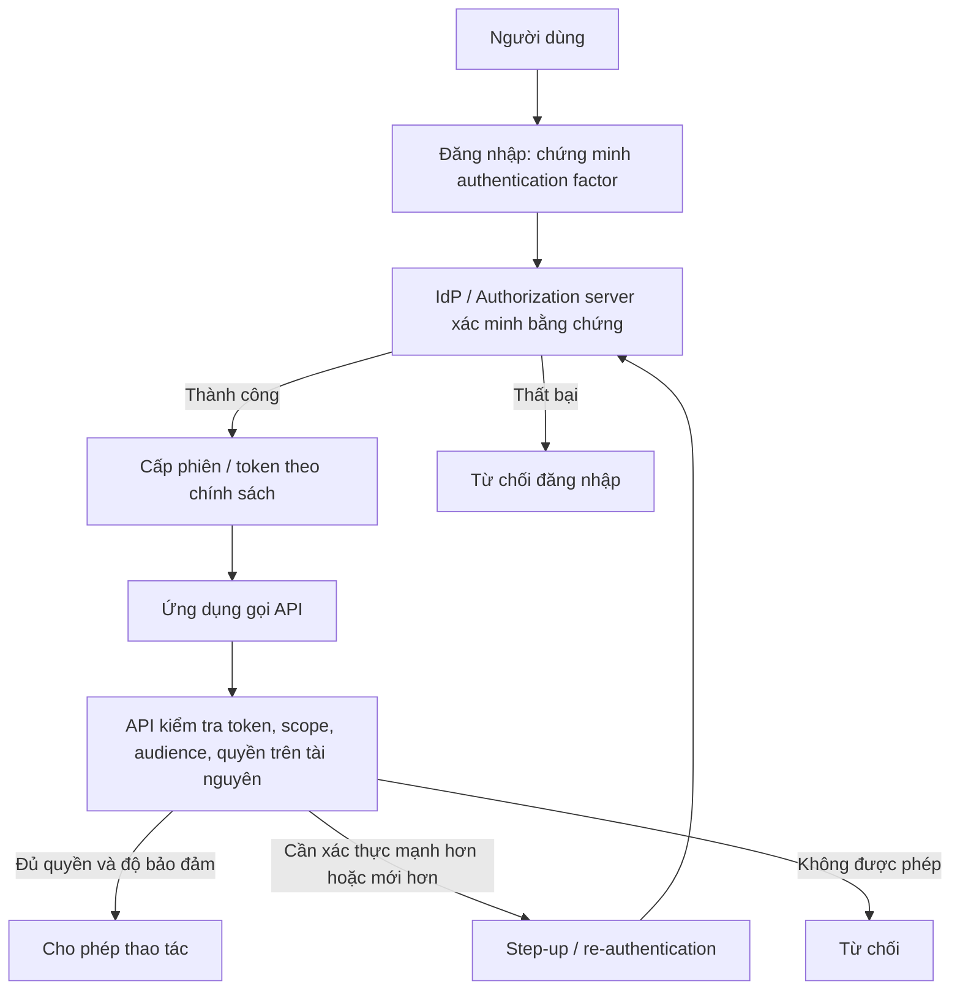
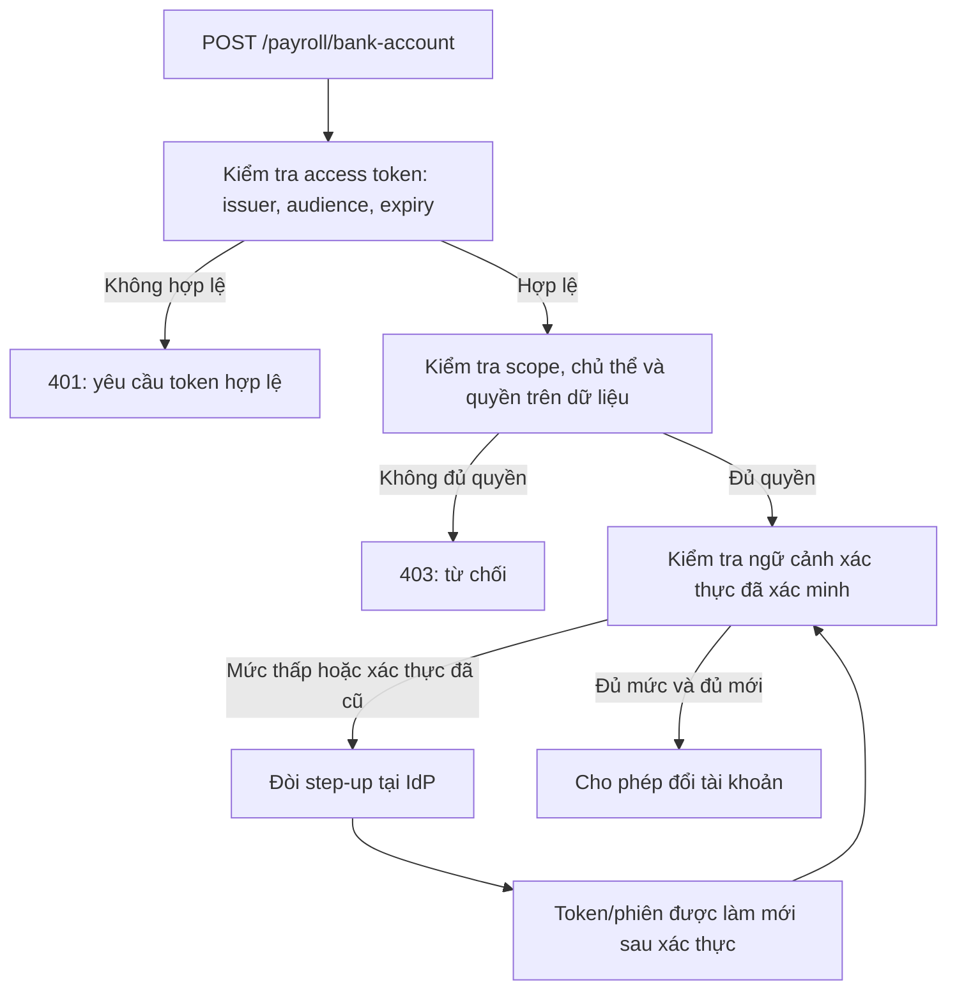
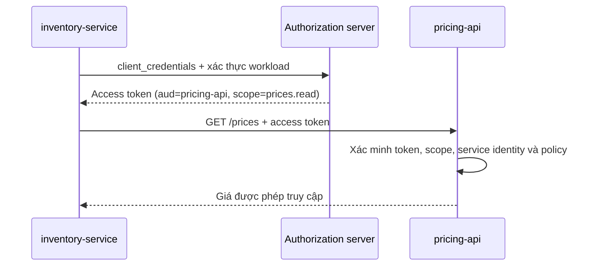

# Authentication factor và token sau đăng nhập

Khi người dùng đăng nhập, hệ thống cần hai thứ khác nhau: **bằng chứng để xác thực** họ tại thời điểm đăng nhập và **cơ chế duy trì quyền truy cập** cho các yêu cầu tiếp theo. Mật khẩu, khóa bảo mật hay mã OTP có thể tham gia xác thực; cookie phiên và token được phát hành sau đó giúp người dùng không phải nhập lại các bằng chứng này ở mỗi lần gọi API.

Sự khác biệt tưởng chừng nhỏ ấy quyết định thiết kế bảo mật của ứng dụng. Một phiên đăng nhập được bảo vệ bằng nhiều yếu tố xác thực (multi-factor authentication – **MFA**) vẫn có thể bị chiếm nếu attacker lấy được session cookie hoặc bearer access token. Ngược lại, một token hợp lệ không chứng minh rằng người đang gửi request chính là người vừa nhập mật khẩu hay chạm cảm biến vân tay. Hệ thống cần kiểm tra **nguồn phát hành, thời gian sống, quyền, audience và mức bảo đảm của lần xác thực gốc** theo chính sách.

Trong bài thuộc chương **Authentication** của module **SECURITY_TOKEN_SECURITY_FUNDAMENTALS**, chúng ta tập trung vào mối nối giữa authentication factor và vòng đời token trong OAuth 2.0/OpenID Connect (OIDC), từ xác thực ban đầu đến quản lý phiên, gia hạn, yêu cầu xác thực lại và chống token bị đánh cắp hoặc phát lại.

Sau bài học, bạn có thể:

- Nhận biết các nhóm yếu tố xác thực và phân biệt MFA thực sự với việc kiểm tra nhiều bước nhưng chỉ thuộc một nhóm yếu tố.
- Giải thích tại sao **authentication factor**, **session cookie**, **access token**, **refresh token** và **ID token** không đồng nghĩa.
- Hiểu cách authorization server chuyển kết quả đăng nhập thành phiên và token cho web/mobile.
- Diễn giải các claims OIDC `auth_time`, `amr`, `acr` và giới hạn của chúng khi đưa ra quyết định bảo mật.
- Thiết kế yêu cầu **step-up authentication**, xác thực lại cho tác vụ nhạy cảm và cơ chế kết thúc phiên/thu hồi token.

## 1. Hai giai đoạn: xác thực ban đầu và sử dụng quyền sau đăng nhập

**Authentication (xác thực)** trả lời câu hỏi: *Ai đang chứng minh quyền kiểm soát tài khoản hoặc danh tính này và bằng chứng đáng tin đến mức nào?* **Authorization (phân quyền)** trả lời: *Chủ thể đã được xác thực được phép làm thao tác gì trên tài nguyên nào?*

Một phiên điển hình gồm:

1. Người dùng yêu cầu đăng nhập vào ứng dụng.
2. **Identity provider (IdP)/authorization server** xác minh một hoặc nhiều yếu tố xác thực và áp dụng chính sách rủi ro.
3. Khi xác thực và ủy quyền thành công, bên có thẩm quyền tạo phiên và/hoặc phát hành token.
4. Ứng dụng dùng cookie phiên hoặc access token để gửi các yêu cầu tiếp theo.
5. Backend/API kiểm tra credential được trình bày, thời hạn, audience, quyền truy cập và các quy tắc nghiệp vụ.
6. Khi cần hành động nhạy cảm hoặc phiên đã cũ, hệ thống có thể yêu cầu người dùng **xác thực lại** hoặc **bổ sung yếu tố xác thực**.



**Điểm then chốt:** mật khẩu, OTP hoặc vân tay không cần đi kèm mỗi request API. Thay vào đó, API dựa trên token hoặc phiên đã được phát hành bởi thành phần đáng tin cậy, cộng với các kiểm tra riêng của API. Khả năng sử dụng credential sau đăng nhập phụ thuộc vào **sở hữu token/phiên**, nên token phải được bảo vệ như một bí mật có giá trị.

## 2. Authentication factor là gì?

**Authentication factor** là một loại bằng chứng dùng để chứng minh quyền kiểm soát một danh tính/tài khoản. Ba nhóm kinh điển:

| Nhóm yếu tố | Câu hỏi | Ví dụ | Rủi ro điển hình |
| --- | --- | --- | --- |
| **Something you know** – điều bạn biết | Người dùng có biết bí mật không? | Mật khẩu, PIN, passphrase | Phishing, mật khẩu tái sử dụng, lộ dữ liệu |
| **Something you have** – vật bạn sở hữu/kiểm soát | Người dùng có kiểm soát authenticator không? | Khóa bảo mật FIDO2, ứng dụng OTP hoặc thiết bị chứa khóa mật mã | Mất thiết bị, đánh cắp hoặc sao chép secret, chiếm quyền thiết bị |
| **Something you are** – đặc điểm sinh trắc | Người dùng có đặc điểm sinh học phù hợp không? | Vân tay, khuôn mặt, mống mắt | Giả mạo cảm biến, sai số, xử lý dữ liệu sinh trắc |

Một **authenticator** là phương tiện cụ thể giúp thực hiện bước xác thực: ứng dụng OTP, thiết bị FIDO2, khóa trong phần cứng hay một phần mềm quản lý passkey. Một authenticator có thể kết hợp nhiều yếu tố, chẳng hạn khóa mật mã nằm trên thiết bị (possession) cần người dùng mở bằng PIN hoặc sinh trắc trước khi ký challenge.

Không nên coi mọi tín hiệu khác biệt là một authentication factor mới. Địa chỉ IP, vị trí gần đúng, dấu vân tay trình duyệt, thời gian truy cập và điểm rủi ro của thiết bị chủ yếu là **tín hiệu ngữ cảnh/rủi ro**; chúng có thể giúp quyết định có cần bước xác thực bổ sung nhưng không tự động chứng minh một yếu tố độc lập.

### 2.1. MFA không đồng nghĩa với nhiều màn hình nhập thông tin

**MFA** yêu cầu bằng chứng thuộc **ít nhất hai nhóm yếu tố độc lập** theo mô hình xác thực được sử dụng. **Two-step verification** chỉ nói đến hai bước; hai bước có thể vẫn cùng một nhóm.

| Quy trình đăng nhập | Đánh giá | Giải thích |
| --- | --- | --- |
| Mật khẩu + PIN do người dùng nhớ | **Không phải MFA** theo ba nhóm kinh điển | Cả hai đều là yếu tố “biết” |
| Mật khẩu + mã TOTP từ authenticator độc lập | **Thường là MFA** | Kết hợp “biết” và kiểm soát authenticator tạo OTP |
| Mật khẩu + mã OTP gửi email | **Không mặc nhiên là MFA mạnh** | Phải đánh giá tài khoản email có độc lập và an toàn hay không; có thể bị chiếm bởi cùng kênh đăng nhập |
| Mật khẩu + SMS OTP | Có hai cơ chế, nhưng **chống phishing và chiếm đoạt số điện thoại yếu** | SMS có thể bị SIM swap/chuyển hướng; không phù hợp cho mọi mức rủi ro |
| Passkey được bảo vệ bằng xác minh người dùng trên thiết bị | **Có thể tạo xác thực nhiều yếu tố theo thiết kế authenticator và chính sách** | Khóa mật mã chứng minh kiểm soát authenticator; PIN/sinh trắc xác minh người dùng tại chỗ |
| Mật khẩu + câu hỏi bảo mật | **Không phải MFA** | Cả hai là thông tin người dùng biết, câu trả lời thường dễ đoán/tra cứu |

Không được đánh giá mức bảo đảm chỉ bằng cách đếm số ô nhập liệu. Cần xem **yếu tố thực sự**, cách đăng ký thiết bị/authenticator, cơ chế xác minh, độ độc lập, khả năng khôi phục tài khoản và khả năng bị phishing.

### 2.2. Những phương thức xác thực hay gặp

**Mật khẩu:** dễ triển khai, quen thuộc nhưng chịu rủi ro credential stuffing, phishing, tái sử dụng và brute force. Backend nên dùng cơ chế băm mật khẩu thích hợp với salt, giới hạn tần suất thử và giám sát đăng nhập bất thường. Mật khẩu không phải token sau đăng nhập.

**TOTP:** ứng dụng authenticator tính mã dùng một lần theo thời gian từ shared secret. TOTP có thời hạn ngắn nhưng kẻ tấn công có thể lừa người dùng nhập mã vào trang giả rồi sử dụng ngay. Việc đặt giới hạn số lần thử, chống phát lại mã đã dùng và bảo vệ quá trình cấp lại authenticator vẫn cần thiết.

**Push approval:** người dùng chấp thuận trên một thiết bị đã đăng ký. Thiết kế nên giúp họ xác nhận ngữ cảnh giao dịch hoặc số khớp (number matching), chống tình trạng kẻ tấn công gửi liên tục yêu cầu phê duyệt để gây mệt mỏi. Một nút “Approve” không kèm ngữ cảnh là tín hiệu yếu nếu người dùng dễ bấm nhầm.

**FIDO2/WebAuthn/passkey:** authenticator ký challenge bằng private key, còn máy chủ kiểm tra chữ ký với public key đã đăng ký; ràng buộc với RP ID/origin giúp chống phishing tốt hơn OTP nhập tay. PIN hoặc sinh trắc dùng để **mở quyền dùng khóa cục bộ**, không có nghĩa ứng dụng backend nhận trực tiếp dữ liệu vân tay. Khả năng chống phishing phụ thuộc việc kiểm tra challenge, origin/RP ID và policy triển khai đúng.

**Sinh trắc đơn lẻ:** bản thân cảm biến trên điện thoại thường phục vụ mở khóa cục bộ. Để nó trở thành thành phần có giá trị trong xác thực với backend, cần cơ chế mật mã và ràng buộc phiên/thiết bị phù hợp; backend không nên tin một cờ `biometricVerified=true` do ứng dụng tự gửi.

## 3. Sau khi xác thực: server phát hành thứ gì?

Kết quả xác thực không trực tiếp trở thành quyền gọi mọi API. Thông thường có nhiều loại credential khác nhau:

| Thành phần | Ai tạo và kiểm tra? | Dùng để làm gì? | Có phải authentication factor? |
| --- | --- | --- | --- |
| **Session cookie** | Web backend/IdP tạo, backend kiểm tra phiên | Gắn yêu cầu trình duyệt với phiên đăng nhập | **Không**. Đây là credential duy trì phiên |
| **Access token** | Authorization server cấp; resource server/API xác minh | Cho phép API xem xét quyền theo scope, audience và chính sách | **Không**. Đây là credential ủy quyền |
| **Refresh token** | Authorization server cấp và nhận lại | Xin access token mới mà không cần đăng nhập lại mỗi lần | **Không**. Đây là credential gia hạn |
| **ID token (OIDC)** | OpenID Provider cấp; OIDC client xác minh | Truyền kết quả xác thực danh tính tới đúng client | **Không**. Đây là thông điệp xác thực có bảo vệ |
| **Mật khẩu, OTP, chứng minh khóa/passkey** | Bên xác thực kiểm tra trong bước login | Chứng minh yếu tố xác thực | **Có/được sử dụng để chứng minh yếu tố**, theo thiết kế cụ thể |

Chẳng hạn người dùng đăng nhập bằng mật khẩu và TOTP rồi nhận một access token. **Bearer access token không biến thành hai yếu tố chỉ vì quá trình phát hành có MFA**. Bất kỳ bên nào có token đó đều có thể thử dùng nó nếu API chỉ kiểm tra dạng bearer; cần hạn chế tuổi thọ, lưu trữ an toàn, kiểm tra audience/quyền và cân nhắc cơ chế ràng buộc người gửi khi thích hợp.

Một cách phân biệt quan trọng nữa:

- **Mục đích token:** access token, refresh token, ID token.
- **Định dạng token:** JWT (có thể được ký và kiểm tra claims) hoặc opaque (cần tra cứu/introspection theo hợp đồng hệ thống).
- **Cơ chế trình bày:** bearer token (ai cầm token có thể dùng) hoặc token được ràng buộc với khóa/chứng chỉ của người gửi (ví dụ DPoP, mTLS).

Ba chiều này độc lập. JWT **không đồng nghĩa** với access token, và chữ ký JWT **không mã hóa** payload: claims trong JWT ký thông thường có thể được đọc bởi người sở hữu token. Refresh token cũng không phải bằng chứng người dùng vừa thực hiện MFA.

## 4. Luồng ví dụ: đăng nhập OIDC bằng MFA và gọi API

Xét một ứng dụng quản lý nhân sự chạy trên web. Nhân viên bắt đầu đăng nhập qua OpenID Provider (OP). OP yêu cầu passkey hoặc mật khẩu cộng TOTP tùy chính sách. Ứng dụng sử dụng **Authorization Code Flow + PKCE** để nhận kết quả và token; backend có thể đóng vai trò BFF để giữ OAuth token phía server.

```mermaid
sequenceDiagram
    participant U as Người dùng
    participant B as Trình duyệt
    participant APP as Web backend / OIDC client
    participant OP as OpenID Provider
    participant API as HR API
    U->>B: Chọn đăng nhập
    B->>APP: Bắt đầu login
    APP-->>B: Chuyển đến authorization endpoint
    B->>OP: Authorization request + PKCE + state + nonce
    OP->>U: Yêu cầu mật khẩu/passkey và MFA theo chính sách
    U->>OP: Cung cấp bằng chứng hợp lệ
    OP-->>B: Redirect với authorization code + state
    B->>APP: Callback trả authorization code
    APP->>OP: Đổi code + code_verifier (xác thực client nếu cần)
    OP-->>APP: ID token + access token (+ refresh token nếu cấp)
    APP->>APP: Xác minh ID token và tạo phiên ứng dụng
    APP-->>B: Session cookie Secure; HttpOnly
    B->>APP: GET /profile kèm session cookie
    APP->>API: Authorization: Bearer access token
    API->>API: Kiểm tra issuer, audience, exp, scope, quyền dữ liệu
    API-->>APP: Dữ liệu được phép
    APP-->>B: Hiển thị thông tin
```

Trong flow trên:

1. **OP/IdP** kiểm tra authentication factors. Ứng dụng không cần và không nên thu thập lại OTP hoặc mật khẩu từ redirect sau login.
2. **OIDC client** xác minh phản hồi OIDC, gồm issuer, audience/client ID, thời hạn, chữ ký, `nonce` khi áp dụng và ràng buộc phiên yêu cầu (`state`); PKCE bảo vệ việc đổi authorization code.
3. **Resource server** xác minh **access token dành cho chính API đó**; không sử dụng ID token thay thế.
4. Backend phát hành **session cookie riêng** sau khi đăng nhập thành công. Cookie chứng minh browser đang giữ phiên; nó không chứa bằng chứng MFA bắt buộc và không nên bị đánh đồng với OAuth token.

**PKCE, `state` và `nonce` không phải các authentication factor.** Chúng là cơ chế bảo vệ luồng giao thức khỏi đánh cắp code, tráo đổi phản hồi và một số kiểu replay/mix-up, tùy bước áp dụng. Tương tự, HTTPS bảo vệ đường truyền nhưng không chứng minh người dùng đã hoàn thành MFA.

## 5. OIDC biểu diễn thông tin xác thực bằng những claims nào?

OIDC định nghĩa các claims có thể giúp client hiểu **lần xác thực người dùng diễn ra khi nào, bằng những cách nào và đạt ngữ cảnh bảo đảm nào**.

| Claim | Ý nghĩa | Cần nhớ |
| --- | --- | --- |
| `auth_time` | Thời điểm **người dùng đã được xác thực**, dạng Unix timestamp giây | Khác `iat` – thời điểm token được phát hành |
| `amr` | Authentication Methods References: danh sách phương thức xác thực đã dùng | Giá trị là mô tả phương thức; **không tự xác lập** mức bảo đảm hay tính độc lập của các yếu tố |
| `acr` | Authentication Context Class Reference: mã lớp/ngữ cảnh bảo đảm xác thực | Chỉ có ý nghĩa khi client và OP có **hợp đồng rõ ràng** về mức đảm bảo và cách gán |
| `iat` | Thời điểm phát hành ID token | ID token mới không nhất thiết tương ứng với người dùng vừa nhập lại yếu tố xác thực |
| `iss`, `aud`, `exp`, `sub` | Issuer, client nhận token, thời hạn, subject | Bắt buộc kiểm tra theo quy tắc xác minh ID token/OIDC tương ứng |

Ví dụ **payload ID token minh họa** sau khi OP xác thực người dùng bằng mật khẩu và OTP. Đây không phải JWT thật; ứng dụng chỉ được tin claims sau khi xác minh token từ issuer đã cấu hình:

```json
{
  "iss": "https://login.example.com",
  "sub": "user-412",
  "aud": "hr-web-client",
  "iat": 1760000300,
  "exp": 1760003900,
  "auth_time": 1760000000,
  "amr": ["pwd", "otp"],
  "acr": "urn:example:assurance:multi-factor",
  "nonce": "request-bound-random-value"
}
```

Giả sử API trả về token mới có `iat` sau lúc đăng nhập 1 giờ. Điều này **không chứng minh** người dùng vừa vượt qua bước MFA. Muốn xác định độ mới của xác thực, phải tham chiếu `auth_time` từ OP tin cậy, so với thời điểm hiện tại và thời gian tối đa cho phép, thay vì chỉ nhìn `iat`.

`amr=["pwd","otp"]` có thể ghi nhận hai phương thức, nhưng nếu client và OP không thống nhất cách đăng ký/kiểm tra OTP, không nên tự suy ra mức bảo đảm phù hợp cho chuyển tiền hay thay đổi khóa khôi phục. `acr` trong ví dụ là **URN giả định của hệ thống**, không phải mức bảo đảm chuẩn dùng chung cho mọi nhà cung cấp. Một API thường **không thể đọc trực tiếp ID token**, vì ID token có `aud` là OIDC client, không phải API. Khi API cần assurance context, hệ thống phải có hợp đồng truyền tiếp an toàn, ví dụ access token chứa claims được authorization server xác nhận, token exchange, hoặc tra cứu trạng thái phiên qua thành phần đáng tin.

**Những điều không nên làm:**

- Tin vào header tùy ý `X-MFA: true`, trường JSON `mfaPassed` hoặc `auth_time` do browser/mobile tự gửi.
- Đọc `amr` từ một JWT mà chưa xác minh chữ ký, issuer, audience và loại token.
- Gắn cứng ý nghĩa `acr` từ nhà cung cấp A sang nhà cung cấp B khi chưa có quy ước chung.
- Xem `iat` của access token mới, thời điểm refresh token được dùng hoặc thời điểm app mở lại là bằng chứng đăng nhập lại.

## 6. Authentication assurance khác authorization scope

Một người dùng có thể đã được xác thực rất mạnh nhưng **không có quyền** xem bảng lương của người khác. Ngược lại, một access token mang scope `payroll.write` theo chính sách có thể vẫn **không đủ mức bảo đảm xác thực** để đổi số tài khoản nhận lương.

| Câu hỏi bảo mật | Dữ liệu/chính sách liên quan | Ví dụ |
| --- | --- | --- |
| **Ai đang đăng nhập?** | Danh tính `sub` từ OP đáng tin, trạng thái phiên | Nhân viên `user-412` |
| **Đã xác thực mạnh đến đâu?** | `acr`, `amr`, cơ chế OP, policy assurance | MFA/phương thức chống phishing theo thỏa thuận |
| **Đã xác thực cách đây bao lâu?** | `auth_time` và chính sách độ mới | Thao tác cần re-auth trong 5 phút gần nhất |
| **Ứng dụng được gọi API nào?** | `aud`, issuer, loại token | `https://api.example.com/payroll` |
| **Được làm gì?** | Scope/role và chính sách tại API | `payroll.read` hoặc `payroll.change-bank-account` |
| **Được làm trên dữ liệu nào?** | Owner, tenant, quan hệ nghiệp vụ | Chỉ đổi tài khoản nhận lương của chính mình |

`scope` là quyền được cấp cho client/token đối với tài nguyên. `acr`/`amr` liên quan tới **ngữ cảnh xác thực**. Cả hai loại thông tin cần đúng **người phát hành và audience**; không được đổi chỗ cho nhau.

Trong hệ thống nhiều API, `aud` còn ngăn **token substitution**: một token được cấp cho Reporting API không được Accounting API chấp nhận chỉ vì chữ ký hợp lệ và có cùng `sub`. Mỗi resource server phải kiểm tra audience, issuer, thời hạn và quyền riêng của mình.

## 7. Step-up authentication: khi đăng nhập ban đầu chưa đủ

**Step-up authentication** là yêu cầu bổ sung hoặc nâng mức xác thực khi người dùng thực hiện hành động nhạy cảm. **Re-authentication** là yêu cầu xác thực lại để có bằng chứng đủ mới, có thể cùng hoặc khác phương thức tùy chính sách. Hai khái niệm giao nhau nhưng không đồng nghĩa: đăng nhập lại bằng một mật khẩu vẫn chưa chắc đạt yêu cầu MFA chống phishing.

Ví dụ hệ thống HR cho phép xem hồ sơ bằng phiên đăng nhập thường, nhưng muốn **đổi tài khoản ngân hàng nhận lương** phải có phương thức chống phishing và lần xác thực đủ mới.



Một quy trình thiết kế có thể là:

1. API hoặc BFF phát hiện token/phiên hợp lệ nhưng **không đáp ứng chính sách authentication assurance** cho thao tác.
2. Ứng dụng bắt đầu luồng OIDC đến OP với yêu cầu ngữ cảnh hoặc độ mới phù hợp. OIDC hỗ trợ `max_age` để yêu cầu giới hạn tuổi xác thực, `prompt=login` để yêu cầu xác thực lại, và `acr_values` để **yêu cầu** authentication context cụ thể.
3. OP quyết định phương thức đáp ứng, ví dụ passkey có user verification hoặc yêu cầu MFA bổ sung, và phát hành kết quả theo chính sách.
4. Client xác minh ID token mới, đặc biệt `auth_time` khi yêu cầu độ mới và `acr` khi có hợp đồng assurance, rồi cập nhật phiên/ngữ cảnh tin cậy.
5. API chỉ cho phép thao tác khi **token hoặc ngữ cảnh assurance mà API thực sự tin cậy** đáp ứng chính sách; đồng thời vẫn kiểm tra scope, quyền dữ liệu và chống replay của yêu cầu giao dịch.

Ví dụ authorization request OIDC (đã rút gọn, các tham số được trình bày để giải thích và phải URL-encode khi gửi thật):

```http
GET /authorize?response_type=code
    &client_id=hr-web-client
    &scope=openid%20profile
    &redirect_uri=https%3A%2F%2Fhr.example.com%2Fcallback
    &state=unguessable-state
    &nonce=unguessable-nonce
    &code_challenge=challenge-value
    &code_challenge_method=S256
    &max_age=300
    &acr_values=urn%3Aexample%3Aassurance%3Amulti-factor HTTP/1.1
Host: login.example.com
```

`max_age=300` biểu thị client yêu cầu lần xác thực không quá 300 giây; **đây là yêu cầu giao thức**, và client phải xác minh kết quả đáp ứng, không chỉ tin vào việc đã gửi tham số. `prompt=login` yêu cầu tái xác thực nhưng **không mặc nhiên buộc có MFA**. `acr_values` có thể chỉ được OP xử lý theo khả năng và cấu hình; các hệ thống cần hợp đồng policy, xử lý trường hợp OP không đạt mức yêu cầu và **không cho phép** thao tác khi assurance chưa đạt.

OAuth 2.0 còn có [RFC 9470](https://www.rfc-editor.org/rfc/rfc9470) mô tả tín hiệu từ resource server rằng cần xác thực người dùng ở mức hoặc độ mới cao hơn. Ví dụ minh họa một **HTTP challenge** (chỉ dùng khi client/authorization server có hỗ trợ giao thức này):

```http
HTTP/1.1 401 Unauthorized
WWW-Authenticate: Bearer error="insufficient_user_authentication",
  acr_values="urn:example:assurance:multi-factor",
  max_age="300"
```

Đây là yêu cầu step-up, **không cấp thêm quyền dữ liệu**. Nếu người dùng thiếu `payroll.write`, thực hiện MFA lần nữa vẫn không thể tự làm phát sinh scope hoặc quyền owner/tenant mới.

## 8. Token còn hạn không có nghĩa xác thực còn đủ mới

Hãy xét dòng thời gian sau:

| Mốc | Điều đã xảy ra | Kết luận đúng |
| --- | --- | --- |
| 09:00 | Người dùng nhập mật khẩu + TOTP, OP ghi `auth_time=09:00` | Đã có xác thực tương ứng với chính sách tại 09:00 |
| 09:10 | Access token đầu tiên hết hạn, client dùng refresh token để xin token mới | Token mới chứng minh **phiên/ủy quyền còn được chấp nhận**, không chứng minh MFA mới lúc 09:10 |
| 11:30 | Client vẫn còn phiên và muốn đổi số tài khoản nhận lương | Phải xét **độ mới của authentication**, bất kể access token hiện tại chưa hết hạn |
| 11:31 | OP yêu cầu xác thực bổ sung và cấp kết quả mới | Chỉ sau khi xác minh kết quả mới và quyền thao tác mới được tiếp tục |

**Access token TTL**, **session idle timeout**, **absolute session timeout**, **refresh token lifetime** và **maximum authentication age** là các giới hạn thời gian khác nhau. Chúng cần được thiết kế nhất quán nhưng không được thay thế nhau.

Một JWT access token có thể tự chứa claims tại lúc phát hành. Nếu quyền, trạng thái khóa tài khoản hoặc độ bảo đảm yêu cầu thay đổi, token cũ có thể còn được API kiểm tra hợp lệ đến `exp` nếu không có cơ chế kiểm tra/truy hồi trạng thái. Vì vậy với nghiệp vụ nhạy cảm, hệ thống có thể cần tra cứu phiên/chính sách hiện hành hoặc áp dụng TTL ngắn, danh sách thu hồi, introspection, gateway quản lý phiên hoặc token exchange phù hợp.

## 9. JWT, opaque token và độ tin cậy của claims xác thực

Một resource server có thể nhận **JWT access token** hoặc **opaque access token**, nhưng không được tự diễn giải giá trị `mfa=true` do client thêm vào bất kỳ chuỗi nào.

### 9.1. Với JWT access token

API phải kiểm tra tối thiểu theo profile/hợp đồng token:

1. Token đến từ kênh được phép, thường là `Authorization: Bearer ...` qua HTTPS.
2. Chữ ký hợp lệ bằng khóa của **issuer đã cấu hình trước**; thuật toán nằm trong allowlist, không chấp nhận `alg=none` hay khóa do token tự dẫn đến nơi không đáng tin.
3. `iss`, `aud`, `exp`, `nbf` và loại/profile token phù hợp với API. `iat` được kiểm tra khi chính sách yêu cầu.
4. Scope/role đủ để **xem xét** endpoint, sau đó kiểm tra quyền theo dữ liệu thực tế, chẳng hạn owner và tenant.
5. Nếu API cần mức bảo đảm MFA/độ mới, chỉ dùng các claims/ngữ cảnh do thành phần phát hành đáng tin xác nhận **và** có semantics đã được thỏa thuận.
6. Nếu token dùng DPoP hoặc mTLS, kiểm tra bằng chứng sở hữu khóa/chứng chỉ và liên kết với đúng request; không chỉ đọc claim `cnf` rồi cho qua.

Ví dụ pseudocode của endpoint nhạy cảm:

```text
access = verifyAccessToken(
    request.Authorization,
    issuer = "https://login.example.com",
    audience = "https://api.example.com/payroll",
    allowedAlgorithms = ["RS256"],
    trustedIssuerKeys = configuredJwks
)
if access is invalid:
    return 401

if "payroll.change-bank-account" not in access.scopes:
    return 403

if !policy.canChangeOwnBankAccount(access.sub, request.employeeId):
    return 403

authentication = getTrustedAuthenticationContext(access, serverSession)
if !policy.hasRequiredAssurance(authentication.acr):
    return requireStepUp()
if now() - authentication.auth_time > policy.maxAuthenticationAge:
    return requireFreshAuthentication()

return changeBankAccountWithTransactionProtections(request)
```

Trong pseudocode, `getTrustedAuthenticationContext` là **hợp đồng riêng của hệ thống**: có thể dựa vào claims được OP/AS phát hành trong access token hoặc tra cứu backend tin cậy. Hàm này **không** được đọc thông tin tự khai từ request. `auth_time` phải gắn với xác thực của đúng chủ thể và đúng ngữ cảnh phiên; việc API nhận claims này trong access token không được giả định cho tất cả nhà cung cấp OAuth.

### 9.2. Với opaque access token

Opaque token không thể được API phân tích trực tiếp để lấy MFA claims. API phải dựa vào introspection hoặc tra cứu trạng thái từ thành phần đáng tin, xác nhận token `active=true`, issuer/audience và quyền theo hợp đồng. Nếu mức đảm bảo xác thực không có trong phản hồi introspection, cần **cơ chế truyền/tra cứu assurance đáng tin cậy khác**, chứ không suy diễn từ việc token còn hoạt động.

Cache introspection có thể gây độ trễ thu hồi và độ trễ thay đổi assurance. Hệ thống xử lý tác vụ rủi ro cao nên đặt thời gian cache theo yêu cầu thu hồi/thay đổi trạng thái thực tế, không chỉ tối ưu hiệu năng.

## 10. Authentication factor có bảo vệ được token sau đăng nhập?

MFA giúp giảm khả năng kẻ tấn công đăng nhập bằng một yếu tố bị lộ, nhưng **không tự động ngăn việc sử dụng token hoặc session đã bị đánh cắp**. Đây là khác biệt giữa **bảo vệ quá trình phát hành token** và **bảo vệ việc sử dụng token**.

| Tình huống | MFA hỗ trợ ở đâu? | Biện pháp cần có sau đăng nhập |
| --- | --- | --- |
| Attacker biết mật khẩu | MFA có thể chặn đăng nhập bằng mật khẩu đơn lẻ | Chống phishing, kiểm soát khôi phục tài khoản, giám sát bất thường |
| XSS đọc bearer token trong SPA | MFA trước đó **không** ngăn token bị dùng lại | Giảm lưu token ở JavaScript, CSP/chống XSS, TTL ngắn, BFF khi phù hợp |
| Session cookie bị chiếm qua malware | Attacker có thể mạo danh phiên mà không nhập lại OTP | Cookie `HttpOnly`, `Secure`, `SameSite`, ràng buộc/giám sát phiên, step-up cho thao tác nhạy cảm |
| Refresh token bị đánh cắp | Attacker có thể tìm cách xin access token mới | Refresh token rotation, reuse detection, thu hồi token family, giới hạn thời gian phiên |
| API chấp nhận token sai `aud` | MFA không giải quyết lỗi xác minh tài nguyên | Kiểm tra issuer, audience, token type, chữ ký, scope và quyền object |
| Kẻ tấn công phát lại bearer access token | MFA không gắn token với người gửi ban đầu | TLS, access token ngắn hạn, giám sát, DPoP/mTLS nếu thích hợp |

### 10.1. Web: cookie và browser

Trong kiến trúc **backend-for-frontend (BFF)**, backend giữ access/refresh token và browser nhận session cookie. Cookie nên có `Secure`, `HttpOnly`, `SameSite` phù hợp, phạm vi host/path tối thiểu; khi có thể dùng prefix `__Host-` đúng quy tắc (không `Domain`, `Path=/`, `Secure`). Sau đăng nhập/step-up, cân nhắc **xoay session ID** để giảm rủi ro session fixation. Với thao tác thay đổi trạng thái, cần chống CSRF (token, kiểm tra Origin hoặc biện pháp thích hợp); vẫn phải ngăn XSS vì mã độc trong trang có thể dùng session cho request trái phép.

Với SPA thuần frontend, token lưu ở `localStorage`/`sessionStorage` có thể bị script độc hại đọc khi xảy ra XSS. Giữ access token trong memory giúp giảm tồn tại bền vững, nhưng không triệt tiêu XSS. PKCE giúp bảo vệ authorization code, **không thay thế cách bảo vệ access token đã phát hành**.

### 10.2. Mobile: bảo vệ credential dài hạn

Ứng dụng iOS/Android là **public client**, không thể giấu `client_secret` chung an toàn trong gói ứng dụng. Thông thường dùng Authorization Code + PKCE với **trình duyệt hệ thống**, redirect URI được kiểm tra nghiêm ngặt, rồi lưu refresh token/credential dài hạn qua Keychain/Keystore và chỉ giữ access token trong memory khi có thể. Khóa local bằng vân tay/PIN có thể hạn chế dùng lại credential sau khi người dùng rời thiết bị, nhưng không đồng nghĩa OP xác thực lại người dùng hoặc cập nhật `auth_time`.

Khi đăng xuất, hệ thống nên xóa credential cục bộ, thu hồi refresh token/phiên phía server và có chính sách xử lý access token còn hạn. Chỉ xóa UI hoặc token trong bộ nhớ **không vô hiệu hóa bản sao token đã bị kẻ xấu lấy đi**.

### 10.3. Sender-constrained token không phải MFA của người dùng

DPoP và mTLS có thể ràng buộc access token với khóa hoặc chứng chỉ mà client phải chứng minh quyền sở hữu khi gọi API. Cơ chế này giảm nguy cơ người khác sử dụng **bản sao token** mà không có khóa tương ứng. Tuy nhiên, proof-of-possession của client **không tự chứng minh người dùng đã xác thực bằng hai yếu tố**, và không thay thế `acr`/`auth_time` khi nghiệp vụ đòi hỏi re-authentication.

## 11. Refresh token, timeout và nguy cơ duy trì phiên quá lâu

Một phiên MFA mạnh ban đầu vẫn có thể tồn tại quá lâu nếu refresh token được gia hạn vô hạn. Cần phân biệt:

- **Access token lifetime:** khoảng thời gian API có thể chấp nhận access token theo hợp đồng.
- **Refresh token lifetime/rotation:** khoảng thời gian và điều kiện client có thể xin access token mới.
- **Idle timeout:** giới hạn phiên khi người dùng không hoạt động trong thời gian đủ dài.
- **Absolute timeout:** giới hạn tổng thời lượng phiên bất kể có hoạt động hay không.
- **Authentication freshness:** tuổi của sự kiện xác thực đáp ứng assurance cụ thể, xét theo `auth_time` tin cậy hoặc trạng thái phiên của IdP.

**Refresh token rotation** thay refresh token sau mỗi lần sử dụng thành công, vô hiệu token trước đó và có thể phát hiện token cũ bị dùng lại. Khi phát hiện **reuse**, authorization server có thể thu hồi nhóm refresh token liên quan (token family), chấm dứt phiên và yêu cầu đăng nhập lại. Cần xử lý refresh đồng thời để tránh báo động giả do race condition.

Với JWT access token tự chứa được API xác minh offline, **thu hồi refresh token không mặc nhiên thu hồi ngay access token chưa hết hạn**. Nếu cần chặn tức thời, phải thiết kế kiểm tra trạng thái phiên/denylist/introspection, rút ngắn TTL hoặc một cơ chế server-side khác. Với opaque token, introspection có thể phản ánh trạng thái thu hồi nhưng bị ảnh hưởng bởi cache.

**Ví dụ:** nhân viên đã xác thực bằng passkey lúc 08:00. Trong ngày ứng dụng dùng refresh token để xin access token nhiều lần. Đến 16:00, token mới vẫn có thể cho phép xem dữ liệu ít nhạy cảm theo chính sách, nhưng thao tác đổi thông tin ngân hàng có thể đòi hỏi authentication event mới. Một access token mới được phát hành lúc 15:59 **không phải bằng chứng** đã re-auth lúc đó.

## 12. Khôi phục tài khoản và đổi authentication factor

Chính sách MFA chỉ mạnh bằng **đường khôi phục yếu nhất**. Nếu người dùng đăng ký khóa bảo mật nhưng có thể thay nó bằng cách trả lời câu hỏi bảo mật dễ đoán, attacker có thể đi vòng qua MFA. Vì vậy việc thêm/xóa authenticator, đổi thiết bị, thay mật khẩu, reset tài khoản hoặc tắt MFA thường phải được coi là thao tác rủi ro cao.

Một quy trình tốt cần:

1. **Bảo vệ đăng ký yếu tố mới:** yêu cầu phiên hợp lệ và xác thực gần đây ở mức phù hợp; xác nhận việc thêm thiết bị/khóa mới qua kênh đã đáng tin khi cần.
2. **Bảo vệ khôi phục:** dùng mã khôi phục một lần hoặc thủ tục phục hồi danh tính được kiểm soát, giới hạn số lần thử, ghi audit và thông báo thay đổi quan trọng.
3. **Phản ứng sự cố:** khóa hoặc gỡ authenticator bị mất, thu hồi phiên/refresh token liên quan, xem xét vô hiệu access token còn hạn bằng cơ chế có sẵn.
4. **Giám sát bất thường:** phát hiện đăng ký authenticator mới, đăng nhập từ thiết bị chưa biết, refresh token reuse, MFA fatigue và chuyển hướng OTP.
5. **Chống leo thang quyền:** không cho phép cookie/token được đánh cắp tự thêm yếu tố mới chỉ vì phiên còn hoạt động; yêu cầu step-up dựa trên bằng chứng mới và chính sách phù hợp.

Không nên lưu mã OTP, shared secret TOTP, mã khôi phục chưa được bảo vệ hoặc token nguyên dạng vào log/analytics. Hệ thống cần thiết kế luồng hỗ trợ người dùng mất authenticator mà vẫn giữ tiêu chuẩn chứng minh danh tính phù hợp.

## 13. Authentication factor trong service-to-service: một trường hợp khác

Khi `inventory-service` gọi `pricing-api` theo OAuth 2.0 **Client Credentials grant**, thường **không có người dùng nhập mật khẩu, OTP hoặc vân tay**. Authorization server xác thực **client/workload** bằng secret được bảo vệ, mTLS, private-key JWT hoặc workload identity/managed identity, rồi cấp access token với audience và scope phù hợp.



Đây là **xác thực client/workload**, không có `auth_time` của người dùng vừa thực hiện MFA. Không nên giả định mọi token đều đại diện cho user hay rằng `sub` luôn là user ID. Nếu backend hành động **thay mặt người dùng** và giao dịch đòi assurance người dùng, cần thiết kế delegation/token exchange/on-behalf-of hợp lệ, truyền thông tin chủ thể/assurance đáng tin và thực thi chính sách tương ứng. Không chuyển nguyên token dành cho API A sang API B nếu audience không hợp lệ.

Khóa hoặc chứng chỉ dùng để xác thực workload cũng là credential quan trọng: quản lý bằng secret manager hoặc workload identity, xoay vòng, hạn chế quyền và không commit vào source code, CI logs hoặc container image.

## 14. Ba tình huống phân tích thiết kế

### Tình huống A: Có MFA mà vẫn mất tài khoản

Nhân viên đã đăng nhập bằng mật khẩu + TOTP. Browser nhận session cookie. Một lỗ hổng XSS cho phép mã độc gọi endpoint đổi địa chỉ email ngay trong phiên đã xác thực. Vì kẻ tấn công **đang dùng ngữ cảnh phiên hợp lệ**, việc có MFA trước đó không đủ để ngăn thao tác. Cần sửa XSS, phân quyền, xác thực lại cho thay đổi quan trọng, xác nhận giao dịch và thu hồi phiên có dấu hiệu bị chiếm.

### Tình huống B: Token mới nhưng assurance đã cũ

Mobile app được cấp refresh token sau khi người dùng đăng nhập bằng passkey. Sáu giờ sau, app refresh access token thành công rồi yêu cầu chuyển tiền. API không được suy ra người dùng vừa xác thực bằng passkey từ `iat` của access token. Nó cần kiểm tra context tin cậy và yêu cầu step-up/re-auth nếu vượt giới hạn độ mới của giao dịch.

### Tình huống C: Có scope nhưng vẫn thiếu quyền

API nhận JWT access token đã ký đúng với `aud=orders-api`, `scope=orders.read`, `acr` đạt yêu cầu. Client gửi `GET /orders/42`, nhưng đơn 42 thuộc tenant khác. API phải trả từ chối (thường 403 hoặc 404 để tránh tiết lộ sự tồn tại). **MFA tốt và token hợp lệ không bỏ qua kiểm tra owner/tenant**.

## 15. Checklist khi thiết kế authentication và token

Trước khi triển khai sản phẩm, nên xác định rõ:

1. **Yếu tố:** đăng nhập dựa trên các authentication factor nào? Có thật sự độc lập? Chống phishing đến đâu? Cơ chế khôi phục có làm suy yếu yêu cầu MFA không?
2. **Bên xác thực:** thành phần nào kiểm tra factors, bảo vệ đăng ký authenticator và ghi sự kiện xác thực? Ai được phép phát hành `acr`, `amr`, `auth_time`?
3. **Phiên/token:** browser/app/service nhận session cookie, ID token, access token hay refresh token? Ai kiểm tra từng loại? Chúng được lưu ở đâu và hết hạn lúc nào?
4. **Ranh giới tin cậy:** API kiểm tra issuer, audience, loại token, chữ ký/introspection, thời gian, scope và quyền owner/tenant chưa? Có tin nhầm header/claims tự khai từ client không?
5. **Step-up:** tác vụ nào cần xác thực mạnh hơn hoặc mới hơn? OP và API dùng chính sách assurance nào và chứng minh kết quả đạt yêu cầu ra sao?
6. **Kết thúc phiên:** logout, khóa tài khoản, đổi yếu tố hoặc nghi ngờ lộ token sẽ làm gì với session, refresh token và access token còn hạn?
7. **Phòng thủ sau đăng nhập:** XSS, CSRF, token theft/replay, refresh reuse, session fixation và lạm quyền theo đối tượng đã có kiểm soát phù hợp chưa?

Quy tắc cần ghi nhớ: **authentication factor chứng minh danh tính hoặc quyền kiểm soát tài khoản tại thời điểm xác thực; token/session được phát hành sau đó duy trì một quan hệ tin cậy có giới hạn.** Bảo mật API đòi cả hai lớp: hiểu **lần xác thực nào đã xảy ra** và xác minh **credential hiện tại được cấp cho ai, để làm gì, trên tài nguyên nào, đến khi nào**.

## Tài liệu tham khảo

- [OpenID Connect Core 1.0](https://openid.net/specs/openid-connect-core-1_0.html) – ID token, `auth_time`, `acr`, `amr`, `max_age`, `prompt`, `acr_values`.
- [RFC 8176 – Authentication Method Reference Values](https://www.rfc-editor.org/rfc/rfc8176) – Giá trị và ngữ nghĩa `amr`.
- [RFC 6749 – The OAuth 2.0 Authorization Framework](https://www.rfc-editor.org/rfc/rfc6749) – Các vai trò, grant và access token.
- [RFC 7636 – Proof Key for Code Exchange (PKCE)](https://www.rfc-editor.org/rfc/rfc7636) – Bảo vệ authorization code.
- [RFC 8252 – OAuth 2.0 for Native Apps](https://www.rfc-editor.org/rfc/rfc8252) – Luồng OAuth cho mobile/native app.
- [RFC 9068 – JWT Profile for OAuth 2.0 Access Tokens](https://www.rfc-editor.org/rfc/rfc9068) – Hợp đồng JWT access token.
- [RFC 9470 – OAuth 2.0 Step Up Authentication Challenge Protocol](https://www.rfc-editor.org/rfc/rfc9470) – Tín hiệu step-up từ resource server.
- [RFC 9449 – OAuth 2.0 Demonstrating Proof of Possession (DPoP)](https://www.rfc-editor.org/rfc/rfc9449) – Ràng buộc token với khóa người gửi.
- [RFC 9700 – Best Current Practice for OAuth 2.0 Security](https://www.rfc-editor.org/rfc/rfc9700) – Các thực hành bảo mật OAuth hiện hành.
- [W3C Web Authentication: WebAuthn](https://www.w3.org/TR/webauthn-3/) – Xác thực bằng public-key credential và authenticator.
