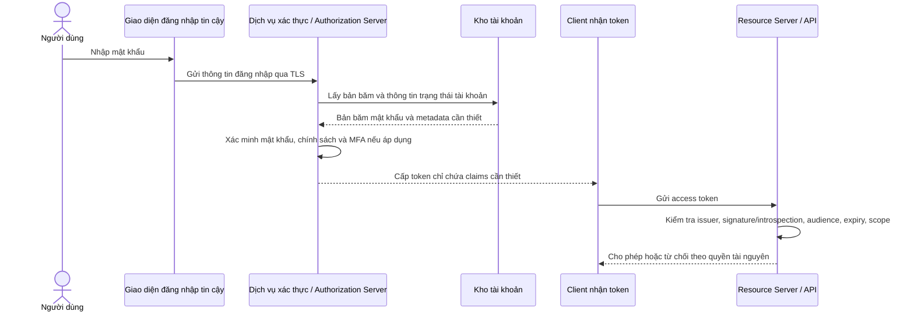
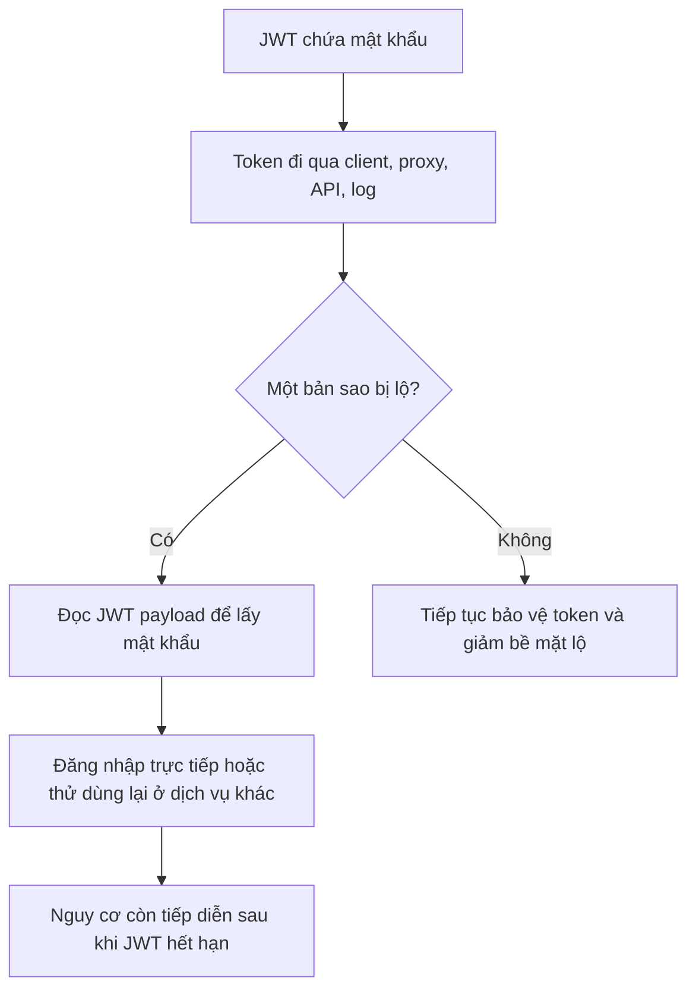

# Mật khẩu không được đặt trực tiếp trong token

Trong hệ thống xác thực, **mật khẩu** và **token** có nhiệm vụ khác nhau. Mật khẩu là bí mật người dùng dùng để chứng minh quyền kiểm soát tài khoản ở bước đăng nhập; token là bằng chứng do hệ thống tin cậy phát hành để một thành phần khác kiểm tra phiên đăng nhập hoặc quyền truy cập trong một phạm vi và thời gian nhất định. Vì thế, **không đặt mật khẩu của người dùng vào token**, dù token là JWT, opaque token, access token, refresh token hay ID token.

Quy tắc này thuộc nền tảng của **SECURITY_TOKEN_SECURITY_FUNDAMENTALS**: hiểu mô hình tin cậy và vòng đời token; phân biệt các loại token trong xác thực, phân quyền, OAuth 2.0/OIDC; kiểm tra claims, scope, audience; bảo vệ lưu trữ, thu hồi và chống token bị đánh cắp hoặc phát lại. Bài học tập trung vào một quyết định thiết kế rất cụ thể: **mật khẩu phải dừng lại ở ranh giới xác thực, không trở thành dữ liệu được đóng gói và phát tán cùng token**.

## 1. Mục tiêu học tập

Sau bài này, bạn có thể:

1. Giải thích vì sao JWT ký số không giúp giấu mật khẩu và vì sao token bị lộ gây hậu quả nghiêm trọng hơn khi chứa mật khẩu.
2. Phân biệt mật khẩu, bản băm mật khẩu, access token, refresh token và ID token; chỉ ra vì sao không được dùng các giá trị này thay cho nhau.
3. Mô tả đúng nơi mật khẩu được thu thập, kiểm tra và nơi token được phát hành trong một luồng đăng nhập an toàn.
4. Thiết kế payload JWT theo **danh sách claims được phép** thay vì sao chép toàn bộ đối tượng người dùng.
5. Viết các bài kiểm tra ngăn mật khẩu và bí mật xác thực bị đưa vào token, log, URL hoặc phản hồi API.
6. Đề xuất cách ứng phó nếu phát hiện token đã phát hành chứa mật khẩu hoặc giá trị tương đương.

## 2. Hai bí mật khác nhau trong mô hình xác thực

### 2.1. Mật khẩu được dùng để xác minh danh tính

Người dùng nhập mật khẩu vào giao diện đăng nhập **đáng tin cậy** và gửi qua HTTPS/TLS đến thành phần chịu trách nhiệm xác thực. Hệ thống so khớp mật khẩu được cung cấp với **bản băm mật khẩu đã lưu** bằng thuật toán dành riêng cho mật khẩu, ví dụ Argon2id hoặc cơ chế phù hợp như bcrypt/PBKDF2 khi có ràng buộc tương thích. Bản băm cần được tạo với salt riêng theo cơ chế của thuật toán, cấu hình chi phí tính toán thích hợp; không lưu mật khẩu nguyên văn.

Sau khi xác thực thành công, hệ thống có thể tạo phiên đăng nhập hoặc cấp token. **Bước phát hành token không cần chép mật khẩu vào token**: điều cần thiết là xác lập chủ thể, loại token, quyền hạn, bên nhận và thời hạn.

Ví dụ trong ứng dụng nội bộ:

- Người dùng biết mật khẩu tài khoản `an@example.test`.
- Máy chủ xác thực kiểm tra mật khẩu với bản băm đã lưu.
- Hệ thống cấp access token có chủ thể `user-42`, audience `orders-api` và scope `orders:read`.
- API đơn hàng kiểm tra token rồi áp dụng chính sách phân quyền trên đơn hàng được yêu cầu; **API này không cần và không được nhận mật khẩu**.

### 2.2. Token là thông tin được cấp có điều kiện

| Giá trị | Công dụng | Bên thường được quyền nhận | Có nên đưa vào claims của token khác? |
| --- | --- | --- | --- |
| **Mật khẩu nguyên văn** | Chứng minh quyền kiểm soát tài khoản ở bước đăng nhập | Chỉ thành phần xác thực đáng tin qua kênh bảo vệ | **Không** |
| **Bản băm mật khẩu** | Máy chủ xác minh mật khẩu đã nhập | Kho định danh và dịch vụ xác thực có quyền hạn | **Không** |
| **Mã OTP, recovery code** | Bằng chứng xác thực bổ sung hoặc khôi phục | Thành phần xác thực phù hợp trong thời gian cần thiết | **Không** |
| **Access token** | Client dùng để gọi resource server/API trong phạm vi đã cấp | Client được cấp và API đúng audience | Không nhúng nguyên access token khác vào claims |
| **Refresh token** | Client xin access token mới tại token endpoint | Client được cấp và authorization server | Không nhúng vào access/ID token |
| **ID token (OIDC)** | OIDC client xác minh kết quả đăng nhập | OIDC client đúng audience | Không dùng thay access token cho API |

Với bearer token, bên nắm giữ token có thể xuất trình nó để truy cập API trong phạm vi token còn hiệu lực. Điều này làm token cũng là **bí mật cần bảo vệ**, nhưng **không biến token thành nơi lưu mật khẩu**. Hai loại bí mật có vòng đời, người nhận và cách thu hồi khác nhau.

## 3. Vì sao mật khẩu không được xuất hiện trong JWT?

### 3.1. JWT ký số có thể bị đọc payload

JWT thường được triển khai dưới dạng JWS với cấu trúc:

```text
BASE64URL(header).BASE64URL(payload).BASE64URL(signature)
```

Đối với dạng JWT ký số phổ biến này:

- **Header** mô tả thông tin phục vụ kiểm tra chữ ký như thuật toán và định danh khóa.
- **Payload** chứa các claims như `iss`, `sub`, `aud`, `exp` và `scope`.
- **Signature** bảo vệ tính toàn vẹn và giúp kiểm chứng token có được ký bởi bên tin cậy hay không.

**Base64URL là cách mã hóa dữ liệu thành chuỗi ký tự, không phải mã hóa bảo mật.** Người có chuỗi JWS có thể giải mã phần header và payload để đọc các claims, dù không có khóa ký. Việc xác minh chữ ký là bước khác, bắt buộc trước khi tin vào dữ liệu.

Ví dụ **payload sai về thiết kế**, chỉ để minh họa lỗi, tuyệt đối không phát hành:

```json
{
  "iss": "https://auth.example.test",
  "sub": "user-42",
  "aud": "orders-api",
  "password": "MAT_KHAU_GIA_DINH_KHONG_DUOC_DUA_VAO_TOKEN",
  "passwordHash": "BAN_BAM_GIA_DINH_KHONG_DUOC_DUA_VAO_TOKEN",
  "scope": "orders:read",
  "exp": 1800000900
}
```

Nếu JWT này xuất hiện trong log của proxy hoặc bị JavaScript độc hại đọc được, kẻ tấn công không chỉ có một access token mà còn có thể có thông tin đăng nhập của người dùng. Token hết hạn **không** làm mất hiệu lực mật khẩu bị lộ.

### 3.2. Chữ ký hợp lệ không làm bí mật trở nên kín

Một nhầm lẫn thường gặp là “JWT có chữ ký nên người ngoài không đọc được”. Chữ ký số giải quyết câu hỏi **token có bị sửa và có do bên ký đáng tin phát hành không?**; nó không giải quyết câu hỏi **ai có thể nhìn thấy nội dung?**.

Một nhầm lẫn khác là “chỉ HTTPS mới đọc được token nên có thể để mật khẩu trong đó”. TLS bảo vệ dữ liệu trên đường truyền, nhưng token có thể được lưu hoặc đi qua những thành phần ngoài thiết bị phát hành: trình duyệt, máy chủ ứng dụng, API gateway, reverse proxy, hệ thống quan sát, công cụ hỗ trợ, sao lưu và bản dump bộ nhớ.

### 3.3. Nếu dùng JWT mã hóa (JWE) thì sao?

JWE có thể bảo vệ tính bí mật của nội dung đối với những bên không có khóa giải mã. Tuy nhiên, **điều đó vẫn không phải lý do để đưa mật khẩu vào token**:

1. Bên nhận được quyền giải mã token sẽ thấy mật khẩu, dù thông thường họ chỉ cần biết quyền truy cập.
2. Mật khẩu bị sao chép sang nhiều hệ thống hơn, làm tăng phạm vi hậu quả khi máy chủ, khóa hoặc log bị xâm nhập.
3. Mật khẩu không tuân theo vòng đời ngắn của access token; thu hồi token không tự đổi mật khẩu.
4. Việc đưa mật khẩu vào JWE không thêm giá trị xác thực hoặc phân quyền mà các claims tối thiểu không thể cung cấp.

**Opaque token cũng không phải ngoại lệ.** Dù client không giải nghĩa được chuỗi opaque, không dùng mật khẩu làm giá trị token, không nhúng mật khẩu vào metadata đi kèm và không trả mật khẩu qua introspection.

## 4. Ranh giới đúng: mật khẩu dừng tại nơi xác thực

### 4.1. Luồng tổng quát khi đăng nhập



Sơ đồ thể hiện **ranh giới dữ liệu**: mật khẩu chỉ cần tồn tại trong tương tác xác thực; token được sinh **sau** khi hệ thống đã kiểm chứng thông tin đăng nhập. Không có mũi tên truyền mật khẩu từ authorization server đến resource server.

Trong **OAuth 2.0/OIDC Authorization Code + PKCE**, ứng dụng client thường chuyển hướng người dùng đến giao diện của nhà cung cấp danh tính. Người dùng nhập mật khẩu trực tiếp với nhà cung cấp đó; ứng dụng client nhận **authorization code**, đổi code lấy token theo luồng giao thức, và không cần đọc mật khẩu. Nếu ứng dụng tự quản lý giao diện đăng nhập, phải xác định rõ thành phần nào được tin cậy để nhận mật khẩu và tránh chuyển tiếp sang các API nghiệp vụ.

Không dùng **Resource Owner Password Credentials grant** làm phương án mặc định cho ứng dụng mới. Cách thiết kế hiện đại nên ưu tiên luồng ủy quyền có chuyển hướng cùng PKCE phù hợp với loại client.

### 4.2. Bản băm mật khẩu cũng không được đặt vào token

Bản băm mật khẩu **không phải mật khẩu nguyên văn**, nhưng vẫn là dữ liệu xác thực nhạy cảm. Nếu bị lộ, bản băm có thể bị thử đoán mật khẩu ngoại tuyến; mức độ khó tùy thuật toán, cost, độ mạnh của mật khẩu và cách triển khai. Đưa bản băm vào JWT còn làm lộ dữ liệu vốn chỉ cần ở kho xác thực.

Sai lầm cần tránh:

```java
// SAI: serializing toàn bộ entity ra claims sẽ đưa cả passwordHash ra token.
Map<String, Object> claims = objectMapper.convertValue(
    userEntity,
    new TypeReference<Map<String, Object>>() {}
);
String jwt = jwtSigner.sign(claims);
```

Đặc biệt, việc đổi tên trường `password` thành `credential`, `secret`, `pwd` hoặc `hash` **không** làm dữ liệu an toàn. Cần kiểm soát theo **bản chất giá trị** chứ không chỉ tìm một tên trường cụ thể.

## 5. Thiết kế payload token đúng mục đích

### 5.1. Chỉ chứa claims phục vụ bên nhận

Một access token tự chứa dành cho API đơn hàng có thể có payload **minh họa**:

```json
{
  "iss": "https://auth.example.test",
  "sub": "user-42",
  "aud": "orders-api",
  "iat": 1800000000,
  "exp": 1800000900,
  "jti": "example-token-id-01",
  "scope": "orders:read"
}
```

Các timestamp và định danh trên chỉ là ví dụ, không phải token có thể sử dụng. Ý nghĩa của từng claim:

| Claim | Ý nghĩa | Lý do có thể cần |
| --- | --- | --- |
| `iss` | Issuer | API chỉ chấp nhận token của nơi phát hành tin cậy |
| `sub` | Subject | Xác định chủ thể theo định danh ổn định phù hợp mô hình |
| `aud` | Audience | Tránh dùng token được cấp cho API khác |
| `iat` | Issued at | Hỗ trợ chính sách về thời điểm phát hành |
| `exp` | Expiration | Giới hạn thời gian token được chấp nhận |
| `jti` | Token ID | Có thể hỗ trợ chống phát lại hoặc thu hồi theo cơ chế riêng |
| `scope` | Phạm vi quyền | Kiểm tra thao tác được phép tại API |

Phụ thuộc token profile, có thể cần các claims khác như `nbf`, `client_id` hoặc `typ`. Không phải cứ thêm nhiều claims là an toàn hơn; ưu tiên **tối thiểu hóa dữ liệu** theo hợp đồng giữa authorization server và resource server.

Ngay cả khi có `scope = orders:read`, API vẫn phải kiểm tra người gọi được phép xem **đơn hàng cụ thể** hay không. Token ghi nhận quyền đã được cấp; nó không thay thế hoàn toàn chính sách phân quyền đối với tài nguyên.

### 5.2. Không nhầm các loại token

| Loại token | Dùng để làm gì? | Điều cần tránh |
| --- | --- | --- |
| **JWT access token** | Trình cho API, API xác minh chữ ký và claims theo profile | Đặt mật khẩu, password hash, OTP, refresh token vào payload |
| **Opaque access token** | Trình cho API, thông tin/hiệu lực có thể được tra qua introspection | Dùng chính mật khẩu làm chuỗi token hoặc trả bí mật qua metadata |
| **Refresh token** | Đổi lấy access token mới tại authorization server | Đặt mật khẩu vào token, ghi token vào log hoặc gửi token cho API nghiệp vụ |
| **ID token** | OIDC client kiểm tra xác thực người dùng | Chứa mật khẩu hoặc dùng ID token làm quyền gọi API |

ID token có thể có một số claims về **sự kiện xác thực**, ví dụ `auth_time` hoặc `amr` theo OIDC, nhưng chúng mô tả **khi nào/bằng phương thức nào đã xác thực**, không chứa chính mật khẩu hay mã OTP đã được nhập.

## 6. Minh họa với mã Java: phát hành token theo danh sách cho phép

Ví dụ sau minh họa **nguyên tắc tách quá trình xác minh mật khẩu khỏi phát hành claims**, không phải mã đầy đủ để đưa thẳng vào production. Các kiểu như `AccountRepository`, `TokenIssuer` và `InvalidCredentialsException` được giả định đã tồn tại.

```java
public TokenResponse signIn(LoginRequest request) {
    // Bước 1: đọc bản băm ở ranh giới xác thực.
    Account account = accountRepository.findByUsername(request.username())
        .orElseThrow(InvalidCredentialsException::new);

    // Bước 2: xác minh bằng password encoder dành cho mật khẩu.
    // Không so sánh chuỗi mật khẩu nguyên văn với cột passwordHash.
    boolean valid = passwordEncoder.matches(
        request.password(),
        account.passwordHash()
    );
    if (!valid || !account.isEnabled()) {
        throw new InvalidCredentialsException();
    }

    // Bước 3: cấp token từ ID, audience, scope đã được phê duyệt.
    // TokenIssuer chịu trách nhiệm iss, exp, ký số và chính sách token.
    String accessToken = tokenIssuer.issueAccessToken(
        account.publicId(),
        "orders-api",
        Set.of("orders:read")
    );
    return new TokenResponse(accessToken, "Bearer");
}
```

Điểm đáng chú ý:

- `passwordEncoder.matches(... )` chỉ dùng mật khẩu ở bước xác minh với bản băm trong dịch vụ xác thực.
- Token issuer nhận **định danh công khai**, audience và scope đã được phê duyệt; nó **không nhận** mật khẩu, `Account` entity hay `passwordHash`.
- Các quyền được gán phải xuất phát từ chính sách ủy quyền thực tế, không chỉ từ giá trị client tự gửi.
- Trong ứng dụng OAuth/OIDC, trách nhiệm xác minh mật khẩu và cấp token thường thuộc authorization server; ứng dụng nghiệp vụ không nên tự xây lại giao thức đăng nhập nếu có nhà cung cấp danh tính phù hợp.

Thiết kế tốt hơn cả ở mức API nội bộ là **không cho phép token issuer nhận đối tượng người dùng đầy đủ**:

```java
// TỐT: các tham số tập trung vào claims được phép.
String issueAccessToken(
    String subjectId,
    String audience,
    Set<String> approvedScopes
);

// TRÁNH: rủi ro sao chép dữ liệu không cần thiết vào token.
String issueAccessToken(AccountEntity everythingAboutUser);
```

Trong triển khai thực tế, dùng thư viện JWT/OAuth/OIDC đã được kiểm chứng; cấu hình thuật toán, quản lý khóa và kiểm tra claims đúng chuẩn. Không tự xây thuật toán ký số chỉ để giải quyết vấn đề giới hạn claims.

## 7. Nguy cơ thực tế khi một token chứa mật khẩu

Giả sử hệ thống phát hành JWT access token chứa `password`, hiệu lực 15 phút. Một ứng dụng web vô tình ghi header `Authorization` vào hệ thống log.



| Đường rò rỉ | Khi token chỉ có claims tối thiểu | Khi token chứa mật khẩu |
| --- | --- | --- |
| Token bị lấy qua XSS | Có thể bị lạm dụng trong audience/scope và thời gian còn hạn | Ngoài lạm dụng token, kẻ tấn công còn có thể dùng mật khẩu để đăng nhập mới |
| Log proxy/API bị đọc trái phép | Token cần được thu hồi/giới hạn theo vòng đời | Mật khẩu bị lộ cho người có quyền đọc log; có thể phải đặt lại |
| Token bị gửi nhầm sang dịch vụ thứ ba | Làm lộ token được cấp cho audience cụ thể | Mang cả bí mật tài khoản sang một ranh giới không đáng tin |
| Bản sao tồn tại trong backup | Bản sao token vẫn cần bảo vệ | Mật khẩu có thể bị lộ lâu sau khi token hết hiệu lực |
| Người dùng tái sử dụng mật khẩu | Sự cố token giới hạn theo quyền/token nếu kiểm soát đúng | Nguy cơ ảnh hưởng cả hệ thống khác không dùng chung token |

Nguy cơ **dùng lại mật khẩu** là điểm khác biệt quan trọng: một access token được thiết kế để giới hạn bởi `aud`, `scope` và `exp`; mật khẩu bị lộ có thể cho phép tạo các phiên hoặc token mới và ảnh hưởng đến nhiều dịch vụ nơi người dùng sử dụng cùng mật khẩu.

## 8. Các quy tắc phòng ngừa từ lúc nhận mật khẩu đến lúc dùng token

### 8.1. Tại giao diện và endpoint đăng nhập

- Chỉ nhận mật khẩu tại endpoint xác thực được thiết kế cho việc đó, qua **HTTPS/TLS**. Không đặt mật khẩu trong query string, URL redirect hay fragment.
- Không lưu mật khẩu nguyên văn trong cơ sở dữ liệu, localStorage, sessionStorage, analytics, log hoặc nội dung thông báo lỗi.
- Không hiển thị mật khẩu trong thông báo từ server. Thông điệp lỗi đăng nhập nên có chính sách tránh xác nhận tài khoản có tồn tại hay không.
- Kiểm soát tốc độ thử đăng nhập, theo dõi bất thường và sử dụng MFA theo mức rủi ro. Những biện pháp này bổ sung cho việc không nhúng mật khẩu vào token.
- Sau xác thực, chỉ phát hành phiên/token khi đã đáp ứng điều kiện bảo mật và quyền được cấp.

### 8.2. Tại nơi phát hành token

- **Allowlist claims**: định nghĩa rõ những claim nào được phép và loại dữ liệu tương ứng. Xây payload từ DTO chuyên dụng hoặc tham số tường minh.
- **Không serialize nguyên entity** (user, credential, account, profile, authentication request) vào payload.
- **Không cho phép claim tùy ý** do request của client quyết định; yêu cầu scope phải được authorization server xét và giới hạn.
- Giữ token **ngắn hạn, đúng audience, đủ scope tối thiểu**; không đưa dữ liệu cá nhân hoặc bí mật không cần thiết vào token.
- Nếu phải thêm custom claim, xem lại ai có thể nhận và đọc nó. Không giả định chữ ký số sẽ giấu claim.
- Việc thay đổi mật khẩu phải có chính sách riêng đối với session, refresh token và access token đang còn hạn.

Một cấu hình có kiểm soát có thể dùng các tên claim như:

```text
ALLOW:
  iss, sub, aud, exp, iat, nbf, jti, scope, client_id
  + custom claims đã được duyệt theo token profile

DENY AS TOKEN CONTENT:
  password, passwordHash, credentialHash, otp, recoveryCode
  rawAuthenticationRequest, clientSecret, refreshToken, privateKey
```

Danh sách **DENY** có ích cho kiểm tra tự động, nhưng **không được xem là đủ** vì cùng một bí mật có thể xuất hiện dưới tên trường khác. Quy tắc gốc là API phát hành token không có cách tiếp cận dữ liệu bí mật không cần cho claims.

### 8.3. Tại client và resource server

- Chỉ gửi access token đến API đúng audience, ưu tiên header `Authorization: Bearer ...`, không đưa token vào URL hoặc log.
- Xác minh chữ ký JWT bằng thuật toán và khóa được cấu hình tin cậy; hoặc xác minh opaque token qua cơ chế introspection phù hợp.
- Kiểm tra `iss`, `aud`, `exp`, `nbf` khi áp dụng, token type, scope và quyền với đối tượng cụ thể. **Không cần mật khẩu** để thực hiện các bước này.
- Bảo vệ token trong bộ nhớ/cookie/kho bí mật theo kiến trúc. Với web, mô hình Backend for Frontend có thể giữ access/refresh token ở backend, dùng cookie phiên `HttpOnly`, `Secure` và `SameSite` phù hợp, kèm bảo vệ CSRF/XSS.
- Khi API trả lỗi, chỉ trả mã/trạng thái hợp lý; không trả lại toàn bộ token, payload nhạy cảm hay giá trị credential trong phản hồi.

### 8.4. Bài học về vòng đời token

Việc **đổi mật khẩu**, **thu hồi refresh token**, **đăng xuất** và **làm hết hiệu lực access token** là những thao tác liên quan nhưng **không tự động đồng nghĩa**. Ví dụ JWT access token tự chứa có thể vẫn được API chấp nhận đến `exp` nếu API chỉ kiểm tra chữ ký và thời gian, chưa có denylist, phiên bản phiên hoặc tra cứu trạng thái thu hồi.

Vì vậy, hệ thống cần quy định rõ khi đổi mật khẩu hoặc phát hiện tài khoản bị xâm nhập thì thu hồi những phiên và refresh token nào, và API sẽ chặn access token còn hạn như thế nào. **Không thể sửa lỗi đưa mật khẩu vào JWT chỉ bằng cách rút ngắn `exp`**: mật khẩu đã lộ vẫn cần xử lý riêng.

## 9. Thiết kế kiểm thử ngăn lọt mật khẩu vào token

Thay vì chỉ kiểm tra token có được ký thành công không, hãy kiểm tra cả **nội dung được phép phát hành**.

| Kiểm thử | Input/tình huống | Kết quả mong đợi |
| --- | --- | --- |
| Đăng nhập đúng | Username và password hợp lệ | Token được phát hành nhưng không chứa mật khẩu hoặc hash |
| Mật khẩu sai | Credential không đúng | Không cấp token; không ghi mật khẩu vào log |
| Đổi mật khẩu | Người dùng thay mật khẩu | Token mới không chứa mật khẩu cũ/mới; áp dụng chính sách phiên/thu hồi |
| Bổ sung trường cho entity | Entity có thêm `passwordHash`, `recoveryCode` | Payload không thay đổi ngoài claims được duyệt |
| Client tự thêm claim | Client gửi `scope` vượt quyền hoặc `password` trong input | Server không phản chiếu claim/bí mật tùy ý |
| Truy cập sai audience | Token cho `orders-api` gọi `billing-api` | API từ chối dù JWT có chữ ký hợp lệ |
| Token hết hạn | `exp` đã qua | API từ chối; không yêu cầu người dùng gửi lại mật khẩu cho API |
| Token lộ trong log | Log request lỗi/trace | Giá trị `Authorization`, token, password được loại bỏ hoặc che theo chính sách |
| Refresh token bị dùng lại | Rotation đã cấp token mới | Nhận diện reuse và ứng phó theo thiết kế |

### 9.1. Kiểm tra tự động ở lớp phát hành

Ví dụ mã giả cho một bài test hợp đồng:

```java
@Test
void accessTokenMustNotExposeAuthenticationSecrets() {
    LoginRequest request = new LoginRequest(
        "an@example.test",
        "TEST_PASSWORD_NOT_FOR_REAL_USE"
    );

    TokenResponse response = loginService.signIn(request);
    Map<String, Object> claims = verifiedJwtDecoder.decodeAndVerify(
        response.accessToken()
    );

    assertThat(claims).containsKeys("iss", "sub", "aud", "exp");
    assertThat(claims).doesNotContainKeys(
        "password",
        "passwordHash",
        "otp",
        "recoveryCode",
        "clientSecret",
        "refreshToken"
    );
    assertThat(claims.values().toString())
        .doesNotContain("TEST_PASSWORD_NOT_FOR_REAL_USE");
}
```

Mã này chỉ minh họa ý tưởng, không phải test chạy độc lập: các thành phần `loginService`, `verifiedJwtDecoder` và framework assertion phải được cung cấp từ dự án. Test theo tên trường vẫn cần kết hợp **kiểm tra allowlist**, vì một trường được đặt tên khác có thể giữ cùng bí mật. Với opaque token, kiểm tra dữ liệu introspection và nơi lưu metadata của token thay vì cố “giải mã” chuỗi opaque.

### 9.2. Kiểm tra thủ công để hiểu JWT

Có thể giải mã payload của **JWT giả lập** để quan sát claims; thao tác decode không chứng minh chữ ký hợp lệ và không cho phép dùng các claims để quyết định phân quyền. **Không dán token thật vào website giải mã công khai**; dùng công cụ chạy cục bộ với dữ liệu thử nghiệm, và luôn tránh tiết lộ token hoặc bí mật.

Một câu hỏi hữu ích khi xem payload: “Nếu đưa toàn bộ JSON này cho một người không có quyền truy cập hệ thống, liệu có thông tin đăng nhập, dữ liệu nhạy cảm hoặc quyền không cần thiết bị lộ không?” Nếu câu trả lời là có, cần xem lại thiết kế claims.

## 10. Ứng phó khi phát hiện token đã chứa mật khẩu

Nếu kiểm tra cho thấy hệ thống đã phát hành token chứa mật khẩu hoặc bản băm mật khẩu, đây là **sự cố lộ dữ liệu xác thực tiềm tàng**. Cần điều tra phạm vi phát tán, không chỉ sửa đoạn code sinh token:

1. **Ngăn phát hành tiếp**: sửa code phát hành sang danh sách claims cho phép; kiểm tra các luồng cấp mới, refresh, đăng nhập trên web và mobile.
2. **Khoanh vùng**: xác định khoảng thời gian phát hành, loại token, đối tượng nhận, vị trí lưu và những hệ thống có thể đã ghi token (gateway, API, APM, logs, analytics, backup).
3. **Bảo vệ tài khoản**: đánh giá việc bắt buộc đặt lại mật khẩu cho tài khoản bị ảnh hưởng, thu hồi session/refresh token và áp dụng biện pháp xác thực bổ sung theo chính sách sự cố.
4. **Xử lý token đã phát**: kiểm tra thời gian hiệu lực và khả năng thu hồi access token, kể cả JWT tự chứa; cân nhắc denylist/thu hồi theo phiên hoặc biện pháp khẩn cấp tương ứng.
5. **Hạn chế bản sao**: giảm quyền truy cập bản log/backup chứa token, quản lý xóa hoặc lưu giữ phục vụ điều tra theo chính sách; không sao chép token bị lộ vào báo cáo/ticket.
6. **Giám sát và xác minh**: theo dõi đăng nhập bất thường, hành vi refresh, truy cập API sai audience hoặc đổi quyền; bổ sung test hồi quy để lỗi không tái diễn.

Nếu mật khẩu thật đã được nhúng vào token, **thu hồi token không thể tự làm mật khẩu cũ trở nên vô dụng**. Cần xử lý chính mật khẩu và các phiên/tài khoản liên quan. Nếu chỉ lộ bản băm, đánh giá loại hash, thông số cost và khả năng tấn công ngoại tuyến để quyết định biện pháp ứng phó phù hợp.

## 11. Bài thực hành

### Bài A — Tìm lỗi trong payload

Giả sử authorization server định cấp JWT cho API báo cáo với payload:

```json
{
  "sub": "user-99",
  "aud": "report-api",
  "role": "analyst",
  "password": "EXAMPLE_NOT_A_REAL_PASSWORD",
  "passwordResetCode": "EXAMPLE_NOT_A_REAL_CODE",
  "exp": 1800000900
}
```

Hãy:

1. Chỉ ra những trường phải loại khỏi token ngay.
2. Đề xuất cấu trúc claims tối thiểu, bổ sung thông tin kiểm chứng như issuer và scope nếu hợp đồng API cần.
3. Xác định API cần kiểm tra gì ngoài chữ ký để cho phép xem báo cáo.
4. Giải thích vì sao việc chuyển JWT này sang JWE vẫn không hợp lý.

**Gợi ý đáp án:** loại `password` và `passwordResetCode`; xác định `iss`, `sub`, `aud`, `exp`, scope/role theo profile; API kiểm tra issuer, audience, loại token, thời gian, quyền và tài nguyên. JWE không loại bỏ nhu cầu bảo vệ bí mật tại nơi giải mã.

### Bài B — Sửa thiết kế Java

Một hàm phát hành token nhận `AccountEntity` và dùng reflection để đưa tất cả fields vào JWT. Entity chứa `id`, `email`, `passwordHash`, `mfaRecoveryCodes` và `roles`. Hãy thay bằng một token issuer nhận `subjectId`, `audience` và `approvedScopes`. Chỉ ra kiểm thử cần thêm khi `AccountEntity` được mở rộng trong tương lai.

**Tiêu chí đạt:** token issuer không thể truy cập bản băm hoặc recovery code qua tham số đầu vào; test payload chỉ có claims được duyệt; không dựa vào việc cố nhớ thêm `@JsonIgnore` cho từng bí mật mới.

### Bài C — Tình huống sự cố

Một JWT chứa mật khẩu nguyên văn đã bị ghi vào log gateway trong ba ngày. Token có TTL 10 phút. Trả lời:

- Vì sao TTL 10 phút **không đủ** để kết luận tài khoản an toàn?
- Những vị trí nào có thể đang giữ bản sao?
- Cần áp dụng thay đổi gì ở code, log, token/session và tài khoản bị ảnh hưởng?

**Tiêu chí đạt:** nhận diện nguy cơ mật khẩu vẫn dùng được sau `exp`, rà soát log/backup, ngăn phát hành, xử lý mật khẩu và thu hồi phiên/token theo chính sách, kiểm tra hồi quy.

## 12. Câu hỏi tự kiểm tra

**1. JWT có chữ ký số thì payload có được mã hóa và giữ bí mật không?** Không. JWT dạng JWS ký số thông thường chỉ mã hóa Base64URL phần payload; có thể đọc được nếu sở hữu chuỗi token.

**2. Nếu không đặt mật khẩu nguyên văn, có thể đặt `passwordHash` vào token không?** Không. Bản băm mật khẩu vẫn là dữ liệu xác thực nhạy cảm, có thể bị khai thác và không cần thiết cho API.

**3. API có cần biết mật khẩu để xác minh access token không?** Không. API dùng chữ ký/khóa và claims đã xác minh hoặc introspection, sau đó kiểm tra scope và chính sách phân quyền.

**4. ID token OIDC có nên chứa mật khẩu để chứng minh người dùng đã đăng nhập không?** Không. ID token ghi nhận kết quả xác thực bằng claims theo quy tắc OIDC, không chuyển mật khẩu cho client.

**5. JWT được mã hóa bằng JWE thì có thể đặt mật khẩu vào đó không?** Về mặt kỹ thuật có thể mang dữ liệu, nhưng **thiết kế bảo mật không nên làm vậy**: bên giải mã vẫn thấy mật khẩu, tăng số nơi dữ liệu tồn tại và không mang lại lợi ích phân quyền.

**6. Đổi mật khẩu có làm JWT đã cấp hết hiệu lực ngay lập tức không?** Không mặc định. Cần có chính sách session/refresh token và cơ chế thu hồi/kiểm tra bổ sung cho JWT còn hạn.

**7. Cách bền vững nhất để ngăn trường `passwordHash` lọt vào JWT khi entity thay đổi là gì?** Thiết kế token issuer bằng tham số/DTO claims được phép, kiểm tra hợp đồng token và không serialize toàn bộ entity.

## 13. Checklist trước khi triển khai

- [ ] Mật khẩu được nhận **chỉ** tại điểm xác thực tin cậy qua TLS, không có trong URL, log hoặc telemetry.
- [ ] Kho tài khoản lưu bản băm mật khẩu bằng thuật toán phù hợp và không để các dịch vụ nghiệp vụ đọc bản băm nếu không cần.
- [ ] Token issuer chỉ nhận ID, audience và quyền đã được duyệt; **không nhận đối tượng credential đầy đủ**.
- [ ] JWT/opaque metadata, access token, refresh token và ID token **không chứa mật khẩu, bản băm, OTP, recovery code hoặc client secret**.
- [ ] Payload JWT có các claims cần thiết cho xác minh, không chứa dữ liệu không phục vụ bên nhận.
- [ ] Các API xác minh đúng issuer, audience, thời hạn, loại token, scope và quyền trên tài nguyên.
- [ ] Token không xuất hiện nguyên dạng trong log, URL hoặc công cụ phân tích; test có kiểm tra dữ liệu nhạy cảm.
- [ ] Đăng xuất, đổi mật khẩu, thu hồi refresh token và vô hiệu hóa access token đã có chính sách rõ ràng.
- [ ] Có cách xác định phạm vi, ngăn phát hành, thu hồi, xử lý credential và giám sát khi phát hiện token chứa bí mật.

**Quy tắc cần nhớ:** mật khẩu được dùng để **đăng nhập và kiểm tra tại nơi xác thực**; token chỉ mang **bằng chứng và quyền cần thiết cho bên nhận**. Một token thiết kế tốt phải tiếp tục có ý nghĩa ngay cả khi **không có bất kỳ trường mật khẩu hoặc bản băm mật khẩu nào**.
