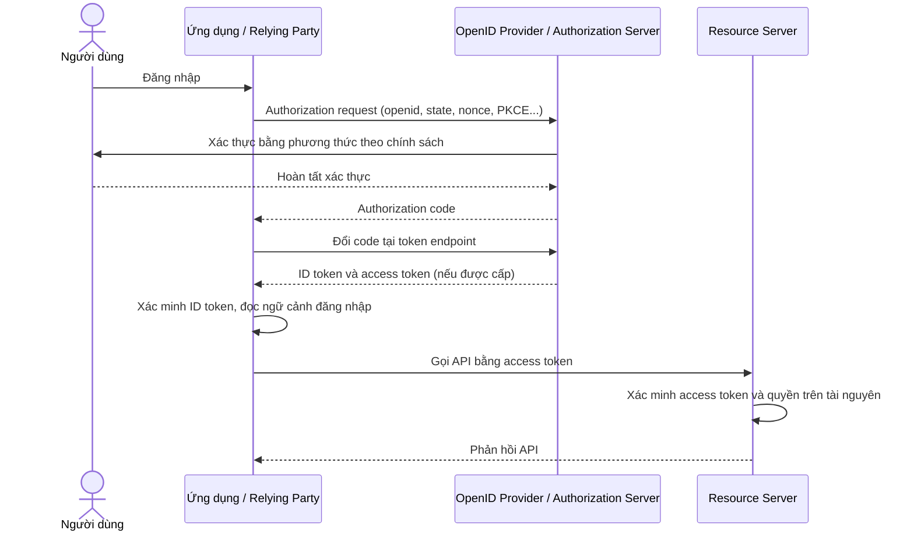

# Authentication context trong identity token

Trong hệ thống sử dụng OpenID Connect (OIDC), sau khi người dùng đăng nhập, ứng dụng có thể nhận được một **ID token** (còn gọi là *identity token*). ID token không chỉ giúp ứng dụng xác định **ai đã được xác thực**, mà tùy cấu hình còn cung cấp **ngữ cảnh xác thực** (*authentication context*): người dùng đã đăng nhập khi nào, theo lớp bảo đảm nào và bằng các phương thức nào.

Ngữ cảnh này đặc biệt quan trọng với thao tác nhạy cảm, chẳng hạn thay đổi mật khẩu, chuyển tiền, quản lý khóa API hoặc sửa cấu hình bảo mật. Một người dùng có phiên đăng nhập hợp lệ từ nhiều giờ trước có thể cần xác thực lại trước khi thực hiện thao tác có rủi ro cao. Tài liệu này giải thích cách đọc và sử dụng thông tin đó theo ranh giới tin cậy của OAuth 2.0/OIDC, đồng thời phân biệt nó với quyền truy cập API do access token đại diện.

## 1. ID token là gì và ai tin nó?

OIDC là lớp định danh xây dựng trên OAuth 2.0. Trong một luồng OIDC hợp lệ, **OpenID Provider (OP)**, thường cũng đóng vai trò **authorization server**, phát hành ID token cho **Relying Party (RP)**, tức ứng dụng client, để trình bày kết quả xác thực người dùng.

ID token thường là JWT được ký. Một JWT có ba phần mã hóa Base64URL, nhưng **giải mã để xem claim không đồng nghĩa với xác minh token**. Chỉ sau khi kiểm tra chữ ký, issuer, audience, thời hạn và các ràng buộc OIDC tương ứng, RP mới có thể sử dụng claim làm cơ sở cho quyết định bảo mật.



| Token hoặc bằng chứng | Chức năng | Bên nhận và kiểm tra |
| --- | --- | --- |
| **ID token** | Chứng minh sự kiện xác thực người dùng và cung cấp các claim OIDC cho RP | **RP/client** có `client_id` nằm trong `aud` |
| **Access token** | Biểu diễn quyền truy cập đến tài nguyên/API được cấp | **Resource server** có audience/resource phù hợp |
| **Refresh token** | Cho client xin token mới theo chính sách AS | **Authorization server**, không phải API nghiệp vụ |
| **Session cookie của RP** | Duy trì phiên của người dùng với chính ứng dụng | Backend/session handler của RP theo chính sách cookie và phiên |

**Không gửi ID token như bearer access token đến resource server.** Dù ID token có chữ ký hợp lệ, token đó được phát hành cho client, với mục đích chứng thực sự kiện đăng nhập. Resource server chỉ nên chấp nhận access token dành cho chính nó và thực hiện kiểm tra phân quyền riêng.

## 2. Authentication context là những thông tin nào?

Trong OIDC, ngữ cảnh xác thực thường được diễn tả qua ba claim:

- **`auth_time`**: thời điểm người dùng được xác thực tại OP, tính theo giây Unix Epoch; giúp xác định xác thực gần đây đến đâu.
- **`acr`** (*Authentication Context Class Reference*): tên một **lớp ngữ cảnh xác thực**, thể hiện mức hoặc kiểu bảo đảm theo hợp đồng giữa các bên.
- **`amr`** (*Authentication Methods References*): danh sách các phương thức được sử dụng trong sự kiện xác thực, chẳng hạn mật khẩu và mã OTP.

Các claim đó **không tự động xuất hiện ở mọi ID token**. `auth_time` được yêu cầu khi client gửi tham số `max_age` trong yêu cầu xác thực; `acr` và `amr` là các claim tùy chọn trong OIDC Core, có thể phải yêu cầu rõ và còn phụ thuộc khả năng, chính sách của OP.

### 2.1. Ví dụ payload ID token

Đây là **payload minh họa**, chưa phải ID token được ký thật và không dùng để gửi API:

```json
{
  "iss": "https://login.example.test",
  "sub": "pseudonymous-user-7f8a",
  "aud": "orders-web",
  "exp": 1795395600,
  "iat": 1795392000,
  "auth_time": 1795391760,
  "acr": "urn:example:assurance:two-factor",
  "amr": ["pwd", "otp"],
  "nonce": "random-request-bound-value"
}
```

Trong ví dụ:

- `iss` là danh tính OP phát hành token; `aud` là RP/client được nhận token (ở đây `orders-web`).
- `sub` định danh chủ thể người dùng trong ngữ cảnh issuer. Cặp **`(iss, sub)`** là khóa định danh đáng tin cậy hơn một email hoặc một tên hiển thị có thể thay đổi; một OP còn có thể cấp `sub` khác nhau cho các client nếu dùng *pairwise subject identifiers*.
- `iat` là lúc ID token được **phát hành**; `auth_time` là lúc người dùng được **xác thực**. Hai thời điểm có thể khác nhau.
- `acr` cho biết lớp ngữ cảnh theo danh mục do các bên thống nhất; URI ở đây **chỉ là ví dụ tự định nghĩa**, không phải chuẩn assurance chung của OIDC.
- `amr` cho biết hệ thống ghi nhận xác thực bằng mật khẩu (`pwd`) và OTP (`otp`).
- `nonce` gắn ID token với yêu cầu xác thực mà RP đã khởi tạo, nếu nonce được gửi trong authorization request.

ID token có thể mang thông tin định danh và ngữ cảnh nhạy cảm; JWT được ký thông thường **không mã hóa payload**. Không ghi nguyên ID token vào log, phân tích hành vi, URL hoặc tài liệu hỗ trợ công khai.

## 3. Phân biệt `auth_time`, `iat` và `exp`

Ba claim này đều là thời gian nhưng trả lời những câu hỏi khác nhau:

| Claim | Ý nghĩa | Có dùng để chứng minh xác thực gần đây không? |
| --- | --- | --- |
| **`auth_time`** | Người dùng được OP xác thực vào thời điểm nào | **Có**, khi được OP phát hành và RP xác minh đúng |
| **`iat`** | Token được tạo tại thời điểm nào | **Không**; token mới không chứng minh người dùng vừa xác thực lại |
| **`exp`** | Token hết hạn khi nào | **Không**; token còn hạn không có nghĩa phiên xác thực còn đủ mới |

Ví dụ: người dùng nhập mật khẩu lúc 08:00. Đến 11:00, nhờ phiên SSO còn hoạt động, OP có thể phát hành ID token mới với `iat=11:00` nhưng `auth_time=08:00`. Khi ứng dụng yêu cầu xác thực trong vòng 5 phút để đổi email khôi phục, phải xét **`auth_time`**, không dùng `iat` của token mới.

Điều kiện phía ứng dụng có thể được diễn giải như sau:

```text
Nếu yêu cầu xác thực trong tối đa 300 giây:
  now - auth_time <= 300 giây (+/- clock skew được kiểm soát)
và auth_time phải đến từ ID token đã xác minh đúng OP/client.
```

Trong thực tế, ứng dụng cũng phải bảo đảm `auth_time` không nằm vô lý ở tương lai; chọn độ lệch đồng hồ cho phép một cách có giới hạn. Khi có thao tác cần bằng chứng xác thực mới tại thời điểm **thực hiện**, ứng dụng phải đánh giá tính mới khi thực thi thao tác, không chỉ kiểm tra một lần lúc đăng nhập.

### Trường hợp dùng `max_age`

Tham số authorization request `max_age=300` yêu cầu OP chỉ tái sử dụng phiên xác thực nếu lần xác thực gần nhất không vượt quá 300 giây; nếu đã quá hạn, OP phải thực hiện xác thực lại theo chính sách. Khi có `max_age`, ID token trả về **phải có `auth_time`** để RP đối chiếu.

```text
GET https://login.example.test/authorize
  ?response_type=code
  &client_id=orders-web
  &redirect_uri=https%3A%2F%2Fapp.example.test%2Fcallback
  &scope=openid
  &state=<random-state>
  &nonce=<random-nonce>
  &code_challenge=<pkce-challenge>
  &code_challenge_method=S256
  &max_age=300
```

Đây là cấu trúc minh họa, không phải một URL có thể chạy ngay: các giá trị phải được sinh ngẫu nhiên, lưu để đối chiếu và mã hóa URL đúng cách. `max_age=0` thường được dùng để yêu cầu người dùng xác thực lại, nhưng **xác thực lại không đồng nghĩa với bắt buộc MFA hoặc phương thức chống phishing**.

`prompt=login` cũng có thể yêu cầu OP hiển thị/tiến hành bước đăng nhập lại, song RP cần dựa vào các bằng chứng xác thực được trả về và hợp đồng với OP để thực thi yêu cầu về tính mới. Không sử dụng trạng thái giao diện «vừa hiện màn hình đăng nhập» làm căn cứ bảo mật.

## 4. `acr`: lớp ngữ cảnh xác thực

**`acr`** là một chuỗi định danh lớp ngữ cảnh. Nó giúp RP diễn đạt yêu cầu kiểu: «thao tác này cần một loại bảo đảm xác thực đã được OP định nghĩa và cam kết». Giá trị ACR có thể là một URL/URN hoặc chuỗi được quy định trong một profile/hợp đồng liên kết định danh.

Giả sử một tổ chức thống nhất hai lớp:

| ACR minh họa | Ý nghĩa được tổ chức quy định | Tình huống sử dụng |
| --- | --- | --- |
| `urn:example:assurance:basic` | Xác thực thông thường theo chính sách nội bộ | Xem thông tin chung |
| `urn:example:assurance:strong` | Đã đạt chính sách xác thực mạnh được mô tả trong hợp đồng OP–RP | Thay khóa API hoặc chuyển tiền |

**Đây là giá trị ví dụ, không có mức mạnh/yếu chuẩn toàn cầu gắn với các tên này.** RP không được giả định rằng một chuỗi chứa `strong` hay `mfa` là bằng chứng chống phishing; phải biết OP đã ánh xạ ACR đó với yêu cầu nào, thời điểm và bằng chứng xác thực ra sao.

### 4.1. Client yêu cầu ACR như thế nào?

OIDC cho phép đưa `acr_values` vào authorization request, ví dụ:

```text
acr_values=urn:example:assurance:strong
```

`acr_values` biểu đạt **các lớp mà client mong muốn**, theo thứ tự ưu tiên. Việc gửi yêu cầu không chứng minh rằng OP đã đáp ứng: RP **phải kiểm tra `acr` thực tế được phát hành**. Với OP hỗ trợ tham số `claims`, client có thể yêu cầu claim trong ID token với yêu cầu `essential`, chẳng hạn:

```json
{
  "id_token": {
    "acr": {
      "essential": true,
      "values": ["urn:example:assurance:strong"]
    },
    "auth_time": {
      "essential": true
    }
  }
}
```

Việc OP hỗ trợ `acr_values`, `claims` và ngữ nghĩa assurance là **vấn đề khả năng tương thích và hợp đồng tích hợp**. Nếu một bước nghiệp vụ bắt buộc ACR mạnh mà ID token thiếu `acr`, trả về lớp khác hoặc OP không thể đáp ứng, RP phải **từ chối hoặc điều hướng sang luồng xác thực phù hợp**; không tự đánh giá đã đạt yêu cầu chỉ vì request đã chứa tham số.

### 4.2. ACR không phải danh sách phương thức

Một lớp ACR có thể phản ánh kết hợp nhiều điều kiện: phương thức xác thực, cách đăng ký yếu tố, chính sách khôi phục, bảo vệ khóa, rủi ro thiết bị, thời điểm xác thực và quy trình xác minh danh tính. Vì vậy, **không thể suy ngược đầy đủ các phương thức chỉ từ giá trị ACR**, trừ khi hợp đồng của OP quy định rõ.

Ngược lại, nhìn thấy hai giá trị trong `amr` cũng không đủ chứng minh một ACR cụ thể đã đạt: hai phương thức có thể không độc lập hoặc không đáp ứng mức bảo đảm mà ứng dụng yêu cầu.

## 5. `amr`: người dùng đã xác thực bằng cách nào?

**`amr`** là mảng các *Authentication Methods References*; chúng mô tả phương thức được OP ghi nhận. Một số mã được đăng ký trong RFC 8176:

| Giá trị AMR | Diễn giải khái quát | Điều cần hiểu đúng |
| --- | --- | --- |
| `pwd` | Mật khẩu | Không nói mật khẩu có đủ mạnh hay có bị phishing không |
| `otp` | Mật khẩu một lần | Chưa nói OTP đến từ ứng dụng, phần cứng hay kênh nào |
| `sms` | Xác thực qua SMS | SMS có các rủi ro riêng, không tự chứng minh chống phishing |
| `hwk` | Bằng chứng liên quan khóa phần cứng | Cần biết cách OP triển khai và kiểm tra ràng buộc khóa |
| `swk` | Bằng chứng liên quan khóa phần mềm | Không đồng nghĩa với khóa được phần cứng bảo vệ |
| `mfa` | Xác thực đa yếu tố | Là tuyên bố về MFA từ OP; cần hiểu chính sách xác định các yếu tố |

Ví dụ `"amr": ["pwd", "otp"]` cho biết OP ghi nhận mật khẩu và OTP. Tuy nhiên, không nên chỉ đếm phần tử trong mảng để kết luận đạt một mức bảo đảm nào đó. Một người dùng đăng nhập bằng passkey/WebAuthn cũng không thể được đánh giá đầy đủ chỉ bằng một giá trị AMR ngắn: cần biết loại authenticator, tính năng xác minh người dùng và chính sách bảo đảm mà OP đã áp dụng.

**ACR và AMR bổ sung cho nhau:**

- ACR trả lời: «OP xác nhận lần xác thực này đạt *lớp ngữ cảnh* nào?»
- AMR trả lời: «OP ghi nhận những *phương thức* nào tham gia?»
- `auth_time` trả lời: «Lần xác thực đó diễn ra *khi nào*?»

Đối với thao tác đặc biệt nhạy cảm, RP nên dựa trên **chính sách assurance được thỏa thuận với OP**, tính mới từ `auth_time` và kết quả kiểm tra claim; tránh suy diễn toàn bộ bảo mật chỉ từ tên một phương thức.

## 6. Step-up authentication: yêu cầu bằng chứng mạnh hơn khi cần

*Step-up authentication* là cơ chế tăng yêu cầu xác thực khi người dùng thực hiện hành động cần mức bảo đảm cao hơn hiện tại. Không nhất thiết bắt người dùng làm lại mọi bước; OP có thể sử dụng phiên hiện tại và yêu cầu thêm bước phù hợp.

Ví dụ một ứng dụng quản trị cho phép xem dashboard sau đăng nhập thông thường nhưng yêu cầu bảo đảm mạnh và xác thực trong vòng 5 phút trước khi tạo API key.

```mermaid
sequenceDiagram
    actor U as Quản trị viên
    participant RP as Admin web / Backend
    participant OP as OpenID Provider

    U->>RP: Bấm "Tạo API key"
    RP->>RP: Kiểm tra session + assurance hiện có
    alt Chưa đủ ACR hoặc auth_time quá cũ
        RP-->>U: Chuyển hướng xác thực nâng mức
        U->>OP: Authorization request (acr_values, max_age, state, nonce, PKCE)
        OP->>U: Thực hiện phương thức cần thiết
        U-->>OP: Xác thực hoàn tất
        OP-->>RP: Code; RP đổi lấy ID token
        RP->>RP: Xác minh ID token, acr, auth_time, state/nonce
    end
    RP->>RP: Kiểm tra quyền tạo khóa và ràng buộc phiên/transaction
    RP-->>U: Tạo API key hoặc từ chối
```

Một chính sách minh họa có thể là:

1. Người dùng đã có phiên RP hợp lệ và được **phân quyền** tạo API key.
2. RP cần một kết quả OIDC đã xác minh với `acr = urn:example:assurance:strong`.
3. `auth_time` phải cách thời điểm thực hiện tối đa 300 giây.
4. Kết quả step-up phải gắn với **đúng user, đúng phiên và đúng thao tác đang chờ**, không dùng một kết quả do trình duyệt tự khai.
5. Nếu claim thiếu, token sai issuer/audience, quá hạn hoặc assurance không đạt, hành động bị từ chối theo chính sách.

### Pseudocode ở backend

Đoạn sau chỉ mô tả **điểm kiểm soát nghiệp vụ**. Hàm `oidcVerifier.verifyIdToken` đại diện cho thư viện OIDC chuyên dụng, đã cấu hình thuật toán, khóa và các quy tắc xác minh cần thiết; không được thay bằng hàm chỉ decode JWT.

```java
// Sau callback OIDC, backend đã đối chiếu state, PKCE và nonce.
VerifiedIdToken idToken = oidcVerifier.verifyIdToken(
    rawIdToken,
    "https://login.example.test", // issuer cố định
    "admin-web",                  // client_id / audience kỳ vọng
    expectedNonce
);

if (!idToken.subject().equals(pendingAction.userSubject())) {
    return deny("Sai người dùng của phiên đang chờ");
}

if (!"urn:example:assurance:strong".equals(idToken.acr())) {
    return startStepUpOrDeny();
}

Instant authenticatedAt = idToken.authTime(); // có thể null
Instant now = clock.instant();
if (authenticatedAt == null
        || authenticatedAt.isAfter(now.plusSeconds(allowedClockSkewSeconds))
        || Duration.between(authenticatedAt, now).getSeconds()
            > 300 + allowedClockSkewSeconds) {
    return startStepUpOrDeny();
}

if (!authorizationPolicy.canCreateApiKey(pendingAction.userSubject())) {
    return forbidden();
}

if (!pendingAction.matchesCurrentSessionAndRequest()) {
    return deny("Giao dịch không khớp phiên");
}

return createApiKey();
```

Trên thực tế, phải tránh vòng lặp redirect vô hạn nếu OP không hỗ trợ ACR yêu cầu; cần xử lý lỗi rõ ràng. RP cũng phải giới hạn thời gian và số lần sử dụng kết quả step-up đối với các giao dịch nhạy cảm theo chính sách riêng. Đừng chỉ đặt cờ `mfaPassed=true` trong JavaScript hoặc tin một header `X-Auth-Level` mà client tự gửi.

### Tính mới không đồng nghĩa mức bảo đảm

`max_age=0` có thể khiến người dùng đăng nhập lại bằng **cùng một phương thức yếu**; nó chỉ tác động tới độ mới của việc xác thực. `acr_values` có thể yêu cầu **lớp bảo đảm mạnh**, nhưng nếu phiên hiện tại đã đáp ứng yêu cầu và còn hợp lệ, OP có thể không cần hiển thị bước mới. Với thao tác vừa cần mới vừa cần mạnh, cần **cả hai điều kiện** và kiểm tra claim trả về.

## 7. Xác minh ID token trước khi tin authentication context

Một thiết kế an toàn thường dựa vào thư viện OIDC/JWT đáng tin cậy để thực hiện đầy đủ việc xác minh, kèm các quy tắc riêng của ứng dụng:

| Điều kiện | Cách xác minh/ý nghĩa |
| --- | --- |
| **Issuer — `iss`** | So khớp chính xác OP đã cấu hình; không tin issuer được nhập từ token hoặc request một cách tùy ý |
| **Audience — `aud`** | Chứa `client_id` của RP; kiểm tra `azp` khi có/được yêu cầu theo quy tắc OIDC, đặc biệt với nhiều audience |
| **Chữ ký/khóa/thuật toán** | Dùng thuật toán được cho phép và khóa từ metadata/JWKS **của issuer tin cậy**; xử lý key rotation an toàn |
| **`exp`, `iat`** | Token còn hạn, thời gian phát hành hợp lý, có giới hạn sai lệch đồng hồ |
| **`nonce`** | Nếu đã gửi nonce trong yêu cầu OIDC, xác minh giá trị trả về khớp với giá trị gắn với phiên yêu cầu; tuân thủ yêu cầu nonce của từng response type |
| **`auth_time`** | Nếu dùng `max_age` hoặc ứng dụng yêu cầu fresh login, phải có claim hợp lệ và đáp ứng ngưỡng thời gian |
| **`acr`, `amr`** | Có mặt và có ý nghĩa theo **hợp đồng OP–RP** khi chính sách yêu cầu; xử lý thiếu claim một cách an toàn |
| **Đúng luồng đăng nhập** | Đối chiếu `state` để gắn response với request; dùng authorization code + PKCE và kiểm tra code theo thiết kế của OP |
| **Đúng người/phiên** | Ánh xạ `(iss, sub)` với tài khoản và transaction đang chờ; chống gắn kết quả xác thực của người A cho phiên người B |

Trong một số luồng phản hồi, ID token có `at_hash` hoặc `c_hash` và client phải kiểm tra theo quy tắc OIDC tương ứng. Không rút gọn toàn bộ xử lý về chỉ kiểm tra `acr`; claim assurance chỉ có giá trị khi **toàn bộ token và luồng phát hành** đã được xác minh.

Một điểm đặc biệt quan trọng: **OP là bên tuyên bố authentication context**. Nếu RP nhận kết quả từ một identity broker dùng upstream IdP, RP phải biết broker có thực sự xác thực được sự kiện và ánh xạ `acr`/`amr` như cam kết không. RP không thể tự đánh giá chất lượng MFA từ một chuỗi ký tự nếu thiếu thỏa thuận tin cậy với issuer.

## 8. Authentication context khác authorization context như thế nào?

Xác thực (*authentication*) trả lời **ai đã đăng nhập, bằng cách nào, khi nào**. Phân quyền (*authorization*) trả lời **người hoặc ứng dụng có được làm hành động cụ thể trên tài nguyên cụ thể không**.

Ví dụ:

- Một tài khoản đăng nhập bằng MFA mạnh có `acr` đạt yêu cầu nhưng **không có role kế toán** thì vẫn không được phê duyệt thanh toán.
- Một kế toán viên có quyền phê duyệt thanh toán nhưng chỉ được xác thực từ phiên cũ **có thể phải step-up** trước khi chuyển tiền.
- Một token `client_credentials` đại diện cho **dịch vụ**, không phải phiên xác thực của người dùng; không thể tự suy diễn `auth_time` người dùng từ token của client.

Vì thế, điều kiện thực thi thao tác nhạy cảm thường là:

```text
Cho phép hành động =
    ID/session đã xác minh
    AND mức bảo đảm xác thực phù hợp
    AND xác thực còn đủ mới (nếu bắt buộc)
    AND quyền nghiệp vụ trên đúng tài nguyên/tenant
    AND ràng buộc transaction/phiên hợp lệ
```

**Resource server không được dùng trực tiếp ID token để thay access token**, kể cả khi API muốn biết ACR hoặc thời điểm xác thực. Nếu một API cần điều kiện assurance, kiến trúc nên đưa thông tin đáng tin cậy vào **access token dành cho API**, phản hồi introspection, hoặc một quyết định authorization từ thành phần server đáng tin theo hợp đồng đã thiết kế. API phải xác minh audience và nguồn phát hành của access token đó, rồi kiểm tra quyền trên tài nguyên. Không nhận `acr`/`auth_time` từ JSON hoặc header không được xác thực do client gửi.

Trong các kiến trúc hỗ trợ yêu cầu tăng mức xác thực từ API, resource server có thể dùng cơ chế *step-up challenge* phù hợp (ví dụ theo RFC 9470) để báo client xin token đáp ứng ACR/tính mới cần thiết. Cơ chế cụ thể phụ thuộc khả năng AS/RS và giao thức đã thống nhất.

## 9. Những sai lầm phổ biến

| Sai lầm | Hậu quả có thể xảy ra | Cách xử lý |
| --- | --- | --- |
| Chỉ `base64decode` ID token rồi tin `amr` hoặc `acr` | Tin claim do attacker tự tạo | Xác minh chữ ký, issuer, audience và toàn bộ quy tắc OIDC trước |
| Dùng `iat` thay `auth_time` | Token mới làm phiên cũ trông như vừa xác thực | Dùng `auth_time` và yêu cầu `max_age` khi cần |
| Gửi `acr_values` rồi cho rằng đã đạt ACR | OP có thể không đáp ứng/không hỗ trợ đúng yêu cầu | Kiểm tra `acr` thực tế và hợp đồng ngữ nghĩa của issuer |
| Cứ thấy `amr` có 2 phần tử là «đủ MFA mạnh» | Không chứng minh hai yếu tố độc lập hay chống phishing | Dựa vào assurance profile đã xác định và chính sách OP |
| Dùng ID token gọi API như access token | Nhầm token có audience là client thành quyền truy cập resource | Chỉ dùng access token đúng audience và kiểm tra authorization |
| Kiểm tra MFA chỉ khi trang được mở, bỏ qua lúc thực hiện lệnh | Phiên có thể già hoặc context đã thay đổi | Kiểm tra tính mới và quyền tại server lúc thực thi |
| Tin cờ `mfa=true` hoặc `lastLogin` do frontend gửi | Client tự nâng mức xác thực | Lưu kết quả đã xác minh ở backend/phiên được bảo vệ |
| Không đối chiếu `state`/`nonce`/người dùng trong callback | Kết quả đăng nhập bị gắn sai phiên hoặc bị thay thế | Gắn authorization request, callback và hành động đang chờ với nhau |
| Phụ thuộc mã ACR của IdP mà không có hợp đồng ánh xạ | Sai kỳ vọng về độ mạnh xác thực | Thống nhất định nghĩa, kiểm thử và xử lý trường hợp provider thiếu claim |
| Ghi ID token chứa thông tin nhạy cảm vào log | Lộ dữ liệu định danh, token có thể bị khai thác | Giảm dữ liệu trong ID token, che/redact token khi ghi log |

## 10. Bài toán ứng dụng: phê duyệt thay đổi tài khoản nhận tiền

Một hệ thống thanh toán có quy tắc:

1. Người dùng đã đăng nhập được phép **xem** tài khoản nhận tiền.
2. Khi **thay đổi** tài khoản nhận tiền, ứng dụng yêu cầu `acr=urn:example:assurance:strong` và `auth_time` không quá 120 giây.
3. API chỉ nhận access token có audience của API và scope `beneficiaries:write`; backend còn kiểm tra người dùng có quyền với tài khoản nguồn và tenant tương ứng.

Xét các trường hợp:

| Trường hợp | Authentication context | Quyết định |
| --- | --- | --- |
| Vừa đăng nhập bằng lớp basic 30 giây trước | Mới nhưng ACR chưa đủ | Yêu cầu step-up để đạt lớp strong |
| Đạt lớp strong từ 30 phút trước | ACR đủ nhưng `auth_time` quá cũ | Yêu cầu xác thực mới |
| Đạt strong 45 giây trước, nhưng người dùng không sở hữu tài khoản | Xác thực đạt; phân quyền không đạt | Từ chối thao tác, không cấp quyền vì MFA |
| Đạt strong 45 giây trước, có quyền tài khoản và token API hợp lệ | Đáp ứng các điều kiện đã nêu | Cho phép sau khi xác minh ràng buộc transaction và chính sách bổ sung |
| Token OIDC không có `auth_time` hoặc `acr` | Không đủ bằng chứng theo chính sách | Từ chối hoặc chuyển hướng sang OP có hỗ trợ |

Ví dụ này cho thấy ba khái niệm phải được xét độc lập: **mức bảo đảm (`acr`), thời điểm xác thực (`auth_time`), và quyền thực hiện hành động**. `amr` cung cấp thông tin bổ sung để kiểm toán/chẩn đoán theo chính sách nhưng không thay thế ba kiểm tra trên.

## 11. Checklist triển khai

Trước khi dùng authentication context trong một hệ thống thực tế, cần xác nhận:

- RP đã tích hợp OIDC đúng luồng, ưu tiên authorization code với PKCE, xác minh `state`/`nonce`, chữ ký, issuer, audience và thời hạn token?
- OP có phát hành `auth_time`, `acr`, `amr` theo yêu cầu không? Khi thiếu claim thì xử lý như thế nào?
- Các giá trị ACR có **định nghĩa nghiệp vụ và cam kết assurance rõ ràng** giữa OP và RP, bao gồm trường hợp xác thực qua IdP bên ngoài?
- Nếu yêu cầu xác thực gần đây, đã dùng `max_age` và kiểm tra `auth_time` tại đúng thời điểm thực hiện nghiệp vụ?
- Nếu yêu cầu mức mạnh, đã kiểm tra `acr` **được trả về** và tránh suy diễn sức mạnh từ tên `amr`?
- Có kiểm tra phân quyền theo role, chủ sở hữu, tài nguyên và tenant một cách độc lập?
- Có ràng buộc kết quả step-up với đúng người dùng, phiên, yêu cầu và giới hạn sử dụng hợp lý?
- Các resource server có nhận **access token đúng audience**, thay vì chấp nhận ID token hoặc header xác thực do client tự khai?
- Có bảo vệ token, session cookie và log để giảm nguy cơ đánh cắp, phát lại hoặc rò rỉ thông tin định danh?

## Tổng kết

Trong OIDC, **ID token xác nhận kết quả xác thực cho client**. Các claim **`auth_time`, `acr` và `amr`** giúp mô tả *khi nào* người dùng xác thực, *lớp bảo đảm* nào được OP công nhận và *những phương thức* nào tham gia. Chúng chỉ đáng tin khi ID token và luồng OIDC đã được xác minh và RP hiểu đúng hợp đồng authentication context của issuer. Với hành động nhạy cảm, hãy kết hợp **xác thực đủ mới + assurance đủ mạnh + phân quyền tài nguyên đúng**; luôn tách vai trò ID token dành cho client khỏi access token dành cho API.

**Tài liệu tham khảo để tìm hiểu sâu:** OpenID Connect Core 1.0 (ID Token, `acr`, `amr`, `auth_time`, `max_age`, `claims`); RFC 8176 (Authentication Method Reference Values); RFC 7636 (PKCE); RFC 8725 (JWT Best Current Practices); RFC 9068 (JWT Profile for OAuth 2.0 Access Tokens); RFC 9470 (OAuth 2.0 Step Up Authentication Challenge Protocol).
