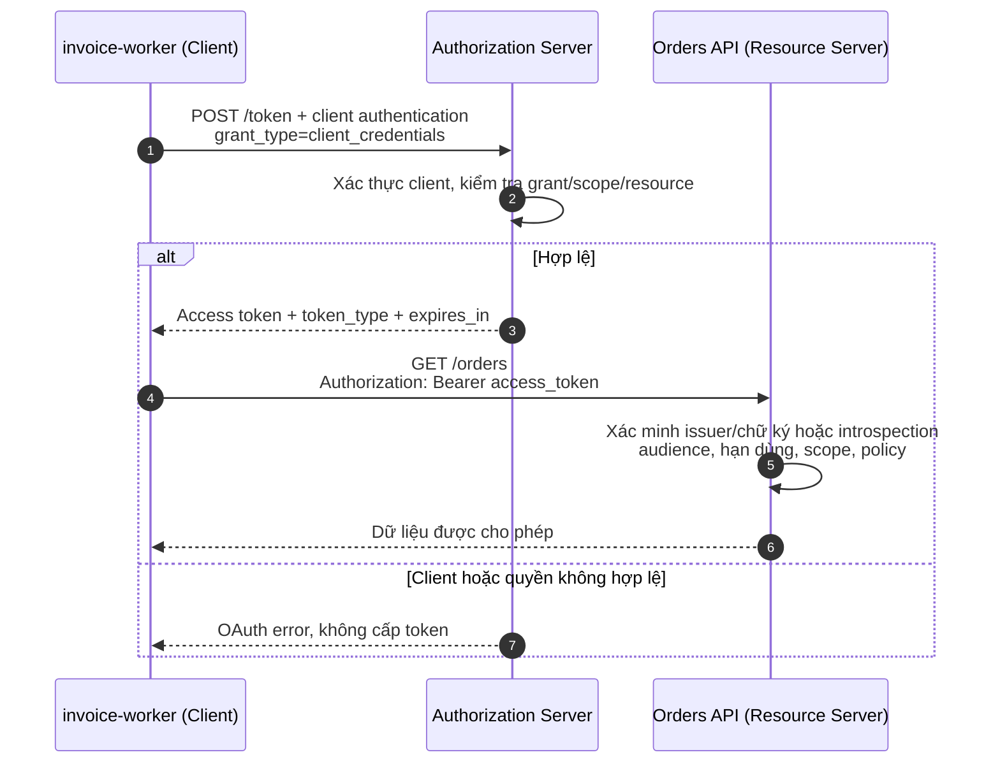

# Client credential authentication

## Mục tiêu học tập

Trong mô hình bảo mật token của **SECURITY_TOKEN_SECURITY_FUNDAMENTALS**, xác thực client là bước chứng minh danh tính ứng dụng hoặc dịch vụ đang yêu cầu token. Sau bài này, bạn có thể:

- Phân biệt **client authentication** với **Client Credentials grant** của OAuth 2.0 và với xác thực người dùng.
- Giải thích vai trò của `client_id`, `client_secret`, khóa riêng, chứng chỉ mTLS, Authorization Server và Resource Server.
- Mô tả luồng máy–máy (machine-to-machine, M2M) cấp access token và sử dụng token để gọi API.
- So sánh `client_secret_basic`, `client_secret_post`, `private_key_jwt`, `client_secret_jwt` và xác thực bằng mTLS.
- Phân biệt JWT với opaque access token, đồng thời thực hiện kiểm tra issuer, audience, scope, thời hạn và phòng chống đánh cắp/phát lại token.
- Chọn cách lưu giữ, xoay vòng, thu hồi credential và access token phù hợp trong hệ thống thực tế.

## 1. Client authentication là gì?

**Client authentication** là quá trình một **Authorization Server (AS)** xác minh rằng thực thể gọi đến endpoint OAuth thực sự là client đã đăng ký. Client có thể là một backend, batch job, worker hoặc dịch vụ nội bộ. AS sử dụng phương thức xác thực đã đăng ký cho client, chẳng hạn một bí mật dùng chung, bằng chứng sở hữu khóa riêng hoặc chứng chỉ TLS.

Ví dụ, dịch vụ `invoice-worker` muốn lấy access token để gọi Orders API. Dịch vụ có `client_id = "invoice-worker"` và một credential được quản lý an toàn. Khi gửi yêu cầu cấp token, dịch vụ chứng minh danh tính bằng credential đó; AS xác minh và quyết định cấp token theo **chính sách đã gán cho client**.

> **Điểm phân biệt cốt lõi:** `client_id` chỉ là **định danh**, không phải mật khẩu. Biết tên một client không đồng nghĩa đã xác thực được client đó. Cũng không nên nhầm **xác thực client** với **xác thực người dùng cuối**: một backend được xác thực không có nghĩa đang có người dùng đăng nhập.

Trong OAuth 2.0 có hai khái niệm liên quan nhưng khác nhau:

| Khái niệm | Trả lời câu hỏi | Có thể xuất hiện trong tình huống nào? |
| --- | --- | --- |
| **Client authentication** | “Ứng dụng nào đang trao đổi với AS, và có chứng minh được danh tính không?” | Khi client bảo mật được credential gọi token endpoint, kể cả trong các luồng Authorization Code hoặc Client Credentials. |
| **Client Credentials grant** (`grant_type=client_credentials`) | “Ứng dụng có thể xin access token để truy cập tài nguyên bằng quyền của **chính ứng dụng** không?” | Tác vụ server-to-server không đại diện phiên đăng nhập của người dùng; theo RFC 6749, grant này chỉ dùng cho confidential client. |
| **Resource Server authentication / token validation** | “Access token gửi đến API có hợp lệ và được phép dùng tại API này không?” | API kiểm tra token sau khi client đã lấy được token; thông thường API không nhìn thấy `client_secret` của client. |
| **End-user authentication** | “Con người nào đang đăng nhập?” | Luồng có tương tác người dùng, thường là Authorization Code + PKCE và OIDC. |

Một client có thể được xác thực thành công nhưng **không được phép sử dụng Client Credentials grant**, hoặc không được cấp scope đã yêu cầu. Xác thực danh tính và cho phép hành động là hai bước riêng.

## 2. Ba vai trò và ranh giới tin cậy

Ví dụ `invoice-worker` cần đọc đơn hàng. Các bên có trách nhiệm như sau:

1. **OAuth Client:** lưu credential, gửi yêu cầu token đến đúng AS, giữ an toàn access token và sử dụng nó với API được chỉ định.
2. **Authorization Server:** xác thực client, kiểm tra grant type/scope/resource được cho phép, phát hành access token với thời hạn và audience phù hợp.
3. **Resource Server:** nhận access token, xác minh token hoặc introspect theo hợp đồng, kiểm tra quyền trên API và dữ liệu cụ thể.



**AS tin vào bằng chứng xác thực client theo thông tin đăng ký. API tin vào access token theo issuer và chính sách API.** Một bearer token không phải là client secret, còn một client secret cũng không phải access token để gửi cho Resource Server.

## 3. Confidential client, public client và danh tính workload

Không phải ứng dụng nào cũng có khả năng giữ bí mật:

| Kiểu client | Khả năng giữ credential | Cách dùng thường gặp |
| --- | --- | --- |
| **Confidential client** | Backend có môi trường chạy được kiểm soát; có thể bảo vệ secret hoặc khóa riêng ở mức phù hợp. | M2M, backend server, worker, ứng dụng web có server. |
| **Public client** | Mã và dữ liệu trên trình duyệt/mobile có thể bị người dùng hoặc kẻ tấn công kiểm tra. Secret gắn vào bản build không được coi là bí mật. | SPA, native mobile, desktop app; thường dùng Authorization Code + PKCE khi có người dùng. |
| **Workload có danh tính nền tảng** | Một nền tảng tin cậy có thể cấp bằng chứng danh tính ngắn hạn thay cho secret cố định. | Workload identity liên kết với AS thông qua phương thức federation/đổi token nếu được hệ thống hỗ trợ. |

`client_credentials` phù hợp với **confidential client** thực thi nghiệp vụ của chính nó. Đặt `client_secret` trong JavaScript chạy ở trình duyệt, ứng dụng mobile phân phối công khai hoặc repository rồi gọi đó là confidential client là một sai lầm kiến trúc. Với các hệ thống hỗ trợ workload identity/federation, có thể giảm phụ thuộc vào bí mật tồn tại lâu dài; cơ chế chính xác phụ thuộc nền tảng và AS.

## 4. Credential và phương thức xác thực tại token endpoint

Khi đăng ký client, AS thường liên kết `client_id` với một hoặc nhiều phương thức xác thực được cho phép. Metadata của Authorization Server (RFC 8414) có thể công bố `token_endpoint_auth_methods_supported`, nhưng quyết định cuối cùng vẫn nằm ở cấu hình đăng ký **từng client**.

| Phương thức | Bằng chứng client gửi | Ưu điểm / lưu ý |
| --- | --- | --- |
| `client_secret_basic` | `client_id` và `client_secret` trong HTTP Basic Authorization header khi gọi token endpoint. | Đơn giản, phổ biến; Basic chỉ mã hóa Base64, **phải dùng HTTPS**. |
| `client_secret_post` | `client_id` và `client_secret` trong body form-encoded. | Chỉ dùng khi cần tương thích; secret dễ đi vào log body, proxy hoặc telemetry hơn nên thường không ưu tiên. |
| `client_secret_jwt` | JWT assertion dùng HMAC với secret đã đăng ký. | Có thể giới hạn audience/thời hạn; vẫn phụ thuộc an toàn của shared secret và hỗ trợ của AS. |
| `private_key_jwt` | JWT assertion được **ký bằng private key**; AS xác minh bằng public key đã đăng ký. | Tránh truyền shared secret tới token endpoint; quản lý private key, thuật toán và vòng đời JWKS. |
| `tls_client_auth` hoặc `self_signed_tls_client_auth` | Bằng chứng sở hữu private key của chứng chỉ client trong bắt tay mutual TLS. | Hữu ích cho dịch vụ được quản lý; cần quản trị cert, khóa riêng và trust/đăng ký cert chính xác. |
| `none` | Không có bằng chứng xác thực client tại token endpoint. | Dùng cho public client hoặc trường hợp cho phép; **không phù hợp** để giả vờ xác thực confidential client bằng `client_id`. |

Các phương thức không được ghép tùy tiện. Client phải dùng **phương thức đã đăng ký**, AS phải từ chối cách xác thực không được cho phép và không được chấp nhận một token được tạo bởi một client chỉ vì client tự khai `client_id`.

### 4.1. Ví dụ `client_secret_basic`

Giả sử client `invoice-worker` đã được đăng ký với secret bảo mật, quyền `orders:read` và token endpoint tại `https://identity.example.com/oauth2/token`:

```http
POST /oauth2/token HTTP/1.1
Host: identity.example.com
Authorization: Basic <base64-encoded-client-credentials>
Content-Type: application/x-www-form-urlencoded
Accept: application/json

grant_type=client_credentials&scope=orders%3Aread
```

Trong ví dụ trên, giá trị Basic đại diện cho cặp `client_id:client_secret` đã được mã hóa theo quy tắc HTTP Basic của OAuth 2.0: trước khi ghép, mỗi thành phần được form-encode theo RFC 6749 mục 2.3.1 rồi Base64-encode. Base64 **không mã hóa bảo mật** secret; HTTPS và quản lý credential an toàn là yêu cầu bắt buộc. Không ghi giá trị Authorization header thực vào log, mã nguồn, tài liệu chia sẻ hoặc lệnh shell lưu trong lịch sử.

Phản hồi thành công có thể có dạng:

```http
HTTP/1.1 200 OK
Content-Type: application/json
Cache-Control: no-store
Pragma: no-cache

{
  "access_token": "<opaque-or-jwt-access-token>",
  "token_type": "Bearer",
  "expires_in": 900,
  "scope": "orders:read"
}
```

Token có thể là **JWT** hoặc **opaque string**. `expires_in` thông báo thời gian sống tính bằng giây; khi token gần hết hạn, client thường **xin access token mới** bằng cách xác thực lại với AS. Trong Client Credentials grant, theo RFC 6749, refresh token **SHOULD NOT** được phát hành. Không mặc định rằng có refresh token hoặc ID Token trong phản hồi M2M.

### 4.2. Ví dụ `private_key_jwt`

Client tạo một **client assertion** có chữ ký bằng private key và gửi đến token endpoint. Phần payload minh họa:

```json
{
  "iss": "invoice-worker",
  "sub": "invoice-worker",
  "aud": "https://identity.example.com/oauth2/token",
  "iat": 1800000000,
  "exp": 1800000060,
  "jti": "unique-assertion-id-123"
}
```

Payload này **không phải JWT hoàn chỉnh**. Trong thực tế, client tạo compact JWS có header với thuật toán được AS cho phép và `kid` nếu cần, sau đó ký bằng private key đã đăng ký. `aud` phải trùng chính xác với audience assertion mà AS yêu cầu (thường là token endpoint, tùy profile/cấu hình); `exp` nên rất ngắn, và AS nên kiểm tra `jti` hoặc cơ chế khác để hạn chế phát lại theo chính sách.

```http
POST /oauth2/token HTTP/1.1
Host: identity.example.com
Content-Type: application/x-www-form-urlencoded

grant_type=client_credentials&scope=orders%3Aread&client_assertion_type=urn%3Aietf%3Aparams%3Aoauth%3Aclient-assertion-type%3Ajwt-bearer&client_assertion=<signed-client-assertion>
```

**Client assertion** chỉ dùng để AS xác thực client. Nó không đồng nghĩa với **access token** mà API sẽ nhận. Chữ ký assertion, audience và các claim kiểm soát thời hạn cần được AS xác minh độc lập với việc cấp access token.

### 4.3. mTLS và token bị ràng buộc với người gửi

Với mTLS (RFC 8705), client trình chứng chỉ trong kết nối TLS đến AS và chứng minh sở hữu khóa riêng tương ứng. AS liên kết chứng chỉ với client theo cấu hình đã đăng ký. Ngoài xác thực client, hệ thống có thể cấp **certificate-bound access token**: token chứa hoặc được liên kết với dấu vân tay chứng chỉ và Resource Server yêu cầu cùng bằng chứng sở hữu khóa khi sử dụng token.

Tương tự, DPoP (RFC 9449) có thể ràng buộc access token với một khóa do bên gửi sở hữu bằng proof cho mỗi yêu cầu. **DPoP một mình không mặc nhiên là phương thức xác thực confidential client tại token endpoint**; đó là cơ chế chứng minh sở hữu khóa/giảm khả năng phát lại token, có thể kết hợp chính sách xác thực client phù hợp. Một bearer token thuần túy thì ai sở hữu token còn hiệu lực cũng có thể thử sử dụng nó, nên cần kiểm soát nguy cơ bị đánh cắp.

## 5. Luồng Client Credentials grant: AS phải kiểm tra những gì?

Giả sử `invoice-worker` đăng ký:

```yaml
clientId: invoice-worker
tokenEndpointAuthMethod: private_key_jwt
allowedGrantTypes: [client_credentials]
allowedScopes: [orders:read]
allowedResources: [api://orders]
accessTokenLifetimeSeconds: 900
```

Đây là cấu hình **minh họa**, không phải schema có thể chép trực tiếp vào một sản phẩm IAM cụ thể. Khi nhận token request, AS cần:

1. **Xác định client** theo `client_id` hoặc phương thức xác thực và tra cứu đăng ký tin cậy.
2. **Xác thực credential** theo phương thức đã đăng ký: secret, JWT assertion hoặc mTLS; kiểm tra thuật toán, khóa, hạn dùng và chống phát lại khi có.
3. **Kiểm tra grant type:** client này có được cấp token bằng `client_credentials` không?
4. **Kiểm tra quyền yêu cầu:** `scope` và tài nguyên/audience có nằm trong chính sách của client không? Request không được tự nâng quyền chỉ vì client gửi thêm scope.
5. **Phát hành token giới hạn:** gắn issuer, audience, scope, hạn sống và danh tính client phù hợp với token profile; chỉ cung cấp claims cần thiết.
6. **Ghi nhận audit an toàn:** client, grant, quyết định, scope/audience, kết quả và correlation ID; không ghi raw secret, assertion hoặc access token.

Trong hệ thống hỗ trợ OAuth Resource Indicators (RFC 8707), client có thể gửi tham số `resource` để chỉ định API đích; AS vẫn phải **kiểm tra và giới hạn** tài nguyên đó theo cấu hình client. Tùy AS, audience có thể được suy ra từ resource, đăng ký ứng dụng hoặc policy — không nên cho client tự định nghĩa audience bất kỳ.

Các kết quả lỗi cần phân biệt:

| Trạng thái | Ý nghĩa điển hình | Hướng xử lý |
| --- | --- | --- |
| `invalid_client` | Không xác thực được client: sai secret/chữ ký/chứng chỉ hoặc phương thức không hợp lệ. | Kiểm tra client registration, credential và phương thức; không tự thử credential khác không có kiểm soát. |
| `unauthorized_client` | Client đã nhận diện nhưng không được phép dùng grant type này. | Sửa chính sách quyền cấp token hoặc lựa chọn luồng OAuth phù hợp. |
| `invalid_scope` | Scope không tồn tại hoặc nằm ngoài phạm vi được cho phép. | Yêu cầu scope hợp lệ, có mức quyền tối thiểu. |
| `unsupported_grant_type` | AS không hỗ trợ giá trị `grant_type` đã gửi. | Chọn grant type được công bố/hỗ trợ. |
| HTTP `503` hoặc `5xx` | AS hoặc hạ tầng token endpoint đang gặp sự cố tạm thời. | Retry giới hạn, exponential backoff, quan sát lỗi; không vô hạn spam token endpoint. |

Với `invalid_client` khi dùng HTTP Authorization header, RFC 6749 quy định cách trả mã HTTP 401 và `WWW-Authenticate` phù hợp. Không sử dụng nội dung lỗi chi tiết để làm lộ sự tồn tại của client, secret hoặc thông tin khóa.

## 6. Access token không đại diện cho người dùng

Client Credentials grant thường cấp **quyền ứng dụng** (*application permissions*), không có người dùng đang trực tiếp cấp consent ở thời điểm request:

```text
Chủ thể tác vụ: invoice-worker (service principal)
Quyền được cấp: orders:read
Audience: api://orders
Thời hạn: 15 phút
```

Một JWT access token theo một profile cụ thể có thể có claims:

```json
{
  "iss": "https://identity.example.com",
  "sub": "invoice-worker",
  "client_id": "invoice-worker",
  "aud": "api://orders",
  "scope": "orders:read",
  "iat": 1800000000,
  "exp": 1800000900
}
```

Đây chỉ là ví dụ; **định nghĩa `sub` và các claims thực tế phụ thuộc AS và profile token**. Với Client Credentials grant, `sub` có thể tham chiếu client/service principal, nên không được diễn giải nó thành ID người dùng cuối. Nếu nghiệp vụ cần biết *người dùng nào* đã duyệt hóa đơn, access token ứng dụng **không cung cấp ngữ cảnh ủy quyền của người dùng đó**.

Một access token cũng không mặc nhiên chứa tất cả scope, role hoặc email. Resource Server phải tuân theo hợp đồng token của AS; chỉ cho phép hành động sau khi xác thực token và kiểm tra quyền cho API/tài nguyên đích.

### API xử lý JWT hay opaque access token như thế nào?

| Bước | JWT access token | Opaque access token |
| --- | --- | --- |
| Xác định AS tin cậy | Dựa trên issuer được cấu hình sẵn; claim `iss` chưa xác minh chỉ dùng để chọn giữa các issuer trong allowlist nếu cần. | Dùng introspection endpoint của AS đã cấu hình/trusted routing; không giải mã opaque token để đoán issuer. |
| Xác thực token | Xác minh chữ ký và thuật toán bằng khóa thuộc issuer tin cậy, kiểm tra claims. | Gọi introspection endpoint tin cậy (RFC 7662), kiểm tra `active` và các thuộc tính theo hợp đồng. |
| Hạn dùng / mục đích | Kiểm tra `exp`, `nbf`, `aud`, `iss`, token type, scope; kiểm tra policy. | Kiểm tra trạng thái, audience/scope/client metadata và điều kiện tương đương do AS cung cấp. |
| Thu hồi | JWT tự chứa có thể vẫn hợp lệ đến `exp` nếu API không có trạng thái thu hồi bổ sung. | Introspection có thể phản ánh trạng thái thu hồi gần thời gian thực, tùy cache và AS. |

Đối với JWT access token theo RFC 9068, việc phân biệt loại token qua `typ` (ví dụ `at+jwt`) và audience giúp tránh **token confusion**. API không được nhận ID Token của OIDC thay cho access token chỉ vì ID Token cũng có chữ ký hợp lệ từ cùng issuer.

## 7. Client gọi API: quyền tối thiểu và kiểm soát dữ liệu

Một token hợp lệ vẫn chưa tự động cho phép mọi tác vụ. Resource Server phải thực thi:

- **Issuer và audience chính xác:** Orders API chỉ nhận token của AS được tin cậy và có `aud` cho Orders API; token cấp cho Billing API phải bị từ chối.
- **Scope/action:** endpoint `GET /orders` có thể yêu cầu `orders:read`; `POST /orders` cần quyền ghi riêng.
- **Ngữ cảnh client/tenant:** nếu có nhiều tenant, kiểm tra client có quyền truy cập tenant hoặc tập đơn hàng cụ thể; tránh suy luận rằng `orders:read` nghĩa là “đọc mọi tenant”.
- **Loại token:** chỉ nhận access token đúng profile; không nhận client assertion, ID Token, refresh token hoặc chuỗi secret.
- **Trạng thái và thời hạn:** kiểm tra hiệu lực, chính sách revocation và các điều kiện bổ sung khi cần.

Pseudocode minh họa:

```java
// Token đã được bộ xác thực OAuth/JWT hoặc introspection middleware kiểm tra.
AuthenticatedAccessToken auth = oauthResourceServer.authenticate(request);

requireIssuer(auth, configuredTrustedIssuer);
requireAudience(auth, "api://orders");
requireTokenPurpose(auth, "access_token");
requireScope(auth, "orders:read");
requireTenantAccess(auth.clientPrincipal(), requestedTenantId);

return ordersRepository.findVisibleOrders(requestedTenantId);
```

Đoạn này thể hiện các điều kiện cần thực thi, không phải API thật của thư viện. Đặc biệt, **kiểm tra tenant/data authorization** phải gắn với tài nguyên yêu cầu; xác thực client thành công không thay thế kiểm tra phân quyền tại API.

Với Spring Security Resource Server, có thể dùng cấu hình `issuer-uri` và bổ sung validator audience phù hợp cho JWT, hoặc cấu hình introspection cho opaque token. Việc yêu cầu scope có thể được thể hiện bằng authorization rule/authority phù hợp. Cần kiểm chứng cách mapping claims theo issuer cụ thể thay vì mặc định rằng mọi token có cùng định dạng.

## 8. Bảo vệ credential và token trong vòng đời sử dụng

### 8.1. Phát hành và lưu trữ credential

- Mỗi dịch vụ, môi trường và nhóm quyền nên có client identity/credential riêng theo mô hình quản trị; tránh chia sẻ một secret cho nhiều workload không liên quan.
- Lưu `client_secret`/private key trong secret manager, vault, KMS/HSM hoặc phương án quản lý khóa được phê duyệt. Chỉ đưa đến process thực sự cần sử dụng, với quyền truy cập tối thiểu.
- Không hard-code secret trong mã nguồn, ảnh container, ứng dụng frontend, file cấu hình commit lên Git, báo lỗi hoặc log HTTP. Biến môi trường có thể là phương án vận chuyển nhưng vẫn cần bảo vệ trước lộ lọt qua runtime, crash dump và công cụ quan sát.
- Dùng TLS đúng chuẩn cho token endpoint và API; xác minh danh tính máy chủ, không tắt certificate verification để “sửa” lỗi kết nối.
- Ưu tiên credential ngắn hạn hoặc workload identity nếu hạ tầng và AS hỗ trợ; hạn chế đời sống của shared secret tồn tại lâu dài.

### 8.2. Cache và làm mới access token

Client có thể cache access token theo **client identity + issuer + audience/resource + scope + chính sách tương ứng** cho đến gần hết hạn để tránh gọi token endpoint liên tục. Nên có khoảng an toàn cho lệch đồng hồ và độ trễ mạng. Khi cache hết hiệu lực:

1. Client xác thực lại tại token endpoint bằng credential hợp lệ.
2. AS phát hành access token mới nếu client vẫn được phép.
3. Client thay token trong cache một cách an toàn, hạn chế nhiều worker cùng đổ dồn request xin token.

Không giữ token vô hạn và không tái sử dụng token của một audience khác. Nếu nhận `401` do token không hợp lệ, xác minh nguyên nhân và làm mới có kiểm soát; nếu nhận `403` do thiếu scope/quyền, xin lại **cùng quyền** thường không giải quyết được lỗi — cần sửa policy hoặc yêu cầu quyền hợp lệ qua quy trình quản trị.

### 8.3. Xoay credential, thu hồi và ứng phó rò rỉ

**Xoay secret/khóa ký** cần có trình tự: tạo credential mới → đăng ký ở AS → chuyển client sử dụng → giám sát yêu cầu cấp token → vô hiệu credential cũ. Nếu AS chỉ cho phép một secret, cần thiết kế thời điểm chuyển đổi phù hợp; không giả định mọi AS hỗ trợ hai credential hoạt động đồng thời.

Khi nghi ngờ credential bị đánh cắp, cần vô hiệu hóa hoặc thay credential đó và **đánh giá các access token đã phát hành**. Đổi `client_secret` không nhất thiết khiến JWT access token cũ lập tức mất hiệu lực; có thể phải áp dụng cơ chế thu hồi, kiểm tra trạng thái, giảm TTL, cô lập client hoặc chặn quyền tại API tùy hạ tầng.

**Refresh token** (nếu một hệ thống ngoại lệ cấp trong bối cảnh khác) là credential có rủi ro cao, cần bảo vệ và xoay/thu hồi theo chính sách riêng. Đối với Client Credentials grant chuẩn, không xây thiết kế dựa vào giả định luôn có refresh token.

### 8.4. Giảm nguy cơ token bị đánh cắp hoặc phát lại

Với bearer access token, người sở hữu token có thể gửi nó đến API cho đến khi hết hiệu lực hoặc bị từ chối. Do đó:

- Chỉ gửi token đến HTTPS endpoint nằm trong danh sách tài nguyên tin cậy; tránh rò qua URL query string, referer, log và các hệ thống giám sát.
- Giới hạn `aud`, scope, thời hạn và quyền của client; phân tách credential cho từng mục đích.
- Khi có hỗ trợ toàn tuyến, cân nhắc **mTLS certificate-bound token** hoặc **DPoP-bound token** nhằm yêu cầu bằng chứng sở hữu khóa tại Resource Server.
- Dùng audit, giới hạn tốc độ, cảnh báo bất thường và khả năng vô hiệu hóa client/token. Trạng thái “token chưa hết hạn” không đủ để đảm bảo mọi request đều an toàn.
- Không tự động gửi token của API A sang API B; khi cần ủy quyền theo chuỗi, sử dụng cơ chế token exchange/delegation đúng thiết kế thay vì chuyển tiếp token sai audience.

## 9. Chọn đúng luồng cho tình huống nghiệp vụ

| Tình huống | Cách tiếp cận phù hợp | Lý do |
| --- | --- | --- |
| Worker định kỳ đồng bộ dữ liệu từ API đối tác, không có phiên người dùng. | Client Credentials grant với confidential client và quyền tối thiểu. | Quyền ứng dụng, không cần thông tin đăng nhập người dùng. |
| SPA chạy trong trình duyệt cần gọi API thay mặt người dùng. | Authorization Code + PKCE; quản lý token/phiên theo kiến trúc đã chọn. | Trình duyệt không thể giữ client secret như backend, và nghiệp vụ cần ngữ cảnh người dùng. |
| Backend web cần trao đổi authorization code sau khi người dùng login. | Authorization Code flow cùng client authentication nếu là confidential client. | Client authentication vẫn tồn tại dù grant type **không phải** client_credentials. |
| Một hệ thống cần thực hiện hành động theo quyền của người dùng đã phê duyệt. | Dùng luồng có ủy quyền người dùng phù hợp hoặc delegation/token exchange đã thiết kế. | Client Credentials grant không tự mang quyền của một người dùng cụ thể. |
| Dịch vụ chạy trên hạ tầng có workload identity đáng tin cậy. | Cân nhắc federation/credential ngắn hạn hoặc khóa bất đối xứng theo khả năng AS. | Giảm nguy cơ từ shared secret tồn tại lâu dài. |

### Một tình huống phản biện

Giả sử `report-generator` có `client_secret` đúng và yêu cầu:

```text
grant_type=client_credentials
scope=orders:read orders:delete
resource=https://api.example.com/orders
```

Client chỉ được đăng ký `orders:read`. AS **không được cấp** `orders:delete` chỉ vì client xác thực được. Nếu token chỉ có `orders:read` nhưng client gửi `DELETE /orders/42`, API phải từ chối theo policy (thông thường `403 Forbidden` hoặc cơ chế lỗi OAuth Bearer thích hợp). Nếu token gửi tới Billing API trong khi `aud` dành cho Orders API, Billing API cũng phải từ chối.

### Đối chiếu lỗi thường gặp

| Lỗi | Vì sao nguy hiểm/sai? | Giải pháp |
| --- | --- | --- |
| Coi `client_id` là bằng chứng đăng nhập. | ID công khai không chứng minh quyền sở hữu client. | Bắt buộc phương thức xác thực hợp lệ cho confidential client. |
| Đưa secret vào SPA hoặc mobile app. | Người dùng hoặc kẻ tấn công có thể trích xuất secret. | Dùng public-client flow phù hợp hoặc backend giữ credential. |
| Chấp nhận token chỉ vì chữ ký hợp lệ. | Token có thể sai issuer, audience, loại hoặc scope. | Kiểm tra đầy đủ claim và policy tại Resource Server. |
| Gửi client assertion như access token cho API. | Assertion nhằm xác thực client với AS, không có hợp đồng quyền truy cập API. | Dùng access token do AS cấp cho Resource Server. |
| Dùng token M2M để xác định “người dùng đang thao tác”. | Token ứng dụng không chứng minh phiên đăng nhập của người dùng. | Dùng ngữ cảnh ủy quyền người dùng phù hợp. |
| Dùng chung credential cho mọi môi trường và dịch vụ. | Rò rỉ một secret ảnh hưởng diện rộng, khó audit và thu hồi. | Phân tách client/credential theo môi trường, trách nhiệm và quyền. |
| Cho token endpoint nhận secret qua HTTP. | Secret và access token có thể bị nghe lén. | Dùng HTTPS và xác minh TLS. |
| Chỉ thay secret sau sự cố rồi cho rằng mọi token đã bị vô hiệu. | Token đã cấp có thể tiếp tục hợp lệ tới lúc hết hạn. | Có kế hoạch xử lý token đang tồn tại, revocation/introspection và TTL. |

## 10. Bài tập tự kiểm tra

**Bài 1.** `analytics-job` có `client_id` hợp lệ nhưng không có secret, certificate hoặc assertion. Job yêu cầu `grant_type=client_credentials`. AS có nên cấp token không?

**Bài 2.** `billing-service` đã xác thực bằng `private_key_jwt` và xin token có `scope=orders:read` dù chỉ được cấp `billing:write`. Xác thực thành công có đồng nghĩa được cấp scope yêu cầu?

**Bài 3.** Orders API nhận một JWT có chữ ký hợp lệ, `iss` đúng, còn hạn, nhưng `aud = api://inventory`. API có nên trả dữ liệu?

**Bài 4.** Một access token JWT bị rò rỉ. Đội vận hành đã thay client secret nhưng JWT còn hiệu lực 10 phút. Điều gì cần kiểm tra thêm?

**Bài 5.** Vì sao DPoP không tự động thay thế cho xác thực confidential client, và vì sao việc triển khai ở AS mà thiếu kiểm tra tại Resource Server chưa đủ để chống phát lại bearer token?

**Gợi ý trả lời:**

1. **Không.** Client Credentials grant yêu cầu confidential client được xác thực theo đăng ký và có quyền sử dụng grant.
2. **Không.** Scope và resource phải được AS cho phép độc lập với bước xác thực.
3. **Không.** Audience của JWT không dành cho Orders API.
4. Cần xác định token còn được API tin cậy không, cơ chế thu hồi/introspection, TTL, log sử dụng và khả năng chặn credential/client/token. Đổi secret không mặc nhiên thu hồi JWT cũ.
5. DPoP chứng minh quyền sở hữu khóa cho request/token, nhưng danh tính confidential client và việc ràng buộc proof-token phải được cấu hình, xác thực ở đúng nơi; AS và Resource Server cần phối hợp kiểm tra.

## 11. Checklist triển khai

- [ ] Chọn đúng luồng: Client Credentials cho quyền ứng dụng; Authorization Code + PKCE cho tình huống có người dùng phù hợp.
- [ ] Đăng ký `client_id`, phương thức client authentication, grant types, scopes và resources/audiences rõ ràng tại AS.
- [ ] Dùng secret manager hoặc private key/certificate được bảo vệ; không đưa secret vào frontend, Git, log hoặc lệnh shell chia sẻ.
- [ ] Sử dụng HTTPS, xác minh TLS, không truyền client credential hoặc token qua URL/query string.
- [ ] Token endpoint xác thực client và **kiểm tra quyền được cấp**, không phát hành quyền vượt đăng ký.
- [ ] Resource Server xác minh issuer, audience, hạn dùng, loại token, scope và quyền trên tài nguyên.
- [ ] Cache token có giới hạn, xin mới trước khi hết hạn; không giả định Client Credentials grant trả refresh token.
- [ ] Có kế hoạch xoay credential, xử lý token còn hiệu lực, cảnh báo rò rỉ/phát lại và thu hồi quyền.
- [ ] Kiểm thử client sai secret/khóa/chứng chỉ, grant không được phép, scope vượt quyền, token sai audience và token hết hạn.

## Tài liệu nền tảng

- **RFC 6749 — The OAuth 2.0 Authorization Framework:** `2.3` (client authentication), `4.4` (Client Credentials grant), `5` (token response/lỗi).
- **RFC 8414 — OAuth 2.0 Authorization Server Metadata:** metadata endpoint và các phương thức xác thực token endpoint được hỗ trợ.
- **RFC 7523 — JWT Profile for OAuth 2.0 Client Authentication and Authorization Grants:** cách sử dụng JWT assertion.
- **RFC 7662 — OAuth 2.0 Token Introspection:** introspect opaque access token và các trường trạng thái.
- **RFC 8705 — OAuth 2.0 Mutual-TLS Client Authentication and Certificate-Bound Access Tokens:** xác thực client bằng mTLS và sender-constrained token.
- **RFC 8707 — Resource Indicators for OAuth 2.0:** yêu cầu access token cho tài nguyên cụ thể.
- **RFC 9068 — JWT Profile for OAuth 2.0 Access Tokens:** cấu trúc và kiểm tra JWT access token.
- **RFC 9449 — OAuth 2.0 Demonstrating Proof of Possession (DPoP):** token gắn với bằng chứng sở hữu khóa.

**Ghi nhớ:** Client credential authentication giúp Authorization Server biết **ứng dụng nào đang yêu cầu token**. Client Credentials grant cho phép ứng dụng đó xin **quyền của chính ứng dụng** khi được AS ủy quyền. Access token được cấp sau đó vẫn phải được Resource Server kiểm tra về **issuer, audience, thời hạn, scope, loại token và quyền trên dữ liệu**. Giữ an toàn credential và thiết kế vòng đời token là điều kiện không thể thiếu để ngăn truy cập trái phép khi credential hoặc bearer token bị đánh cắp.
